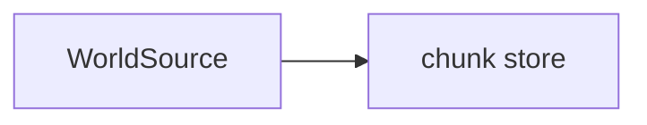

# NNNN: <short title>

> **Status:** draft | approved | in-progress | done | abandoned
> **Created:** YYYY-MM-DD
> **Milestone:** M<n> in `docs/roadmap.md`
> **Related ADRs:** ADR-NNNN (link), or none

## TL;DR

One paragraph: what we're building, why, and the first thing the user will see in the
fly-through or in a test. A reader who reads only this can restate the decision in one sentence.

## Context & problem

What forces drove this. Describe the *problem*, not the chosen solution. Name the consumer
requirement it serves (by section of `project-context.md`) and the `nfr.md` figures it touches.

## Decision

The chosen approach in one paragraph, active voice. Name the rejected options in one sentence
each: "We rejected B because …".

## Architecture diagram



## Implementation phases

Each phase ships as its own commit. `dev` implements all phases in one session with no review
between phases. The architect reviews once at the end, in a fresh session. **Phase 1 is a walking
skeleton**, something observable in a test or in the fly-through, not plumbing.

Every phase carries exactly one `**Owner skill:**`: `dev` or `human`.

### Phase 1: <name>
- **Owner skill:** dev
- **What:** One sentence on what this phase produces.
- **Files touched:** `crates/vxe-world/src/brick.rs`, `crates/vxe-world/tests/edits.rs`, …
  A new shader also touches `crates/vxe-render/src/shaders/`. A new budget reading touches
  `docs/nfr.md`.
- **Done when:** A concrete behavioral acceptance. For tests, state the claim they defend
  ("a radius-10 sphere carve at the origin of a solid material-3 world returns
  `{3: 4169}` and leaves voxel (0,0,10) solid"), not "tests pass". Every numeric value is
  worked out, not guessed, or stated as a property.

### Phase 2: <name>
…

## Data shapes

New types, buffers and formats, pinned down. Short and labelled illustrative.

```rust
// illustrative
pub struct EditResult {
    pub removed: Vec<(MaterialId, u32)>,
    pub touched: Vec<ChunkCoord>,
}
```

## Budgets

Which `docs/nfr.md` figures this plan touches, the expected effect, and how the close measures
them (command, scene, machine).

## Risks & open questions

What could go wrong, and what we'd do about it. Call out determinism, memory, GPU feature
availability and threading hazards explicitly.

## What this plan does NOT do

Scope cuts, naming future plans or milestones where possible.

## Implementation log

> Written by `dev`: one row per phase as its commit lands, then the close block. **The phases
> above are the contract. This section records what happened.** Observations, never conclusions:
> no pass list, no self-assessment. Deviations and unmet done-whens are **always** disclosed.
> Keep it shorter than `## Implementation phases`.

| phase | owner | state | commit |
|---|---|---|---|
| 1: <name> | dev | not started | |

### Notes

_(Deviations from the plan, with the commit, stated without justification. Done-whens not
satisfiable as stated, and what was done instead. Followups noticed and not acted on. One line
each. Empty is fine.)_

### Close triggers

_(Facts for the architect. No recommendations, and no suggested version bump.)_

- **What shipped:** feature / fix-only / docs-chore-only
- **Public API changed:** types, traits, functions, shader interfaces, config (list them, or none)
- **Budget readings:** each `nfr.md` figure touched, with its measured value, machine and commit
- **Gate at the tip:** the commands run (build, nextest, doctests, clippy, fmt, deny), exit codes, test counts
- **Outstanding `human` phases:** which, or none

## Followups

A list. Empty at draft time is fine.
