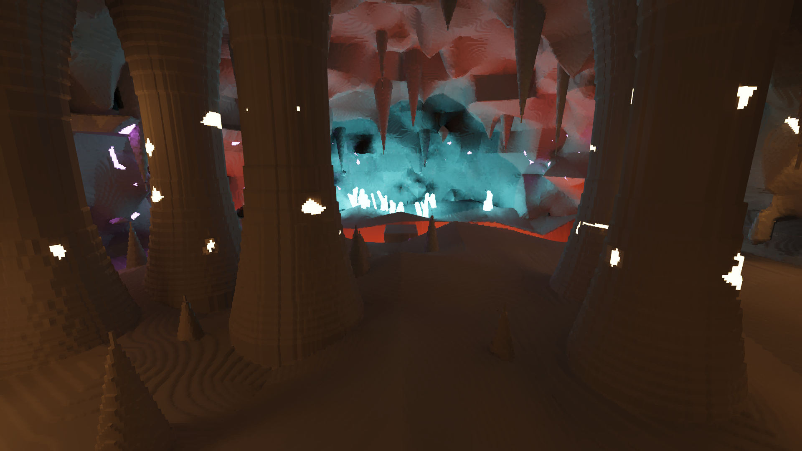
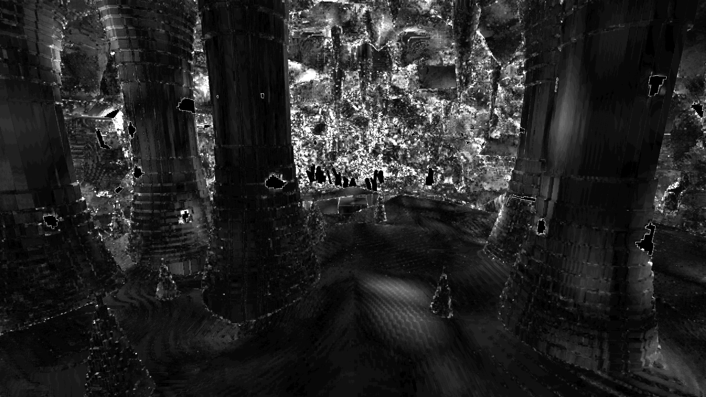
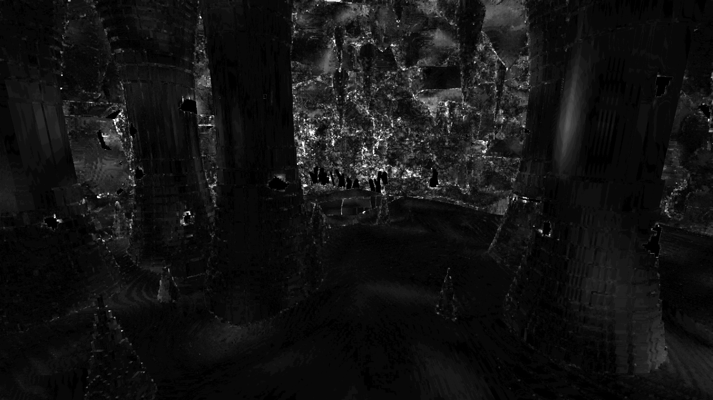

# Light feedback: Plan 0049 live session 2 (2026-10-29)

The owner's live check of the light at Plan 0049 Phase 2, together with everything measured so
far. Plan 0049 (`docs/plans/done/0049-light-settles-fast-and-young-pixels-hold-no-dots.md`,
dropped 2026-11-03, its rig under tag `archive/plan-0049`) is the authoritative record of the
readings. Plan 0051 takes the work. This file collects the owner's words and the evidence in one
place.

The owner's rule (2026-10-29): until the light is fixed, nothing else moves forward. The order
at this session was Plan 0049 alone, then 0048, then 0032; it is now Plan 0051, the plan its ADR
names if any, then 0048, then 0032.

## What the owner wants

- **Nothing changes while nothing moves.** "I see that parameters are moving without me doing
  anything. I think this should not happen when user and all lights are stationed."
- **No bright dots in motion.** "When I move my camera, I see always these bright dots, and it
  breaks immersion a lot. Dots settle eventually, but it looks really bad."
- **The light settles quickly after a change.** "I can count to 5 when light settles when lamp
  is off."
- **The cost matches what is on screen.** "It's suspicious that we are doing all of that
  calculations, and process is so heavy. Maybe it's right but maybe we can optimize." And:
  "I see only a very small fraction of overall world. What are we computing then?"
- **The light holds still unless something real moves it (2026-11-03).** "light that never
  settles when objects are not moving + not natural flickering light (flame eg) - are super
  unsettling". A flame may flicker because a flame flickers. Nothing else may.
- **A stable image comes first (2026-11-03).** "the main thing that I care about for now is a
  stable image without any flicker or aliasing artiacts. we move towards this image by any means
  possible, considering performance of course."

## The hero that never settled (2026-11-03)

The owner looked at the README's hero and saw artifacts: "it seems that shot was taken before
every light settled, which is exactly the problem I'm talking about". Then, on the readings below:
"this is exactly what I'm talking about".

The same still rendered from a fresh start at growing frame counts, nothing moving: the showcase's
`hall` shot, 1920 x 1080, FSR 2 at 1.5, the default look, lamp off, manual exposure 8, RTX 3080
Laptop, at 4bf567f (`hero --exposure 8 --adapter NVIDIA --frames N`). The 64-frame render is
byte-identical to the `docs/images/hero.png` of b829b21: the README showed an unsettled frame, because the tool's
default is 64 frames. Differences are per pixel in 8-bit levels, the worst of the three channels.

| Compared | Mean | p99 | Pixels off by more than 2 | more than 8 | more than 32 |
|---|---|---|---|---|---|
| 64 vs 8192 | 4.83 | 33 | 53.5 % | 14.2 % | 1.00 % |
| 512 vs 8192 | 2.49 | 16 | 27.8 % | 4.6 % | 0.08 % |
| 2048 vs 8192 | 2.36 | 15 | 27.8 % | 4.2 % | 0.08 % |
| 512 vs 2048 | 2.37 | 16 | 25.2 % | 4.5 % | 0.10 % |

- **It stops improving and never arrives.** 2048 frames is no nearer 8192 than 512 is, and about a
  quarter of the pixels stay more than 2 levels apart with nothing moving. How much of that floor
  is the light and how much is FSR 2's jitter is not separated in this table.
- **The speckle is the unsettled part.** The mean difference of a pixel from its 3 x 3 neighbours
  falls from 0.886 at 64 frames to 0.654 at 8192, mostly on the cyan wall.
- **The emissive-lit wall moves most**, up to about 18 mean in the worst cell of a 12 x 7 grid,
  against about 1 to 3 on the floor and pillars. The difference has two shapes: sharp sparkle along
  edges, and smooth drifting blobs, as on the right pillar. That the blobs are the probes is a
  guess until it is read.
- **Still there at 8192 frames, so not settling:** hard-edged colour patches on the ceiling, dark
  holes in the cyan wall, rings on the floor, blocky white emitters.

64 frames against 8192, the difference times 8:

2048 frames against 8192, the difference times 8: what never settles:

### What the drift is made of

The same shot and settings at b2ea5ec's tree, one setting removed at a time. A repeat run of frame
2048 reads 0 at every pixel, so these are the renderer's differences and not the driver's.

| Setting | One frame: 2048 vs 2049 mean, max, over 2 | Drift: 2048 vs 8192 mean, p99, over 2, over 8 |
|---|---|---|
| Default (FSR 2, indirect on) | 0.19, 119, 0.62 % | 2.36, 15, 27.8 %, 4.18 % |
| Indirect off | 0.18, 122, 0.60 % | 1.84, 16, 17.8 %, 3.77 % |
| Native, no upscaler | 0.06, 8, 0.03 % | 2.16, 13, 25.2 %, 3.07 % |
| Native, indirect off | 0.05, 4, 0.00 % | 1.64, 14, 15.3 %, 2.75 % |

- **The image creeps rather than boils.** The drift is over ten times the one-frame change, so a
  one-frame metric misses most of it.
- **About 70 % of the drift's mean survives with no probes and no upscaler** (1.64 of 2.36). That
  leaves the direct emissive path: the wall's worst cells read 6.7 with both removed and 7.9 with
  both on.
- **The probes spread it wide and thin.** Indirect on takes the pixels over 2 levels from 15.3 % to
  25.2 %, on the pillars as well as the wall, and hardly moves those over 8.
- **FSR 2 adds little drift and most of the frame-to-frame jumps:** 119 levels at worst against 8.
  Where those jumps lie, and whether they are the sparkle the eye sees, is unread (Plan 0056's first
  reading, if it is approved).
- **This is one still shot with the lamp off.** The readings at the level's vein and patch poses
  (Plan 0049, and Plan 0051's Phase 1) rank the gather first in the view-mean's variance. That is a
  different scene and a different measure, and neither reading replaces the other.

## The session, step by step

All runs: `--level --seed 1 --hud --pose vein|patch`, windowed on the RTX 3080 Laptop, auto
exposure. `flythrough-p1` is today's build at `121737f` (probe hysteresis 0.97). `flythrough-h099`
is a scratch build with hysteresis 0.99. Steps 1–8 hold the camera still.

| Step | Setup | What the owner saw |
|---|---|---|
| 1 | vein, lamp off, indirect on | "Very subtle and small change", and the HUD's numbers move with nothing touched. Dark wedges at ledge corners (screenshot `wedges`). |
| 2 | vein, lamp off, indirect off | "No visible movement." |
| 3 | vein, lamp on, indirect on | No flicker. The artifacts again: dark wedges at the bottoms of ledges, and thin dark and light slivers along the ledge edges inside the lamp light. The lamp's centre is clipped to white (screenshot `step3`). |
| 4 | vein, lamp on, indirect off | No flicker. Raised the question of cost (HUD screenshot `hud-step4`). |
| 5 | patch, lamp off, indirect on | No flicker. Many small bright triangles exactly where the facets of the smoothed surface meet. Faint concentric bands mid-floor (screenshot `step5`). |
| 6 | patch, lamp off, indirect off | No flicker. The same artifacts as step 5, so they don't come from indirect light. |
| 7 | vein, lamp off, indirect on, 32 probe rays | No flicker while still. 1–5 fps for several seconds after switching to the window. In motion: "flicker is quite heavy... a lot of small bright dots at first, it is all gone in 5–7 sec and light mostly stabilizes". Only the triangles remain. |
| 8 | as step 1, scratch h 0.99 | "Quite better, even when I see parts that are far away." |
| 9 | events, today's build | The light needs about a 5-count to settle after the lamp goes off. Bright dots on every camera move. "It looks really bad." |
| 10 | events, scratch h 0.99 | Q (fixed exposure) "doesn't really change anything, flicker is still there". |

## Readings from the session log

Each run's exit summary, from `session2.log`. The camera was held still in steps 1–6 and 8. It
moved in step 7, and steps 9 and 10 included digging, so those are not like-for-like.

| Step | Frames | CPU p50 / max (ms) | GPU march p50 / p99 / max (ms) |
|---|---|---|---|
| 1 vein off, ind on | 3155 | 0.81 / 702 | 5.83 / 7.32 / 53.7 |
| 2 vein off, ind off | 1253 | 0.61 / 706 | 4.42 / 42.9 / 46.0 |
| 3 vein on, ind on | 892 | 2.05 / 779 | 6.69 / 9.78 / 56.8 |
| 4 vein on, ind off | 3016 | 1.77 / 769 | 5.01 / 7.36 / 43.2 |
| 5 patch off, ind on | 1934 | 2.03 / 9.4 | 6.17 / 8.48 / 9.0 |
| 6 patch off, ind off | 5026 | 1.65 / 702 | 6.43 / 8.91 / 41.0 |
| 7 vein, 32 rays (moved) | 3670 | 1.98 / 768 | 8.72 / 10.0 / 55.3 |
| 8 vein, h 0.99 | 1073 | 1.98 / 8.0 | 7.18 / 10.3 / 10.5 |
| 9 events, today | 4892 | 1.92 / 704 | 9.07 / 11.3 / 66.9 |
| 10 events, h 0.99 | 16475 | 0.67 / 706 | 7.21 / 11.7 / 61.0 |

- **One CPU frame of about 700–780 ms in 8 of the 10 runs.** Steps 5 and 8 don't have it, so it
  doesn't come from every start-up. It may be the focus switch the owner saw as 1–5 fps. The
  HUD's fps averages the last 240 frames, so one long frame keeps the reading low for about
  3–4 s. Not yet explained.
- **Start-up, before the first frame:** about 5.2–5.4 s on a cold run. The whole world is
  generated (1.3 s, 383,608 bricks) and uploaded (158 MB, 1.6 s), and its lights are indexed
  across 371,000 bricks (0.2 s). Each frame afterwards traces only the pixels on screen
  (1687×919 internal, upscaled to 2530×1378), and the probes cover the space around the camera.
- **HUD at step 4 (vein, lamp on, indirect off, about 25 s still):** 71 fps; frame mean 14.0 ms,
  p99 16.1. CPU 2.1 ms; GPU march 5.3 ms, made of hit 0.79, gradient 0.19, light 1.89, temporal
  0.14, a-trous 0.89 and probes 0.00. So about 7.5 ms of work fills a 14 ms frame; the rest is
  probably waiting on vsync. Not yet confirmed.
- **HUD questions:** `fsr2 0.00 ms` is labelled FSR2, though the upscaler is our own, and its
  time reads zero. `world sample ... call 4.528 ms` is a 4.5 ms CPU call in a still scene.

## What Phase 1 measured (headless, before the session)

At the vein, `--level --seed 1`, 8k frames per series:

- **Still camera: the light never settles.** Composite sigma_view, with indirect on and then
  off:

  | Lamp | Indirect on | Indirect off |
  |---|---|---|
  | on | 0.0413 | 0.0143 |
  | off | 0.0593 | 0.0350 |

  The probe gather owns 0.88 (lamp on) and 0.65 (lamp off) of the view-mean variance. The
  emissive part wanders 0.053 at every setting. The gather wanders 0.10–0.17 log2 std, up to
  about 1.7× in range. Hysteresis 0.99 about halves it. Jitter at scale 1.5 adds noise from the
  lighting grid. The probe scroll's share is 0.
- **Settle:** the composite's S90 per step is 1–15 frames, but the gather's tail runs
  1064–2012 frames (256–756 at h 0.99). After a toggle to dark, exposure adds 264–352 frames.
- **Dots:** a dig leaves up to about 6400 extra dots over 60 frames, in pixels 1–63 frames old,
  from the emissive and a-trous passes. **The fast yaw showed no excess at these poses, but the
  owner sees dots on every camera move.** The rig's turn misses the defect.

## Findings to carry into the plan

1. **Still-camera wander (B0).** The owner's rule is that nothing changes when nothing moves.
   That is stricter than the proposed `sigma_view_on <= max(1.25 × off, off + 0.010)`, so B0 is
   to be re-derived near zero. A second bar is to hold the exposure readout still: in step 1
   the eye value wandered between +2.39 and +2.52 EV, against a climb with no reversal in step 2.
2. **Dots in motion (B2).** This is the owner's top complaint. Before any fix, the rig's
   camera-move case must reproduce what the owner sees. Proposed bar: 25 % of the sum, and by
   frame 16, 10 % of frame 1.
3. **Settle after a change (B1).** The owner saw 5–7 s in motion and about 5 s after the lamp
   goes off. Q (fixed exposure) didn't remove the flicker, so it is not only eye adaptation.
   Proposed bar: `S90_on <= max(S90_off + 30, 1.25 × S90_off)`, and the gather's S90 at most 120
   frames (about 1.7 s at 70 fps) at the toggle and at the dig. The owner may want faster.
4. **Hysteresis 0.99 looks better when still.** This matches the measurement. It is candidate
   W2, but in Plan 0047 it lagged about 30 s on a toggle. The adaptive form (slow while still,
   fast after a change) is the one to try.
5. **Surface artifacts at facet corners. They don't flicker and don't come from indirect
   light.** Dark wedges at ledge corners, bright triangles where facets meet, and slivers along
   edges inside the lamp light. Hypothesis: small gaps in the smoothed surface at the corners.
   Not yet measured. The likely fix is in the surface code, not Plan 0049, and the owner decides
   whether it waits for the flicker fix.
6. **Cost and start-up.** A cost per pass for each Phase 3 candidate on both adapters, with a
   cost bar next to B0. Find the cause of the ~700 ms frame. Skipping work while still (pausing
   probe updates) is parked for after the light is accepted.
7. **Smaller items:** the lamp's centre clips to white under auto exposure; faint concentric
   bands on the patch floor; the HUD's `fsr2` label and its zero time.

## Where the evidence is

- `.git/lane-archive/plan-0049/session2/`: the full session log, the runner, the owner's notes
  verbatim, and the screenshots (`wedges`, `step3`, `hud-step4`, `step5`).
- `renders/plan-0049-live/filmstrip/p1/` (local, gitignored): Phase 1 filmstrips.
- Plan 0049's Implementation log, under `docs/plans/done/`: the Phase 1 tables in full.
