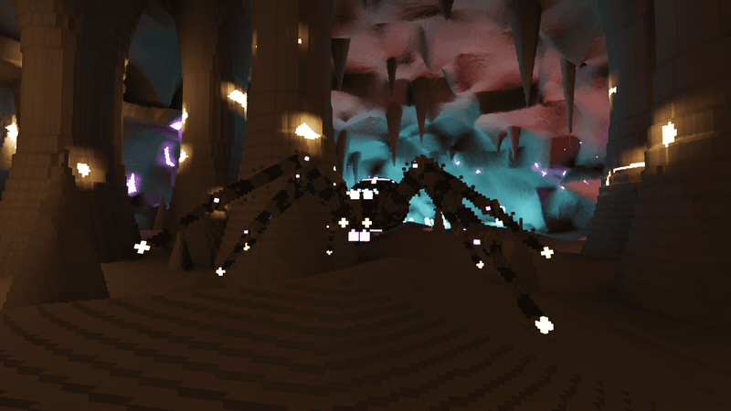

# svet

[](https://github.com/IgorKonovalov/svet/actions/workflows/ci.yml)
[](#license)



<sub>An entity: the spider from the [entities library](docs/entities.md), rigid voxel parts
playing its `walk` clip in the showcase's hall, rendered headlessly frame by frame on an
RTX 3080 Laptop GPU (1280x720, 16 settle frames a pose, exposure 10, lamp off, entity light
`world`) at v0.57.0, 25 fps, 800 px wide. Regenerate with
`scripts/record-clip.sh --width 800 --out docs/images/spider-walk -- --clip walk`
(every other setting is the clip example's default).</sub>

A game-agnostic voxel engine in Rust. A streaming world of small voxels (10 cm at the first
consumer's scale) is ray-marched in compute shaders through [`wgpu`](https://wgpu.rs), edited at
runtime with deterministic operations that report what they changed, and queried for collision,
acoustics and navigation from the same data.

It is a **library workspace, not a framework**. There is no ECS, no scene editor and no asset
pipeline beyond voxel-model and rig import. A game composes the crates it needs and owns its
own loop and entity model.

> **Status: pre-alpha.** Milestones M1 (fly-through with digging), M3 (collision and a
> character controller), M4 (spatial audio), M5 (the simulation split and a WebAssembly logic
> host) and M6 (entities as voxel models, with rigs and clips) have shipped, with parts of M2
> (lighting: baked emissive light, dynamic lights, a sun and a sky), M7 (tooling: the tester
> build, the loading screen, render settings and named profiles), M8 (collapse) and M10
> (outdoors: the sun and sky). v0.54.0 was the first tagged release; its tester archives are on
> the [releases page](https://github.com/IgorKonovalov/svet/releases).
> [`CHANGELOG.md`](CHANGELOG.md) says what has shipped, [`docs/roadmap.md`](docs/roadmap.md)
> what comes next, and [`docs/plans/README.md`](docs/plans/README.md) what is in flight.

## What works today

- **A brick-map world** of `u16` voxels in 8³ bricks and 64³ chunks, with a material table
  whose rows carry an opaque payload for the game. Bounded worlds, and unbounded ones
  streamed around a focus point on a worker pool, with an LOD-only ring of mips out past full
  detail and edited chunks kept in RAM or spilled to disk.
- **Deterministic edits.** Sphere, box, capsule and tool-along-ray shapes; carve, fill and
  replace modes; each op returns per-material counts, the touched chunks and bounds. Integer
  math throughout, pinned by cross-platform hashes.
- **Queries:** an integer raycast, point and box queries, brick occupancy masks, and a coarse
  per-brick grid with a walkable map that update incrementally from each edit's result.
- **Prefabs:** MagicaVoxel `.vox` import with a palette-to-material map, and prefab stamping
  in any of the 24 rotations, at generation time or at runtime, with the same edit result.
- **Collapse:** a support query over the coarse grid finds regions an edit left unsupported;
  deterministic ops drop them as a rigid piece or turn them into rubble.
- **Collision:** vertical-cylinder sweeps and a character controller with step-up, wall
  slide, gravity, jumping and ledge climbing, in integer math.
- **The simulation split:** a server owns the world and an op log of every edit, stamp, drop
  and removal (a save carries the prefabs its stamps name); clients are shared or own a
  replica with desync detection; a session replays from seed plus log to the same hash.
  Game logic runs behind a trait, natively or as a sandboxed WebAssembly component with
  deterministic WASI, fuel and a memory cap, proven equal to the native build.
- **A compute ray marcher** in WGSL over a sharded GPU mirror of the world, reserved once
  and uploaded incrementally from the dirty set, walking a hierarchy of occupancy bits, with
  honest cubes (a smooth field surface is an opt-in look, ADR-0041), a translucent material
  class, a far shading normal that softens distant faces, and a stats overlay with a
  frame-time strip.
- **Lighting that holds in the dark.** Emissive voxels are baked per chunk into a store of
  one record a brick, filled by a live queue nearest the camera first and re-baked by digs
  (ADR-0046). A list of analytic point and spot lights, the headlamp among them, is shaded
  exactly with one shadow ray each (ADR-0044), with a probe channel for the lamp's bounce.
  The direct part is denoised in a target of its own and the frame is upscaled by a WGSL
  port of FSR 2 (the default, at 1.5), or with the upscaler off rendered at the output size.
- **A sun and a sky.** Hillaire's atmosphere as LUTs built on the GPU from a `Sky` the game
  sets, a time of day the game steps, the sun or moon as one directional sample with a shadow
  ray and the sky's light from a sky ray (ADR-0026, ADR-0027). A frame with no sky set builds
  none of it.
- **Entities as voxel models:** rigid parts on a rig, posed in fixed point so the entity
  ray query gives bit-identical hits on every platform, traced after the world march and lit
  and shadowed by the list lights. Clips are keyframes sampled by integer tick; a model's rig
  and clips live in a `.rig` text file beside its `.vox`, and `.voxtext` draws voxels as
  text. The models uploaded to the GPU pool are freed by handle. [`docs/entities.md`](docs/entities.md)
  has the library and how to make one.
- **Render settings as one surface:** every setting of the frame and the mirror in one
  `RenderSettings` value, each field with its apply class, and the named profiles `Floor`,
  `Portable`, `Performance` and `High` whose frame budgets are in `docs/nfr.md` section 2
  (ADR-0055).
- **Spatial audio:** a headless HRTF mixer on the device callback, with occlusion,
  transmission and early reflections probed through the same voxels and the material
  table's acoustic triple, and a late reverb sized by the room the listener sees.
- **The fly-through** testbed: fly or walk, dig, fill and stamp, watch unsupported rock fall,
  drop and carry lights, place entities and play their clips, switch worlds and the time of
  day, save and replay sessions, and print what each edit changed, behind an engine loading
  screen that keeps the window live while the world loads. Every toggle shows its mode in
  the window. Headless benchmarks, golden images and a clip recorder run without one.
- **The tester build:** `svet-tester` runs the fly-through once per scene along a fixed camera
  path, as a timed benchmark or a tour, and packs the reports into one zip (ADR-0054).
  Release archives for Linux and Windows are built by CI.

The figures behind these, met and missed, are in [`docs/nfr.md`](docs/nfr.md).

## Where it is going

- **Outdoors (M10).** The sun and sky have shipped. Next, in plan order: a far field of coarse
  chunk levels to about 1 km, liquid surfaces with waves, a reflection and a refraction ray,
  aerial perspective and clouds, weather as cosmetic client state, and the night sky; later,
  flowing liquids as deterministic ops through the log.
- **Lighting (M2).** Steady outdoor light (sky visibility baked into the per-chunk store) and
  a surface detail layer marched above styled faces are drafted; the mirror sync's cost in
  flight is still over the frame line (`docs/nfr.md` section 2) and heads the backlog.
- **Tooling (M7).** An in-game menu that takes over the fly-through's keys, a settings file,
  an entity picker, the remaining debug views and a profiler across passes.
- **Entities (M6).** Entities aware of the floor and the walls, squash and stretch, variants
  per instance, and a posed entity entering the world as a prefab.
- **Volumetrics and debris (M8).** Dust, fog and smoke in a separate coarse volume, never as
  voxels; particle debris from edits and a cosmetic rigid-body layer.
- **Networking (M9).** A QUIC transport over the channel abstraction, prediction and
  reconciliation for local edits, entity replication, late join by seed plus compressed op
  log, and positional voice through the audio occlusion.
- **Scripting hosts.** WASM for deterministic server-side logic (shipped), Lua for client-side
  scripts, so a game's rules can be data rather than engine code.
- **Two workflows, both first class.** The engine is meant to be worked with by a person
  alone or by an agent alone: readable text formats, a window that shows every mode it is in
  and clear errors for the person; a headless build, run and check loop with machine-readable
  output (run reports, rendered stills, deterministic replay) for the agent. The authoring
  direction that follows, level and logic text compiled to a logic component with a visual
  editor optional on top, is recorded in the roadmap and unscheduled.

The budgets these claims are held to (frame time per profile, VRAM, edit cost, baseline
hardware) are in [`docs/nfr.md`](docs/nfr.md). A figure there without a measurement is a guess
and says so.

## Layout

| Path | Owns |
|------|------|
| [`crates/svet-world`](crates/svet-world) | Voxel storage, materials, edit ops and results, spatial queries, prefabs and stamping, collapse, streaming, the op log and its wire encoding. Headless and deterministic: no GPU, no wall clock, no unseeded RNG. |
| [`crates/svet-render`](crates/svet-render) | `wgpu`: the GPU mirror and its upload, compute ray marching, the baked light store and its live queue, the light list, the sun and sky, denoise, FSR 2 and our upscaler, exposure, voxel-model entities, the loading screen, the text overlay, render settings and profiles. All WGSL lives here. |
| [`crates/svet-app`](crates/svet-app) | Thin, optional `winit` shell: window, input, surface, frame loop, a splash before the world loads. |
| [`crates/svet-sim`](crates/svet-sim) | Cylinder sweeps and the character controller. Depends on `svet-world` only. |
| [`crates/svet-assets`](crates/svet-assets) | `.vox` parsing and writing and the palette-to-material map, producing `svet-world` prefabs; `.rig` files to `svet-entity` models and clips; voxels drawn as text (`.voxtext`). |
| [`crates/svet-net`](crates/svet-net) | The byte channel, the server tick with its op and input logs, the `Logic` and `Host` traits, shared and owned clients. |
| [`crates/svet-script-wasm`](crates/svet-script-wasm) | The `wasmtime` host for logic components; `guests/` holds the test components. Not in the default build. |
| [`crates/svet-audio`](crates/svet-audio) | `cpal` output, the HRTF mixer on the device callback, occlusion and early reflections through the material table; the HRIR pack under `assets/`. Depends on `svet-world` only. |
| [`crates/svet-entity`](crates/svet-entity) | Voxel-model entities: rigid parts as prefabs, poses in fixed point and Q14 quaternions, clips sampled by tick, the entity ray query. Headless and deterministic; depends on `svet-world` only. |
| [`apps/flythrough`](apps/flythrough) | The engine's own testbed binary; `logic/` is its dig logic, built natively or as a component; `assets/entities/` is the entities library. |
| [`apps/tester`](apps/tester) | `svet-tester`, the tester build's launcher: a menu that runs the fly-through per scene and packs a report. |
| [`dist/`](dist) | What the tester archives ship beside the binaries. |
| [`scripts/`](scripts) | Repository gates (doc links, comment hygiene, index rows, test tiers, file and plan size), the changed-crates test runner, the guest build, the clip recorder and the tester packaging. |
| [`docs/`](docs) | [Roadmap](docs/roadmap.md), [budgets](docs/nfr.md), [ADRs](docs/adrs/README.md), [plans](docs/plans/README.md), [the fly-through's keys and flags](docs/flythrough.md), [the entities](docs/entities.md). |

Further crates (Lua scripting, the network transport) are added one plan at a time; the
roadmap names them.

## Building

The toolchain is pinned in [`rust-toolchain.toml`](rust-toolchain.toml); `rustup` installs it on
first use. Linux and Windows are the supported platforms.

On Linux, `winit` and `wgpu` need the X11/Wayland headers and a Vulkan driver, `cpal` needs the
ALSA headers, and `gilrs` (the gamepad) needs libudev. On Debian or Ubuntu:

```sh
sudo apt-get install pkg-config libxkbcommon-dev libwayland-dev mesa-vulkan-drivers libasound2-dev libudev-dev
```

Then:

```sh
cargo build
cargo run --release -p flythrough
```

To run the fly-through's logic as a WebAssembly component, add the target once and build the
components first:

```sh
rustup target add wasm32-wasip2
scripts/build-guests.sh
cargo run --release -p flythrough --features wasm -- --level --logic wasm
```

### The fly-through

With no flags it streams an unbounded seeded cave around the camera. Digs, fills and the bench
go through an in-process server, so every edit you see came back as a client event.

```sh
cargo run --release -p flythrough -- --level                  # the bounded level: walk, collapse, coarse grid
cargo run --release -p flythrough -- --source showcase        # a 72 m hall lit by four ores
cargo run --release -p flythrough -- --source outdoor         # hills and a cave mouth under a sky
cargo run --release -p flythrough -- --level --walk --hud     # start walking, the stats overlay shown
cargo run --release -p flythrough -- --profile portable       # a named render profile
cargo run --release -p flythrough -- --help                   # every flag
```

| Input | Does |
|-------|------|
| Mouse, `W` `A` `S` `D`, `Space` / `C` | Look and fly; hold `Shift` to go faster |
| Left / right click | Dig / fill at the crosshair; the edit result prints to the terminal |
| Scroll | Change the dig radius |
| `Tab` | The menu: every toggle and action by group with its live value; type to search, `Enter` flips or runs |
| `F1` | The Keys page: every menu entry and its key |
| `F2` | Toggle the stats overlay |
| `F4` | The next render profile: floor, portable, performance, high |
| `F7` | Toggle the headlamp |
| `F10` | Cycle the upscaler: off, fsr2 |
| `G` | Toggle fly and walk mode (bounded worlds only); walking, `Space` jumps or climbs a ledge |
| `Esc` | Close the menu (a page at a time); with it closed, quit |

Everything else (the look presets, the lighting modes, the lights, the light queue, the
entities, the sky and the world source, audio, the debug views) is an entry of the menu, and a
gamepad walks the same menu (`Start`). [`docs/flythrough.md`](docs/flythrough.md) lists the
fixed keys, the shortcuts, the gamepad and every flag; `flythrough --keys` prints the whole
tree. Every toggle shows its mode in a banner and in its menu row and prints it to stdout.
Walking, the coarse grid and collapse run on the bounded worlds (`--source level` and
`--source showcase`) only. Every run prints a `frames:` line at exit: p50, p99 and max of the
frame's render-thread CPU, of `update + poll + sync`, and of the march's GPU time on the
frames it was timed.

The tester build's launcher, `cargo run --release -p svet-tester`, opens a menu that runs the
fly-through once per scene and packs the reports into a zip
([`dist/README-TESTER.txt`](dist/README-TESTER.txt)).

The storage figures come from an example: `cargo run --release -p flythrough --example
world_budget -- --chunks 20,20,8 --census` (the level) or `--stream 16,24 --census` (the streamed
residency); `--veins N --census` prints the census of a synthetic world of `N - 1` materials,
and `--surface` (with `--stream`) projects what a per-voxel attribute would take (ADR-0011's
layout; the mirror no longer holds one). The bounded run also times the coarse grid and the
per-chunk mip build. A `Full` brick is a packed mask, palette and bit planes (ADR-0012); the
readings of the level's and the streamed defaults' RAM are in
[`docs/nfr/03-memory.md`](docs/nfr/03-memory.md).
`cargo bench -p svet-world --bench brick_kernel` times the planar edit kernel against a row
write on raw ids over the same brick-edits.

### Checks

These are the gates CI runs on every push, on Linux and Windows (Windows runs the CPU tests
and DX12 pipeline creation on WARP):

```sh
scripts/build-guests.sh
SVET_REQUIRE_SOFTWARE_ADAPTER=1 cargo nextest run --workspace --profile ci   # the gate tier; ci-windows on Windows
cargo nextest run -p flythrough --features wasm --profile ci -E 'binary(component)'
cargo test --workspace --doc
cargo clippy --workspace --all-targets --features flythrough/wasm -- -D warnings
cargo clippy -p flythrough-logic --features component --target wasm32-wasip2 -- -D warnings
cargo fmt --all --check
cargo deny check
node --test "scripts/*.test.mjs"
node scripts/check-doc-links.mjs
node scripts/check-comment-hygiene.mjs
node scripts/check-index-rows.mjs
node scripts/check-index-rows.mjs --self-test
node scripts/check-test-tiers.mjs
node scripts/check-file-size.mjs
node scripts/check-plan-size.mjs
```

The guest crates under `crates/svet-script-wasm/guests/` get the same wasm32 clippy. Locally,
`cargo nextest run --profile gate` is the gate tier and `node scripts/test-changed.mjs
--profile quick` tests only the crates a change touched.

GPU tests run headless on a software Vulkan adapter (a pinned build of Mesa's lavapipe) on
CI's Linux arm, where the golden baselines are blessed, so every feature has a test that needs
no window. CI also prints readings, not gates: the gate tests' times against the line in
`docs/nfr.md` section 7, each compute pass's pipeline creation time, and the tester's system
report. [`ci.yml`](.github/workflows/ci.yml) is the full list; the soak tier runs weekly
([`soak.yml`](.github/workflows/soak.yml)) and a `v*` tag builds the tester archives
([`release.yml`](.github/workflows/release.yml)).

## How the project is run

Work is plan-driven. A design question becomes an ADR when there is a rejected alternative worth
remembering, then a phased plan in [`docs/plans/`](docs/plans/README.md), then code. Decisions
are recorded once and cited by number; a closed plan moves to `docs/plans/done/` and gets a
changelog entry and a version bump.

The engine is being built alongside a first consumer game, but **nothing under `crates/` names
that game or any gameplay concept**. A game-specific need arrives as a requirement and is met
with a general mechanism.

## License

Licensed under either of

- Apache License, Version 2.0 ([LICENSE-APACHE](LICENSE-APACHE))
- MIT license ([LICENSE-MIT](LICENSE-MIT))

at your option.

Unless you explicitly state otherwise, any contribution intentionally submitted for inclusion in
the work by you, as defined in the Apache-2.0 license, shall be dual licensed as above, without
any additional terms or conditions.
