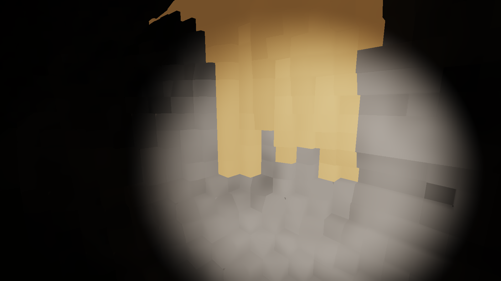

# voxel-engine

[](https://github.com/IgorKonovalov/voxel-engine/actions/workflows/ci.yml)
[](#license)



<sub>The bounded level, seed 1, from voxel (148, 280, 484) at yaw 135 and pitch -10 degrees: the
headlamp's cone and a vein of glowing ore, after 64 accumulated and filtered frames at exposure
0.08, contour look, at the lighting defaults (half-resolution lighting, coarse shadow walk,
reservoir reuse, edit-box history, a 32-frame emissive history), on an RTX 3080 Laptop GPU at
1600x900. Regenerate with
`cargo run --release -p flythrough --example hero -- --at 148,280,484 --yaw 135 --pitch -10
--exposure 0.08 --frames 64`.</sub>

A game-agnostic voxel engine in Rust. A streaming world of small voxels (10 cm at the first
consumer's scale) is ray-marched in compute shaders through [`wgpu`](https://wgpu.rs), edited at
runtime with deterministic operations that report what they changed, and queried for collision,
acoustics and navigation from the same data.

It is a **library workspace, not a framework**. There is no ECS, no scene editor and no asset
pipeline beyond voxel-model import. A game composes the crates it needs and owns its own loop
and entity model.

> **Status: pre-alpha.** Milestones M1 (fly-through with digging), M3 (collision and a
> character controller) and M5 (the simulation split and a WebAssembly logic host) have
> shipped, with parts of M2, M6, M7 and M8. Spatial audio (M4) shipped its first slice,
> heard and checked by the owner; its reverb slice is in flight. [`CHANGELOG.md`](CHANGELOG.md) says what has shipped,
> [`docs/roadmap.md`](docs/roadmap.md) what comes next, and
> [`docs/plans/README.md`](docs/plans/README.md) what is in flight.

## What works today

- **A brick-map world** of `u16` voxels in 8³ bricks and 64³ chunks, with a material table
  whose rows carry an opaque payload for the game. Bounded worlds, and unbounded ones
  streamed around a focus point on a worker pool, with an LOD-only ring of mips out past full
  detail and edited chunks kept in RAM or spilled to disk.
- **Deterministic edits.** Sphere, box, capsule and tool-along-ray shapes; carve, fill and
  replace modes; each op returns per-material counts, the touched chunks and bounds. Integer
  math throughout, pinned by cross-platform hashes.
- **Queries:** an integer raycast, point and box queries, brick occupancy masks, and a coarse
  per-brick grid with a walkable map that update incrementally from each edit's result.
- **Prefabs:** MagicaVoxel `.vox` import with a palette-to-material map, and prefab stamping
  in any of the 24 rotations, at generation time or at runtime, with the same edit result.
- **Collapse:** a support query over the coarse grid finds regions an edit left unsupported;
  deterministic ops drop them as a rigid piece or turn them into rubble.
- **Collision:** vertical-cylinder sweeps and a character controller with step-up, wall
  slide, gravity, jumping and ledge climbing, in integer math.
- **The simulation split:** a server owns the world and an op log of every edit, stamp, drop
  and removal (a save carries the prefabs its stamps name); clients are shared or own a
  replica with desync detection; a session replays from seed plus log to the same hash.
  Game logic runs behind a trait, natively or as a sandboxed WebAssembly component with
  deterministic WASI, fuel and a memory cap, proven equal to the native build.
- **A compute ray marcher** in WGSL over a sharded GPU mirror of the world, reserved once
  and uploaded incrementally from the dirty set, walking a hierarchy of occupancy bits, with
  a headlamp, a shadow ray, per-voxel contour normals with procedural detail, a translucent
  material class, and a stats overlay with a frame-time strip.
- **Spatial audio:** a headless HRTF mixer on the device callback, with occlusion,
  transmission and early reflections probed through the same voxels and the material
  table's acoustic triple.
- **The fly-through** testbed: fly or walk, dig, fill and stamp, watch unsupported rock fall,
  save and replay sessions, and print what each edit changed, plus headless benchmarks and
  golden images.

The figures behind these, met and missed, are in [`docs/nfr.md`](docs/nfr.md).

## Where it is going

- **Streaming world.** Voxels live in a chunked brick map with LOD mips, paged around focus
  points and generated on background threads by a source the game provides.
- **Compute ray marching.** A DDA ray marcher in WGSL lights the world from few sources,
  including emissive voxels, then denoises and upscales to the baseline GPU's budget.
- **Deterministic edits.** Shape, parameters and tool in; per-material counts and the touched
  region out. The same op on the same world gives bit-identical results on Linux and Windows,
  so a game can hang gameplay on destruction and replicate edits as compact ops.
- **Spatial queries.** Raycasts, sweeps, region counts and coarse grids serve collision,
  acoustics and navigation without a second representation of the world.
- **Scripting hosts.** WASM for deterministic server-side logic (shipped), Lua for client-side
  scripts, so a game's rules can be data rather than engine code.
- **Spatial audio.** HRTF playback with occlusion and early reflections (shipped), then a late
  reverb sized by the room the listener sees.

The budgets these claims are held to (frame time, VRAM, edit cost, baseline hardware) are in
[`docs/nfr.md`](docs/nfr.md). A figure there without a measurement is a guess and says so.

## Layout

| Path | Owns |
|------|------|
| [`crates/vxe-world`](crates/vxe-world) | Voxel storage, materials, edit ops and results, spatial queries, streaming. Headless and deterministic: no GPU, no wall clock, no unseeded RNG. |
| [`crates/vxe-render`](crates/vxe-render) | `wgpu` upload, compute ray marching, lighting, denoise, upscale. All WGSL lives here. |
| [`crates/vxe-app`](crates/vxe-app) | Thin, optional `winit` shell: window, input, surface, frame loop. |
| [`crates/vxe-sim`](crates/vxe-sim) | Cylinder sweeps and the character controller. Depends on `vxe-world` only. |
| [`crates/vxe-assets`](crates/vxe-assets) | `.vox` parsing and the palette-to-material map, producing `vxe-world` prefabs. |
| [`crates/vxe-net`](crates/vxe-net) | The byte channel, the server tick with its op and input logs, the logic trait, shared and owned clients. |
| [`crates/vxe-script-wasm`](crates/vxe-script-wasm) | The `wasmtime` host for logic components; `guests/` holds the test components. Not in the default build. |
| [`crates/vxe-audio`](crates/vxe-audio) | `cpal` output, the HRTF mixer on the device callback, occlusion and early reflections through the material table; the HRIR pack under `assets/`. Depends on `vxe-world` only. |
| [`apps/flythrough`](apps/flythrough) | The engine's own testbed binary; `logic/` is its dig logic, built natively or as a component. |
| [`scripts/`](scripts) | Repository gates (doc links, comment hygiene, index rows) and the guest build script. |
| [`docs/`](docs) | [Roadmap](docs/roadmap.md), [budgets](docs/nfr.md), [ADRs](docs/adrs/README.md), [plans](docs/plans/README.md). |

Further crates (Lua scripting, the network transport) are added one plan at a time; the
roadmap names them.

## Building

The toolchain is pinned in [`rust-toolchain.toml`](rust-toolchain.toml); `rustup` installs it on
first use. Linux and Windows are the supported platforms.

On Linux, `winit` and `wgpu` need the X11/Wayland headers and a Vulkan driver, and `cpal`
needs the ALSA headers. On Debian or Ubuntu:

```sh
sudo apt-get install pkg-config libxkbcommon-dev libwayland-dev mesa-vulkan-drivers libasound2-dev
```

Then:

```sh
cargo build
cargo run --release -p flythrough
```

To run the fly-through's logic as a WebAssembly component, add the target once and build the
components first:

```sh
rustup target add wasm32-wasip2
scripts/build-guests.sh
cargo run --release -p flythrough --features wasm -- --level --logic wasm
```

### The fly-through

With no flags it streams an unbounded seeded cave around the camera. Digs, fills and the bench
go through an in-process server, so every edit you see came back as a client event.

| Input | Does |
|-------|------|
| Mouse, `W` `A` `S` `D`, `Space` / `C` | Look and fly; hold `Shift` to go faster |
| Left / right click | Dig / fill at the crosshair; the edit result prints to the terminal |
| Scroll | Change the dig radius |
| `L` | Toggle the shadow ray |
| `N` | Cycle the normal mode: face, trilinear8, gradient27, contour (contour skipped under `--look plain`) |
| `V` | Toggle procedural surface detail |
| `B` | Run the carve benchmark in place |
| `P` | Stamp a 16-voxel room with an indestructible shell at the crosshair |
| `G` | Toggle fly and walk mode (bounded level only); walking, `Space` jumps or climbs a ledge |
| `K` | Print the coarse grid and walkable map |
| `R` | Toggle what unsupported rock does after a dig: fall (default) or crumble into rubble |
| `H`, `J`, `T` | With `--audio`: play a knock, a looping hum, or a looping pulse (a knock each second) at the point the last left click dug |
| `E` | With `--audio`: toggle the early reflections |
| `F1` | Sample the next frames and print frame-time readings |
| `F2` | Toggle the stats overlay; with the lighting it shows every frame pass's GPU time and the light samples |
| `F3` | Toggle the shadow walk: coarse (default; 2^3 blocks of the masks) or full |
| `F4` | Toggle the emissive sampler: reservoir reuse (default) or the flat candidate list |
| `F5` | Toggle what kills history: edit boxes (default), or edit boxes and A-SVGF's gradient |
| `F6` | Toggle the lighting resolution: half (default) or full; applied on the next frame |
| `F7` | Toggle the headlamp |
| `F10` | Cycle the upscaler: off, own, fsr2; a banner names the mode and its scale for 3 s |
| `M` | Pulse the ore's emission (a render-side scale) |
| `Esc` | Quit |

For 3 s after the start and after every `F3` to `F7`, `M` or applied `F6` change, a yellow
banner names the lighting modes (shadow walk, sampler, history, resolution, lamp, filter), the
pulse and the emissive history. It shows with the stats overlay off, and sits under its rows
when `F2` has it on. The same line goes to stdout.

Walking, the coarse grid and collapse run on the bounded level (`--level`) only. Every run
prints a `frames:` line at exit: p50, p99 and max of the frame's render-thread CPU, of
`update + poll + sync`, and of the march's GPU time on the frames it was timed (the overlay
shown, `F1`, the autopilot's flight).

| Flag | Does |
|------|------|
| `--level` | The bounded level instead of the streamed cave |
| `--walk` | With `--level`: start in walk mode |
| `--seed N` | World seed (default 1) |
| `--hud` | Start with the stats overlay shown; with `--view steps` it adds a row with the last frame's mean, p99 and block-max mean steps per ray and the mean loads |
| `--logic native\|wasm[=PATH]` | Run the dig logic natively (default) or as a component; `wasm` needs `--features wasm` |
| `--vault` | Generate a 16-voxel room with an indestructible shell 10 m along +x from the spawn |
| `--headless` | Run the same frames on an offscreen target, with no window |
| `--adapter SUBSTRING` | With `--headless`, use the first GPU adapter whose name contains the substring (for example `AMD` for the dev box's iGPU), the default adapter when none does |
| `--frames N` | Exit after `N` frames, printing the `F1` readings over the last ones |
| `--bench N` | Send `N` `B` benchmark inputs on the first frame |
| `--autopilot` | Dig, fly 300 m out and back through the streamed cave, print streaming readings |
| `--census` | Print the brick census on exit: `Full` bricks and mip-bricks by count of materials, and their payload bytes today, under the packed class ladder and under exact planes |
| `--render WxH` | Fix the marcher's resolution; the window scales it |
| `--sync-budget MiB` | Bytes uploaded to the GPU mirror per frame |
| `--mirror-budget MiB` | VRAM the GPU mirror reserves for its pool, masks and records at startup (default 3072 streamed; on `--level`, what the level needs plus dig headroom). While streaming, the full radius drops a chunk after 30 frames with the mirror's pressure (the fuller of its pool slots and records) over 0.9, and returns after 300 frames under 0.7, down to 6 |
| `--residency R_FULL,R_LOD` | Streamed full and LOD radii in chunks, hysteresis 1 (default 16,24) |
| `--look MODE` | Start in normal mode `face`, `trilinear8`, `gradient27` or `contour` (default), with attribute pages for contour and rock detail; `plain` starts in face mode without either, detail off |
| `--view VIEW` | Write `shaded` (default), `normals`, `hitmask`, `steps` (red: walk steps, green: storage loads, blue: pool loads per ray) or `albedo` (the composited albedo, unlit) to the target; with `--frames`, `steps` prints the last frame's mean and p99 steps per ray, the mean over 8 × 8 pixel blocks of each block's maximum steps, and the loads' and pool loads' mean and p99 |
| `--translucent-layers N` | Translucent voxels composited in front of the opaque hit, nearest first (default 4); 0 ignores them |
| `--detail` | Start with procedural surface detail on under `--look plain` (it is on in every other look) |
| `--rock-detail SCALE,STRENGTH` | Rock's detail feature scale in voxels and strength in [0, 1], in every look but `plain` (default 4,0.1) |
| `--save PATH` | With `--level`: write the session's log file to `PATH` on exit and print the world hash; stamps and collapse are in the log |
| `--audio` | Open the default output device; `H`, `J`, `T` and `E` then work, and every frame probes the sounds' occlusion through the world. `FLYTHROUGH_HRIR=<pack>` loads another HRIR pack |
| `--audio-debug` | `--audio` plus a line a second of the output callback's readings; on exit writes the last 60 s to `flythrough-audio-debug.wav` |
| `--lamp on\|off` | The headlamp (default on) |
| `--emissive-ore on\|off` | The ore glows and lights the cave (default on) |
| `--shadow-walk full\|coarse` | The walk shadow rays take (default coarse) |
| `--sampler list\|reuse` | The emissive sampler: candidates alone, or with last frame's reservoirs (default reuse) |
| `--history edits\|gradient` | What kills temporal history: edit boxes, or edit boxes and A-SVGF's gradient (default edits) |
| `--lighting full\|half` | The lighting passes' resolution (default half) |
| `--internal-scale 1\|1.5\|2` | The output size over the internal size on each edge; above 1 the upscaler fills the output (default 1: no upscaler). `--internal-scale 1.5 --jitter on` is the performance option: 720p for 1080p, about half the frame's GPU time |
| `--jitter on\|off` | Each frame's sub-pixel ray jitter, which the upscaler accumulates (default off); on, the upscaler runs at any scale |
| `--upscaler off\|own\|fsr2` | The upscaler: none, ours (ADR-0024; it jitters unless `--jitter off`), or AMD's FSR 2.2.1 ported to WGSL (ADR-0034; it jitters by its own sequence). Without it, `--internal-scale` and `--jitter` choose between off and own as before. The overlay's upscale row shows FSR 2's passes as one total |
| `--sharpen S` | The upscaler's RCAS sharpening (FSR 2's RCAS under `fsr2`), 0 to 1 (default 0.5, 0 off) |
| `--emissive-history N` | Frames static emissive light accumulates over at least, 1 to 4096 (default 32); the headlamp's part keeps a short history |
| `--filter on\|off` | The a-trous filter; off shows the light pass's raw irradiance (default on) |
| `--light-radius N` | Chunks around the camera whose emitters light the frame (default 4) |
| `--replay PATH` | With `--level`: re-simulate a saved session before the first frame and print its hash; add `--vault` for a session saved with it (the save does not record the room placed at generation) |

The storage figures come from an example: `cargo run --release -p flythrough --example
world_budget -- --chunks 20,20,8 --census` (the level) or `--stream 16,24 --census` (the streamed
residency); `--veins N --census` prints the census of a synthetic world of `N - 1` materials,
and `--surface` (with `--stream`) counts the contour-plane voxels.
The bounded run also times the coarse grid and the per-chunk mip build. A `Full` brick is a
packed mask, palette and bit planes (ADR-0012), so the level's bricks take 58 MiB of RAM and
the streamed defaults' about 400 MiB ([`docs/nfr.md`](docs/nfr.md) section 3).
`cargo bench -p vxe-world --bench brick_kernel` times the planar edit kernel against a row
write on raw ids over the same brick-edits.

### Checks

These are the gates CI runs on every push, on both Linux and Windows:

```sh
scripts/build-guests.sh
cargo build --workspace
cargo nextest run --workspace
cargo nextest run -p flythrough --features wasm
cargo test --workspace --doc
cargo clippy --workspace --all-targets -- -D warnings
cargo clippy -p flythrough --features wasm --all-targets -- -D warnings
cargo fmt --all --check
cargo deny check
node --test ".claude/hooks/*.test.mjs"
node scripts/check-doc-links.mjs
node scripts/check-comment-hygiene.mjs
node scripts/check-index-rows.mjs
node scripts/check-index-rows.mjs --self-test
```

GPU tests run headless on a software Vulkan adapter (Mesa's lavapipe) in CI, so every feature
has a test that needs no window. [`ci.yml`](.github/workflows/ci.yml) is the full list.

## How the project is run

Work is plan-driven. A design question becomes an ADR when there is a rejected alternative worth
remembering, then a phased plan in [`docs/plans/`](docs/plans/README.md), then code. Decisions
are recorded once and cited by number; a closed plan moves to `docs/plans/done/` and gets a
changelog entry and a version bump. [`CLAUDE.md`](CLAUDE.md) is the orientation map for anyone,
human or tool, working in the tree.

The engine is being built alongside a first consumer game, but **nothing under `crates/` names
that game or any gameplay concept**. A game-specific need arrives as a requirement and is met
with a general mechanism.

## License

Licensed under either of

- Apache License, Version 2.0 ([LICENSE-APACHE](LICENSE-APACHE))
- MIT license ([LICENSE-MIT](LICENSE-MIT))

at your option.

Unless you explicitly state otherwise, any contribution intentionally submitted for inclusion in
the work by you, as defined in the Apache-2.0 license, shall be dual licensed as above, without
any additional terms or conditions.
