# svet

A Rust voxel engine for worlds you dig, ray-marched on the GPU.

[](https://github.com/IgorKonovalov/svet/actions/workflows/ci.yml)
[](#license)
[](https://github.com/IgorKonovalov/svet/releases)

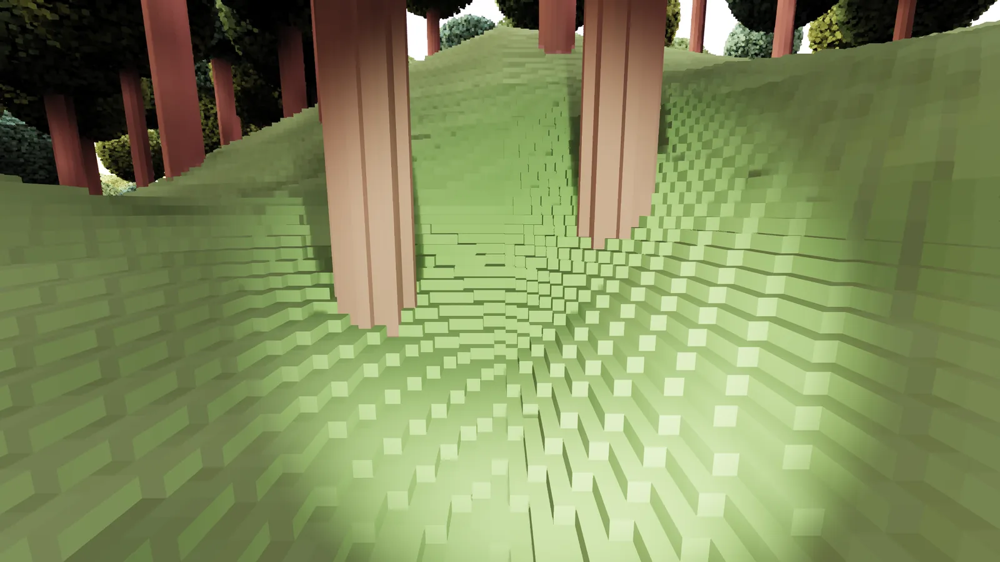

<sub>The forest on the hills at 18:10, from under the trees.</sub>

svet streams worlds of small voxels that you can dig, fill and build on. Compute shaders
ray-march the voxels directly, with no meshes. The name is Slavic: *svet* means "light", and
also "the world".

The forest renders a median frame in 8.3 ms at 1920 x 1080 on an RTX 3080 Laptop GPU. That
holds while the light in view is still baking.

It is a library, not a framework. A game picks the crates it needs and keeps its own loop and
entities.

**Status:** pre-alpha. Read the [changelog](CHANGELOG.md), the [roadmap](docs/roadmap.md) and the budgets, [met and missed](docs/nfr.md).

## Quickstart

Download the archive for Linux or Windows from the
[releases page](https://github.com/IgorKonovalov/svet/releases). Unpack it and run
`svet-tester`. Its menu opens each scene in a window.

To build from source, install Rust; the repository pins the toolchain. On Linux the build needs
a few system packages, listed in [the development guide](docs/development.md#building).

```sh
cargo run --release -p flythrough                                     # a streamed cave, the headlamp on
cargo run --release -p flythrough -- --source showcase                # a 72 m hall lit by glowing ores
cargo run --release -p flythrough -- --source outdoor --trees forest  # hills and a forest under the sky
```

| Key | Does |
|-----|------|
| Mouse, `W` `A` `S` `D`, `Space` / `C` | Look and fly; `Shift` goes faster |
| Left / right click | Dig / fill at the crosshair |
| `Tab` | The menu: every setting, searchable |
| `F1` | Every key |
| `F2` | The stats overlay |
| `F7` | The headlamp |
| `G` | Walk or fly, in the bounded worlds |
| `Esc`, twice | Quit |

Every key and flag is in [the fly-through's guide](docs/flythrough.md).

## Use it as a library

A game depends on the crates it needs. They are not on crates.io yet, so depend on the
repository:

```toml
[dependencies]
svet-world = { git = "https://github.com/IgorKonovalov/svet" }
```

The world on its own, with no GPU: a ground, one carve, its result and a ray.

```rust
use svet_world::{AIR, ChunkExtent, EditOp, FIXED_ONE, Fixed3, FnSource, Material, MaterialTable};
use svet_world::{Mode, World};

fn main() {
    let mut table = MaterialTable::new();
    let stone = table.push(Material::named("stone"));
    let ore = table.push(Material::named("ore"));

    // One chunk of ground: stone below z = 32, with a seam of ore at z = 20.
    let ground = FnSource(move |v: [i32; 3]| match v[2] {
        20 => ore,
        z if z < 32 => stone,
        _ => AIR,
    });
    let world = World::generate(ChunkExtent::new([0, 0, 0], [1, 1, 1]), &ground, &table);

    // Carve a ball 8 voxels in radius: the result counts what it removed, per material.
    let at = |v: [i64; 3]| Fixed3(v.map(|c| c * FIXED_ONE));
    let dug = world.apply(&EditOp::sphere(at([32, 32, 24]), 8 * FIXED_ONE, Mode::Carve)).unwrap();
    assert_eq!(dug.changed_from, [(stone, 2012), (ore, 164)]);

    // A ray cast straight down now lands on the crater's floor.
    let hit = world.raycast(at([32, 32, 60]), [0, 0, -FIXED_ONE], 64 * FIXED_ONE).unwrap();
    assert_eq!(hit.map(|h| h.voxel.0), Some([32, 32, 15]));
}
```

A window on a small world, with the renderer and the shell:

<!-- quoted from crates/svet-app/examples/minimal_window.rs, between its readme markers -->
```rust ignore
impl App for Demo {
    fn device_request(&mut self, adapter: &wgpu::Adapter) -> (wgpu::Features, wgpu::Limits) {
        let limits = svet_render::limits_for(adapter, 16 << 20).expect("a capable adapter");
        (wgpu::Features::empty(), limits)
    }
    fn init(&mut self, gpu: &Gpu) {
        let (dev, queue, world) = (&gpu.device, &gpu.queue, &world());
        let mut mirror = GpuWorld::new(dev, world.extent());
        let mut enc = dev.create_command_encoder(&Default::default());
        mirror.sync(world, queue, &mut enc).expect("the world fits");
        queue.submit([enc.finish()]);
        let mut frame = Frame::new(dev, gpu.size[0], gpu.size[1]);
        frame.apply_settings(dev, queue, &RenderSettings::profile(Profile::Floor));
        frame.set_sky(Some(Sky::new(Body::sun(SUN), Body::moon([0.0, 0.0, -1.0]))));
        let (all, bake) = (world.extent(), BakeSettings::default());
        let baked = frame.bake_until(dev, queue, &mut mirror, world, all, &bake, &mut |_| {});
        baked.expect("the light store holds the world");
        self.0 = Some((mirror, frame, Presenter::new(dev, gpu.surface_format)));
    }
    fn frame(&mut self, gpu: &Gpu, input: &Input, dt: f32, out: &wgpu::TextureView) -> Flow {
        let (mirror, frame, presenter) = self.0.as_mut().expect("init ran");
        let (lamp, quit) = (LightParams::headlamp(), input.pressed(KeyCode::Escape));
        frame.set_dt(dt);
        frame.step(&gpu.device, &gpu.queue, mirror, &EYE, &lamp);
        let mut enc = gpu.device.create_command_encoder(&Default::default());
        presenter.encode(&gpu.device, &mut enc, frame.target(), out);
        gpu.queue.submit([enc.finish()]);
        if quit { Flow::Exit } else { Flow::Continue }
    }
}
```

```sh
cargo run --release -p svet-app --example minimal_window
```

A window opens on a stone floor with an arched wall and a crater under a sunlit sky; Escape closes it.

For a full loop with streaming, creatures, lights and sound, read [the fly-through](apps/flythrough).

## Features

### World and edits

- Bounded worlds, or endless ones streamed around the camera.
- Dig, fill and stamp at runtime; every edit reports what it changed.
- Spheres, boxes, capsules and a tool swept along a ray.
- Integer math: the same edits give identical voxels on Linux and Windows.
- Unsupported rock falls as one piece or crumbles to rubble.

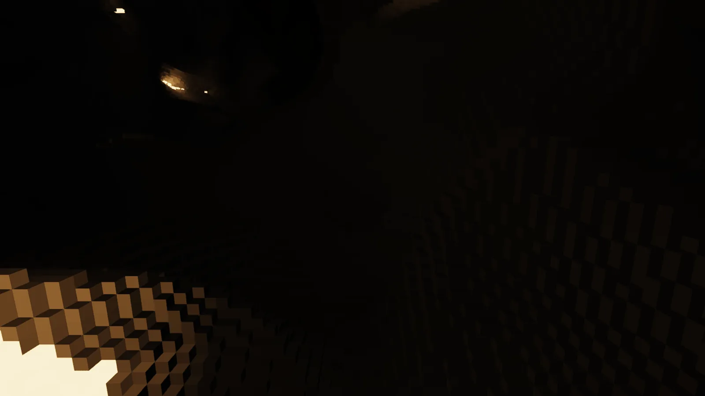

<sub>A dug cave lit by the headlamp, its light settled.</sub>

Try it:

```sh
cargo run --release -p flythrough -- --source cave --dig-at 40 --eye 32,32,32,180,-10
```

### Rendering

- Ray marching in WGSL compute shaders, with no meshes.
- Plain cubes by default, a smooth surface as an option.
- Glass and other see-through materials.
- FSR 2 upscaling, ported to WGSL.
- Named quality profiles for 720p and 1080p output.

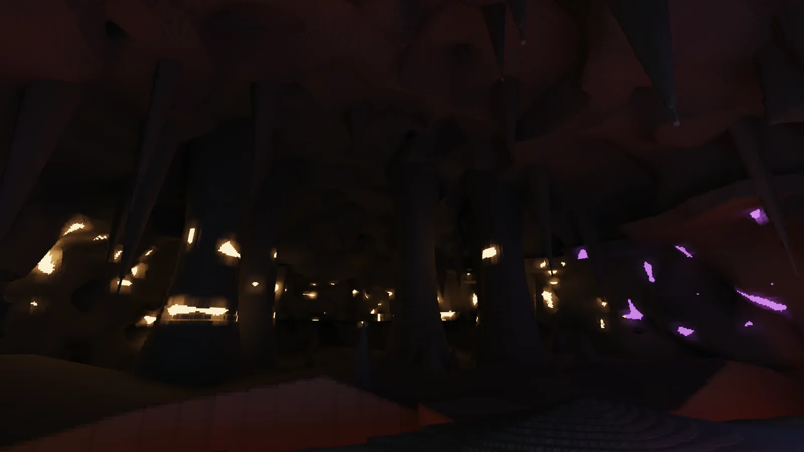

<sub>The showcase hall with the headlamp off, lit by its glowing ores alone.</sub>

Try it:

```sh
cargo run --release -p flythrough -- --source showcase --shot crystals
```

### Lighting

- Glowing voxels light the world; a dig re-lights what it opens.
- Light bakes per chunk in the background, off the render thread.
- Up to sixteen point and spot lights, each casting a shadow.
- The headlamp's light bounces off the rock around you.
- Exposure adapts like an eye: quick to light, slow to dark.

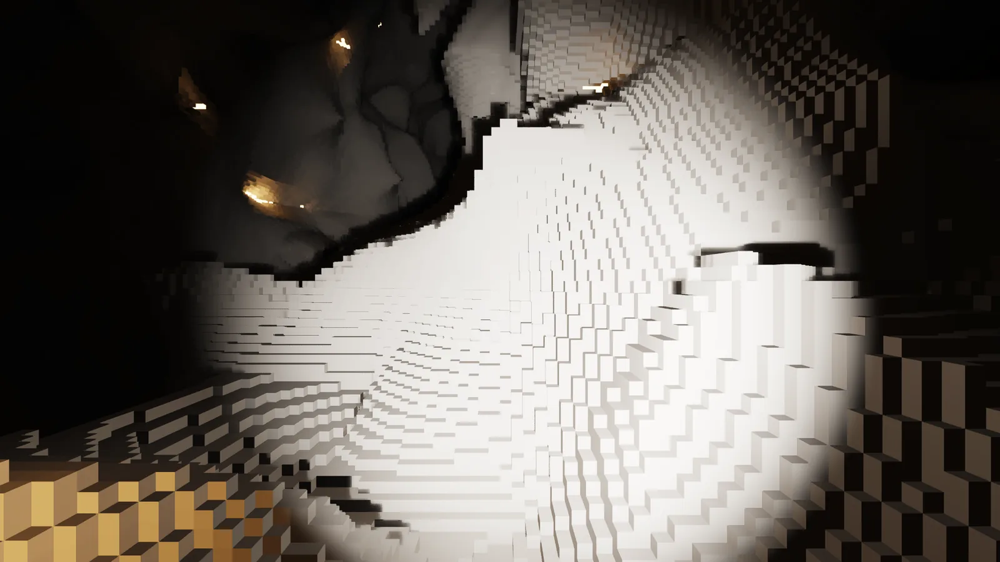

<sub>The headlamp in the streamed cave, its light falling off into the dark.</sub>

Try it:

```sh
cargo run --release -p flythrough -- --source cave --lamp on --eye 32,32,32,180,0
```

### Outdoors

- A physically based sky with a time of day the game sets.
- Sun and moon, with shadows across the hills.
- Sky light baked per chunk, like the light of glowing voxels.
- Exposure follows the sky, so a tunnel at noon stays dark.
- A forest on rolling hills to fly through in the testbed.

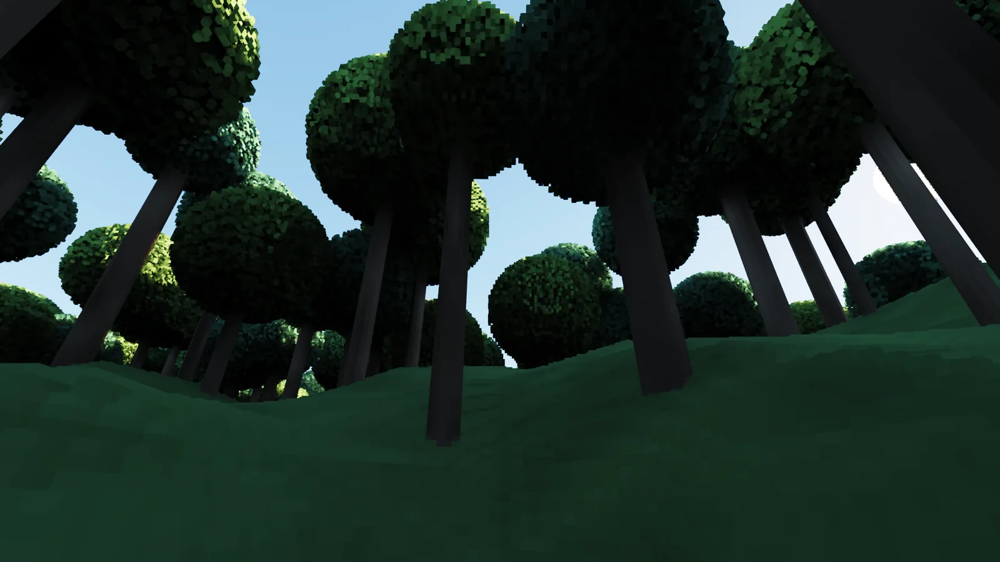

<sub>The forest canopy at 15:00, seen from under the trees.</sub>

Try it:

```sh
cargo run --release -p flythrough -- --source outdoor --trees forest --spawn forest --time 15:00 --eye 0,640,579,270,30
```

### Entities

- Creatures built from voxel models, with rigid parts on a rig.
- Animation clips of keyframes, written as text beside the model.
- Bodies that walk on floors, walls and ceilings.
- A text format for drawing voxel models.
- A ray query that hits every creature identically on every platform.

The models we ship and how to make one: [the entities guide](docs/entities.md).

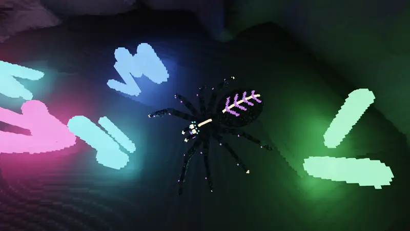

<sub>One spider wandering among the lit crystals of the showcase hall.</sub>

Try it:

```sh
cargo run --release -p flythrough -- --source showcase --entities 1 --entities-walk on --shot crystals \
  --lamp off --model apps/flythrough/assets/entities/spider/spider.rig --eye 680,300,215,0,-65
```

### Structures

- Any MagicaVoxel `.vox` scene, placed in the world as a structure.
- Each palette colour becomes a material: glass, glow or metal.
- Placed at generation time or at runtime, in any of 24 rotations.
- Material colours and glow update live from a text file.
- The testbed generates a castle with a nave, gate and dungeon.

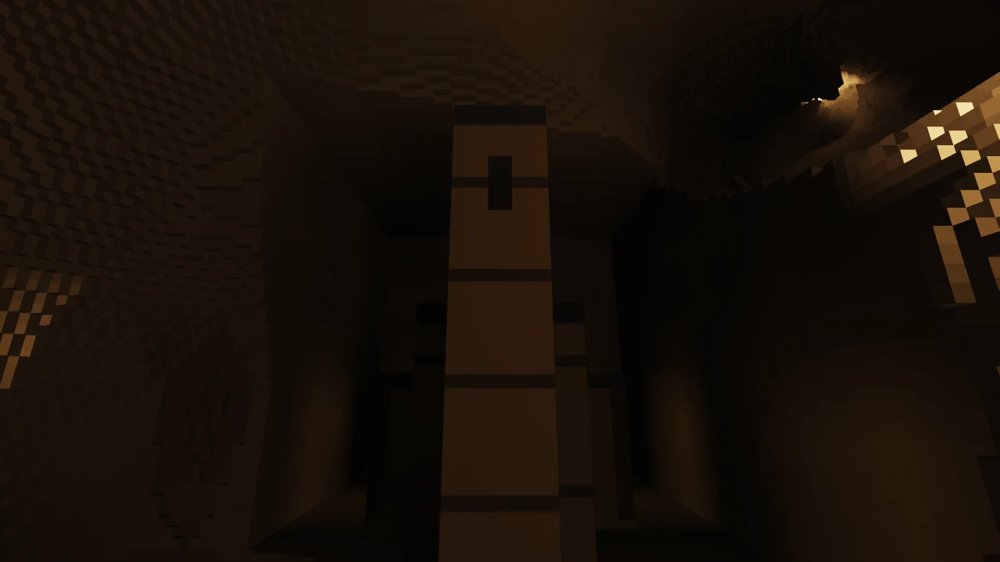

<sub>A chapel from a `.vox` file, placed in the streamed cave, the headlamp off.</sub>

Try it:

```sh
cargo run --release -p flythrough -- --source cave --vox apps/flythrough/assets/structures/chapel/chapel.vox --eye 32,32,32,0,15 --lamp off
```

### Simulation and determinism

- A server owns the world and logs every edit as an operation.
- A session replays from its seed and log to the same hash.
- Clients share the server's world or keep a replica that detects desync.
- Game logic runs natively or as a sandboxed WebAssembly component.
- A character controller that steps, slides, climbs ledges and falls.

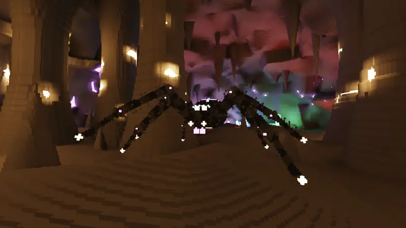

<sub>The spider's walk clip, played from its text rig in the showcase hall.</sub>

### Audio

- 3D sound for headphones, mixed with HRTF.
- Walls muffle and block sound according to their material.
- Early reflections from the surfaces around the listener.
- A late reverb sized by the room the listener is in.

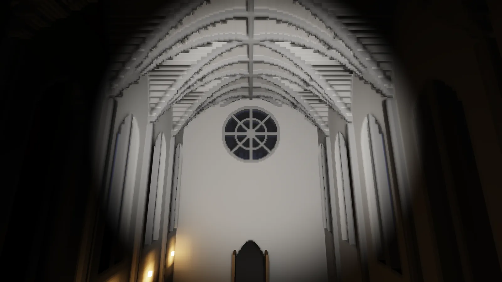

<sub>The castle's nave under its vault, lit by the headlamp and its own lamps.</sub>

Try it:

```sh
cargo run --release -p flythrough -- --castle-shot nave
```

### Tooling

- A testbed to fly, dig, and place lights, creatures and structures.
- One searchable menu; every setting shows its live value.
- A stats overlay with frame times and every render pass.
- Headless runs that write stills, run reports and golden images.
- A tester build for Linux and Windows that benchmarks fixed camera paths.

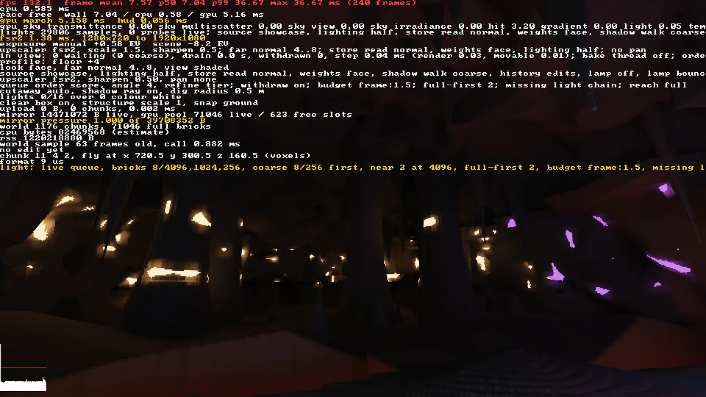

<sub>The stats overlay over the showcase hall.</sub>

Try it:

```sh
cargo run --release -p flythrough -- --source showcase --hud --shot crystals
```

## Gallery

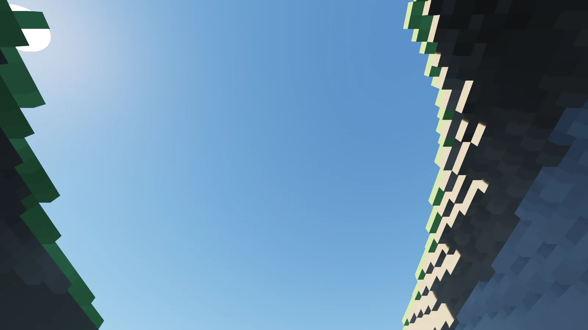

<sub>A dig through a tunnel's roof, opened to the sky.</sub>

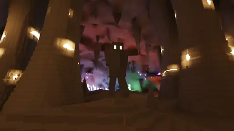

<sub>The walker's walk clip, close up.</sub>

Every image here is the engine's own output, rendered from [the shot list](docs/images/shots.json)
by one command:

```sh
node scripts/shoot-images.mjs
```

## Wishlist

- [A far field out to about a kilometre](docs/roadmap.md)
- [Water and lava with waves, then liquids that flow](docs/roadmap.md)
- [Clouds, weather and a night sky](docs/roadmap.md)
- [Dust, fog and smoke in a coarse volume](docs/roadmap.md)
- [Networking over QUIC, with late join from a seed and the log](docs/roadmap.md#m9-networking)
- [Lua for client-side scripts](docs/roadmap.md)
- [Sand, fire and flowing liquids at chunk scale](docs/backlog.md#chunk-scale-world-dynamics-a-cellular-material-step-and-an-event-scheduler)
- [Hundreds of creatures at once](docs/backlog.md#hundreds-or-thousands-of-entities)
- [Levels and logic written as text, then compiled](docs/references/designer-authoring.md)
- [Deterministic simulation testing](docs/references/deterministic-simulation-testing.md)

## Development

The layout, building, the checks and how the project is run are in [the development guide](docs/development.md).

## License

Licensed under either of

- Apache License, Version 2.0 ([LICENSE-APACHE](LICENSE-APACHE))
- MIT license ([LICENSE-MIT](LICENSE-MIT))

at your option.

Unless you explicitly state otherwise, any contribution intentionally submitted for inclusion in
the work by you, as defined in the Apache-2.0 license, shall be dual licensed as above, without
any additional terms or conditions.
