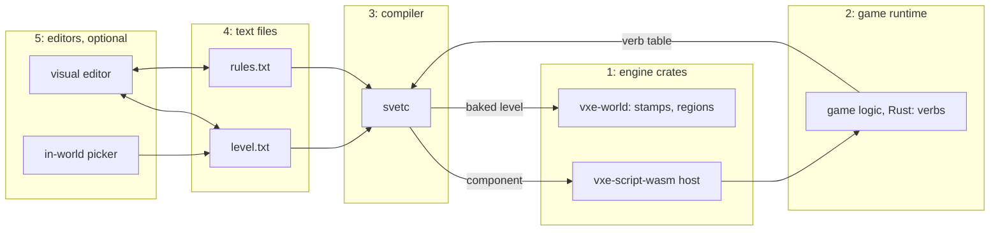

# ADR-0072: Designer authoring is a layered text stack: text files, a separate compiler to the logic component, an optional editor over the same text

> **Status:** proposed (2026-11-17). **A future direction, not scheduled.** The owner's
> framing: "this is more a future idea after everything that we have will be polished. Plus we
> still need proper destruction, physics, water, etc etc". No plan takes it before the current
> polish lands and the engine's own mechanisms (destruction, physics, water, the rest of M8 and
> M10) exist; the backlog entry under "Later apps" carries the pick-up condition.
> **Date:** 2026-11-17
> **Related plan(s):** none yet. The first plan would be a spike (see "What a first plan would
> be"). Builds on ADR-0010 (the logic component), ADR-0007 (the op log and replay), ADR-0014
> (prefab identity in the log), ADR-0051 (`.rig` text), ADR-0065 (the material file), ADR-0067
> (staged structures as logged stamps), ADR-0054 (the tester and `run.json`).
> **Names:** the tree keeps `vxe-*` until Plan 0087 merges (ADR-0071); this record uses the
> names as they are today and names the new crates it proposes with the `svet-` prefix they will
> be born with.

## Context

The owner asked (2026-11-17) what a Blueprint-style system, as in Unreal Engine 5, would look
like here, and then stated the goal behind it: "letting non programmer build levels and game
logic. I guess using a separate compilator could be an idea. I want a layered architecture and
keep the text." The same day he added a requirement for the whole engine: "I want this engine
be best in class, and with possibility to work with it for both pure human workflow, and agentic
workflow as well", and when asked whether that principle is engine-wide, "yes, of course engine
wide". `docs/roadmap.md` carries it as "Two workflows, both first class"; this record applies it
to authoring.

What exists today, and what the stack would stand on:

- **The logic boundary is built and deterministic.** A game's server logic is a component
  behind the `Logic` trait (ADR-0010): `init(seed)`, `tick(tick, inputs) -> bytes`, and a
  `Host` of queries and edits. The WIT world `vxe:logic@0.1.0`
  (`crates/vxe-script-wasm/wit/logic.wit`) imports `apply`, `material-at`, `raycast`,
  `count-in-box` and `unsupported`; compound values cross as the op log's wire bytes. The host
  (`vxe-script-wasm`) gives the component tick clocks, seeded entropy, canonical NaNs, fuel
  per call and a memory cap, so whatever runs in it replays bit-identically through the op log
  (ADR-0007). The one component in the tree is the fly-through's dig logic
  (`apps/flythrough/logic`), Rust, built natively and as a `wasm32-wasip2` component by
  `scripts/build-guests.sh`.
- **The small text formats already follow the rule "text a human writes, parsed by hand".**
  `.rig` files for rigs and clips (ADR-0051), `.voxtext` for voxels drawn as text, the
  material table in the `.rig` line grammar (ADR-0065), staged structures read from a `.vox`'s
  layers and named groups (ADR-0067), and `.vox` itself as the model and prefab format, with
  MagicaVoxel as its editor. None of them is a level, and none carries behaviour.
- **A level is Rust.** Every scene the fly-through shows (`cave.rs`, `castle.rs`, `trees.rs`,
  the showcase hall) is a `WorldSource` written in Rust, with its prefabs stamped by
  `StampedSource`. The level-layout format the logic produces and the generator consumes has
  been owed since M5 (`docs/roadmap.md`, M5's follow-ups). A rule ("the door opens when this
  room is empty of ore") is Rust in the logic crate. Nobody who is not a Rust programmer can
  make a room or a rule, and an agent that makes one edits Rust and rebuilds the workspace.
- **The engine is a library, not a framework** (ADR-0001, `docs/roadmap.md`: "no ECS, no scene
  editor, no asset pipeline beyond voxel model import"), it knows no gameplay (`CLAUDE.md`),
  and Lua for client scripts is deferred until a consumer asks (ADR-0010).
- **The headless loop exists for agents already, in parts.** `flythrough --headless`,
  `--check-args`, `--replay PATH`, `--logic wasm=PATH`, `--path NAME --report DIR` writing
  `run.json` (schema 2, ADR-0054), `--settings`, the logic's broadcast lines, golden images on
  lavapipe, and the world hash a replay reproduces. What is missing is the authoring side: a
  thing to compile, a diagnostic an agent can parse, and a still it can look at from a named
  point of a named level.

Why this is a decision and not a feature list: the obvious answer to "let non-programmers
build logic" is a visual node graph owned by an editor, and that answer is wrong for this
engine for reasons worth recording. A node graph stored as the editor writes it diffs badly and
merges worse; the owner and the agents work in text and in `git`; an editor with its own object
model is the framework the roadmap refuses; and the two engines that tried hardest have moved
on from it for their creators. Godot removed VisualScript in 4.0 after a poll found 0.5 % of
its users on it; Epic gives Fortnite creators Verse, a text language whose stated goals are
"learnable as a first language", determinism and transactional rollback, and dropped Blueprint
nativization in 5.0, with Blueprints themselves reported (November 2026) to leave UE6 for Verse.
Unity's graphs bind host methods by reflective strings through a serialiser the vendor now lists
as a liability. The closest precedent for this engine is Teardown: an XML level file that places
`.vox` models and attaches Lua scripts with typed parameters, tags as the join between placed
things and logic, and an in-game editor that is a view over the same files. The references file
`docs/references/designer-authoring.md` holds the sources with what each one teaches.

## Decision

**Designer authoring is a stack of five layers, and text is the source of truth at every one
of them.** The layers, from the engine up:

| Layer | What | Who owns it | Where |
|---|---|---|---|
| 1 | The engine crates. They learn no gameplay and no language: at most general mechanisms (a level loader from baked data, named regions and their enter/leave events, a logic component swapped at a tick boundary) | engine | `crates/` |
| 2 | The game runtime. Owns the loop, the entity model, and the **verbs**: the actions and queries a designer may use, exported by the game's Rust logic as a typed table | consumer | the game's repo |
| 3 | A **separate compiler**: level and logic text in, a WebAssembly logic component plus baked level data out, with diagnostics that carry file, line and column, as text for a human and as JSON for an agent | engine (a tool, not a runtime crate) | `tools/`, over a grammar library crate |
| 4 | The designer's **text files**: a level file (placements of `.vox` prefabs, named regions, spawn points, material overrides) and logic files in a small rule language | designer | the game's content folder |
| 5 | An **optional visual editor** that reads and writes the same text files, never a format of its own; and an in-world placement helper in the fly-through that writes a line of layer 4 | later, if at all | its own app |

The rules that hold the stack together:

1. **Text is the truth.** A level or a rule exists as a text file a human can read in full and
   an agent can write in full. A visual editor is a view of that text and writes it back in a
   canonical layout (stable ordering, one entity per line or block) so that a diff shows the
   change and nothing else. Anything the editor cannot represent in the text does not exist.
2. **The compiler is separate from the runtime.** Nothing under `crates/` parses designer
   text at run time. The compiler validates, reports every error with its position, and emits
   two artifacts the engine already knows how to consume: a logic component against the WIT
   world, and baked level data in the op log's wire encoding (a seed plus generation-time
   stamps and regions, so a level is a log prefix the way a save is, ADR-0007 and ADR-0014).
3. **The engine learns mechanisms, never meaning.** A region is a box with an opaque id; the
   engine reports what entered and left it. A verb is the game's. A "door", a "trap" and a
   "spawn" are words in layer 4 and code in layer 2.
4. **Both workflows are first class.** Every layer is usable by a human alone and by an agent
   alone, and neither is a port of the other: the engine-wide goal `docs/roadmap.md` states
   under "Two workflows, both first class" (owner, 2026-11-17), applied here to authoring. For
   a human: readable text,
   a preview that reloads on save, errors in the words of the domain at the line that caused
   them, and completion of the names in scope. For an agent: a grammar small enough to write
   reliably from a spec, a headless `compile -> validate -> run -> inspect` loop whose every
   step has machine-readable output (diagnostics as JSON with file, line and column; a run
   report of what happened, tick by tick; a rendered still from a named point; a world hash),
   and deterministic replay so that a change is checked by re-running the same inputs. The
   same binary serves both: the human's editor plugin and the agent's tool call are two front
   ends on one compiler library and one headless runner.
5. **Nothing of this is scheduled.** The stack comes after the current polish and after the
   engine's own mechanisms: destruction, physics, water and the rest (owner, 2026-11-17). Until
   then, every new text format the engine grows (a material file, a structure's stages) is
   designed as a layer-4 file: line-based, hand-parsed, diffable, with positions in its errors.

The decision fixes the shape. The four open choices inside it are shortlisted below with a
recommendation each; they are the owner questions at the end, and the first plan (a spike)
settles the ones that need evidence rather than taste.

## Shortlists

### Decision 1: the logic language of layer 4

| Option | What | For | Against |
|---|---|---|---|
| **(a) A small purpose-built rule language** (recommended) | `when <event> [if <condition>] then <verbs>` rules, named state machines per thing (a chart whose guards and actions are names, as SCXML separates the chart from its action language), a tiny integer and fixed-point expression language, functions with parameters and modules from the first version (Minecraft's datapacks show what a format without them breeds), a `try ... else` whose edits are rolled back on failure (Verse's failure-as-control-flow, cheap over ops that report their result), a standard library of the gadgets every such tool ends up with (counter, timer, selector, exclusive gate), no loops over the world, no floats, no clocks; the verbs and events are the game's typed table plus the engine's host imports. The compiler (a lexer and a parser with error recovery and spans, `logos` and `chumsky` or the like) checks every name and type and emits either a component with the rules lowered to a small bytecode run by a fixed, precompiled interpreter module, or (later, if fuel cost bites) core WebAssembly wrapped into a component by `wasm-tools` | Event, condition and action is the shape every non-programmer logic tool converges on (Dreams and LittleBigPlanet gadgets, Blueprint event graphs, Minecraft command blocks, PuzzleScript's rules, Inform 7's rulebooks). The surface is small enough for a spec an agent reads in one sitting and for an LSP written in a week. Errors speak the domain ("`room_b` is not a region; regions in scope: ..."). Deterministic by construction: the language has nothing nondeterministic to offer, which is what Verse made a language property for its creators. It round-trips to a domain-level block view by design (Godot's lesson: the useful visual layer is domain blocks, not a graph of expressions) | A new language is ours to maintain: grammar, checker, codegen, LSP, spec, examples; Mun, the one Rust-world language with the right design (AOT, static, hot-reload-first), stalled on exactly that cost. An expressivity cliff: the consumer's ARPG logic (treasure classes, affix rolls, combat) is real code and stays Rust in layer 2; the language only composes verbs. Agents write a language they have never seen less reliably than Lua, so the spec and the diagnostics must carry the weight |
| **(b) A Lua dialect** (the fallback): Lua 5.4 or Luau, the VM (C) compiled once with a WASI SDK to a `wasm32-wasip2` module, the designer's source checked by the compiler (Luau's `luau-analyze` is an open-source checker and linter) and embedded as data, a stripped standard library (no `os`, `io`, `math.random`; the host's seeded entropy and tick clocks behind what remains) | Known, taught, documented; Roblox's Luau proves that a creator audience learns it when gradual types, a linter and completion run on one inference engine. Agents write Lua fluently. The expressivity cliff is gone: a designer who outgrows rules writes functions. Teardown, the nearest voxel precedent, ships exactly this: an XML level with `.vox` models and Lua scripts with typed parameters | It is still programming: tables, nil, scope, loops. A garbage collector makes fuel per tick uneven and replay cost less predictable. The VM is C compiled with a WASI SDK, a toolchain the repo does not have (one build, cached, but a build). Floats are everywhere in idiomatic Lua, so fixed-point discipline is a convention, not a check. A general language does not round-trip to a block view, which is why Blueprint and C++ are two things. Not `mlua`: that embeds a VM in the host process, beside the component sandbox, and ADR-0010's boundary would gain a second, wider one |
| **(c) Rhai, Rune or Koto** (Rust-written embeddable languages) | Rust, so the interpreter compiles to WebAssembly with no C toolchain; Rhai counts operations as a budget and has no GC | They are interpreters meant to run in the host process; inside a component they double the sandbox (their limits under wasmtime's fuel) and give no determinism the host does not already give. Few learners, few examples, and so weak for both audiences: a non-programmer has no tutorials, an agent has little training data |
| **(d) A node graph serialised as text** | The editor's graph (nodes, pins, wires, positions) as JSON or a custom text form; the compiler lowers the graph | The visual editor maps one to one onto the file | Fails rule 4 twice: a human cannot write node ids and pin wires by hand, and an agent writes them badly; diffs are of positions and ids. It is the Blueprint format with the extension changed. This is what a layer-5 editor may *emit* into (a), never the source |
| **(e) Rust only, plus data files** | No language: designers edit RON or TOML tables the Rust logic reads | Nothing to build | Every new behaviour needs a programmer and a rebuild. It is the state today, and the floor the stack must beat; kept as layer 2's own data, not as an answer |

**Recommendation: (a), with (b) as the named fallback** if the spike finds that the three
reference scenes (below) cannot be written without loops or arithmetic beyond the tiny
expression language. The deciding fact is the audience: a designer who can write `when
region room_b emptied of ore then open door_b; play sound creak at door_b` has built a level,
and a designer who must learn Lua's `nil` has started a programming course. The ceiling is
handled where it belongs: a rule calls verbs, and verbs are Rust. Whether the compiler's first
back end is a bytecode interpreter inside a fixed module or emitted WebAssembly is an
implementation choice the spike measures (fuel per tick on a rule set of realistic size); the
interpreter is cheaper to build and needs no Rust toolchain on a designer's machine.

### Decision 2: where the compiler lives

| Option | What | For | Against |
|---|---|---|---|
| **(a) This repository** (recommended): a grammar library crate (`svet-lang`: parse, check, lower; the one implementation the compiler, the LSP and any editor share) and a thin CLI (`tools/svetc`), neither a default workspace member, like `vxe-script-wasm` | Versioned with the WIT world it targets and the wire encoding it emits; CI runs the native-vs-component equality test against a compiled rule set; the repo's gates (fmt, clippy, deny, the hooks, the doc scripts) apply with no new harness | The repository grows a second product. The parser and LSP dependencies enter `cargo deny`. `CLAUDE.md`'s map gains a `tools/` row |
| (b) A separate repository | Its own release cadence; the engine repo stays an engine | Version skew against the WIT world and the wire encoding, a second CI, and path or git dependencies across repos, the pain the first consumer already carries |
| (c) The consumer's repository | The verbs are the game's, so the language's vocabulary is partly the game's | The grammar, the checker and the back end are engine-level; a second consumer would need them. Only the verb table is the game's, and it is an input to the compiler, not part of it |

**Recommendation: (a).** The grammar library stays out of every runtime crate's dependency
graph (`vxe-world` and `vxe-net` never depend on it), so the engine a game links knows nothing
of the language; the CLI, the LSP and a game's own in-process hot-reload (layer 2 may link the
library at development time) are front ends on it.

### Decision 3: how a non-programmer edits a level before any visual editor

| Option | What | For | Against |
|---|---|---|---|
| **(a) Text, `.vox` prefabs and a live preview** (recommended): the level file places prefabs made in MagicaVoxel and names regions and points; the fly-through watches the file, recompiles on save, re-stamps the level, swaps the logic component at the next tick boundary, and shows the compiler's errors in its overlay. A **coordinate picker** (aim, press a key, the voxel or region box is copied as a ready-made line) bridges the one thing text is bad at | The cheapest loop, and the same loop the agent runs headless. The model editor already exists and designers know it. Text stays the only truth; the picker only produces text the designer pastes | Boxes typed by hand are tedious without the picker; the picker reads out, never writes back, so the designer still edits the file |
| (b) An in-world placement mode that writes the text back | Aim, pick a prefab or region kind from the overlay menu (ADR-0061), place; the app edits the level file in canonical layout | WYSIWYG for positions; it is the seed of layer 5 and proves the round trip early | An editor grows inside the testbed, a step toward the scene editor the roadmap refuses; write-back must preserve comments and order or it destroys the designer's file |
| (c) MagicaVoxel alone: the `.vox` is the level, its layers the stages, its named groups the markers | Zero new tools; ADR-0067 already reads stages and named groups from a `.vox` | No logic, no text for the level itself (the `.vox` is binary), a palette of 256, and the model size limits of the editor |

**Recommendation: (a), with (c)'s conventions kept** (a `.vox` is the model asset, as a
`.png` is to a web page, referenced from the text by name) **and (b) grown later from the
picker** if designers ask, as the first increment of layer 5, once the canonical layout exists.
The level file's shape borrows what the text level formats have settled: a placement states
only what differs from the prefab's defaults (Bevy's BSN patches), a reader ignores what it does
not know and warns (Tiled's rule), the file carries the format's version (LDtk, Tiled), a placed
thing's script parameters are typed in the level file (Teardown), and the voxel payload is never
inline, only referenced. The live preview's reload is ink's "recompile and fast-forward" over
the op log: replay to the tick the designer was at.

### Decision 4: what the engine (layer 1) must add

All of it general, none of it a language or an editor:

| Mechanism | Shape (a proposal, settled by the spike) | Exists today |
|---|---|---|
| A level loader | A `WorldSource` built from baked level data in the wire encoding: a seed, a base generator's parameters, generation-time stamps by prefab content id (ADR-0014), regions. The layout format owed since M5 | `StampedSource` stamps placements over a source; saves replay a log over a seed (ADR-0007) |
| Named regions and their events | Axis-aligned voxel boxes with an opaque id, registered by the logic through the host; per tick, the engine reports which tracked positions entered or left which region, as an input to `tick` or a host import | Roadmap M3's "region change notifications", unbuilt; `count-in-box` exists |
| A logic component swapped at a tick boundary | Two routes: (i) **replay-based**: the server restarts the new component from the seed and re-simulates the input log to the current tick, so hot reload is a replay and no state migrates; (ii) state hand-off exports (`save-state`/`load-state` as opaque bytes) when replay is too slow for a long session | `--replay PATH` re-simulates a saved session; ADR-0010's native-vs-component equality is the proof the two routes must pass |
| Machine-readable run output | Beside `run.json`: the logic's events per tick as JSON lines, a still from a named point at a named tick, the world hash at exit, all headless | `run.json` schema 2, the broadcast lines as text, goldens in tests, the world hash in the replay tests |
| WIT growth | The host imports the verbs need and the engine can answer generally: region registration and events, and the entity snapshots owed by M6 | `vxe:logic@0.1.0` with five imports |

**Recommendation: build (i) first for the hot swap.** Deterministic replay is the engine's
own mechanism, and it makes a code change checkable by construction: the same inputs, the new
rules, a diff of the two event logs. State hand-off is an optimisation for long sessions and
can wait for a measurement.

## Both workflows, per layer

What each layer gives a human alone and an agent alone. The left column is what exists; the
right column is what the stack adds. Nothing in the agent column is a scraped version of the
human one: both read the same compiler and the same runner.

| Layer | Human alone | Agent alone |
|---|---|---|
| 4, text | A grammar that reads as sentences; comments; one thing per line or block; an LSP in the editor (errors, completion of regions, prefabs and verbs in scope, go to definition), written over the compiler library, never a second parser | A short spec with the full grammar and ten examples; a schema for the level file generated from the Rust types with their doc comments as descriptions (as LDtk publishes its schema), versioned with the format; the verb table as a data file the compiler, the LSP and the agent all read (as Yarn Spinner's command declarations); the LSP's diagnostics as the same JSON the CLI prints |
| 3, compiler | Errors in domain words at file:line:column with a suggestion, rendered with the offending line | `svetc --diagnostics json`, rustc's format imitated: one JSON object per line, a message type, a stable code, byte and line/column spans, the rendered text carried alongside, suggestions marked machine-applicable where they are; one diagnostic type with text, JSON and LSP renderers (`miette`-style); exit codes by severity; `--format sarif` for CI annotation and cross-run fingerprints |
| 2 and 1, run | The fly-through reloads on save, shows the errors in its overlay, plays the level | `flythrough --headless --level X --logic wasm=Y --run-to <tick> --events out.jsonl --still <point>=out.png --report DIR`: text state first (the ops applied with their counts, the region events, the logic's events per tick, the world hash), the still as evidence, with a blank-frame statistic and an optional coordinate overlay so the image is checked before it is trusted; `--replay` to check a change against the same inputs, and "same seed, old and new rules, diff every tick" as the agent's regression harness; the report written to a path, never scraped from a pipe |
| 5, editor | A visual editor over the text, if one is ever built | None needed: the agent is a front end on the text already. The engine MCP servers that exist today spend most of their tools rebuilding a text API over an editor's object model or a binary graph; here the text is the API. An MCP server, if ever, wraps `svetc` and the headless runner and adds nothing they lack |

Already in the tree for the agent: headless render tests on lavapipe (`tests/gpu_*.rs`),
`--headless`, `--check-args`, `--replay`, `--logic wasm=PATH`, `--path ... --report DIR` with
`run.json`, `--settings`, the deterministic op log and the world hash, the logic's broadcast
lines, the golden images and their SSIM floors.

## What a first plan would be

Not now. When the owner opens it, the first plan is a **spike, not a build**:

1. **Three reference scenes on paper**, written as a level file and a rule file in each of two
   candidate syntaxes (the rule language of 1(a), a Lua subset of 1(b)): the dig logic as it
   stands (`apps/flythrough/logic`), a door that opens when a region is emptied of a material,
   a trap that fires when a tracked position enters a region after a timer. The owner reads
   both and picks by eye; an agent writes the same scenes from the spec alone and the plan
   counts its errors.
2. **A throwaway compiler** for the picked syntax (parse, check, lower to a bytecode run by a
   fixed interpreter module; or to a Lua VM module), to a component the existing host runs, and
   a headless run of the door scene that reports its events as JSON lines and its world hash.
3. **Readings:** fuel per tick for the rule set, compile time, the diagnostic format in use by
   an agent, and the replay-based hot swap's time for a 10-minute session.

The ADRs that would follow: the language itself (grammar and semantics, once picked), the level
format and its baked encoding, and the region mechanism's shape in `vxe-world`.

## Consequences

### Positive

- A level and a rule become files a designer, the owner and an agent all write and read, diff
  in `git` and review in a pull request; the editor, when it exists, is replaceable.
- The engine stays a library: it gains a loader, regions and a swap, and no editor, no language
  runtime and no gameplay word.
- Determinism, replay and fuel metering come for free from the component boundary already
  built; a designer's mistake cannot desync a session, only fail a check or run out of fuel.
- The agentic workflow is the headless path the tests already run, extended by a compiler with
  JSON diagnostics and a runner with a report, a still and a hash; no second toolchain.
- The consumer's own logic keeps its home: Rust in layer 2, exporting verbs. The stack adds a
  floor for designers, and takes nothing from programmers.

### Negative

- **A language is a product.** Grammar, checker, back end, LSP, spec and examples, kept in step
  with the WIT world forever. Option 1(b) halves this and loses the audience fit; the owner's
  pick decides which cost to carry.
- **Two logics must compose.** The game's Rust logic (verbs) and the designer's compiled rules
  are two components or one linked module; the spike must show the composition (WIT component
  composition, or the game logic hosting the rule module as a library) before the language is
  worth building.
- **A verb table is an API the game must keep stable** for its designers, with its own
  versioning, the same burden the WIT world already carries for the host.
- **The picker and the live preview grow the fly-through**, which is a testbed, not an editor;
  the line between "a key that copies a coordinate" and "an editor" is a judgment the owner
  must keep making.
- **Nothing here ships soon**, and in the meantime every new scene is Rust. The cost of waiting
  is the pile of Rust scenes that a layer-4 file would later replace or leave as examples.

## Alternatives considered

### Alternative A: a Blueprint-style editor-owned graph as the source format

A visual node editor whose graph is the truth, stored as the editor serialises it (binary, or
a text the editor owns). It lost because it is a framework (an editor with an object model, the
thing the roadmap refuses), its files diff and merge badly, agents and the owner work in text,
and the field has moved: Godot removed VisualScript in 4.0 for lack of use, and Epic gives
creators Verse, a text language, beside Blueprints. A graph view stays possible as layer 5,
over text.

### Alternative B: scripting inside `crates/`

A script runtime (Lua through `mlua`, or a rule interpreter) linked into `vxe-world` or
`vxe-net`, with hooks the engine calls. It lost because the engine would then know gameplay
and a language, the boundary of ADR-0010 (queries, edits and bytes) would gain a second,
wider one, and determinism would depend on the script runtime's discipline instead of on the
component sandbox. ADR-0010 deferred Lua for client scripts; nothing here changes that.

### Alternative C: a general-purpose language with a full toolchain on the designer's machine

Rust, or C# as in s&box: designers write code, a compiler they install builds it. It lost on
the audience: a non-programmer does not install a toolchain, and the compile times of a
workspace build are not a design loop. It stays the programmer's path (layer 2).

### Alternative D: the game interprets designer text at run time, no compiler

The Rust logic parses level and rule text in `init`, inside the component. It lost because
errors surface when the level loads instead of when the file is saved, there is no validation
step for an agent to call, and the component carries a parser in its fuel budget every init.
The compiler's bytecode back end (1(a)) is not this: the text is checked and lowered ahead of
running, and only the lowered form is run.

## Owner questions

Numbered, recommended option first. Each is answered in the backlog entry or in the spike plan
when the stack is opened; none is owed now.

1. **The logic language (Decision 1).** (a) A small purpose-built rule language over the game's
   verbs, bytecode in a fixed interpreter module first; (b) a Lua dialect (Luau or 5.4) with a
   stripped library, the VM as a precompiled module; (c) Rhai or Rune; (d) a node graph as
   text. Recommended (a), with (b) the named fallback the spike keeps alive.
2. **The compiler's home (Decision 2).** (a) This repository: a grammar library crate and a
   `tools/` CLI, not default members; (b) a separate repository; (c) the consumer's repository.
   Recommended (a).
3. **Level editing before any visual editor (Decision 3).** (a) Text files placing `.vox`
   prefabs, a live preview in the fly-through, and a coordinate picker that copies a line;
   (b) an in-world placement mode that writes the file; (c) MagicaVoxel alone. Recommended (a),
   with (b) grown from the picker later if designers ask.
4. **The hot swap (Decision 4).** (a) Replay-based: restart the new component and re-simulate
   the input log to the current tick, no state migration; (b) `save-state`/`load-state`
   exports. Recommended (a) first, (b) on a measurement.
5. **The first plan's scope, when it comes.** (a) A spike: the three scenes on paper in two
   syntaxes, the owner's pick by eye and an agent's error count, then a throwaway compiler and
   one headless run with readings; (b) the level file and loader first, logic later.
   Recommended (a); it is the only step that produces evidence for question 1.
6. **The interim rule.** (a) From now, every new text format the engine grows is designed as a
   layer-4 file (line-based, hand-parsed, positions in its errors), and new fly-through scenes
   stay Rust until the stack exists; (b) start writing new scenes as data files now, ahead of a
   compiler. Recommended (a); (b) invents a format before the spike has picked one.
   **Answered 2026-11-18 (owner): (a).** The rule binds now; questions 1 to 5 wait for the
   spike.
