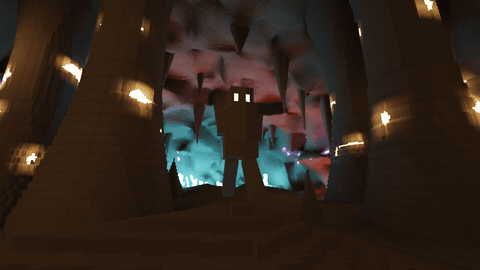
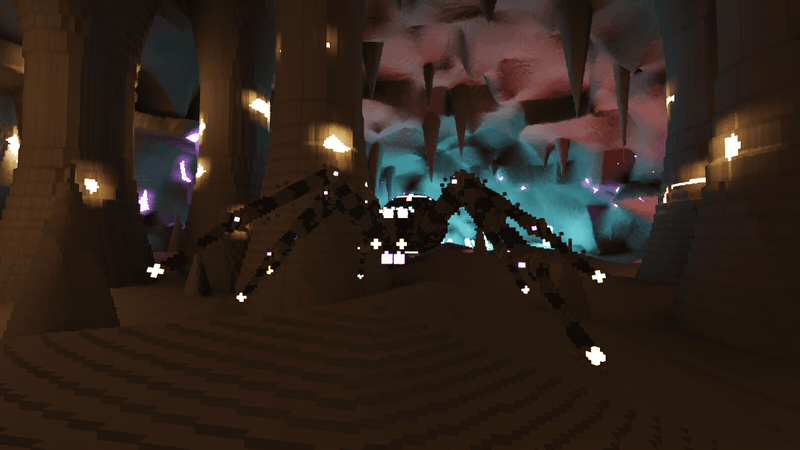

# Entities: the models we have, how they work, how to make one

An entity is a voxel model on rigid parts that moves without touching the world's voxels: a
creature, a door, a prop that swings. The decisions are ADR-0050 (posed voxel volumes in their
own pool, traced after the world march) and ADR-0051 (rigs and clips as text files, sampled in
fixed point by tick); Plan 0062 built the entities and Plan 0063 the rigs, clips and the
fly-through's model viewer. The code: `vxe-entity` (models, poses, clips, the ray query),
`vxe-assets` (`.vox`, `.voxtext` and `.rig` to a model), `vxe-render` (the GPU mirror and
tracing) and the fly-through's viewer (`apps/flythrough/src/viewer.rs`).

## The library

The fly-through's predefined models live in
[`apps/flythrough/assets/entities/`](../apps/flythrough/assets/entities/README.md), one
directory per entry: `<name>.voxtext` (the source), `<name>.vox` (generated from it) and
`<name>.rig`. That directory is the catalogue; `apps/flythrough/tests/entities.rs` checks every
entry in it.

| Entry | Parts | Clips | Materials (table rows) | |
|-------|-------|-------|------------------------|-|
| `walker` | torso, head, legs, arms | `idle`, `walk`, `turn` | `walker`, `walker_eye` |  |
| `spider` | body, abdomen, eight legs on their own phases, palps, fangs | `walk`, `idle`, `rear` | `shell`, `rubble`, `rock`, `ore`, `crystal`, `amethyst`, `ember`, `walker`, `walker_eye` |  |

The rows `crystal`, `amethyst` and `ember` are the showcase's, so the spider builds against the
showcase's table (`--source showcase`) and not the streamed cave's. The `walker` rows are in
every table the fly-through builds.

The two GIFs are regenerated with `scripts/record-clip.sh --width 800 --out
docs/images/spider-walk -- --clip walk` and `scripts/record-clip.sh --width 480 --out
docs/images/walker-walk -- --rig apps/flythrough/assets/entities/walker/walker.rig --clip walk
--ahead 70 --orbit 24,3,-10 --aim 9`.

### The icons

The chooser and the belt show each entry as a still 64 x 64 picture (ADR-0075), made on the CPU
from the model in its rest pose through the entity raycast: an orthographic view 30 degrees down
from off the model's -x, -y side (so a model facing -y, as the rig grammar has it, shows its
front and its left flank), the silhouette fitted to 40 of the 64 pixels, each pixel the hit
voxel's table colour with a fixed light from `(-2, -3, 6) / 7` (the -x, -y and top faces take
three distinct shades). The icons are made on a worker thread when the library builds and again
when an entry's rig reloads with a changed model; a row or a slot shows the entry's name until
its picture arrives. `apps/flythrough/tests/icon.rs` pins the walker's and the spider's icons.

## How they work

### A model is rigid parts on a `.vox`

A model is a list of parts. Each part is a voxel volume (a `vxe_world::Prefab`, one `.vox`
model), a parent part, a pivot and a `detail`: 1, 2 or 4 model voxels to a world voxel, so a
part can be finer than the world. Parts are rigid: a part turns and moves as a whole, and no
voxel moves inside it. The caps are `vxe_entity::MAX_PARTS` parts a model and
`vxe_entity::MAX_EDGE` voxels a side a part, and the renderer draws at most
`vxe_render::MAX_ENTITIES` entities and `vxe_render::MAX_ENTITY_PARTS` parts a frame (the
rest are counted and not drawn).

### The `.rig` file

The rig is a text file beside its `.vox`, one statement a line, `#` a comment. The format's
reference is the module doc of `crates/vxe-assets/src/rig.rs`; in short:

```text
vox walker.vox                     # the .vox, relative to the rig
rate 30                            # ticks a second, for viewers
material 1 walker                  # palette index -> a material table row by name
material 2 walker_eye              #   (`_` stands for a space in the row's name)
part torso node torso at 0 0 8 pivot 4 3 0 detail 2
part head  node head parent torso at 0 0 12 pivot 3 3 0 detail 2
clip nod ticks 30 loop
key 0  head rot x 10
key 15 head rot x -10 move 0 0 0.5
key 30 head rot x 10
```

- **`part`** takes its voxels from a `.vox` transform node by name (`node`) or a model by index
  (`model`). `pivot` is the point it turns about, in its own model voxels. `parent` and `at`
  hang it: `at` is the pivot's rest place from the parent's pivot, in the parent's model voxels
  (for the root, from the entity's origin). Lengths are decimals in steps of 1/256.
- **`material`** maps each palette index the parts use to a row of the consumer's material
  table, by name. An index a part uses with no `material` line is an error.
- **`clip`** and **`key`**: a clip is keys at integer ticks, per part: `rot <x|y|z> <degrees>`
  (whole degrees, several composing in the order written) and `move x y z` (an offset from the
  rest place). With `loop` the clip wraps at its length; without it the clip holds there.

### Poses in fixed point, drawn between ticks

A pose places the entity's root with a fixed-point position and a Q14 quaternion, and each part
relative to its parent. `vxe_entity::sample` gives a clip's pose at an integer tick: translation
linear and rotation a normalised blend along the shorter arc, all in integers, so a server and
its clients pose alike on every platform. Degrees become quaternions through a committed table
of sines, never the platform's `sin`. A viewer draws between two ticks:
`vxe_render::DisplayPose::between` blends the two ticks' placements in `f32` for the frame
only, and every query reads the integer tick's pose.

### Drawn, lit, shadowed and queried

The renderer keeps the parts' volumes in an entity pool beside the world's bricks and a small
tree over the entities' boxes, rebuilt each frame. A primary ray marches the world, then walks
the tree with the world's hit as its limit, and keeps the nearer hit; the list lights' shadow
rays do the same, so an entity casts the list lights' shadows. Probe and bake rays
never see an entity, so it does not light or occlude the baked light. An entity hit is shaded
by the list lights like a world hit and shows its material's emission. Its share of the world's
emissive light comes from its own sample of the emitters (`own`) or from the baked light of the
world faces around it (`world`): `--entity-light own|world` or `Insert` in the fly-through
(`flythrough --help` names the default).

The headless query is `vxe_entity::EntitySet::raycast`: it returns the entity, the part, the
model voxel, the face and the distance, in integer arithmetic. It does not see the world; the
consumer raycasts the world first and gives its distance as the entities' limit.

## Making a new one

1. **Draw the voxels.** Either write a `.voxtext` (the format is the module doc of
   `crates/vxe-assets/src/voxtext.rs`: `color <char> <index> r g b` lines, then per part a
   `model <name> at x y z` and its `layer`s from the bottom up), or model it in MagicaVoxel with
   one model per part and name each transform node after its part. Turn either into the other
   with `cargo run -p vxe-assets --example voxtext -- to-vox x.voxtext x.vox` (or `from-vox`).
   Keep each part within the size cap and z up; the library's models face -y.
2. **Write the rig.** A `part` line per part with its pivot (where the joint is, in the part's
   voxels) and its `at` (where that joint sits on the parent's pivot); a `material` line for
   every palette index the parts use, naming a row of the table it will be drawn under. A
   missing one is refused as
   ``rig line N: part `X` uses palette indices [..] with no `material` line``.
3. **Look at it live.** `flythrough --source showcase --model path/x.rig --clip walk`, then
   `` ` `` places it on the looked-at surface (or `--entities N` places a ring); `Left` and
   `Right` change the clip and `Down` pauses. Save the `.rig` or the `.vox` and the viewer
   reloads it within a second, keeping every placed copy; an error keeps the old model and
   shows `rig line N: ...` in the banner.
4. **Add it to the library.** Put `x.voxtext`, `x.vox` and `x.rig` in
   `apps/flythrough/assets/entities/x/`, and name it in that directory's README.
   `cargo nextest run -p flythrough --test entities` then checks that the voxtext converts to
   the committed `.vox` and that the rig builds against the showcase's table.
5. **Record it.** `scripts/record-clip.sh -- --rig apps/flythrough/assets/entities/x/x.rig
   --clip walk` renders the clip headlessly and writes `target/clip/x-walk.gif`; the
   [fly-through page](flythrough.md#recording-clips) lists its options.
