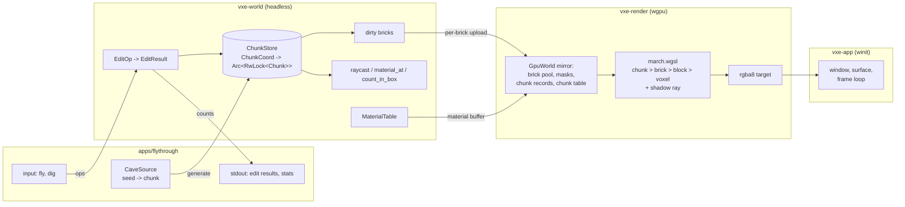

# 0001: Bounded brick map, deterministic edits, and a headlamp ray marcher

> **Status:** in-progress
> **Created:** 2026-10-16
> **Milestone:** M1 in `docs/roadmap.md` (first of two plans; Plan 0002 adds streaming and LOD)
> **Related ADRs:** [ADR-0002](../adrs/0002-brick-map-layout-and-per-chunk-locked-access.md) (storage layout, GPU mirror, access model), ADR-0001 (stack)

## TL;DR

We build the walking skeleton of the engine: a bounded brick-map world in `vxe-world` with a
material table, the full set of edit operations in integer math returning per-material counts,
CPU raycast and region queries, a seeded integer-noise cave, and a `wgpu` compute ray marcher
in `vxe-render` that draws that cave lit by a headlamp with one shadow ray. `vxe-app` gets a
`winit` shell and `apps/flythrough` lets you fly through the cave, dig, and read the counts on
the console. The first thing a reader sees is a headless test: a radius-10-voxel sphere carved
out of solid material 3 returns `{3: 4169}`. The first thing the user sees is a golden image of
the cave on lavapipe, then the fly-through on the dev box. No streaming, no eviction, no LOD:
the world is a finite box of chunks generated up front, and ADR-0002 fixes the layout so that
Plan 0002 adds paging without changing it.

## Context & problem

Nothing in `crates/` exists beyond doc comments. The consumer's P0 list
(`project-context.md`, "The first consumer") needs, in this order of dependency: sparse storage
of a 128 × 128 × 48 m level at 10 cm with a 16-bit material id; carve ops (sphere, box,
capsule, tool-along-ray) whose per-material counts are exact and identical on every machine;
an indestructible flag; raycast, point and region queries; generation as a pure function of
the seed; and a first-person image stable at arm's length. The roadmap fixes the storage
proposal and leaves the access model to this plan's ADR.

`nfr.md` figures touched: §3 world RAM and VRAM (bricks only; mips are Plan 0002), §4 edit cost
and upload volume, §2 primary-ray time (a dev-box reading, labelled as such), §6 determinism
across the two CI arms, §7 time to first frame.

## Decision

We implement ADR-0002 as written: `u16` voxels, 8³ bricks that are `Uniform` or `Full`, 64³
chunks in a map of `Arc<RwLock<Chunk>>`, edits applied in place under per-chunk write locks in
coordinate order after a residency check, a GPU mirror of brick pool, brick masks, chunk
records and a wrapped chunk table, and a marcher that walks chunk, brick, 2 × 2 × 2 block and
voxel levels. The renderer ships primary visibility plus one spot light with one shadow ray;
real lighting is M2. The world is bounded in this plan: a `WorldSource` is evaluated for every
chunk of a stated extent before the first frame, in parallel over chunks with output
independent of thread count.

We rejected a world-first plan without a renderer because the owner wants pixels before the
mechanism debates (smoothing, contours) start, and a render-first plan over dense arrays
because the uniform-brick representation is exactly what the renderer must mirror. We rejected
splitting this into a world plan and a render plan because one close review should see the
store and its mirror together.

## Architecture diagram



## Implementation phases

Each phase ships as its own commit. `dev` implements all phases in one session with no review
between phases. The architect reviews once at the end, in a fresh session. Phase 1 is the
walking skeleton.

Shared conventions for every phase:

- Coordinates: `VoxelCoord` and `ChunkCoord` are `[i32; 3]` newtypes; voxel `v` lies in chunk
  `v.div_euclid(64)` and brick `v.rem_euclid(64).div_euclid(8)`. Fixed-point positions are
  `[i64; 3]` in units of 1/256 voxel; the centre of voxel `i` is `256 * i + 128`. Shape tests
  compare squared distances in `i64` (sphere, box) or `i128` (capsule, which multiplies two
  squared lengths). No `f32` or `f64` appears in any edit predicate, result or hash.
- A test world is built from a `WorldSource`; tests use `UniformSource(material)` and a
  closure source evaluated per voxel. A "solid material-3 world" means `UniformSource(3)` over
  chunks `[-2, 2)³` unless stated otherwise. The material table in tests has rows 0 (air),
  1..=5 (plain) and 4 flagged indestructible.
- Every new dependency is pinned exactly in `[workspace.dependencies]` at the then-latest
  compatible release; the ones expected are listed under "Data shapes".
- Hashes in tests are FNV-1a 64 implemented in `vxe-world`'s test support (no crate), fed in
  ascending chunk coordinate order, bricks in slot order, voxels in x-fastest order; a
  `Uniform` brick hashes as its 512 expanded values so representation changes never move the
  hash.

### Phase 1: Brick map and the first carve
- **Owner skill:** dev
- **What:** `vxe-world` stores a bounded world of `u16` voxels in uniform-or-full bricks inside
  locked chunks, owns a material table, and carves a sphere returning per-material counts and
  the touched chunk set.
- **Files touched:** `Cargo.toml` (workspace deps), `crates/vxe-world/Cargo.toml`,
  `crates/vxe-world/src/{lib.rs, coords.rs, brick.rs, chunk.rs, store.rs, material.rs,
  source.rs, edit.rs, fixed.rs}`, `crates/vxe-world/tests/edits.rs`,
  `crates/vxe-world/tests/support/mod.rs`.
- **Done when:**
  - `World::generate(extent, &source, &table)` over chunks `[-2, 2)³` from `UniformSource(3)`
    holds 64 chunks and 32 768 brick slots, every one `Uniform(3)`, and `World::stats()` reports
    `full_bricks == 0`.
  - `world.apply(&EditOp::sphere(centre_of_voxel([0,0,0]), 10 * 256, Mode::Carve))` returns
    `Ok(EditResult)` with `changed_from == [(3, 4169)]`, `touched` equal to the eight chunks
    with coordinates in `{-1, 0}³` in ascending order, and `aabb == ([-10,-10,-10], [10,10,10])`.
  - After that carve, `material_at([0,0,10]) == Some(0)`, `material_at([5,5,7]) == Some(0)`,
    `material_at([0,0,11]) == Some(3)`, `material_at([6,6,6]) == Some(3)`, and `stats()`
    reports exactly 32 `Full` bricks (the bricks the sphere enters; the 32 other bricks of its
    bounding box contain no carved voxel and stay `Uniform`).
  - Carving the same sphere again returns `changed_from == []` and `touched == []`.
  - A brick whose voxels all become air collapses: carving a box covering exactly brick
    `[0,8)³` leaves `stats().full_bricks` unchanged from before the box was applied.
  - `vxe-world` has no dependency that links a GPU API; `cargo clippy -p vxe-world -- -D
    warnings` passes with the wall-clock ban in `clippy.toml` in force.

### Phase 2: All shapes, all modes, indestructible, atomic failure
- **Owner skill:** dev
- **What:** box and capsule shapes; `Carve`, `Fill(material)` and `Replace { from, to }` modes;
  the indestructible flag honoured by `Carve` and ignored by `Replace`; an op touching a
  non-resident chunk fails before changing anything.
- **Files touched:** `crates/vxe-world/src/{edit.rs, shape.rs, material.rs}`,
  `crates/vxe-world/tests/edits.rs`.
- **Done when:**
  - In the solid material-3 world, `EditOp::box_(min = [0,0,0], max = [1024,1280,1536],
    Mode::Carve)` (fixed-point, half-open) returns `changed_from == [(3, 120)]` (4 × 5 × 6
    voxel centres fall inside).
  - `EditOp::capsule(a = centre_of_voxel([0,0,0]), b = centre_of_voxel([10,0,0]), r = 3 * 256,
    Mode::Carve)` returns `changed_from == [(3, 413)]`.
  - In a world where `x >= 0` is material 4 (indestructible) and `x < 0` is material 3, the
    radius-10 sphere carve at the origin returns `changed_from == [(3, 1926)]` and
    `material_at([0,0,0]) == Some(4)` afterwards.
  - In the same world, `Mode::Replace { from: 4, to: 5 }` with that sphere returns
    `changed_from == [(4, 2243)]` (4169 - 1926) and `material_at([0,0,0]) == Some(5)`: replace
    ignores the flag.
  - After the radius-10 carve in the solid material-3 world, `Mode::Fill(2)` with a box of
    voxels `[-1,1]³` (fixed `[-256,-256,-256]..[512,512,512]`) returns `changed_from == [(0, 27)]`;
    filling it again returns `[]`; `Fill` never overwrites a non-air voxel.
  - A radius-10 sphere centred on voxel `[127,0,0]` of the `[-2,2)³` world returns
    `Err(EditError::NotResident([2,0,0]))` and the world hash is identical before and after.
  - A fixed list of ops mixing every shape and mode produces the same `changed_from` vector
    whether applied to a world generated with one thread or sixteen (generation parallelism is
    invisible).

### Phase 3: Raycast, queries, tool-along-ray
- **Owner skill:** dev
- **What:** an integer DDA raycast over bricks (uniform bricks skipped whole), point and region
  material queries, and the tool-along-ray op built on the raycast.
- **Files touched:** `crates/vxe-world/src/{raycast.rs, query.rs, edit.rs}`,
  `crates/vxe-world/tests/{queries.rs, edits.rs}`.
- **Done when:**
  - After the radius-10 carve in the solid material-3 world, `count_in_box([-10,-10,-10],
    [10,10,10])` (inclusive voxel coordinates) returns `[(0, 4169), (3, 5092)]` in ascending
    material order.
  - `count_in_box` over a box that exactly covers chunk `[1,1,1]` of the uncarved world returns
    `[(3, 262144)]` and, by an instrumented counter in the test support, reads zero voxel
    arrays (uniform bricks contribute 512 without a read).
  - `raycast(origin = centre_of_voxel([0,0,0]), dir = [0,0,256], max_t = 100 * 256)` in the
    carved world returns `Some(Hit { voxel: [0,0,11], face: NegZ, t: 2688, material: 3 })`
    (from z = 0.5 to the face at z = 11.0 is 10.5 voxels); `t` is exact fixed-point, computed
    by cross-multiplication, never by a float division.
  - The same ray with `max_t = 2687` returns `None`; a ray starting inside voxel `[0,0,11]`
    returns `Some(Hit { voxel: [0,0,11], t: 0, face: None, .. })` (`face` is an `Option`).
  - A ray along `[256, 256, 256]` from the origin centre of the carved world hits the voxel the
    brute-force reference walk in the test (stepping the ray in 1/1024-voxel increments and
    reporting the first solid voxel) also reports, for ten seeded directions.
  - `EditOp::tool_along_ray(origin = centre_of_voxel([0,0,0]), dir = [0,0,256], max_t = 100 *
    256, r = 2 * 256, Mode::Carve)` in the carved world returns `changed_from == [(3, 26)]`: the
    capsule from the origin to the hit face point `(128, 128, 2816)` with radius 2 voxels
    reaches 26 solid voxels at z = 10, 11 and 12 outside the earlier sphere.
  - With no hit within `max_t`, the capsule ends at `origin + dir * max_t / 256`.
  - The raycast is a pure function: a test asserts byte-identical hit lists over 1000 seeded
    rays against a blessed FNV-1a hash (the first cross-arm assertion; the full vector is
    Phase 4).

### Phase 4: Cave source, determinism vector, world budget readings
- **Owner skill:** dev
- **What:** a seeded integer-noise cave `WorldSource` in `apps/flythrough` (the engine ships
  no terrain), the CI determinism vector asserted on both arms, a `criterion` bench for the edit
  budget, and a release example that prints the RAM and mirror sizes at two scene sizes.
- **Files touched:** `apps/flythrough/src/cave.rs`, `apps/flythrough/Cargo.toml`,
  `crates/vxe-world/tests/determinism.rs`, `crates/vxe-world/benches/edits.rs`,
  `crates/vxe-world/examples/world_budget.rs`, `crates/vxe-world/src/hash.rs` (FNV-1a and
  the integer hash and value noise helpers the cave builds on, since they are reusable and
  deterministic), `docs/nfr.md`.
- **Done when:**
  - `CaveSource { seed, extent }` produces chunks from integer value noise with a 64-bit mix
    hash, trilinear interpolation in fixed point, and a threshold; materials are 1 rock, 2 ore
    (veins from a second noise), 3 shell on the outermost 2 voxels of the extent flagged
    indestructible, 0 air; a spherical air pocket of radius 3 m exists at the stated spawn
    point. No `f32`, `f64`, `sin`, `exp` or `powf` in the source (a grep in the test).
  - Same seed, same chunk: identical bytes; seeds 1 and 2 differ in at least one chunk.
  - A brick whose eight corner densities all sit beyond a margin from the threshold is emitted
    `Uniform` without per-voxel evaluation; the spawn pocket and the shell are applied after.
  - `tests/determinism.rs` generates the cave with seed `0x5EED_0001` over chunks `[0,4)³`,
    applies a fixed list of 24 ops (every shape and mode, one of them failing on a
    non-resident chunk), hashes the voxels and every result (and the error) with FNV-1a 64,
    and asserts the hash equals a literal constant blessed on Linux. CI runs it on both arms;
    the constant is not loosened to make Windows pass.
  - `cargo bench -p vxe-world --bench edits` measures 100 radius-10 carves at distinct seeded
    positions in a fresh solid world per iteration (every carve expands uniform bricks, the
    worst case) and the log records the reading on the dev box against `nfr.md` §4 (2 ms).
  - `cargo run --release -p vxe-world --example world_budget -- --chunks 20x20x8 --seed 1`
    and `-- --chunks 32x32x32 --seed 1` print: chunk count, `Full` and `Uniform` brick counts
    and the `Full` fraction, CPU bytes by accounting (`Full` bricks × 1024 + chunks × slot
    array), mirror bytes by the same formula the uploader uses (`Full` bricks × (1024 + 8) +
    chunks × (512 × 4) + table), generation wall time and voxels per second per thread. The
    example carries the `#[allow(clippy::disallowed_methods)]` for its one clock read. The
    log records both readings; `nfr.md` §3 and §5 get the fraction and the throughput as
    dev-box readings.

### Phase 5: GPU mirror and primary-ray marcher with a golden image
- **Owner skill:** dev
- **What:** `vxe-render` mirrors the store into the ADR-0002 buffers, uploads dirty bricks,
  and marches primary rays in a WGSL compute shader into an `rgba8` target, shaded as albedo
  times a spot-light term without shadows. A headless golden test runs on lavapipe.
- **Files touched:** `crates/vxe-render/Cargo.toml`, `crates/vxe-render/src/{lib.rs,
  gpu_world.rs, camera.rs, marcher.rs, readback.rs}`,
  `crates/vxe-render/src/shaders/march.wgsl`, `crates/vxe-render/tests/golden.rs`,
  `crates/vxe-render/tests/golden/primary.png`, `crates/vxe-render/tests/support/mod.rs`.
- **Done when:**
  - `GpuWorld::new(device, extent)` sizes the chunk table to the extent, grows the brick pool
    by whole pages (initially from `stats().full_bricks`), and `sync(&world, &queue)` uploads
    every dirty brick and clears the dirty bits; after a second `sync` with no edits, zero
    bytes are written (a counter the test reads).
  - A brick that collapses to `Uniform` frees its pool slot and the chunk record entry becomes
    `uniform | material`; the free list reuses the slot on the next expansion.
  - The shader walks chunk table, chunk record, then voxels of a `Full` brick with a
    three-level DDA (the block level is Phase 8); a uniform-air entry advances the ray by a
    whole brick; a uniform-solid entry hits at the brick entry face. Workgroup size 8 × 8; the
    dispatch is `ceil(width / 8) × ceil(height / 8)` and the shader bounds-checks the pixel.
  - The device is requested with `max_storage_buffer_binding_size` and `max_buffer_size` set to
    the adapter's values (clamped to what the pool needs); the golden test prints the
    adapter's name and both limits, and the log records them for lavapipe and for the dev box.
  - `tests/golden.rs` requests a software adapter (`force_fallback_adapter`), builds the cave
    with seed 7 over chunks `[0,6)³` with the spawn at its centre, applies one radius-10 carve
    1.5 m ahead of the camera, renders 320 × 180 from the fixed spawn pose, reads the target
    back, and compares to `tests/golden/primary.png`: at most 0.1 % of pixels differ by more
    than 2/255 in any channel (exact match is expected on the same Mesa; the tolerance absorbs a
    runner upgrade). If no adapter is found the test prints `skipped: no software adapter` and
    passes, so the Windows arm stays green; `VXE_BLESS=1` rewrites the golden.
  - The golden shows the carve: the test also renders the same scene without the carve and
    asserts that at least 2 % of pixels differ from the golden by more than 8/255 (the carve
    is visible), and that the golden holds at least two colours each covering 5 % of the
    pixels or more (a uniform image fails; inside a closed pocket no ray misses).

### Phase 6: Headlamp with a shadow ray
- **Owner skill:** dev
- **What:** a spot light carried with the camera but offset from the eye (right 0.25 m, down
  0.15 m, so shadows are visible), cone falloff, inverse-square attenuation, and one shadow ray
  per pixel from the hit point offset half a voxel along the face normal toward the lamp.
- **Files touched:** `crates/vxe-render/src/shaders/march.wgsl`, `crates/vxe-render/src/{marcher.rs,
  light.rs}`, `crates/vxe-render/tests/golden.rs`, `crates/vxe-render/tests/golden/headlamp.png`.
- **Done when:**
  - `golden/headlamp.png` is blessed on lavapipe for the Phase 5 scene with the lamp on and
    compared under the same floor.
  - Rendering the scene with the shadow ray disabled (a `LightParams` flag that exists for this
    test and the fly-through's debug toggle) gives an image in which no pixel is darker than
    the shadowed image, and at least 1 % of pixels are brighter by more than 8/255: shadows
    exist and only ever remove light.
  - `golden/primary.png` is unchanged by this phase.

### Phase 7: Window shell and the fly-through
- **Owner skill:** dev
- **What:** `vxe-app` wraps `winit` 0.30's `ApplicationHandler` with a surface and a frame
  loop that hands input and a frame to a user trait; `apps/flythrough` generates the
  level-size cave, flies, digs, and prints edit results and stats.
- **Files touched:** `crates/vxe-app/Cargo.toml`, `crates/vxe-app/src/{lib.rs, input.rs,
  shell.rs}`, `apps/flythrough/src/{main.rs, cave.rs, fly.rs}`, `apps/flythrough/Cargo.toml`,
  `crates/vxe-render/src/present.rs` (blit of the `rgba8` target to the surface).
- **Done when:**
  - `cargo run --release -p flythrough -- --seed 1` opens a window on the dev box, prints
    `first frame after <n> ms` with n under 3000 (`nfr.md` §7), and shows the cave from the
    spawn pose. Generation of the 20 × 20 × 8 chunk extent runs in parallel over chunks with
    `std::thread::scope`.
  - WASD and mouse look (cursor locked) fly the camera; left click applies
    `tool_along_ray` with radius 0.5 m along the view ray; right click fills a sphere of
    radius 0.3 m with material 1 at the hit point; scroll changes the radius; `L` toggles the
    shadow ray; `B` applies 100 radius-10 carves at seeded positions within 10 m and prints
    the CPU time of the edits and the bytes `sync` uploaded; `F1` prints frame time (CPU, and
    GPU through timestamp queries when `Features::TIMESTAMP_QUERY` is available), `Full`
    brick count and mirror bytes; `Esc` quits.
  - Every edit prints one line in the form `carved: rock 1234, ore 12 (3 chunks, 0.21 ms)`
    using the material table's names.
  - The only wall-clock reads outside `vxe-app` are in `apps/flythrough`, each behind an
    `#[allow(clippy::disallowed_methods, reason = ...)]`; `vxe-world` and `vxe-render` have
    none.
  - CI builds `flythrough` on both arms (no windowed test runs).

### Phase 8: Brick occupancy masks
- **Owner skill:** dev
- **What:** the 64-bit occupancy mask per `Full` brick in the mirror and a block-level step
  in the marcher, with the primary-ray timing read before and after.
- **Files touched:** `crates/vxe-world/src/brick.rs` (mask builder), `crates/vxe-render/src/{gpu_world.rs,
  marcher.rs}`, `crates/vxe-render/src/shaders/march.wgsl`,
  `crates/vxe-world/tests/bricks.rs`, `docs/nfr.md`.
- **Done when:**
  - `Brick::occupancy_mask()` of a brick with the single solid voxel `[3,3,3]` is `1 << 21`
    (block `(1,1,1)`, bit `bx + 4 by + 16 bz`); of an all-air brick, 0; of an all-solid brick,
    `u64::MAX`; and the mask of any brick equals the brute-force mask computed in the test over
    64 seeded random bricks.
  - The marcher walks the 4 × 4 × 4 mask before touching voxels: an unset block advances the
    ray by a 2 × 2 × 2 block in one step.
  - `golden/primary.png` and `golden/headlamp.png` match bit-exactly on lavapipe: the mask
    changes no hit.
  - The log records the primary-pass GPU time at 1920 × 1080 from the fly-through's spawn
    pose on the dev box before and after this phase (timestamp queries), and `nfr.md` §2 gets
    the reading labelled dev reference.

## Data shapes

```rust
// illustrative: vxe-world
pub struct VoxelCoord(pub [i32; 3]);
pub struct ChunkCoord(pub [i32; 3]);
pub struct Fixed3(pub [i64; 3]);           // 1/256 voxel
pub type MaterialId = u16;                 // 0 is air

pub enum Brick { Uniform(MaterialId), Full(Box<[MaterialId; 512]>) }
pub struct Chunk { bricks: [Brick; 512], dirty: [u64; 8] }
pub struct ChunkStore { chunks: RwLock<HashMap<ChunkCoord, Arc<RwLock<Chunk>>>> }

pub struct Material {
    pub name: String, pub albedo: [f32; 3], pub roughness: f32, pub emission: [f32; 3],
    pub hardness: f32, pub flags: MaterialFlags /* INDESTRUCTIBLE */,
    pub acoustic: [f32; 3] /* absorption, transmission, resonance */, pub payload: u64,
}

pub enum Shape { Sphere { c: Fixed3, r: i64 }, Box_ { min: Fixed3, max: Fixed3 },
                 Capsule { a: Fixed3, b: Fixed3, r: i64 } }
pub enum Mode { Carve, Fill(MaterialId), Replace { from: MaterialId, to: MaterialId } }
pub struct EditOp { pub shape: Shape, pub mode: Mode }   // tool_along_ray resolves to Capsule
pub struct EditResult {
    pub changed_from: Vec<(MaterialId, u32)>,  // ascending material; voxels that changed, by old id
    pub touched: Vec<ChunkCoord>,              // ascending
    pub aabb: (VoxelCoord, VoxelCoord),        // inclusive bounds of changed voxels
}
pub enum EditError { NotResident(ChunkCoord) }
pub trait WorldSource { fn chunk(&self, coord: ChunkCoord, out: &mut Chunk); }
```

```text
GPU mirror (ADR-0002), all storage buffers, little-endian u32 words:
  brick_pool:    [slot][256 x u32]   two u16 voxels per word, x fastest
  brick_masks:   [slot][2 x u32]     bit b = block (b & 3, (b >> 2) & 3, b >> 4) has a non-air voxel
  chunk_records: [chunk][512 x u32]  bit 31 set: pool slot in bits 0..31; clear: material in bits 0..16
  chunk_table:   [wrapped coord]u32  record index, or 0xFFFF_FFFF when absent
  materials:     [id][8 x f32]       albedo rgb, roughness, emission rgb, flags as f32 bits
  params:        uniform             camera, extent, window, light, flags
```

Expected new dependencies (pinned by `dev` at the then-latest compatible release): `wgpu`,
`winit`, `glam`, `bytemuck`, `pollster` (blocking adapter and buffer-map awaits), `log` and
`env_logger` (the fly-through only), and as dev-dependencies `png` (golden images) and
`criterion` (the edit bench). `vxe-world` takes none of them.

## Budgets

| `nfr.md` figure | Expected effect | How the close measures it |
|---|---|---|
| §3 world RAM and VRAM | First readings of the `Full` brick fraction at level size and at the 100 m cube; the mips line stays a proposal until Plan 0002 | `world_budget` example, both sizes, release, dev box; plus the fly-through's `F1` mirror bytes at level size |
| §4 edit cost (100 carves of radius 1 m in 2 ms) | Read, not changed | `cargo bench -p vxe-world --bench edits`, dev box; the fly-through's `B` key for the in-frame figure with upload bytes |
| §2 primary rays (3.0 ms at 1080p, baseline) | First dev-box reading, before and after masks | Timestamp queries from the fly-through's spawn pose at 1920 × 1080, dev box, labelled dev reference |
| §5 generation throughput | First reading (bounded, synchronous) | voxels per second per thread from `world_budget` |
| §6 determinism | Asserted | `tests/determinism.rs` on both CI arms, every push |
| §7 time to first frame (3 s) | Read | the fly-through's startup line, dev box |

The baseline GPU is not on hand; every GPU figure in this plan is a dev-reference reading and
says so.

## Risks & open questions

- **Storage buffer binding limits.** wgpu's default `max_storage_buffer_binding_size` is
  128 MiB and `max_buffer_size` 256 MiB; the level-size scene can need up to 1.6 GB if every
  brick were `Full`. Phase 5 requests the adapter's limits and records them for lavapipe and
  the dev box. If the measured `Full` fraction times 1 KiB exceeds what an adapter binds,
  Plan 0002 shards the pool across bindings; this plan does not.
- **lavapipe speed.** A software adapter marching 57 600 pixels through a 6³-chunk cave should
  take well under a second; if a golden test exceeds 30 s on CI, shrink the scene, not the
  resolution floor.
- **GPU and CPU DDA disagreement.** The shader walks in `f32`; the CPU raycast is integer. At a
  grazing voxel corner they may pick adjacent voxels. The dig lands where the CPU says; a
  one-voxel visual mismatch at corners is accepted and noted, not hidden.
- **Blessing across arms.** The determinism constant is blessed on Linux. If the Windows arm
  disagrees, the cause is a non-integer path and is a defect to fix; the test is not loosened.
- **Generation cost against the first-frame budget.** 840 M voxels of noise per start is too
  slow if every voxel is evaluated; the uniform-brick early-out on corner densities is the
  mechanism, and the throughput reading tells whether it suffices.
- **Pointer lock on Wayland.** `winit` 0.30 supports `CursorGrabMode::Locked` on Wayland; if
  Hyprland refuses it, fall back to `Confined` plus relative motion and note it.
- **Threading.** No lock is held across generation; the uploader takes one chunk read lock at a
  time; ops lock chunks in ascending order. A test asserts generation output is independent of
  thread count; nothing else in this plan runs concurrently with edits.
- **Open:** whether `Fill` should report the material it wrote as well as the air it replaced.
  The result keys by old material only; the consumer's P0 needs removed-per-material, which
  that gives. Revisit when a consumer asks.

## What this plan does NOT do

- **Streaming, eviction, edit persistence for paged-out chunks, LOD mips, LOD rays:** Plan 0002.
- **The far-field clipmap** beyond the resident set: its own plan after M1.
- **Per-chunk palette narrowing of the mirror and sharding the brick pool:** taken in Plan 0002
  or a follow-up if this plan's VRAM readings demand it (ADR-0002).
- **Real lighting, emissive extraction, denoising, upscaling, the smooth-surface spike:** M2.
- **Sweeps, character controller, coarse grids, change notifications:** M3.
- **A save format or an op log on disk:** M5 (seed plus op log).
- **A baseline-GPU reading:** the card is not on hand (`nfr.md` §1); M2 close.
- **Debug views and a profiler overlay:** M7. The fly-through prints to stdout.

## Implementation log

> Written by `dev`: one row per phase as its commit lands, then the close block. **The phases
> above are the contract. This section records what happened.** Observations, never conclusions:
> no pass list, no self-assessment. Deviations and unmet done-whens are **always** disclosed.
> Keep it shorter than `## Implementation phases`.

| phase | owner | state | commit |
|---|---|---|---|
| 1: Brick map and the first carve | dev | done | committed with this row |
| 2: All shapes, all modes, indestructible, atomic failure | dev | not started | |
| 3: Raycast, queries, tool-along-ray | dev | not started | |
| 4: Cave source, determinism vector, world budget readings | dev | not started | |
| 5: GPU mirror and primary-ray marcher with a golden image | dev | not started | |
| 6: Headlamp with a shadow ray | dev | not started | |
| 7: Window shell and the fly-through | dev | not started | |
| 8: Brick occupancy masks | dev | not started | |

### Notes

_(Deviations from the plan, with the commit, stated without justification. Done-whens not
satisfiable as stated, and what was done instead. Followups noticed and not acted on. One line
each. Empty is fine.)_

- Phase 1: the `Box_` shape landed in `edit.rs` in Phase 1, because the collapse done-when carves a box (commit of Phase 1).
- Phase 1: `EditResult::aabb` is `Option<(VoxelCoord, VoxelCoord)>`, `None` when nothing changed (commit of Phase 1).
- Phase 1: the collapse done-when ("`full_bricks` unchanged") cannot hold after the sphere, where brick `[0,8)³` is `Full`. Per the owner, the test runs it on a fresh solid world (0 -> 0, brick is `Uniform(0)`) and also asserts 32 -> 31 after the sphere, with the box carving 32 voxels (commit of Phase 1).
- Phase 2: the done-when expects `NotResident([2,0,0])` for the sphere at `[127,0,0]`, but the shape also reaches non-resident `[2,-1,-1]`, `[2,-1,0]` and `[2,0,-1]`, and `[2,-1,-1]` comes first in ascending order. Routed to `/architect` by the owner before Phase 2 starts.
- Phase 4 (owner-approved, not yet applied): `CaveSource` is unreachable from `vxe-world` tests, so `flythrough` gets a lib target and `determinism.rs` and `world_budget.rs` move under `apps/flythrough/`.

### Close triggers

_(Facts for the architect. No recommendations, and no suggested version bump.)_

- **What shipped:**
- **Public API changed:**
- **Budget readings:**
- **Gate at the tip:**
- **Outstanding `human` phases:**

## Followups

- Per-chunk 8-bit palette in the mirror (ADR-0002, "named follow-up"), after the VRAM reading.
- A `Fill` result that also reports the written material, if a consumer needs it.
