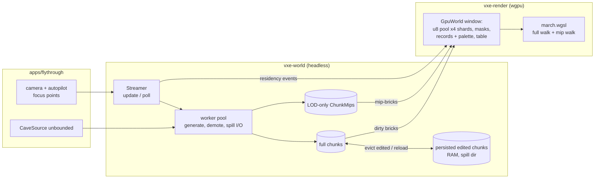

# 0002: Streaming residency, an LOD-only ring, and a narrowed, sharded mirror

> **Status:** in-progress
> **Created:** 2026-10-16
> **Milestone:** M1 in `docs/roadmap.md` (second of two plans; closes M1)
> **Related ADRs:** [ADR-0003](../adrs/0003-sphere-residency-with-lod-ring-and-edit-persistence.md) (residency tiers, LOD-only ring, persistence, edit/eviction exclusion), [ADR-0004](../adrs/0004-palette-narrowed-sharded-brick-pool.md) (8-bit palette mirror, sharded pool), ADR-0002 (layout, access model), ADR-0001 (stack)
> **Prerequisite:** Plan 0001 closed (done 2026-10-16, v0.2.0), including its Phase 8 (brick
> occupancy masks) and its fix pass (batched runs in `GpuWorld::sync`).

## TL;DR

The world stops being a box generated up front. In `vxe-world`, a `Streamer` keeps chunks
resident in spheres around focus points. Full-detail chunks lie inside `r_full`, and a ring out
to `r_lod` keeps only 32³/16³/8³ mips. A `std::thread` pool generates and demotes chunks off the
caller's thread. An evicted chunk that was ever edited is kept in RAM, spills to disk past a
cap, and comes back byte-identical. In `vxe-render`, the mirror follows the camera through a
wrapped window. It uploads nearest-first under a per-frame byte budget, in batched writes. It
stores voxels as 8-bit indices into a per-chunk palette, splits the brick pool over up to four
bindings, and the marcher walks LOD-only chunks at mip resolution. The first thing a reader sees
is a headless test: a radius-2 residency around chunk `[0,0,0]` holds exactly 33 chunks, and
after the focus moves three chunks along x it holds 42, with 22 evicted. The first thing the
user sees is the fly-through streaming an unbounded cave. `--autopilot` digs a hole, flies
300 m away and back, and prints that the hole's chunks hash as they did right after the dig.

## Context & problem

Plan 0001 delivered the bounded walking skeleton. M1 is not done until the world streams
(ADR-0001, `nfr.md` §5), and Plan 0001's readings (its Implementation log, `nfr.md` §3 and §5)
add four problems this plan must solve:

- **VRAM.** The cave's `Full` brick fraction is 20.8 % to 23.4 %, against the 10 % the roadmap
  assumed. A 32³-chunk cube mirrors to 3.5 GB at `u16`, over the 3 GB world line, before any LOD.
- **Binding limits.** One storage binding holds at most 2 GiB on the dev box and 128 MiB on
  lavapipe. The level-size pool (about 375 MiB) already fails on lavapipe.
- **Upload.** Plan 0001's fix pass batched the initial mirror into runs of consecutive pool
  slots (349 to 357 ms for the level, down from 853 to 888 ms), but `sync` still visits every
  chunk under a write lock and writes one record per dirty chunk. In the fly-through, 100
  carves then one `sync` read 3.9 to 12.9 ms of render-thread CPU for 1.2 to 2.0 MB, against
  the 1.0 ms streaming line of `nfr.md` §2. A streaming world uploads all the time.
- **Persistence.** Edits are ops on resident chunks. A chunk that leaves residency must come
  back with its edits (`nfr.md` §5, last bullet).

Consumer requirements served (`project-context.md`, "The first consumer"): P1 stacked levels
generated in the background, which streaming covers, and P0 generation as a pure function of
the seed, kept under streaming. The consumer's P0 bounded levels need no streaming, and
`World::generate` stays for them.

`nfr.md` figures touched: §2 primary rays (the palette lookup and the LOD walk) and the
streaming line; §3 world VRAM and RAM; §5 residency latency and generation throughput under
streaming; §6 determinism (mips join the cross-platform vector); §7 time to first frame.

## Decision

We implement ADR-0003 and ADR-0004 in one plan, world first:

- In `vxe-world`, sphere residency in two tiers with hysteresis, driven by `update(focus)` and
  `poll()` on the caller's thread over a `std::thread` worker pool. `World::apply` holds the
  store map's read lock for the whole op. Edited chunks are persisted in RAM with disk spill.
- Also in `vxe-world`, `ChunkMips` built from a full chunk.
- In `vxe-render`, a wrapped mirror window around one focus (the camera), a dirty-chunk set so
  an idle sync costs nothing, nearest-first budgeted uploads in batched writes, 8-bit
  palettes with a wide fallback, up to four pool shards, and LOD records walked by the marcher
  at a per-chunk mip level.
- `apps/flythrough` streams an unbounded cave and gains an autopilot that measures what the
  close needs.

The radii are parameters. Their defaults (`r_full = 16`, about 102 m; `r_lod = 24`, about 154 m;
`h = 1`) are proposals that a headless sweep in Phase 8 checks, and the close sets them from
it. That follows the owner's decide-by-measurement rule.

Rejected (details in the ADRs): cube residency (1.9 times the chunks); mips in every resident
chunk (adds VRAM instead of replacing it); op-log replay for persistence (M5 owns the log);
keeping the ring's full voxels in RAM (4.8 GB); per-brick variable-width palettes (allocator
complexity first, saving second); a global 8-bit remap (caps a world at 255 materials); and
storage binding arrays (a native-only feature unproven on the baseline). We rejected splitting
LOD into a Plan 0003 because the VRAM line can only be read once, with all three levers in
place.

## Architecture diagram



A chunk's lifecycle, with `d` the integer chunk distance to the nearest focus chunk:

```mermaid
stateDiagram-v2
    [*] --> Queued: d <= r_lod
    Queued --> Full: generated or reloaded, d <= r_full
    Queued --> LodOnly: generated or reloaded, mips built
    LodOnly --> Queued: d <= r_full (promote, regenerate)
    Full --> LodOnly: d > r_full + h (demote; persist if edited)
    LodOnly --> [*]: d > r_lod + h (evict)
    Full --> [*]: d > r_lod + h (evict; persist if edited)
```



## Implementation phases

Each phase ships as its own commit. `dev` implements all phases in one session with no review
between phases. The architect reviews once at the end, in a fresh session. Phase 1 is the
walking skeleton.

Shared conventions for every phase:

- Plan 0001's conventions hold: coordinates, fixed point, integer shape tests, a "solid
  material-3 world" from `UniformSource(3)`, the test material table, and FNV-1a 64 hashes in
  ascending chunk order with `Uniform` bricks hashed expanded.
- **Distances are integer chunk units.** The focus chunk is the focus voxel's `chunk()`.
  `d2(c, f) = |c - f|^2` in `i64`. Chunk `c` is wanted full when `min_f d2 <= r_full^2`, and
  wanted LOD-only when it is not full and `min_f d2 <= r_lod^2`. A full chunk is demoted only
  when `min_f d2 > (r_full + h)^2`; a resident chunk of either tier is evicted only when
  `min_f d2 > (r_lod + h)^2`.
- **No clock in `vxe-world`.** Latency is counted in `update` ticks. The fly-through converts
  ticks to milliseconds with its own frame timer (the app shell's `#[allow]` pattern).
- **Tests drive the streamer synchronously** with `wait_idle(&world)`, which blocks until the
  queue is empty and all results are polled. No test sleeps.
- **Golden test time.** On the Linux CI arm Plan 0001's golden tests took up to 67 s each,
  over its 30 s line, because each test regenerates the cave and renders it several times.
  Every golden test this plan adds or changes generates each scene once per test binary and
  reuses one device. On the dev box's llvmpipe the slowest golden test finishes within 10 s
  (CI runners read about 2.5 times slower), and the log records the slowest per phase that
  touches `golden.rs`.
- New dependencies: none expected. Threads, the queue, channels and file I/O are `std`. Spill
  tests use a directory under `std::env::temp_dir()` named from the test name and
  `std::process::id()`, removed by the test.

### Phase 1: Streamer skeleton, full tier only
- **Owner skill:** dev
- **What:** an empty unbounded `World`, a `Streamer` that loads and evicts full chunks around
  focus points on a worker pool, and `World::apply` holding the store map's read lock for the
  whole op.
- **Files touched:** `crates/vxe-world/src/{lib.rs, store.rs, stream.rs, edit.rs}`,
  `crates/vxe-world/tests/stream.rs`, `crates/vxe-world/tests/support/mod.rs`.
- **Done when:**
  - With `UniformSource(3)`, `r_full = r_lod = 2`, `h = 1` and one focus at voxel `[0,0,0]`,
    after `update` and `wait_idle` the store holds exactly the 33 coordinates with
    `x^2 + y^2 + z^2 <= 4`.
  - After the focus moves to voxel `[192,0,0]` (chunk `[3,0,0]`), `update` and `wait_idle`
    leave exactly 42 resident chunks: the 33 within distance 2 of `[3,0,0]`, plus the 9 old
    chunks within distance 3 of it that are not among the 33. The 22 chunks farther than 3
    are evicted. `poll` reports those 22 as evicted, and each of the 42 as loaded exactly once
    over both steps.
  - Every streamed chunk hashes equal to the same coordinate from `World::generate` over a
    covering extent, on the `flythrough` cave's per-voxel closure stand-in in
    `tests/support` (a non-uniform source, so the hash is not trivially equal).
  - The resident set's world hash is identical with 1 worker and with 8 workers.
  - A unit test of the queue order on a radius-2 set around `[0,0,0]`: the focus chunk
    first, then its 6 face neighbours in ascending coordinate order, then the 12 at squared
    distance 2.
  - A carve on a chunk evicted in the second step returns `NotResident` with that coordinate
    and changes nothing.
  - `World::apply` takes the store map's read lock before its residency check and releases it
    after the last write. A test holds a map write lock on another thread and shows `apply`
    blocks until it is released (a `Barrier` and a `std::sync::mpsc` handshake, no sleeps).

### Phase 2: Edited-chunk persistence and disk spill
- **Owner skill:** dev
- **What:** an `edited` flag on chunks, a persistence map that takes edited chunks on
  eviction and gives them back on reload, and spill files past a RAM cap.
- **Files touched:** `crates/vxe-world/src/{lib.rs, chunk.rs, edit.rs, stream.rs, persist.rs}`,
  `crates/vxe-world/tests/persist.rs`.
- **Done when:**
  - On a solid material-3 world with `r_full = r_lod = 1` and the focus at `[0,0,0]`, a
    radius-10-voxel sphere carve centred on voxel `[32,32,32]` returns `{3: 4169}`, touched
    `[[0,0,0]]`. Moving the focus to chunk `[10,0,0]` evicts all 7 chunks, and persistence
    holds exactly 1 (the 6 unedited chunks are not persisted). Moving back reloads
    `[0,0,0]` from persistence, not from the source: its hash equals the hash taken right
    after the carve, `material_at([32,32,32])` is air and `material_at([32,32,43])` is 3.
  - The same sequence with `ram_cap_bytes = 0` and a spill directory leaves one file in the
    directory while the chunk is evicted, with 0 bytes held in RAM. After reload the file is
    gone and the hash matches. With no spill directory and cap 0, the chunk stays in RAM and
    `StreamStats::persist_over_cap` is true.
  - A spill file round-trips byte-exactly: write, read, then rewrite gives the same bytes.
    Flipping one byte of the brick payload makes the reload report
    `StreamError::Spill { coord: [0,0,0], kind: Corrupt }`; the chunk stays non-resident and
    the other 6 chunks load. A file written under world key 1 and read under key 2 reports
    `WorldMismatch`.
  - **No lost edit under racing eviction.** One thread applies 2000 radius-2-voxel carves at
    SplitMix64-seeded voxel centres in chunks `x` in `[-1, 1]`, `y = z = 0`, recording which
    ops returned `Ok`. Another thread alternates the focus between chunk `[0,0,0]` and chunk
    `[4,0,0]` (`r_full = r_lod = 1`) and polls. At the end the focus returns to `[0,0,0]` and
    `wait_idle` runs. The hash of the 7 chunks resident at focus `[0,0,0]` equals that of
    the same chunks in a bounded world over `[-1, 2)^3` with only the `Ok` ops applied in
    issue order (an `Ok` op touches only those 7, so the reference never fails). The test runs on 4
    workers. The op sequence is seeded; the interleaving is not, and the assertion holds for
    every interleaving.

### Phase 3: Mirror window, dirty-chunk set, budgeted batched upload
- **Owner skill:** dev
- **What:** `GpuWorld` mirrors the chunks inside a cubic window of side `W` that follows one
  focus, takes residency events from `poll`, visits only dirty chunks on `sync`, uploads them
  nearest-first under a byte budget, and batches its queue writes.
- **Files touched:** `crates/vxe-world/src/{store.rs, chunk.rs, edit.rs, stream.rs}` (the
  dirty-chunk set), `crates/vxe-render/src/{gpu_world.rs, marcher.rs}`,
  `crates/vxe-render/src/shaders/march.wgsl` (window origin replaces the extent),
  `crates/vxe-render/tests/mirror.rs`, `apps/flythrough/src/main.rs` (the bounded world
  through the new API).
- **Done when:**
  - `World` keeps a set of chunks with any dirty brick, and `sync` visits only those. A
    second `sync` with no edit and no residency event visits 0 chunks
    (`SyncStats::chunks_visited`) and writes 0 bytes.
  - On the Phase 1 scenario (`r = 2`, `h = 1`, `W = 7`), after the move and a full sync, the
    mirror holds exactly 42 live records. For each of the 42 chunks, a readback of table,
    records and pool decodes to that chunk's CPU voxels. The live pool slot count equals the
    `Full` bricks of the 42 chunks. The 22 evicted chunks' slots are on the free list.
  - On the level-size seed-1 world, the initial sync issues at most `3 × chunks + 8` queue
    writes and copy commands (`SyncStats::writes`). The log records the dev-box upload time
    against Plan 0001's 349 to 357 ms.
  - The fly-through's `B` key (bounded `--level` world) prints its `sync` time; the log records
    five readings against Plan 0001's 3.9 to 12.9 ms for 1.2 to 2.0 MB.
  - With `sync_budget_bytes = 8 MiB`, every sync of that world writes at most 8 MiB plus one
    chunk's largest upload (526 848 B: a wide chunk, 512 × 1024 + 2560). The first sync
    includes the chunk holding the focus voxel. `SyncStats::pending_chunks` reaches 0.
  - `apps/flythrough/tests/golden/primary.png` and `headlamp.png` match bit-exactly on
    lavapipe, with the window set to the golden extent.

### Phase 4: Per-chunk 8-bit palette, wide fallback
- **Owner skill:** dev
- **What:** pool slots of 512 one-byte palette indices, a 256-entry `u16` palette after each
  record's brick entries, and two-slot `u16` bricks for wide chunks (ADR-0004).
- **Files touched:** `crates/vxe-render/src/gpu_world.rs`, `crates/vxe-render/src/shaders/march.wgsl`,
  `crates/vxe-render/tests/mirror.rs`, `docs/nfr.md` (§3 mirror bytes).
- **Done when:**
  - On the level-size seed-1 world, live pool bytes equal `512 × Full bricks` exactly:
    196 407 296 B for its 383 608 `Full` bricks, with no wide chunk in the cave. Records are
    2560 B per mirrored chunk.
  - A closure-source chunk using 300 distinct non-air materials is wide. Each of its `Full`
    bricks holds an even-aligned slot pair, and the readback decodes to its CPU voxels. A
    two-material chunk next to it decodes through its palette.
  - A `Fill` with a material not yet in a chunk's palette appends it. That sync uploads only
    the touched bricks plus the chunk's record and palette; the chunk's other `Full` bricks
    are not rewritten (`SyncStats::bricks`). A fill that pushes a chunk past 255 non-air
    materials turns it wide and rewrites every `Full` brick of that chunk.
  - `primary.png` and `headlamp.png` match bit-exactly on lavapipe: narrowing changes no
    pixel.
  - The log records the primary-pass GPU time at 1920 × 1080 from the fly-through's spawn pose
    on the dev box, before and after this phase.

### Phase 5: Brick pool sharded over four bindings
- **Owner skill:** dev
- **What:** the pool as up to four storage buffers of `slots_per_shard` slots each, sized
  from the adapter's limits, with a shard `switch` in the shader.
- **Files touched:** `crates/vxe-render/src/{gpu_world.rs, marcher.rs, lib.rs}`,
  `crates/vxe-render/src/shaders/march.wgsl`, `crates/vxe-render/tests/mirror.rs`,
  `apps/flythrough/tests/golden.rs`.
- **Done when:**
  - `slots_per_shard` is the largest multiple of 4096 with `slots × 512` within both
    `max_storage_buffer_binding_size` and `max_buffer_size`. The shard count is
    `min(4, max_storage_buffers_per_shader_stage - 4)`. A `MirrorConfig::max_shard_slots` test
    knob caps it lower. Nothing reads the adapter's backend or vendor.
  - On lavapipe (128 MiB per binding, so 262 144 slots per shard), the level-size seed-1 world
    syncs without `PoolTooLarge`, using 2 shards for its 383 608 slots. A readback of 1000
    SplitMix64-chosen `Full` bricks, at least one of them in shard 1, decodes to the CPU
    voxels.
  - With `max_shard_slots` set so the golden scene needs at least 2 and at most 4 shards,
    `primary.png` and `headlamp.png` match bit-exactly on lavapipe.
  - A world that needs more than four shards' slots fails `sync` with `PoolTooLarge`,
    reporting the four-shard capacity, and changes nothing in the mirror.
  - The log records `max_storage_buffers_per_shader_stage` for lavapipe, the RTX 3080 Laptop
    and RADV.

### Phase 6: Chunk mips in `vxe-world`
- **Owner skill:** dev
- **What:** `ChunkMips::build(&Chunk)`: three levels of mip-bricks (64, 8 and 1), as
  `Brick`s of 8³ cells, under ADR-0003's conservative majority rule. Mips join the
  determinism vector.
- **Files touched:** `crates/vxe-world/src/{lib.rs, mips.rs, hash.rs}`,
  `crates/vxe-world/tests/mips.rs`, `apps/flythrough/tests/determinism.rs`.
- **Done when:**
  - An air chunk with one voxel of material 5 at local `[3,3,3]` has cell `[1,1,1]` = 5 at
    level 1 and cell `[0,0,0]` = 5 at levels 2 and 3. Every other cell is air. Level 1 has
    exactly 1 `Full` mip-brick of 64, level 2 has 1 of 8, and level 3 has 1 of 1.
  - Within one 2³ block, 4 voxels of material 2 and 4 of material 7 give 2 (tie to the lower
    id). 3 of 7, 1 of 2 and 4 air give 7 (air never wins while anything is solid). 8 air give
    air.
  - A uniform chunk of material `m` has every mip-brick `Uniform(m)` and no `Full` one.
  - On a solid material-3 chunk carved by a radius-10 sphere centred on local `[32,32,32]`
    (4169 voxels), exactly 410 level-1 cells, 32 level-2 cells and 0 level-3 cells are air
    (the cells whose voxels all lie in the sphere).
  - Mips equal a brute-force reference built from voxels over 16 SplitMix64-seeded chunks.
  - `apps/flythrough/tests/determinism.rs` also hashes the mips of every chunk of the fixed
    vector. The constant is blessed on Linux and asserted on the Windows CI arm.

### Phase 7: The LOD-only ring and the mip walk
- **Owner skill:** dev
- **What:** the streamer's second tier (demote, promote, evict LOD-only), LOD records in the
  mirror (73 mip-brick entries plus the palette, flagged in the chunk table), and a marcher
  that walks a LOD-only chunk's mip level as a DDA over cells of `2^level` voxels.
- **Files touched:** `crates/vxe-world/src/{stream.rs, store.rs}`,
  `crates/vxe-world/tests/stream.rs`, `crates/vxe-render/src/{gpu_world.rs, marcher.rs}`,
  `crates/vxe-render/src/shaders/march.wgsl`, `crates/vxe-render/tests/mirror.rs`,
  `apps/flythrough/tests/golden.rs`, `apps/flythrough/tests/golden/lod.png`.
- **Done when:**
  - `r_full = 1`, `r_lod = 2`, `h = 0`, focus `[0,0,0]` on a solid material-3 world: 7 full
    chunks and 26 LOD-only. Queries and `apply` treat the 26 as non-resident.
  - A radius-10 carve at voxel `[96,32,32]` (local `[32,32,32]` of chunk `[1,0,0]`) returns
    `{3: 4169}`. Moving the focus to chunk `[-1,0,0]` demotes `[1,0,0]` (squared distance
    4). Its mips show 410, 32 and 0 air cells at levels 1 to 3, and persistence holds it.
    Moving back promotes it from persistence, hash-equal to the post-carve hash.
  - The mirror's readback of a LOD record decodes to the chunk's `ChunkMips`. A demoted
    chunk's full-brick slots return to the free list.
  - The marcher picks a LOD-only chunk's level from its squared chunk distance to the camera
    chunk: level 1 within `(2 r_full)^2`, level 2 within `(4 r_full)^2`, else 3. A params
    override forces a level for tests.
  - **Identity property:** a scene of uniform chunks (solid material 3 below `z = 0`, air
    above) renders bit-identically on lavapipe with every chunk except the camera's
    LOD-only at each forced level, against all full, because a uniform chunk's mips hit at
    the same entry face.
  - `apps/flythrough/tests/golden/lod.png`: the seed-7 golden scene from the spawn pose,
    with chunks at squared distance > 1 from the camera chunk LOD-only at forced level 1.
    Same tolerance and skip rule as `primary.png`. The test also asserts at least 1 % of
    pixels differ from `primary.png` by more than 8/255, so the LOD walk is really in use.

### Phase 8: The fly-through streams; autopilot, sweep and readings
- **Owner skill:** dev
- **What:** an unbounded `CaveSource`, the fly-through on the streamer by default (`--level`
  keeps the bounded world), an `--autopilot` run that measures streaming, and a headless
  `world_budget --stream` sweep.
- **Files touched:** `apps/flythrough/src/{cave.rs, main.rs, lib.rs}`,
  `apps/flythrough/examples/world_budget.rs`, `apps/flythrough/tests/determinism.rs` (the
  bounded vector unchanged), `docs/nfr.md`.
- **Done when:**
  - `CaveSource::unbounded(seed)` has no extent and no shell. The bounded constructor and its
    goldens are unchanged, and the spawn pocket sits at a fixed voxel. The first frame waits
    for the 33 chunks within squared distance 4 of the spawn chunk to be resident and
    mirrored, not for all of `r_full`. The log reads time to first frame and time to full
    residency separately.
  - `--autopilot` waits for full residency, then carves 1 m at the first rock hit within 30 m
    along +x (CPU raycast, `tool_along_ray`). It prints the counts and records the hash of the
    touched chunks. It then flies +x at 10 m/s for 30 s (300 m, beyond `(r_lod + h) × 6.4 m =
    160 m`, so the touched chunks are evicted), flies back for 30 s, and waits for those
    chunks to be full again. It prints `return: <n> chunks, hash match` or
    `hash MISMATCH` and exits.
  - The autopilot prints the following, all dev reference:
    - unready-near frames: frames in which a chunk wanted full within squared distance
      `(r_full - 2)^2` of the camera chunk is not yet both resident and mirrored. The
      target is 0 at 10 m/s.
    - render-thread streaming CPU per frame (`update + poll + sync`): p50, p99 and max,
      against the 1.0 ms line.
    - residency latency from wanted to mirrored (ticks converted to ms): p95 and max,
      against the 500 ms proposal.
    - peak mirror bytes, resident RAM and persisted RAM.
    - march-pass GPU time over the flight (timestamp queries, when the adapter has
      `Features::TIMESTAMP_QUERY`): p50, p99 and max. Plan 0001's close saw 3.8 to 8.1 ms at
      2530 × 1378 away from spawn, against 1.59 ms at 1080p from spawn, so the spawn pose
      alone does not defend §2.
  - `world_budget --stream R_FULL,R_LOD` builds the residency around the unbounded cave's
    spawn headlessly. It reports chunks per tier, CPU bytes and the projected mirror bytes
    (at 8 bits, palettes and records included, mips counted). It runs for `R_FULL` in
    {10, 12, 16} and `R_LOD` in {R_FULL + 4, R_FULL + 8}, and the six rows go into `nfr.md`
    §3.
  - The fly-through's defaults are `r_full = 16`, `r_lod = 24`, `h = 1`, and the window side
    is `2 (r_lod + h) + 1 = 51`.

## Data shapes

```rust
// illustrative: vxe-world
pub struct Residency { pub r_full: i32, pub r_lod: i32, pub hysteresis: i32 }
pub struct PersistConfig { pub ram_cap_bytes: u64, pub spill_dir: Option<PathBuf>, pub world_key: u64 }
pub struct StreamConfig { pub residency: Residency, pub workers: usize, pub persist: PersistConfig }

pub struct Streamer { /* worker pool, queue ordered by (d2, coord), tick counter */ }
impl Streamer {
    pub fn new<S: WorldSource + Send + Sync + 'static>(source: Arc<S>, cfg: StreamConfig) -> Self;
    pub fn update(&mut self, world: &World, focus: &[VoxelCoord]);   // recomputes when a focus chunk moves
    pub fn poll(&mut self, world: &World) -> StreamEvents;            // inserts, evicts, persists
    pub fn wait_idle(&mut self, world: &World) -> StreamEvents;       // tests and startup
    pub fn stats(&self) -> StreamStats;
}
pub struct StreamEvents {
    pub loaded: Vec<(ChunkCoord, Tier)>, pub demoted: Vec<ChunkCoord>,
    pub evicted: Vec<ChunkCoord>, pub errors: Vec<StreamError>,
    pub latency_ticks: Vec<u32>,                                      // per chunk loaded full
}
pub enum Tier { Full, LodOnly }
pub enum StreamError { Spill { coord: ChunkCoord, kind: SpillError } }
pub enum SpillError { Io, Corrupt, WorldMismatch, Version }

pub struct ChunkMips { levels: [Vec<Brick>; 3] }   // 64, 8, 1 mip-bricks of 8^3 cells

impl World {
    pub fn new(table: &MaterialTable) -> Self;                         // empty, unbounded
    pub fn lod(&self, c: ChunkCoord) -> Option<Arc<ChunkMips>>;
}
```

```text
GPU mirror after this plan (ADR-0004 over ADR-0002), little-endian u32 words:
  params          uniform   camera, window_min, window_size, light, lod radii, forced level, flags
  brick_pool[k]   storage   k = 0..4; [slot_in_shard][128 x u32], four u8 palette indices per word;
                            a wide brick is two slots holding [256 x u32] of u16 pairs
  brick_masks     storage   [global slot][2 x u32] (Plan 0001 Phase 8), mip-bricks included
  chunk_records   storage   [record][640 x u32]: 512 entries, then the palette (256 x u16)
                            entry: bit 31 full | bit 30 wide | slot in bits 0..30,
                                   or the uniform material in bits 0..16
                            LOD record: entries 0..64 level 1, 64..72 level 2, 72 level 3
  chunk_table     storage   [wrapped coord]u32: record index | bit 30 LOD-only; 0xFFFF_FFFF absent
  materials       storage   [id][8 x f32], unchanged
  storage buffers per stage: 4 shards + 4 = 8 (WebGPU default limit)
```

## Budgets

| `nfr.md` figure | Expected effect | How the close measures it |
|---|---|---|
| §3 world VRAM (3 GB) | Projected, a guess from Plan 0001's 20.79 % `Full` fraction: about 0.99 GB for 17 077 full chunks at `r_full = 16` (57.9 KB each: pool 54.5 KB, masks 0.85 KB, record 2.56 KB), plus about 0.67 GB for 40 700 ring chunks at `r_lod = 24`. The ring's per-chunk cost (about 16.5 KB, assuming 35 % of level-1 mip-bricks are `Full`) has never been measured. | `world_budget --stream` sweep (six rows), and the autopilot's peak mirror bytes, dev box |
| §3 world RAM (4 GB) | Resident full chunks at about 117 KB each (about 2.0 GB at `r_full = 16`), mips, and persisted chunks | the same sweep and the autopilot's RAM line |
| §2 primary rays (3.0 ms) | The palette lookup and the LOD walk; expected small | spawn-pose timestamps at 1080p before and after Phase 4, and at close, plus the autopilot's march p50/p99 over the flight, dev reference |
| §2 streaming line (1.0 ms) | First real reading | the autopilot's render-thread streaming CPU, p99 and max |
| §5 residency latency (500 ms) and throughput | First reading under motion. At 10 m/s the full sphere's leading face needs about 1260 chunks/s and the ring's about 2830 chunks/s; together about 1.1e9 voxels/s, against about 1.65e9 on the dev box's 15 workers at Plan 0001's per-thread rate | the autopilot's latency p95 and max and its unready-near frames; generation voxels/s/worker from `StreamStats` |
| §6 determinism | Mips join the vector; streaming changes no voxel | `determinism.rs` on both arms; Phase 1 and 2 hash tests |
| §7 time to first frame (3 s) | Should drop: 33 chunks and batched upload, not 3200 chunks one brick at a time | the fly-through's startup lines (first frame, full residency), dev box |

The baseline GPU is not on hand; every GPU figure in this plan is a dev-reference reading and
says so. On the baseline's 4 cores the ring will likely lag at 10 m/s. Far geometry arriving
late is acceptable; a hole near the camera is not, and the unready-near counter is the check.

## Risks & open questions

- **Generation rate with a ring.** Each ring chunk is generated at full detail and
  downsampled, and each promotion generates again (ADR-0003). If the dev box's unready-near
  frames are not 0 at 10 m/s, the levers are a smaller default `r_lod`, or full promotions
  preempting LOD jobs harder. A `WorldSource::mips` method that skips full generation is the
  clipmap plan's, not this one's.
- **Holes at the camera when uploads lag.** An unmirrored chunk is drawn as empty space. The
  nearest-first budget is the mechanism and the unready-near counter is the check. The plan
  does not add a "not yet loaded" fill.
- **Determinism.** Residency timing varies between runs, but chunk contents must not. The
  Phase 1 thread-count test, the Phase 2 interleaving test and the mips vector defend it. The
  queue order ties to coordinates, so even scheduling is reproducible for a fixed worker
  count, though no test depends on that.
- **Threading.** `apply` holds the map read lock for an op's duration. Insertion and eviction
  wait for it, and no lock is held across generation or spill I/O. A worker reads a chunk
  under its read lock to demote it. A burst of 100 carves holds the read lock for about 5 ms
  (Plan 0001's bench), so `poll` can stall that long on the render thread. The autopilot's
  max streaming CPU would show it. If it does, `poll` defers insertion with `try_write`
  instead of blocking.
- **Spill I/O on workers.** A slow disk delays reload, not the frame. A spill directory on a
  full disk reports `Io` and the chunk stays in RAM.
- **Palette lookup cost.** One extra dependent read per voxel hit. Phase 4 measures it.
- **LOD look.** Mips are conservative, so thin gaps close and holes shrink by up to a cell. A
  level-1 cell (20 cm) at 102 m spans about 2.4 pixels at 1080p and a 90 degree field of view.
  This is the owner's on-screen call at the close, which may move `r_full` or the level radii.
- **Window size.** A cubic window of side 51 is 132 651 table entries (about 0.5 MB). With
  several focus points, chunks outside the camera's window are resident but not mirrored.
  That is intended: one camera, one window.
- **Plan 0001 drift.** Resolved at its close: the mask buffer and the marcher structure are
  as this plan assumes. `GpuWorld::sync` already stages `Full` bricks in runs of consecutive
  slots (112cfa0); Phase 3 builds on that, not on per-brick writes.
- **CI runner image.** `ubuntu-latest` moves to Ubuntu 26 from 2026-10-19, with a newer Mesa.
  If the goldens fail there with no code change, re-bless on the new runner's lavapipe in its
  own commit and record it; never widen the floor.
- **Open:** whether the LOD record should get its own smaller stride (it uses 73 of 512
  entries; a shared stride costs about 104 MB at the default ring). It stays one stride
  unless the sweep says otherwise.

## What this plan does NOT do

- **The edit-cost miss** (4.9 ms bench, 3.1 to 4.6 ms in the fly-through, against §4's
  2 ms): the budget stands (owner's call at Plan 0001's close), and the fix is its own plan
  after this one.
- **The far-field clipmap** and a `WorldSource` method that generates coarse cells directly:
  its own plan after M1.
- **LOD rays inside full-detail chunks**, CPU queries or raycasts against LOD-only chunks.
- **A save format or op log on disk:** M5. The spill is a per-process cache with no
  compatibility promise.
- **Per-brick variable-width palettes, binding arrays, more than four shards:** ADR-0004
  alternatives, revisited on a baseline reading.
- **Several mirror windows, or several cameras.**
- **Streaming for the consumer's bounded levels:** `World::generate` stays for them.
- **A baseline-GPU reading:** M2's close (`nfr.md` §1).
- **Lighting, denoising and the smooth-surface spike:** M2.

## Implementation log

> Written by `dev`: one row per phase as its commit lands, then the close block. **The phases
> above are the contract. This section records what happened.** Observations, never conclusions:
> no pass list, no self-assessment. Deviations and unmet done-whens are **always** disclosed.
> Keep it shorter than `## Implementation phases`.

| phase | owner | state | commit |
|---|---|---|---|
| 1: Streamer skeleton, full tier only | dev | done | ac973d2 |
| 2: Edited-chunk persistence and disk spill | dev | done | f59b8f1 |
| 3: Mirror window, dirty-chunk set, budgeted batched upload | dev | done | 4bc17bd |
| 4: Per-chunk 8-bit palette, wide fallback | dev | done | 8b5147b |
| 5: Brick pool sharded over four bindings | dev | done | 138b3bd |
| 6: Chunk mips in `vxe-world` | dev | done | 8472735 |
| 7: The LOD-only ring and the mip walk | dev | done | committed with this row |
| 8: The fly-through streams; autopilot, sweep and readings | dev | not started | |

### Notes

_(Deviations from the plan, with the commit, stated without justification. Done-whens not
satisfiable as stated, and what was done instead. Followups noticed and not acted on. One line
each. Empty is fine.)_

- Phase 1: the cave stand-in in `crates/vxe-world/tests/support` is a hash-per-brick and
  hash-per-voxel closure (air, 1, 2), not value noise; a noise closure took 37 s for the
  worker-count test in the unoptimized test build.
- Phase 1: public additions beyond the data shapes: `ChunkStore::remove`,
  `ChunkStore::write_lock` and `StoreWriteGuard` (insert, remove, get, contains), used by the
  streamer and the lock tests.
- Phase 1: an extra test, `the_store_write_lock_never_sees_half_an_op`, checks that `apply`
  keeps the map lock through its writes; it fails when the lock is dropped before the writes.
- Phase 2: public additions beyond the data shapes: `StreamStats` fields `restored_chunks`,
  `persisted_ram_chunks`, `persisted_ram_bytes`, `spilled_chunks`; `Streamer::is_persisted`;
  `encode_spill`, `decode_spill` and `SPILL_VERSION` (used by the round-trip test).
- Phase 2: `PersistConfig::default()` is a 1 GiB RAM cap, no spill directory, key 0.
- Phase 2: a chunk whose spill read fails is never queued again by that streamer; its file
  stays in the directory.
- Phase 2: the racing test runs 20 rounds of 100 ops; each round starts settled at one focus
  and moves the focus after its 50th op, so the second half races eviction or loading.
- Phase 2: outside Files touched, `crates/vxe-world/tests/stream.rs` gains the new
  `StreamConfig::persist` field.
- Phase 3: outside Files touched, the root `Cargo.toml` sets `opt-level = 2` for `vxe-world`
  and `flythrough` in the dev profile; the level-size cave took 52 s to generate in a test
  build without it and 1.7 s with it. The serial workspace test run went from 25 s to 6.6 s.
- Phase 3: outside Files touched, a new `apps/flythrough/tests/level_mirror.rs` holds the
  level-size write-count and budget tests. They pick any Vulkan adapter that binds the whole
  pool in one buffer and print a skip otherwise; until Phase 5 that skips on lavapipe (128 MiB
  per binding), so CI does not run them. On the dev box they ran on RADV Renoir.
- Phase 3: "the 22 evicted chunks' slots are on the free list" is asserted right after
  `apply_events` (the free list equals their slot set); after the following sync each of those
  slots is either reused by a new chunk or still free.
- Phase 3: the five `B` readings come from a new `--bench N` flag that runs the `B` bench N
  times after the first mirror upload, at the spawn pose. The display was off (DPMS) during
  the session, so the windowed loop stalled after its first frame and a `wtype` key press
  never reached the window.
- Phase 3: bit-exactness of `primary.png` and `headlamp.png` was checked with an uncommitted
  scratch test (0 differing bytes each); `golden.rs` is not in Files touched and keeps its
  tolerance assertion.
- Phase 3: public API beyond the data shapes: `MirrorConfig`, `Window`, `GpuWorld::with_config`,
  `set_focus`, `focus`, `window`, `apply_events`, `table_index`, `is_mirrored`,
  `mirrored_chunks`, `pending_chunks`; `SyncStats::{chunks_visited, writes, pending_chunks}`;
  `ChunkStore::{mark_dirty, take_dirty, dirty_len}`. `GpuWorld::new(device, extent)` stays as
  the fixed-window constructor.
- Phase 3: the `B` bench syncs issued 656 to 2186 queue writes for 1.6 to 2.0 K bricks, since
  bricks rewritten in place sit in scattered slots and each slot is its own run.
- Phase 4: the plan's "one chunk's largest upload (526 848 B: a wide chunk, 512 x 1024 +
  2560)" leaves out the masks a wide chunk also writes (16 B per brick, 8 B per slot); by
  `SyncStats::bytes` a wide chunk's upload is 512 x 1040 + 2560 + 4 = 535 044 B. The test
  asserts the plan's 526 848 B, which the cave meets (no wide chunk; its largest sync read
  8 502 448 B against 8 912 896 B).
- Phase 4: outside Files touched, `apps/flythrough/tests/level_mirror.rs` holds the level-size
  narrowing assertions (live pool bytes, no wide chunk, record size, mirror bytes); still
  skipped on lavapipe until Phase 5.
- Phase 4: the primary-pass GPU times before and after were read headless with an uncommitted
  scratch test (same level world, spawn pose, headlamp, 1920 x 1080, timestamps around the
  march pass, median of the last 30 of 300 frames, each frame read back before the next),
  because the windowed loop stalls with the display off. They are not comparable with
  Plan 0001's 1.59 ms windowed reading.
- Phase 4: a chunk that turns wide during a sync is estimated narrow by the selection pass, so
  that sync can pass the budget plus one chunk, and the `PoolTooLarge` pre-check undercounts
  its slots.
- Phase 4: public API: `SLOT_BYTES` replaces `BRICK_BYTES`; new `PALETTE_ENTRIES`, `WIDE_BIT`,
  `SLOT_MASK`, `GpuWorld::{live_pool_bytes, palette, is_wide, wide_chunks}`.
- Phase 5: outside Files touched, `apps/flythrough/tests/level_mirror.rs` moves to the software
  adapter (`support::software_device`), so its three level-size tests run on lavapipe and in
  CI; it holds the two-shard readback test. Each takes about 7.5 s serially on the dev box.
- Phase 5: `ShardLayout::from_limits` reads the device's requested limits; `limits_for` keeps
  `max_storage_buffers_per_shader_stage` at 8, so every adapter here gets 4 shards.
- Phase 5: public API: `ShardLayout`, `MAX_SHARDS`, `OTHER_STORAGE_BUFFERS`,
  `MirrorConfig::{max_shard_slots, new}`, `GpuWorld::{pool_shard, shard_layout,
  shards_in_use}`; `GpuWorld::pool` is gone. The marcher binds shards 1 to 3 at bindings 7 to
  9 and `Params` gains `slots_per_shard`.
- Phase 5: `goldens_match_bit_exactly_over_one_and_several_shards` also asserts byte equality
  for the unsharded mirror, which covers Phases 3 and 4's bit-exact claim from here on.
- Phase 5: the level's first sync takes about 500 ms of CPU on the dev box against about
  345 ms at Phase 3, from scanning each narrowed brick for new palette materials before
  writing its indices (about 150 ms; a single-pass variant read 670 ms).
- Phase 6: the determinism vector's mips hash (`World::mips_hash`, 0x6cc1_4fda_4b7f_5188) is
  taken over the world after the op list and asserted separately; the existing voxel-and-
  result constant is unchanged. It was blessed on Linux here; the Windows arm has not run it
  yet (CI on push).
- Phase 6: public API: `ChunkMips::{build, level, cell, full_bricks, write_hash}`, `majority`,
  `MIP_LEVELS`, `MIP_BRICKS`, `World::mips_hash`. `World::lod` arrives with the ring in
  Phase 7.
- Phase 7: outside Files touched, `crates/vxe-render/src/lib.rs` re-exports `LodParams`.
- Phase 7: public API: `Tier::LodOnly`, `StreamEvents::demoted`, `StreamStats::resident_lod`,
  `World::{lod, insert_lod, remove_lod, lod_coords}` (`insert_lod` also builds the LOD test
  scenes), `LodParams`, `Marcher::{set_lod, lod}`, `LOD_BIT`, `LOD_LEVEL_ENTRY`,
  `GpuWorld::is_lod`; `Params` trades its padding for `forced_level`, `lod1_r2`, `lod2_r2`.
- Phase 7: a demoting chunk leaves the store (and is persisted if edited) when the demotion is
  queued, and its mips become resident when the worker returns them; meanwhile edits see it as
  non-resident and the mirror keeps drawing its full record. A demotion whose chunk is wanted
  full again by then is reported as evicted and the chunk is reloaded.
- Phase 7: the level-selection done-when is tested two ways: the golden scene with
  `r_full = 3` equals forced level 1 and with `r_full = 0` forced level 3, and a column
  scene with one LOD chunk at squared distance 9 equals forced level 2 at `r_full = 1`.
- Phase 7: the identity test renders with `LightParams::at_eye()` and `headlamp()` (shadow
  rays walk the mips too); 27 484 of 57 600 pixels are lit.
- Phase 7: `lod.png` was blessed on the dev box's lavapipe (llvmpipe, Mesa 26.2.2, LLVM
  22.1.8); it differs from `primary.png` at 6.70 % of pixels by more than 8/255.

### Close triggers

_(Facts for the architect. No recommendations, and no suggested version bump.)_

- **What shipped:**
- **Public API changed:**
- **Budget readings:** (dev box: RTX 3080 Laptop GPU, Ryzen 9 5900HS, Hyprland, release
  build, unless stated)
  - Phase 3 commit, level-size bounded cave seed 1 (3200 chunks), first `sync`: 195 writes
    (line: 9608), 402 449 984 B, 331, 333, 335 and 345 ms over four launches (Plan 0001:
    349 to 357 ms).
  - Phase 3 commit, `B` bench via `--bench 5` at the spawn pose, `sync` render-thread CPU:
    17.41 ms (2 194 440 B; this sync grew the pool), 5.23 ms (2 075 696 B), 6.05 ms
    (2 025 128 B), 6.37 ms (1 993 200 B), 6.44 ms (1 773 432 B). Plan 0001: 3.9 to 12.9 ms
    for 1.2 to 2.0 MB, interactive.
  - Phase 3 commit, 8 MiB sync budget on the level world (`level_mirror.rs`, RADV Renoir):
    48 syncs, largest 8 582 152 B (line: 8 912 896 B).
  - Phase 4 commit, level world narrowed: live pool 196 407 296 B, mirror 207 681 088 B (was
    402 449 984 B), first sync 195 writes; 8 MiB budget: 25 syncs, largest 8 502 448 B (RADV
    Renoir).
  - March pass at 1920 x 1080, spawn pose, headlamp, level seed 1, headless timestamps
    (scratch test, median of last 30 of 300): before Phase 4 (4bc17bd) 1.854, 1.854,
    1.874 ms; after Phase 4 1.869, 1.889, 1.886 ms. RTX 3080 Laptop GPU, driver 610.57.04.
  - Phase 5, `max_storage_buffers_per_shader_stage` offered by each Vulkan adapter (wgpu
    `Adapter::limits`): lavapipe (llvmpipe, Mesa 26.2.2, LLVM 22.1.8) 48; RTX 3080 Laptop
    GPU (NVIDIA 610.57.04) 524 288; RADV Renoir (Mesa 26.2.2) 2 097 150. Binding size:
    134 217 728, 2 147 483 644 and 2 147 483 644 B.
  - Phase 5 commit, level world on lavapipe: 262 144 slots per shard, 2 shards in use for
    383 608 slots; 322 of the 1000 sampled bricks in shard 1.
  - Phase 5 commit, slowest golden test serially on the dev box's llvmpipe: 1.58 s
    (`primary_golden_shows_the_carve`); the new sharded golden test 1.27 s.
  - Phase 5 commit, level first sync CPU (headless scratch timing, RTX 3080 Laptop): 497,
    515, 499 ms.
  - Phase 7 commit, slowest golden test serially on the dev box's llvmpipe: 1.63 s
    (`masks_move_only_isolated_pixels`); the new ones 0.37 s (identity), 0.55 s
    (`lod.png`), 1.16 s (level selection).
- **Gate at the tip:**
- **Outstanding `human` phases:**

## Followups

- Edit-cost plan for `nfr.md` §4 (the 4.9 ms bench).
- Far-field clipmap with a direct coarse `WorldSource` method (roadmap "Far field").
