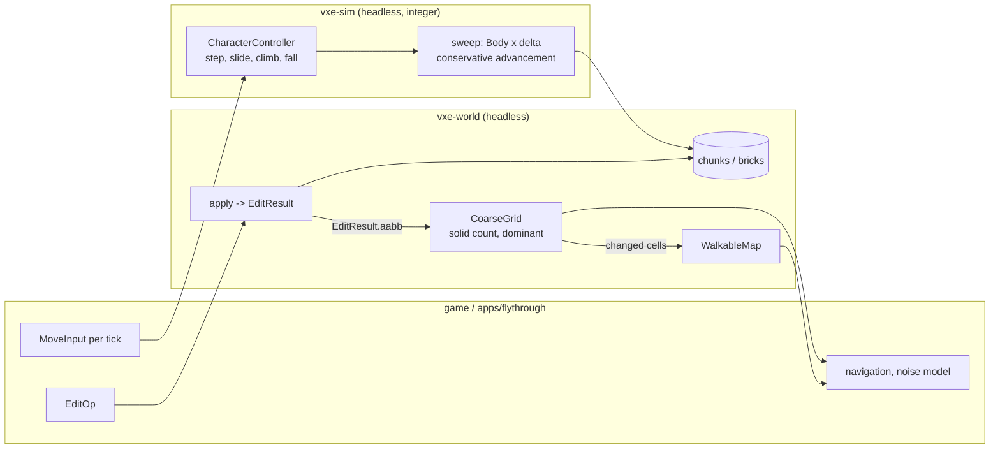

# 0004: Cylinder sweeps, a character controller, and a per-brick coarse grid with change notifications

> **Status:** in-progress
> **Created:** 2026-10-16
> **Milestone:** M3 in `docs/roadmap.md`
> **Related ADRs:** [ADR-0005](../adrs/0005-vertical-cylinder-collision-by-integer-conservative-advancement.md) (body shape, sweep, where it lives), ADR-0002 (layout and access model), ADR-0001 (stack)
> **Prerequisite:** Plan 0001 closed. Independent of Plan 0002 and of its readings; the coarse grid gains its streaming hooks here and is wired to the streamer when both plans are closed.

## TL;DR

A new crate, `vxe-sim`, sweeps a vertical cylinder through the brick map in fixed-point
integers and drives a character controller on it: walk, slide along walls, step up, climb out
of a hole, fall, jump. `vxe-world` gains a coarse grid with one cell per brick (0.8 m): a solid
count and a dominant material, built from the world and updated from each edit's result, with a
list of changed cells per update and a walkable-space mask derived from it. The first thing a
reader sees is a headless test: a body walking into a wall two chunks away stops with its foot
at exactly `x = 4352` and reports the wall voxel and an outward normal, and a 300-tick course
over six fixtures hashes to a constant on both CI arms. The first thing the user sees is the
fly-through in walk mode: dig a hole under your feet, fall in, hold forward and jump, and climb
out.

## Context & problem

The consumer's P0 list (`project-context.md`, Queries and Audio) needs a character controller
for the player and monsters against voxel terrain with steps, slopes and climbing out of dug
holes; shape sweeps for tool reach and line of sight; and a coarse occupancy and material grid of
about 1 m cells that the game reads for its own deterministic noise model and that updates
incrementally after edits. P1 adds region change notifications and walkable-space extraction
for navigation. The roadmap's M3 assigns sweeps and the controller to `vxe-sim`, and the grid,
notifications and walkable extraction to `vxe-world`.

The controller runs on the consumer's server for monsters, so it is held to the determinism
rule: integer math, no clock, bit-identical on both CI arms. The grid feeds the consumer's
deterministic noise model, so it is exact and canonical too.

`nfr.md` has no figure for any of this. This plan proposes them (see "Budgets") and reads them
on the dev box; the close writes them into `nfr.md`.

## Decision

We implement ADR-0005: a vertical cylinder (foot point, radius, height) whose squared distance
to an axis-aligned voxel box is `max(0, d_xy - r)² + d_z²`, swept by conservative advancement
in fixed point, and a controller that composes sweeps in a fixed per-tick order. Slopes are
staircases and are climbed as steps; there is no slope parameter. The coarse grid is derived
data in `vxe-world`: one `(solid count, dominant material)` cell per brick, kept per chunk,
rebuilt for the bricks inside an edit's `aabb` when the caller passes the `EditResult` in, so
nothing hides behind the edit and the renderer's dirty bits stay the renderer's. Walkability is
a second derived layer over the grid with explicit parameters.

Rejected: an axis-aligned box controller, a float capsule through a physics library, and
point-sampled collision (ADR-0005). Rejected for the grid: updating it inside `World::apply`
(couples every edit to a consumer that may not want the grid, and hides a cost in the §4
figure); and deriving it from the chunk dirty bits (the renderer clears those).

## Architecture diagram



## Implementation phases

Each phase ships as its own commit. `dev` implements all phases in one session with no review
between phases. The architect reviews once at the end, in a fresh session. Phase 1 is the
walking skeleton.

Shared conventions for every phase:

- Plan 0001's conventions hold: `VoxelCoord`, `ChunkCoord`, `Fixed3` at 1/256 voxel, voxel `v`
  spans fixed `[256 v, 256 v + 256)`, integer math only, FNV-1a 64 hashes, SplitMix64 seeds.
- **The body** is `Body { foot: Fixed3, radius: i64, height: i64 }`: its axis is the vertical
  line through `foot`, it occupies `z` in `[foot.z, foot.z + height)` and plan distance `< radius`
  from the axis. The test body is `radius = 768` (0.3 m), `height = 4608` (1.8 m).
- **Distance.** For a box `[bmin, bmax)` in fixed units: `d_xy = isqrt(dx² + dy²)` where
  `dx = clamp(foot.x, bmin.x, bmax.x) - foot.x` and likewise `dy`; `d_z` is the gap between
  `[foot.z, foot.z + height]` and `[bmin.z, bmax.z]` (0 when they overlap); `d² = max(0, d_xy -
  r)² + d_z²`. `overlaps` means `d² == 0` and strict interior overlap on both terms (touching
  is not overlapping). A `Uniform` solid brick is one box; voxels of a `Full` brick are boxes.
- **Contact normal** (integer direction, not unit): `vz = +1` if `bmax.z <= foot.z`, `-1` if
  `bmin.z >= foot.z + height`, else `0`; `h = (foot.x - cx, foot.y - cy)` with `(cx, cy)` the
  nearest point of the box's plan rectangle to the axis, zero when the axis is inside it. If
  `vz == 0` the contact is a wall with normal `(h.x, h.y, 0)`. Else if `dx² + dy² < r²` it is
  a floor (`vz = +1`) or ceiling with normal `(0, 0, vz * r)`. Else it is a rim contact and
  counts as a wall. A contact is **walkable** iff it is a floor.
- **Sweep.** `sweep(world, body, delta)`: iterate: `g² = min d²` over the solid boxes in the
  region swept by the body's box along the remaining delta; `g = isqrt(g²)`; if `g == 0` stop
  with the nearest box as the contact (ties broken by ascending voxel coordinate); else advance
  by `min(g, |remaining|)` along the delta, each component `delta_k * step / |delta|` rounded
  toward zero; stop when the delta is spent or every component rounds to zero; cap 64
  iterations. A sweep that spends its whole delta reports no contact even if it ends touching.
  `|delta| = isqrt(sum of squares)`; `delta` components are bounded to `2^31` fixed units.
- **Controller tick** (fixed order; `wish` is horizontal, fixed units per tick):
  1. If climbing: rise by `min(climb_speed, remaining)` with an upward sweep; if the foot has
     reached the target height, sweep forward by `radius` along the stored wall direction,
     set `climbed`, leave the climbing state. No horizontal input applies on a climbing tick.
  2. Horizontal: sweep by `wish`. On a wall contact with remainder: **step attempt**: sweep up
     by `step_height` (must move the full height), sweep forward by the remainder (must move
     more than zero), sweep down by `step_height`; accept iff the down sweep ends on a floor
     contact and the foot rose by at most `step_height`; set `stepped`. Otherwise revert and
     **slide**: project the remainder onto the wall plane (`w - n (w . n) / |n|²` in `i128`,
     rounded toward zero, horizontal components of `n` only) and sweep once more; at most two
     slides. If still blocked, set `blocked`; run the **climb probe**: sweep a copy up by
     `climb_height` (must move fully), forward by `radius` (must move fully), down by
     `climb_height`; if it ends on a floor contact with a rise in `(step_height,
     climb_height]`, report `climb_available = Some(landing foot)` and, if `input.climb`, enter
     the climbing state with that target height and the wall direction, and run step 1 in this
     same tick.
  3. Vertical: if grounded and `input.jump`, `vz = jump_speed`; else if not grounded, `vz =
     max(vz + gravity, -max_fall)`. Sweep by `(0, 0, vz)`. On a floor contact while moving
     down: grounded, `landed = Some(-vz)` (the impact speed, so the game can rule on fall
     damage without keeping the previous tick's state; amended 2026-10-16 from the roadmap's
     physics decision), then `vz = 0`. On a ceiling contact while moving up: `vz = 0`. Grounded is
     re-evaluated every tick by a downward probe sweep of `ground_probe` units when `vz <= 0`.
  Test parameters: `step_height = 1024`, `climb_height = 3072`, `climb_speed = 64`, `gravity =
  -8`, `max_fall = 1024`, `jump_speed = 160`, `ground_probe = 2`, `wish = (128, 0)` (0.5 voxel
  per tick, 3 m/s at 60 Hz).
- **Fixtures** (`crates/vxe-sim/tests/support/mod.rs`), all closure sources over chunks
  `[-2, 2)³` with material 1 solid, `S = (2688, 2688, 0)` the default start (voxel 10 centre in
  plan, resting on the floor):
  - F1 floor: solid iff `z < 0`.
  - F2 wall: F1, plus `x in [20, 22)` and `z in [0, 40)`, all `y`.
  - F3 step: F1, plus `x in [30, 40)`, `z in [0, 4)`.
  - F4 tall step: F1, plus `x in [30, 50)`, `z in [0, 5)`.
  - F5 pit: F1 with air where `x in [50, 58)`, `y in [50, 58)`, `z in [-8, 0)`. Start
    `(13952, 13952, -2048)`.
  - F6 staircase: F1, plus solid where `60 <= x < 80` and `z < x - 60`, and where `x >= 80`
    and `z < 20`. Start `(12928, 2688, 0)`.

### Phase 1: `vxe-sim`, the distance and the sweep
- **Owner skill:** dev
- **What:** the crate, `Body`, `distance2`, `overlaps`, `sweep`, and their tests.
- **Files touched:** `Cargo.toml` (workspace member and `vxe-sim` dependency row),
  `crates/vxe-sim/Cargo.toml`, `crates/vxe-sim/src/{lib.rs, body.rs, sweep.rs}`,
  `crates/vxe-sim/tests/{sweep.rs, support/mod.rs}`.
- **Done when:**
  - `vxe-sim` depends on `vxe-world` and nothing else; `cargo clippy -p vxe-sim -- -D warnings`
    passes with the wall-clock ban in force; no `f32` or `f64` appears in `crates/vxe-sim/src`
    (a test greps, as Plan 0001 Phase 4 did).
  - F2, body at `S`, `delta = (10000, 0, 0)`: `moved == (1664, 0, 0)` (the foot ends at
    `x = 4352`, the wall face `5120` minus the radius), contact voxel `[20, 10, 0]`, normal
    `(-768, 0, 0)`, at most 2 iterations.
  - F2, body at `S`, `delta = (10000, 10000, 0)`: `moved.x == moved.y`, both in
    `[1662, 1664]`, contact present, `overlaps` false afterwards.
  - F1, body at `(2688, 2688, 2560)`, `delta = (0, 0, -10000)`: `moved == (0, 0, -2560)`,
    contact voxel `[10, 10, -1]`, normal `(0, 0, 768)`.
  - F1, body at `S`, `delta = (0, 0, 10000)`: `moved == delta`, no contact.
  - F1, body at `(2688, 2688, -256)` (overlapping the floor): any sweep returns `moved == 0`,
    `started_overlapping == true`, contact voxel `[10, 10, -1]`.
  - `distance2` over a `Uniform` solid brick equals `distance2` over the same brick expanded to
    512 voxels (a test on F1 with the body above a brick boundary), and the sweep's region scan
    reads no voxel array of a `Uniform` brick (`vxe-world`'s `QueryStats`-style counter, or the
    world's `count_in_box_with_stats` pattern reused).

### Phase 2: Walk, step, slide, fall
- **Owner skill:** dev
- **What:** `CharacterController` with the tick order above, without climbing.
- **Files touched:** `crates/vxe-sim/src/{lib.rs, controller.rs}`,
  `crates/vxe-sim/tests/controller.rs`.
- **Done when:** (`wish = (128, 0)` every tick unless stated; "never overlapping" means
  `overlaps` is false after every tick)
  - F1, 60 ticks: foot `(10368, 2688, 0)`, grounded every tick, `vz == 0`, never overlapping.
  - F2: ticks 1 to 13 each move the foot by 128 to `x = 4352`; from tick 14 on `blocked` is
    true, the foot stays at `(4352, 2688, 0)`, `stepped` is never true.
  - F2 with `wish = (128, 128)`: the body slides along the wall: after 60 ticks `foot.x ==
    4352` and `foot.y > 2688 + 40 * 128` (most of the y motion survives the slide), never
    overlapping.
  - F3: `stepped` is true on exactly one tick, tick 34, after which the foot is `(7040, 2688,
    1024)`; at tick 60 the foot is `(10368, 2688, 1024)` and grounded.
  - F4 without `climb`: from tick 34 on, `blocked` is true, the foot stays at `(6912, 2688,
    0)`, and `climb_available == Some((7680, 2688, 1280))`.
  - F6: `stepped` is true on exactly 20 ticks (16, 18, 20, ..., 54); at tick 60 the foot is
    `(20608, 2688, 5120)` and grounded.
  - F1, `wish = (0, 0)`, `jump` on tick 1 only: the foot leaves the floor on tick 1, reaches a
    maximum `z` in `[1500, 1700]` (the ballistic estimate is `160² / 16 = 1600`, quantised by
    the per-tick integration), and is grounded again at `z = 0` by tick 45, never overlapping.
  - F1, body dropped from `z = 25600` (100 voxels): `vz` never exceeds `max_fall` in
    magnitude, and the body lands at `z = 0` without overlapping on any tick. `landed` is
    `Some(640)` on tick 80 and `None` on every other tick: after `n` ticks the fall is
    `4n(n + 1)` units (`gravity = -8`, never reaching `max_fall`), 25280 after tick 79 and
    25920 after tick 80, so tick 80 sweeps from `z = 320` with `vz = -640` and is clipped by
    the floor. In the jump case above, `landed == Some(160)` on tick 41: the rise is 1680 over
    ticks 1 to 21, and the descent `4k(k + 1)` equals 1680 at `k = 20` exactly.

### Phase 3: Ledge climb and the pinned course
- **Owner skill:** dev
- **What:** the climbing state and the cross-platform hash of the whole course.
- **Files touched:** `crates/vxe-sim/src/controller.rs`, `crates/vxe-sim/tests/{controller.rs,
  course.rs}`.
- **Done when:**
  - F4 with `climb` held: `blocked` at tick 34, climbing begins the same tick; `climbed` is true
    at tick 53, after which the foot is `(7680, 2688, 1280)`; at tick 60 the foot is `(8576,
    2688, 1280)` and grounded.
  - F5 with `climb` held: tick 1 moves to `x = 14080`; tick 2 is blocked and begins the climb;
    `climbed` is true at tick 33, after which the foot is `(14848, 13952, 0)`; at tick 60 the
    foot is `(18304, 13952, 0)` and grounded. Never overlapping.
  - F4 with `climb` released on tick 40: the climbing state ends, the body falls back to
    `z = 0` grounded by tick 60, and `climb_available` is reported again.
  - `tests/course.rs`: F1 to F6 run 300 ticks each with the inputs above (F4 and F5 with
    `climb` held, F1 with a jump every 60 ticks), hashing foot, `vz` and the result flags every
    tick with FNV-1a 64. The constant is blessed on Linux and asserted on the Windows CI arm;
    it is never loosened.

### Phase 4: The coarse grid
- **Owner skill:** dev
- **What:** `CoarseGrid` in `vxe-world`: build from a world, update from an `EditResult`, report
  changed cells; streaming hooks; a `world_budget` line.
- **Files touched:** `crates/vxe-world/src/{lib.rs, coarse.rs}`, `crates/vxe-world/tests/coarse.rs`,
  `apps/flythrough/examples/world_budget.rs`.
- **Done when:**
  - `CoarseCell { solid: u16, dominant: MaterialId }`: `solid` is the count of non-air voxels in
    the brick (0 to 512); `dominant` is the most frequent non-air material, ties to the lower
    id, `AIR` when `solid == 0`. A `Uniform(m)` brick costs no voxel read.
  - `CoarseGrid::build(&World)` over the solid material-3 world: 32 768 cells, every one
    `{512, 3}`. After the radius-10 carve at the origin, exactly 32 cells have `solid < 512`,
    `sum(512 - solid)` over all cells is 4169, and the cell of brick slot `[0, 0, 0]` in chunk
    `[0, 0, 0]` is `{32, 3}`.
  - `grid.update(&world, &result) -> Vec<CellChange>` after that carve returns 32 changes
    sorted by `(chunk, slot)` with `before` and `after`; the same carve applied again returns
    0 changes; a `Fill(2)` of the box `[0, 2048)³` then returns 1 change and the cell reads
    `{512, 2}` (480 ore against 32 rock).
  - Ties and air: a closure-source chunk with brick `[0, 8)³` holding 256 voxels of material 2
    and 256 of material 5 reads `{512, 2}`; a brick with 255 of material 5 and 257 air reads
    `{255, 5}`.
  - `chunk_loaded(&World, coord)` and `chunk_evicted(coord)` add and drop a chunk's 512 cells;
    building by loading every chunk equals `build`. Wiring to `StreamEvents` is a follow-up
    (Plan 0002).
  - `world_budget` prints the grid's bytes (4 per brick: 6 553 600 at the level size, 2048 per
    chunk) and build time; the log records both readings.

### Phase 5: Walkable space
- **Owner skill:** dev
- **What:** a walkable mask per chunk derived from the grid, updated incrementally from the
  grid's changes.
- **Files touched:** `crates/vxe-world/src/{coarse.rs, walkable.rs, lib.rs}`,
  `crates/vxe-world/tests/walkable.rs`.
- **Done when:**
  - `WalkableParams { max_solid: 64, min_floor: 448, clearance: 2 }`: cell `c` is walkable iff
    `c.solid <= max_solid`, the cell directly below has `solid >= min_floor`, and the
    `clearance` cells above `c` each have `solid <= max_solid`. Cells in chunks that are not in
    the grid count as not solid enough to be a floor and as blocking clearance.
  - On the F1 floor world, `WalkableMap::build(&grid, params)` has exactly 1024 walkable cells,
    all at brick `z = 0` (voxels `0..8`), one per plan column of the `[-128, 128)²` extent.
  - After `Fill(1)` of the box covering voxels `[0, 8) x [0, 8) x [0, 24)` (a three-brick
    pillar), `grid.update` returns 3 changes and `map.update(&grid, &changes)` returns exactly
    2 changed cells: `(0, 0, 0)` is no longer walkable and `(0, 0, 3)` now is; the total stays
    1024.
  - `map.update` after a change recomputes only the changed cells and the `clearance + 1` cells
    above and the one below each (a counter in the test), and a full `build` after any sequence
    of updates equals the incrementally maintained map on 32 seeded carve-and-fill sequences.

### Phase 6: Walk mode in the fly-through, benches, readings
- **Owner skill:** dev
- **What:** `--walk` and the `G` toggle in the fly-through, `criterion` benches for the sweep,
  the tick and the grid update, and the readings.
- **Files touched:** `apps/flythrough/src/{main.rs, fly.rs}`, `apps/flythrough/Cargo.toml`,
  `crates/vxe-sim/benches/controller.rs`, `crates/vxe-world/benches/coarse.rs`,
  `crates/vxe-sim/Cargo.toml`, `crates/vxe-world/Cargo.toml`, `docs/nfr.md`.
- **Done when:**
  - `cargo run --release -p flythrough -- --level --seed 1 --walk` (the bounded level: the
    coarse grid is not wired to streaming in this plan; amended at Plan 0002's close) spawns the body at the spawn pocket
    and it falls to the pocket floor; `G` toggles between fly and walk; in walk mode `W A S D`
    move at 3 m/s, `Space` jumps, holding `Space` against a wall with a standable top within
    1.2 m climbs it; `L`-style debug lines print `walk: grounded`, `walk: stepped`, `walk:
    climbing`, `walk: climbed` on state changes. Digging a 1 m hole under the feet (left
    click looking down) drops the body in, and holding forward plus `Space` climbs out. The log
    records that this was driven by hand on the dev box.
  - `K` prints `coarse: <n> walkable cells, last edit changed <m> cells in <t> us`; the
    fly-through keeps a `CoarseGrid` and `WalkableMap` updated from every edit.
  - `cargo bench -p vxe-sim --bench controller`: 1000 ticks of the F6 course; and 1000 sweeps
    of the F2 wall case. `cargo bench -p vxe-world --bench coarse`: 100 updates after radius-10
    carves at seeded positions on the `mixed` world of Plan 0003 Phase 1 (or the solid world if
    Plan 0003 has not landed), and 100 walkable updates from those changes. The log records
    all four on the dev box against the proposals under "Budgets".
  - `nfr.md` gains a section for collision and coarse grids carrying the proposals and the
    dev-box readings (the close writes it; this phase supplies the numbers in the log).

## Data shapes

```rust
// illustrative: vxe-sim
pub struct Body { pub foot: Fixed3, pub radius: i64, pub height: i64 }
pub struct Contact { pub voxel: VoxelCoord, pub material: MaterialId, pub normal: [i64; 3] }
pub struct Sweep { pub moved: Fixed3, pub contact: Option<Contact>, pub started_overlapping: bool, pub iterations: u32 }
pub fn distance2(world: &World, body: &Body) -> Option<(i64, Contact)>;   // None: no solid in the probe region
pub fn overlaps(world: &World, body: &Body) -> bool;
pub fn sweep(world: &World, body: &Body, delta: Fixed3) -> Sweep;

pub struct ControllerParams {
    pub radius: i64, pub height: i64, pub step_height: i64, pub climb_height: i64,
    pub climb_speed: i64, pub gravity: i64, pub max_fall: i64, pub jump_speed: i64, pub ground_probe: i64,
}
pub struct MoveInput { pub wish: [i64; 2], pub jump: bool, pub climb: bool }
pub struct CharacterState { pub foot: Fixed3, pub vz: i64, pub grounded: bool, climbing: Option<Climb> }
pub struct MoveResult {
    pub moved: Fixed3, pub grounded: bool, pub blocked: bool, pub stepped: bool,
    pub climbed: bool, pub climb_available: Option<Fixed3>, pub contacts: Vec<Contact>,  // at most 4
    pub landed: Option<i64>,  // impact speed on the tick the body comes to rest on a floor
}
impl CharacterController {
    pub fn tick(&self, world: &World, state: &mut CharacterState, input: &MoveInput) -> MoveResult;
}

// illustrative: vxe-world
pub struct CoarseCell { pub solid: u16, pub dominant: MaterialId }
pub struct CoarseGrid { cells: HashMap<ChunkCoord, Box<[CoarseCell; CHUNK_BRICKS]>> }
pub struct CellChange { pub chunk: ChunkCoord, pub slot: u16, pub before: CoarseCell, pub after: CoarseCell }
impl CoarseGrid {
    pub fn build(world: &World) -> Self;
    pub fn update(&mut self, world: &World, result: &EditResult) -> Vec<CellChange>;  // sorted
    pub fn cell(&self, chunk: ChunkCoord, slot: usize) -> Option<CoarseCell>;
    pub fn chunk_loaded(&mut self, world: &World, c: ChunkCoord);
    pub fn chunk_evicted(&mut self, c: ChunkCoord);
}
pub struct WalkableParams { pub max_solid: u16, pub min_floor: u16, pub clearance: u8 }
pub struct WalkableMap { masks: HashMap<ChunkCoord, [u64; 8]> }
impl WalkableMap {
    pub fn build(grid: &CoarseGrid, p: WalkableParams) -> Self;
    pub fn update(&mut self, grid: &CoarseGrid, changes: &[CellChange]) -> Vec<(ChunkCoord, u16)>;
    pub fn is_walkable(&self, chunk: ChunkCoord, slot: usize) -> bool;
    pub fn count(&self) -> usize;
}
```

No new external dependency. `vxe-sim` depends on `vxe-world` only.

## Budgets

The figures below are **proposals** this plan introduces; the close writes them into `nfr.md`
with the dev-box readings. Every one is a guess until read.

| Figure (proposed) | Proposal | How the close measures it |
|---|---|---|
| Controller tick, one body | 20 µs on the dev box | `bench controller`, 1000 F6 ticks |
| Sweep, one body, one contact | 5 µs | `bench controller`, 1000 F2 sweeps |
| Coarse grid update after a radius-1 m carve | 50 µs (at most 64 bricks, 512 voxel reads each) | `bench coarse` |
| Walkable update after that change | 20 µs | `bench coarse` |
| Coarse grid RAM | 4 B per brick, 2 KiB per chunk: 6.6 MB at the level, 67 MB at 32³ chunks (`nfr.md` §3 RAM) | `world_budget` |
| `nfr.md` §6 determinism | The course hash on both arms | `tests/course.rs` on CI |

## Risks & open questions

- **Flat-foot overhang** (ADR-0005): the body stands while any floor is within `radius` of
  the axis. Accepted; the owner sees it in walk mode and can ask for a smaller support radius
  as a follow-up parameter.
- **Creep at corners.** Oblique conservative advancement stops when the advance rounds to zero,
  leaving a gap under 2 fixed units; the iteration cap is 64. The F2 diagonal test bounds it.
- **Determinism.** Integer only, sorted tie-breaks, no clock, no map iteration in results. The
  course hash is the gate. `HashMap` in `CoarseGrid` never feeds a result unsorted: `update`
  returns sorted changes and `count` is a sum.
- **Locking.** A sweep takes one chunk read lock at a time; a tick may take dozens of short
  read locks. Nothing is held across a sweep. An edit on another thread between two sweeps of
  the same tick can change the terrain under the body; the next tick's probe sweep sees it.
- **Chunk boundaries in the walkable map.** The cell below a chunk's bottom layer lives in the
  chunk below; the clearance cells above its top layer in the chunk above. A missing chunk
  blocks. The Phase 5 full-rebuild equivalence test covers the boundaries.
- **Streaming.** The grid's `chunk_loaded` and `chunk_evicted` exist; nothing calls them until
  Plan 0002's events are wired, which is a follow-up named here.
- **Open:** whether `MoveResult.contacts` should carry the per-contact penetration-free
  distance for sound and animation. It stays voxel plus normal until a consumer asks.

## What this plan does NOT do

- **Monster bodies with other shapes** (crawlers, large bodies): the body is a parameterised
  cylinder; a new shape is a new ADR.
- **Crouch, swim, ladders, moving platforms.**
- **Pathfinding.** The consumer pathfinds on the walkable map; the engine extracts it.
- **Notifications pushed through a channel.** `update` returns the changes to the caller; a
  subscription mechanism is M5's server tick.
- **Wiring the grid to the streamer** (`StreamEvents` from Plan 0002): follow-up.
- **A CPU raycast against LOD-only chunks**: Plan 0002 excludes it too.

## Implementation log

> Written by `dev`: one row per phase as its commit lands, then the close block. **The phases
> above are the contract. This section records what happened.** Observations, never conclusions:
> no pass list, no self-assessment. Deviations and unmet done-whens are **always** disclosed.
> Keep it shorter than `## Implementation phases`.

| phase | owner | state | commit |
|---|---|---|---|
| 1: `vxe-sim`, the distance and the sweep | dev | done | b1377d7 |
| 2: Walk, step, slide, fall | dev | done | 215285a |
| 3: Ledge climb and the pinned course | dev | done | f8ecdc9 |
| 4: The coarse grid | dev | done | 611dfe5 |
| 5: Walkable space | dev | done | c7abac7 |
| 6: Walk mode in the fly-through, benches, readings | dev | done | fe50d6d |

### Notes

- Phase 1: the contact among boxes at equal `d²` is picked by the key `(d², squared distance from the foot point to the box's nearest lattice point [bmin, bmax - 1], voxel coordinate)`; plain ascending voxel coordinate would pick `[7, 10, -1]`, not `[10, 10, -1]`, in the F1 drop test. The contact voxel of a `Uniform` brick is the voxel holding that nearest lattice point.
- Phase 1: the swept region is the body's half-open bounding box extended along the remaining delta; `distance2` probes the body's bounding box grown by one voxel on every side.
- Phase 1: a sweep that stops because every component rounds to zero, or at the iteration cap, reports the nearest box in the remaining region as its contact.
- Phase 1: public API beyond the data shapes: `isqrt`, `Body::at`, `Contact::{is_floor, is_ceiling, is_wall}` (classified from the normal's sign), `distance2_with_stats`, `sweep_with_stats` (return `vxe_world::QueryStats`), `MAX_SWEEP_ITERATIONS`.
- Phase 1: `Cargo.toml` also gains `[profile.dev.package.vxe-sim] opt-level = 2` (fixture worlds took 1.4 s each to generate in a test build).
- Phase 2: a downward vertical move lands (grounded, `landed`, `vz = 0`) on a floor contact or, when the sweep spends its delta, when the ground probe from its end hits a floor; with the floor contact alone the jump lands exactly on `z = 0` on tick 41 with no contact and `landed` is `None` there.
- Phase 2: the step attempt runs only when the state was grounded at the start of the tick. The step's and the climb probe's down sweeps require a floor contact, as written.
- Phase 2: the climb probe's forward sweep, and the climb's forward move, go `radius` units along the reversed horizontal contact normal (scaled by `radius / isqrt(|n|²)`, rounded toward zero).
- Phase 2: `blocked` is set when, after the step attempt and up to two slides, a wall contact still leaves an unspent remainder, including when the projection onto the wall is zero (head-on). Grounded is probed at the start of the vertical step when `vz <= 0`, before the jump decision. `CharacterState::new(foot)` starts with `vz = 0`, not grounded.
- Phase 2: also touches `crates/vxe-sim/tests/support/mod.rs` (the test parameters and a tick runner that asserts no overlap after every tick).
- Phase 3: a climbing tick skips the vertical step; the tick on which the climb finishes runs it (the ground probe sets `grounded`). A rise cut short by a ceiling ends the climb. `CharacterState::is_climbing()` exposes the private climbing state.
- Phase 3: course inputs: F1 `WISH` with `jump` on ticks 1, 61, 121, 181, 241; F2, F3, F6 `WISH`; F4, F5 `WISH` with `climb` held. The hash feeds, per tick, foot, `vz`, `grounded`, `blocked`, `stepped`, `climbed`, climbing, `climb_available` and `landed`. Within 300 ticks the F1, F3, F4, F5 and F6 bodies walk past the `[-2, 2)³` extent and fall through the non-resident space (no solid there). Constant `0x0c80_8031_d14f_27eb`, blessed on the dev box (Linux); the Windows arm is CI's.
- Phase 4: public API beyond the data shapes: `CoarseCell::of(&Brick)`, `CoarseGrid::{new, build_with_stats, update_with_stats, chunk, contains, chunks, len, is_empty, bytes}`; the `_with_stats` forms return `QueryStats` (one voxel-array read per `Full` brick), used to show a `Uniform` brick costs no voxel read (solid world build: 0 reads; carved-world build and the carve's update: 32 each).
- Phase 4: `world_budget` prints the grid lines for the bounded cave only (`--chunks`), not for `--stream`.
- Phase 5, done-when not satisfiable as stated: "recomputes only the changed cells and the `clearance + 1` cells above and the one below each" conflicts with the walkability definition (cell `c` depends on `c - 1` .. `c + clearance`) and with the full-rebuild equivalence done-when. A change at `g` can flip only `g - clearance ..= g + 1`; `update` recomputes exactly that set, deduplicated, and the tests count it (pillar: 6 distinct cells for 3 changes; one isolated change: `clearance + 2 = 4`). With the stated set (`g - 1 ..= g + clearance + 1`) the pillar test and the 32-sequence equivalence test fail (run on the dev box, then reverted).
- Phase 5: `coarse.rs` is not touched. Public API beyond the data shapes: `WalkableMap::{params, update_with_stats, cells}`, `WalkableStats { cells_recomputed }`. A cell in a chunk the grid no longer holds is cleared from the map by `update`.
- Phase 6: `Space` in walk mode sets both `jump` and `climb`. `--walk` without `--level` is refused. The coarse grid and walkable map are kept on the bounded level only (`K` prints `coarse: not kept while streaming` otherwise); `--frames N` prints the body's foot and the `K` line at exit.
- Phase 6: headless parts scripted as tests: `fly::tests::walking_with_w_moves_three_metres_per_second` (60 ticks with `W` move 7680 units), `fly::tests::a_body_falls_into_a_dug_hole_and_climbs_out_with_w_and_space` (1 m box carved under the feet, falls to `z = -2560`, `W` plus `Space` prints `walk: climbing`, `walk: climbed`, `walk: grounded`), `tests::an_edit_keeps_the_coarse_grid_and_walkable_map_current` (27 changed cells, map equals a rebuild).
- Phase 6: `flythrough --level --seed 1 --walk --headless --frames 4000` on the dev box (RTX 3080 Laptop): the eye at the spawn voxel `[640, 640, 256]` centre puts the foot at `[163968, 163968, 61312]`; the run printed `walk: grounded`, ended at `[163968, 163968, 58112]` grounded; `coarse: 3200 chunks, 6553600 bytes, 3010 walkable cells, built in 231 ms`.
- Phase 6, awaits the owner (windowed, by hand): `cargo run --release -p flythrough -- --level --seed 1 --walk`; judge the fall to the pocket floor, `G` toggling fly and walk, `W A S D` at 3 m/s, `Space` jumping and climbing a ledge within 1.2 m, left click looking down to dig a 1 m hole, falling in, `W` plus `Space` climbing out, the `walk: grounded / stepped / climbing / climbed` lines, and `K` printing `coarse: <n> walkable cells, last edit changed <m> cells in <t> us`. The log does not record this as driven by hand.
- Phase 6: the coarse bench runs on the solid world: Plan 0003 Phase 1's `mixed` world is not on this branch. The controller bench also times 300 F6 ticks: the F6 body leaves the `[-2, 2)^3` extent before tick 300 and falls through non-resident space, so most of the 1000 ticks are free fall.
- Phase 6: `Cargo.lock` is touched (the `vxe-sim` and `criterion` edges); not in Files touched. `docs/nfr.md` is not touched (the close writes it).
- Fix pass, finding 1 (zero-rise step reported as a step): `step_attempt`'s result sets `stepped` only when the landing foot is above the start; a landing at the same height is taken as a plain continuation. e81d07f. Test `a_move_past_a_corner_never_steps_without_rising`: a one-voxel block, start `[4352, 5064, 0]` (2 units from the corner), wish `[30, -120]`, sweep hits `MAX_SWEEP_ITERATIONS` with `moved [12, -88, 0]` and a wall contact, the tick does not step and `z` stays 0; plus 27 clearances x 12 directions, every stepped tick rose. The test also passes on the pre-fix code: the step's down sweep returns to the start height only by spending its whole `-step_height` delta, and a sweep that spends its delta reports no contact, so `on_floor` rejects it; no zero-rise step was found in a scan of 64 directions over clearances 1 to 32 around that corner (block heights 1, 2 and 4 voxels). Course hash unchanged (`0x0c80_8031_d14f_27eb`).
- Fix pass, finding 2 (benches mostly free fall): bench `60 ticks of the F6 staircase, all on terrain` added (the Phase 2 fixture and input; asserts the run ends grounded at `[20608, 2688, 5120]`). cb642f5. Course and constant unchanged. Committed as `perf(sim)`; it changes no speed, `test` fits the convention.
- Fix pass, finding 3 (`G` enabled walk mode while streaming): `G` while streaming prints `walk: walk mode needs --level (the coarse grid is not wired to streaming); still flying`; `--walk` without `--level` now errors `--walk: walk mode needs --level (...)` from the same constant. `parse_args` delegates to `parse_args_from(iterator)`. Test `tests::walk_mode_is_refused_while_streaming`. 0c4f7f7.
- Fix pass, finding 4 (coarse build reading): the 231 ms in Phase 6 is the fly-through's `Coarse::build` at the level, which builds the coarse grid and the walkable map together. The coarse grid alone, `world_budget --chunks 20x20x8 --seed 1` (`coarse build: ... on 1 thread`): close review 156.3 ms; this pass 200.9 ms and 201.0 ms (two runs, same load as the fix-pass bench readings in Close triggers).

### Close triggers

_(Facts for the architect. No recommendations, and no suggested version bump.)_

- **What shipped:** new crate `vxe-sim` (cylinder distance, integer sweep, character controller with step, slide, fall, jump, ledge climb; pinned course hash `0x0c80_8031_d14f_27eb`); `vxe-world` coarse grid and walkable map; fly-through `--walk`, `G`, `K`; benches `vxe-sim/controller` and `vxe-world/coarse`.
- **Public API changed:** `vxe-sim` (new): `Body`, `Contact`, `isqrt`, the `controller` and `sweep` exports in `crates/vxe-sim/src/lib.rs`. `vxe-world` (added): `CellChange`, `CoarseCell`, `CoarseGrid`, `WalkableMap`, `WalkableParams`, `WalkableStats`. Extras beyond the data shapes are listed per phase in Notes.
- **Budget readings:** dev box AMD Ryzen 9 5900HS (Linux), commit fe50d6d, `cargo bench`, criterion median (low, high), under the exclusive lock. Controller tick: `1000 ticks of the F6 course` 522.20 us (521.41, 523.19), 0.52 us per tick; `300 ticks of the F6 course` 372.15 us (371.11, 373.31), 1.24 us per tick; proposal 20 us. Sweep: `1000 sweeps of the F2 wall case` 17.539 ms (17.391, 17.701), 17.5 us per sweep; proposal 5 us. Coarse grid update after a radius-10 (1 m) carve, solid world: 100 updates 1.1287 ms (1.1144, 1.1440), 11.3 us per update; proposal 50 us. Walkable update from those changes: 100 updates 667.78 us (659.36, 677.02), 6.7 us per update; proposal 20 us. Coarse grid RAM at the level (`--level --seed 1`, headless on NVIDIA GeForce RTX 3080 Laptop GPU): 3200 chunks, 6553600 bytes, grid plus walkable map built in 231 ms. Fix pass, dev box AMD Ryzen 9 5900HS (Linux), commit cb642f5, exclusive lock, criterion median (low, high): `60 ticks of the F6 staircase, all on terrain` 144.32 us (143.89, 144.74), 2.41 us per tick; second run 145.35 us (144.66, 146.40). Machine load in that window: other processes outside the lock (`game.exe` about 90% CPU, `python3` about 95%, load average 4.8 to 12.9); the unchanged benches read 27 to 34% above the fe50d6d readings in the same run (`1000 ticks of the F6 course` 700.11 us, `300 ticks` 481.03 us, `1000 sweeps of the F2 wall case` 22.459 ms). `world_budget --chunks 20x20x8 --seed 1` coarse build (grid only, 1 thread): 200.9 ms, 201.0 ms; the close review's reading 156.3 ms.
- **Gate after the fix pass (working tree of 0c4f7f7):** `cargo build --workspace --all-targets` 0; `cargo nextest run --workspace` 130 passed, 0 skipped, exit 0 (exclusive lock, RTX 3080 Laptop present); `cargo test --workspace --doc` 0 (2 doctests); `cargo clippy --workspace --all-targets -- -D warnings` 0; `cargo fmt --all --check` 0; `cargo deny check` advisories, bans, licenses, sources ok; `node scripts/check-doc-links.mjs` 45 links resolve. CARGO_BUILD_JOBS=3.
- **Gate at the tip (fe50d6d):** `cargo build --workspace --all-targets` 0; `cargo nextest run --workspace` 128 passed, 0 skipped, exit 0 (exclusive lock, RTX 3080 Laptop present); `cargo test --workspace --doc` 0 (2 doctests); `cargo clippy --workspace --all-targets -- -D warnings` 0; `cargo fmt --all --check` 0; `cargo deny check` advisories, bans, licenses, sources ok; `node scripts/check-doc-links.mjs` 45 links resolve. CARGO_BUILD_JOBS=3.
- **Outstanding `human` phases:** none. Phase 6's hand-driven walk-mode checks await the owner (Notes).

## Followups

- Wire `CoarseGrid::chunk_loaded` and `chunk_evicted` to Plan 0002's `StreamEvents`; a
  `demoted` chunk (full to LOD-only) counts as evicted for the grid.
- A support-radius parameter smaller than the body radius, if the overhang shows.
- HRTF-side use of `Contact` for footstep material (Plan 0006 reads the material table).
