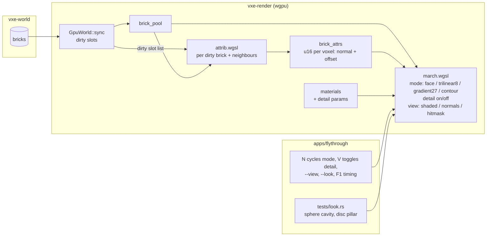

# 0005: The surface-look spike: smoothed normals, per-voxel contour planes and procedural detail, measured on screen

> **Status:** approved (2026-10-16)
> **Created:** 2026-10-16
> **Milestone:** M2 in `docs/roadmap.md` (first M2 plan; it produces the measurements the lighting plan and the surface ADR are written from)
> **Related ADRs:** ADR-0002 (the reserved parallel pool for a per-voxel attribute), ADR-0001 (stack). This plan writes no ADR; the surface-representation ADR is written at its close from the readings and the owner's call.
> **Prerequisite:** Plan 0002 closed. Not because of its readings (nothing here depends on them) but because both plans rewrite `march.wgsl` and `gpu_world.rs`, and a second pool must follow the sharded, palette-narrowed pool Plan 0002 leaves behind.

## TL;DR

The marcher shades every hit with its face normal, so the cave reads as cubes. The owner's bar
is the Sibenik cathedral of Laine and Karras 2010: smooth, believable rock, chosen by
measurement, not by committing to a mechanism first. This plan builds the three candidate
mechanisms behind flags and a harness that measures each the same way: (A) normals smoothed in
the shader from the neighbourhood of the hit, (B) a per-voxel contour plane (normal plus offset)
computed on the GPU into a second pool and intersected by the marcher, so silhouettes smooth too,
and (C) procedural per-material surface detail from world position. For each it reads the
normal error against an analytic sphere, the silhouette error against an analytic disc, the
primary-pass time at 1080p, and the VRAM cost. The first thing a reader sees is a headless test
printing the face-normal baseline: about 30 degrees of mean normal error inside a carved sphere.
The last phase is the owner looking at the fly-through in each mode and writing the call into
the log.

## Context & problem

The roadmap's surface-look decision (2026-10-16) wants smooth natural rock at 10 cm voxels with
one material id per voxel and no stored colour or occlusion, and names three places the
impression must come from: the silhouette, the surface texture, and the light. This plan takes
the first two; the light is the lighting plan. The roadmap and ADR-0002 already reserve the
mechanism's storage: a second pool parallel to the brick pool, indexed by the same slot, that
does not exist until a plan needs it.

The consumer requirement is `project-context.md`, Rendering P0: a first-person image stable at
arm's length, and the owner's look bar. `nfr.md` figures touched: §2 primary rays (every mode
adds reads per hit) and §3 world VRAM (mode B adds bytes per `Full` brick).

What is known: Plan 0001 reads the primary pass at 1.59 ms at 1080p on the dev box with masks,
and the level-size cave has 383 608 `Full` bricks. What is not known, and what this plan
measures: how much each mechanism costs per frame, how much B costs in VRAM at the chosen
width, and which of them the owner accepts on screen.

## Decision

We build all three mechanisms as switchable modes in `vxe-render`, measured by one harness, and
defer the choice to the owner's on-screen call, recorded as a `human` phase. We do not ship a
default: until the close, the fly-through's default mode stays face normals.

Rejected: picking one mechanism now (the roadmap decision says measure first); building the
spike outside the engine in a throwaway renderer (the cost that matters is the cost inside
`march.wgsl` with the real pool); a full ESVO-style octree with contours (ADR-0002 rejected the
octree; the contour idea is taken without it, per voxel in the brick map).

## Architecture diagram



## Implementation phases

Each phase ships as its own commit. `dev` implements all phases in one session with no review
between phases. The architect reviews once at the end, in a fresh session. Phase 1 is the
walking skeleton: the harness with the face-normal baseline.

Shared conventions for every phase:

- Plan 0001's render conventions hold: lavapipe goldens under the 0.1 % / 2 per 255 floor,
  the skip rule and `VXE_REQUIRE_SOFTWARE_ADAPTER`, 320 x 180 test renders, camera in voxel
  units with z up, timestamps through `MarchTimer`.
- **Modes** are `Params` fields, not shader variants: `normal_mode` in {`Face`, `Trilinear8`,
  `Gradient27`, `Contour`}, `detail` on or off, `view` in {`Shaded`, `Normals`, `HitMask`}.
  `view = Normals` writes `n * 0.5 + 0.5` to the target; `HitMask` writes white where a ray
  hits and black elsewhere. The shadow ray's origin offset stays along the face normal in every
  mode (it is a robustness device, not a look device); only shading and, in `Contour`, the hit
  itself change.
- **The two harness scenes** live in `apps/flythrough/tests/support/mod.rs`:
  - **Cavity:** the solid material-3 world over chunks `[-2, 2)³` (the test table, rock
    albedo) carved by a radius-40-voxel sphere centred on voxel `[0, 0, 0]`; camera at the
    sphere centre `(0.5, 0.5, 0.5)` looking `+x`, vfov 70 degrees, 320 x 180. Every pixel hits
    the cavity wall. The analytic normal at a hit point `p` is `(c - p) / |c - p|` (inward).
    The **normal error** of a render is the mean over pixels of the angle between the decoded
    `view = Normals` value and the analytic normal; decoding quantisation contributes under
    0.5 degrees.
  - **Pillar:** an air world over chunks `[0, 2)³` under `cave_materials()`, with a rock sphere
    of radius 20 voxels filled at the centre of voxel `[96, 64, 64]`; camera at `(16.5, 64.5,
    64.5)` looking `+x`, vfov 70 degrees, 320 x 180. The **silhouette error** is the number of
    pixels where `view = HitMask` disagrees with the analytic disc (the pixel's centre ray
    intersects the sphere of radius 20 voxels or not). At 80 voxels one voxel is about 1.8
    pixels, so the face-mode error is a few hundred pixels along a 226-pixel perimeter.
- **Timing** is the median of the last 30 of 300 frames from the spawn pose at 1920 x 1080 on
  the dev box, `flythrough --seed 1 --render 1920x1080 --frames 300 --look <mode>`, three
  runs, as Plan 0001 Phase 8 did. Every reading names the mode, the adapter and the commit.
- Mode B's attribute is `u16` per voxel: a 6-bit, 6-bit octahedral-encoded normal (4096
  directions, about 2.8 degrees apart) and a 4-bit plane offset in `[-7/8, +7/8]` voxels
  along the normal from the voxel centre (16 steps of 1/8 voxel). The value `0xFFFF` means
  "no plane" (an interior voxel, or one with all six face neighbours solid).

### Phase 1: The harness and the face-normal baseline
- **Owner skill:** dev
- **What:** the `view` and `normal_mode` params, the two scenes, the two metrics, the
  fly-through switches, and the baseline readings.
- **Files touched:** `crates/vxe-render/src/{marcher.rs, light.rs, lib.rs}`,
  `crates/vxe-render/src/shaders/march.wgsl`, `apps/flythrough/tests/{look.rs, support/mod.rs}`,
  `apps/flythrough/src/main.rs` (`--look`, `--view`, keys `N` and `V`, the mode in `F1`'s line).
- **Done when:**
  - `tests/look.rs::face_normals_baseline` prints the cavity normal error in face mode and
    asserts it lies in `[15, 45]` degrees (a uniform distribution of surface normals gives
    31.9 degrees to the nearest axis; the cavity's view weights the wall unevenly, so the band
    is wide), and prints the pillar silhouette error and asserts it lies in `[100, 800]`
    pixels. Both values are recorded in the log as the baseline every other mode is compared
    against.
  - `view = Normals` on the occluder scene of Plan 0001 Phase 6 (a wall facing `-x`) reads
    `(-1, 0, 0)` at the image centre after decoding, within 1/255 per channel.
  - `primary.png` and `headlamp.png` are unchanged byte for byte with `view = Shaded`,
    `normal_mode = Face`, `detail` off.
  - The log records the face-mode primary-pass time at 1080p on the dev box (three runs), the
    reference every later phase is measured against.

### Phase 2: Mode A, normals smoothed in the shader
- **Owner skill:** dev
- **What:** `Trilinear8` (the gradient of the trilinearly interpolated occupancy of the 2 x 2
  x 2 voxels around the hit point pushed half a voxel into the surface) and `Gradient27`
  (central differences of occupancy over the 3 x 3 x 3 voxels around the hit voxel, each axis
  summing the nine voxels on its positive face minus the nine on its negative face), both
  computed at the hit through the existing `lookup`.
- **Files touched:** `crates/vxe-render/src/shaders/march.wgsl`, `crates/vxe-render/src/marcher.rs`,
  `apps/flythrough/tests/look.rs`, `apps/flythrough/tests/golden/{look_trilinear8.png,
  look_gradient27.png}`.
- **Done when:**
  - Cavity normal error: `Gradient27` at most 12 degrees; `Trilinear8` at most half of the
    face-mode value from the same run. Both are printed and recorded.
  - Pillar silhouette error is unchanged from face mode in both (shading modes do not move
    hits), asserted equal.
  - A flat wall (the occluder scene) reads `(-1, 0, 0)` at the centre in both modes within
    2/255 per channel: smoothing does not bend flat surfaces.
  - Goldens for both modes on the Phase 5 cave scene with the headlamp are blessed on lavapipe
    and compared under the usual floor.
  - The log records the 1080p primary-pass time for both modes on the dev box.

### Phase 3: Mode B, per-voxel contour planes in a second pool
- **Owner skill:** dev
- **What:** the `brick_attrs` pool (one `u16` per voxel, parallel to the brick pool and its
  shards), a compute pass `attrib.wgsl` that fills it for every dirty brick and its 26
  neighbours from the pool itself, and a marcher that intersects the ray with a hit voxel's
  plane and treats the voxel as empty when the ray misses the solid half-space inside it.
- **Files touched:** `crates/vxe-render/src/{gpu_world.rs, marcher.rs, attrib.rs, lib.rs}`,
  `crates/vxe-render/src/shaders/{march.wgsl, attrib.wgsl}`, `crates/vxe-render/tests/mirror.rs`,
  `apps/flythrough/tests/look.rs`, `apps/flythrough/tests/golden/look_contour.png`.
- **Done when:**
  - `GpuWorld::sync` records the slots it wrote; `GpuWorld::update_attrs(encoder)` dispatches
    `attrib.wgsl` over those slots and the slots of their 26 neighbouring bricks (deduplicated,
    bounded by 27 times the dirty count), 512 voxels per brick. For each voxel: if all six face
    neighbours are solid, write `0xFFFF`; otherwise the normal is `Gradient27` of occupancy
    (computed through the chunk table, so neighbours across brick and chunk boundaries count)
    and the offset is `(f - 0.5) * 3` voxels clamped to `[-7/8, 7/8]`, where `f` is the solid
    fraction of the 27-voxel neighbourhood.
  - A readback test in `mirror.rs` on the `Floor` world: the voxel at local `(3, 3, 2)` (the top
    solid layer) decodes to a normal within 3 degrees of `+z` and an offset within 1/8 voxel
    of the value the same formula gives on the CPU in the test; an interior voxel reads
    `0xFFFF`. After a carve in one brick, a voxel in a face-adjacent unchanged brick next to
    the carve has the attribute a full recompute gives (the neighbour pass ran).
  - In `Contour` mode the marcher, on reaching a solid voxel with a plane, intersects the ray
    with the plane; if the intersection lies inside the voxel's cube and the ray enters the
    solid half-space there, the hit is at that `t` with the plane normal; if the ray's segment
    through the cube lies wholly outside the half-space, the voxel is skipped; if wholly
    inside, the hit is the cube entry with the plane normal. A voxel reading `0xFFFF` hits as
    before.
  - Pillar silhouette error in `Contour` mode is at most half of face mode; cavity normal
    error at most 12 degrees. Both recorded.
  - `GpuWorld::mirror_bytes` includes the attribute pool: at the level-size seed-1 world it
    rises by exactly `1024 * Full bricks` bytes (392 814 592 B for 383 608 bricks, 374.6 MiB),
    read from the fly-through's `F1` line and recorded.
  - The log records the 1080p primary-pass time in `Contour` mode and the `attrib.wgsl` pass
    time for the initial level-size fill and for a radius-1 m carve (timestamp queries around
    the pass), on the dev box.
  - `look_contour.png` blessed on lavapipe.

### Phase 4: Mode C, procedural per-material detail
- **Owner skill:** dev
- **What:** two detail parameters per material row (scale in voxels, strength in `[0, 1]`),
  a 16-float GPU material row, and a shader term that perturbs the shading normal with the
  gradient of two octaves of hashed value noise at world position and the albedo by the same
  noise times the strength.
- **Files touched:** `crates/vxe-world/src/material.rs` (`detail: [f32; 2]`, default `[0, 0]`),
  `crates/vxe-render/src/{gpu_world.rs, marcher.rs}`, `crates/vxe-render/src/shaders/march.wgsl`,
  `apps/flythrough/src/lib.rs` (`cave_materials()` detail values behind the `--look` switch),
  `apps/flythrough/tests/look.rs`, `apps/flythrough/tests/golden/look_detail.png`.
- **Done when:**
  - With every row's strength at 0 and `detail` on, `primary.png` and `headlamp.png` match byte
    for byte: the term is exactly zero at zero strength.
  - With rock at `detail = [4.0, 0.3]` (a 40 cm feature scale) and `detail` on, the Phase 5 cave
    scene under the headlamp differs from the face-mode render at 20 % or more of pixels by
    more than 8/255; `look_detail.png` is blessed on lavapipe.
  - The noise is a pure function of world position: the same scene rendered from two camera
    positions decodes the same `view = Normals` value at a wall point visible in both, within
    2/255 (the test picks the pillar's front pole).
  - The log records the 1080p primary-pass time with `detail` on over face normals and over
    `Gradient27`, dev box.

### Phase 5: Readings and the comparison table
- **Owner skill:** dev
- **What:** the full table of readings, one row per mode combination, in the log and in
  `nfr.md` as dev-reference lines.
- **Files touched:** `docs/nfr.md` (§2 dev-reference lines for each mode; §3 the attribute pool
  bytes), `apps/flythrough/tests/look.rs` (prints every metric for every mode in one test so the
  table is reproducible with one command).
- **Done when:**
  - The log holds a table with rows `Face`, `Trilinear8`, `Gradient27`, `Contour`, each with
    and without `detail`, and columns: cavity normal error (degrees), pillar silhouette error
    (pixels), 1080p primary-pass median (ms, dev box), mirror bytes at the level (B). Every
    cell has a number or the reason it does not apply.
  - `nfr.md` §2 lists the primary-pass readings per mode as dev reference, and §3 the attribute
    pool's bytes at the level, each with machine and commit.

### Phase 6: The owner's call
- **Owner skill:** human
- **What:** the owner runs `flythrough --seed 1` on the dev box, cycles the modes with `N` and
  `V` at arm's length from a carved wall and at 5 m from a cavern wall, and writes the call
  into this plan's log.
- **Files touched:** this plan's `## Implementation log`.
- **Done when:** the log carries one entry naming the chosen normal mode, whether detail is on
  and at what strength for rock, and the on-screen reason in one or two sentences; or names two
  finalists and the measurement that would separate them. The architect's close review turns
  that entry and the Phase 5 table into the surface-representation ADR and into the lighting
  plan's starting state.

## Data shapes

```rust
// illustrative: vxe-render
pub enum NormalMode { Face, Trilinear8, Gradient27, Contour }
pub enum ViewMode { Shaded, Normals, HitMask }
pub struct LookParams { pub normal_mode: NormalMode, pub detail: bool, pub view: ViewMode }

// Params gains: look_flags: u32 (normal mode in bits 0..2, detail bit 2, view in bits 3..5)
```

```text
GPU mirror additions:
  brick_attrs[k]   storage   parallel to brick_pool shard k; [slot][256 x u32], two u16 per word, x fastest
                             u16: bits 0..6 octahedral u, 6..12 octahedral v, 12..16 offset (0..15 -> -7/8..+7/8 voxel),
                             0xFFFF: no plane
  attrib_slots     storage   [n]u32 global slots to (re)compute this frame
  materials        storage   [id][16 x f32]: albedo rgb, roughness, emission rgb, flags, detail scale, detail strength, 6 spare
```

No new external dependency.

## Budgets

| `nfr.md` figure | Expected effect | How the close measures it |
|---|---|---|
| §2 primary rays (3.0 ms at 1080p, baseline) | Every mode adds reads per hit: `Trilinear8` 8 lookups, `Gradient27` 27, `Contour` one attribute read per candidate voxel plus a plane test; detail adds about 16 hash evaluations. Expected under 1 ms added on the dev box for any one mode; this is a guess | the Phase 5 table |
| §3 world VRAM | `Contour` adds 1 KiB per `Full` brick: 374.6 MiB at the level (383 608 bricks), about 3.3 GiB at 32³ chunks before Plan 0002's LOD ring; the others add nothing | `F1` mirror bytes at the level |
| Attribute pass (new, no figure) | Initial fill of 383 608 bricks and a 1 m carve's 27 x 64 bricks; proposal: the carve's pass under 0.5 ms | timestamp queries around `attrib.wgsl` |

The baseline GPU is not on hand; every figure is a dev-reference reading and says so. The
roadmap's RTX 3080 Laptop is roughly two to three times the baseline's throughput, so a mode
that adds 1 ms here projects to 2 to 3 ms there, against a 3.0 ms line that also pays for the
primary rays themselves. That projection is the number the owner's call weighs.

## Risks & open questions

- **Merge with Plan 0002.** Both rewrite `march.wgsl` and `gpu_world.rs`; the attribute pool
  must shard like the brick pool. The prerequisite is the mitigation. If the owner wants
  pixels sooner, Phases 1 and 2 can run on Plan 0001's tree with a known rebase of Phase 3.
- **The contour offset formula is crude.** `(f - 0.5) * 3` from a 27-voxel fraction is a
  first guess at where the surface sits; a least-squares plane fit over the neighbourhood is
  the follow-up if silhouettes look lumpy. The metric says whether it is needed.
- **Contours can open holes.** A voxel skipped because the ray misses its half-space may expose
  a neighbour whose plane also misses, leaking the ray through a thin wall. The pillar
  silhouette error catches gross leaks; the owner's eye catches the rest. The mitigation inside
  the plan is the `0xFFFF` rule for interior voxels, which never skip.
- **Neighbour recompute cost.** 27 bricks per dirty brick; a 100-carve burst touches up to
  6400 bricks, so about 170 000 brick recomputes of 512 voxels each. The reading says whether
  the pass stays inside the streaming line; if not, the follow-up restricts the neighbour set
  to the six face neighbours plus edge bricks whose boundary voxels are solid.
- **Shadow rays and contours.** The shadow ray marches in the same mode; a contour hit may
  shadow where a cube would not, which is correct. The occluder-scene count (820 to 840) is a
  face-mode test and is run in face mode only.
- **Determinism** is untouched: everything here is render-side and reads the world through
  the mirror.

## What this plan does NOT do

- **Choose the mechanism.** Phase 6 records the owner's call; the ADR is written at the close.
- **Lighting, emissive extraction, denoising, upscaling**: the lighting plan.
- **A least-squares or distance-field plane fit, or a generator-provided surface field**: a
  follow-up if the first formula fails the metric or the eye.
- **Per-voxel colour or baked occlusion**: the roadmap says the impression must come from
  cheaper places; nothing here stores colour.
- **Baseline-GPU readings**: M2's close.

## Implementation log

> Written by `dev`: one row per phase as its commit lands, then the close block. **The phases
> above are the contract. This section records what happened.** Observations, never conclusions:
> no pass list, no self-assessment. Deviations and unmet done-whens are **always** disclosed.
> Keep it shorter than `## Implementation phases`.

| phase | owner | state | commit |
|---|---|---|---|
| 1: The harness and the face-normal baseline | dev | not started | |
| 2: Mode A, normals smoothed in the shader | dev | not started | |
| 3: Mode B, per-voxel contour planes in a second pool | dev | not started | |
| 4: Mode C, procedural per-material detail | dev | not started | |
| 5: Readings and the comparison table | dev | not started | |
| 6: The owner's call | human | not started | |

### Notes

_(Deviations from the plan, with the commit, stated without justification. Done-whens not
satisfiable as stated, and what was done instead. Followups noticed and not acted on. One line
each. Empty is fine.)_

### Close triggers

_(Facts for the architect. No recommendations, and no suggested version bump.)_

- **What shipped:**
- **Public API changed:**
- **Budget readings:**
- **Gate at the tip:**
- **Outstanding `human` phases:**

## Followups

- The surface-representation ADR, from Phase 6 and the Phase 5 table.
- Least-squares plane fit for the contour offset, if needed.
