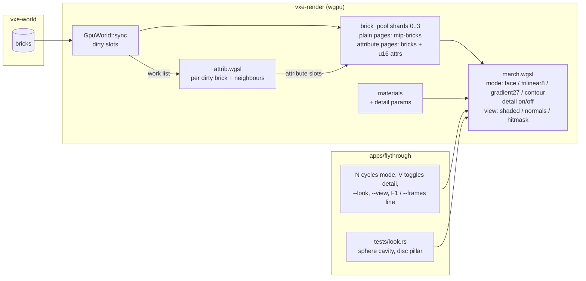

# 0005: The surface-look spike: smoothed normals, per-voxel contour planes and procedural detail, measured on screen

> **Status:** in-progress (2026-10-16)
> **Created:** 2026-10-16
> **Amended:** 2026-10-16, after Plan 0002's close, for the tree it shipped: the contour
> attribute lives in attribute pages inside the existing pool shards (no new storage binding;
> the marcher already binds the default 8), sizes follow the 512 B narrow slot, mip-bricks
> carry no attribute, the VRAM reading is `allocated_bytes`, and every fly-through run names
> `--level` and, for `dev`, `--headless`. See "Amendment 2026-10-16" below.
> **Milestone:** M2 in `docs/roadmap.md` (first M2 plan; it produces the measurements the lighting plan and the surface ADR are written from)
> **Related ADRs:** ADR-0002 (the reserved per-voxel attribute, parallel to the pool and indexed by slot), ADR-0004 (the sharded pool; its Outcome: a further storage binding needs a higher requested limit or a packed binding; this plan packs), ADR-0003 (LOD records), ADR-0001 (stack). This plan writes no ADR; the surface-representation ADR is written at its close from the readings and the owner's call.
> **Prerequisite:** Plan 0002 closed (done, v0.3.0). Both plans rewrite `march.wgsl` and `gpu_world.rs`; this plan builds on the sharded, palette-narrowed pool and the LOD records Plan 0002 left behind.

## TL;DR

The marcher shades every hit with its face normal, so the cave reads as cubes. The owner's bar
is the Sibenik cathedral of Laine and Karras 2010: smooth, believable rock, chosen by
measurement, not by committing to a mechanism first. This plan builds the three candidate
mechanisms behind flags and a harness that measures each the same way: (A) normals smoothed in
the shader from the neighbourhood of the hit, (B) a per-voxel contour plane (normal plus offset)
computed on the GPU into attribute pages of the brick pool and intersected by the marcher, so
silhouettes smooth too, and (C) procedural per-material surface detail from world position. For
each it reads the normal error against an analytic sphere, the silhouette error against an
analytic disc, the primary-pass time at 1080p, and the VRAM cost by allocated bytes. The first
thing a reader sees is a headless test printing the face-normal baseline: about 32 degrees of
mean normal error inside a carved sphere. The last phase is the owner looking at the
fly-through in each mode and writing the call into the log.

## Context & problem

The roadmap's surface-look decision (2026-10-16) wants smooth natural rock at 10 cm voxels with
one material id per voxel and no stored colour or occlusion, and names three places the
impression must come from: the silhouette, the surface texture, and the light. This plan takes
the first two; the light is the lighting plan. ADR-0002 reserves the mechanism's storage: a
per-voxel attribute parallel to the brick pool and indexed by the same slot, which does not
exist until a plan needs it.

The consumer requirement is `project-context.md`, Rendering P0: a first-person image stable at
arm's length, and the owner's look bar. `nfr.md` figures touched: §2 primary rays (every mode
adds reads per hit) and §3 world VRAM (mode B adds bytes per `Full` brick of a full chunk).

What is known, from Plan 0002's tree (`crates/vxe-render/src/gpu_world.rs`,
`crates/vxe-render/src/shaders/march.wgsl`):

- The marcher binds **8 storage buffers**: pool shards 0 to 3 (bindings 1, 7, 8, 9), chunk
  records, chunk table, materials and brick masks. That is wgpu's default
  `max_storage_buffers_per_shader_stage`, and `vxe_render::limits_for` requests exactly 8.
  The output is a storage texture, which counts against a separate limit. A ninth storage
  buffer for a parallel attribute pool does not fit (ADR-0004 Outcome).
- A narrow `Full` brick is one 512 B slot of `u8` palette indices; a wide brick is two slots
  from an even slot, holding `u16` materials. Masks are 8 B per global slot. Records are
  2560 B. `slots_per_shard` is a multiple of `POOL_PAGE_SLOTS` (4096).
- Record entries use bit 31 (`FULL_BIT`), bit 30 (`WIDE_BIT`) and bits 0..30 for the slot;
  narrow voxels use all 8 bits as a palette index and wide voxels all 16 bits as a material.
  There are no spare bits in a voxel or an entry for a 16-bit attribute.
- LOD-only chunks are LOD records (table entry bit 30, `LOD_BIT`) whose mip-bricks take slots
  from the same pool.
- The level-size seed-1 world has 383 608 `Full` bricks, no wide chunk, and a mirror of
  207 681 088 B live. Its march pass reads 1.953 to 1.956 ms at 1920 x 1080 from the spawn,
  headless (Plan 0002 Phase 8, RTX 3080 Laptop GPU).

What is not known, and what this plan measures: how much each mechanism costs per frame, how
much B costs in VRAM by allocated bytes, and which of them the owner accepts on screen.

## Decision

We build all three mechanisms as switchable modes in `vxe-render`, measured by one harness, and
defer the choice to the owner's on-screen call, recorded as a `human` phase. We do not ship a
default: until the close, the fly-through's default mode stays face normals.

Mode B's attribute is packed into the existing pool bindings as **attribute pages**. With
`MirrorConfig::surface_attrs` set, a 4096-slot pool page is either a *plain page* (today's
layout, for mip-bricks of LOD records) or an *attribute page*, for the `Full` bricks of full
chunks: slots 0..1364 of the page are brick slots, allocated as today (narrow single slots,
wide even pairs), and brick slot `i` of the page owns the two slots `1364 + 2i` and
`1365 + 2i`, which hold its 512 `u16` attributes (1024 B). `3 x 1364 = 4092`, so slots
4092..4096 of an attribute page are unused. The attribute of global slot `s` is at global slot
`p + 1364 + 2 (s - p)` with `p = s - s % 4096`: computed, never stored, always in the same
shard as `s` because shards are whole pages. A wide brick uses the pair of its first slot; the
pair of its second slot is reserved and unused. With `surface_attrs` off, nothing changes: every
page is plain and Plan 0002's tests and readings stand byte for byte.

This keeps ADR-0002's reservation in substance (the attribute is indexed by the brick's slot)
without a ninth binding, and it keeps Plan 0002's staged runs: consecutive brick slots of a page
are still consecutive, the CPU never writes attribute slots, and the sync byte budget counts
only voxels and masks.

Rejected:

- Picking one mechanism now (the roadmap decision says measure first); building the spike
  outside the engine in a throwaway renderer (the cost that matters is the cost inside
  `march.wgsl` with the real pool); a full ESVO-style octree with contours (ADR-0002 rejected
  the octree; the contour idea is taken without it, per voxel in the brick map).
- **A ninth storage binding** for a parallel attribute pool (the original draft): requires
  requesting `max_storage_buffers_per_shader_stage` above the WebGPU default of 8, which
  ADR-0004's Outcome names as the alternative to packing.
- **Spare bits in the voxel or entry encoding:** none exist (see above).
- **Attribute slots adjacent to each brick** (`s`, then `s+1`, `s+2`): breaks every staged
  run into one write per brick, about 383 608 queue writes for the level's first sync against
  Plan 0002's 195.
- **An attribute pointer per slot in the masks buffer:** changes the mask stride for every
  mirror, attributes or not, and adds a dependent read per hit.

## Amendment 2026-10-16

Made at Plan 0002's close, against its shipped tree, before "go". The intent, the modes, the
scenes, the metrics and the phase order are unchanged. What changed:

1. **No new binding.** The original draft added `brick_attrs[k]` storage buffers parallel to
   each shard; the marcher already uses all 8 default storage bindings. The attribute moves
   into attribute pages of the existing shards (Decision above). The attribute pass's
   per-frame work list is a buffer bound only by `attrib.wgsl`, which binds 6 storage buffers
   (four shards read-write, chunk records, chunk table) plus the work list, 7 in all.
2. **Sizes follow the 512 B slot.** The draft priced the attribute at 1 KiB per brick beside a
   1 KiB brick. A narrow brick is 512 B; its attribute is 1024 B in two slots, each with its
   8 B mask entry, so the live accounting rises by `2 x (512 + 8) = 1040` B per narrow brick
   slot, and the page layout makes the allocated cost `4096 / 1364` slots per brick slot.
   Every VRAM figure below is redone.
3. **Mip-bricks carry no attribute.** They live in plain pages; in `Contour` mode a hit in a
   LOD-only chunk hits and shades exactly as in face mode. The chunk-table bits (`LOD_BIT`,
   `ABSENT`) and the record-entry bits (`FULL_BIT`, `WIDE_BIT`, slot) are untouched.
4. **VRAM is read on `allocated_bytes`**, which Plan 0002's fix pass made the §3 reading; the
   exact live rise stays as a correctness check.
5. **Runs name `--level` and `--headless`.** The fly-through streams by default since Plan
   0002, so every bounded-level run names `--level`; `dev` runs every reading headless
   (`--headless`, `--frames`, `--bench`, `--autopilot`), since windowed runs on this machine
   open on a hidden workspace. Phase 6 stays the owner's, windowed, at the keyboard.
6. **Arithmetic rechecked:** the pillar's projected radius (33.2 px, perimeter about 208 px),
   the offset codes (15 values, so `0xFFFF` never collides), the neighbour recompute bound
   (216 bricks per 1 m carve, not 1728), and the face-mode baseline (31.9 degrees).

## Architecture diagram



## Implementation phases

Each phase ships as its own commit. `dev` implements all phases in one session with no review
between phases. The architect reviews once at the end, in a fresh session. Phase 1 is the
walking skeleton: the harness with the face-normal baseline.

Shared conventions for every phase:

- Plan 0001's render conventions hold: lavapipe goldens under the 0.1 % / 2 per 255 floor,
  the skip rule and `VXE_REQUIRE_SOFTWARE_ADAPTER`, 320 x 180 test renders, camera in voxel
  units with z up, timestamps through `MarchTimer`. Plan 0002's
  `goldens_match_bit_exactly_over_one_and_several_shards`, `lod.png` and the mirror tests in
  `crates/vxe-render/tests/mirror.rs` and `apps/flythrough/tests/level_mirror.rs` stay green
  and unchanged in every phase.
- **No new storage binding in `march.wgsl`** (amended 2026-10-16). It keeps its 8 storage
  buffers and one storage texture; `limits_for` keeps requesting 8.
- **Modes** live in bits of the existing `Params.flags`, not shader variants and not new
  uniform fields: bit 0 shadows and bit 1 masks as today, bits 2..4 `normal_mode` in {`Face`,
  `Trilinear8`, `Gradient27`, `Contour`}, bit 4 `detail`, bits 5..7 `view` in {`Shaded`,
  `Normals`, `HitMask`}, bit 7 set when the mirror has attribute pages. `view = Normals` writes
  `n * 0.5 + 0.5` to the target; `HitMask` writes white where a ray hits and black elsewhere.
  The shadow ray's origin offset stays along the face normal in every mode (it is a robustness
  device, not a look device); only shading and, in `Contour`, the hit itself change.
- **Mip levels** (amended 2026-10-16): `Trilinear8` and `Gradient27` read through `lookup`, so
  in a LOD-only chunk they see mip cells; `Contour` falls back to face behaviour there. The
  harness scenes are full chunks only; the LOD look is the owner's separate Plan 0002
  followup.
- **The two harness scenes** live in `apps/flythrough/tests/support/mod.rs`:
  - **Cavity:** the solid material-3 world over chunks `[-2, 2)³` (the test table, rock
    albedo) carved by a radius-40-voxel sphere centred on voxel `[0, 0, 0]`; camera at the
    sphere centre `(0.5, 0.5, 0.5)` looking `+x`, vfov 70 degrees, 320 x 180. Every pixel hits
    the cavity wall. The analytic normal at a hit point `p` is `(c - p) / |c - p|` (inward).
    The **normal error** of a render is the mean over pixels of the angle between the decoded
    `view = Normals` value and the analytic normal; decoding quantisation contributes under
    0.5 degrees.
  - **Pillar:** an air world over chunks `[0, 2)³` under `cave_materials()`, with a rock sphere
    of radius 20 voxels filled at the centre of voxel `[96, 64, 64]`; camera at `(16.5, 64.5,
    64.5)` looking `+x`, vfov 70 degrees, 320 x 180. The **silhouette error** is the number of
    pixels where `view = HitMask` disagrees with the analytic disc (the pixel's centre ray
    intersects the sphere of radius 20 voxels or not). The focal length is
    `90 / tan 35° = 128.5` px, so one voxel at 80 voxels is about 1.6 pixels and the disc's
    radius is `128.5 x 20 / sqrt(80² - 20²) = 33.2` px: a 208-pixel perimeter, along which
    face mode errs by a few hundred pixels (amended 2026-10-16; the draft said 226).
- **Timing** is the median of the last 30 of 300 frames from the spawn pose at 1920 x 1080 on
  the dev box, `flythrough --level --headless --seed 1 --render 1920x1080 --frames 300 --look
  <mode>`, three runs, as Plan 0002 Phase 8 read the level (1.953 to 1.956 ms). Every reading
  names the mode, the adapter and the commit. `--level` keeps the figures comparable with
  Plans 0001 and 0002; the streamed world's 6.69 ms is the march-diagnosis spike's subject,
  not this plan's.
- Mode B's attribute is `u16` per voxel: a 6-bit, 6-bit octahedral-encoded normal (4096
  directions, about 3 degrees apart on average) and a 4-bit plane offset code `k` in 0..=14
  for `(k - 7) / 8` voxel along the normal from the voxel centre, `[-7/8, +7/8]` in steps of
  1/8 (amended 2026-10-16: 15 codes; code 15 appears only in the sentinel). The value `0xFFFF`
  means "no plane" (an interior voxel, one with all six face neighbours solid). A hit with no
  plane (`0xFFFF`, a uniform solid brick, which has no slot and so no attribute, or a mip
  cell) hits and shades exactly as in face mode.

### Phase 1: The harness and the face-normal baseline
- **Owner skill:** dev
- **What:** the `view` and `normal_mode` flag bits, the two scenes, the two metrics, the
  fly-through switches, and the baseline readings.
- **Files touched:** `crates/vxe-render/src/{marcher.rs, light.rs, lib.rs}`,
  `crates/vxe-render/src/shaders/march.wgsl`, `apps/flythrough/tests/{look.rs, support/mod.rs}`,
  `apps/flythrough/src/main.rs` (`--look`, `--view`, keys `N` and `V`, the mode in the `F1`
  and `--frames` line).
- **Done when:**
  - `tests/look.rs::face_normals_baseline` prints the cavity normal error in face mode and
    asserts it lies in `[15, 45]` degrees (a uniform distribution of surface normals gives
    31.9 degrees to the nearest axis; the cavity's view weights the wall unevenly, so the band
    is wide), and prints the pillar silhouette error and asserts it lies in `[100, 800]`
    pixels. Both values are recorded in the log as the baseline every other mode is compared
    against.
  - `view = Normals` on the occluder scene of Plan 0001 Phase 6 (a wall facing `-x`) reads
    `(-1, 0, 0)` at the image centre after decoding, within 1/255 per channel.
  - `primary.png`, `headlamp.png` and `lod.png` are unchanged byte for byte with
    `view = Shaded`, `normal_mode = Face`, `detail` off.
  - The log records the face-mode primary-pass time at 1080p on the dev box (three runs of
    the timing command), the reference every later phase is measured against.

### Phase 2: Mode A, normals smoothed in the shader
- **Owner skill:** dev
- **What:** `Trilinear8` (the gradient of the trilinearly interpolated occupancy of the 2 x 2
  x 2 voxels around the hit point pushed half a voxel into the surface) and `Gradient27`
  (central differences of occupancy over the 3 x 3 x 3 voxels around the hit voxel, each axis
  summing the nine voxels on its positive face minus the nine on its negative face), both
  computed at the hit through the existing `lookup`.
- **Files touched:** `crates/vxe-render/src/shaders/march.wgsl`, `crates/vxe-render/src/marcher.rs`,
  `apps/flythrough/tests/look.rs`, `apps/flythrough/tests/golden/{look_trilinear8.png,
  look_gradient27.png}`.
- **Done when:**
  - Cavity normal error: `Gradient27` at most 12 degrees; `Trilinear8` at most half of the
    face-mode value from the same run. Both are printed and recorded.
  - Pillar silhouette error is unchanged from face mode in both (shading modes do not move
    hits), asserted equal.
  - A flat wall (the occluder scene) reads `(-1, 0, 0)` at the centre in both modes within
    2/255 per channel: smoothing does not bend flat surfaces.
  - Goldens for both modes on the Plan 0001 Phase 5 cave scene with the headlamp are blessed
    on lavapipe and compared under the usual floor.
  - The log records the 1080p primary-pass time for both modes on the dev box.

### Phase 3: Mode B, per-voxel contour planes in attribute pages
- **Owner skill:** dev
- **What:** `MirrorConfig::surface_attrs` and the attribute-page allocator, a compute pass
  `attrib.wgsl` that fills the attributes of every dirty brick and its neighbours from the
  pool itself, and a marcher that intersects the ray with a hit voxel's plane and treats the
  voxel as empty when the ray misses the solid half-space inside it.
- **Files touched:** `crates/vxe-render/src/{gpu_world.rs, marcher.rs, attrib.rs, lib.rs}`,
  `crates/vxe-render/src/shaders/{march.wgsl, attrib.wgsl}`, `crates/vxe-render/tests/mirror.rs`,
  `apps/flythrough/src/main.rs` (`--look` sets `surface_attrs`, so `N` can reach `Contour`;
  without it `N` skips `Contour`; the level's requested pool bytes count attribute pages;
  the `F1` and `--frames` line prints `allocated_bytes` beside the live mirror bytes),
  `apps/flythrough/tests/look.rs`, `apps/flythrough/tests/golden/look_contour.png`.
- **Done when:**
  - **Layout.** With `surface_attrs` on, the `Full` bricks of full chunks take slots only from
    attribute pages and mip-bricks only from plain pages; each kind has its own free lists;
    attribute slots are never handed out as brick slots and are never written by the CPU. A
    readback test in `mirror.rs` forces several shards with `max_shard_slots` and checks, for
    every brick slot `s` the mirror uses, that `s % 4096 < 1364`, that a wide brick's pair
    starts even, and that the attribute slots `p + 1364 + 2 (s - p)` and the next one lie in
    the shard of `s`.
  - **Face mode is untouched by the layout.** With `surface_attrs` on and `normal_mode =
    Face`, `primary.png`, `headlamp.png` and `lod.png` render byte for byte as with it off,
    over one shard and over several.
  - **The pass.** `GpuWorld::sync` records the brick slots it wrote. `GpuWorld::update_attrs(
    encoder)` dispatches `attrib.wgsl` over a work list of those slots plus the attribute-page
    slots of their 26 neighbouring bricks, deduplicated, plus the boundary bricks of mirrored
    full chunks next to any chunk whose record changed, was demoted or was evicted this sync;
    512 voxels per brick. For each voxel: if all six face neighbours are solid, write
    `0xFFFF`; otherwise the normal is `Gradient27` of occupancy, read through the chunk table
    as the marcher does (neighbours across brick and chunk boundaries count; a voxel in an
    absent chunk counts as air, one in a LOD-only chunk as its level-1 mip cell), and the
    offset is `(f - 0.5) * 3` voxels clamped to `[-7/8, 7/8]` and rounded to the nearest
    1/8, where `f` is the solid fraction of the 27-voxel neighbourhood.
  - A readback test in `mirror.rs` on the `Floor` world (solid below `z = 3`): the voxel at
    local `(3, 3, 2)` (the top solid layer, `f = 18/27`, so offset `+1/2`, code 11) decodes
    to a normal within 3 degrees of `+z` and offset code 11; an interior voxel reads
    `0xFFFF`. After a carve in one brick, a voxel in a face-adjacent unchanged brick next to
    the carve has the attribute a full recompute gives (the neighbour pass ran).
  - In `Contour` mode the marcher, on reaching a solid voxel of a full chunk with a plane,
    reads its attribute at `pool_word(attr_slot, i / 2)`, half `i & 1`, and intersects the
    ray with the plane; if the intersection lies inside the voxel's cube and the ray enters
    the solid half-space there, the hit is at that `t` with the plane normal; if the ray's
    segment through the cube lies wholly outside the half-space, the voxel is skipped; if
    wholly inside, the hit is the cube entry with the plane normal. A hit with no plane hits
    as before (shared conventions).
  - Pillar silhouette error in `Contour` mode is at most half of face mode; cavity normal
    error at most 12 degrees. Both recorded.
  - **VRAM, live accounting (a correctness check).** `GpuWorld::mirror_bytes` counts, for
    each live brick slot in an attribute page, its two attribute slots and their masks:
    `2 x (512 + 8) = 1040` B. At the level-size seed-1 world (383 608 narrow `Full` bricks,
    no wide chunk), `--level --headless --frames 1` with `--look contour` against without
    `--look`, at the same commit, reads a rise of exactly `1040 x 383 608 = 398 952 320` B
    (380.5 MiB): from 207 681 088 B to 606 633 408 B.
  - **VRAM, the §3 reading.** The same two runs print `allocated_bytes`; both values are
    recorded with machine and commit, and the `--look contour` one is the reading. Expected
    from the page layout and the half-again growth rule (ADR-0004 Outcome): the level needs
    `ceil(383 608 / 1364) = 282` attribute pages, 1 155 072 slots, so the pool and masks
    allocate at least `1 155 072 x 520 = 600 637 440` B and at most
    `(1.5 x 1 155 072 + 4096) x 520 = 903 086 080` B, plus records, table, materials and
    placeholder shards. A reading outside that band is disclosed in the log. The level does
    not fit four 128 MiB shards with attribute pages (256 pages hold 349 184 brick slots), so
    on lavapipe this run fails with `PoolTooLarge` by design; the reading is a dev-box one.
  - The log records the 1080p primary-pass time in `Contour` mode, the level's first-sync
    queue writes with attribute pages, and the `attrib.wgsl` pass time for the initial
    level-size fill (383 608 bricks, 196.4 M voxels) and for a radius-1 m carve (timestamp
    queries around the pass), on the dev box.
  - `look_contour.png` blessed on lavapipe.

### Phase 4: Mode C, procedural per-material detail
- **Owner skill:** dev
- **What:** two detail parameters per material row (scale in voxels, strength in `[0, 1]`),
  a 16-float GPU material row in the existing `materials` binding, and a shader term that
  perturbs the shading normal with the gradient of two octaves of hashed value noise at world
  position and the albedo by the same noise times the strength.
- **Files touched:** `crates/vxe-world/src/material.rs` (`detail: [f32; 2]`, default `[0, 0]`),
  `crates/vxe-render/src/{gpu_world.rs, marcher.rs}`, `crates/vxe-render/src/shaders/march.wgsl`,
  `apps/flythrough/src/lib.rs` (`cave_materials()` detail values behind the `--look` switch),
  `apps/flythrough/tests/look.rs`, `apps/flythrough/tests/golden/look_detail.png`.
- **Done when:**
  - With every row's strength at 0 and `detail` on, `primary.png`, `headlamp.png` and
    `lod.png` match byte for byte: the term is exactly zero at zero strength.
  - With rock at `detail = [4.0, 0.3]` (a 40 cm feature scale) and `detail` on, the Plan 0001
    Phase 5 cave scene under the headlamp differs from the face-mode render at 20 % or more
    of pixels by more than 8/255; `look_detail.png` is blessed on lavapipe.
  - The noise is a pure function of world position: the same scene rendered from two camera
    positions decodes the same `view = Normals` value at a wall point visible in both, within
    2/255 (the test picks the pillar's front pole).
  - The material rows grow from 32 B to 64 B in the existing `materials` binding; the live
    mirror bytes rise by exactly 32 B per material row and by nothing else.
    `apps/flythrough/tests/level_mirror.rs` stays green unchanged (its mirror-bytes assertion
    reads `materials().size()`).
  - The log records the 1080p primary-pass time with `detail` on over face normals and over
    `Gradient27`, dev box.

### Phase 5: Readings and the comparison table
- **Owner skill:** dev
- **What:** the full table of readings, one row per mode combination, in the log and in
  `nfr.md` as dev-reference lines, plus one streamed reading of mode B's VRAM.
- **Files touched:** `docs/nfr.md` (§2 dev-reference lines for each mode; §3 the attribute
  pages' allocated bytes), `apps/flythrough/tests/look.rs` (prints every metric for every mode
  in one test so the table is reproducible with one command), `apps/flythrough/src/main.rs`
  (`--autopilot` accepts `--look`).
- **Done when:**
  - The log holds a table with rows `Face`, `Trilinear8`, `Gradient27`, `Contour`, each with
    and without `detail`, and columns: cavity normal error (degrees), pillar silhouette error
    (pixels), 1080p primary-pass median (ms, dev box, `--level --headless`), mirror bytes at
    the level, live and allocated (B). Every cell has a number or the reason it does not
    apply.
  - One headless `flythrough --autopilot --headless --look contour` run on the dev box
    records the mirror's live and allocated bytes at full residency and at peak, beside Plan
    0002's face-mode figures (1 675 304 748 B allocated at full residency, 2 431 425 836 B
    peak), or the error the run stops on, which is then the reading.
  - `nfr.md` §2 lists the primary-pass readings per mode as dev reference, and §3 the
    attribute pages' allocated bytes at the level and in the streamed run, each with machine
    and commit.

### Phase 6: The owner's call
- **Owner skill:** human
- **What:** the owner, at the keyboard of the dev box, runs `flythrough --level --seed 1
  --look face` windowed, cycles the modes with `N` and `V` at arm's length from a carved wall
  and at 5 m from a cavern wall, and writes the call into this plan's log. (Agents do not run
  this phase: windowed runs started by an agent open on a hidden workspace.)
- **Files touched:** this plan's `## Implementation log`.
- **Done when:** the log carries one entry naming the chosen normal mode, whether detail is on
  and at what strength for rock, and the on-screen reason in one or two sentences; or names two
  finalists and the measurement that would separate them. The architect's close review turns
  that entry and the Phase 5 table into the surface-representation ADR and into the lighting
  plan's starting state.

## Data shapes

```rust
// illustrative: vxe-render
pub enum NormalMode { Face, Trilinear8, Gradient27, Contour }
pub enum ViewMode { Shaded, Normals, HitMask }
pub struct LookParams { pub normal_mode: NormalMode, pub detail: bool, pub view: ViewMode }

// MirrorConfig gains: surface_attrs: bool (default false)
// Params.flags gains: normal mode bits 2..4, detail bit 4, view bits 5..7, attribute pages bit 7
pub const ATTR_PAGE_BRICK_SLOTS: u32 = 1364; // brick slots of an attribute page
// attribute slot of brick slot s: (s - s % POOL_PAGE_SLOTS) + 1364 + 2 * (s % POOL_PAGE_SLOTS)
```

```text
GPU mirror, with surface_attrs (no new marcher binding):
  brick_pool0..3   pages of 4096 slots, each plain or attribute
                   plain page:     4096 slots of mip-bricks (narrow 1 slot, wide 2), as Plan 0002
                   attribute page: slots 0..1364 bricks of full chunks; 1364 + 2i, 1365 + 2i the
                                   attributes of brick slot i: [256 x u32], two u16 per word,
                                   x fastest; slots 4092..4096 unused
                   u16: bits 0..6 octahedral u, 6..12 octahedral v, 12..16 offset code
                        (0..=14 -> (k - 7) / 8 voxel), 0xFFFF: no plane
  brick_masks      unchanged: [global slot][2 x u32]; attribute slots' entries stay zero
  chunk_records    unchanged (entry bits 31 full, 30 wide, slot)
  chunk_table      unchanged (bit 30 LOD, 0xFFFFFFFF absent)
  materials        [id][16 x f32]: albedo rgb, roughness, emission rgb, flags, detail scale,
                   detail strength, 6 spare (Phase 4)

attrib.wgsl only:
  attrib_work      storage   [n][4 x u32]: brick slot, brick origin in voxels (x, y, z as i32)
  bindings: uniform params, shards 0..3 read_write, chunk_records, chunk_table, attrib_work
            = 7 storage buffers
```

No new external dependency.

## Budgets

| `nfr.md` figure | Expected effect | How the close measures it |
|---|---|---|
| §2 primary rays (3.0 ms at 1080p, baseline) | Every mode adds reads per hit: `Trilinear8` 8 lookups, `Gradient27` 27, `Contour` one attribute read per candidate voxel plus a plane test; detail adds about 16 hash evaluations. Expected under 1 ms added on the dev box for any one mode, over the level's 1.95 ms; this is a guess | the Phase 5 table, `--level --headless` |
| §3 world VRAM (3 GB, read on allocated bytes) | `Contour` adds 1040 B live per brick slot of a full chunk, nothing for mip-bricks. The level: exactly 398 952 320 B live (380.5 MiB), 600.6 to 903.1 MB of pool and masks allocated. The streamed default (r_full 16, r_lod 24): about 1.64 M `Full` bricks in full chunks (Plan 0002's 855.1 MiB full-chunk mirror less 41.7 MiB of records, at 520 B), so about 1.71 GB more live, about 3.31 GB live in all, over the 3 GB line before any allocation headroom (face mode peaks at 2.43 GB allocated). A guess from the sweep, not a measurement | Phase 3's level reading and Phase 5's autopilot run, both `allocated_bytes` |
| Attribute pass (new, no figure) | Initial fill of the level's 383 608 bricks; a 1 m carve dirties at most 4 x 4 x 4 = 64 bricks, at most 6 x 6 x 6 = 216 with neighbours. Proposal: the carve's pass under 0.5 ms | timestamp queries around `attrib.wgsl` |

The baseline GPU is not on hand; every figure is a dev-reference reading and says so. The
roadmap's RTX 3080 Laptop is roughly two to three times the baseline's throughput, so a mode
that adds 1 ms here projects to 2 to 3 ms there, against a 3.0 ms line that also pays for the
primary rays themselves. That projection, and mode B's streamed VRAM against the 3 GB line,
are the numbers the owner's call weighs.

## Risks & open questions

- **Mode B's VRAM at the default residency.** At `u16` per voxel the attribute is twice the
  narrow brick, and the streamed estimate is over the 3 GB line by live bytes alone. The
  spike measures it rather than shrinking it; if the owner picks B, the surface ADR chooses
  among attributes on surface voxels only, a smaller encoding, a per-block plane, or a smaller
  `r_full`. The level fits on the dev box; on an adapter with 128 MiB bindings it does not
  (256 attribute-capable pages hold 349 184 brick slots against 383 608).
- **Attribute pages reserve space.** A partly filled attribute page reserves its attribute
  slots, and a wide brick's second pair is unused. The level wastes at most one page's
  remainder; a wide-heavy world would show it in the reading.
- **The contour offset formula is crude.** `(f - 0.5) * 3` from a 27-voxel fraction is a
  first guess at where the surface sits; a least-squares plane fit over the neighbourhood is
  the follow-up if silhouettes look lumpy. The metric says whether it is needed.
- **Contours can open holes.** A voxel skipped because the ray misses its half-space may expose
  a neighbour whose plane also misses, leaking the ray through a thin wall. The pillar
  silhouette error catches gross leaks; the owner's eye catches the rest. The mitigation inside
  the plan is the `0xFFFF` rule for interior voxels, which never skip.
- **Uniform solid bricks have no attribute.** A wall that runs exactly along a brick face can
  belong to a uniform solid brick, which hits as a cube in `Contour` mode. In the cavity this
  happens near the poles (for example the bricks at `x` in `[40, 48)` beside the carved
  voxels at `x = 39`), on a patch of a few per cent of the pixels where the face normal is
  within about 13 degrees of the analytic one, so it cannot carry the mean past the 12-degree
  bound; the owner's eye judges the rest.
- **Neighbour recompute cost.** Deduplicated, a 1 m carve's dirty bricks and their neighbours
  form at most a 6 x 6 x 6 block, so a 100-carve burst recomputes at most 21 600 bricks of
  512 voxels (11.1 M voxels); a streamed chunk's first upload recomputes its own `Full`
  bricks and up to 488 boundary bricks of its neighbours (6 faces of 64, 12 edges of 8,
  8 corners). The reading says whether the pass stays inside the streaming line; if not, the
  follow-up restricts the neighbour set to bricks whose boundary voxels are solid.
- **Shadow rays and contours.** The shadow ray marches in the same mode; a contour hit may
  shadow where a cube would not, which is correct. The occluder-scene count (820 to 840) is a
  face-mode test and is run in face mode only.
- **Determinism** is untouched: everything here is render-side and reads the world through
  the mirror.

## What this plan does NOT do

- **Choose the mechanism.** Phase 6 records the owner's call; the ADR is written at the close.
- **Fix the attribute layout for good.** Attribute pages are the spike's packing; the surface
  ADR records the layout the chosen mechanism keeps.
- **Carry attributes on mip-bricks.** A downsampled plane per mip cell is a follow-up if the
  owner's LOD look calls for it.
- **Lighting, emissive extraction, denoising, upscaling**: the lighting plan.
- **A least-squares or distance-field plane fit, or a generator-provided surface field**: a
  follow-up if the first formula fails the metric or the eye.
- **Per-voxel colour or baked occlusion**: the roadmap says the impression must come from
  cheaper places; nothing here stores colour.
- **Baseline-GPU readings**: M2's close.

## Implementation log

> Written by `dev`: one row per phase as its commit lands, then the close block. **The phases
> above are the contract. This section records what happened.** Observations, never conclusions:
> no pass list, no self-assessment. Deviations and unmet done-whens are **always** disclosed.
> Keep it shorter than `## Implementation phases`.

| phase | owner | state | commit |
|---|---|---|---|
| 1: The harness and the face-normal baseline | dev | done: face cavity normal error 40.75 degrees, pillar silhouette error 172 px (lavapipe); occluder centre normal (-1, 1/255, 1/255); `primary.png`, `headlamp.png`, `lod.png` byte for byte; face 1080p march 17.218 / 17.261 / 17.255 ms on RADV Renoir (RTX 3080 lost from the bus, see Notes) | ca7dc23 |
| 2: Mode A, normals smoothed in the shader | dev | done: cavity normal error trilinear8 18.62, gradient27 6.95 degrees (face 40.75, same run); pillar silhouette 172 px in all three; occluder centre (-1, 1/255, 1/255) in both; `look_trilinear8.png`, `look_gradient27.png` blessed on lavapipe; 1080p march trilinear8 25.024 / 24.885 / 24.872 ms, gradient27 41.277 / 41.400 / 41.353 ms on RADV Renoir | 9480183 |
| 3: Mode B, per-voxel contour planes in attribute pages | dev | done: layout and floor readback tests in `mirror.rs`; face goldens byte for byte with attribute pages over 1 and 3 shards (`lod.png` 1 and 2); contour cavity normal error 7.41 degrees, pillar silhouette 32 px (face 40.75, 172, same run, lavapipe); `look_contour.png` blessed on lavapipe. RTX 3080 Laptop GPU, `--level --headless --seed 1 --frames 1`: without `--look` 207 681 088 B live, 213 334 144 B allocated; `--look contour` 606 633 408 B live, 613 759 104 B allocated; first sync 571 writes (195 without); 1080p contour march 1.891 / 1.891 / 1.892 ms; attrib initial fill (383 608 bricks) 55.020 / 39.581 / 41.722 / 41.889 ms; one 1 m carve 46 bricks 0.020 ms; the other 99 bench carves 2777 bricks 0.310 ms | committed with this row |
| 4: Mode C, procedural per-material detail | dev | not started | |
| 5: Readings and the comparison table | dev | not started | |
| 6: The owner's call | human | not started | |

### Notes

_(Deviations from the plan, with the commit, stated without justification. Done-whens not
satisfiable as stated, and what was done instead. Followups noticed and not acted on. One line
each. Empty is fine.)_

- Phase 1: the RTX 3080 Laptop GPU fell off the PCIe bus at 17:51 on 2026-10-16 (kernel:
  `NVRM: GSP core unresponsive`, then `GPU lost from the bus`); `nvidia-smi` and
  `vulkaninfo` no longer list it. The headless fly-through's high-performance adapter is then
  RADV Renoir (the integrated GPU), and every timing and VRAM reading in this log is taken on
  it and names it. The RTX 3080 readings the plan asks for are not taken.
- Phase 1: `LookParams`, `NormalMode` and `ViewMode` live in `marcher.rs`; `light.rs` is
  unchanged.
- Phase 2: `Trilinear8` takes its gradient at the hit point on the entry face: along the hit
  axis the 2 x 2 x 2 stencil is the hit voxel and the voxel across the face (weight 1/2 each),
  on the other axes the two voxel centres either side of the point. At the point pushed half
  a voxel into the surface (the hit voxel's centre on that axis) the stencil spans two solid
  voxels on a flat wall and the gradient along the face normal is zero.
- Phase 1: the harness helpers (`make_lod`, `carved_world`, `lod_scene`) are copied into
  `tests/support/mod.rs`; `tests/golden.rs` keeps its own copies unchanged.
- Phase 3: the RTX 3080 Laptop GPU is back on the bus after a reboot (`nvidia-smi -L` checked
  before and after each reading); every Phase 3 figure named RTX is on it. Phases 1 and 2's
  figures stay the Renoir ones; the RTX figures for every mode are Phase 5's table.
- Phase 3: `surface_attrs` is a constructor, `GpuWorld::with_surface_attrs(device, cfg)`, with
  a `surface_attrs()` getter, not a `MirrorConfig` field: `apps/flythrough/tests/level_mirror.rs`
  builds `MirrorConfig` with every field named and stays unchanged.
- Phase 3: `GpuWorld::update_attrs_timed(encoder, timestamps)` sits beside
  `update_attrs(encoder)` for the pass timings; both return the bricks in the work list.
- Phase 3: `free_slots()` returns the plain kind's free single slots (every slot without
  attribute pages). Pages keep their kind for the mirror's life; a page freed of bricks is not
  handed to the other kind.
- Phase 3: `attrib.wgsl` runs one workgroup of 256 per brick, loading the 10 x 10 x 10
  occupancy around the brick into workgroup memory once.
- Phase 3: the face-with-attribute-pages golden check, the contour metrics and the contour
  golden are in `apps/flythrough/tests/look.rs`; the layout and floor readback tests in
  `crates/vxe-render/tests/mirror.rs`.
- Phase 3: with `--look`, `--bench` applies and syncs the first of its 100 carves alone and
  times its attribute pass, then the other 99; the `bench:` sync line covers those 99. The
  level's `mirror: uploaded` line also prints live and allocated bytes, since a `--frames 1`
  run prints no frame line.
- Phase 3: `look_contour.png` shows isolated dark pixels on lit wall (lavapipe image).

### Close triggers

_(Facts for the architect. No recommendations, and no suggested version bump.)_

- **What shipped:**
- **Public API changed:**
- **Budget readings:**
- **Gate at the tip:**
- **Outstanding `human` phases:**

## Followups

- The surface-representation ADR, from Phase 6 and the Phase 5 table, including the attribute
  layout if mode B is kept.
- Least-squares plane fit for the contour offset, if needed.
- A smaller attribute footprint (surface voxels only, a smaller encoding, or a per-block
  plane), if mode B is kept and the streamed reading misses §3.
