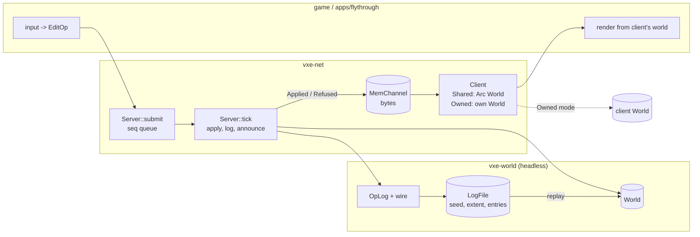

# 0007: Server-owned op log, a byte channel, shared and owned clients, and replay from seed plus log

> **Status:** draft
> **Created:** 2026-10-16
> **Milestone:** M5 in `docs/roadmap.md` (the simulation split; scripting follows in its own plan)
> **Related ADRs:** [ADR-0007](../adrs/0007-server-op-log-byte-channel-shared-and-owned-clients.md) (log, channel, client modes), ADR-0002 (per-chunk locked access), ADR-0001 (stack)
> **Prerequisite:** Plan 0001 closed. Independent of Plans 0002 to 0006 and of their readings. Bounded worlds only; the server's ownership of streaming focus points is a named follow-up after Plan 0002 closes.

## TL;DR

`vxe-world` gains an `OpLog` and a hand-written byte encoding for ops, results and log files.
A new crate, `vxe-net`, gains a `Channel` trait with an in-memory implementation, a `Server`
that applies submitted ops once per tick and announces what it did, and a `Client` that either
shares the server's world (solo) or owns its own and applies every announced op itself,
raising `Desync` on the first disagreement. The first thing a reader sees is a headless test:
the 24 ops of the determinism vector go through a log, round-trip through bytes, replay onto a
fresh world and hash to the vector's existing constant. The first thing the user sees is the
fly-through's `--save` and `--replay`: a dug cave reproduced from a file of a few kilobytes,
with every dig in the session going through the server.

## Context & problem

The consumer's Networking P0 (`project-context.md`) wants the server/client responsibility
split even in solo, over an in-memory channel the same code path later carries over the
network; P1 wants edits replayable for saves and late join. Today `apps/flythrough` calls
`World::apply` directly, there is no notion of a tick, and nothing serializes an op.
ADR-0007 records why the client shares the world in solo and why the encoding is ours.

`nfr.md` figures touched: §6 (determinism: a new replay assertion on both arms), §3 RAM
(shared mode adds no world copy). New figures proposed under "Budgets": bytes per logged op,
replay throughput, tick overhead.

## Decision

We implement ADR-0007. `OpLog`, the wire encoding and `LogFile` live in `vxe-world`, because
they are the world's own data format and replay is a world operation. `Channel`, `MemChannel`,
`Server` and `Client` live in `vxe-net`, which is the crate the roadmap names for the channel
abstraction and M9's transport. The tick is a counter the caller advances; the engine reads no
clock. The fly-through becomes the first consumer of the split: every dig is a `submit`, one
`tick` runs per frame, and the printed edit lines come from the client's events.

We rejected function calls on a shared world with no bytes, two worlds always, `serde` with a
binary codec, and snapshot saves (ADR-0007).

## Architecture diagram



## Implementation phases

### Phase 1: OpLog, wire encoding, replay
- **Owner skill:** dev
- **What:** the log, its byte encoding, the save-file header, and `World::replay`; the
  determinism vector extended to prove the round trip.
- **Files touched:** `crates/vxe-world/src/{lib.rs, log.rs, wire.rs}`,
  `crates/vxe-world/tests/log.rs`, `apps/flythrough/tests/determinism.rs`.
- **Done when:**
  - The encoding is the one under "Data shapes". A log entry is `tick: u64`, `seq: u32`, then
    the op: kind `u8` (1 = edit; 2, 3 and 4 are reserved for Plan 0008's stamp and Plan
    0009's drop and remove), mode `u8` plus its payload (`Carve` none, `Fill` a `u16`,
    `Replace` two `u16`), shape `u8` plus its payload (sphere 3 × `i64` + `i64`, box 6 ×
    `i64`, capsule 7 × `i64`). A sphere carve entry is 8 + 4 + 1 + 1 + 1 + 32 = 47 bytes, a
    box fill 8 + 4 + 1 + 1 + 2 + 1 + 48 = 65, a capsule replace 8 + 4 + 1 + 1 + 4 + 1 + 56 =
    75. The test asserts these three lengths on hand-built entries.
  - `OpLog::push(tick, op) -> u32` assigns `seq` ascending from 0; `encode() -> Vec<u8>`;
    `OpLog::decode(&[u8]) -> Result<OpLog, WireError>` reproduces an equal log. A byte string
    cut anywhere inside an entry decodes to `WireError::Truncated { at }` with `at` the
    offset of the entry that failed; an unknown op kind to `WireError::UnknownKind(k)`.
  - `World::replay(&self, log: &OpLog) -> Vec<Result<EditResult, EditError>>` applies the
    entries in `seq` order. In `determinism.rs`, the vector's 24 ops pushed to a log, encoded,
    decoded and replayed on a fresh `generate(0x5EED_0001)` world return the same 24 results
    (including `Err(NotResident([4, 1, 1]))` at index 16) and the vector's voxel hash
    `0x2b6b_6a0d_1f9b_8d75`, which does not change because the voxels do not. The FNV-1a 64
    of the encoded log is blessed on Linux and asserted on both CI arms: the bytes are
    platform independent by construction.
  - `LogFile { seed: u64, source_version: u32, extent: ChunkExtent, log: OpLog }` with
    `write_to(&mut impl Write)` and `read_from(&mut impl Read)`. The header is 52 bytes:
    magic `VXEL` (4), format `u32` = 1 (4), seed (8), source version (4), extent min and max
    as 6 × `i32` (24), entry count `u64` (8). A wrong magic reads as `WireError::BadMagic`, a
    format of 2 as `WireError::UnsupportedFormat(2)`. A file of the vector is 52 bytes plus
    the sum of its entry sizes, asserted from the op list in the test.

### Phase 2: Server and a shared client over an in-memory channel
- **Owner skill:** dev
- **What:** the `vxe-net` crate: `Channel`, `MemChannel`, messages, `Server`, `Client::shared`.
- **Files touched:** `Cargo.toml` (workspace member and dependency row),
  `crates/vxe-net/{Cargo.toml, src/lib.rs, src/channel.rs, src/message.rs, src/server.rs,
  src/client.rs}`, `crates/vxe-net/tests/shared.rs`, `clippy.toml` (the wall-clock denial
  covers `vxe-net`).
- **Done when:**
  - `Channel`: `send(&self, bytes: Vec<u8>)` and `try_recv(&self) -> Option<Vec<u8>>`.
    `MemChannel::pair() -> (Endpoint, Endpoint)` on `std::sync::mpsc`; messages arrive in
    send order; `try_recv` on an empty queue returns `None` without blocking.
  - Messages: `Applied { tick, seq, op, result }` and `Refused { tick, seq, op, error }`,
    encoded as a tag `u8` then fields. An `EditResult` encodes as a `u16` count of
    `(u16, u32)` pairs, a `u16` count of 3 × `i32` chunk coordinates, and a `u8` presence
    flag plus 6 × `i32` for the aabb. The `Applied` message for a sphere carve with one
    material and one touched chunk is 1 + 8 + 4 + 35 + (2 + 6) + (2 + 12) + (1 + 24) = 95
    bytes, asserted.
  - `Server::new(world: Arc<World>, log: OpLog)`; `submit(&self, op: EditOp) -> u32` returns
    the `seq` it assigned, under one lock, in call order; `attach(&mut self, Endpoint)`;
    `tick(&mut self) -> TickReport { tick, applied: u32, refused: u32 }` applies every op
    submitted before the call in `seq` order, appends applied ops to the log with the current
    tick, sends one message per op to every attached endpoint, then advances the tick.
  - `Client::shared(world: Arc<World>, Endpoint)`; `poll(&mut self) -> Vec<Event>` decodes
    every pending message into `Event::Applied { tick, seq, op, result }` or
    `Event::Refused { .. }`.
  - On `solid3_world()` in an `Arc`: submit the radius-10 carve at the origin, then `Fill(2)`
    of the same sphere, then `Replace { from: 2, to: 5 }` of it, then a sphere at
    `[10000, 0, 0]`. One `tick`: the client polls exactly four events with seqs 0 to 3 and
    results `[(3, 4169)]`, `[(0, 4169)]`, `[(2, 4169)]` and `Refused` with `NotResident`;
    `log.len() == 3`; the server's tick is 1; `Arc::ptr_eq` holds between the client's and
    the server's world.
  - Two threads each submit 100 sphere carves (radius 1 m at distinct centres, from the
    seeded helper in `tests/support`), then one `tick`: the log's seqs are 0 to 199 with each
    op exactly once, and the world's hash equals the hash of applying the log's ops in `seq`
    order on a fresh `solid3_world()`. The log is the truth whatever the interleaving.

### Phase 3: Owned client and desync detection
- **Owner skill:** dev
- **What:** `Client::owned`, result comparison, the pipe test on two worlds.
- **Files touched:** `crates/vxe-net/src/client.rs`, `crates/vxe-net/tests/owned.rs`.
- **Done when:**
  - `Client::owned(world: World, Endpoint)` applies each `Applied` op to its own world and
    compares its `EditResult` to the message's; equal yields `Event::Applied`, different
    yields `Event::Desync { seq, ours, theirs }`, after which `desynced()` is true and the
    client applies nothing further.
  - Two `solid3_world()`s, the server on one and an owned client on the other: 100 seeded
    sphere carves through `submit`, `tick`, `poll` give 100 `Applied` events, zero `Desync`,
    and equal voxel hashes on both worlds.
  - Fault injection: after 10 ops the test carves a radius-5 sphere at `[40, 40, 40]` on the
    client's world directly; op 11, submitted to the server, is that same sphere. The server
    reports `[(3, n)]` with `n > 0`, the client computes an empty result, and `poll` yields
    `Desync { seq: 11, .. }`; ops 12 onward are received but not applied, so the client's
    hash is unchanged afterwards.

### Phase 4: Save, replay, and the fly-through on the split
- **Owner skill:** dev
- **What:** `LogFile` on disk, `--save` and `--replay`, and every dig in the testbed going
  through `Server` and a shared `Client`.
- **Files touched:** `apps/flythrough/src/{main.rs, lib.rs}`, `apps/flythrough/Cargo.toml`,
  `apps/flythrough/tests/replay.rs`.
- **Done when:**
  - `flythrough::replay_file(path) -> Result<(World, Vec<Result<EditResult, EditError>>),
    ReplayError>` (library, headless) rebuilds the cave with `CaveSource` from the header's
    seed and extent and replays. `CaveSource::VERSION: u32 = 1` is written into the header; a
    mismatch reads as `ReplayError::SourceVersion { file, ours }`.
  - `tests/replay.rs`: a `LogFile` of the determinism vector written to a temp file and read
    back through `replay_file` yields the vector's hash and its 24 results.
  - The fly-through runs a `Server` on the cave world in an `Arc` and a `Client::shared`.
    Digs, fills and the `B` bench go through `submit`; one `tick` runs per frame before
    `GpuWorld::sync`; the edit lines printed to the console come from the client's events.
  - `--save <path>` writes the `LogFile` on exit (including `--frames` exit) and prints
    `world hash 0x…`; `--replay <path>` loads before the first frame, replays, and prints
    `replayed N ops, hash 0x…`. `--bench` runs the `B` bench on the first frame. A session
    `--frames 2 --bench --save a.log` followed by `--frames 1 --replay a.log` prints the same
    hash twice; the log records both lines.

### Phase 5: Readings
- **Owner skill:** dev
- **What:** the figures this plan proposes, measured on the dev box.
- **Files touched:** `crates/vxe-world/benches/replay.rs`, `crates/vxe-net/benches/tick.rs`,
  `crates/vxe-world/Cargo.toml`, `crates/vxe-net/Cargo.toml`, `docs/nfr.md`.
- **Done when:**
  - `cargo bench -p vxe-world --bench replay`: decode plus replay of 10 000 radius-1 m carves
    on a solid 4³-chunk world (the carves at seeded centres inside the interior), reported as
    ops per second; and the encoded size, which is exactly 470 000 bytes plus the 52-byte
    header.
  - `cargo bench -p vxe-net --bench tick`: 100 submits, one tick and one poll in shared mode
    on the same world, against 100 direct `apply` calls; the overhead is reported in
    microseconds. Proposal: under 50 µs.
  - Both readings go into the Implementation log and `nfr.md` §4 with machine and commit.

## Data shapes

```rust
// illustrative
pub struct LogEntry { pub tick: u64, pub seq: u32, pub op: Op }
pub enum Op { Edit(EditOp) }                 // kinds 2..=4 reserved (Plans 0008, 0009)
pub struct OpLog { entries: Vec<LogEntry> }
pub struct LogFile { pub seed: u64, pub source_version: u32, pub extent: ChunkExtent, pub log: OpLog }
pub enum WireError { Truncated { at: usize }, UnknownKind(u8), BadMagic, UnsupportedFormat(u32) }

pub trait Channel { fn send(&self, bytes: Vec<u8>); fn try_recv(&self) -> Option<Vec<u8>>; }
pub enum Message {
    Applied { tick: u64, seq: u32, op: Op, result: EditResult },
    Refused { tick: u64, seq: u32, op: Op, error: EditError },
}
pub struct Server { world: Arc<World>, log: OpLog, pending: Mutex<Vec<(u32, Op)>>, next_seq: AtomicU32, tick: u64, clients: Vec<Endpoint> }
pub enum ClientWorld { Shared(Arc<World>), Owned(World) }
pub struct Client { world: ClientWorld, endpoint: Endpoint, desynced: bool }
pub enum Event {
    Applied { tick: u64, seq: u32, op: Op, result: EditResult },
    Refused { tick: u64, seq: u32, op: Op, error: EditError },
    Desync { seq: u32, ours: EditResult, theirs: EditResult },
}
```

Wire: little-endian throughout; `Fixed3` as 3 × `i64`; `ChunkCoord` as 3 × `i32`; counts as
`u16`; no padding, no alignment, no varints. Every tag value is a constant with a name in
`wire.rs` and a test that encodes and decodes one value of each kind.

## Budgets

| Figure | Expected effect | Close measures by |
|---|---|---|
| §6 determinism | A new assertion: the vector's log replays to the vector's hash, and the log bytes hash to a blessed constant, on both CI arms | `determinism.rs` on both arms |
| §3 RAM | Shared mode adds no world copy | `Arc::ptr_eq` assertion in Phase 2; `world_budget` unchanged |
| §4 edits (new line) | 47 bytes per sphere carve in the log; replay throughput; tick overhead under 50 µs per 100 ops (proposal) | Phase 5 benches, dev box, commit named |

## Risks & open questions

- **Threads and order.** `submit` from several threads is ordered by its lock; the log is the
  order of truth and replay follows it. Phase 2's two-thread test defends this.
- **Concurrent readers.** The server applies while the render thread's `GpuWorld::sync` reads
  the same `Arc<World>`. ADR-0002's per-chunk locks make each chunk consistent; a multi-chunk
  op may be half-visible to one `sync`, which is already true today and is repaired by the
  next frame's dirty upload.
- **No clock in `vxe-net`.** The tick is the caller's counter. `clippy.toml`'s wall-clock
  denial extends to the crate.
- **Streaming.** An op on a non-resident chunk is refused. Replay on a streaming world must
  reproduce residency first; this plan stays on bounded worlds and names the follow-up: after
  Plan 0002 closes, the `Server` owns the `Streamer`'s focus points, and a replay drives them
  from the log's op positions before applying.
- **Allocation.** One `Vec<u8>` per message. Fine for hundreds of ops per frame; M9 may pool.
- **Open:** whether `Refused` should carry the full op or only its `seq`. The plan says the
  op, so a client can retry without remembering what it sent.

## What this plan does NOT do

- **Prediction and reconciliation**, **entity replication**, **QUIC**, **late join**: M9.
- **Log compaction or snapshots**: M9.
- **Streaming on the server**: the follow-up named above, after Plan 0002.
- **Scripting hosts**: M5's second plan.
- **Stamp, drop and remove ops in the log**: op kinds 2 to 4 are reserved here and claimed by
  Plans 0008 and 0009; wiring them through `Server` is a follow-up once those plans close.

## Implementation log

| Phase | Owner | Status | Notes |
|---|---|---|---|
| 1: OpLog, wire encoding, replay | dev | not started | |
| 2: Server and shared client | dev | not started | |
| 3: Owned client and desync | dev | not started | |
| 4: Save, replay, fly-through on the split | dev | not started | |
| 5: Readings | dev | not started | |
