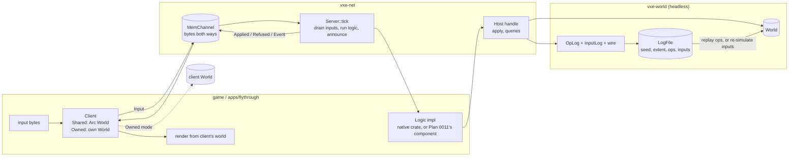

# 0007: Server-owned op log, a byte channel, the logic boundary, shared and owned clients, and replay from seed plus log

> **Status:** approved (2026-10-16; amended the same day with the logic boundary, ADR-0010)
> **Created:** 2026-10-16
> **Milestone:** M5 in `docs/roadmap.md` (the simulation split; the WASM host is Plan 0011)
> **Related ADRs:** [ADR-0007](../adrs/0007-server-op-log-byte-channel-shared-and-owned-clients.md) (log, channel, client modes), [ADR-0010](../adrs/0010-game-logic-as-a-component-behind-a-logic-trait.md) (logic behind a trait, native and component), ADR-0002 (per-chunk locked access), ADR-0001 (stack)
> **Amended:** 2026-10-17, a boundary entry for directly submitted ops (Phase 3 unblock; orchestrator-applied, owner may overturn; see "Amendment 2026-10-17")
> **Prerequisite:** Plan 0001 closed. Independent of Plans 0002 to 0006 and of their readings. Bounded worlds only; the server's ownership of streaming focus points is a named follow-up.

## TL;DR

`vxe-world` gains an `OpLog`, an `InputLog` and a hand-written byte encoding for ops, inputs,
results and log files. A new crate, `vxe-net`, gains a `Channel` trait with an in-memory
implementation, a `Server` that drains client inputs once per tick, hands them to a `Logic`
behind a trait, applies the ops the logic requests and announces what it did, and a `Client`
that either shares the server's world (solo) or owns its own and applies every announced op
itself, raising `Desync` on the first disagreement. The logic is the game's; the engine gives
it a `Host` handle for queries and edits and carries its inputs and events as opaque bytes.
The first thing a reader sees is a headless test: the 24 ops of the determinism vector go
through a log, round-trip through bytes, replay onto a fresh world and hash to the vector's
existing constant; and a seeded test logic driven by 100 inputs re-simulates from the input
log to the same world hash and the same op-log bytes. The first thing the user sees is the
fly-through's `--save` and `--replay`, with every dig going through a native `DigLogic` on the
server.

## Context & problem

The consumer's Networking P0 (`project-context.md`) wants the server/client responsibility
split even in solo, over an in-memory channel the same code path later carries over the
network; P1 wants edits replayable for saves and late join. The owner decided on 2026-10-16
(ADR-0010) that the game's server logic is a component behind a trait, developed natively and
shipped as WebAssembly, so the server's loop must be shaped for it before the first line of
`vxe-net` exists: clients send inputs, the logic decides the ops. Today `apps/flythrough`
calls `World::apply` directly, there is no tick, and nothing serializes an op.

`nfr.md` figures touched: §6 (determinism: replay assertions on both arms), §3 RAM (shared
mode adds no world copy). New figures proposed under "Budgets": bytes per logged op and input,
replay throughput, tick overhead.

## Decision

We implement ADR-0007 and the boundary of ADR-0010. `OpLog`, `InputLog`, the wire encoding and
`LogFile` live in `vxe-world`, because they are the world's own data format and replay is a
world operation. `Channel`, `MemChannel`, `Logic`, `Host`, `Server` and `Client` live in
`vxe-net`. The tick is a counter the caller advances; the engine reads no clock. Inputs and
events are opaque byte payloads the logic defines; the engine never decodes them. Ops may also
be submitted directly on the host side (tests, editors); they are applied before the logic's
tick and logged like any other, followed by a boundary entry that lets re-simulation tell
them from the logic's ops (amended 2026-10-17). The fly-through becomes the first consumer: its digs are
inputs to a native `DigLogic`, one `tick` runs per frame, and the printed edit lines come from
the client's events.

We rejected function calls on a shared world with no bytes, two worlds always, `serde` with a
binary codec, and snapshot saves (ADR-0007); and an engine-owned loop with script hooks,
native-only logic, and Lua for server logic (ADR-0010).

## Architecture diagram



## Implementation phases

### Phase 1: OpLog, InputLog, wire encoding, replay
- **Owner skill:** dev
- **What:** the logs, their byte encoding, the save-file header, and `World::replay`; the
  determinism vector extended to prove the round trip.
- **Files touched:** `crates/vxe-world/src/{lib.rs, log.rs, wire.rs}`,
  `crates/vxe-world/tests/log.rs`, `apps/flythrough/tests/determinism.rs`.
- **Done when:**
  - The encoding is the one under "Data shapes". An op entry is `tick: u64`, `seq: u32`, then
    the op: kind `u8` (1 = edit; 2, 3 and 4 are reserved for Plan 0008's stamp and Plan
    0009's drop and remove), mode `u8` plus its payload (`Carve` none, `Fill` a `u16`,
    `Replace` two `u16`), shape `u8` plus its payload (sphere 3 × `i64` + `i64`, box 6 ×
    `i64`, capsule 7 × `i64`). A sphere carve entry is 8 + 4 + 1 + 1 + 1 + 32 = 47 bytes, a
    box fill 65, a capsule replace 75. An input entry is `tick: u64`, `client: u32`, `len:
    u16`, then `len` bytes: 14 + `len`. The test asserts these lengths on hand-built entries.
  - `OpLog::push(tick, op) -> u32` assigns `seq` ascending from 0; `InputLog::push(tick,
    client, bytes)`; both `encode() -> Vec<u8>` and `decode(&[u8]) -> Result<_, WireError>`
    to equal logs. A byte string cut inside an entry decodes to `WireError::Truncated { at }`
    with `at` the offset of the entry that failed; an unknown op kind to
    `WireError::UnknownKind(k)`; an input `len` running past the end to `Truncated`.
  - (Added 2026-10-17; lands with Phase 3's resume.) A boundary entry is `tick: u64`, `seq:
    u32`, kind `u8` = `KIND_BOUNDARY` (0x80), 13 bytes, no payload; 0x80 sits clear of the
    op kinds 1 to 4 and of everything Plans 0008 and 0009 may claim below it. `OpLog`
    records one with a seq that ascends like any entry's. `World::replay` skips it and
    returns results for op entries only. `OpLog::len` counts op entries; the log file
    header's op count counts every entry, boundaries included, because the decoder reads
    that many. The test round-trips a log holding a boundary through `encode`/`decode` and
    a `LogFile`, and asserts its 13 bytes.
  - `World::replay(&self, log: &OpLog) -> Vec<Result<EditResult, EditError>>` applies the
    entries in `seq` order. In `determinism.rs`, the vector's 24 ops pushed to a log,
    encoded, decoded and replayed on a fresh `generate(0x5EED_0001)` world return the same
    24 results (including `Err(NotResident([4, 1, 1]))` at index 16) and the vector's hash
    `0x2b6b_6a0d_1f9b_8d75`, unchanged because the voxels are. The FNV-1a 64 of the encoded
    op log is blessed on Linux and asserted on both CI arms.
  - `LogFile { seed: u64, source_version: u32, extent: ChunkExtent, ops: OpLog, inputs:
    InputLog }` with `write_to(&mut impl Write)` and `read_from(&mut impl Read)`. The header
    is 60 bytes: magic `VXEL` (4), format `u32` = 1 (4), seed (8), source version (4),
    extent min and max as 6 × `i32` (24), op count `u64` (8), input count `u64` (8); the
    op entries follow, then the input entries. A wrong magic reads as `WireError::BadMagic`,
    a format of 2 as `WireError::UnsupportedFormat(2)`. A file of the vector with no inputs
    is 60 bytes plus the sum of its op entry sizes, asserted from the op list in the test.

### Phase 2: Server, shared client, direct submission
- **Owner skill:** dev
- **What:** the `vxe-net` crate: `Channel`, `MemChannel`, messages, `Server` with a `NoLogic`
  placeholder, `Client::shared`, and host-side `submit`.
- **Files touched:** `Cargo.toml` (workspace member and dependency row),
  `crates/vxe-net/{Cargo.toml, src/lib.rs, src/channel.rs, src/message.rs, src/logic.rs,
  src/server.rs, src/client.rs}`, `crates/vxe-net/tests/shared.rs`, `clippy.toml` (the
  wall-clock denial covers `vxe-net`).
- **Done when:**
  - `Channel`: `send(&self, bytes: Vec<u8>)` and `try_recv(&self) -> Option<Vec<u8>>`.
    `MemChannel::pair() -> (Endpoint, Endpoint)` on two `std::sync::mpsc` queues, one per
    direction; messages arrive in send order; `try_recv` on an empty queue returns `None`
    without blocking.
  - Messages (Data shapes): server to client `Applied { tick, seq, op, result }`, `Refused {
    tick, seq, op, error }`, `Event { tick, bytes }`; client to server `Input { bytes }`.
    Each encodes as a tag `u8` then fields; an `EditResult` encodes as a `u16` count of
    `(u16, u32)` pairs, a `u16` count of 3 × `i32` chunk coordinates, and a `u8` presence
    flag plus 6 × `i32` for the aabb. The `Applied` message for a sphere carve with one
    material and one touched chunk is 1 + 8 + 4 + 35 + (2 + 6) + (2 + 12) + (1 + 24) = 95
    bytes, asserted. An `Input` of `n` bytes is 1 + 2 + `n`.
  - `Logic` and `Host` are the traits under "Data shapes". `NoLogic` implements `Logic` with
    an empty `tick`.
  - `Server::new(world: Arc<World>, logic: Box<dyn Logic>, seed: u64)` calls `logic.init`
    with a host handle and the seed; `submit(&self, op: EditOp) -> u32` returns the `seq`
    it assigned, under one lock, in call order; `attach(&mut self, Endpoint) -> u32` returns
    the client index; `tick(&mut self) -> TickReport { tick, applied: u32, refused: u32,
    inputs: u32 }` applies every directly submitted op in `seq` order (and, per Phase 3's
    interleaving, logs a boundary after them), then drains every
    attached endpoint's `Input` messages (endpoints in attach order, each in arrival order)
    into `ClientInput`s appended to the input log, then calls `logic.tick`, during which
    `Host::apply` assigns the next `seq`, applies, logs and announces; then sends the
    logic's broadcast bytes as `Event` to every client, and advances the tick.
  - `Client::shared(world: Arc<World>, Endpoint)`; `send_input(&self, bytes: Vec<u8>)`;
    `poll(&mut self) -> Vec<Event>` decodes every pending message into `Event::Applied`,
    `Event::Refused` or `Event::Logic { tick, bytes }`.
  - On `solid3_world()` in an `Arc` with `NoLogic`: submit the radius-10 carve at the
    origin, then `Fill(2)` of the same sphere, then `Replace { from: 2, to: 5 }` of it, then
    a sphere at `[10000, 0, 0]`. One `tick`: the client polls exactly four events with seqs
    0 to 3 and results `[(3, 4169)]`, `[(0, 4169)]`, `[(2, 4169)]` and `Refused` with
    `NotResident`; `ops.len() == 3` and one boundary entry at seq 4 (Phase 3's
    interleaving); the server's tick is 1; `Arc::ptr_eq` holds between
    the client's and the server's world.
  - Two threads each submit 100 sphere carves (radius 1 m at distinct centres, from the
    seeded helper in `tests/support`), then one `tick`: the op entries' seqs are 0 to 199
    with each op exactly once, followed by a boundary at seq 200, and the world's hash equals the hash of applying the log's ops in
    `seq` order on a fresh `solid3_world()`.

### Phase 3: The logic boundary and re-simulation
- **Owner skill:** dev
- **What:** inputs through the channel to a `Logic`, the `Host` handle, and replay by
  re-running the logic on the input log.
- **Files touched:** `crates/vxe-net/src/{logic.rs, server.rs}`,
  `crates/vxe-net/tests/{logic.rs, shared.rs, support/mod.rs}`; for the boundary entry
  (Phase 1's amended bullet, landed with this phase): `crates/vxe-world/src/{log.rs,
  wire.rs}`, `crates/vxe-world/tests/log.rs`.
- **Done when:**
  - `Host` offers `apply(op) -> Result<EditResult, EditError>`, `material_at(v)`,
    `raycast(origin, dir, max) -> Option<Hit>` (Plan 0001's CPU raycast) and
    `count_in_box(lo, hi)`. Nothing else; later plans add their queries by amendment.
  - `tests/support` defines two logics. `EchoLogic` decodes each input payload as one op
    (Phase 1's op encoding) and applies it through the host. `SeededLogic` keeps a 64-bit
    xorshift state seeded from `init`'s seed, and on each tick carves one radius-1 m sphere
    per input at a centre drawn from its own state inside the world's interior, ignoring the
    payload; its broadcast is the 8-byte state after the tick.
  - `EchoLogic`, 100 inputs from one shared client over 10 ticks (10 per tick): 100
    `Applied` events in input order, the input log holds 100 entries with the right ticks,
    and `Server::resimulate(world: Arc<World>, logic, seed, &ops, &inputs) -> OpLog` on a fresh
    `solid3_world()` and a fresh `EchoLogic` yields an op log whose encoded bytes equal the
    live one's and a world with the same hash.
  - `SeededLogic` with seed 7, 100 inputs: re-simulation with seed 7 gives the same op-log
    bytes and world hash; with seed 8 the hash differs and at least 90 of the 100 op entries
    differ (the logic's state, not the inputs, chose the centres). The client receives one
    `Event::Logic` per tick whose bytes are the logic's state.
  - A `Host::apply` that is refused (`NotResident`) is announced as `Refused`, not logged,
    and the logic receives the `Err` to decide what to do.
  - Interleaving (amended 2026-10-17, see "Amendment 2026-10-17"): in a tick that drains at
    least one directly submitted op, applied or refused, the server logs those that applied,
    then a boundary entry `(tick, seq)` that takes the next seq, then the logic's ops. The
    boundary is not announced and counts in neither `applied` nor `refused`.
    `Server::resimulate(world, logic, seed, &OpLog, &InputLog) -> OpLog` runs ticks 0
    through the later of the last input's and the last op entry's tick. At a tick with a
    boundary, it applies that tick's op entries whose seqs lie at or above its own next seq
    and below the boundary's (at tick 0 this skips the ops `init` already produced), records
    them under their logged seqs, continues seqs from boundary + 1, then runs the logic. The
    test submits 5 direct ops at tick 3 among the `EchoLogic` run, the third of them
    `NotResident`, and gets equal op-log bytes and an equal world hash.

### Phase 4: Owned client and desync detection
- **Owner skill:** dev
- **What:** `Client::owned`, result comparison, the pipe test on two worlds.
- **Files touched:** `crates/vxe-net/src/client.rs`, `crates/vxe-net/tests/owned.rs`.
- **Done when:**
  - `Client::owned(world: World, Endpoint)` applies each `Applied` op to its own world and
    compares its `EditResult` to the message's; equal yields `Event::Applied`, different
    yields `Event::Desync { seq, ours, theirs }`, after which `desynced()` is true and the
    client applies nothing further. `Event::Logic` passes through untouched.
  - Two `solid3_world()`s, the server with `EchoLogic` on one and an owned client on the
    other: 100 seeded sphere carves as inputs give 100 `Applied` events, zero `Desync`, and
    equal voxel hashes on both worlds.
  - Fault injection: after 10 ops the test carves a radius-5 sphere at `[40, 40, 40]` on the
    client's world directly; input 11 is that same sphere. The server reports `[(3, n)]` with
    `n > 0`, the client computes an empty result, and `poll` yields `Desync { seq: 11, .. }`;
    ops 12 onward are received but not applied, so the client's hash is unchanged afterwards.

### Phase 5: Save, replay, and the fly-through on the split
- **Owner skill:** dev
- **What:** `LogFile` on disk, `--save` and `--replay`, a native `DigLogic`, and every dig
  in the testbed going through inputs, the server and a shared client.
- **Files touched:** `apps/flythrough/src/{main.rs, lib.rs, logic.rs}`,
  `apps/flythrough/Cargo.toml`, `apps/flythrough/tests/replay.rs`.
- **Done when:**
  - `flythrough::logic::DigLogic` implements `Logic` natively. Its inputs are its own
    encoding of `Dig { origin, dir, radius }`, `Fill { origin, dir, radius, material }` and
    `Bench { origin, seed }`; it raycasts through the host and applies the capsule, sphere
    or 100 bench carves exactly as the testbed does today, and broadcasts one line of bytes
    per applied op for the client to print. Plan 0011 compiles this same crate as a
    component, so it depends on `vxe-net`'s traits and nothing GPU.
  - `flythrough::replay_file(path, mode) -> Result<(World, u64), ReplayError>` (library,
    headless) rebuilds the cave with `CaveSource` from the header's seed and extent, then
    either replays the op log (`Mode::Ops`) or re-simulates the input log through a fresh
    `DigLogic`, with the op log for its boundaries (`Mode::Inputs`), returning the world and its hash. `CaveSource::VERSION: u32
    = 1` is in the header; a mismatch reads as `ReplayError::SourceVersion { file, ours }`.
  - `tests/replay.rs`: a `LogFile` of the determinism vector's ops replays to the vector's
    hash through `Mode::Ops`; a `LogFile` with 20 `Dig` inputs at fixed rays and the ops
    `DigLogic` produced from them yields the same hash through both modes.
  - The fly-through runs a `Server` on the cave world in an `Arc` with `DigLogic`, and a
    `Client::shared`. Digs, fills and the `B` bench are `send_input`; one `tick` runs per
    frame before `GpuWorld::sync`; the printed edit lines come from the client's events.
  - `--save <path>` writes the `LogFile` on exit (including `--frames` exit) and prints
    `world hash 0x…`; `--replay <path>` loads before the first frame, re-simulates the inputs
    and prints `replayed N inputs, M ops, hash 0x…`; `--bench` sends a `Bench` input on the
    first frame. A session `--frames 2 --bench --save a.log` followed by `--frames 1 --replay
    a.log` prints the same hash twice; the log records both lines.

### Phase 6: Readings
- **Owner skill:** dev
- **What:** the figures this plan proposes, measured on the dev box.
- **Files touched:** `crates/vxe-world/benches/replay.rs`, `crates/vxe-net/benches/tick.rs`,
  `crates/vxe-world/Cargo.toml`, `crates/vxe-net/Cargo.toml`, `docs/nfr.md`.
- **Done when:**
  - `cargo bench -p vxe-world --bench replay`: decode plus replay of 10 000 radius-1 m carves
    on a solid 4³-chunk world (seeded centres inside the interior), as ops per second; the
    log is built with `OpLog::push`, so it holds no boundary, and the encoded op log is
    exactly 470 000 bytes plus the 60-byte header.
  - `cargo bench -p vxe-net --bench tick`: 100 inputs, one tick through `EchoLogic` and one
    poll in shared mode, against 100 direct `apply` calls; the overhead in microseconds.
    Proposal: under 100 µs.
  - Both readings go into the Implementation log and `nfr.md` §4 with machine and commit.

## Data shapes

```rust
// illustrative
pub enum LogEntry { Op { tick: u64, seq: u32, op: Op }, Boundary { tick: u64, seq: u32 } } // boundary kind 0x80
pub enum Op { Edit(EditOp) }                 // kinds 2..=4 reserved (Plans 0008, 0009)
pub struct OpLog { entries: Vec<LogEntry> }
pub struct InputEntry { pub tick: u64, pub client: u32, pub bytes: Vec<u8> }
pub struct InputLog { entries: Vec<InputEntry> }
pub struct LogFile { pub seed: u64, pub source_version: u32, pub extent: ChunkExtent, pub ops: OpLog, pub inputs: InputLog }
pub enum WireError { Truncated { at: usize }, UnknownKind(u8), BadMagic, UnsupportedFormat(u32), Trailing { at: usize }, Io(ErrorKind) }

pub trait Channel { fn send(&self, bytes: Vec<u8>); fn try_recv(&self) -> Option<Vec<u8>>; }
pub enum Message {
    Applied { tick: u64, seq: u32, op: Op, result: EditResult },
    Refused { tick: u64, seq: u32, op: Op, error: EditError },
    Event { tick: u64, bytes: Vec<u8> },      // logic to clients, opaque
    Input { bytes: Vec<u8> },                 // client to logic, opaque
}

pub struct ClientInput { pub client: u32, pub bytes: Vec<u8> }
pub struct TickOutput { pub broadcast: Vec<u8> }
pub trait Host {
    fn apply(&mut self, op: EditOp) -> Result<EditResult, EditError>;
    fn material_at(&self, v: VoxelCoord) -> Option<MaterialId>;
    fn raycast(&self, origin: Fixed3, dir: Fixed3, max: i64) -> Option<Hit>;
    fn count_in_box(&self, lo: VoxelCoord, hi: VoxelCoord) -> Vec<(MaterialId, u64)>;
}
pub trait Logic {
    fn init(&mut self, host: &mut dyn Host, seed: u64);
    fn tick(&mut self, host: &mut dyn Host, tick: u64, inputs: &[ClientInput]) -> TickOutput;
}
pub struct Server { world: Arc<World>, logic: Mutex<Box<dyn Logic>>, ops: OpLog, inputs: InputLog, pending: Mutex<Vec<(u32, Op)>>, next_seq: AtomicU32, tick: u64, clients: Vec<Endpoint> }
pub enum ClientWorld { Shared(Arc<World>), Owned(Box<World>) }
pub struct Client { world: ClientWorld, endpoint: Endpoint, desynced: bool }
pub enum Event {
    Applied { tick: u64, seq: u32, op: Op, result: EditResult },
    Refused { tick: u64, seq: u32, op: Op, error: EditError },
    Logic { tick: u64, bytes: Vec<u8> },
    Desync { seq: u32, ours: EditResult, theirs: EditResult },
}
```

Wire: little-endian throughout; `Fixed3` as 3 × `i64`; `ChunkCoord` as 3 × `i32`; counts as
`u16`; no padding, no alignment, no varints. Every tag value is a constant with a name in
`wire.rs` and a test that encodes and decodes one value of each kind. The `Logic` and `Host`
traits are object-safe and free of generics so that Plan 0011 can implement `Logic` for a
component and pass `Host` across the boundary as imports.

## Budgets

| Figure | Expected effect | Close measures by |
|---|---|---|
| §6 determinism | New assertions: the vector's ops replay to its hash, the op-log bytes hash to a blessed constant, and a seeded logic re-simulates to equal bytes, on both CI arms | `determinism.rs` and `tests/logic.rs` on both arms |
| §3 RAM | Shared mode adds no world copy | `Arc::ptr_eq` assertion in Phase 2; `world_budget` unchanged |
| §4 edits (new lines) | 47 bytes per sphere carve and 14 bytes plus payload per input in the logs; replay throughput; tick overhead under 100 µs per 100 inputs (proposal) | Phase 6 benches, dev box, commit named |

## Risks & open questions

- **Threads and order.** `submit` from several threads is ordered by its lock; inputs are
  ordered by attach order then arrival; the logs are the order of truth and re-simulation
  follows them. Phase 2's two-thread test and Phase 3's interleaving test defend this.
- **Concurrent readers.** The server applies while the render thread's `GpuWorld::sync` reads
  the same `Arc<World>`. ADR-0002's per-chunk locks make each chunk consistent; a multi-chunk
  op may be half-visible to one `sync`, which is already true today and is repaired by the
  next frame's dirty upload.
- **The logic's own state.** Re-simulation reproduces a world only if the logic is a pure
  function of its seed and inputs. `SeededLogic` demonstrates it; a logic that reads a clock
  or an unseeded RNG breaks it, and Plan 0011's component configuration removes those
  sources for shipped logic. Native logic is held to it by review.
- **No clock in `vxe-net`.** The tick is the caller's counter. `clippy.toml`'s wall-clock
  denial extends to the crate.
- **Streaming.** An op on a non-resident chunk is refused. Re-simulation on a streaming world
  must reproduce residency first; this plan stays on bounded worlds and names the follow-up:
  after Plan 0002, the `Server` owns the `Streamer`'s focus points, and a replay drives them
  from the log before applying.
- **Allocation.** One `Vec<u8>` per message and per input. Fine for hundreds per frame; M9
  may pool.
- **Open:** whether `Refused` should carry the full op or only its `seq`. The plan says the
  op, so a client can retry without remembering what it sent.

## Amendment 2026-10-17: a boundary entry for submitted ops

`dev` stopped Phase 3 at the Interleaving done-when: the op log could not tell a directly
submitted op from a logic op of the same tick, and a refused submitted op took a seq that
neither log recorded. **Decision: a boundary entry.** A tick that drained at least one
submitted op logs a 13-byte `(tick, seq)` boundary after the ones that applied; its seq is
the first one left to the logic. Replay skips it; re-simulation applies the tick's op entries
below it, resumes the seq count after it, then runs the logic. The wording lives in Phase 1,
Phase 2 and Phase 3's amended bullets and in Data shapes; ADR-0007's Decision gains one
sentence, ADR-0010 is unchanged.

This call was applied by the orchestrator under the owner's standing "go with your
recommendations" while the owner was away overnight (2026-10-16 to 17), on a read-only architect
analysis. **The owner may overturn it**; until then it binds `dev`.

Rejected:

- **(a) Submitted ops in the input log under client `u32::MAX`.** No format change, but the
  engine would decode a class of input entries, against ADR-0010's rule that inputs are
  opaque bytes the engine never decodes, and the input log would stop being only the logic's.
- **(b) A flag byte or a distinct op kind on submitted entries.** Moves the 47/65/75-byte
  arithmetic, Phase 6's 470 000 bytes and the blessed op-log hash, and still cannot recover
  a refused submitted op, which is not logged.
- **(c) A third log of submitted ops.** The most churn: a new type, a `LogFile` field, the
  header from 60 to 68 bytes, for no consumer that needs submitted ops separately.
- **(d) Re-simulate only sessions with no submissions.** A session that mixes them would
  re-simulate wrong with no error; silent divergence is the failure this plan exists to stop.
- **(e) Seqs only for applied ops.** Breaks Phase 2's shipped `submit -> u32` (the seq is
  returned before the op applies) and ADR-0007's Decision, where `submit` assigns the next
  `seq`.

Unchanged: the 47, 65 and 75-byte entry sizes, the 60-byte header, Phase 6's 470 000 bytes
and the blessed op-log hash `0x5ac8_737d_db0f_ccec`. The determinism vector builds its log
with `OpLog::push` and the replay bench is specified the same way, so neither holds a
boundary; only logs a `Server` writes after a submission do.

`dev`'s deviations in the Implementation log's Notes, reviewed:

- Accepted, and folded into Data shapes where they change a shape: `WireError::Trailing`
  and `Io`; `OpLog::record`; mode, shape and error tags from 1; `tests/support` created in
  Phase 2; message tags in `vxe-net`'s `message.rs` (the messages live there; the edit
  result and error encodings stay in `vxe_world::wire`); the `Event` payload length as
  `u32` (1 + 8 + 4 + `n`); `Logic: Send` with the logic in a `Mutex` reached by `get_mut`;
  no `Event` for an empty broadcast; undecodable or misaddressed bytes dropped (an
  in-memory channel produces none; M9's transport revisits it); `TickReport::tick` as the
  tick that ran, `current_tick()` as the next, and the extra accessors; `Owned(Box<World>)`;
  `EchoLogic`'s outcome bytes; `SeededLogic`'s start `seed ^ 0x9e37_79b9_7f4a_7c15` and its
  `state % 234 - 117` draw, which with a 1 m radius stays inside `solid3_world`'s ±128
  voxels; the tick draining endpoints before the shared step, since the order of world and
  log effects is unchanged; the `Cargo.lock` change.
- Superseded: `resimulate` without the op log and stopping at the last input's tick. The
  amended Phase 3 bullet gives it the op log and runs to the later of the two last ticks.
  A logic that acts in later ticks with neither input nor op is still not reproduced past
  that point; it stays a named limit until a log records a tick count.

## What this plan does NOT do

- **The WASM host**: Plan 0011 implements `Logic` for a component built from the same crate.
- **Entity snapshots**: the logic owns entities; the host API for handing their transforms
  to the renderer and the replication stream is defined with M6, when the model exists.
- **Prediction and reconciliation**, **entity replication**, **QUIC**, **late join**: M9.
- **Log compaction or snapshots**: M9.
- **Streaming on the server**: the follow-up named above.
- **Stamp, drop and remove ops in the log**: op kinds 2 to 4 are reserved here and claimed by
  Plans 0008 and 0009; adding them to `Host` is a follow-up once those plans close.

## Implementation log

| Phase | Owner | Status | Notes |
|---|---|---|---|
| 1: OpLog, InputLog, wire encoding, replay | dev | not started | |
| 2: Server, shared client, direct submission | dev | not started | |
| 3: The logic boundary and re-simulation | dev | not started | |
| 4: Owned client and desync detection | dev | not started | |
| 5: Save, replay, fly-through on the split | dev | not started | |
| 6: Readings | dev | not started | |
