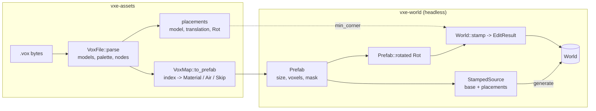

# 0008: MagicaVoxel import with a material map, and prefab stamping with 24 rotations at generation time and at runtime

> **Status:** draft
> **Created:** 2026-10-16
> **Milestone:** the headless halves of M6 (`.vox` import) and M7 (prefab stamping) in `docs/roadmap.md`, brought forward because neither needs the renderer
> **Related ADRs:** ADR-0002 (layout, access model), ADR-0001 (stack); none new, the decisions here have no alternative worth a record beyond the ones named under "Decision"
> **Prerequisite:** Plan 0001 closed. Independent of Plans 0002 to 0007. Plan 0007 reserves op kind 2 for the stamp; wiring the stamp through `Server` is a follow-up once both close.

## TL;DR

A new crate, `vxe-assets`, parses `.vox` files (models, palette, scene-graph placements) and
maps palette indices to material rows. `vxe-world` gains `Prefab`, a dense voxel volume with
a write mask; `Rot`, the 24 axis-aligned rotations; `World::stamp`, which writes a rotated
prefab and returns an `EditResult`; and `StampedSource`, a `WorldSource` wrapper that blits
placements into chunks at generation time. The first thing a reader sees is a headless test: a
16³ vault with a one-voxel shell stamped into solid rock changes exactly 4096 voxels and leaves
1352 shell and 2744 air voxels, and the same vault placed through `StampedSource` generates a
world hash-equal to the runtime stamp. The first thing the user sees is `--vault` in the
fly-through: a room with an indestructible shell ten meters ahead of the spawn.

## Context & problem

The consumer's World P1 (`project-context.md`) wants hand-built vaults stamped into generated
levels with rotation and a mask that marks the indestructible shell; Tooling P1 wants import
from MagicaVoxel with a material mapping. Today the only way to build structure is a
`WorldSource` written in Rust. Nothing in `nfr.md` covers this; the plan proposes a stamp
cost and a prefab memory figure under "Budgets".

The shell mask needs no mechanism of its own: the roadmap's storage shape already says a voxel
that differs from its neighbours is a second material row, so "shell" is a palette index mapped
to an indestructible material. What the engine owes is the mapping, the rotation and the stamp.

## Decision

A `Prefab` is a dense `u16` volume plus one write bit per voxel. A `Rot` is one of the 24
signed axis permutations with determinant +1; rotating a prefab materialises a new prefab
re-anchored at its minimum corner, so a stamp's `origin` is always the rotated volume's
minimum corner. `World::stamp` writes every masked voxel regardless of material flags: it is an
authoring operation, and a vault's shell must be able to replace anything. The `.vox` parser
is ours and reads `SIZE`, `XYZI`, `RGBA`, `PACK`, `nTRN`, `nGRP` and `nSHP`, skipping every
other chunk by its declared size. Mapping is explicit per palette index: a material, air, or
skip.

We rejected a brick-sparse prefab (prefabs are small and a dense 64³ is 512 KiB), a `dot_vox`
dependency (the format is a handful of chunk types and the mapping is the real work),
rotating at stamp time by index arithmetic (the generation path blits one placement into up to
eight chunks, and a materialised prefab is cheaper there), and any float in the transform
(all of this is integer).

## Architecture diagram



## Implementation phases

### Phase 1: Prefab, rotations, runtime stamp
- **Owner skill:** dev
- **What:** `Prefab`, `Rot`, `Prefab::rotated`, `World::stamp` returning an `EditResult`.
- **Files touched:** `crates/vxe-world/src/{lib.rs, prefab.rs, stamp.rs}`,
  `crates/vxe-world/tests/stamp.rs`.
- **Done when:**
  - `Prefab::new(size: [u32; 3], voxels: Vec<MaterialId>, mask: Option<Vec<u64>>)` (x
    fastest; a `None` mask writes every voxel); `get(local) -> Option<MaterialId>` is `None`
    where the mask is clear. `Prefab::id() -> u64` is FNV-1a 64 over size, voxels and mask as
    little-endian bytes; two prefabs with the same contents have the same id.
  - `Rot`: `Rot::IDENTITY`, `Rot::Z90` (x, y, z → −y, x, z), `Rot::all()` yielding 24
    distinct values in one fixed order, `inverse()`, `then(other)`, `apply([i32; 3])`. For
    every `r` in `all()`, `r.then(r.inverse()) == IDENTITY`; every matrix has determinant +1;
    the set is closed under `then` (24 × 24 products all in the set).
  - The test prefab `T` is the tripod: material 5 at (0,0,0), (1,0,0), (2,0,0), (0,1,0),
    (0,0,1), (0,0,2), (0,0,3), masked to those seven voxels, size (3, 2, 4). Its symmetry
    group is trivial, so `T.rotated(r).id()` over the 24 rotations gives 24 distinct ids.
    `T.rotated(Z90)` has size (2, 3, 4) and solid voxels at (0,0,0), (1,0,0), (1,1,0),
    (1,2,0), (1,0,1), (1,0,2), (1,0,3): the rotation maps (0,1,0) to (−1,0,0), and
    re-anchoring shifts x by +1. `T.rotated(IDENTITY)` equals `T`.
  - `Prefab::vault(edge: u32, shell: MaterialId)` test helper: every voxel on the surface of
    the cube is `shell`, the interior is `AIR`, all written. At edge 16 that is 16³ − 14³ =
    4096 − 2744 = 1352 shell voxels and 2744 air.
  - `World::stamp(&self, prefab: &Prefab, origin: VoxelCoord, rot: Rot) -> Result<EditResult,
    EditError>` writes `prefab.rotated(rot)` with its minimum corner at `origin`; checks
    residency of every chunk holding a masked voxel first and fails with the first missing
    chunk ascending before writing anything; counts by old material only the voxels whose
    material changed; `touched` and `aabb` as for edits; bricks that become uniform collapse.
  - On `solid3_world()`: `stamp(&vault16, [8, 8, 8], IDENTITY)` returns `changed_from ==
    [(3, 4096)]`, `touched == [[0, 0, 0]]`, `aabb == Some(([8, 8, 8], [23, 23, 23]))`;
    `count_in_box([8, 8, 8], [24, 24, 24]) == [(0, 2744), (4, 1352)]` with the shell as
    material 4; `material_at([8, 8, 8]) == 4`, `[15, 15, 15] == 0`, `[23, 23, 23] == 4`,
    `[24, 8, 8] == 3`. The same stamp again returns an empty `changed_from`, empty
    `touched` and `aabb == None`.
  - `stamp(&T, [100, 100, 100], Z90)` on `solid3_world()`: `changed_from == [(3, 7)]`;
    `material_at([101, 102, 100]) == 5`, `[100, 100, 100] == 5`, `[101, 100, 103] == 5`,
    and `[100, 101, 100] == 3` (unmasked, untouched).
  - A stamp whose masked voxels reach outside `test_extent()` returns
    `Err(NotResident(c))` with `c` the first missing chunk ascending, and the world's hash is
    unchanged.

### Phase 2: `.vox` parsing and the material map
- **Owner skill:** dev
- **What:** the `vxe-assets` crate: parser, default palette, scene-graph placements, `VoxMap`.
- **Files touched:** `Cargo.toml` (workspace member and dependency row),
  `crates/vxe-assets/{Cargo.toml, src/lib.rs, src/vox.rs, src/palette.rs, src/map.rs}`,
  `crates/vxe-assets/tests/{vox.rs, support/mod.rs}` (a test-side `.vox` writer).
- **Done when:**
  - `VoxFile::parse(&[u8]) -> Result<VoxFile, VoxError>`: header `VOX ` plus version 150 or
    200 (others: `VoxError::Version(v)`); `MAIN` with children `PACK`, `SIZE` and `XYZI`
    pairs, `RGBA`, `nTRN`, `nGRP`, `nSHP`; `MATL`, `LAYR`, `rOBJ`, `rCAM`, `NOTE` and `IMAP`
    are skipped by size, and a test file containing each of them parses to the same models
    as one without. A chunk cut short reads as `VoxError::Truncated { chunk: [u8; 4], at }`.
    A model axis over 1024 reads as `VoxError::TooLarge`.
  - `VoxModel { size: [u32; 3], voxels: Vec<[u8; 4]> }` as `(x, y, z, index)` in file order;
    `palette: [[u8; 4]; 256]` with MagicaVoxel's default palette when `RGBA` is absent, and
    the documented offset: `RGBA` entry `k` is the colour of index `k + 1`; index 0 is empty.
  - `support::vox_bytes(models, palette, nodes)` builds a file in the test. A 3 × 2 × 1 model
    with voxels (0,0,0,1) and (2,0,0,2) parses to size [3, 2, 1] and those two voxels; the
    palette's index 1 equals the first `RGBA` entry written.
  - `VoxFile::placements() -> Vec<Placement { model: usize, translation: [i32; 3], rot: Rot
    }>` walks `nTRN` → `nGRP` → `nSHP` from node 0, composing integer translations and
    rotations. The `_r` byte decodes by the spec's rule (bits 0 to 1: index of the non-zero
    entry of row 1; bits 2 to 3: of row 2; bits 4 to 6: the signs of rows 1 to 3): byte 4
    decodes to `IDENTITY`; byte 17 decodes to rows (0, −1, 0), (1, 0, 0), (0, 0, 1), which is
    `Z90`. A file without a scene graph yields one placement per model at translation 0 and
    `IDENTITY`. A two-model file whose second node carries `_t` of `0 0 16` yields
    `placements[1].translation == [0, 0, 16]`.
  - MagicaVoxel's translation refers to the model's centre at `size / 2` (integer division).
    `Placement::min_corner(&self, rotated_size)` returns `translation − rotated_size / 2`, so
    a stamp at `min_corner` reproduces the editor's layout: the 16³ vault at translation
    (8, 8, 8) has `min_corner == [0, 0, 0]`.
  - `VoxMap`: 256 slots of `Slot::{Air, Material(MaterialId), Skip, Unset}`; `new()` sets
    index 0 to `Air` and the rest `Unset`; `set(index, slot)`; `to_prefab(&VoxModel, &VoxMap)
    -> Result<Prefab, Unmapped(Vec<u8>)>` lists every `Unset` index present in the model,
    sorted and deduplicated. A model with indices {1, 2} and a map setting only 1 returns
    `Err(Unmapped(vec![2]))`. `Skip` clears the mask bit; `Air` writes air.
  - Round trip: the vault written as a `.vox` (shell index 1, interior empty) with `{1 →
    Material(4)}` and index 0 as `Air` produces a prefab whose `id()` equals
    `Prefab::vault(16, 4).id()`.

### Phase 3: Generation-time placement
- **Owner skill:** dev
- **What:** `StampedSource`, a `WorldSource` that blits placements after its base source.
- **Files touched:** `crates/vxe-world/src/{stamp.rs, source.rs, lib.rs}`,
  `crates/vxe-world/tests/stamp.rs`.
- **Done when:**
  - `StampedSource::new(base: S, placements: Vec<(Arc<Prefab>, VoxelCoord, Rot)>)` rotates
    each prefab once at construction and keeps its world aabb; `chunk(coord, out)` calls
    `base.chunk` then blits every placement whose aabb meets the chunk, in placement order
    (later placements win on overlap), allocating nothing per chunk beyond what the base does.
  - `World::generate` over a one-chunk extent with `StampedSource(UniformSource(3),
    [(vault16, [8, 8, 8], IDENTITY)])` has the same voxel hash as `solid3_world()` after
    `stamp(&vault16, [8, 8, 8], IDENTITY)`.
  - A straddling placement: extent `[0, 0, 0]..[2, 1, 1]`, vault at `[56, 8, 8]` (x 56 to 71
    across both chunks): the generated hash equals the runtime stamp's hash on a two-chunk
    solid world, and the runtime stamp's `touched == [[0, 0, 0], [1, 0, 0]]`.
  - `generate_with_threads(.., 1)` and `(.., 7)` give the same hash.
  - Overlap order: `T` (material 5) then a one-voxel prefab of material 6 at `T`'s origin
    leaves that voxel as 6; the reverse order leaves it as 5.

### Phase 4: The fly-through's vault, and the bench
- **Owner skill:** dev
- **What:** `--vault` and the `V` key in the testbed, and the stamp bench.
- **Files touched:** `apps/flythrough/src/{cave.rs, main.rs, lib.rs}`,
  `crates/vxe-world/benches/stamp.rs`, `crates/vxe-world/Cargo.toml`.
- **Done when:**
  - `--vault` wraps the cave in a `StampedSource` with one 16³ vault whose shell is the cave's
    `SHELL` material, placed with its minimum corner 100 voxels ahead of the spawn along +x
    (clamped inside the extent). Without the flag the cave is unchanged, so Plan 0001's
    determinism constants and golden image hold; the test in `determinism.rs` stays green.
  - `V` stamps the vault at the aim point (the dig ray's hit, minimum corner at the hit
    voxel) through `World::stamp` and prints the result line like a dig does. Once Plan 0007
    lands, this goes through `Server` as op kind 2: follow-up.
  - `cargo bench -p vxe-world --bench stamp`: the 16³ vault into solid rock at `[8, 8, 8]`
    (eight uniform bricks expanded) and a 64³ all-written prefab at `[0, 0, 0]` (512
    bricks), each as microseconds per stamp. Proposals: under 100 µs and under 5 ms. The
    log records both with the machine.

## Data shapes

```rust
// illustrative
pub struct Prefab { size: [u32; 3], voxels: Vec<MaterialId>, mask: Vec<u64> }   // x fastest
#[derive(Clone, Copy, PartialEq, Eq, Hash)]
pub struct Rot { axis: [u8; 3], neg: [bool; 3] }   // row k of the matrix is ±e[axis[k]]
pub struct Placement { pub model: usize, pub translation: [i32; 3], pub rot: Rot }
pub enum Slot { Unset, Air, Material(MaterialId), Skip }
pub struct VoxMap([Slot; 256]);
pub struct StampedSource<S> { base: S, placed: Vec<(Prefab, VoxelCoord, (VoxelCoord, VoxelCoord))> }
```

Prefab memory: 2 bytes plus one bit per voxel. A 16³ prefab is 8 KiB + 512 B; a 64³ prefab is
512 KiB + 32 KiB. `StampedSource` holds one rotated copy per placement.

## Budgets

| Figure | Expected effect | Close measures by |
|---|---|---|
| `nfr.md` §4 edits (new line) | A 16³ vault stamp under 100 µs, a 64³ prefab under 5 ms (proposals) | `cargo bench -p vxe-world --bench stamp`, dev box, commit named |
| §3 RAM | Prefab bytes as above; placements held once per `StampedSource` | Arithmetic; no reading needed |
| §6 determinism | Generation with placements is thread-count independent | Phase 3 test |

## Risks & open questions

- **Format quirks.** The `_r` byte's row convention and the centre-based translation are the
  two places the spec is easy to misread. Both are pinned by hand-built bytes in tests, and
  the parser cites the spec section in a comment.
- **Version 200 files** add chunk types we skip. A file that relies on them for placement
  (`IMAP` remaps palette indices) would map wrongly; `IMAP` presence is reported as a warning
  field on `VoxFile` so a caller can refuse.
- **Write-everything semantics** let one stamp delete another's shell. By design; the game
  orders placements. Carve and fill still respect `INDESTRUCTIBLE`; only `stamp` does not.
- **Open:** whether `StampedSource` should clip a placement that reaches outside the extent
  (currently it blits what falls inside each generated chunk, which is the natural clip).

## What this plan does NOT do

- **An in-engine editor** or `.vox` export.
- **Stamps as log entries**: op kind 2 is reserved in Plan 0007; the wiring follows both.
- **`MATL` properties to material rows**: the map is manual.
- **Animation frames** (`PACK` is read for the model count only).
- **Rendering of prefabs as entities**: M6's render half, after Plan 0005.
- **Debug views** of shell versus fill: M7.

## Implementation log

| Phase | Owner | Status | Notes |
|---|---|---|---|
| 1: Prefab, rotations, runtime stamp | dev | not started | |
| 2: `.vox` parsing and the material map | dev | not started | |
| 3: Generation-time placement | dev | not started | |
| 4: The fly-through's vault, and the bench | dev | not started | |
