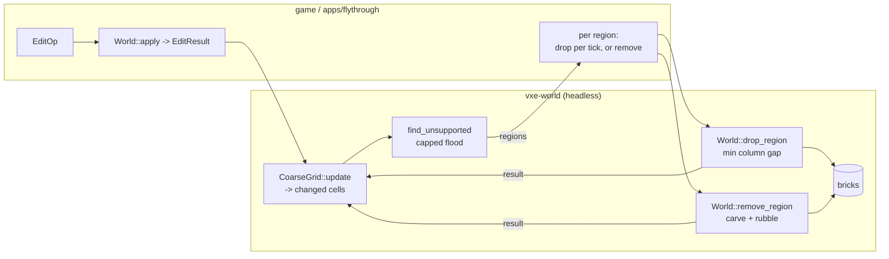

# 0009: A support query on the coarse grid, and deterministic drop and rubble ops for collapse

> **Status:** approved (2026-10-16)
> **Created:** 2026-10-16
> **Milestone:** M8 in `docs/roadmap.md` (the collapse half; volumetrics, debris and the cosmetic rigid-body layer stay in M8 proper)
> **Related ADRs:** [ADR-0008](../adrs/0008-collapse-as-capped-support-flood-and-rigid-vertical-drop.md) (the mechanism and what it is not), ADR-0005 (the controller's landing event), ADR-0002 (layout, access model)
> **Prerequisite:** Plan 0004 closed (`CoarseGrid`, `CellChange`). Independent of Plans 0002, 0003 and 0005 to 0008. Plan 0007 reserves op kinds 3 and 4 for the two ops here; wiring them through `Server` is a follow-up once both close.

## TL;DR

`vxe-world` gains `find_unsupported`, a capped flood over load-bearing cells of the coarse
grid that reports which solid regions lost their connection to an anchor after an edit, and
two ops: `drop_region`, which translates a region straight down by the air gap under it (up to
a per-call maximum, so a per-tick call is an animated, authoritative fall), and
`remove_region`, which carves a region and piles a fraction of it as rubble below. The first
thing a reader sees is a headless test on a one-chunk fixture: carving the single pillar under
a 3 × 3-cell slab reports that slab as one unsupported region of exactly 4608 voxels, and
dropping it yields a world hash-equal to one built with the slab already on the floor. The
first thing the user sees is the fly-through: dig out the rock under a ledge and watch the
ledge fall at a fixed speed, with its counts printed.

## Context & problem

The owner's physics decision (`docs/roadmap.md`, 2026-10-16) makes collapse emergent and
authoritative, and ADR-0008 fixes the mechanism: a support flood on the grid, rigid vertical
drops, rubble, and no rigid-body engine in the authoritative world. Plan 0004 delivers the
grid and the per-edit changed cells this plan consumes; nothing else exists. `nfr.md` has no
figure for support or collapse; this plan proposes them under "Budgets".

## Decision

We implement ADR-0008 in `vxe-world`, as derived queries and ops over the grid and the bricks,
in integer arithmetic, with every result in the edit-result vocabulary. Candidates for the
flood are the load-bearing cells among an edit's changed cells and their six neighbours,
visited in ascending coordinate order; each flood is a breadth-first search in a fixed
neighbour order, so the output is canonical. Cells in non-resident chunks count as anchors
(unknown is conservative). The ops do not run inside `World::apply`: the game calls the query
with the changes it got from `CoarseGrid::update` and chooses what to do with each region.

We rejected a rigid-body engine, scripted-only collapse, exact dynamic connectivity and
voxel-granular support (ADR-0008). We also rejected triggering the query inside `apply`,
for the same reason Plan 0004 keeps the grid update outside it: a consumer that does not want
it should not pay for it, and the §4 edit figure must stay what it measures.

## Architecture diagram



## The fixture

Every done-when below uses fixture `F` unless stated: a one-chunk extent `[0, 0, 0]..[1, 1,
1]` generated from `UniformSource(AIR)` with material 3 filled by three box ops, voxel bounds
half-open:

| Part | Voxels | Count | Cells (global brick coordinates) |
|---|---|---|---|
| Floor | `[0, 0, 0]..[64, 64, 8]` | 32 768 | 64 cells at z = 0 (on the extent's bottom face: anchors) |
| Pillar | `[32, 32, 8]..[40, 40, 40]` | 2048 | (4, 4, 1) to (4, 4, 4) |
| Slab | `[24, 24, 40]..[48, 48, 48]` | 4608 | (3..=5, 3..=5, 5): 9 cells |

Params unless stated: `solid_min = 64`, `max_region = 4096`, `boundary_anchors = true`, no
explicit anchors. "The pillar carve" is `Carve` of box `[32, 32, 8]..[40, 40, 40]`, which
returns `[(3, 2048)]` and makes `CoarseGrid::update` report 4 changes (cells (4, 4, 1) to
(4, 4, 4), 512 to 0). "Hash-equal to a direct build" means the world's `voxel_hash` equals
that of a fresh fixture generated with the named parts only.

## Implementation phases

### Phase 1: The support flood
- **Owner skill:** dev
- **What:** `CellCoord` helpers, anchors, `find_unsupported`, and the bench.
- **Files touched:** `crates/vxe-world/src/{lib.rs, coarse.rs, support.rs}`,
  `crates/vxe-world/tests/collapse.rs`, `crates/vxe-world/benches/collapse.rs`,
  `crates/vxe-world/Cargo.toml`.
- **Done when:**
  - `CellCoord([i32; 3])` is the global brick coordinate (chunk × 8 + brick), with
    `CellCoord::from(chunk, slot)` and `split() -> (ChunkCoord, usize)` in `coarse.rs`;
    `CellChange` gains or exposes its `CellCoord`.
  - `SupportParams { solid_min: u16, max_region: u32, boundary_anchors: bool }` and
    `Anchors<'a> { explicit: &'a [CellCoord] }`. A cell is load-bearing iff `solid >=
    solid_min`. A cell is an anchor iff its `dominant` material is `INDESTRUCTIBLE`, or it
    lies on a boundary face of the world extent and `boundary_anchors`, or it is in
    `explicit`, or its chunk is not resident.
  - `find_unsupported(&World, &CoarseGrid, &SupportParams, &Anchors, changed: &[CellChange])
    -> Vec<Region>`: candidates are the load-bearing cells among `changed` and their
    6-neighbours, in ascending `(x, y, z)` order; each unvisited candidate starts a
    breadth-first flood over load-bearing 6-neighbours in the order −x, +x, −y, +y, −z, +z;
    a flood that reaches an anchor or exceeds `max_region` marks its cells supported; a flood
    that exhausts yields `Region { cells: Vec<CellCoord>` (ascending)`, counts: Vec<(MaterialId,
    u32)>` (per material over the region's bricks, ascending by material)`, aabb: (VoxelCoord,
    VoxelCoord)` (inclusive bounds of its solid voxels)`}`. Regions are returned in the order
    their first cell was visited.
  - On `F` with `changed` = every cell (an initial sweep): no regions.
  - After the pillar carve: exactly one region, `cells` = the 9 slab cells ascending, `counts
    == [(3, 4608)]`, `aabb == ([24, 24, 40], [47, 47, 47])`.
  - A floor hole: `Carve` of `[8, 8, 0]..[16, 16, 8]` (one floor cell) yields 1 change and
    no regions, because the floor is boundary-anchored.
  - Two pillars: `F` plus a second pillar at `[24, 24, 8]..[32, 32, 40]`. Carving the first
    pillar yields no regions; carving both yields the slab region as above.
  - The cap: `max_region = 8` after the pillar carve yields no regions (the 9-cell slab
    exceeds the cap and is treated as supported; this documents the semantics).
  - The threshold: on `F`, `Carve` of `[32, 32, 16]..[40, 36, 24]` removes 256 voxels of
    cell (4, 4, 2), leaving 256. With `solid_min = 300` the cell is no longer load-bearing
    and the region is the slab plus cells (4, 4, 3) and (4, 4, 4): 11 cells, `counts ==
    [(3, 5632)]`. With `solid_min = 200` there are no regions.
  - `cargo bench -p vxe-world --bench collapse`: `find_unsupported` after a radius-10 carve
    at the centre of a solid 4³-chunk world (about 32 changed cells, every flood running to
    the cap), reported in microseconds per query. Proposal: under 1 ms.

### Phase 2: The drop op
- **Owner skill:** dev
- **What:** `World::drop_region`, the rigid vertical translation.
- **Files touched:** `crates/vxe-world/src/{collapse.rs, lib.rs}`,
  `crates/vxe-world/tests/collapse.rs`.
- **Done when:**
  - `World::drop_region(&self, cells: &[CellCoord], max_drop: i32) -> Result<DropResult,
    EditError>` with `DropResult { moved: Vec<(MaterialId, u32)>, dropped: i32, touched:
    Vec<ChunkCoord>, aabb: Option<(VoxelCoord, VoxelCoord)> }`. For every (x, y) column of
    the cells' footprint that holds a solid voxel in the region's bricks, the gap is the
    number of air voxels directly below the column's lowest solid region voxel, down to the
    first solid voxel, capped at `max_drop`; a column whose scan enters a non-resident chunk
    fails with `NotResident(c)` before anything moves. `dropped` is the minimum gap over the
    columns (0 when any column has gap 0). When `dropped > 0` every solid voxel of the
    region's bricks is cleared and rewritten `dropped` lower; destinations are air or
    vacated region cells by construction, so nothing is overwritten. `moved` counts the
    region's voxels by material when `dropped > 0` and is empty otherwise; `touched` and
    `aabb` cover both the vacated and the landed voxels.
  - After the pillar carve, `drop_region(slab cells, 64)` returns `dropped == 32`, `moved ==
    [(3, 4608)]`, `touched == [[0, 0, 0]]`, `aabb == Some(([24, 24, 8], [47, 47, 47]))`, and
    the world is hash-equal to a direct build of floor plus slab at `[24, 24, 8]..[48, 48,
    16]`. Calling it again returns `dropped == 0` and empty `moved`.
  - Per-tick fall: from the carved state, `drop_region(slab, 10)` four times returns
    `dropped` of 10, 10, 10 and 2, then 0; the world after the fourth call is hash-equal to
    the 64-drop result.
  - Uneven bottom: carve only the pillar's lower three cells (`[32, 32, 8]..[40, 40, 32]`);
    the region is the slab plus cell (4, 4, 4), 10 cells, `counts == [(3, 5120)]`; the lowest
    voxels are the stub's at z = 32, so `dropped == 24` and the world is hash-equal to floor
    plus slab at `[24, 24, 16]..[48, 48, 24]` plus stub at `[32, 32, 8]..[40, 40, 16]`.

### Phase 3: The remove op with rubble
- **Owner skill:** dev
- **What:** `World::remove_region`.
- **Files touched:** `crates/vxe-world/src/collapse.rs`, `crates/vxe-world/tests/collapse.rs`.
- **Done when:**
  - `World::remove_region(&self, cells: &[CellCoord], rubble: MaterialId, fraction: (u32,
    u32), max_depth: i32) -> Result<RemoveResult, EditError>` with `RemoveResult { removed:
    Vec<(MaterialId, u32)>, placed: u32, touched, aabb }`. Every solid voxel of the region's
    bricks is carved and counted in `removed`. Per column, `n` is the number of voxels
    removed in that column and `h = n * fraction.0 / fraction.1` (integer division); from
    the column's lowest removed voxel the scan goes down through air to the first solid
    voxel within `max_depth` (non-resident: `NotResident` before anything changes), and `h`
    rubble voxels are written upward from that solid voxel, fewer if the air run is shorter;
    `placed` is the number written.
  - After the pillar carve, `remove_region(slab, 7, (1, 4), 64)` returns `removed == [(3,
    4608)]`, `placed == 1152` (576 columns × 2), `count_in_box([24, 24, 8], [48, 48, 10]) ==
    [(7, 1152)]`, and the world is hash-equal to floor plus a box of material 7 at `[24, 24,
    8]..[48, 48, 10]`.
  - `fraction = (0, 1)` returns `placed == 0` and leaves the world hash-equal to the floor
    alone. `fraction = (1, 1)` returns `placed == 4608` and a world hash-equal to floor plus
    a box of 7 at `[24, 24, 8]..[48, 48, 16]`.
  - The course: on `F`, the pillar carve, the query, four drops of 10, a second pillar carve
    on a fresh `F`, the query and a remove at (1, 4), hashing every result and the world
    after each step with FNV-1a 64 into one constant blessed on Linux and asserted on the
    Windows CI arm.

### Phase 4: Collapse in the fly-through
- **Owner skill:** dev
- **What:** the testbed keeps a grid, runs the query after every dig and drops what falls.
- **Files touched:** `apps/flythrough/src/{main.rs, lib.rs}`.
- **Done when:**
  - The fly-through builds a `CoarseGrid` at start (its build time printed with the startup
    lines) and updates it from every edit result. After each dig it calls `find_unsupported`
    with `solid_min = 64`, `max_region = 4096`, boundary anchors on, and prints each region
    as `unsupported: N cells, {material: count, ...}`.
  - Each unsupported region is dropped by 8 voxels per frame (`drop_region(.., 8)`) until
    `dropped == 0`, then printed as `landed after N frames, fell M voxels`. Key `R` toggles
    remove-with-rubble instead (fraction 1/4, rubble material `RUBBLE`, a new row in
    `cave_materials()` that changes no voxel and so no existing constant).
  - `F1` adds the last query's microseconds and the number of regions. The log records a
    reading of the query after a typical dig in the cave on the dev box.
  - Once Plan 0007 lands, the drops and removes go through `Server` as op kinds 3 and 4:
    follow-up.

## Data shapes

```rust
// illustrative
pub struct CellCoord(pub [i32; 3]);                       // global brick coordinate
pub struct SupportParams { pub solid_min: u16, pub max_region: u32, pub boundary_anchors: bool }
pub struct Anchors<'a> { pub explicit: &'a [CellCoord] }
pub struct Region { pub cells: Vec<CellCoord>, pub counts: Vec<(MaterialId, u32)>, pub aabb: (VoxelCoord, VoxelCoord) }
pub struct DropResult { pub moved: Vec<(MaterialId, u32)>, pub dropped: i32, pub touched: Vec<ChunkCoord>, pub aabb: Option<(VoxelCoord, VoxelCoord)> }
pub struct RemoveResult { pub removed: Vec<(MaterialId, u32)>, pub placed: u32, pub touched: Vec<ChunkCoord>, pub aabb: Option<(VoxelCoord, VoxelCoord)> }
```

Working memory: the flood's visited set is a `HashSet<CellCoord>` bounded by `max_region`
per flood plus the supported marks of the candidates' components; it is not kept between
calls. The drop's column table is one `i32` per column of the footprint (576 for the slab).

## Budgets

| Figure | Expected effect | Close measures by |
|---|---|---|
| `nfr.md` §4 edits (new lines) | Support query after a 1 m carve under 1 ms; drop of the 9-cell slab under 100 µs; remove under 200 µs; a 4096-cell region drop under 20 ms (a guess: 2 M voxels moved) | `cargo bench -p vxe-world --bench collapse`, dev box, commit named |
| §6 determinism | The course constant on both arms | Phase 3 course test |
| §3 RAM | Nothing retained between calls | By inspection |

## Risks & open questions

- **The cap and the threshold** are the two documented limits of ADR-0008. The fly-through's
  defaults are a starting point, not a reading; the consumer tunes per level scale.
- **Floating leftovers.** Voxels in cells below `solid_min` are neither load-bearing nor part
  of a region, so a thin tooth under a dropped slab stays in the air. The game sweeps with a
  carve or a remove; the plan does not hide this.
- **Two regions in one tick** are processed in the order the game calls; the second's gap
  sees the first's landed voxels. Deterministic, order-dependent, and the game's call.
- **Column scans** cost `columns × gap`; `max_drop` bounds the gap and a per-tick call keeps
  it small. A single 64-voxel drop over a 4096-cell region is the worst case in the bench.
- **Open:** whether `drop_region` should refuse a region with cells in more than one chunk
  column when some are non-resident (it does, by the first-missing-chunk rule) or drop what
  it can. The plan refuses; an op either happens or does not.

## What this plan does NOT do

- **Cosmetic rigid bodies**: an optional client-side crate after M6, when voxel-model
  entities can draw the pieces.
- **Rotation, sliding, stacking, material strength**: ADR-0008.
- **Running the query inside `apply`**, or inside the controller.
- **Wiring into `Server` and the log**: follow-up with Plan 0007 (kinds 3 and 4 reserved).
- **Volumetrics and particle debris**: M8 proper.

## Implementation log

| Phase | Owner | Status | Notes |
|---|---|---|---|
| 1: The support flood | dev | not started | |
| 2: The drop op | dev | not started | |
| 3: The remove op with rubble | dev | not started | |
| 4: Collapse in the fly-through | dev | not started | |
