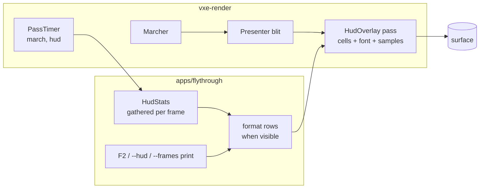

# 0010: A toggleable stats HUD: a bitmap-font text grid and a frame-time strip drawn as one overlay pass

> **Status:** in-progress (blocked at Phase 3; see Notes)
> **Created:** 2026-10-16
> **Milestone:** M7 in `docs/roadmap.md` (tooling; the profiler overlay half, brought forward)
> **Related ADRs:** [ADR-0009](../adrs/0009-testbed-hud-as-embedded-bitmap-font-overlay-pass.md) (no UI library), ADR-0001 (stack)
> **Prerequisite:** Plan 0001 closed. Independent of every other plan; it touches `apps/flythrough/src/main.rs`, which Plans 0002, 0004, 0007, 0008 and 0009 also touch, so merges are expected and conflicts are textual only.
> **Amended 2026-10-16**, before "go": Phase 2's `PassTimer` and Phase 3's frame-time window
> are copied from Ritmolux (the owner's sibling repository, commit `ad375596`) and adapted,
> not written fresh. See "Amendment 2026-10-16" below.
> **Amended 2026-10-17**, during implementation (orchestrator-applied under the owner's
> standing "go with your recommendations"; the owner can overturn it): the march check becomes
> before/after equality on a named `--level` command, and Phase 3 samples the world's stats at
> a cadence instead of every frame. See "Amendment 2026-10-17" below.
> **Amended 2026-10-17, second**, during implementation (orchestrator-applied under the same
> standing "go"; the owner can overturn it): the `FrameStats` p99 case is restated with three
> spikes, the "HUD does not move the readings" check gates the `--level` command only, and
> the Phase 3 deviations are ruled. See "Amendment 2026-10-17, second" below.

## TL;DR

`vxe-render` gains `HudOverlay`: a grid of 8 × 8 glyphs at an integer scale and a bar strip of
recent frame times, drawn by one fullscreen fragment pass with alpha blending onto the
surface after the presenter's blit. The fly-through gathers `HudStats` every frame (frame
CPU time, march GPU time, upload bytes and time, mirror bytes and pool slots, resident chunks
and CPU bytes, the last edit's result and cost, camera and chunk, process RSS on Linux) and
toggles the overlay with `F2`; `--frames N` prints the same rows at exit, so a headless run
and the screen read the same numbers. The first thing a reader sees is a headless test on
lavapipe: the glyph `A` at scale 2 produces exactly four times its bitmap's set bits in white
pixels. The first thing the user sees is `F2`.

## Context & problem

The owner asked on 2026-10-16 for rich on-screen data in human runs. Every reading today goes
to the console, and the `F1` summary is a snapshot. ADR-0009 records why this is a bitmap
font and not a UI library. `nfr.md` has no line for a tool overlay; the constraint is that
the overlay does not move the readings it shows, and the plan proposes its own cost under
"Budgets".

## Decision

We implement ADR-0009. The overlay is generic (rows of bytes, a strip of samples) and lives in
`vxe-render` because it is GPU code; the stats and their formatting live in the fly-through,
so a game can reuse the overlay without inheriting the testbed's rows. The pass is
pixel-exact: integer scale, no sampling, no filtering, so the golden with the HUD on is a
bit-exact comparison. `MarchTimer` generalises to `PassTimer` so the HUD pass can be timed
with the same mechanism that times the march.

We rejected `egui`, `glyphon` and CPU-rasterised text (ADR-0009), and we rejected putting the
stats struct in `vxe-app`: the shell stays thin, and the rows are the testbed's business.

## Amendment 2026-10-16

Made before "go", after a survey of `~/Work/Ritmolux` (the owner's music visualiser, same
licence, same owner, so its code is copied without ceremony). Two pieces of this plan already
exist there, tested, and `dev` copies them instead of writing them. Both citations are to
Ritmolux commit `ad375596`.

1. **`PassTimer` starts from Ritmolux's `core/src/render/gpu.rs`, `PassTimer`** (the struct and
   its `new`, `claim`, resolve and read path; about lines 294 to 480). What is kept: `new`
   returns `Option<Self>` and is `None` on a device without `TIMESTAMP_QUERY`, so a caller on
   the software adapter gets no timer rather than a validation error; the tick period is read
   off the queue once at construction; the resolve buffer (`QUERY_RESOLVE | COPY_SRC`) and the
   `MAP_READ` readback buffer are separate, because wgpu forbids one buffer carrying both; the
   query set holds a fixed number of index pairs so several passes in one frame are timed
   against one set and one resolve. What is **not** copied: the thread-local `ARMED` slot that
   lets Ritmolux's forty pass call sites claim a slot without a parameter. This engine has two
   call sites, the march and the HUD, and they take the writes explicitly, as `MarchTimer`
   does today. Phase 2's done-when is unchanged; its "Files touched" gains nothing.
2. **The frame-time window is Ritmolux's `FrameStats`** (`core/src/diag/mod.rs`, about lines
   130 to 260, with its tests): a fixed ring of 240 deltas fed explicitly, no clock read,
   giving fps, mean, median and p99 by nearest rank from a stack-local sorted copy, so it
   allocates nothing per frame and tests headless with made-up deltas. It is copied into
   `apps/flythrough/src/hud.rs` (the stats are the testbed's), and its ring **is** the strip's
   sample source, so the window is 240 frames, not one second, and `HudStats.frame_ms` carries
   mean, median, p99 and max rather than min, mean and max. The `Diag` wrapper around it, the
   GPU-byte accounting and the analysis fields are Ritmolux's and are not copied. The clock
   read stays where the fly-through already has it.

Also surveyed and rejected for this plan: Ritmolux's `overlay_font.rs` (a 5 x 7 partial glyph
set; ADR-0009 chose a full 8 x 8 ASCII font) and its `overlay.rs` (one quad per lit font pixel
through an instanced pipeline; this plan's cell grid in one fragment pass is the cheaper shape
for 24 rows of text).

## Amendment 2026-10-17

Made during implementation, after `dev` stopped at Phase 2 on branch `plan-0010` (tip
`ee4e88e`; the readings are in the Implementation log there). Applied by the orchestrator
under the owner's standing "go with your recommendations" while the owner was away; it is a
recommendation the owner can overturn, and overturning it changes only the done-whens below,
not the code already written.

### 1. The march check is before/after equality on `--level`, not the 1.5 to 1.7 ms band

**The problem.** Phase 2's done-when asked that the march reading of `flythrough --seed 1
--render 1920x1080 --frames 300` stay within the 1.5 to 1.7 ms band of `nfr.md` §2. The band
is Plan 0001's 1.59 ms. Since Plan 0002 that command streams the unbounded cave (6.68 to 7.10
ms at the commit before the refactor), and the bounded level that Plan 0001 measured now needs
`--level` (1.71 to 1.75 ms before the refactor). `nfr.md` §2 itself records the level's spawn
at 1.95 ms (Plan 0002) and 1.826 to 1.859 ms (Plan 0005). The base commit misses the band, so
no change in this plan can meet it; the done-when was a stale citation, not a claim about
`PassTimer`.

**Chosen: (a), equality within noise on a named command.** What the refactor must defend is
"`PassTimer` changed nothing", which is a before/after claim. The rule: the march GPU reading
of `flythrough --headless --level --seed 1 --render 1920x1080 --frames 300` (timestamps,
median of the last 30 of 300 frames), three runs at the parent commit and three at the
phase's commit, under the exclusive perf lock; the median of the three after-runs is within
3 % of the median of the three before-runs. 3 % sits above the run-to-run spread of the
readings already logged (1.712 to 1.753 ms, 2.4 %). The streamed command's reading is logged
beside it for the record and is not gated: its own spread before the refactor was 6 %.

**Rejected: (b), move the band to the current `--level` reading.** It turns an equality claim
into an absolute number that drifts with every plan touching the march (it has moved three
times already), so the next plan inherits the same stale band. **Rejected: (c), keep the band
and diagnose a march regression outside this plan.** The readings show no regression to
diagnose: the level's spawn reads lower now than at Plan 0005 (1.826 to 1.859 ms), and the gap
to 1.59 ms is the march gaining features since Plan 0001, recorded in `nfr.md` §2. The
march-pass diagnosis spike that `nfr.md` §2 already names owns the streamed miss.

**Result for Phase 2.** The readings in the log meet the rule: before 1.712 / 1.753 / 1.714 ms
(median 1.714), after 1.753 / 1.720 / 1.707 ms (median 1.720), 0.35 % apart. Phase 2 is done
on those readings; `dev` records the verdict and needs no new run.

**The same stale reference elsewhere.** Phase 3's "within 5 %" check named no command, and
the Budgets row's "march reading with the HUD on equals the reading with it off" named no
rule. Both now cite the commands and rules above. Phase 4 cites no band or command (its
golden is Plan 0001's fixed view, a test fixture, not a fly-through run) and is unchanged.

### 2. Phase 3 samples the world's stats at a cadence, not every frame

**The problem.** Phase 3 asked for `World::stats` every frame. `World::stats` walks every
resident chunk and every brick under each chunk's read lock; on the streamed world (about 1.6
million `Full` bricks at full residency) that is a walk over millions of bricks on the render
thread, competing for chunk locks with the streamer's workers, and it would move the very
frame readings Phase 3 must defend. `Streamer::stats` is cheaper but not free: it counts the
resident map (tens of thousands of entries) and takes the queue and persistence mutexes.

**Chosen: per-frame sources stay O(1); world-side stats are sampled.** Every frame `HudStats`
takes only what costs nothing: the `FrameStats` ring, the two `PassTimer` readings, the last
`SyncStats`, the mirror's counters (`mirror_bytes`, `live_slots`, `free_slots().len()`), the
last edit, the camera and mode, and RSS. `World::stats` (and `Streamer::stats` in the streamed
mode, for resident full and LOD chunks) is called only:

- once when the HUD turns visible,
- every Nth frame while it is visible (N below),
- once at exit for the `--frames` print,

and never on a frame where the HUD is hidden and no `--frames` print is due. The rows show the
sample's age in frames beside the chunk and brick figures. `cpu_bytes` has no source in
`WorldStats` (it holds chunks, uniform and full bricks only); the fly-through computes it as
`full_bricks` times the size of one full brick's voxel array plus `chunks` times the size of
`Chunk`, and its row is labelled as an estimate. No new API in `vxe-world`.

**What `dev` measures to pick N, and the rule.** One `World::stats` call on the streamed world
at the unbounded cave's spawn after full residency, median of 10 calls, release build, logged
with the machine. Under 1 ms (the `nfr.md` §2 streaming line): N = 60. 1 ms or more: N = 240,
one sample per `FrameStats` window, so a sample's spike reaches at most the window's max and
not its p99 by nearest rank. Either way the rows show the call's measured cost beside the
formatting time.

**Rejected:** per-frame `World::stats` as first written (the walk above, every frame);
incremental counters kept by `vxe-world` or the streamer (it changes the deterministic crate's
store and stream for a testbed tool's convenience, outside Files touched; a later plan can add
them if a consumer needs live counts); running the walk on a worker thread (a thread and a
channel for a figure the HUD can show a second late).

### 3. The Phase 1 and Phase 2 deviations

Each deviation in the Implementation log's Notes, ruled:

- **Accepted:** the cell buffer always has the cap layout (256-column stride by 128 rows). The
  done-when's cap already sized it at 128 KiB in Budgets; `set_text` cannot see the target.
- **Accepted:** the target height reaches the shader as the draw's first instance, since
  `encode` takes no queue. The mechanism stays in a comment beside the draw.
- **Accepted:** `set_rows`, `HudColour` and `encode_timed` beside `set_text` and `encode`.
  They implement the per-row colour that "Risks & open questions" settled on, and the HUD's
  timer.
- **Rejected:** `hud.wgsl`'s portability check living only as a unit test in `hud.rs`.
  `tests/shader_portability.rs` is the one list of shaders checked against the FXC rule for
  the Windows backend, and a shader missing from it escapes that check. Phase 3 adds
  `hud.wgsl` to its `SHADERS` list; the unit test may stay.
- **Accepted:** `PassTimer` with one two-timestamp query set per instance rather than
  Ritmolux's fixed set of index pairs. Phase 2's done-when named the two-timestamp set, and
  with two call sites a shared set buys nothing. `MarchTimer::new` taking the queue and
  returning `Option` follows from "the period is read once" and "`None` without
  `TIMESTAMP_QUERY`" in the 2026-10-16 amendment.
- **Accepted for Phase 2:** the HUD pass reading as an ignored test (0.0573 ms, under the 0.1
  ms proposal). Phase 3 adds the fly-through reading, since the fly-through draws the HUD
  from then on.
- **Accepted:** `crates/vxe-render/src/lib.rs` re-exporting `PassTimer`.
- **Accepted:** the red line drawn only where no bar covers it, with no strip backdrop.

## Amendment 2026-10-17, second

Made during implementation, after `dev` stopped at Phase 3 on branch `plan-0010` (tip
`cfa90c8`, Phase 3 commit `f91726f`; every reading cited here is in the Implementation log
there). Applied by the orchestrator under the owner's standing "go with your recommendations"
while the owner was away; it is a recommendation the owner can overturn, and overturning it
changes only the Phase 3 done-whens below, not the code already written.

### 1. The p99 case: three spikes, with the index arithmetic

**The problem.** Phase 3's done-when asked that "a ring fed one 100 ms delta among 239 of
1 ms reports a p99 of 100 ms". The copied `FrameStats` sorts the window and reads index
`round((n - 1) x q)`; for a full window, `round(239 x 0.99) = round(236.61) = 237`. One spike
sorts to index 239, so index 237 holds 1 ms. Nearest rank by `ceil(0.99 x 240) = 238` (the
238th sample, index 237) gives 1 ms too. One sample is 0.42 % of 240, under the 1 % a p99
excludes, so no nearest-rank definition reports it; Amendment 2026-10-17 item 2's N rule
already says a lone spike "reaches at most the window's max and not its p99". The done-when
was wrong arithmetic, not a defect in the copied code.

**Chosen: (b), restate the case with three spikes, and keep the one-spike case as a max
case.** With k spikes of 100 ms in a full window of 1 ms deltas, the spikes sort to indices
`240 - k` to 239, so index 237 holds 100 ms exactly when `k >= 3`. Two spikes (indices 238
and 239) still read 1 ms, so three is the smallest count that proves the p99 sees spikes.
The median reads index `round(239 x 0.5) = round(119.5) = 120` (Rust rounds half away from
zero), which holds 1 ms for any `k <= 119`. The done-when now names two cases: three 100 ms
deltas among 237 of 1 ms report p99 100 ms, median 1 ms and max 100 ms; one 100 ms delta
among 239 of 1 ms reports p99 1 ms, median 1 ms and max 100 ms (the test already committed).

**Rejected: (a), accept the committed one-spike assertion alone.** It is correct but proves
only that p99 ignores a lone spike, never that p99 sees spikes at all; a p99 stuck at the
median would pass it. **Rejected: (c), change the percentile definition.** It departs from
the copied, tested Ritmolux code for no gain: every nearest-rank definition agrees on the
one-spike case, and an interpolating one would report a figure no frame took.

### 2. The "HUD does not move the readings" check gates `--level` only

**The problem.** On the streamed command the frame mean with `--hud` read 9.2 % below the
mean without it (medians 20.50 and 22.58 ms). The three runs without the HUD alone spread
from 20.38 to 24.64 ms (21 %), and an earlier set read -1.4 %. The 240 measured frames of a
300-frame run fall before full residency, so that mean measures the streaming load of a
cold start, not the frame with or without an overlay; a 5 % gate on it is a gate on noise
four times its width. The `--level` command meets both its checks: frame mean +4.0 %
(medians 2.25 and 2.34 ms), march +0.06 % (medians 1.722 and 1.723 ms).

**Chosen: (a), gate the `--level` command and log the streamed one.** This is the treatment
Amendment 2026-10-17 item 1 already gave the streamed march reading (logged, not gated, for
the same reason: its spread exceeds the threshold). The `--level` frame mean within 5 % and
its march within 3 % defend "the HUD does not move the readings"; the streamed readings stay
in the log for the record. Phase 3 is met on the readings already logged; `dev` records the
verdict and needs no new run.

**Rejected: (b), gate the streamed command after full residency.** It needs a new mode of
the fly-through (run to residency, then measure) for a check the bounded level already
answers, and the streaming CPU at rest (0.35 ms in `nfr.md` §2) is not what the HUD could
move. **Rejected: (c), more runs per side.** A 21 % spread needs many runs per side to
resolve 5 %, and the runs would still measure cold-start streaming, not the HUD.

### 3. The Phase 3 deviations

Each Phase 3 deviation in the Implementation log's Notes, ruled:

- **Accepted:** the process RSS read with the world sample, at the cadence, not every frame.
  Item 2 of the first amendment listed RSS as a per-frame source on the guess that one
  `/proc/self/statm` read is free; the diagnostic build measured 0.12 to 0.15 ms per frame
  and pushed the `--level` frame mean to +9.4 %. RSS shares the sample's age on its row.
- **Accepted:** `march_ms` and `hud_ms` as `Option<f32>` shown as `n/a` without
  `TIMESTAMP_QUERY`, matching `PassTimer::new` returning `None`; and `cpu_ms`, the
  render-thread CPU from frame start to submit, beside the window's `frame_ms`.
- **Accepted:** the `FrameStats` ring and the strip fed the delta between frames rather than
  the render-thread CPU time, and the first delta skipped. A frame's delta is what fps and
  the frame-time strip mean, and it includes the waits the CPU time hides; `cpu_ms` carries
  the CPU figure. The first delta spans start-up, not a frame. The check's "printed average
  frame time" is the exit print's `frame mean`.
- **Accepted:** the march and HUD timers read every frame while the HUD is shown. The
  `--level` march with `--hud` reads +0.06 %, so the readback moves nothing measurable.
- **Accepted:** `format_us` showing the previous frame's formatting time. A row cannot hold
  the time spent formatting itself without a second pass.
- **Accepted:** the row colours: frame row red when the window's max exceeds 33.3 ms (two
  60 fps frames, a dropped frame) and yellow when its p99 exceeds 16.67 ms; `cpu` yellow
  above 16.67 ms; march yellow above 3.0 ms and upload yellow above 1.0 ms, the `nfr.md` §2
  primary-ray and streaming lines. This is the rule "Risks & open questions" left to `dev`.
- **Accepted:** the `World::stats` reading as an ignored test in `main.rs`'s tests, run by
  hand in release: 14.854 ms median of 10 on the streamed cave at full residency, 1 ms or
  more, so N = 240 by the first amendment's rule.

## Architecture diagram



## Implementation phases

### Phase 1: The overlay pass and the font
- **Owner skill:** dev
- **What:** `HudOverlay` with a text grid, the embedded font, and the headless glyph test.
- **Files touched:** `crates/vxe-render/src/{lib.rs, hud.rs, font8x8.rs, shaders/hud.wgsl}`,
  `crates/vxe-render/tests/hud.rs`.
- **Done when:**
  - `FONT: [[u8; 8]; 95]` covers ASCII 32 to 126 with the public-domain `font8x8` bitmaps
    (Daniel Hepper; cited in a comment), row-major, bit 0 the leftmost pixel. `glyph(b' ')`
    is all zero; any byte outside 32 to 126 draws as `?`.
  - `HudOverlay::new(device, format, scale: u32)`; `set_text(&mut self, queue, rows:
    &[&[u8]])` fills a cell buffer of `cols × rows` `u32`s with `cols = ceil(width / (8 ·
    scale))`, `rows = ceil(height / (8 · scale))`, capped at 256 × 128 cells (128 KiB);
    `encode(&self, encoder, view, width, height)` draws one fullscreen triangle with
    `SrcAlpha`/`OneMinusSrcAlpha` blending: a set glyph bit is white at alpha 1, the bit's
    one-pixel-offset (+x, +y) shadow is black at alpha 0.75 where no white pixel lands, and
    everything else is transparent.
  - Headless on lavapipe: a 64 × 16 `rgba8` target cleared to (10, 20, 30, 255), `set_text`
    of `b"A "` at scale 2, one `encode`, readback. The count of (255, 255, 255) pixels is
    exactly `4 × popcount(FONT[b'A' − 32])`; every pixel with `x >= 17` equals the clear
    colour (cell 1 is a space and only a shadow from cell 0's last column could reach
    `x = 16`); no pixel is any other colour than white, the shadow blend of black at 0.75
    over the clear colour, or the clear colour.
  - `Presenter` and `march.wgsl` are untouched; Plan 0001's golden image test passes
    unchanged.

### Phase 2: The frame-time strip and the pass timer
- **Owner skill:** dev
- **What:** `set_samples`, the strip in the shader, `PassTimer`.
- **Files touched:** `crates/vxe-render/src/{hud.rs, marcher.rs, shaders/hud.wgsl}`,
  `crates/vxe-render/tests/hud.rs`, `apps/flythrough/src/main.rs`.
- **Done when:**
  - `set_samples(&mut self, queue, samples: &[f32], ceiling_ms: f32)` takes up to 256
    samples; the strip sits at the bottom-left above one text row, is `64 · scale` pixels
    tall and `scale` pixels wide per sample, a sample of `ceiling_ms` fills the height,
    larger samples clamp, and a one-pixel red line marks 16.67 ms when `ceiling_ms > 16.67`.
  - Headless at scale 1 with samples `[0, c/2, c, 2c]` and `ceiling_ms = c = 32`: the four
    columns hold 0, 32, 64 and 64 white pixels respectively, plus the red line row.
  - `PassTimer` owns a two-timestamp query set with `writes()`, `resolve()` and `read_ms()`,
    following the Ritmolux shape named in "Amendment 2026-10-16" (`new` is `None` without
    `TIMESTAMP_QUERY`; the period is read once; resolve and readback buffers are separate);
    `MarchTimer` is a type alias; the march reading of `flythrough --headless --level --seed
    1 --render 1920x1080 --frames 300` on the dev box, three runs at the parent commit and
    three at this phase's, has an after-median within 3 % of the before-median, logged with
    the streamed command's reading beside it (ungated), so the refactor changed nothing
    (amended 2026-10-17; was the stale 1.5 to 1.7 ms band).
  - A second `PassTimer` around the HUD pass; its reading at 1920 × 1080 with 24 rows of
    text and 240 samples is logged. Proposal: under 0.1 ms on the dev box.

### Phase 3: Stats in the fly-through and the toggle
- **Owner skill:** dev
- **What:** `HudStats`, its rows, `F2`, `--hud`, and the `--frames` print.
- **Files touched:** `apps/flythrough/src/{main.rs, hud.rs, lib.rs}`,
  `crates/vxe-render/tests/shader_portability.rs` (adds `hud.wgsl` to `SHADERS`).
- **Done when:**
  - `hud.wgsl` is in `tests/shader_portability.rs`'s `SHADERS` and passes its checks.
  - Per "Amendment 2026-10-17" item 2: the per-frame fields come only from O(1) sources;
    `World::stats` and `Streamer::stats` are called on toggle-on, every Nth visible frame and
    once at exit for `--frames`, never on a hidden frame otherwise; one `World::stats` call
    on the streamed world after full residency is measured (median of 10, release) and
    logged, and N is 60 if it is under 1 ms, else 240; the rows show the sample's age and the
    call's cost. A test drives the cadence with a stub counter: 300 hidden frames make no
    call, toggling on makes one, and 120 visible frames then make exactly `120 / N` more
    (rounded down).
  - `HudStats` (Data shapes) is filled from what already exists: frame CPU time
    and the 240-frame window's fps, mean, median, p99 and max, from the `FrameStats` ring
    copied per "Amendment 2026-10-16" (its tests come with it: a ring fed 240 equal deltas
    reports that delta as mean, median and p99; a ring fed three 100 ms deltas among 237 of
    1 ms reports p99 100 ms, median 1 ms and max 100 ms, since the spikes sort to indices 237
    to 239 and p99 reads index `round(239 x 0.99) = 237`; a ring fed one 100 ms delta among
    239 of 1 ms reports p99 1 ms, median 1 ms and max 100 ms; amended 2026-10-17, second, was
    one spike at p99 100 ms); `MarchTimer` and the HUD timer; the last
    `SyncStats` (bytes, chunks, milliseconds); `GpuWorld::mirror_bytes`, `live_slots` and
    `free_slots().len()`; `World::stats` at its cadence (resident chunks, `Full` bricks, and
    CPU bytes as the estimate the amendment defines); the
    last edit's verb, counts and milliseconds; camera position and chunk; mode (fly, and
    walk once Plan 0004 lands); process RSS from `/proc/self/statm` (second field times the
    page size) on Linux and `None` elsewhere, shown as `n/a`.
  - Rows are formatted into a reused `String` only while the HUD is visible; the formatting
    time is measured with `Instant` and shown on its own row. Proposal: under 50 µs.
  - `F2` toggles; `--hud` starts visible. `--frames N` prints the `HudStats` rows at exit
    through the same `Display`; `F1` keeps printing its snapshot.
  - The strip holds the last 240 CPU frame times with `ceiling_ms = 33.3`, read in
    chronological order from the same `FrameStats` ring the rows are computed from.
  - "The HUD does not move the readings", on two commands, three runs with `--hud` and three
    without, under the exclusive perf lock: `flythrough --headless --level --seed 1 --render
    1920x1080 --frames 300` and the same without `--level` (the streamed cave). On the
    `--level` command the median of the three printed average frame times with `--hud` is
    within 5 % of the median without it, and the march reading's median with `--hud` is
    within 3 % of the median without it. The streamed command's frame means and march
    readings are logged, not gated (its 300-frame runs end before full residency, so they
    measure streaming load). The HUD pass reading from the `--hud` runs is logged (proposal:
    under 0.1 ms). (Amended 2026-10-17, the check named no command before; amended again
    2026-10-17, second, the streamed command was gated at 5 %.)

### Phase 4: The golden with the HUD on
- **Owner skill:** dev
- **What:** a bit-exact golden image of the overlay over the fixed view.
- **Files touched:** the directory of Plan 0001's golden test and its baseline images,
  `apps/flythrough/src/hud.rs` (a fixed-stats constructor).
- **Done when:**
  - `HudStats::fixed()` returns constants (every number set by hand, not measured) so the
    rendered rows are stable; the golden is Plan 0001's fixed view after its fixed carve with
    the overlay drawn from `fixed()` and a fixed 240-sample strip, blessed on lavapipe and
    compared pixel-exact (no SSIM floor: integer scale, no filtering).
  - Plan 0001's golden with the HUD off is byte-identical to its current baseline.

## Data shapes

```rust
// illustrative
pub struct HudOverlay { cells: wgpu::Buffer, font: wgpu::Buffer, samples: wgpu::Buffer, params: wgpu::Buffer, pipeline: wgpu::RenderPipeline, scale: u32, cols: u32, rows: u32 }
// cell: bits 0..8 glyph index (0 = blank), bits 8..16 colour (0 white, 1 yellow, 2 red)
// params: size, scale, cols, rows, strip origin and height, sample count, ceiling_ms

pub struct HudStats {
    pub fps: f32, pub frame_ms: FrameMs, pub march_ms: f32, pub hud_ms: f32,
    pub upload_bytes: u64, pub upload_ms: f32, pub upload_chunks: u32,
    pub mirror_bytes: u64, pub pool_live: u32, pub pool_free: u32,
    pub chunks: u32, pub full_bricks: u64, pub cpu_bytes: u64, pub rss_bytes: Option<u64>,
    pub last_edit: Option<EditLine>, pub camera: [f32; 3], pub chunk: [i32; 3], pub mode: Mode,
    pub format_us: u32,
}
pub struct FrameMs { pub mean: f32, pub p50: f32, pub p99: f32, pub max: f32 }  // from FrameStats, 240-frame ring
pub struct FrameStats { ring: [f32; 240], head: usize, len: usize, frames_total: u64 }  // copied from Ritmolux diag
```

Buffers: cells 128 KiB at the cap, font 760 bytes, samples 1 KiB, params 64 bytes.

## Budgets

| Figure | Expected effect | Close measures by |
|---|---|---|
| `nfr.md` §2 | No new line (a tool, not a frame stage). Constraint: the march reading with the HUD on equals the reading with it off within noise (3 % on medians of three, `--level` command, per "Amendment 2026-10-17"); the HUD pass itself under 0.1 ms at 1080p (proposal) | Phase 2 and Phase 3 readings, dev box, commit named |
| §3 "everything else in VRAM" | Under 200 KiB | Arithmetic above |

## Risks & open questions

- **Rasterisation differences** between lavapipe and NVIDIA for a fullscreen triangle with
  integer pixel math: none expected, and the goldens are blessed on lavapipe as always.
- **sRGB surfaces.** White and black are fixed points of the transfer; the shadow's 0.75
  alpha is not, so the shadow's exact value is adapter and format specific. The headless test
  asserts white counts and clear-colour pixels, not the shadow's value.
- **Small windows** truncate rows and columns at the cap; the text is clipped, never wrapped.
- **`Instant`** is already allowed in the fly-through; nothing here touches `vxe-world`.
- **Open:** whether rows should carry colour per row (the plan says yes: a row over budget
  renders yellow, a dropped frame red) or stay white; the dev picks yellow for any `ms` row
  above its `nfr.md` line.

## What this plan does NOT do

- **A UI library** (ADR-0009).
- **Debug views** of material ids, acoustic properties or the coarse grid: M7 proper; the
  overlay's grid carries their labels when they come.
- **A profiler across every pass** or a benchmark lane with committed readings: M7 proper.
- **RSS on Windows.**

## Implementation log

| Phase | Owner | Status | Notes |
|---|---|---|---|
| 1: The overlay pass and the font | dev | done | `HudOverlay` (`hud.rs`, `hud.wgsl`), `font8x8.rs` from `font8x8_basic.h`; lavapipe (llvmpipe, LLVM 22.1.8): `A` at scale 2 has 28 set bits, 112 white pixels, 33 shadow pixels, every pixel at `x >= 17` the clear colour; `present.wgsl`, `march.wgsl`, `present.rs` unchanged and Plan 0001's goldens pass; gate: 175 tests run, 175 passed, 1 skipped. Commit: 04fffd5 |
| 2: The frame-time strip and the pass timer | dev | done | `set_samples` and the strip; lavapipe: samples `[0, 16, 32, 64]`, ceiling 32, scale 1 give columns of 0, 32, 64, 64 white pixels and the red line 33 rows above the strip's bottom row in columns 0 and 1. `PassTimer` in `marcher.rs`, `MarchTimer` a type alias. March GPU, `flythrough --headless --seed 1 --render 1920x1080 --frames 300`, median of the last 30, three runs each, RTX 3080 Laptop GPU, exclusive lock: before (04fffd5) 6.684 / 7.100 / 6.683 ms, after 6.779 / 6.787 / 6.797 ms; with `--level` added, before 1.712 / 1.753 / 1.714 ms, after 1.753 / 1.720 / 1.707 ms; after-median 1.720 vs before-median 1.714 ms on `--level`, 0.35 %, within 3 % (Amendment 2026-10-17). HUD pass (`hud_pass_reading_at_1080p`, ignored test, release): 1920 x 1080, 24 rows x 100 characters, 240 samples, scale 2, median of 300: 0.0573 / 0.0573 / 0.0573 ms. Gate: 177 tests run, 177 passed, 2 skipped. Commit: cbee825 |
| 3: Stats in the fly-through and the toggle | dev | blocked: the p99 test's arithmetic; the streamed 5 % check | `hud.wgsl` in `tests/shader_portability.rs`'s `SHADERS`; its check passes. `apps/flythrough/src/hud.rs`: `FrameStats` copied from Ritmolux `ad375596` with its tests, `HudStats`, `Cadence`, `WorldSample`, `EditLine`, `Mode`; `F2` toggles, `--hud` starts visible, `--frames` prints the rows at exit after a fresh sample. `World::stats` on the streamed cave at its spawn after full residency (ignored test `world_stats_call_on_the_streamed_world_at_full_residency`, release, 17077 chunks, 1640292 full bricks, 40700 LOD-only): median of 10 14.854 ms (min 14.570, max 15.681), 1-minute load 3.17; so N = 240. Cadence test with a stub counter, N = 60 and N = 240: 300 hidden frames 0 calls, toggle on 1, then 120 visible frames `120 / N` more (2 and 0). `FrameStats`: 240 equal 5 ms deltas give mean, median and p99 5 ms; one 100 ms delta among 239 of 1 ms gives median 1 ms, p99 1 ms, max 100 ms. Formatting: 4 to 9 us in the `--hud` runs. Readings, `flythrough --headless [--level] --seed 1 --render 1920x1080 --frames 300 [--hud]`, three runs each, interleaved, exclusive lock, 1-minute load 1.13 to 3.29: `--level` frame mean (the exit print, 240-frame window) without 2.29 / 2.25 / 2.20 ms (median 2.25), with `--hud` 2.32 / 2.39 / 2.34 ms (median 2.34), +4.0 %; march (median of the last 30) without 1.708 / 1.736 / 1.722 ms (median 1.722), with 1.787 / 1.708 / 1.723 ms (median 1.723), +0.06 %; streamed frame mean without 20.38 / 24.64 / 22.58 ms (median 22.58), with 20.88 / 20.17 / 20.50 ms (median 20.50), -9.2 %; streamed march without 6.687 / 6.791 / 8.998, with 6.751 / 7.099 / 7.666 ms. HUD pass (median of the last 30) `--level` 0.0389 / 0.0379 / 0.0379 ms, streamed 0.0369 / 0.0379 / 0.0410 ms. An earlier set at a build reading RSS every frame (1-minute load 1.89 to 5.45): `--level` frame mean without 2.17 / 2.13 / 2.07, with 2.22 / 2.33 / 2.40 ms (+9.4 %); streamed without 20.41 / 24.98 / 21.49, with 20.99 / 24.08 / 21.18 ms (-1.4 %). Gate: 188 tests run, 188 passed, 3 skipped. Commit: f91726f |
| 4: The golden with the HUD on | dev | not started | |

### Notes

- **Block (Phase 3), the p99 test:** the done-when asks that "a ring fed one 100 ms delta among
  239 of 1 ms reports a p99 of 100 ms". The copied `FrameStats` takes p99 at index
  `round(0.99 x 239) = 237` of the sorted window, which holds 1 ms; nearest rank by
  `ceil(0.99 x 240) = 238` (the 238th sample, index 237) gives 1 ms too. One sample is 0.42 %
  of 240, under the 1 % a p99 excludes, so no nearest-rank definition puts it at p99; the
  amendment's own N rule says the same ("reaches at most the window's max and not its p99").
  The test as written asserts median 1 ms, p99 1 ms, max 100 ms. Options: (a) accept that
  assertion (the spike in the max, not the p99); (b) restate the case with three spikes (3 of
  240 = 1.25 %, so index 237 holds 100 ms); (c) change the percentile definition away from the
  copied code.
- **Block (Phase 3), the streamed 5 % check:** the streamed command's frame mean with `--hud`
  is 9.2 % below the mean without it (medians 20.50 and 22.58 ms), outside "within 5 %" in the
  direction of the HUD costing less than nothing; the three runs without the HUD spread from
  20.38 to 24.64 ms (21 %), and an earlier set read -1.4 %. The last 240 of 300 frames of that
  command fall before full residency, so the mean is the streaming load's. The `--level`
  command meets both its checks (+4.0 % and +0.06 %). Options: (a) gate the 5 % on `--level`
  only and log the streamed one, as Phase 2 does; (b) run the streamed command until full
  residency first (more frames, or a rest pose) and gate that; (c) more runs per side.
- Phase 4 is not started.
- Deviation, 04fffd5: the cell buffer always has the cap layout (256 columns stride x 128
  rows); the visible `ceil(width / 8 scale)` x `ceil(height / 8 scale)` cells are the ones the
  target's pixels reach. `set_text` takes no size, so it cannot size the grid to the target.
- Deviation, 04fffd5: `encode` passes the target height to the shader as the draw's first
  instance (`instance_index`), because `encode` takes no queue to write a uniform.
- Deviation, 04fffd5: `HudOverlay::set_rows` and `HudColour` added beside `set_text`, for the
  per-row colour of "Risks & open questions"; `encode_timed` added beside `encode` for the
  HUD's `PassTimer`.
- Deviation, 04fffd5: `hud.wgsl`'s naga validation is a unit test in `hud.rs`;
  `tests/shader_portability.rs` (outside Files touched) does not list `hud.wgsl`.
- Deviation, cbee825: `PassTimer` keeps a two-timestamp query set (the done-when)
  rather than Ritmolux's fixed set of index pairs; the march and the HUD each own one.
  `MarchTimer::new` now takes the queue and returns `Option`; the fly-through's two call sites
  follow.
- Deviation, cbee825: the HUD reading is an ignored test in `tests/hud.rs` run by
  hand, not a fly-through run (the fly-through draws no HUD until Phase 3).
- Deviation, cbee825: `crates/vxe-render/src/lib.rs` (outside Phase 2's Files
  touched) re-exports `PassTimer`.
- The red line is drawn where no bar covers it; the strip has no backdrop.
- Deviation, f91726f: the process RSS is read with the world sample, at the cadence, not every
  frame. A diagnostic build (not committed) read the `--level` frame mean at 2.34 / 2.42 ms with
  the per-frame `/proc/self/statm` read and 2.22 / 2.26 ms without it (2.11 / 2.22 ms with the
  HUD off).
- Deviation, f91726f: `HudStats.march_ms` and `hud_ms` are `Option<f32>` (`n/a` without
  `TIMESTAMP_QUERY`); `HudStats` adds `cpu_ms`, the frame's render-thread CPU from its start to
  its submit, beside the window's `frame_ms`.
- Deviation, f91726f: the `FrameStats` ring and the strip are fed the delta between frames
  (the `dt` the shell passes), not the render-thread CPU time; the first frame's delta is
  skipped. The "printed average frame time" of the check is the exit print's `frame mean`.
- Deviation, f91726f: while the HUD is shown the march and HUD timers run and are read every
  frame; the `F1` and `--frames` line gains `gpu hud` (median of its frames) when the HUD is
  drawn.
- Deviation, f91726f: `format_us` shows the previous frame's formatting time.
- Deviation, f91726f: row colours: the frame row is red when the window's max is above 33.3 ms
  and yellow when its p99 is above 16.67 ms; `cpu` yellow above 16.67 ms; march yellow above
  3.0 ms; upload yellow above 1.0 ms.
- Deviation, f91726f: the `World::stats` reading is an ignored test in `main.rs`'s tests,
  run by hand in release.

### Close triggers

- Stopped at Phase 3 on the two blocks above. Gate at the Phase 3 commit: `cargo build`,
  `cargo nextest run --workspace` (188 run, 188 passed, 3 skipped), `cargo test --workspace
  --doc`, `cargo clippy --workspace --all-targets -- -D warnings`, `cargo fmt --all --check`,
  `cargo deny check`, hook bite tests (59), `check-doc-links.mjs`,
  `check-comment-hygiene.mjs`, `check-index-rows.mjs` and its `--self-test`: all exit 0.
- Readings: Phase 2 and Phase 3 rows; NVIDIA GeForce RTX 3080 Laptop GPU, Ryzen 9 5900HS,
  headless, every GPU command and timing under the exclusive perf lock. Phase 2's 1-minute
  load read 6 to 25; Phase 3's readings were taken at a 1-minute load of 4 or less after up
  to five retries a minute apart, except the earlier set's one run at 5.45 (logged in the
  Phase 3 row).
