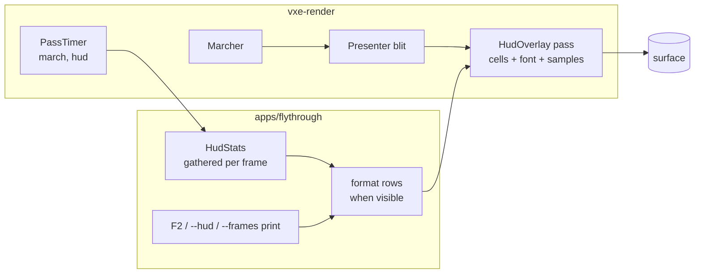

# 0010: A toggleable stats HUD: a bitmap-font text grid and a frame-time strip drawn as one overlay pass

> **Status:** in-progress (blocked at Phase 2; see Notes)
> **Created:** 2026-10-16
> **Milestone:** M7 in `docs/roadmap.md` (tooling; the profiler overlay half, brought forward)
> **Related ADRs:** [ADR-0009](../adrs/0009-testbed-hud-as-embedded-bitmap-font-overlay-pass.md) (no UI library), ADR-0001 (stack)
> **Prerequisite:** Plan 0001 closed. Independent of every other plan; it touches `apps/flythrough/src/main.rs`, which Plans 0002, 0004, 0007, 0008 and 0009 also touch, so merges are expected and conflicts are textual only.
> **Amended 2026-10-16**, before "go": Phase 2's `PassTimer` and Phase 3's frame-time window
> are copied from Ritmolux (the owner's sibling repository, commit `ad375596`) and adapted,
> not written fresh. See "Amendment 2026-10-16" below.

## TL;DR

`vxe-render` gains `HudOverlay`: a grid of 8 × 8 glyphs at an integer scale and a bar strip of
recent frame times, drawn by one fullscreen fragment pass with alpha blending onto the
surface after the presenter's blit. The fly-through gathers `HudStats` every frame (frame
CPU time, march GPU time, upload bytes and time, mirror bytes and pool slots, resident chunks
and CPU bytes, the last edit's result and cost, camera and chunk, process RSS on Linux) and
toggles the overlay with `F2`; `--frames N` prints the same rows at exit, so a headless run
and the screen read the same numbers. The first thing a reader sees is a headless test on
lavapipe: the glyph `A` at scale 2 produces exactly four times its bitmap's set bits in white
pixels. The first thing the user sees is `F2`.

## Context & problem

The owner asked on 2026-10-16 for rich on-screen data in human runs. Every reading today goes
to the console, and the `F1` summary is a snapshot. ADR-0009 records why this is a bitmap
font and not a UI library. `nfr.md` has no line for a tool overlay; the constraint is that
the overlay does not move the readings it shows, and the plan proposes its own cost under
"Budgets".

## Decision

We implement ADR-0009. The overlay is generic (rows of bytes, a strip of samples) and lives in
`vxe-render` because it is GPU code; the stats and their formatting live in the fly-through,
so a game can reuse the overlay without inheriting the testbed's rows. The pass is
pixel-exact: integer scale, no sampling, no filtering, so the golden with the HUD on is a
bit-exact comparison. `MarchTimer` generalises to `PassTimer` so the HUD pass can be timed
with the same mechanism that times the march.

We rejected `egui`, `glyphon` and CPU-rasterised text (ADR-0009), and we rejected putting the
stats struct in `vxe-app`: the shell stays thin, and the rows are the testbed's business.

## Amendment 2026-10-16

Made before "go", after a survey of `~/Work/Ritmolux` (the owner's music visualiser, same
licence, same owner, so its code is copied without ceremony). Two pieces of this plan already
exist there, tested, and `dev` copies them instead of writing them. Both citations are to
Ritmolux commit `ad375596`.

1. **`PassTimer` starts from Ritmolux's `core/src/render/gpu.rs`, `PassTimer`** (the struct and
   its `new`, `claim`, resolve and read path; about lines 294 to 480). What is kept: `new`
   returns `Option<Self>` and is `None` on a device without `TIMESTAMP_QUERY`, so a caller on
   the software adapter gets no timer rather than a validation error; the tick period is read
   off the queue once at construction; the resolve buffer (`QUERY_RESOLVE | COPY_SRC`) and the
   `MAP_READ` readback buffer are separate, because wgpu forbids one buffer carrying both; the
   query set holds a fixed number of index pairs so several passes in one frame are timed
   against one set and one resolve. What is **not** copied: the thread-local `ARMED` slot that
   lets Ritmolux's forty pass call sites claim a slot without a parameter. This engine has two
   call sites, the march and the HUD, and they take the writes explicitly, as `MarchTimer`
   does today. Phase 2's done-when is unchanged; its "Files touched" gains nothing.
2. **The frame-time window is Ritmolux's `FrameStats`** (`core/src/diag/mod.rs`, about lines
   130 to 260, with its tests): a fixed ring of 240 deltas fed explicitly, no clock read,
   giving fps, mean, median and p99 by nearest rank from a stack-local sorted copy, so it
   allocates nothing per frame and tests headless with made-up deltas. It is copied into
   `apps/flythrough/src/hud.rs` (the stats are the testbed's), and its ring **is** the strip's
   sample source, so the window is 240 frames, not one second, and `HudStats.frame_ms` carries
   mean, median, p99 and max rather than min, mean and max. The `Diag` wrapper around it, the
   GPU-byte accounting and the analysis fields are Ritmolux's and are not copied. The clock
   read stays where the fly-through already has it.

Also surveyed and rejected for this plan: Ritmolux's `overlay_font.rs` (a 5 x 7 partial glyph
set; ADR-0009 chose a full 8 x 8 ASCII font) and its `overlay.rs` (one quad per lit font pixel
through an instanced pipeline; this plan's cell grid in one fragment pass is the cheaper shape
for 24 rows of text).

## Architecture diagram



## Implementation phases

### Phase 1: The overlay pass and the font
- **Owner skill:** dev
- **What:** `HudOverlay` with a text grid, the embedded font, and the headless glyph test.
- **Files touched:** `crates/vxe-render/src/{lib.rs, hud.rs, font8x8.rs, shaders/hud.wgsl}`,
  `crates/vxe-render/tests/hud.rs`.
- **Done when:**
  - `FONT: [[u8; 8]; 95]` covers ASCII 32 to 126 with the public-domain `font8x8` bitmaps
    (Daniel Hepper; cited in a comment), row-major, bit 0 the leftmost pixel. `glyph(b' ')`
    is all zero; any byte outside 32 to 126 draws as `?`.
  - `HudOverlay::new(device, format, scale: u32)`; `set_text(&mut self, queue, rows:
    &[&[u8]])` fills a cell buffer of `cols × rows` `u32`s with `cols = ceil(width / (8 ·
    scale))`, `rows = ceil(height / (8 · scale))`, capped at 256 × 128 cells (128 KiB);
    `encode(&self, encoder, view, width, height)` draws one fullscreen triangle with
    `SrcAlpha`/`OneMinusSrcAlpha` blending: a set glyph bit is white at alpha 1, the bit's
    one-pixel-offset (+x, +y) shadow is black at alpha 0.75 where no white pixel lands, and
    everything else is transparent.
  - Headless on lavapipe: a 64 × 16 `rgba8` target cleared to (10, 20, 30, 255), `set_text`
    of `b"A "` at scale 2, one `encode`, readback. The count of (255, 255, 255) pixels is
    exactly `4 × popcount(FONT[b'A' − 32])`; every pixel with `x >= 17` equals the clear
    colour (cell 1 is a space and only a shadow from cell 0's last column could reach
    `x = 16`); no pixel is any other colour than white, the shadow blend of black at 0.75
    over the clear colour, or the clear colour.
  - `Presenter` and `march.wgsl` are untouched; Plan 0001's golden image test passes
    unchanged.

### Phase 2: The frame-time strip and the pass timer
- **Owner skill:** dev
- **What:** `set_samples`, the strip in the shader, `PassTimer`.
- **Files touched:** `crates/vxe-render/src/{hud.rs, marcher.rs, shaders/hud.wgsl}`,
  `crates/vxe-render/tests/hud.rs`, `apps/flythrough/src/main.rs`.
- **Done when:**
  - `set_samples(&mut self, queue, samples: &[f32], ceiling_ms: f32)` takes up to 256
    samples; the strip sits at the bottom-left above one text row, is `64 · scale` pixels
    tall and `scale` pixels wide per sample, a sample of `ceiling_ms` fills the height,
    larger samples clamp, and a one-pixel red line marks 16.67 ms when `ceiling_ms > 16.67`.
  - Headless at scale 1 with samples `[0, c/2, c, 2c]` and `ceiling_ms = c = 32`: the four
    columns hold 0, 32, 64 and 64 white pixels respectively, plus the red line row.
  - `PassTimer` owns a two-timestamp query set with `writes()`, `resolve()` and `read_ms()`,
    following the Ritmolux shape named in "Amendment 2026-10-16" (`new` is `None` without
    `TIMESTAMP_QUERY`; the period is read once; resolve and readback buffers are separate);
    `MarchTimer` is a type alias and keeps its API; the march reading at the spawn pose
    (`--seed 1 --render 1920x1080 --frames 300`) on the dev box stays within the 1.5 to
    1.7 ms band of `nfr.md` §2, re-read and logged, so the refactor changed nothing.
  - A second `PassTimer` around the HUD pass; its reading at 1920 × 1080 with 24 rows of
    text and 240 samples is logged. Proposal: under 0.1 ms on the dev box.

### Phase 3: Stats in the fly-through and the toggle
- **Owner skill:** dev
- **What:** `HudStats`, its rows, `F2`, `--hud`, and the `--frames` print.
- **Files touched:** `apps/flythrough/src/{main.rs, hud.rs, lib.rs}`.
- **Done when:**
  - `HudStats` (Data shapes) is filled every frame from what already exists: frame CPU time
    and the 240-frame window's fps, mean, median, p99 and max, from the `FrameStats` ring
    copied per "Amendment 2026-10-16" (its tests come with it: a ring fed 240 equal deltas
    reports that delta as mean, median and p99; a ring fed one 100 ms delta among 239 of
    1 ms reports a p99 of 100 ms and a median of 1 ms); `MarchTimer` and the HUD timer; the last
    `SyncStats` (bytes, chunks, milliseconds); `GpuWorld::mirror_bytes`, `live_slots` and
    `free_slots().len()`; `World::stats` (resident chunks, `Full` bricks, CPU bytes); the
    last edit's verb, counts and milliseconds; camera position and chunk; mode (fly, and
    walk once Plan 0004 lands); process RSS from `/proc/self/statm` (second field times the
    page size) on Linux and `None` elsewhere, shown as `n/a`.
  - Rows are formatted into a reused `String` only while the HUD is visible; the formatting
    time is measured with `Instant` and shown on its own row. Proposal: under 50 µs.
  - `F2` toggles; `--hud` starts visible. `--frames N` prints the `HudStats` rows at exit
    through the same `Display`; `F1` keeps printing its snapshot.
  - The strip holds the last 240 CPU frame times with `ceiling_ms = 33.3`, read in
    chronological order from the same `FrameStats` ring the rows are computed from.
  - A `--frames 300 --hud` run prints an average frame time within 5 % of the one printed by
    the same run without `--hud`, which defends "the HUD does not move the readings".

### Phase 4: The golden with the HUD on
- **Owner skill:** dev
- **What:** a bit-exact golden image of the overlay over the fixed view.
- **Files touched:** the directory of Plan 0001's golden test and its baseline images,
  `apps/flythrough/src/hud.rs` (a fixed-stats constructor).
- **Done when:**
  - `HudStats::fixed()` returns constants (every number set by hand, not measured) so the
    rendered rows are stable; the golden is Plan 0001's fixed view after its fixed carve with
    the overlay drawn from `fixed()` and a fixed 240-sample strip, blessed on lavapipe and
    compared pixel-exact (no SSIM floor: integer scale, no filtering).
  - Plan 0001's golden with the HUD off is byte-identical to its current baseline.

## Data shapes

```rust
// illustrative
pub struct HudOverlay { cells: wgpu::Buffer, font: wgpu::Buffer, samples: wgpu::Buffer, params: wgpu::Buffer, pipeline: wgpu::RenderPipeline, scale: u32, cols: u32, rows: u32 }
// cell: bits 0..8 glyph index (0 = blank), bits 8..16 colour (0 white, 1 yellow, 2 red)
// params: size, scale, cols, rows, strip origin and height, sample count, ceiling_ms

pub struct HudStats {
    pub fps: f32, pub frame_ms: FrameMs, pub march_ms: f32, pub hud_ms: f32,
    pub upload_bytes: u64, pub upload_ms: f32, pub upload_chunks: u32,
    pub mirror_bytes: u64, pub pool_live: u32, pub pool_free: u32,
    pub chunks: u32, pub full_bricks: u64, pub cpu_bytes: u64, pub rss_bytes: Option<u64>,
    pub last_edit: Option<EditLine>, pub camera: [f32; 3], pub chunk: [i32; 3], pub mode: Mode,
    pub format_us: u32,
}
pub struct FrameMs { pub mean: f32, pub p50: f32, pub p99: f32, pub max: f32 }  // from FrameStats, 240-frame ring
pub struct FrameStats { ring: [f32; 240], head: usize, len: usize, frames_total: u64 }  // copied from Ritmolux diag
```

Buffers: cells 128 KiB at the cap, font 760 bytes, samples 1 KiB, params 64 bytes.

## Budgets

| Figure | Expected effect | Close measures by |
|---|---|---|
| `nfr.md` §2 | No new line (a tool, not a frame stage). Constraint: the march reading with the HUD on equals the reading with it off within noise; the HUD pass itself under 0.1 ms at 1080p (proposal) | Phase 2 and Phase 3 readings, dev box, commit named |
| §3 "everything else in VRAM" | Under 200 KiB | Arithmetic above |

## Risks & open questions

- **Rasterisation differences** between lavapipe and NVIDIA for a fullscreen triangle with
  integer pixel math: none expected, and the goldens are blessed on lavapipe as always.
- **sRGB surfaces.** White and black are fixed points of the transfer; the shadow's 0.75
  alpha is not, so the shadow's exact value is adapter and format specific. The headless test
  asserts white counts and clear-colour pixels, not the shadow's value.
- **Small windows** truncate rows and columns at the cap; the text is clipped, never wrapped.
- **`Instant`** is already allowed in the fly-through; nothing here touches `vxe-world`.
- **Open:** whether rows should carry colour per row (the plan says yes: a row over budget
  renders yellow, a dropped frame red) or stay white; the dev picks yellow for any `ms` row
  above its `nfr.md` line.

## What this plan does NOT do

- **A UI library** (ADR-0009).
- **Debug views** of material ids, acoustic properties or the coarse grid: M7 proper; the
  overlay's grid carries their labels when they come.
- **A profiler across every pass** or a benchmark lane with committed readings: M7 proper.
- **RSS on Windows.**

## Implementation log

| Phase | Owner | Status | Notes |
|---|---|---|---|
| 1: The overlay pass and the font | dev | done | `HudOverlay` (`hud.rs`, `hud.wgsl`), `font8x8.rs` from `font8x8_basic.h`; lavapipe (llvmpipe, LLVM 22.1.8): `A` at scale 2 has 28 set bits, 112 white pixels, 33 shadow pixels, every pixel at `x >= 17` the clear colour; `present.wgsl`, `march.wgsl`, `present.rs` unchanged and Plan 0001's goldens pass; gate: 175 tests run, 175 passed, 1 skipped. Commit: 04fffd5 |
| 2: The frame-time strip and the pass timer | dev | blocked: the 1.5 to 1.7 ms band | `set_samples` and the strip; lavapipe: samples `[0, 16, 32, 64]`, ceiling 32, scale 1 give columns of 0, 32, 64, 64 white pixels and the red line 33 rows above the strip's bottom row in columns 0 and 1. `PassTimer` in `marcher.rs`, `MarchTimer` a type alias. March GPU, `flythrough --headless --seed 1 --render 1920x1080 --frames 300`, median of the last 30, three runs each, RTX 3080 Laptop GPU, exclusive lock: before (04fffd5) 6.684 / 7.100 / 6.683 ms, after 6.779 / 6.787 / 6.797 ms; with `--level` added, before 1.712 / 1.753 / 1.714 ms, after 1.753 / 1.720 / 1.707 ms. HUD pass (`hud_pass_reading_at_1080p`, ignored test, release): 1920 x 1080, 24 rows x 100 characters, 240 samples, scale 2, median of 300: 0.0573 / 0.0573 / 0.0573 ms. Gate: 177 tests run, 177 passed, 2 skipped. Commit: committed with this row |
| 3: Stats in the fly-through and the toggle | dev | not started | |
| 4: The golden with the HUD on | dev | not started | |

### Notes

- **Block (Phase 2):** the done-when names "the march reading at the spawn pose (`--seed 1
  --render 1920x1080 --frames 300`) on the dev box stays within the 1.5 to 1.7 ms band of
  `nfr.md` §2". That command now streams the unbounded cave (the default mode since Plan 0002)
  and reads 6.68 to 7.10 ms before the refactor and 6.78 to 6.80 ms after it; with `--level`
  it reads 1.71 to 1.75 ms before and 1.71 to 1.75 ms after. Neither is inside 1.5 to 1.7 at
  the commit before the refactor, so the done-when cannot be met as stated by any change in
  this plan. The 1.59 ms of `nfr.md` §2 is the Plan 0001 reading; `nfr.md` also records 1.95
  ms (Plan 0002) and 1.826 to 1.859 ms (Plan 0005) for the bounded level's spawn. Options:
  (a) restate the done-when as before/after equality within noise on a named command
  (`--level`, readings above), (b) restate the band to the current `--level` reading, (c)
  keep the band and treat it as a march regression to diagnose outside this plan. Phases 3
  and 4 are not started.
- Deviation, 04fffd5: the cell buffer always has the cap layout (256 columns stride x 128
  rows); the visible `ceil(width / 8 scale)` x `ceil(height / 8 scale)` cells are the ones the
  target's pixels reach. `set_text` takes no size, so it cannot size the grid to the target.
- Deviation, 04fffd5: `encode` passes the target height to the shader as the draw's first
  instance (`instance_index`), because `encode` takes no queue to write a uniform.
- Deviation, 04fffd5: `HudOverlay::set_rows` and `HudColour` added beside `set_text`, for the
  per-row colour of "Risks & open questions"; `encode_timed` added beside `encode` for the
  HUD's `PassTimer`.
- Deviation, 04fffd5: `hud.wgsl`'s naga validation is a unit test in `hud.rs`;
  `tests/shader_portability.rs` (outside Files touched) does not list `hud.wgsl`.
- Deviation, this row's commit: `PassTimer` keeps a two-timestamp query set (the done-when)
  rather than Ritmolux's fixed set of index pairs; the march and the HUD each own one.
  `MarchTimer::new` now takes the queue and returns `Option`; the fly-through's two call sites
  follow.
- Deviation, this row's commit: the HUD reading is an ignored test in `tests/hud.rs` run by
  hand, not a fly-through run (the fly-through draws no HUD until Phase 3).
- Deviation, this row's commit: `crates/vxe-render/src/lib.rs` (outside Phase 2's Files
  touched) re-exports `PassTimer`.
- The red line is drawn where no bar covers it; the strip has no backdrop.

### Close triggers

- Stopped at Phase 2 on the block above. Gate at the tip: `cargo build`, `cargo nextest run
  --workspace` (177 run, 177 passed, 2 skipped), `cargo test --workspace --doc`, `cargo clippy
  --workspace --all-targets -- -D warnings`, `cargo fmt --all --check`, `cargo deny check`,
  hook bite tests, `check-doc-links.mjs`: all exit 0.
- Readings: Phase 2 row; NVIDIA GeForce RTX 3080 Laptop GPU, Ryzen 9 5900HS, headless,
  every GPU command and timing under the exclusive perf lock; the 1-minute load average read
  6 to 25 during the readings (other lanes building).
