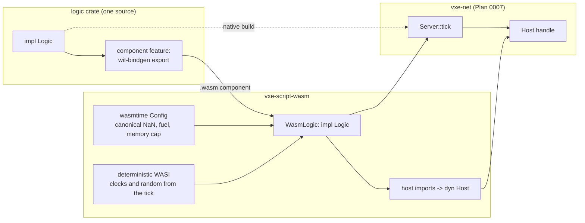

# 0011: A WebAssembly host for the logic component, proven by native-versus-component equality

> **Status:** approved (2026-10-16)
> **Created:** 2026-10-16
> **Milestone:** M5 in `docs/roadmap.md` (the scripting half)
> **Related ADRs:** [ADR-0010](../adrs/0010-game-logic-as-a-component-behind-a-logic-trait.md) (logic behind a trait, native and component), [ADR-0007](../adrs/0007-server-op-log-byte-channel-shared-and-owned-clients.md) (the server loop it plugs into), ADR-0001 (stack)
> **Prerequisite:** Plan 0007 closed (the `Logic` and `Host` traits, the logs, `DigLogic`). Independent of every other plan.
> **Amended 2026-10-17:** a hosted logic that fails a call (fuel, memory cap, trap) is
> stopped for the rest of the run (fail-stop); later ticks report `LogicError::Stopped` and
> the server carries on without it. Ops it applied before failing stay applied and logged.
> `--logic wasm` sits behind a `wasm` cargo feature on `flythrough`. See "Amendment
> 2026-10-17" below.

## TL;DR

A new crate, `vxe-script-wasm`, loads a WebAssembly component built against a small WIT
world (`init`, `tick`, and host imports for edits and queries) and implements Plan 0007's
`Logic` trait for it, with `wasmtime` configured so the component can observe nothing but its
seed and its inputs: canonical NaNs, clocks and entropy derived from the tick, a fuel budget
per tick, a memory cap. The first thing a reader sees is a headless test: the echo logic of
Plan 0007, native and as a component, driven by the same 100 inputs, produces the same
op-log bytes and the same world hash, on both CI arms. The first thing the user sees is
`--logic wasm` in the fly-through: the testbed's own dig logic running as a component, with
`--replay` giving the same hash as the native run.

## Amendment 2026-10-17

Phase 2 stopped on its fuel done-when ("the store is usable for the next tick"). wasmtime
49.0.3 does not enter a component instance again after any trap, and the component model
specifies the same: a trap leaves the instance's state undefined, so nothing may call it
again. The draft assumed a tick that runs out of fuel is a skipped tick with the logic's
state intact. That is not available, so the decision is what a failed logic becomes.

**Decision: fail-stop.** When a hosted logic fails a call (`init` or `tick`: fuel, memory
cap, any other trap), `WasmLogic` reports that failure once, as today
(`LogicError::{Fuel, Memory, Trap}` for that tick), and never enters the instance again.
Every later `tick` returns `LogicError::Stopped { tick, since }`, where `since` is the tick
of the failing call (0 for `init`), without calling into wasmtime. The server carries on:
it still logs each tick's inputs, applies submitted ops, and surfaces the error in
`TickReport::logic_error`. Recovery is the consumer's call, made from things it already
owns: end the session, or rebuild from the save (seed plus log) up to the tick before the
failure with a fixed logic, or drop the input that triggered it.

**Edits applied before a failure stay.** The world has no rollback. Ops the logic applied
through `Host::apply` before it failed are in the world and in the op log, with the failing
tick's seqs, like any other. This is a property of the boundary, not an accident: the log
records what the world did, so `Mode::Ops` replay is exact, and re-simulation reproduces the
failure and the partial ops at the same tick, because fuel counts wasm instructions and the
memory cap counts pages. Re-simulation is exact only with the same component bytes, the same
`WasmConfig` and the same `wasmtime` version; the log header records none of them (see
Risks).

**Rejected:**

- **(a) A fresh instance plus `init(seed)` again at the next tick.** Deterministic, but the
  restarted logic believes it is at the start of the run while the world holds every edit
  since. `init`'s own ops apply a second time (a fill or a stamp is not idempotent), and the
  logic's state (whatever a game keeps: entities, rolls, counters) silently resets. A
  logic that restarts mid-run is a worse failure than one that stops, because it looks alive.
- **(b) A fresh instance without `init`.** The same contradiction, plus the seed is lost, so
  the logic's own RNG starts from `Default`. Strictly worse than (a).
- **(d) Restore the guest from a snapshot taken before the tick.** The WIT world has no
  state export, so the host would have to copy the component's linear memories, globals and
  tables into a fresh instance, which wasmtime's component API does not expose; the
  alternative, a guest-exported `save`/`load` pair, changes the WIT world and asks every
  logic to serialize itself. It would also need the world rolled back to undo the tick's
  partial edits, and `vxe-world` has no undo. Both are new mechanisms with their own
  tradeoffs and need an ADR; nothing in this plan asks for them. If a consumer needs a
  logic that survives its own traps, that ADR is where it starts.

ADR-0010 says the host meters fuel per tick and says nothing about what a failed logic
becomes; this plan's Risks already read "the server records the tick and continues". Fail-stop
keeps both. Applied by the orchestrator under the owner's standing "go with your
recommendations" on 2026-10-17; the owner may overturn it, and (a) is the fallback if a
consumer wants a logic that restarts.

**Phase 3's feature flag.** `--logic wasm` needs `vxe-script-wasm` with its `host` feature,
which compiles `wasmtime`, and Phase 4 requires that a default-members build does not.
`flythrough` gets a `wasm` cargo feature, off by default, that enables an optional
dependency on `vxe-script-wasm`. Without it, `--logic wasm` exits non-zero with a message
naming `--features wasm`. `tests/component.rs` declares `required-features = ["wasm"]`, and
CI runs it on both arms with `cargo nextest run -p flythrough --features wasm` after
`scripts/build-guests.sh`. We rejected a separate binary (a second `main` that duplicates the
fly-through's argument handling and frame loop) and making `vxe-script-wasm` a default member
(the everyday loop would compile `wasmtime`, against §7).

The phase texts below carry the changes, each marked "amended 2026-10-17".

## Context & problem

ADR-0010 makes the game's server logic a component behind the `Logic` trait that Plan 0007
defines, developed natively and shipped as WebAssembly. Nothing hosts a component yet, and
nothing proves that the two builds of one logic crate behave identically, which is the whole
promise. `project-context.md` names `wasmtime` with the component model as the stack; the
exact version is pinned at implementation (the latest stable then; the context's note on
50.0.0-rc.1 is a lead, not a pin).

`nfr.md` figures touched: §6 (determinism: native-versus-component equality on both arms),
§7 (build time: the host and the guests stay out of the everyday loop). New figures proposed
under "Budgets": host-call overhead and the component's tick time against native.

## Decision

We implement ADR-0010's host. Compound values cross the boundary as Plan 0007's wire bytes
(an op in, a result or error out), so the boundary has one schema, the one the log and the
channel already use; scalars (coordinates, material ids) cross typed. The guest side is a
thin adapter: a crate that implements `Logic` natively exports the WIT world through
`wit-bindgen` when built with its `component` feature, and the adapter forwards `init` and
`tick` to the same `impl Logic` with a `Host` that calls the imports. Guests are built in CI
for `wasm32-wasip2` by a script and are never committed as binaries. The host crate and the
guests are outside `default-members`.

We rejected a typed WIT schema for ops and results (two schemas to keep in step for the same
values), a core-module ABI with hand-written pointer passing (the component model's lists do
the copying and the typing), and committing built `.wasm` files (binaries in git, and a build
that nobody verifies).

## Architecture diagram



## Implementation phases

### Phase 1: Host skeleton and the echo guest
- **Owner skill:** dev
- **What:** the WIT world, `WasmLogic`, the guest build script, the echo guest, and the
  equality test.
- **Files touched:** `Cargo.toml` (members, `default-members` listed explicitly without the
  host and the guests, dependency rows for `wasmtime`, `wasmtime-wasi`, `wit-bindgen`),
  `crates/vxe-script-wasm/{Cargo.toml, wit/logic.wit, src/lib.rs, src/host.rs,
  src/wasi.rs}`, `crates/vxe-script-wasm/guests/echo/{Cargo.toml, src/lib.rs}`,
  `crates/vxe-net/src/test_logic.rs` (Plan 0007's `EchoLogic` and `SeededLogic` behind a
  `test-logic` feature so both crates and the guests use them), `scripts/build-guests.sh`,
  `.github/workflows/ci.yml` (install `wasm32-wasip2`, run the script before tests on both
  arms), `crates/vxe-script-wasm/tests/equality.rs`.
- **Done when:**
  - `wit/logic.wit` defines package `vxe:logic`, interface `host` with `apply(op: list<u8>)
    -> list<u8>` (the result or error in wire bytes, tagged), `material-at(voxel) ->
    option<u16>`, `raycast(origin: fixed3, dir: fixed3, max: s64) -> option<hit>`,
    `count-in-box(lo: voxel, hi: voxel) -> list<tuple<u16, u64>>`, and world `logic` with
    `import host`, `export init(seed: u64)` and `export tick(tick: u64, inputs:
    list<client-input>) -> list<u8>`.
  - `WasmLogic::load(path: &Path, config: &WasmConfig) -> Result<WasmLogic, LogicError>`
    implements `Logic`; `LogicError::{Load(String), Trap { tick, message }, Fuel { tick },
    Memory { tick }}`.
  - `scripts/build-guests.sh` builds every crate under `crates/vxe-script-wasm/guests/` for
    `wasm32-wasip2` in release and places the components under
    `target/guests/<name>.wasm`; the tests load from there and fail with a message naming
    the script when a component is missing (no skipping).
  - The echo guest wraps `EchoLogic` through the adapter. `tests/equality.rs`: on two
    `solid3_world()`s, 100 inputs (each a wire-encoded radius-1 m carve at a seeded centre)
    over 10 ticks through `Server` with native `EchoLogic` and through `Server` with
    `WasmLogic` of the echo component: the two op logs' encoded bytes are equal, the two
    worlds' hashes are equal, and both equal the hash from Plan 0007's `EchoLogic` test. CI
    runs it on both arms.

### Phase 2: Determinism configuration
- **Owner skill:** dev
- **What:** the configuration that leaves the component nothing to observe but seed and
  inputs, each knob with a guest that would notice its absence.
- **Files touched:** `crates/vxe-script-wasm/src/{lib.rs, wasi.rs}`,
  `crates/vxe-script-wasm/guests/{probe, spin, hog}/`,
  `crates/vxe-script-wasm/tests/determinism.rs`; amended 2026-10-17:
  `crates/vxe-net/src/{logic.rs, server.rs}` (`LogicError::Stopped`, `TickReport`).
- **Done when:**
  - `WasmConfig { fuel_per_tick: u64, memory_bytes: u64, frame_ns: u64 }` with defaults
    `10_000_000_000`, `64 MiB`, `16_666_667`.
  - The `probe` guest's `tick` broadcasts, in order: the bits of `0.0f32 / 0.0f32`, the
    monotonic clock in nanoseconds, the wall clock in nanoseconds since the epoch, eight
    bytes from `getrandom`, and the iteration order of a `HashMap` with keys 1 to 8. The
    host asserts: the NaN bits are `0x7fc0_0000` (canonical, `cranelift_nan_canonicalization`);
    the monotonic clock equals `tick × frame_ns`; the wall clock equals the same; the eight
    bytes are the first eight of a xorshift stream seeded from `mix64(seed ^ tick)` (both
    `insecure_random` and `secure_random` serve it); and the `HashMap` order is the same
    across two loads of the component with the same seed (the `RandomState` seed comes from
    the same stream). The plan does not claim that order equals the native one; a logic that
    depends on `HashMap` order is wrong on both sides, and the review lens for logic crates
    says so.
  - (amended 2026-10-17: fail-stop) The `spin` guest loops forever in `tick`. Over ticks 0,
    1 and 2, `WasmLogic` returns `LogicError::Fuel { tick: 0 }`, then `LogicError::Stopped
    { tick: 1, since: 0 }` and `Stopped { tick: 2, since: 0 }`, and the later two do not
    enter wasmtime. The ignored `after_running_out_of_fuel_the_next_tick_runs_again` is
    replaced by this test. A logic whose `init` fails reports the failure through
    `Server::init_error()` and `Stopped { tick, since: 0 }` on every tick.
  - (amended 2026-10-17: edits before a failure) The `hog` guest first applies each of its
    tick's inputs as a wire-encoded op through the host (as `EchoLogic` does), then
    allocates 1 GiB: `LogicError::Memory { tick }`. With one radius-1 m carve as tick 0's
    input, the report is `applied: 1` with `logic_error: Some(Memory { tick: 0 })`, the op
    log holds that carve at tick 0, the world's hash equals the hash of `solid3_world()`
    after that carve applied directly, and `Server::resimulate` with a fresh `hog` component
    and the same `WasmConfig` gives equal op-log bytes and the same hash.
  - No filesystem preopens and no environment: the `probe` guest's attempt to open `/` and
    to read an environment variable both fail inside the guest and are reported in its
    broadcast as failures.
  - `Server` treats a `LogicError` as a tick with no further logic ops (amended
    2026-10-17: ops the logic applied before failing stay applied and logged) and surfaces
    it in `TickReport::logic_error`; the inputs of that tick are still logged.

### Phase 3: The fly-through's logic as a component
- **Owner skill:** dev
- **What:** `DigLogic` moved into a crate that builds both ways, and `--logic`.
- **Files touched:** `apps/flythrough/logic/{Cargo.toml, src/lib.rs}` (package
  `flythrough-logic`, workspace member, outside `default-members` only for its `component`
  feature build), `apps/flythrough/src/{main.rs, lib.rs}`, `apps/flythrough/Cargo.toml`,
  `scripts/build-guests.sh` (adds this guest), `apps/flythrough/tests/component.rs`;
  amended 2026-10-17: `.github/workflows/ci.yml` (the `--features wasm` test step).
- **Done when:**
  - (amended 2026-10-17) `flythrough` has a `wasm` feature, off by default, enabling an
    optional dependency on `vxe-script-wasm`; without it `--logic wasm` exits non-zero with
    a message naming `--features wasm`. `tests/component.rs` has `required-features =
    ["wasm"]`, and CI runs `cargo nextest run -p flythrough --features wasm` on both arms
    after `scripts/build-guests.sh`.
  - `flythrough-logic` holds `DigLogic` from Plan 0007 unchanged in behaviour, as an `rlib`
    for the native path and, with `--features component`, as the WIT export.
  - `--logic native` (default) and `--logic wasm[=path]` (default path
    `target/guests/flythrough-logic.wasm`) select the implementation; the fly-through prints
    which one runs. A hosted logic that fails is printed once and the session continues
    without it (amended 2026-10-17).
  - `tests/component.rs`: Plan 0007's replay fixture (20 `Dig` inputs at fixed rays) through
    `replay_file` in `Mode::Inputs` with native `DigLogic` and with `WasmLogic` gives the
    same hash; the `Bench` input (100 carves) through both gives equal op-log bytes.
  - A session (built with `--features wasm`) `--frames 2 --bench --logic wasm --save a.log` followed by `--frames 1
    --replay a.log --logic native` prints the same hash twice; the log records both lines.

### Phase 4: Readings
- **Owner skill:** dev
- **What:** the overhead of the boundary, measured.
- **Files touched:** `crates/vxe-script-wasm/benches/boundary.rs`,
  `crates/vxe-script-wasm/Cargo.toml`, `docs/nfr.md`.
- **Done when:**
  - `cargo bench -p vxe-script-wasm --bench boundary`: one `apply` of a radius-1 m carve
    through the component's import against one native `Host::apply`, as the difference in
    nanoseconds per call; and the `Bench` tick (100 carves) through `WasmLogic` against
    native `DigLogic`, as a ratio. Proposals: under 1 µs per host call, under 2× for the
    tick. Readings go into the log and `nfr.md` §4 with machine, commit and `wasmtime`
    version.
  - `cargo build` of the default members does not compile `wasmtime` (amended 2026-10-17:
    and `cargo tree -p flythrough -e normal` without features lists no `wasmtime`); the log records the
    incremental build time of a one-line change in `vxe-world` before and after this plan
    (`nfr.md` §7, under 10 s).

## Data shapes

```wit
// illustrative: wit/logic.wit
package vxe:logic@0.1.0;

interface host {
    record fixed3 { x: s64, y: s64, z: s64 }
    record voxel { x: s32, y: s32, z: s32 }
    record hit { voxel: voxel, material: u16, normal: voxel, distance: s64 }
    apply: func(op: list<u8>) -> list<u8>;              // wire bytes in, tagged result out
    material-at: func(v: voxel) -> option<u16>;
    raycast: func(origin: fixed3, dir: fixed3, max: s64) -> option<hit>;
    count-in-box: func(lo: voxel, hi: voxel) -> list<tuple<u16, u64>>;
}

world logic {
    import host;
    record client-input { client: u32, bytes: list<u8> }
    export init: func(seed: u64);
    export tick: func(tick: u64, inputs: list<client-input>) -> list<u8>;
}
```

```rust
// illustrative: the host side
pub struct WasmConfig { pub fuel_per_tick: u64, pub memory_bytes: u64, pub frame_ns: u64 }
pub struct WasmLogic { engine: wasmtime::Engine, store: wasmtime::Store<State>, instance: LogicBindings, config: WasmConfig }
struct State { wasi: WasiCtx, host: *mut dyn Host /* set for the duration of one call */, limits: StoreLimits, tick: u64 }
pub enum LogicError { Load(String), Trap { tick: u64, message: String }, Fuel { tick: u64 }, Memory { tick: u64 } }
```

The `Host` handle is lent to the store for the duration of `init` or `tick` and cleared
after; an import called outside those windows traps. The adapter on the guest side is under
fifty lines and generated bindings.

## Budgets

| Figure | Expected effect | Close measures by |
|---|---|---|
| §6 determinism | Native and component runs of one logic are byte-equal in the op log and hash-equal in the world, on both CI arms | Phase 1 and Phase 3 tests on both arms |
| §4 edits (new lines) | Host-call overhead under 1 µs; component tick under 2× native (proposals) | Phase 4 bench, dev box, `wasmtime` version named |
| §7 build | The everyday loop never compiles `wasmtime`; incremental build under 10 s unchanged | Phase 4 reading |

## Risks & open questions

- **Toolchain.** `wasm32-wasip2` must be installed on both CI arms and on the dev box; the
  `wasmtime`, `wasmtime-wasi` and `wit-bindgen` versions must agree on the WASI snapshot.
  Pinned exactly in the workspace table; a bump is its own commit with the equality test as
  its gate.
- **`HashMap` order.** Deterministic within the component by the seeded `RandomState`, but
  not equal to native. Logic crates must not depend on it; the probe test documents the
  guarantee that exists and no more.
- **Panics in the guest** become traps; the server records the tick and continues without
  the logic (fail-stop, amended 2026-10-17). A panicking logic is a bug in the logic, and the
  fly-through prints it.
- **Re-simulating a failure** (amended 2026-10-17) is exact only with the same component
  bytes, `WasmConfig` and `wasmtime` version: fuel accounting can change between `wasmtime`
  releases, and a different `fuel_per_tick` moves the failing tick. `LogFile`'s header
  records none of them, as it records `CaveSource::VERSION`. Recording a component hash and
  the config in the header is a follow-up for the plan that ships a logic in a save.
- **Host-call volume.** Pathfinding or per-monster queries at hundreds per tick will show
  in the Phase 4 ratio; batched imports (a list of raycasts per call) are the known answer
  and are added when a consumer's measurement asks.
- **Open:** whether `apply`'s result should return the full `EditResult` bytes or only
  counts; the plan returns the full result, since the logic needs the aabb for its own grids.

## What this plan does NOT do

- **A Lua host** (ADR-0010 defers it).
- **The level-layout format** that the logic will produce and the generator consume: its own
  plan.
- **Entity snapshots** across the boundary: with M6.
- **Hot reload** of a component during a run: a follow-up; the fly-through reloads on
  restart only.
- **Mods loading from a directory**, signing, or any trust model beyond the sandbox.

## Implementation log

| Phase | Owner | Status | Notes |
|---|---|---|---|
| 1: Host skeleton and the echo guest | dev | not started | |
| 2: Determinism configuration | dev | not started | |
| 3: The fly-through's logic as a component | dev | not started | |
| 4: Readings | dev | not started | |
