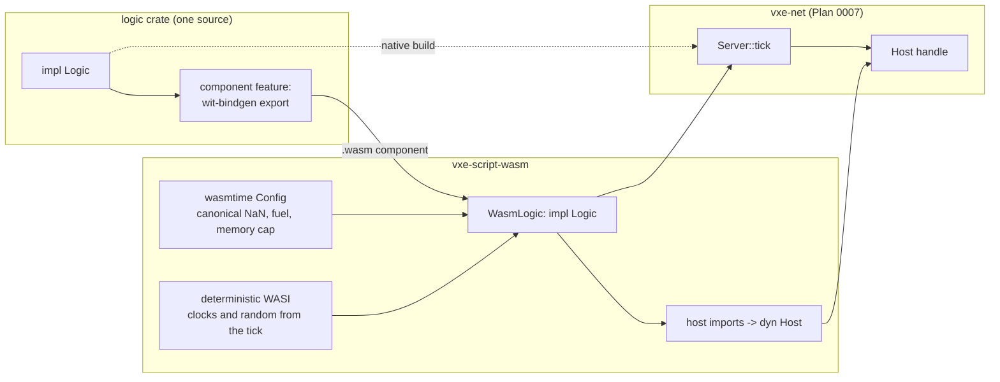

# 0011: A WebAssembly host for the logic component, proven by native-versus-component equality

> **Status:** in-progress (2026-10-17), blocked at Phase 2: wasmtime does not re-enter a component instance after a trap (see Notes)
> **Created:** 2026-10-16
> **Milestone:** M5 in `docs/roadmap.md` (the scripting half)
> **Related ADRs:** [ADR-0010](../adrs/0010-game-logic-as-a-component-behind-a-logic-trait.md) (logic behind a trait, native and component), [ADR-0007](../adrs/0007-server-op-log-byte-channel-shared-and-owned-clients.md) (the server loop it plugs into), ADR-0001 (stack)
> **Prerequisite:** Plan 0007 closed (the `Logic` and `Host` traits, the logs, `DigLogic`). Independent of every other plan.

## TL;DR

A new crate, `vxe-script-wasm`, loads a WebAssembly component built against a small WIT
world (`init`, `tick`, and host imports for edits and queries) and implements Plan 0007's
`Logic` trait for it, with `wasmtime` configured so the component can observe nothing but its
seed and its inputs: canonical NaNs, clocks and entropy derived from the tick, a fuel budget
per tick, a memory cap. The first thing a reader sees is a headless test: the echo logic of
Plan 0007, native and as a component, driven by the same 100 inputs, produces the same
op-log bytes and the same world hash, on both CI arms. The first thing the user sees is
`--logic wasm` in the fly-through: the testbed's own dig logic running as a component, with
`--replay` giving the same hash as the native run.

## Context & problem

ADR-0010 makes the game's server logic a component behind the `Logic` trait that Plan 0007
defines, developed natively and shipped as WebAssembly. Nothing hosts a component yet, and
nothing proves that the two builds of one logic crate behave identically, which is the whole
promise. `project-context.md` names `wasmtime` with the component model as the stack; the
exact version is pinned at implementation (the latest stable then; the context's note on
50.0.0-rc.1 is a lead, not a pin).

`nfr.md` figures touched: §6 (determinism: native-versus-component equality on both arms),
§7 (build time: the host and the guests stay out of the everyday loop). New figures proposed
under "Budgets": host-call overhead and the component's tick time against native.

## Decision

We implement ADR-0010's host. Compound values cross the boundary as Plan 0007's wire bytes
(an op in, a result or error out), so the boundary has one schema, the one the log and the
channel already use; scalars (coordinates, material ids) cross typed. The guest side is a
thin adapter: a crate that implements `Logic` natively exports the WIT world through
`wit-bindgen` when built with its `component` feature, and the adapter forwards `init` and
`tick` to the same `impl Logic` with a `Host` that calls the imports. Guests are built in CI
for `wasm32-wasip2` by a script and are never committed as binaries. The host crate and the
guests are outside `default-members`.

We rejected a typed WIT schema for ops and results (two schemas to keep in step for the same
values), a core-module ABI with hand-written pointer passing (the component model's lists do
the copying and the typing), and committing built `.wasm` files (binaries in git, and a build
that nobody verifies).

## Architecture diagram



## Implementation phases

### Phase 1: Host skeleton and the echo guest
- **Owner skill:** dev
- **What:** the WIT world, `WasmLogic`, the guest build script, the echo guest, and the
  equality test.
- **Files touched:** `Cargo.toml` (members, `default-members` listed explicitly without the
  host and the guests, dependency rows for `wasmtime`, `wasmtime-wasi`, `wit-bindgen`),
  `crates/vxe-script-wasm/{Cargo.toml, wit/logic.wit, src/lib.rs, src/host.rs,
  src/wasi.rs}`, `crates/vxe-script-wasm/guests/echo/{Cargo.toml, src/lib.rs}`,
  `crates/vxe-net/src/test_logic.rs` (Plan 0007's `EchoLogic` and `SeededLogic` behind a
  `test-logic` feature so both crates and the guests use them), `scripts/build-guests.sh`,
  `.github/workflows/ci.yml` (install `wasm32-wasip2`, run the script before tests on both
  arms), `crates/vxe-script-wasm/tests/equality.rs`.
- **Done when:**
  - `wit/logic.wit` defines package `vxe:logic`, interface `host` with `apply(op: list<u8>)
    -> list<u8>` (the result or error in wire bytes, tagged), `material-at(voxel) ->
    option<u16>`, `raycast(origin: fixed3, dir: fixed3, max: s64) -> option<hit>`,
    `count-in-box(lo: voxel, hi: voxel) -> list<tuple<u16, u64>>`, and world `logic` with
    `import host`, `export init(seed: u64)` and `export tick(tick: u64, inputs:
    list<client-input>) -> list<u8>`.
  - `WasmLogic::load(path: &Path, config: &WasmConfig) -> Result<WasmLogic, LogicError>`
    implements `Logic`; `LogicError::{Load(String), Trap { tick, message }, Fuel { tick },
    Memory { tick }}`.
  - `scripts/build-guests.sh` builds every crate under `crates/vxe-script-wasm/guests/` for
    `wasm32-wasip2` in release and places the components under
    `target/guests/<name>.wasm`; the tests load from there and fail with a message naming
    the script when a component is missing (no skipping).
  - The echo guest wraps `EchoLogic` through the adapter. `tests/equality.rs`: on two
    `solid3_world()`s, 100 inputs (each a wire-encoded radius-1 m carve at a seeded centre)
    over 10 ticks through `Server` with native `EchoLogic` and through `Server` with
    `WasmLogic` of the echo component: the two op logs' encoded bytes are equal, the two
    worlds' hashes are equal, and both equal the hash from Plan 0007's `EchoLogic` test. CI
    runs it on both arms.

### Phase 2: Determinism configuration
- **Owner skill:** dev
- **What:** the configuration that leaves the component nothing to observe but seed and
  inputs, each knob with a guest that would notice its absence.
- **Files touched:** `crates/vxe-script-wasm/src/{lib.rs, wasi.rs}`,
  `crates/vxe-script-wasm/guests/{probe, spin, hog}/`,
  `crates/vxe-script-wasm/tests/determinism.rs`.
- **Done when:**
  - `WasmConfig { fuel_per_tick: u64, memory_bytes: u64, frame_ns: u64 }` with defaults
    `10_000_000_000`, `64 MiB`, `16_666_667`.
  - The `probe` guest's `tick` broadcasts, in order: the bits of `0.0f32 / 0.0f32`, the
    monotonic clock in nanoseconds, the wall clock in nanoseconds since the epoch, eight
    bytes from `getrandom`, and the iteration order of a `HashMap` with keys 1 to 8. The
    host asserts: the NaN bits are `0x7fc0_0000` (canonical, `cranelift_nan_canonicalization`);
    the monotonic clock equals `tick × frame_ns`; the wall clock equals the same; the eight
    bytes are the first eight of a xorshift stream seeded from `mix64(seed ^ tick)` (both
    `insecure_random` and `secure_random` serve it); and the `HashMap` order is the same
    across two loads of the component with the same seed (the `RandomState` seed comes from
    the same stream). The plan does not claim that order equals the native one; a logic that
    depends on `HashMap` order is wrong on both sides, and the review lens for logic crates
    says so.
  - The `spin` guest loops forever in `tick`: `WasmLogic::tick` returns `LogicError::Fuel {
    tick }` and the store is usable for the next tick (the fuel is reset per tick).
  - The `hog` guest allocates 1 GiB in `tick`: `LogicError::Memory { tick }`.
  - No filesystem preopens and no environment: the `probe` guest's attempt to open `/` and
    to read an environment variable both fail inside the guest and are reported in its
    broadcast as failures.
  - `Server` treats a `LogicError` as a tick with no logic ops and surfaces it in
    `TickReport::logic_error`; the inputs of that tick are still logged.

### Phase 3: The fly-through's logic as a component
- **Owner skill:** dev
- **What:** `DigLogic` moved into a crate that builds both ways, and `--logic`.
- **Files touched:** `apps/flythrough/logic/{Cargo.toml, src/lib.rs}` (package
  `flythrough-logic`, workspace member, outside `default-members` only for its `component`
  feature build), `apps/flythrough/src/{main.rs, lib.rs}`, `apps/flythrough/Cargo.toml`,
  `scripts/build-guests.sh` (adds this guest), `apps/flythrough/tests/component.rs`.
- **Done when:**
  - `flythrough-logic` holds `DigLogic` from Plan 0007 unchanged in behaviour, as an `rlib`
    for the native path and, with `--features component`, as the WIT export.
  - `--logic native` (default) and `--logic wasm[=path]` (default path
    `target/guests/flythrough-logic.wasm`) select the implementation; the fly-through prints
    which one runs.
  - `tests/component.rs`: Plan 0007's replay fixture (20 `Dig` inputs at fixed rays) through
    `replay_file` in `Mode::Inputs` with native `DigLogic` and with `WasmLogic` gives the
    same hash; the `Bench` input (100 carves) through both gives equal op-log bytes.
  - A session `--frames 2 --bench --logic wasm --save a.log` followed by `--frames 1
    --replay a.log --logic native` prints the same hash twice; the log records both lines.

### Phase 4: Readings
- **Owner skill:** dev
- **What:** the overhead of the boundary, measured.
- **Files touched:** `crates/vxe-script-wasm/benches/boundary.rs`,
  `crates/vxe-script-wasm/Cargo.toml`, `docs/nfr.md`.
- **Done when:**
  - `cargo bench -p vxe-script-wasm --bench boundary`: one `apply` of a radius-1 m carve
    through the component's import against one native `Host::apply`, as the difference in
    nanoseconds per call; and the `Bench` tick (100 carves) through `WasmLogic` against
    native `DigLogic`, as a ratio. Proposals: under 1 µs per host call, under 2× for the
    tick. Readings go into the log and `nfr.md` §4 with machine, commit and `wasmtime`
    version.
  - `cargo build` of the default members does not compile `wasmtime`; the log records the
    incremental build time of a one-line change in `vxe-world` before and after this plan
    (`nfr.md` §7, under 10 s).

## Data shapes

```wit
// illustrative: wit/logic.wit
package vxe:logic@0.1.0;

interface host {
    record fixed3 { x: s64, y: s64, z: s64 }
    record voxel { x: s32, y: s32, z: s32 }
    record hit { voxel: voxel, material: u16, normal: voxel, distance: s64 }
    apply: func(op: list<u8>) -> list<u8>;              // wire bytes in, tagged result out
    material-at: func(v: voxel) -> option<u16>;
    raycast: func(origin: fixed3, dir: fixed3, max: s64) -> option<hit>;
    count-in-box: func(lo: voxel, hi: voxel) -> list<tuple<u16, u64>>;
}

world logic {
    import host;
    record client-input { client: u32, bytes: list<u8> }
    export init: func(seed: u64);
    export tick: func(tick: u64, inputs: list<client-input>) -> list<u8>;
}
```

```rust
// illustrative: the host side
pub struct WasmConfig { pub fuel_per_tick: u64, pub memory_bytes: u64, pub frame_ns: u64 }
pub struct WasmLogic { engine: wasmtime::Engine, store: wasmtime::Store<State>, instance: LogicBindings, config: WasmConfig }
struct State { wasi: WasiCtx, host: *mut dyn Host /* set for the duration of one call */, limits: StoreLimits, tick: u64 }
pub enum LogicError { Load(String), Trap { tick: u64, message: String }, Fuel { tick: u64 }, Memory { tick: u64 } }
```

The `Host` handle is lent to the store for the duration of `init` or `tick` and cleared
after; an import called outside those windows traps. The adapter on the guest side is under
fifty lines and generated bindings.

## Budgets

| Figure | Expected effect | Close measures by |
|---|---|---|
| §6 determinism | Native and component runs of one logic are byte-equal in the op log and hash-equal in the world, on both CI arms | Phase 1 and Phase 3 tests on both arms |
| §4 edits (new lines) | Host-call overhead under 1 µs; component tick under 2× native (proposals) | Phase 4 bench, dev box, `wasmtime` version named |
| §7 build | The everyday loop never compiles `wasmtime`; incremental build under 10 s unchanged | Phase 4 reading |

## Risks & open questions

- **Toolchain.** `wasm32-wasip2` must be installed on both CI arms and on the dev box; the
  `wasmtime`, `wasmtime-wasi` and `wit-bindgen` versions must agree on the WASI snapshot.
  Pinned exactly in the workspace table; a bump is its own commit with the equality test as
  its gate.
- **`HashMap` order.** Deterministic within the component by the seeded `RandomState`, but
  not equal to native. Logic crates must not depend on it; the probe test documents the
  guarantee that exists and no more.
- **Panics in the guest** become traps; the server records the tick and continues. A
  panicking logic is a bug in the logic, and the fly-through prints it.
- **Host-call volume.** Pathfinding or per-monster queries at hundreds per tick will show
  in the Phase 4 ratio; batched imports (a list of raycasts per call) are the known answer
  and are added when a consumer's measurement asks.
- **Open:** whether `apply`'s result should return the full `EditResult` bytes or only
  counts; the plan returns the full result, since the logic needs the aabb for its own grids.

## What this plan does NOT do

- **A Lua host** (ADR-0010 defers it).
- **The level-layout format** that the logic will produce and the generator consume: its own
  plan.
- **Entity snapshots** across the boundary: with M6.
- **Hot reload** of a component during a run: a follow-up; the fly-through reloads on
  restart only.
- **Mods loading from a directory**, signing, or any trust model beyond the sandbox.

## Implementation log

| Phase | Owner | Status | Notes |
|---|---|---|---|
| 1: Host skeleton and the echo guest | dev | done | 60c1d34; `tests/equality.rs` pins the echo world hash `0x8f7d_4016_15d9_5c4d` (native and component, Linux x86_64) |
| 2: Determinism configuration | dev | blocked | d9473eb; every done-when met except "the store is usable for the next tick" after `spin`'s fuel trap (see Notes) |
| 3: The fly-through's logic as a component | dev | not started | |
| 4: Readings | dev | not started | |

### Notes

- Phase 1: pins are `wasmtime` and `wasmtime-wasi` `=49.0.3` (the latest stable; `50.0.0-rc.1` is a release candidate) and `wit-bindgen` `=0.61.1`, not the latest `0.63.0`: 0.61.1 is the release on wasmtime 49's `wasm-tools` (0.258), so the two share `wasmparser`, `wit-parser` and `wasm-encoder`. A fourth row, `rand_core` `=0.10.1`, is the trait `wasmtime-wasi` takes for its random generators. `cargo deny check` passes with them.
- Phase 1: the `wasm32-wasip2` target was added to the dev box's 1.97.1 toolchain with `rustup target add wasm32-wasip2`; CI runs the same command before `scripts/build-guests.sh`.
- Phase 1: `LogicError` lives in `vxe-net` (`logic.rs`, re-exported as `vxe_script_wasm::LogicError`), so the server can carry it; `crates/vxe-net/src/logic.rs` is outside Files touched.
- Phase 1: `test_logic.rs` holds all of `crates/vxe-net/tests/support/mod.rs` (the world, the seeded carves, `op_bytes`, the xorshift helpers, `EchoLogic`, `SeededLogic`); `tests/support/mod.rs` re-exports it, and `vxe-net` takes itself as a dev-dependency with `test-logic`. `crates/vxe-net/{Cargo.toml, src/lib.rs, tests/support/mod.rs}` are outside Files touched.
- Phase 1: the guest adapter is one macro, `vxe_script_wasm::export_logic!(Type)` (`src/guest.rs`, outside Files touched), behind the crate's `guest` feature; the host is its default `host` feature. A guest depends on the crate without default features, so it does not build `wasmtime`. The adapter keeps one `Default` instance of the logic in a thread-local.
- Phase 1: the WIT `hit` record mirrors `vxe_world::Hit`: `{ voxel, face: option<face>, t, material }` with a six-case `face` enum, where Data shapes sketched `normal` and `distance`. `apply`'s answer is a tag byte, 0 then the result's wire bytes, 1 then the error's, or 2 alone for op bytes that do not decode (`encode_answer`/`decode_answer` in `lib.rs`).
- Phase 1: `WasmLogic::load` compiles and links the component and checks it against the world; the store and the instance are made in `init`, where the seed is known, because the WASI context is built from it. `WasmLogic` also has `try_init`/`try_tick` returning `Result<_, LogicError>` and `take_error`.
- Phase 1: `scripts/build-guests.sh` names each component after its directory under `guests/` (`echo.wasm`); the package is `echo-guest`. The tests find components at `target/guests/` under the workspace root whatever `CARGO_TARGET_DIR` is.
- Phase 1: `vxe-net`'s `EchoLogic` test pins no world hash, so `tests/equality.rs` pins the hash of the same inputs (`seeded_carves(0xEC40, 100)`, ten a tick, on `solid3_world()`) as `ECHO_HASH` and asserts both runs equal it. It also asserts equal input-log bytes and client events, and re-simulates the component's session through the component to the same op-log bytes.
- Phase 2 (block): after any trap (fuel, memory cap, a panic) wasmtime 49.0.3 refuses to enter the component instance again: the next call fails with `wasm trap: cannot enter component instance`, so `spin`'s tick 1 is `LogicError::Trap { tick: 1, .. }`, not `Fuel { tick: 1 }`. The store and its fuel can be reset (fuel is set before every call), but the instance cannot be called. Making the next tick run needs a new instance, and what the logic's state is then is a design call the plan does not make. Options: (a) after a trap, instantiate afresh in the same store and call the guest's `init(seed)` again with the host lent at the next tick (deterministic, since fuel counts wasm instructions and a re-simulation traps at the same tick; the logic restarts from its seed, and ops its `init` applies are applied again); (b) instantiate afresh without `init` (the logic's `Default` state, its seed lost); (c) a trapped logic stays down: every later tick reports `LogicError::Trap` and the server carries on with submitted ops only, and the done-when changes to say so. The ignored test `after_running_out_of_fuel_the_next_tick_runs_again` in `tests/determinism.rs` holds the done-when's assertion (ticks 0, 1, 2 each `Fuel { tick }`); it fails today on tick 1. The code at this commit is (c) without a decision behind it.
- Phase 2: `Logic` gains a provided method `take_error(&mut self) -> Option<LogicError>` (default `None`), which the server calls after `init` and after every `tick`; `WasmLogic` reports its failures there. `TickReport` gains `logic_error: Option<LogicError>` and loses `Copy` (the error carries a `String`); `Server::init_error()` returns `init`'s failure. A failed tick sends no broadcast; ops a logic applied before it failed stay applied and logged (the world has them), so "a tick with no logic ops" holds for a logic that fails before applying any, as `spin` does. `crates/vxe-net/src/{logic.rs, server.rs}` and the `TickReport` literals in `crates/vxe-net/tests/{logic.rs, shared.rs}` are outside Files touched.
- Phase 2: the clocks read `tick × frame_ns` during `init` too (tick 0), and the random stream restarts before `init` from `mix64(seed ^ 0)`. Where `mix64(seed ^ tick)` is 0 the stream starts from `0x9e37_79b9_7f4a_7c15` (xorshift sticks at 0); the test's seed avoids it. `wasi:random/insecure-seed`, which the 1.97.1 standard library imports for its `HashMap` keys (the probe component's import names show it), is the first sixteen bytes of tick 0's stream, fixed at instantiation; the probe's `HashMap` order was equal across two loads with the same seed.
- Phase 2: the memory cap applies to each linear memory through a `ResourceLimiter` that fails the growth (a trap) and records it, so a hit is `LogicError::Memory` whatever the guest does with the failure; tables may grow to 65 536 elements. The engine also sets `relaxed_simd_deterministic`.
- Phase 2: the probe reads the monotonic clock through a hand-declared import of `wasi:clocks/monotonic-clock@0.2.0` `now` (the standard library hides it behind `Instant`), avoiding the `wasip2` crate and its second `wit-bindgen`; `getrandom` `=0.4.3` is a new workspace row (already in the lock through `wasmtime`'s dependencies, no new transitive crate). The probe's broadcast ends with two flags for opening `/` and reading `HOME` (0 failed); both read 0. A `#[allow(clippy::disallowed_methods)]` with a reason covers its `SystemTime::now`.
- Phase 2: the fuel and server tests run `spin` at 50 000 000 fuel per tick to stay fast. At the default 10 000 000 000, one `spin` tick ran out of fuel after 709 ms (release, RTX 3080 laptop dev box, exclusive lock, 1-minute load 3.03; a throwaway test, not committed).

### Close triggers

- **Stopped at the Phase 2 block** (see Notes); Phases 3 and 4 not started. Gate at d9473eb (Linux x86_64, RTX 3080 laptop dev box, `CARGO_BUILD_JOBS=3`): `scripts/build-guests.sh` built echo, hog, probe and spin; `cargo build` and `cargo build --workspace --all-targets` exit 0; `cargo nextest run --workspace` 304 passed, 5 skipped (NVIDIA GeForce RTX 3080 Laptop GPU per `nvidia-smi -L`, exclusive lock, 1-minute load 13.86 after), the skips including the ignored `after_running_out_of_fuel_the_next_tick_runs_again`; `cargo test --workspace --doc`, `cargo clippy --workspace --all-targets -- -D warnings`, `cargo clippy -p echo-guest -p probe-guest -p spin-guest -p hog-guest --target wasm32-wasip2 -- -D warnings`, `cargo fmt --all --check`, `cargo deny check` exit 0; hook bite tests 59 passed; doc links (89), comment hygiene, index rows and its self-test (9/9) exit 0.
- **Determinism:** native `EchoLogic` and the echo component give equal op-log bytes, input-log bytes, client events and the world hash `0x8f7d_4016_15d9_5c4d` on Linux x86_64; not yet run on the Windows arm (needs a push). The probe's readings (NaN bits `0x7fc0_0000`, clocks at `tick × frame_ns`, the seeded random bytes, `HashMap` order across loads, failing `/` and `HOME`) hold on Linux x86_64.
- **Readings:** none yet (Phase 4).
