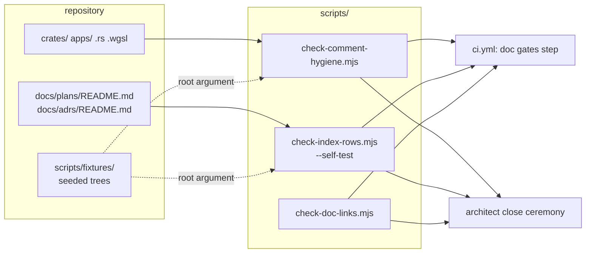

# 0012: Two repository gates copied from Ritmolux: comment hygiene in sources, and a byte cap on index rows

> **Status:** draft
> **Created:** 2026-10-16
> **Milestone:** none; repository tooling, not an engine slice. It serves the `CLAUDE.md` rule that a rule which keeps getting broken gets a mechanical gate.
> **Related ADRs:** none. The alternative to a gate is the prose that already states each rule in `CLAUDE.md`; the reasoning behind both gates is recorded in Ritmolux as its ADR-0127 (comment hygiene) and ADR-0116 (index-row cap) and is not restated here.
> **Prerequisite:** none. Independent of every plan; it touches `.github/workflows/ci.yml` and two index READMEs, which every plan close also touches, so textual merges are expected.

## TL;DR

Two zero-dependency Node scripts are copied from `~/Work/Ritmolux/scripts/` (the owner's
sibling repository, commit `ad375596`) into `scripts/`, with their seeded fixture trees, and
wired into the CI job that already runs `check-doc-links.mjs`. `check-comment-hygiene.mjs`
rejects a relative markdown link and plan-relative narration ("this plan", "used to", "since
Plan 0003") inside Rust and WGSL comments, which is the `CLAUDE.md` rule "cite by bare number,
never with a relative link; don't write plan-relative history" made mechanical.
`check-index-rows.mjs` holds every row inside a marked roster region of `docs/plans/README.md`
and `docs/adrs/README.md` to 320 bytes, which is the "a row is a pointer, not an abstract"
convention made mechanical. The first thing a reader sees is CI red on a seeded fixture tree
and green on the repository.

## Context & problem

`CLAUDE.md` states both rules in prose, and the tree already breaks them. Run against this
repository on 2026-10-16, Ritmolux's comment-hygiene gate reports narration in
`crates/vxe-render/src/gpu_world.rs` and four string literals in
`apps/flythrough/examples/world_budget.rs` that carry a line break's indentation mid-sentence.
Two rows of the plans roster are over 320 bytes, and the longest is the one amended most
recently: an amendment's summary went into the index instead of staying in the plan. Ritmolux
watched the same convention fail twice before gating it (its ADR-0116: an index that reached
16 % of the corpus it indexed), and its `check-doc-links.mjs` is already this repository's.

No `nfr.md` figure is touched. The gates run in CI and at the architect's close ceremony.

## Decision

Copy both scripts and their fixtures verbatim, then adapt three things: the language table of
the comment gate reads `.rs` and `.wgsl` (the C and C++ arms go, there is no shim here, and
WGSL has `//` and `/* */` comments and no string literals, so the Rust lexer serves it); the
seeded-tree skip list names this repository's `scripts/fixtures`; and the roster markers go
around the three tables the index gate measures. The findings the gates report on the current
tree are fixed in the same phases, so each lands green. The gates join the CI step that runs
the doc-link checker and the close ceremony in the architect skill.

We rejected rewriting either gate smaller: the fixture trees and `--self-test` are the part
that proves a gate still bites, and they are most of the size. We rejected a pre-push hook:
Ritmolux's is opt-in per clone and this repository has no local gate yet; CI is the backstop
and is enough until a push is routinely red. We rejected porting Ritmolux's other gates
(system counts, reader prose, contents blocks, release tags) because nothing here has broken
the rule each one guards.

## Architecture diagram



## Implementation phases

Each phase ships as its own commit. `dev` implements all phases in one session with no review
between phases. The architect reviews once at the end, in a fresh session. Phase 1 is the
walking skeleton: a gate that bites a fixture and passes the tree.

Shared conventions: the scripts are copied from Ritmolux commit `ad375596` and keep their
header comments, with that repository's ADR citations left as "Ritmolux ADR-NNNN" so a reader
knows where to look. `scripts/fixtures/README.md` is written fresh for the two trees copied,
in the shape of Ritmolux's. No `npm`, no `package.json`: `node` 20 or later, as the hook bite
tests already require.

### Phase 1: The comment-hygiene gate
- **Owner skill:** dev
- **What:** `check-comment-hygiene.mjs` with its seeded fixture tree, adapted to Rust and WGSL,
  the current tree's findings fixed, the CI step added.
- **Files touched:** `scripts/check-comment-hygiene.mjs`, `scripts/fixtures/comment-hygiene/`
  (the Rust seeds from Ritmolux, the `.cpp` seed dropped, a `.wgsl` seed added),
  `scripts/fixtures/README.md`, `.github/workflows/ci.yml`,
  `crates/vxe-render/src/gpu_world.rs`, `apps/flythrough/examples/world_budget.rs`,
  `CLAUDE.md` (the `scripts/` lines of "Where things live").
- **Done when:**
  - `node scripts/check-comment-hygiene.mjs` exits 0 on the tree. The narration in
    `gpu_world.rs` is restated as a property of the code, and the four `world_budget.rs`
    literals use a trailing `\` line continuation or one line each, so the printed columns
    are unchanged (the `--frames` output of `world_budget` before and after is byte-identical).
  - `node scripts/check-comment-hygiene.mjs scripts/fixtures/comment-hygiene` exits 1 and
    names every seeded finding `scripts/fixtures/README.md` lists for that tree, one per
    line as `file:line -> reason`, and nothing else. The list includes a `.wgsl` seed carrying
    a relative link in a `//` comment, so WGSL is proven read.
  - A `hygiene-allow: <why>` comment suppresses its own line and the next, as the copied
    script already does; the fixture README names the seed that exercises it.
  - The CI step sits beside "Doc links" in the same job, so a broken gate fails the same job
    that a broken link does.

### Phase 2: The index-row gate and the roster markers
- **Owner skill:** dev
- **What:** `check-index-rows.mjs` with its two fixture trees and `--self-test`, roster markers
  in both index READMEs, the over-cap rows trimmed, the CI steps, and the close ceremony.
- **Files touched:** `scripts/check-index-rows.mjs`, `scripts/fixtures/index-rows/`,
  `scripts/fixtures/index-rows-red/`, `scripts/fixtures/README.md`, `docs/plans/README.md`,
  `docs/adrs/README.md`, `.github/workflows/ci.yml`, `.claude/skills/architect/SKILL.md` (the
  close ceremony runs both gates after the link checker), `CLAUDE.md`.
- **Done when:**
  - `<!-- roster:begin cap=320 -->` and `<!-- roster:end -->` enclose the active roster and
    the recently-closed table in `docs/plans/README.md`, and the ADR table in
    `docs/adrs/README.md`. Nothing outside a marked region is measured.
  - `node scripts/check-index-rows.mjs` exits 0 on the tree. Each row it reported over cap is
    trimmed to a pointer (the link, the title as the plan's H1 writes it, the status, and at
    most two sentences of live constraint); the detail it carried is already in the plan file,
    and nothing is deleted from a plan.
  - `node scripts/check-index-rows.mjs scripts/fixtures/index-rows-red` exits 1 and reports
    the seeded fat row as `file:line  N bytes (cap C)` with the fixture's exact `N`;
    `node scripts/check-index-rows.mjs scripts/fixtures/index-rows` exits 0.
  - `node scripts/check-index-rows.mjs --self-test` exits 0 and asserts the fixture trees'
    exact row counts and the reporting path, so a detector whose row regex stopped matching
    goes red here rather than green everywhere.
  - Both CI steps sit beside "Doc links"; the architect skill's close ceremony names all
    three checkers in its step 2.

## Data shapes

None in code. The one format introduced is the marker pair in a markdown index:

```markdown
<!-- roster:begin cap=320 -->
| Plan | Title | Status | Live constraint |
|------|-------|--------|-----------------|
| [0012](0012-comment-hygiene-and-index-row-gates.md) | ... | draft | ... |
<!-- roster:end -->
```

## Budgets

No `nfr.md` figure is touched. The gates read the tracked tree once each; both are std-only
Node and Ritmolux runs them on a tree a hundred times this one's size in its pre-push hook.
Their CI cost is one `node` invocation each in a job that already checks out the repository.
Proposal, not a reading: under five seconds for all three gates on a CI runner.

## Risks & open questions

- **False positives in the narration check.** "is new" in `gpu_world.rs` is a genuine
  finding (the comment dates a record against the upload that created it); another phrase may
  not be. The copied `hygiene-allow: <why>` escape handles a true false positive on the line
  it marks, and the review reads every allow.
- **The 320-byte cap versus the "two sentences" convention.** The cap enforces the
  convention rather than replacing it; a row that fits 320 bytes and still summarises the plan
  is for the review to catch, not the gate.
- **Concurrent edits to the index READMEs.** Other sessions amend rows while this plan is
  open; the gate is the thing that makes that safe, and a merge conflict there is textual.
- **WGSL through the Rust lexer** is a guess stated here: WGSL has no string or character
  literals, so the lexer's string handling is inert, and its comment syntax is the same. The
  `.wgsl` seed in Phase 1 is what proves it.
- **Node on the Windows CI arm.** The scripts use `fileURLToPath`, as the copied
  `check-doc-links.mjs` already does for the same reason; nothing else is path-sensitive.

## What this plan does NOT do

- **The hot-path panic-denial guard** (Ritmolux's `#![deny(clippy::unwrap_used, ...)]`
  pragma and the test that checks every real-time module carries it). It belongs with
  `vxe-audio`'s callback and is a follow-up after Plan 0006 closes, as a `dev`-owned fix or a
  short plan of its own.
- **A pre-push hook.** CI is the gate; a local hook is a follow-up if pushes turn red often.
- **Ritmolux's other gates** (system counts, reader prose, contents blocks, release tags,
  settings declarations) and its conductor.
- **Any change to what the comment rule or the index rule says.** Both are `CLAUDE.md`'s
  already; this plan only makes them run.

## Implementation log

> Written by `dev`: one row per phase as its commit lands, then the close block. **The phases
> above are the contract. This section records what happened.** Observations, never conclusions:
> no pass list, no self-assessment. Deviations and unmet done-whens are **always** disclosed.
> Keep it shorter than `## Implementation phases`.

| phase | owner | state | commit |
|---|---|---|---|
| 1: The comment-hygiene gate | dev | not started | |
| 2: The index-row gate and the roster markers | dev | not started | |

### Notes

_(Deviations from the plan, with the commit, stated without justification. Done-whens not
satisfiable as stated, and what was done instead. Followups noticed and not acted on. One line
each. Empty is fine.)_

### Close triggers

_(Facts for the architect. No recommendations, and no suggested version bump.)_

- **What shipped:** feature / fix-only / docs-chore-only
- **Public API changed:** types, traits, functions, shader interfaces, config (list them, or none)
- **Budget readings:** each `nfr.md` figure touched, with its measured value, machine and commit
- **Gate at the tip:** the commands run (build, nextest, doctests, clippy, fmt, deny), exit codes, test counts
- **Outstanding `human` phases:** which, or none

## Followups

- The panic-denial pragma and its guard test, once `vxe-audio` exists on `main`.
