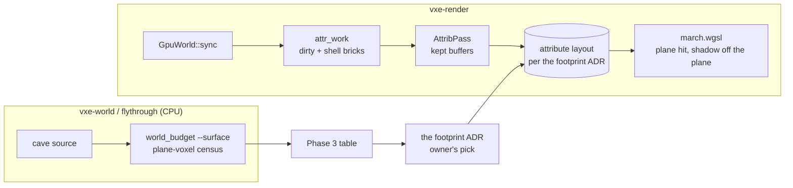

# 0013: Contour as the fly-through's default: the shadow-ray origin, a streamed footprint under 3 GB, and a weaker rock detail

> **Status:** in-progress
> **Created:** 2026-10-16
> **Milestone:** M2 in `docs/roadmap.md` (the surface follow-up before the lighting plan)
> **Related ADRs:** [ADR-0011](../adrs/0011-contour-planes-in-attribute-pages-with-procedural-detail.md)
> (the decision this plan finishes: the shadow-ray rule and the footprint are owed here),
> [ADR-0004](../adrs/0004-palette-narrowed-sharded-brick-pool.md) (the shards, and the growth
> rule that makes §3 a reading of allocated bytes), ADR-0003 (the residency radii). The
> footprint ADR is [ADR-0012](../adrs/0012-mask-first-brick-with-per-brick-palette-planes.md)
> (the final, surface-only form; "the footprint ADR" below), and
> [ADR-0013](../adrs/0013-mirror-reserves-its-vram-budget-up-front.md) sets how §3 is read.
> **Prerequisite:** Plan 0005 closed (done). Independent of Plans 0003, 0004 and 0006.
> Phase 5 also needs [Plan 0017](done/0017-mirror-budget-reservation-page-kinds-and-pressure.md)
> merged into this plan's branch (the owner's call, 2026-10-18).
> **Amended:** 2026-10-18, after Phase 3, from the owner's answers: Phase 4 is met by the
> owner's pick of D at 14,24 (2026-10-17, `docs/decisions-pending.md` (answered and deleted; read it with `git show 880982c:docs/decisions-pending.md`) D1) and by ADR-0012,
> accepted 2026-10-17, which records the footprint's final form (surface-only, a later plan);
> Phase 5 builds D at 14,24 after Plan 0017 lands, its §3 check read as live bytes against
> Plan 0017's reserved budget; Phase 6 may run before Phase 5.
> **Amended:** 2026-10-20, at the Phase 5 stop, from the owner's answer (option c): D at 14,24
> is withdrawn. Phase 5 removes `AttribQuant` and its `--attrib-quant` flag and sets no new
> residency; the attribute footprint moves to ADR-0012's mirror-slot plan (surface-only
> storage). Phase 7 makes contour the default at the existing `RESIDENCY` (16/24), lets Plan
> 0017's pressure rule set `r_full`, and reads §3 as live bytes against the reservation
> (ADR-0013).
> **Source:** Plan 0005's "Follow-up items" (cited below as "follow-up N"): items 1 to 3, the
> streamed attribute-pass reading of item 4, and items 5 to 7. Item 4's baseline readings and
> item 8 are out of scope.

## TL;DR

ADR-0011 chose per-voxel contour planes with procedural rock detail, but the fly-through still
starts in face mode, because contour's shadow ray starts inside neighbouring rock (black lines
and dark specks) and its streamed mirror ran the 8 GiB card out of memory at the default
radius. This plan fixes the shadow-ray origin, measures four ways to shrink the attribute
footprint and builds the one the owner picks (recorded in a new ADR), sets rock's detail
from the owner's eye, and then makes contour plus detail the default. On the way it fixes the
attribute pass's per-call allocation, tests the shell recompute, and reads the attribute pass
under motion. The first thing a reader sees is the speck test turned from a diagnostic into a
gate: contour's only-with-shadows speck count drops from 372 to at most face mode's.
Amended 2026-10-20: the footprint build is deferred to ADR-0012's mirror-slot plan; contour
becomes the default at the existing residency, with Plan 0017's pressure rule keeping live
bytes under the line by shortening the full-detail radius.

## Context & problem

The owner's call at Plan 0005's close (2026-10-16): contour reads best on screen, but its
artifacts come with the shadow ray and vanish with `L` off, and rock detail at `[4.0, 0.3]`
reads "between noise and shadows". ADR-0011 records the decision and two rules it leaves to
this plan: the shadow ray leaves a plane hit along the plane normal, and the streamed footprint
fits the 8 GiB dev card and `nfr.md` §3's 3 GB line.

The footprint figures (`nfr.md` §3, "Attribute pages"): each `Full` brick of a full chunk costs
1040 B more live (two 512 B attribute slots and two 8 B mask entries), and an attribute page
holds 1364 bricks in 4096 slots. Streamed at r_full 16, r_lod 24, the contour mirror reached
3 309 723 820 B live and 4 103 413 164 B allocated at full residency, against Plan 0002's
1 603 820 012 B live and 1 675 304 748 B allocated in face mode, then stopped on
`wgpu error: Out of Memory`. The live difference, 1 705 903 808 B, is 1 640 292 bricks at
1040 B. Face mode already peaks at 2 431 425 836 B allocated under motion (buffers grow by half
again and never shrink, ADR-0004 Outcome), which leaves about 0.57 GB of allocated headroom
under the 3 GB line for attributes. At the same growth ratio (peak allocated over live, about
1.44 in face mode) that is about 0.39 GB of attribute bytes live, about 240 B per brick against
1040 today. That target is arithmetic on two readings, not a measurement.

The consumer requirement is `project-context.md`'s rendering bar (smooth natural rock at 10 cm,
one material id per voxel). The `nfr.md` figures touched are §2 (primary rays, streaming line)
and §3 (world VRAM).

## Decision

We finish ADR-0011 in seven phases. The shadow ray of a plane hit leaves the plane point along
the plane normal (a cube hit keeps the face normal), which leaves every non-contour golden byte
for byte. The footprint is chosen by measurement among four candidates, each costed from a CPU
census of the streamed world and, for the two lossy ones, by emulating their precision in the
existing layout and running Plan 0005's look metrics:

- **A, surface voxels only:** a 64 B plane mask per brick plus 2 B per voxel that has a plane;
  lossless.
- **B, an 8-bit code per voxel:** octahedral 3 + 3 bits and a 2-bit offset (`-3/8`, `-1/8`,
  `1/8`, `3/8` voxel); 520 B per brick with its mask entry.
- **C, one plane per 2 x 2 x 2 block:** 64 `u16` per brick, 128 B; every solid voxel of a block
  that holds a surface voxel uses the block's plane, a block with none reads `NO_PLANE`.
- **D, a smaller `r_full`:** 12 or 14 chunks with the current layout; lossless, but the
  full-detail radius drops from 102 m to 77 m or 90 m against §3's "about 100 m".

A combination (A with B's code, say) is a fifth row if the census shows no single candidate
fits. The owner picks at Phase 4 from the table; the footprint ADR records the pick and the
rejected rows, because by construction there are rejected alternatives, and because A, B and C
change the attribute-page layout ADR-0011 recorded. ADR-0011 is not edited; the footprint ADR
states which of its clauses it supersedes.

Rejected here: choosing the footprint now without the census (the surface-voxel fraction of the
cave is not measured, and A's cost depends on it); raising the 3 GB line (the owner kept it,
and the baseline card has 6 GB); fixing the black lines by turning shadows off in contour mode
(the owner wants the lamp's shadows).

## Architecture diagram



## Implementation phases

Each phase ships as its own commit. `dev` implements all phases in one session with no review
between phases, stopping at the two `human` phases. The architect reviews once at the end, in a
fresh session. Phase 1 is the walking skeleton.

Shared conventions:

- **Goldens.** `primary.png`, `headlamp.png`, `lod.png`, `look_trilinear8.png`,
  `look_gradient27.png` and `look_detail.png` stay byte for byte in every phase.
  `look_contour.png` is reblessed on lavapipe in Phase 1 and, only for a lossy footprint, in
  Phase 5. The look tests pin rock detail to a test-local `SPIKE_ROCK_DETAIL = [4.0, 0.3]` from
  Phase 1 on, so Phase 7's new default moves no golden.
- **Readings.** Timings on the RTX 3080 Laptop GPU under the exclusive perf lock, with the
  1-minute load average read by `uptime` before and after; a timing taken with the load at 2 or
  above is recorded as diagnostic, not as a reading. Bytes are read from `mirror_bytes` and
  `allocated_bytes`.
- **The streamed run** is `flythrough --autopilot --headless --look contour` on the unbounded
  cave seed 1 (`--residency R_FULL,R_LOD` from Phase 3 on; default 16,24), which prints its
  peak live and allocated bytes and ends with the `return: 2 chunks, hash match` line.

### Phase 1: The shadow ray leaves the plane
- **Owner skill:** dev
- **What:** `shade` offsets a plane hit's shadow ray along the plane normal; the speck count
  becomes an asserting test; the `detail` comment is rewrapped (follow-up 1 and 7).
- **Files touched:** `crates/vxe-render/src/shaders/march.wgsl`,
  `apps/flythrough/tests/look.rs`, `apps/flythrough/tests/golden/look_contour.png`.
- **Done when:**
  - In `Contour` mode a hit on a voxel's plane starts its shadow ray at `p + n_plane * 0.5`
    voxel; a cube hit (interior voxel, uniform brick, mip cell) and every other mode keep
    `p + n_face * 0.5`. If 0.5 does not meet the next bullet, the log records the counts at
    0.5, 0.75 and 1.0 voxel and the smallest offset that does is kept; if none does, the phase
    stops with the three counts.
  - `contour_dark_specks_with_and_without_shadows` is no longer `#[ignore]` and asserts, on
    the contour golden scene (carved world, `scene_camera`, headlamp, 320 x 180, llvmpipe),
    that contour's only-with-shadows count is at most face mode's in the same run (372 against
    174 at Plan 0005's close); the log records both counts.
  - `look_contour.png` is reblessed on lavapipe; the six goldens named above stay byte for
    byte; `contour_planes_cut_the_silhouette_and_normal_errors` still reads 7.41 degrees and
    32 px (the shadow ray moves no hit or normal).
  - The `detail` comment in `march.wgsl` reads as whole sentences wrapped at 100 columns.

### Phase 2: The attribute pass keeps its buffers, and the shell path is tested
- **Owner skill:** dev
- **What:** `AttribPass` owns its uniform, work buffer and bind group and grows the work buffer
  on demand; a headless readback test covers the boundary recompute when a neighbour chunk
  arrives or leaves (follow-up 5 and 6).
- **Files touched:** `crates/vxe-render/src/{attrib.rs, gpu_world.rs}`,
  `crates/vxe-render/tests/mirror.rs`.
- **Done when:**
  - `AttribPass` creates its work buffer at first use, rebuilds it (to the next power of two
    of the item count, at least 256 items) only when a list outgrows it, and rebuilds the bind
    group only when the work buffer or a shard buffer is replaced. A test encodes a 46-item list
    1000 times and then a 2777-item list once (Plan 0005's two carve sizes) and reads
    `AttribPass::buffer_builds() == 2`; the attributes it writes equal the per-call version's,
    checked by the existing layout and floor readback tests unchanged.
  - `a_neighbour_chunk_arriving_and_leaving_recomputes_the_shell`: chunk `(0, 0, 0)` is rock
    except an air voxel at `(60, 4, 4)`, so its brick `(7, 0, 0)` is `Full`; with chunk
    `(1, 0, 0)` absent, voxel `(63, 4, 4)` reads a plane whose decoded normal has `x > 0.9`
    (its `x = 64` neighbours are air and nothing else in its 3 x 3 x 3 stencil is); after
    `(1, 0, 0)` is mirrored as solid rock and `update_attrs` runs, it reads `NO_PLANE` (all six
    face neighbours solid); after `(1, 0, 0)` is evicted and `update_attrs` runs, it reads the
    `+x` plane again. If the eviction half fails, the fix to `attr_work` lands in this phase and
    the log says so.

### Phase 3: The footprint census and the candidates
- **Owner skill:** dev
- **What:** a CPU census of plane voxels at the streamed residency, the four candidates costed
  from it, and the lossy two emulated in the existing layout for the look metrics (follow-up 2,
  the measurement).
- **Files touched:** `apps/flythrough/examples/world_budget.rs`, `apps/flythrough/src/main.rs`
  (`--residency`), `crates/vxe-render/src/{attrib.rs, shaders/attrib.wgsl}` (an `AttribQuant`
  parameter: `None`, `Code8`, `Block2`), `apps/flythrough/tests/look.rs`.
- **Done when:**
  - `world_budget --stream R_FULL,R_LOD --surface` prints, for the `Full` bricks of full
    chunks, the brick count, the plane-voxel count (solid voxels with at least one air face
    neighbour, neighbours read from the source across chunk edges; an upper bound on the
    shader's planes, which also drop vanishing gradients), the plane voxels per brick as a
    histogram in 32-voxel bins, and the count of 2 x 2 x 2 blocks holding one. At 16,24 its
    brick count times 1040 is within 1 % of the 1 705 903 808 B live rise Plan 0005 read.
  - The log carries a table with one row per candidate (current, A, B, C, D at 12,24 and
    14,24, and a combination row if no single row fits): attribute bytes live at the streamed
    residency from the census, total mirror live (Plan 0002's face figure at that residency
    plus the attribute bytes), an allocated estimate at 1.44 times live (labelled a guess),
    cavity normal error and pillar silhouette error on lavapipe, and the added per-hit work in
    words (A: a popcount over the brick's mask prefix; B, C: none). A and D reuse the current
    metrics (7.41 degrees, 32 px), being lossless.
  - `AttribQuant::Code8` and `Block2` are reachable only from the look tests and the
    fly-through's `--attrib-quant` flag; `None` leaves every attribute byte unchanged (the
    layout tests pass as they are).

### Phase 4: The owner's footprint call
- **Owner skill:** human
- **What:** the owner picks a row of the Phase 3 table, after an on-screen look at the lossy
  rows (`--level --seed 1 --look contour --attrib-quant code8|block2`) if one is a contender;
  the architect then writes the footprint ADR from the table and the pick.
- **Files touched:** this plan's `## Implementation log`.
- **Done when:** the log names the chosen row and the owner's reason in one or two sentences,
  and the footprint ADR is accepted. Phase 5 does not start before both.
- **Met (amendment, 2026-10-18):** the owner chose **D at 14,24** on 2026-10-17
  (`docs/decisions-pending.md` D1): lossless, no layout change to undo later; the final
  surface-only form (row A) comes with ADR-0012's mirror-slot plan. ADR-0012 is the footprint
  ADR and was accepted 2026-10-17. `dev` writes the Phase 4 log row with this pick and reason
  when the branch next merges main.
- **Revised (amendment, 2026-10-20):** the owner withdrew D at 14,24 at the Phase 5 stop and
  chose option (c): no new residency here, the footprint in ADR-0012's mirror-slot plan.
  Since Plan 0015's masks a slot costs 584 B and an attribute brick 1168 B (520 and 1040 B
  when D was costed), and the Phase 5 probe at 14,24 read pressure 0.911 at full residency,
  over the 0.9 trigger, so the rule moved the radius anyway (the resume notes).

### Phase 5: The chosen footprint: retire the precision emulation, no new residency
- **Owner skill:** dev
- **Starts after:** main is merged into this plan's branch (done at af4dc02, with Plans 0015,
  0017 and 0021).
- **What:** amended 2026-10-20 (option c). `AttribQuant`, `AttribPass::set_quant`,
  `GpuWorld::set_attrib_quant`, the shader's `params.quant` branch and the fly-through's
  `--attrib-quant` flag are removed; the full attribute (ADR-0011's `u16` per voxel in
  attribute pages, 1168 B per `Full` brick of a full chunk since Plan 0015's masks) is the
  only path. No residency, budget or layout changes: `flythrough::RESIDENCY` stays 16/24 with
  hysteresis 1, and the footprint belongs to ADR-0012's mirror-slot plan.
- **Files touched:** `crates/vxe-render/src/{attrib.rs, gpu_world.rs, shaders/attrib.wgsl}`,
  `apps/flythrough/src/main.rs`, `apps/flythrough/tests/look.rs`, `docs/nfr.md`.
- **Done when:**
  - `grep -rn "AttribQuant\|attrib_quant\|attrib-quant\|params.quant" crates apps README.md`
    finds nothing; `contour_metrics_at_each_attribute_precision` is deleted (its lossless row
    is the next bullet's test); `flythrough --attrib-quant none` exits with `unknown argument`;
    `flythrough::RESIDENCY` and `STREAM_MIRROR_BUDGET` are unchanged.
  - `contour_planes_cut_the_silhouette_and_normal_errors` passes and the log records its
    readings on lavapipe: 7.38 degrees and 32 px, the figures re-derived on the merged tree
    (Phase 1's 7.41 degrees predate the merge of main). `look_contour.png` stays byte for
    byte, and so do the six goldens named under Shared conventions.
  - Phase 2's shell test (`a_neighbour_chunk_arriving_and_leaving_recomputes_the_shell`) and
    `mirror.rs`'s attribute-page tests pass unchanged, among them the assertion of
    `2 * (SLOT_BYTES + MASK_BYTES)`, 1168 B, per attribute-page brick.
  - The level's live mirror with contour (`flythrough --level --headless --seed 1 --look
    contour --frames 3`, dev box) reads 680 491 136 B: the face level's 232 436 992 B
    (`level_mirror.rs`, material rows included) plus 1168 x 383 608 = 448 054 144 B. The log
    records the printed figure; §3's "Attribute pages" paragraph carries it as a reading with
    machine and commit, beside Plan 0005's 1040 B and 606 633 408 B.

### Phase 6: Rock detail on screen
- **Owner skill:** human
- **What:** the owner sets rock's detail strength by eye on the contour level (follow-up 3).
  It reads nothing Phase 5 changes, so it may run on the branch before Phase 5 (amendment,
  2026-10-18); Phase 7 still waits for both.
- **Files touched:** this plan's `## Implementation log`.
- **Done when:** after `cargo run --release -p flythrough -- --level --seed 1 --look contour
  --rock-detail 4,S` at `S` = 0.1, 0.15 and 0.2 (and at scale 8 if the owner asks), judged at
  arm's length from a carved wall and at 5 m from a cavern wall, the log records the chosen
  `[scale, strength]` and the reason in one sentence.

### Phase 7: Contour plus detail as the default, and the streamed readings
- **Owner skill:** dev
- **What:** `ROCK_DETAIL` takes the owner's pair; the fly-through starts in contour with detail
  on and the attribute layout, at the existing `RESIDENCY` (16/24) and the default reservation;
  Plan 0017's pressure rule sets `r_full` (amended 2026-10-20: no residency cap and no new
  default radius). The attribute pass is read under motion (follow-up 3 and the streamed half
  of follow-up 4).
- **Files touched:** `apps/flythrough/src/{lib.rs, main.rs}`, `README.md` (the fly-through's
  flags), `docs/nfr.md`.
- **Done when:**
  - `cargo run --release -p flythrough` with no flag prints `look contour, detail on (rock
    scale X, strength Y), view shaded` with the Phase 6 pair; `--look MODE` still picks the
    starting mode, and `--look plain` gives face mode without attribute data, so Plan 0002's
    and Plan 0017's face readings stay reproducible.
  - The streamed run, now without `--look`, at the default `RESIDENCY` and the default 3 GiB
    reservation, twice under the exclusive perf lock with the 1-minute load stated: each run
    ends `return: 2 chunks, hash match` with no wgpu error and no out-of-memory stop; peak
    live bytes stay under §3's 3 000 000 000 B and peak live over the budget under 0.95
    (ADR-0013: allocated bytes equal the reservation by construction and are not the
    reading); the longest deferral streak is at most 90 syncs with no empty sync (Plan
    0017's stall bar). The rule acts as it will; the log records each radius change with its
    tick and pressure, the lowest and the final `r_full`, and peak pressure with its slot and
    record terms. Plan 0017's contour rows (the same mirror bytes) read 16 to 12 and peak live
    0.8894 of the budget, about 2.86 GB. An `r_full` under 12 (76.8 m) in either run stops
    the phase: hand back to the architect with the readings.
  - The streamed run prints per frame the attribute pass's GPU time (timestamps) and
    work-list length, and the render thread's CPU time in `attr_work`; the log records p50,
    p99 and max of each over the flight, against the proposals under "Budgets".
  - The log records the 1080p march (median of the last 30 of 300 frames, three runs) of the
    default look at the level's spawn and at the streamed spawn; `nfr.md` §2 carries them, and
    §3 carries the streamed peak live, budget and settled `r_full` of the default look, all as
    dev-reference readings. §3 states that the default look holds full detail to the radius
    the rule settles at (76.8 to 83.2 m at Plan 0017's readings) against the line's "about
    100 m" until ADR-0012's mirror-slot plan, and that `--look plain` holds 16 (102 m).

## Data shapes

```rust
// illustrative: vxe-render
pub struct AttribPass {
    pipeline: wgpu::ComputePipeline,
    layout: wgpu::BindGroupLayout,
    uniform: wgpu::Buffer,                 // kept
    work: Option<(wgpu::Buffer, usize)>,   // capacity in items, grows by powers of two
    bind: Option<wgpu::BindGroup>,         // rebuilt when `work` or a shard is replaced
    builds: u32,                           // buffer_builds(), for the test
}
pub enum AttribQuant { None, Code8, Block2 } // Phase 3 only, removed in Phase 5
```

```text
Footprint candidates, per Full brick of a full chunk (current: 2 x 512 B + 2 x 8 B = 1040 B):
  A  64 B plane mask + 2 B x planes          lossless, layout per the footprint ADR
  B  512 B (u8: oct 3+3, offset 2) + 8 B     lossy
  C  128 B (u16 per 2x2x2 block)             lossy
  D  1040 B at r_full 12 or 14               lossless, smaller full-detail radius
```

No new external dependency.

## Budgets

| `nfr.md` figure | Expected effect | How the close measures it |
|---|---|---|
| §3 world VRAM (3 GB; after Plan 0017, live bytes against the reserved budget) | Amended 2026-10-20: no layout or residency change in this plan. Contour at the default 16/24 under the 3 GiB reservation (3 220 387 776 B) read in Plan 0017 (b474737): peak live 0.8894 of the budget (about 2.86 GB), peak pressure 0.9114, `r_full` 16 to 12 by the rule (full detail 76.8 to 83.2 m against "about 100 m"). The level with contour: 680 491 136 B live (232 436 992 + 1168 x 383 608), Plan 0017 Phase 1's reading. The footprint that would hold `r_full` 16 (ADR-0012 row A, 220 385 388 B of attributes at 16,24 by Phase 3's census, before Plan 0015's masks; a census figure, not a reading) is the mirror-slot plan's | Phase 5's level reading; Phase 7's two streamed runs: `mirror_bytes`, `pressure()`, radius changes |
| §2 primary rays (3.0 ms, 1080p, baseline) | Contour with detail read 2.068 to 2.069 ms at the level on the dev box (Plan 0005); Phase 1 changes only the shadow origin, A adds a popcount per candidate voxel: under 0.1 ms is a guess | Phase 7, `--level --render 1920x1080 --frames 300` and the streamed spawn |
| §2 streaming line (1.0 ms render-thread CPU, a recorded miss) | `attr_work` adds CPU on every frame a chunk arrives or leaves; unread | Phase 7, per-frame `attr_work` CPU, p50/p99/max |
| Attribute pass (no `nfr.md` figure yet) | Proposal: under 1.0 ms of GPU per frame at p99 under motion at 10 m/s (a guess; Plan 0005 read 39.6 to 55.0 ms for the level's first fill and 0.020 ms for a 1 m carve) | Phase 7, timestamps around the pass |

The baseline GPU is not on hand; every figure is a dev-reference reading and says so.

## Risks & open questions

- **No candidate fits alone.** B halves the attribute and still overruns; A's fit depends on a
  surface fraction nobody has measured; C is the smallest but loses detail at 2-voxel
  features; D gives up radius. The combination row exists for this; if even that misses, the
  phase records it and the owner chooses between a radius and the allocation growth rule
  (ADR-0004's never-shrink buffers are the other half of the 2.43 GB face peak). Resolved
  2026-10-18: D at 14,24 behind Plan 0017's reservation; the risk left is that the flight's
  peak live at 14 passes Plan 0017's 0.9 pressure line and the rule drops the radius, which
  Phase 5's first done-when catches. Amended 2026-10-20: it did (pressure 0.911 at 14,24), and
  the owner moved the footprint to ADR-0012's mirror-slot plan.
- **The default look gives up full-detail radius.** With contour on by default the rule
  settles at `r_full` 12 or 13 (76.8 to 83.2 m) where face mode holds 16 (102 m): §3's bytes
  hold, its "about 100 m" does not, until the mirror-slot plan. Phase 7 states it in §3, and
  an `r_full` under 12 stops the phase. Plan 0017's page-fragmentation deferrals (at pressure
  under 0.9 with attribute pages) come with the default too; its 90-sync stall bar applies.
- **A needs variable-size storage.** A brick's plane count changes with every edit, so A means
  a sub-slot allocator inside the pool. Amended 2026-10-20: that allocator is ADR-0012's
  mirror-slot plan's, not this plan's.
- **The 0.5-voxel shadow offset** may still land in a neighbouring voxel's solid half-space at
  grazing angles. Phase 1's offset ladder bounds the search; a remaining speck excess goes to
  the owner's eye rather than to a larger offset that detaches shadows.
- **Lavapipe and the level.** Four 128 MiB shards hold 349 184 attribute-page bricks against
  the level's 383 608, so level-size contour readings stay dev-box only unless the chosen
  layout fits. Amended 2026-10-20: no layout changes here, so they stay dev-box only (282
  attribute pages, 1 155 072 slots, against four 128 MiB shards' 1 048 576).
- **The default flips the fly-through's readings.** Plan 0002's figures were taken in face
  mode without attribute pages; `--look plain` keeps them reproducible, and the readings in
  `nfr.md` name their look.
- **Determinism** is untouched: everything here is render-side, and the census reads the world
  without changing it.

## What this plan does NOT do

- **Baseline-GPU readings** of any mode (follow-up 4's other half): M2's close.
- **A least-squares plane fit, or planes on mip cells** (follow-up 8): later, if the eye asks.
- **The streaming-CPU plan and the march-pass diagnosis spike** (`nfr.md` §2's recorded
  misses): their own plans.
- **Lighting, denoising, upscaling**: the lighting plan.

## Implementation log

> Written by `dev`: one row per phase as its commit lands, then the close block. **The phases
> above are the contract. This section records what happened.** Observations, never conclusions:
> no pass list, no self-assessment. Deviations and unmet done-whens are **always** disclosed.
> Keep it shorter than `## Implementation phases`.

| phase | owner | state | commit |
|---|---|---|---|
| 1: The shadow ray leaves the plane | dev | done: offset 0.5 voxel along the plane normal kept; only-with-shadows specks contour 52 (347 with, 301 without) against face 174 (1179, 1017), llvmpipe 320 x 180; contour metrics 7.41 degrees, 32 px; `look_contour.png` reblessed on llvmpipe (24.34 % of pixels differ from `headlamp.png` by more than 8/255), other goldens unchanged; look tests pin rock to `SPIKE_ROCK_DETAIL` | 82b19b8 |
| 2: The attribute pass keeps its buffers, and the shell path is tested | dev | done: `AttribPass` keeps its uniform, a work buffer (next power of two, at least 256 items) and its bind group; 46 items x 1000 then 2777 read `buffer_builds() == 2`, capacity 256 then 4096, attribute bytes equal to a fresh mirror's pass; the shell test failed on its first state (east absent read `NO_PLANE`) until the chunk table was created filled with `ABSENT`; arrival and eviction halves pass with `attr_work` unchanged | 9ffa2a5 |
| 3: The footprint census and the candidates | dev | done: `world_budget --stream R_FULL,R_LOD --surface`, `--residency`, `--attrib-quant`, `AttribQuant` (`None` writes the full attribute: layout and floor tests unchanged, contour metrics 7.41 degrees, 32 px); at 16,24 the census reads 1 640 292 bricks, x 1040 = 1 705 903 680 B against the 1 705 903 808 B rise (-0.000 %); table below | d75a0af |
| 4: The owner's footprint call | human | done: D at 14,24, chosen 2026-10-17 (`docs/decisions-pending.md` D1): lossless, no layout change to undo later; the final surface-only form comes with ADR-0012's mirror-slot plan; ADR-0012 accepted 2026-10-17; withdrawn 2026-10-20 at the Phase 5 stop for option (c), the footprint to ADR-0012's mirror-slot plan (amendment 688b3ed) | |
| 5: The chosen footprint: retire the precision emulation, no new residency | dev | done: `AttribQuant`, `set_quant`, `set_attrib_quant`, `params.quant` and `--attrib-quant` removed (the grep finds nothing; `--attrib-quant none` exits 2 with `unknown argument --attrib-quant`); `RESIDENCY` and `STREAM_MIRROR_BUDGET` unchanged; contour 7.38 degrees, 32 px on llvmpipe; goldens byte for byte; `--level --headless --seed 1 --look contour --frames 3` reads 680 491 136 B live (RTX 3080 Laptop GPU, perf lock, load 3.47) | committed with this row |
| 6: Rock detail on screen | human | done, ahead of Phase 5: `[4.0, 0.1]`; of `--rock-detail 4,S` at S = 0.1, 0.15, 0.2 and 0.3 (today's default) on `--level --seed 1 --look contour --detail`, the owner judged 0.1 best (2026-10-18) | |
| 7: Contour plus detail as the default, and the streamed readings | dev | not started | |

### Footprint candidates (Phase 3)

Census: `world_budget --stream R,24 --surface --seed 1` (this phase's commit), unbounded
cave seed 1, CPU only. At 16,24: 17 077 full chunks, 1 640 292 `Full` bricks, 57 703 350 plane
voxels (35.2 per brick, 6.87 % of their voxels), 20 123 752 of 104 978 688 2 x 2 x 2 blocks
holding one (19.17 %); bricks by plane voxels: 0..31 44.12 %, 32..63 37.58 %, 64..95 18.29 %,
96..127 175 bricks, 128..159 2 bricks. At 12,24: 682 400 bricks, 23 899 197 plane voxels;
at 14,24: 1 109 349 bricks, 39 015 306. The face mirror at each residency is the census
formula's (at 16,24 it equals Plan 0002's 1 603 820 012 B; 12,24: 1 253 834 532 B;
14,24: 1 409 664 492 B). Metrics: contour on llvmpipe, 320 x 180,
`contour_metrics_at_each_attribute_precision`.

| row | attribute B live | mirror B live | allocated x 1.44 (guess) | allocated x 1.93 (guess) | cavity normal error (deg) | pillar silhouette error (px) | added per-hit work |
|---|---|---|---|---|---|---|---|
| current, 16,24 | 1 705 903 680 | 3 309 723 692 | 4.77 GB | 6.38 GB | 7.41 | 32 | none |
| A, 16,24 | 220 385 388 | 1 824 205 400 | 2.63 GB | 3.52 GB | 7.41 | 32 | a popcount over the brick's mask prefix |
| B, 16,24 | 852 951 840 | 2 456 771 852 | 3.54 GB | 4.74 GB | 14.71 | 40 | none |
| C, 16,24 | 209 957 376 | 1 813 777 388 | 2.61 GB | 3.50 GB | 5.50 | 44 | none |
| D, 12,24 | 709 696 000 | 1 963 530 532 | 2.83 GB | 3.79 GB | 7.41 | 32 | none |
| D, 14,24 | 1 153 722 960 | 2 563 387 452 | 3.69 GB | 4.94 GB | 7.41 | 32 | none |
| A at 14,24 | 149 028 948 | 1 558 693 440 | 2.24 GB | 3.01 GB | 7.41 | 32 | as A |
| C at 14,24 | 141 996 672 | 1 551 661 164 | 2.23 GB | 2.99 GB | 5.50 | 44 | none |
| A at 12,24 | 91 471 994 | 1 345 306 526 | 1.94 GB | 2.59 GB | 7.41 | 32 | as A |
| C at 12,24 | 87 347 200 | 1 341 181 732 | 1.93 GB | 2.59 GB | 5.50 | 44 | none |

D at 12,24 measured, current layout: `flythrough --autopilot --headless --look contour
--residency 12,24 --seed 1`, NVIDIA GeForce RTX 3080 Laptop GPU, exclusive lock, 1-minute
load 12.29 before and 14.88 after. Full residency 7 153 full and 50 624 LOD-only chunks,
1 963 530 660 B live, 2 789 252 524 B allocated; flight peak 2 128 118 260 B live,
4 103 413 164 B allocated; `return: 2 chunks, hash match`, no wgpu error. The x 1.93 column
is that run's peak allocated over peak live (1.928), applied to every row; the x 1.44 column is
the plan's face-mode ratio. Both are guesses for A, B and C, whose layouts are not built.

### Notes

_(Deviations from the plan, with the commit, stated without justification. Done-whens not
satisfiable as stated, and what was done instead. Followups noticed and not acted on. One line
each. Empty is fine.)_

- Phase 2: the GPU chunk table was created zero-filled while `table_cpu` starts `ABSENT`, and
  `flush_table` writes only changed entries, so a window entry no chunk ever took read as
  record 0 (in the attribute pass and the marcher). `GpuWorld::with_config` now creates it
  filled with `ABSENT` (gpu_world.rs). No golden moved.
- Phase 2: `GpuWorld` keeps a clone of the queue its first `sync` was given and writes the
  pass's uniform and work list through it; `AttribPass::encode` takes `&mut self` and a
  `queue`; at most one encoded pass per `queue.submit` (documented on `encode`).
- Phase 2: the bind group is also rebuilt when the record or table buffer is replaced (they
  are bound too), and `GpuWorld` drops it when it replaces a shard or the record buffer.
- Phase 3: `GpuWorld::set_attrib_quant` added in `crates/vxe-render/src/gpu_world.rs`, which
  Phase 3's Files touched does not name.
- Phase 3: the table has four combination rows (A and C at 14,24 and 12,24) because no row at
  16,24 is under 3.0 GB in the x 1.93 column; at x 1.44, A, C and D at 12,24 are.
- Phase 3: D at 12,24 measured 4 103 413 164 B peak allocated under motion against its
  2.83 GB guess (the same allocated figure as Plan 0005's 16,24 run at its out-of-memory stop).
- Merge of main (af4dc02): `release_attrib_bindings` and `AttribPass::release_bindings`
  removed with the grow paths they served; the branch's `--residency` dropped for main's;
  `look_contour.png` reblessed on llvmpipe from the merged tree; the contour metric reads 7.38
  degrees (7.41 before the merge). Resolutions are in the merge commit's body.
- Phase 5 stopped at e574898 on its first done-when (14,24 read pressure 0.911 at full
  residency and the rule lowered `r_full` to 12); the plan was amended at 688b3ed (option c).
- Phase 5: `world_budget --surface` (Phase 3's census) stays; it never used `AttribQuant`.

### Close triggers

_(Facts for the architect. No recommendations, and no suggested version bump.)_

- **What shipped:**
- **Public API changed:**
- **Budget readings:**
- **Gate at the tip:**
- **Outstanding `human` phases:**

## Followups

- Baseline-GPU readings of the default look (M2's close).
- A least-squares plane fit and planes on mip cells, if the eye asks (Plan 0005 follow-up 8).
- The contour attribute's footprint (amendment, 2026-10-20): surface-only attribute storage in
  size-classed slots, so the default look holds `r_full` 16 under the 3 GB line. ADR-0012's
  mirror-slot plan (not yet numbered; `docs/plans/README.md`).
