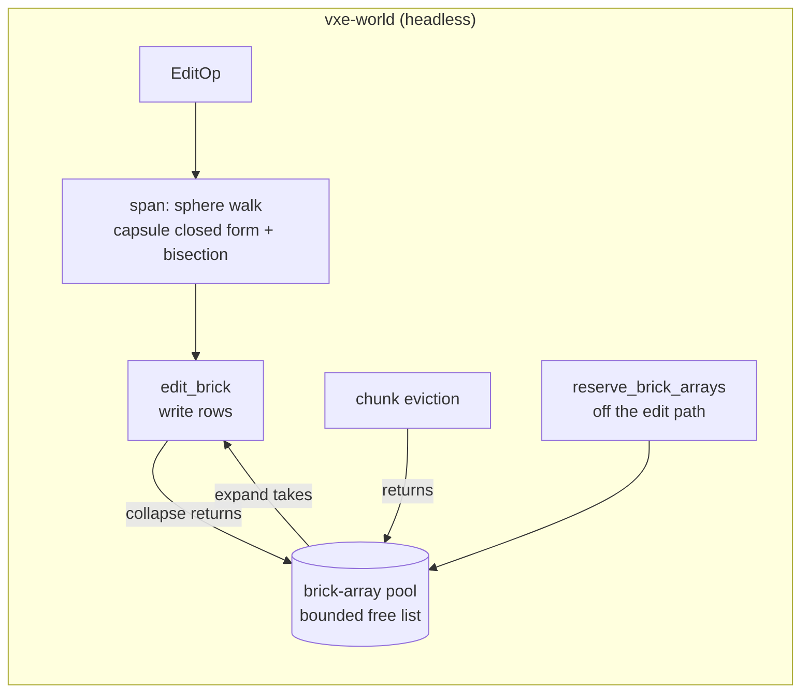

# 0014: Edit cost under 2 ms, second pass: the allocation measured, a brick-array pool, cheaper sphere spans and an analytic capsule row

> **Status:** in-progress
> **Created:** 2026-10-16
> **Milestone:** M1 follow-up in `docs/roadmap.md` (the `nfr.md` §4 miss, carried from Plans
> 0001 and 0003)
> **Related ADRs:** [ADR-0002](../adrs/0002-brick-map-layout-and-per-chunk-locked-access.md)
> (brick layout and access model, unchanged here: a phase that would change the brick
> representation stops and goes to the architect as an ADR question). No new ADR.
> **Prerequisite:** Plan 0003 closed (its tip is this plan's baseline). `perf` installed on the
> dev box by the owner (`pacman -S perf`; `kernel.perf_event_paranoid` at its current 2 allows
> user-space sampling and fault counts of one's own processes).
> **Amended 2026-10-17**, after `dev` stopped at Phase 3's profile done-when (orchestrator-applied
> under the owner's standing "go with your recommendations"; the owner can overturn it): Phase
> 3's done-when is restated to the measured property, Phases 4 and 5 keep their tests and run
> to the end, and the plan states that it does not reach the 2 ms figure. See "Amendment
> 2026-10-17, after the Phase 1 profile" below.

## TL;DR

Plan 0003 cut the `worst` edit bench from 4.61 to 3.66 ms (read under load 10 to 14) against
the 2 ms figure in `nfr.md` §4, which the owner keeps as the target. Its close breakdown says
where the rest is: `Brick::expand` 36.5 % (almost all in libc under `Box::new`), `write_rows`
22.3 %, `Shape::row_span` 15.4 % with `isqrt` about 10 %, and the capsule's row scan making
`tool` no faster than before. That breakdown came from 260 gdb samples at 30 ms on a loaded
box. This plan measures first, on a quiet box with `perf`, what the allocation cost is
(allocator, the 1 KiB fill, or the first touch of fresh pages), then removes it with a pool of
brick arrays filled off the edit path, replaces the sphere's per-row square root with an exact
span walk, gives the capsule an analytic row interval, and adds the oracle run the Uniform
expand path was missing. The first thing a reader sees is the oracle on a world of uniform
bricks, then a profile that names the allocation's parts.

## Context & problem

`nfr.md` §4: 100 sphere carves of radius 1 m (4169 voxels each) in one frame at most 2 ms of
CPU, results and dirty marking included. Plan 0003's readings (AMD Ryzen 9 5900HS, the dev
box, release bench profile, exclusive perf lock): at its tip `worst` 3.656 ms, `mixed`
2.670 ms, `tool` 8.265 ms with the 1-minute load at 10 to 14; its Phase 3 tree read `worst`
3.120 ms on a quieter box. Every Plan 0003 reading after Phase 3 was taken with other sessions
loading the machine, by up to 30 % between runs of one binary, so the gap to 2 ms is not known
to better than about 1 to 1.7 ms.

What the close review found, from Plan 0003's log and code:

- **The allocation.** `Brick::expand` does `Box::new([m; 512])` for every `Uniform` brick a
  carve writes into. The bench builds a fresh solid world per iteration, so every carve
  expands its partial bricks from fresh heap. 35.0 % of `apply`'s samples sat in libc under
  that `Box::new`. A tunable that keeps the heap from being trimmed between iterations moved
  `worst` by about 1.5 %, so the cost is not heap trimming; whether it is the allocator's own
  path, the fill, or first-touch page faults on fresh heap is unmeasured, and the fix differs
  for each.
- **The sphere span.** `row_span` solves `isqrt(r² - dy² - dz²)` once per voxel row of a brick
  row; `isqrt` was about 10 % of `apply`.
- **The capsule row.** A row with no inside centre still scans its whole x window with the
  capsule test, so `tool` (100 capsules of radius 5 and length 30 voxels) read 8.27 ms against
  `worst`'s 3.66 although it carves fewer voxels: about `pi 25 x 30 + 4/3 pi 125 = 2880` voxel
  centres per op against 4169, with the same surface area (`2 pi 5 x 30 + 4 pi 25 = 4 pi 100`),
  so about the same bricks touched.
- **The oracle's blind spot.** `apply_matches_the_reference_over_seeded_ops` runs on a world
  of `hash(v) % 6`, where every brick is `Full`; the `Uniform` expand path, the one the bench
  spends a third of its time in, is checked only by the determinism vector.

The consumer requirement is `project-context.md`'s many small edits per frame at interactive
cost. `nfr.md` §6 (determinism) is the gate: nothing here may move a hash.

## Decision

We keep ADR-0002's representation (`Brick::Uniform(m)` or `Brick::Full(Box<[u16; 512]>)`), the
public API and every result, and change where arrays come from and how spans are found:

1. **Measure first** (Phase 1): `perf` at about 5 kHz on the three bench cases and a
   micro-bench that separates allocator, fill and first touch, plus page-fault counts.
2. **A brick-array pool** (Phase 2): the world keeps a bounded free list of boxed arrays.
   `expand` takes one from it, `collapse` and chunk eviction return theirs, and
   `World::reserve_brick_arrays(n)` tops it up off the edit path (the caller's choice of
   thread; the fly-through calls it after each frame's edits and the streaming workers after
   generation). The arrays keep their type, so the brick representation does not change. An
   empty pool falls back to `Box::new`, so correctness never depends on it.
3. **An exact span walk for the sphere** (Phase 3): each row's span starts from the previous
   row's ends and steps by squared-distance comparisons, with `isqrt` only for a brick row's
   first row.
4. **An analytic capsule row** (Phase 4): the row's nearest lattice point to the segment from
   the closed form, then each end found by bisection with the capsule test, so a row with no
   inside centre costs two tests.

We rejected a slab or arena with index handles (`Full(u32)` into a world-owned array store):
that changes ADR-0002's representation and every reader of a brick, and it is an ADR question
if Phase 1 shows the pool cannot reach the figure. We rejected `f64` square roots (`edit.rs`
and `shape.rs` stay integer). We rejected SIMD and threading one op across bricks for Plan
0003's reasons, which still hold.

## Amendment 2026-10-17, after the Phase 1 profile

Made during implementation, after `dev` stopped at Phase 3's profile done-when on branch
`plan-0014` (tip `2c9794f`; every reading cited here is in the Implementation log's Notes and
Close triggers there). Applied by the orchestrator under the owner's standing "go with your
recommendations" while the owner was away; it is a recommendation the owner can overturn, and
overturning it changes only the done-whens below, not the code already written. The owner asked
to measure first and decide by the numbers; this amendment follows the numbers.

### 1. What the profile showed, and why this plan does not reach 2 ms

**The `nfr.md` §4 target of 2 ms is not reached by this plan.** The Budgets row assumed
`Brick::expand` was 36.5 % of `worst` (Plan 0003's gdb samples on a loaded box) and that the
pool would remove about 1.2 ms of it. Phase 1's quiet-box `perf` profile, inclusive shares of
the samples inside `World::apply` for `worst`: `write_rows` 54.2 %, span work 24.9 % (`isqrt`
12.5 %), `Brick::expand` 5.0 %. The pool (Phase 2) moved `worst` from 3.597 to 3.504 ms and
read `worst_warm` 3.272 ms; the walk (Phase 3) took `worst_warm` from 3.226 to 3.014 ms,
paired. At the Phase 3 tip, the sphere's row solve is 13.2 %, `RowCache::span` 4.7 % and
`Brick::expand` 2.8 % (self) of `worst_warm`'s apply samples. Removing all three entirely
leaves about 3.01 x 0.79 = 2.4 ms, so no lever inside this plan's scope (allocation, spans,
the capsule row) can reach 2 ms. The rest is the row write itself (`write_rows` and
`CarveBits::target`, about 55 to 57 % inclusive), which is bounded by the brick
representation. The baseline projection (1.5 to 2 times the dev box, a guess) puts the
plan's end state at about 4.5 to 6 ms there.

### 2. Phase 3's done-when, restated to the measured property

The under-5 % threshold was set before Phase 1 measured anything; at about 54600 rows per 100
carves it needs about 11 cycles a row, and the walk is about 35 instructions with 0.5 % branch
misses. More span work (option (b) in the stop note) would save at most about a fifth of the
13.2 %, about 0.08 ms, and not change the outcome. Phase 3's second done-when now reads:

- A quiet-box `perf` profile of `worst_warm`, by the Phase 1 harness method, puts the
  sphere's span work (the row solve and what it calls or inlines) at **at most 14 %** of the
  samples inside `World::apply`, down from 19.1 % at Plan 0003's tip by the same method; and
  `worst_warm` reads lower than the Phase 2 tree's in a paired quiet-box run. The first
  done-when (`walked_spans_equal_solved_spans`, spans equal to the solved spans, and Plan
  0003's 1000-row test unchanged) is not relaxed.

The readings at `5850b77` (13.2 %; 3.014 and 3.023 against 3.226 and 3.247 ms) meet it, so
Phase 3 is done as amended with no further code.

### 3. What Phase 4 must still show

Every test-shaped done-when stands: the closed form in `i128`, the floor-or-ceiling minimiser,
at most `2 + 2 ceil(log2(w))` capsule tests a row and 2 for an empty row, Plan 0003's 1000-row
test unchanged, and the new 1000-row capsule-only property test. The reading changes from a
parity gate to the measured property: `tool_warm` reads **at least 10 % below** the Phase 3
tree's `tool_warm` in a paired quiet-box run (the uncommitted draft read 7.897 to 6.707 ms,
15 %, diagnostic), and `worst_warm` is unchanged within the run-to-run spread, since the sphere
path is untouched. The log still records `tool_warm` against `worst_warm` and, since parity is
not expected, the `perf` breakdown of `tool_warm` (top self symbols and the capsule test's
share).

### 4. What Phase 5 must still show

Phase 5 runs in full: the five bench cases paired with Plan 0003's tip, the profile of Phase 1
repeated at the tip (the miss path, now the expected one), the fly-through's three `bench:`
lines with the `carved:` line equal to Plan 0003's, and `nfr.md` §4's readings with machine,
commit and load. §4 records the miss and keeps the 2 ms figure as written: this plan does not
widen it. Then the plan goes to its close.

### 5. Follow-up for the owner: the brick representation

The remaining bulk is `write_rows`. The next lever is the representation (ADR-0002's
`Uniform` or `Full(Box<[u16; 512]>)`): a bitmask or palette brick that writes a carve as word
operations, or arena handles. That supersedes part of ADR-0002 and touches the renderer's
mirror, so it is an ADR question for the owner at this plan's close, alongside the other
choice the plan already names: revising `nfr.md` §4. Neither is decided here.

**Rejected.** (b) More span work before Phase 4: at most about 0.08 ms, and it delays the
capsule row, which the draft shows is worth about 1.2 ms on `tool`. (c) Stopping the plan now
for the representation ADR: Phases 4 and 5 are independent of the representation, their gains
are measured, and the close is where the plan already routes that question.

## Architecture diagram



## Implementation phases

Each phase ships as its own commit. `dev` implements all phases in one session with no review
between phases. The architect reviews once at the end, in a fresh session. Phase 1 is the
walking skeleton: the oracle that guards every later phase, and the measurement that orders
them.

Shared conventions:

- Plan 0003's conventions hold: integer shape math, no `f32` or `f64` in `edit.rs` or
  `shape.rs`, and every phase ends with the oracle tests (Plan 0003's and this plan's),
  `determinism.rs`'s `0x2b6b_6a0d_1f9b_8d75` and `raycast_hit_list_is_pinned`'s
  `0xa0f2_c477_8892_c8fb` green and unchanged. A phase that moves a constant has a defect.
- **A reading is taken on a quiet box:** the 1-minute load average from `uptime` under 2.0
  before and after the run, both recorded with it, under the exclusive perf lock. A run that
  misses that is recorded as diagnostic and does not count against a done-when. Comparisons
  between phases are paired runs of both binaries, alternated, as Plan 0003 did.
- Bench readings name the case, the mean, the confidence interval, the machine, the commit and
  the load.

### Phase 1: The uniform-brick oracle and the allocation measured
- **Owner skill:** dev
- **What:** the oracle on worlds of uniform bricks; a `perf` breakdown of the three cases at
  Plan 0003's tip; a micro-bench that splits the expansion's cost; counts per carve.
- **Files touched:** `crates/vxe-world/tests/edits.rs`, `crates/vxe-world/tests/support/mod.rs`,
  `crates/vxe-world/benches/edits.rs`.
- **Done when:**
  - `apply_matches_the_reference_on_uniform_worlds` runs Plan 0003's 200 seeded ops (same
    seed, shapes, modes and radii) in sequence on two worlds and checks every result, error and
    voxel against `reference_apply`: the bench's cubes world (`material = 1` where
    `((x >> 4) + (y >> 4) + (z >> 4)).rem_euclid(3) != 0`, else air; cube edges at multiples of
    16 voxels align with 8-voxel bricks, so every brick starts `Uniform`) and the solid world
    (`UniformSource(3)` over `[-2, 2)³`). The test asserts that before the first op no brick
    of either world is `Full`, and prints how many ops changed something on each.
  - The log records, at Plan 0003's tip on a quiet box: `perf record -F 4999 -e cycles:u
    --call-graph dwarf` on each of `worst`, `mixed` and `tool`, with the top ten symbols by
    self time inside `World::apply` and their percentages and sample counts; `perf stat -e
    task-clock,page-faults,cycles:u,instructions:u` per case, with user and system seconds.
  - A bench group `expand` times, per 1000 arrays: `Box::new([3; 512])` kept alive (fresh
    heap, as the bench sees it); the same with each box dropped before the next (the
    allocator's hot path); a 1 KiB fill into an existing array; and `Box::new` after the
    heap was pre-touched by allocating and freeing the same total. The log records the four
    means and states which share of `Brick::expand`'s time each explains.
  - The log records, for one `worst` carve and one `tool` carve, the bricks expanded, the
    bricks collapsed, the rows solved and the capsule tests per row, counted by instrumentation
    that is not committed.

### Phase 2: A brick-array pool
- **Owner skill:** dev
- **What:** `BrickArrays`, a bounded free list of boxed arrays owned by the world; `expand`
  takes from it, `collapse` and eviction give back, `reserve_brick_arrays` refills off the
  edit path. If Phase 1 puts the 1 KiB fill above 10 % of `worst`, `expand` also stops
  filling voxels the same brick's spans overwrite (a fused expand and write).
- **Files touched:** `crates/vxe-world/src/{brick.rs, edit.rs, store.rs, stream.rs, lib.rs}`,
  `crates/vxe-world/tests/{edits.rs, stream.rs}`,
  `crates/vxe-world/benches/edits.rs`, `apps/flythrough/src/main.rs` (the per-frame reserve).
- **Done when:**
  - The pool is one `Mutex<Vec<Box<[MaterialId; 512]>>>` in the world, locked at most twice
    per `apply` (take a batch sized by the op's partial-brick bound, return the unused rest
    and the collapsed arrays), with a cap of `World::BRICK_ARRAY_POOL_CAP` arrays (8192, 8 MiB);
    past the cap a returned array is freed. `pool_len()` is public for tests and the HUD.
  - `a_pooled_expand_allocates_nothing`: after `reserve_brick_arrays(4096)`, 100 radius-10
    carves on the solid world run with a counting global allocator in the test and allocate
    no `[u16; 512]`-sized block; the oracle tests and the two constants hold.
  - `an_evicted_chunk_returns_its_arrays`: a chunk with `F` `Full` bricks evicted from a
    residency, with no other holder of its `Arc`, raises `pool_len()` by `min(F, cap - len)`;
    a chunk still held elsewhere returns nothing and is freed as today when the last holder
    drops it.
  - The bench gains `worst_warm` (the `worst` case with `reserve_brick_arrays` called in the
    untimed setup, sized from Phase 1's expansions per carve times 100) and keeps `worst`
    cold. Both read on a quiet box, paired with Phase 1's tree, and the log records them.

### Phase 3: An exact span walk for the sphere
- **Owner skill:** dev
- **What:** `row_span` for the sphere walks from the previous row's ends by squared-distance
  steps; `isqrt` remains for the first row of each brick row and as the test's reference.
- **Files touched:** `crates/vxe-world/src/{shape.rs, edit.rs}`,
  `crates/vxe-world/tests/shapes.rs`.
- **Done when:**
  - `row_span_equals_the_set_of_contained_centres` (Plan 0003's 1000 seeded rows) passes
    unchanged, and a new `walked_spans_equal_solved_spans` asserts, for 200 seeded spheres
    (radius 1 to 40 voxels, centres at arbitrary fixed-point positions within ±64 voxels), that
    every row of every brick row walked in `edit_brick`'s order gives exactly the `isqrt`
    span, including the boundary `|256 x + 128 - cx| == h` inside.
  - A quiet-box `perf` profile of `worst_warm` at this phase puts the sphere's span work
    (`row_span` and what it inlines) under 5 % of the samples inside `World::apply` (15.4 % at
    Plan 0003's close); the log records it. (Amended 2026-10-17: restated as "the share falls
    from 19.1 % to at most 14 %"; see "Amendment 2026-10-17, after the Phase 1 profile" item 2.)

### Phase 4: An analytic capsule row
- **Owner skill:** dev
- **What:** `CapsuleRow` finds the row's lattice point nearest the segment from the closed
  form, returns `None` if that point is outside, and otherwise bisects each end with the
  capsule test.
- **Files touched:** `crates/vxe-world/src/shape.rs`, `crates/vxe-world/tests/shapes.rs`.
- **Done when:**
  - The row along `x` at fixed `(y, z)` is a line, so the real `x` minimising the squared
    distance to the segment has a closed form (the line-to-segment closest point, clamped to
    the segment's ends), computed in `i128`; the integer minimiser is its floor or ceiling
    (clamped to the window), because the squared distance along the row is convex. A row
    costs at most `2 + 2 ceil(log2(w))` capsule tests for a window of `w` voxels, and 2 when
    no centre is inside.
  - Plan 0003's 1000-row property test passes unchanged, and a new 1000-row capsule-only
    property test (radius 1 to 40, ends within ±64 voxels, including segments parallel to `x`
    and degenerate segments of length 0) gives exactly the `contains` set.
  - `tool_warm` reads no more than `worst_warm` in the same quiet-box run (the capsules carve
    fewer centres, about 2880 against 4169, over the same surface area); the log records both,
    or the breakdown if it does not. (Amended 2026-10-17: the gate is `tool_warm` at least 10 %
    below the Phase 3 tree's in a paired quiet-box run, with the breakdown recorded; see
    "Amendment 2026-10-17, after the Phase 1 profile" item 3.)

### Phase 5: Readings against the figure
- **Owner skill:** dev
- **What:** the final quiet-box readings, the fly-through's in-frame figure, and `nfr.md` §4.
- **Files touched:** `docs/nfr.md`.
- **Done when:**
  - `cargo bench -p vxe-world --bench edits` on a quiet box reads `worst_warm` under 2.0 ms,
    and the log records `worst`, `worst_warm`, `mixed`, `tool` and `tool_warm` with confidence
    intervals, load, machine and commit, each paired with Plan 0003's tip. If `worst_warm`
    reads 2.0 ms or more, the log records the Phase 1 profile repeated at the tip and the plan
    stops there without widening the figure: the close decides between the brick
    representation ADR question and an `nfr.md` revision. (Amended 2026-10-17: `worst_warm`
    is not expected under 2.0 ms; "stops there" means the plan goes to its close after this
    phase's other two items, which still run; see "Amendment 2026-10-17, after the Phase 1
    profile" item 4.)
  - `cargo run --release -p flythrough -- --level --seed 1 --headless --bench 1 --frames 1`
    (100 radius-10 carves near the spawn, the reserve called before the bench): the log records
    the `bench:` line's edit CPU time, three runs, paired with Plan 0003's tip, and the
    `carved:` line, which must equal Plan 0003's (`rock 340502, ore 126 (39 chunks)`).
  - `nfr.md` §4 carries `worst_warm` and `worst` as dev-reference readings with machine,
    commit and load, and says that the warm figure assumes the reserve runs off the edit path.

## Data shapes

```rust
// illustrative: vxe-world
pub struct World { /* … */ brick_arrays: Mutex<Vec<Box<[MaterialId; BRICK_VOXELS]>>> }
impl World {
    pub const BRICK_ARRAY_POOL_CAP: usize = 8192;      // 8 MiB of u16 arrays
    pub fn reserve_brick_arrays(&self, n: usize);       // tops the pool up to min(n, cap)
    pub fn pool_len(&self) -> usize;
}
// Brick is unchanged: Uniform(MaterialId) | Full(Box<[MaterialId; 512]>).
```

No new dependency. `perf` is a tool on the dev box, not a crate.

## Budgets

| `nfr.md` figure | Expected effect | How the close measures it |
|---|---|---|
| §4 edit cost (2 ms per 100 radius-1 m carves) | From Plan 0003's 3.1 to 3.7 ms (load-dependent) to under 2 ms for `worst_warm`. Arithmetic on Plan 0003's tip breakdown: the pool removes most of `Brick::expand`'s 36.5 % if first touch and the allocator are the cost (about 1.2 ms), the span walk most of `row_span`'s 15.4 % (about 0.4 ms); that lands near 2 ms, a guess until Phase 1 says what the 36.5 % is. (Amended 2026-10-17: Phase 1 falsified this arithmetic; `Brick::expand` is 5.0 %, and the plan does not reach 2 ms. See "Amendment 2026-10-17, after the Phase 1 profile" item 1.) | `cargo bench -p vxe-world --bench edits` on a quiet box, paired with Plan 0003's tip; the fly-through's `--bench` line |
| §3 world RAM (4 GB; 3.87 GB peak RSS read by Plan 0002) | The pool adds at most 8 MiB | `pool_len()` times 1 KiB, printed by the fly-through's `bench:` line |
| §6 determinism | Unchanged, asserted | both constants on both CI arms; the oracle tests |

The baseline CPU is not on hand; readings are dev reference. Per Plan 0003, the dev box's
single-thread speed is roughly 1.5 to 2 times the baseline's, so a 2 ms reading here projects
to 3 to 4 ms there; a guess until the baseline is measured.

## Risks & open questions

- **The cost may be first touch, not malloc.** If Phase 1 shows the time is page faults on
  fresh heap, only a pool filled and touched before the frame helps, and `worst` cold stays
  slow by construction; the figure then rests on `worst_warm`, with the reserve's cost on
  another thread named in `nfr.md`. The owner decides at the close whether that reading
  satisfies the figure.
- **The pool is shared state behind a lock.** Two `apply` calls on different chunks contend on
  it twice each; a contended lock costs microseconds, not milliseconds, and the lock is never
  held across brick work. It never affects results, so determinism is untouched.
- **The brick representation may be the floor.** If the pool, the walk and the capsule row
  land above 2 ms and the profile puts the rest in `write_rows`, the next lever is the
  representation (a palette or bitmask brick, or arena handles). That supersedes part of
  ADR-0002 and touches the mirror's narrowing; it is an ADR question for the architect at the
  close, not a phase here.
- **Overflow in the capsule closed form.** The line-to-segment terms are products of
  fixed-point differences up to about 2^40 (window and segment within a few chunks); `i128`
  holds their products. The property test includes the extremes of its ranges.

## What this plan does NOT do

- **Change the brick representation** (arena handles, palette or bitmask bricks): an ADR
  question if Phase 5 misses.
- **An allocation-free `EditResult`**: Plan 0003's followup, if the frame path shows it.
- **SIMD, threading an op across bricks**: rejected by Plan 0003 and still rejected.
- **The upload cost of edits** and the streaming line: other plans.
- **Baseline readings**: `nfr.md` §1, M2 close.

## Implementation log

> Written by `dev`: one row per phase as its commit lands, then the close block. **The phases
> above are the contract. This section records what happened.** Observations, never conclusions:
> no pass list, no self-assessment. Deviations and unmet done-whens are **always** disclosed.
> Keep it shorter than `## Implementation phases`.

| phase | owner | state | commit |
|---|---|---|---|
| 1: The uniform-brick oracle and the allocation measured | dev | done | `baf0ac0` |
| 2: A brick-array pool | dev | done | `7ed81d3` |
| 3: An exact span walk for the sphere | dev | done (as amended 2026-10-17) | `5850b77` |
| 4: An analytic capsule row | dev | done | committed with this row |
| 5: Readings against the figure | dev | not started | |

### Notes

- Phase 1: the `perf record` breakdowns are of a scratch harness (uncommitted) that runs the
  bench's three cases (same worlds, same 100 ops, same release profile, with debuginfo) and
  enables the counters (`perf record --delay=-1 --control fifo:...`) only around each
  iteration's 100 `apply` calls, 300 iterations; every sample is inside `World::apply`. In
  `perf record` of the criterion bench binary itself, DWARF call chains from `row_span` and
  `isqrt` (out-of-line) end before `World::apply` (also with a 64 KiB stack copy), so a
  "chain passes through `apply`" filter dropped those samples; that record put `Box::new` at
  2.1 % and `write_rows` at 68.4 % of the 20825 samples it kept for `worst`.
- Phase 1: `perf stat` is recorded twice per case: on the criterion bench process
  (`--profile-time 10`, the done-when's form, generation and drops included), and on the
  harness with counters only around the applies (apply alone). `perf stat --control` prints
  user and system seconds as 0; its task-clock is the apply time.
- Phase 1: `perf record -e page-faults:u -c 1 --call-graph dwarf` of the bench (`worst` and
  `tool`, 3 s each) found no page fault with `World::apply` in its chain.
- Phase 1: the 1 KiB fill is about 1.4 % of `worst` (below the 10 % that triggers Phase 2's
  fused expand), so Phase 2 keeps the fill.
- Phase 1: the plan's budget arithmetic (the pool removing about 1.2 ms of `Brick::expand`'s
  36.5 %) does not hold at this tip: `Brick::expand` is 5.0 % of `worst`'s samples inside
  `apply`, `write_rows` 54.2 %, span work 24.9 %. The phases continue as written; Phase 5
  carries the miss path.
- Phase 2: the pool's list type is `SpareArrays = Vec<Box<[u16; 512]>>` with
  `#[allow(clippy::vec_box)]` and a reason (each box moves into `Brick::Full` as is).
- Phase 2: `crates/vxe-world/src/lib.rs` is unchanged (the new API is `World` methods and an
  associated constant).
- Phase 2: the streaming workers do not call `reserve_brick_arrays` (a worker holds no
  `World`); the streamer's eviction and its drop of a chunk that left both bands while
  loading give unedited chunks' arrays back on the caller's thread (`World::recycle_chunk`).
- Phase 2: the bench also gains `tool_warm` (the `tool` case with the same reserve), read by
  Phase 4's done-when; `WARM_ARRAYS` is 2500 (24.9 expansions per `worst` carve and 24.1 per
  `tool` carve, times 100, rounded up).
- Phase 2: the fly-through reserves 4096 arrays after each frame's input and edits and before
  each `--bench` run, and its `bench:` line prints the pool's size in KiB after the carves.
- Phase 3: the sphere's spans are walked for a whole brick row up front
  (`sphere_row_spans` in `shape.rs`, called when `RowCache` is built for a brick row with a
  `Partial` brick) instead of per row from `Shape::row_span`; `Shape::row_span` is unchanged
  and keeps `isqrt`. A row with no neighbouring span is solved with `isqrt` when it is the
  brick row's first row or its `rem` exceeds `(8 * 256)²`, and otherwise walked outward from
  the centre nearest `cx`.
- Phase 3: `walked_spans_equal_solved_spans` is a unit test in `shape.rs` (it calls the
  crate-private `sphere_row_spans`); `crates/vxe-world/tests/shapes.rs` is unchanged.
- Phase 3, unmet done-when: the sphere's span work reads 13.2 % of the samples inside
  `World::apply` for `worst_warm` (12.0 % for `worst`), not under 5 %. Same harness and
  method as Phase 1: 19.1 % at Plan 0003's tip (`row_span` and what it calls or inlines),
  15.8 % with a per-row walk (`RowWalk`, an uncommitted draft), 13.2 % with the brick-row
  walk committed here. `RowCache::span`'s own lookup is a further 4.7 %. A scratch
  microbenchmark of the span computation alone over the bench's 100 spheres (44100 rows,
  29158 walked, 2542 solved, 12400 with `rem < 0`): `isqrt` per row 0.58 ms, per-row walk
  0.43 ms, brick-row walk 0.31 ms, with the centre start 0.27 ms per 100 spheres; the walk
  is about 35 instructions, branch misses are 0.5 % of branches. Under 5 % of a 3.0 ms
  `apply` is about 0.15 ms for about 54600 rows per 100 carves (about 2.7 ns, 11 cycles, a
  row). Per the batch rules the plan stopped here.
- Phase 3, after the amendment of 2026-10-17: the readings at `5850b77` (span work 13.2 % of
  `worst_warm`'s samples inside `World::apply`, against at most 14 %; `worst_warm` 3.014 and
  3.023 ms against the Phase 2 tree's 3.226 and 3.247 ms, paired) meet the amended done-when.
  No code changed for it.
- Merge of `main` (`87227d6`): `crates/vxe-world/src/stamp.rs` (Plan 0008's stamp) called
  `Brick::expand` and `collapse` without the pool argument; `World::stamp` now takes one
  batch from the brick-array pool per stamp and gives it back, and `blit_into` (sources) passes
  an empty local list. The file is outside every phase's Files touched.
- Phase 4: before the commit, an uncommitted draft of the same code read, diagnostic, paired
  with the Phase 3 tree (load 1.81 / 1.47 / 1.27): Phase 3 `tool` 7.989, `tool_warm` 7.897,
  `worst_warm` 3.022 ms; draft `tool` 6.833, `tool_warm` 6.707, `worst_warm` 3.075 ms.
- Phase 4: the test-count bound (`capsule_rows_cost_logarithmic_tests`, 1000 seeded rows,
  439 with a span and 561 without) is a unit test in `shape.rs`, counting
  `CapsuleRow::contains` calls through a `#[cfg(test)]` thread-local counter.
- Phase 4: `tool_warm` (6.658 / 6.651 ms) reads above `worst_warm` (3.033 / 3.023 ms) in the
  same run, about 2.2 times; the breakdown is in the Close triggers.
- Phase 4: the Phase 3 side of the paired run is the bench built from the merge commit
  `87227d6` (Phase 3 code plus `main`), so the two binaries differ by Phase 4 only.

### Close triggers

_(Facts for the architect. No recommendations, and no suggested version bump.)_

- **What shipped:** Phase 1: `apply_matches_the_reference_on_uniform_worlds`, the bench
  group `expand`, `cubes_world` in the test support. Phase 2: the brick-array pool
  (`BrickArrays`, `SpareArrays`, pool-aware `Brick::expand` / `collapse`,
  `World::recycle_chunk` on the streamer's eviction), `a_pooled_expand_allocates_nothing`,
  `an_evicted_chunk_returns_its_arrays`, the bench cases `worst_warm` and `tool_warm`, the
  fly-through's reserve and pool size on its `bench:` line. Phase 3: `sphere_row_spans`
  (brick-row sphere walk) used by `RowCache`, `walked_spans_equal_solved_spans`. Phases 4 and
  5 not started.
- **Public API changed:** `World::BRICK_ARRAY_POOL_CAP`, `World::reserve_brick_arrays`,
  `World::pool_len` (Phase 2). Nothing removed or changed.
- **Budget readings:** (AMD Ryzen 9 5900HS dev box, release bench profile, every reading under
  the exclusive perf lock, 1-minute load from `uptime` before / after each run; the
  `perf record` and `perf stat` figures are cycles and counts, not times)
  - Phase 1, Plan 0003's tip edit path (`2129bfb` source, Phase 1 bench file), load 1.65 /
    1.45: `cargo bench` `worst` 3.557 ms [3.552, 3.562]; `mixed` 2.554 ms [2.550, 2.558];
    `tool` 8.060 ms [8.053, 8.067]. `expand` group, per 1000 arrays: `fresh_kept` 46.19 µs
    [46.10, 46.29]; `alloc_drop` 65.11 µs [64.78, 65.47]; `fill` 20.45 µs [20.43, 20.48];
    `pretouched` 45.32 µs [45.13, 45.49]. Per expansion: about 46 ns, of which the fill
    about 20 ns (44 %), the allocator about 25 ns (54 %), first touch about 1 ns
    (`fresh_kept` minus `pretouched`, 2 %).
  - Phase 1 counts per carve (uncommitted instrumentation): first `worst` carve 32 bricks
    expanded, 0 collapsed, 416 rows solved; over the 100 `worst` carves 24.9 expanded, 0.1
    collapsed, 546 rows per carve (`mixed` 16.6, 0.1, 460). First `tool` carve 26 expanded,
    0 collapsed, 1284 rows solved, 6821 capsule tests (5.31 per row; 643 rows with no inside
    centre took 4027, 6.26 each); over the 100 `tool` carves 24.1 expanded, 677 rows, 10.99
    tests per row, 11.78 per empty row.
  - Phase 1 `perf stat -e task-clock,page-faults,cycles:u,instructions:u`, criterion process
    (`--profile-time 10`): `worst` 14224.6 ms task-clock, 1080813 faults, 30.49 G cycles,
    103.12 G instructions, user 9.82 s, sys 4.96 s; `mixed` 14669.9 ms, 1002419, 30.79 G,
    101.12 G, user 9.95 s, sys 5.47 s; `tool` 11863.8 ms, 412754, 31.90 G, 104.42 G, user
    10.03 s, sys 2.08 s. Apply only (harness, 300 iterations): `worst` 1056.5 ms (3.52 ms per
    iteration), 1273 faults (4.2 per iteration), 3.412 G cycles, 12.418 G instructions;
    `mixed` 780.5 ms, 848, 2.517 G, 8.843 G; `tool` 2448.9 ms, 1234, 7.947 G, 26.527 G.
  - Phase 1 `perf record -F 4999 -e cycles:u --call-graph dwarf`, harness, load 1.84 / 1.79.
    Top ten by self time (leaf frame, inlined functions as their own symbol), share of the
    samples inside `World::apply` (samples):
    `worst` (5877): `write_rows` 20.2 % (1185), `CarveBits::target` 10.7 % (630),
    `int_sqrt::u32_stages` 7.9 % (464), `edit_brick` 6.5 % (383), `RowCache::span` 4.9 %
    (287), `Range::is_empty` 4.8 % (285), `usize::min` 4.8 % (280), `Shape::row_span` 4.0 %
    (234), libc 3.8 % (223), `i64::lt` 3.1 % (181).
    `mixed` (4353): `write_rows` 18.2 % (794), `target` 10.7 % (465), `u32_stages` 9.8 %
    (427), `edit_brick` 6.2 % (268), `row_span` 5.1 % (221), `is_empty` 4.4 % (193), `min`
    4.3 % (186), `RowCache::span` 4.2 % (182), libc 3.2 % (141), `overflowing_mul` 2.8 % (122).
    `tool` (12628): `CapsuleRow::contains` 48.3 % (6104), `write_rows` 7.5 % (950),
    `row_span` 4.6 % (579), `CapsuleRow::new` 4.1 % (522), `target` 3.8 % (483),
    `edit_brick` 3.7 % (469), `lt` 3.1 % (396), the capsule scan's `find` 3.1 % (387),
    `RowCache::span` 2.9 % (362), `is_empty` 2.2 % (280).
    Inclusive (call chain holds the frame): `worst` `write_rows` 54.2 %, span work
    (`RowCache::span`, `row_span`, `isqrt`) 24.9 % with `isqrt` 12.5 %, `Brick::expand`
    5.0 % with `Box::new` 4.9 %, `collapse` 2.0 %, libc 3.9 %; `mixed` 49.6 %, 28.3 %
    (15.4 %), 4.0 % (3.9 %), 2.1 %, 3.4 %; `tool` `CapsuleRow::contains` 48.9 %, span work
    68.6 %, `write_rows` 19.4 %, `Brick::expand` 0.8 %.
  - Phase 2, paired with the Phase 1 tree (`baf0ac0`), alternated, `cargo bench` binaries
    of both trees, mean [CI]; 1-minute load at the start of each run 1.93 (base), 1.83
    (Phase 2), 1.75 (base), 1.65 (Phase 2), 2.44 after the last, so the round-2 Phase 2 run
    is diagnostic. Round 1: base `worst` 3.597 [3.592, 3.602], `mixed` 2.543, `tool` 8.048
    ms; Phase 2 `worst` 3.504 [3.495, 3.516], `worst_warm` 3.272 [3.268, 3.277], `mixed`
    2.479, `tool` 8.010, `tool_warm` 7.914 [7.908, 7.921] ms. Round 2: base `worst` 3.539
    [3.535, 3.543], `mixed` 2.549, `tool` 8.050 ms; Phase 2 (diagnostic) `worst` 3.356,
    `worst_warm` 3.221, `mixed` 2.447, `tool` 8.024, `tool_warm` 7.925 ms.
  - Phase 3 profile, harness `perf record` of `worst_warm` (300 iterations, 5086 samples),
    load 1.70 / 1.64: the sphere's row solve (`sphere_row_spans` and what it calls or
    inlines) 13.2 % (669 samples), `RowCache::span`'s own lookup 4.7 % (237). Same run,
    `worst` (5220 samples): 12.0 % (627) and 5.1 % (267). Top self symbols for
    `worst_warm`: `write_rows` 19.8 %, `CarveBits::target` 12.0 %, `edit_brick` 8.7 %,
    `Range::is_empty` 6.0 %, `i64::lt` 4.5 %, `walk_sphere_span` 4.5 %, `RowCache::span`
    4.4 %, `sphere_row_spans` 3.8 %, `usize::min` 3.7 %, `Brick::expand` 2.8 %.
  - Phase 3, paired with the Phase 2 tree (`7ed81d3`), alternated, load at the start of each
    run 1.85, 1.37, 1.47, 1.39, 1.51 after. Round 1 / round 2, mean [CI]: Phase 2 `worst`
    3.398 / 3.458, `worst_warm` 3.226 [3.220, 3.232] / 3.247 [3.242, 3.252], `mixed` 2.452 /
    2.453, `tool` 7.977 / 7.984, `tool_warm` 7.869 / 7.915 ms; Phase 3 `worst` 3.234 /
    3.249, `worst_warm` 3.014 [3.011, 3.018] / 3.023 [3.020, 3.027], `mixed` 2.334 / 2.334,
    `tool` 7.989 / 7.980, `tool_warm` 7.884 / 7.880 ms.
  - Phase 4, paired with the Phase 3 tree (bench built from `87227d6`), alternated, two
    rounds, one quiet-lock hold; 1-minute load 1.94 before, 1.46, 1.48, 1.39 at the starts of
    the next three runs, 1.24 after. Round 1 / round 2, mean [CI]: Phase 3 `worst` 3.260 /
    3.241, `worst_warm` 3.026 [3.022, 3.030] / 3.033 [3.028, 3.038], `mixed` 2.329 / 2.329,
    `tool` 8.014 / 8.020, `tool_warm` 7.911 [7.905, 7.917] / 7.912 [7.903, 7.923] ms;
    Phase 4 `worst` 3.161 / 3.139, `worst_warm` 3.033 [3.030, 3.036] / 3.023 [3.019, 3.028],
    `mixed` 2.334 / 2.325, `tool` 6.778 / 6.774, `tool_warm` 6.658 [6.653, 6.664] / 6.651
    [6.646, 6.656] ms. `tool_warm` is 15.8 % / 15.9 % below Phase 3's.
  - Phase 4 profile, harness `perf record` of `tool_warm` (300 iterations, 10498 samples),
    load 1.13 / 1.20. Top self symbols: `CapsuleRow::contains` 26.2 %, `write_rows` 7.6 %,
    `last_true` 4.0 %, `CarveBits::target` 3.8 %, `edit_brick` 3.7 %, `i128::div_euclid`
    3.6 %, `CapsuleRow::new` 3.5 %, `RowCache::span` 3.3 %, `Shape::row_span` 3.2 %,
    `first_true` 3.1 %, `CapsuleRow::nearest` 3.1 %, `Range::is_empty` 2.9 %; the 128-bit
    division helpers (`u128_by_u64_div_rem`, `__divti3`, `__udivti3`) a further 5.2 %.
    Inclusive: the capsule test (`CapsuleRow::contains`) 27.5 %; `nearest` 16.5 % (its two
    tests and the `i128` closed form), `first_true` 12.6 %, `last_true` 14.3 %;
    `Shape::row_span` 51.0 %, span work 57.8 %, `write_rows` 22.7 %, `Brick::expand` 1.9 %.
- **Gate at the tip** (tree of `5850b77`, `CARGO_BUILD_JOBS=3`): `cargo build --workspace
  --all-targets` exit 0; `cargo clippy --workspace --all-targets -- -D warnings` exit 0;
  `cargo fmt --all --check` exit 0; `cargo test --workspace --doc` exit 0 (1 doctest);
  `cargo nextest run --workspace` exit 0, 129 run, 129 passed, 1 skipped (exclusive lock,
  NVIDIA GeForce RTX 3080 Laptop GPU from `nvidia-smi -L`), including
  `apply_matches_the_reference_over_seeded_ops`, `apply_matches_the_reference_on_uniform_worlds`,
  `walked_spans_equal_solved_spans`, `determinism_vector` (`0x2b6b_6a0d_1f9b_8d75`) and
  `raycast_hit_list_is_pinned` (`0xa0f2_c477_8892_c8fb`), both constants unchanged;
  `cargo deny check` exit 0 (advisories, bans, licenses, sources ok); the hook bite tests
  exit 0; `node scripts/check-doc-links.mjs` exit 0, 76 links.
- **Outstanding `human` phases:** none. The plan stopped at Phase 3's profile done-when
  (13.2 % against under 5 %); Phases 4 and 5 are not started and `nfr.md` is unchanged.

## Followups

- Allocation-free result path (Plan 0003's followup), if the frame path shows it.
