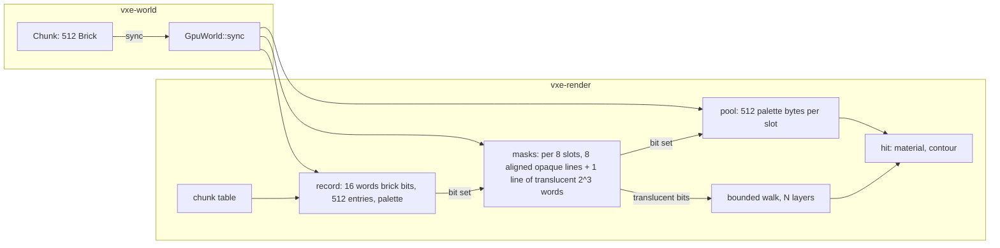

# 0015: The traversal hierarchy: chunk bits, full-resolution brick masks, a one-read-per-level walk, and the translucent class

> **Status:** in-progress
> **Created:** 2026-10-17
> **Milestone:** M2 in `docs/roadmap.md` (the frame-time floor before the lighting plan)
> **Related ADRs:** [ADR-0012](../adrs/0012-mask-first-brick-with-per-brick-palette-planes.md)
> (proposed; this plan is its first step and changes no brick format),
> [ADR-0004](../adrs/0004-palette-narrowed-sharded-brick-pool.md) (the pool, records and
> shards this plan keeps), ADR-0003 (the LOD ring whose mip-bricks get the same masks).
> **Prerequisite:** none. Independent of Plans 0006 and 0013; it touches `march.wgsl` and
> `gpu_world.rs`, which Plan 0013's branch also touches, so whichever merges second resolves
> the conflict.
> **Amended:** 2026-10-17, before `dev` started, from the traversal efficiency review of
> that day: the steps view lands as its own phase before any skip, so the walk's cost is
> read before and after; the mask buffer keeps every opaque mask on one 64-byte line
> (groups of eight slots); the kernel split and the coarse secondary walk are named as the
> lighting plan's, and beam optimization as a followup.

## TL;DR

The marcher spends five dependent reads at every DDA step and walks an empty chunk brick by
brick, which is why the streamed cave's spawn view reads 6.69 ms against the small level's
1.59 ms at the same resolution. This plan gives the walk a hierarchy of occupancy bits, one
read per level per ray segment: 512 brick bits at the head of each chunk record, a 512-bit
opaque mask per brick in place of the 8-byte 2³ mask, and a walk that re-derives its chunk
and brick state only when it crosses into a new one, so the pool is read at the hit alone.
It also introduces the opacity class: translucent materials (glass, water, lava) are air to
the opaque walk and are composited by a second, bounded walk of at most `N` layers. The
first thing a reader sees is a `--view steps` heat map and a headless step histogram of
today's walk, landed before any skip so that every later phase reads against it, and the
frame figure the plan is held to is the streamed spawn's march time.

## Context & problem

`march.wgsl`'s `lookup` reads the chunk table, the chunk record entry, the 2³ mask word, the
pool byte and the palette pair in sequence, at every step. A chunk whose bricks are all
uniform air costs eight record reads to cross along an axis; the 2³ mask is the only skip
inside a brick, so a ray grazing a wall reads pool bytes for every voxel it visits. At 1080p
and 60 fps with three rays per pixel the dev box affords about twenty uncached 64-byte lines
per ray, a GTX 1660 about eight, a Switch-2-class portable about three (ADR-0012). The
streamed cave's spawn view reads 6.69 ms for primary rays plus the headlamp's shadow ray on
the dev box (`nfr.md` §2, a recorded miss against the 3.0 ms line); the level's spawn reads
1.59 ms. The difference is steps through air, which the hierarchy removes.

The consumer wants translucent voxels (glass, water, lava; owner, 2026-10-17) and
`project-context.md` §"Rendering" lists volumetrics at P1; gas and smoke are a separate
coarse volume (M8), not this plan. A translucent voxel must not stop the opaque walk, so
occupancy has to be split by class before any material is read.

Budgets touched: `nfr.md` §2 primary rays (the streamed and level spawn readings), §2
streaming line (masks raise a `Full` brick's upload from 520 to 584 B), §3 world VRAM (mask
and record bytes).

## Decision

We add a bit hierarchy to the mirror and restructure the walk around it, on today's 512-byte
pool slots and per-chunk palettes, so that nothing in `vxe-world` changes and ADR-0012's
format plans can follow without this plan waiting for them. Chunk bits live at the head of
the record and the 512-bit masks in the existing mask buffer, in groups of eight slots: eight
64-byte opaque masks, each on its own 64-byte line, then one line holding the eight slots'
translucent 2³ words (72 B per slot on average), so the marcher still binds eight storage
buffers, WebGPU's default limit. The grouping is what makes "one line per level" true in the
hardware and not only in word counts: a flat 72-byte slot would start seven of every eight
opaque masks off a line boundary, so each of those mask reads would touch two lines. We
rejected a separate 1-bit mip chain for this plan because
the two mask levels plus the 4³ and 2³ tests on the same line already give four cell sizes
from two reads; a chain for secondary rays is the lighting plan's to add if it needs one. We
rejected changing the mip-level selection or adding the far-field clipmap here: they change
the look and belong to the far-field plan. We rejected screen-door transparency for now: it
needs the temporal pass the lighting plan brings, and a bounded accumulation with `N = 1` is
the floor profile's equivalent until then.

## Architecture diagram



## Implementation phases

Each phase ships as its own commit. `dev` implements all phases in one session with no review
between phases. The architect reviews once at the end, in a fresh session.

### Phase 1: The steps view and the headless histogram, on today's walk
- **Owner skill:** dev
- **What:** a `steps` debug view and a headless histogram make the walk's cost visible
  before any skip changes it. This phase changes no layout and no walk; its readings are the
  "before" that every later phase is read against.
- **Files touched:** `crates/vxe-render/src/marcher.rs` (`ViewMode::Steps`; the view field
  widens to 3 bits), `crates/vxe-render/src/shaders/march.wgsl`,
  `crates/vxe-render/src/readback.rs` (a step histogram from the steps view),
  `crates/vxe-render/tests/mirror.rs` or a new `crates/vxe-render/tests/walk.rs` (the fixed-ray
  step counts, which Phases 2 to 4 extend), `apps/flythrough/src/main.rs` (`--view steps`;
  `--headless --frames N` prints mean and p99 steps per ray when the view is `steps`),
  `README.md` (the flag table).
- **Done when:**
  - In `VIEW_STEPS` the red channel holds `min(steps, 255) / 255` and the green channel
    `min(pool reads, 255) / 255` for the primary ray, where a step is one iteration of the
    walk's loop, the hitting iteration included. On a closure world of 4 × 1 × 1 chunks whose
    first three chunks are uniform air and whose fourth is uniform rock, a +x ray from the
    centre of the first chunk's -x face takes exactly 25 steps on today's walk (eight
    uniform-air bricks per air chunk, then the hit on the rock chunk's face) and 0 pool reads.
  - `apps/flythrough/tests/golden/{primary,headlamp,lod}.png` match bit-exactly on lavapipe:
    the view changes no shaded pixel.
  - `flythrough --headless --seed 1 --render 1920x1080 --frames 60 --view steps` prints mean
    and p99 steps per ray for the streamed spawn and, with `--level`, for the level spawn;
    the log records both, beside the march time of the same two views at this commit
    (median of the last 30 of 300 frames, timestamps, three runs, quiet dev box), as the
    plan's before figures.

### Phase 2: Chunk bits, the chunk-level and 16³ skips
- **Owner skill:** dev
- **What:** each chunk record starts with 512 brick bits (bit `b` set when brick `b` is not
  uniform air); the walk skips a chunk whose bits are all clear as one 64³ cell and a 2×2×2
  brick group whose 8 bits are clear as one 16³ cell.
- **Files touched:** `crates/vxe-render/src/gpu_world.rs` (record layout: words 0..16 bits,
  16..528 entries, 528..656 palette; `RECORD_WORDS` 656),
  `crates/vxe-render/src/shaders/march.wgsl`, `crates/vxe-render/tests/mirror.rs`,
  `apps/flythrough/tests/level_mirror.rs`, the Phase 1 fixed-ray test file.
- **Done when:**
  - On the level-size seed-1 world, a readback of every record's first 16 words equals, for
    each chunk, the bits of its bricks that are not `Uniform(AIR)` (`level_mirror.rs`), and
    the record stride is 2624 B.
  - On the Phase 1 four-chunk closure world, the same +x ray takes exactly 4 steps (one per
    air chunk, then the hit on the rock chunk's face) and 0 pool reads, from 25 in Phase 1.
    On the same world with the three air chunks replaced by chunks whose bricks are uniform
    air except a solid floor layer of bricks, a +x ray through the air above the floor takes
    at most 4 steps per chunk.
  - `apps/flythrough/tests/golden/{primary,headlamp,lod}.png` match bit-exactly on lavapipe.
  - The Phase 1 histogram command is re-run for both spawns and the log records its mean and
    p99 beside Phase 1's.

### Phase 3: Full-resolution opaque masks, with 4³, 2³ and voxel skips from one line
- **Owner skill:** dev
- **What:** the mask buffer holds 16 words of opaque voxel bits per slot (word `2z + (y >= 4)`
  holds rows `y % 4` of layer `z`, bit `x + 8 (y % 4)`), laid out in groups of eight slots so
  that every opaque mask starts on a 64-byte boundary; the walk tests 4³ and 2³ blocks by
  masking the line and single voxels by bit, and reads the pool only when it has a hit.
  Mip-bricks get the same masks from their cells.
- **Files touched:** `crates/vxe-render/src/gpu_world.rs` (`MASK_GROUP_SLOTS` 8 and
  `MASK_GROUP_WORDS` 144: slot `s` has its opaque words at `144 (s / 8) + 16 (s % 8)` and
  its translucent words at `144 (s / 8) + 128 + 2 (s % 8)`; the buffer is sized in whole
  groups, and `grow_to` copies it as one block as today; the upload computes the bits in the
  pass that narrows the brick), `crates/vxe-render/src/shaders/march.wgsl`,
  `crates/vxe-world/src/brick.rs` (a `solid_bits() -> [u64; 8]` helper beside
  `occupancy_mask`), `crates/vxe-render/tests/mirror.rs`,
  `apps/flythrough/tests/level_mirror.rs`, `docs/nfr.md` §3 (mask bytes).
- **Done when:**
  - On the level-size seed-1 world, a readback of each `Full` brick's 16 mask words equals
    its CPU `solid_bits()`, and the mask buffer's live bytes are `72 × Full bricks`:
    27 619 776 B for its 383 608 `Full` bricks (live accounting is per slot; the allocated
    size is whole 576-byte groups).
  - A layout test asserts, for slots 0 to 63, that the byte offset of a slot's first opaque
    word is a multiple of 64 and that its two translucent words lie in the group's ninth
    line (`144 (s / 8) + 128 + 2 (s % 8)`).
  - A primary ray that hits a voxel of a `Full` brick reads the pool exactly once (the green
    channel of the steps view reads `1 / 255` on the hit pixel of a fixed ray into a
    `Full` brick with a single solid voxel at its far corner, and the ray takes at most 4
    steps inside that brick: the empty 4³ block, the empty 2³ block, the empty voxel before
    the corner, the hit).
  - A ray through a `Full` brick whose voxels are all air except one 2³ block it misses
    reads the pool 0 times.
  - `FLAG_MASKS` cleared still walks every voxel of a `Full` brick through the pool, as a
    comparison switch; the goldens match bit-exactly either way.
  - `apps/flythrough/tests/golden/{primary,headlamp,lod}.png` match bit-exactly on lavapipe.

### Phase 4: A walk that re-derives chunk and brick state only at their boundaries
- **Owner skill:** dev
- **What:** `march` keeps the current chunk's record base, level and the current brick's
  slot across steps, re-reading the table only on entering a chunk and the record entry
  only on entering a brick, so that per ray segment each level costs one read. The steps
  view's green channel becomes total storage reads (table, record, mask, pool, palette).
- **Files touched:** `crates/vxe-render/src/shaders/march.wgsl`,
  `crates/vxe-render/tests/mirror.rs` or a new `crates/vxe-render/tests/walk.rs` (fixed-ray
  read counts), `docs/nfr.md` §2.
- **Done when:**
  - On the Phase 1 four-chunk closure world, the +x ray reads exactly 4 table entries, 4
    record words (the bits word of each chunk) and 0 masks or pool words: 8 reads.
  - On a closure world of one chunk that is uniform air except one `Full` brick holding one
    solid voxel at its far corner, a +x ray through that voxel reads: 1 table entry, at
    most 2 bits words (a 16³ group's 8 bits span two words), 1 record entry, mask words all
    from that brick's one 64-byte opaque line (at most 8), 1 pool word, 1 palette word. A ray
    through the same chunk that misses the brick reads 1 table entry and at most 2 bits
    words.
  - The goldens match bit-exactly on lavapipe.
  - March-pass readings (median of the last 30 of 300 frames, three runs, timestamp
    queries, dev box, quiet) for: `--level --seed 1 --render 1920x1080` from the spawn;
    `--seed 1 --render 1920x1080` from the streamed spawn at full residency; and the
    autopilot's p50 and p99 (`--autopilot --headless`). Each is recorded in the log beside
    Phase 1's reading of the same view, and the histogram command's mean and p99 beside
    Phase 1's and Phase 2's.

### Phase 5: The translucent class and the bounded accumulation walk
- **Owner skill:** dev
- **What:** a material may be translucent (`MaterialFlags::TRANSLUCENT`, `Material::opacity`
  in `[0, 1]`); the upload leaves translucent voxels out of the opaque mask and sets their
  2³ bits in the slot's two translucent words (the group's ninth line); after the opaque
  hit, a second walk from the ray
  origin to the hit visits translucent 2³ blocks, reads their voxels and composites up to
  `translucent_layers` voxels front to back, each `albedo × opacity` under the headlamp's
  cone and distance term with no shadow ray; an `albedo` debug view composites unlit.
- **Files touched:** `crates/vxe-world/src/material.rs` (`TRANSLUCENT`, `opacity`; the
  table refuses to change a sealed row's class), `crates/vxe-render/src/gpu_world.rs`
  (class split at upload; `opacity` in the material row's spare float), `marcher.rs`
  (`LookParams::translucent_layers`, default 4; `ViewMode::Albedo`), `march.wgsl`,
  `crates/vxe-render/tests/translucent.rs` (new), `apps/flythrough/src/main.rs`
  (`--translucent-layers N`, `--view albedo`), `apps/flythrough/tests/golden/translucent.png`
  (new, lavapipe), `README.md`.
- **Done when:**
  - A closure world of one chunk: a one-voxel-thick wall of material 2 (`TRANSLUCENT`,
    opacity 0.5, albedo `[1, 0, 0]`) at `x = 20`, and a wall of material 1 (opaque, albedo
    `[0.5, 0.5, 0.5]`) at `x = 40`. A +x ray from `x = 10` in `VIEW_ALBEDO` reads
    `[0.75, 0.25, 0.25]` within `1 / 255` per channel (`0.5 × red + 0.5 × grey`), and in
    `VIEW_HITMASK` reads a hit (the opaque wall). With `translucent_layers = 0` the albedo
    view reads the grey wall alone. With two red walls and `translucent_layers = 1` only the
    nearer one is composited: `[0.75, 0.25, 0.25]`; with `2`, `[0.875, 0.125, 0.125]`.
  - The opaque walk's reads on the ray through one red wall equal its reads on the same
    world without the wall: translucent voxels cost the opaque walk nothing.
  - `golden/translucent.png` (the closure scene from a fixed pose, shaded) matches
    bit-exactly on lavapipe; the three existing goldens are unchanged (no translucent
    material in the level).
  - `MaterialTable` refuses to change a material's `TRANSLUCENT` flag after `seal`, with an
    error naming the id; `World::replace_material` and the `.vox` material map accept
    translucent rows like any other.
  - `apps/flythrough/tests/determinism.rs` hashes are unchanged (no `vxe-world` data
    changed; the flag is a table property).

### Phase 6: Readings, budgets and the stats line
- **Owner skill:** dev
- **What:** the readings `nfr.md` §2 and §3 need, the mean steps per ray on the HUD's text
  grid, and the `README.md` and roadmap notes.
- **Files touched:** `docs/nfr.md` (§2 primary rays: the three Phase 4 views at the tip; §3:
  mask and record bytes at the level and at the streamed defaults), `crates/vxe-render/src/hud.rs`
  and `apps/flythrough/src/main.rs` (a `steps` line when the steps view is on), `README.md`.
- **Done when:**
  - `nfr.md` §2 holds the Phase 4 readings with machine, commit, command and load, and §3
    holds live and allocated mirror bytes at the level and at the streamed defaults
    (`--autopilot --headless`, peak), against Plan 0002's 1 672 823 572 B live and
    2 431 425 836 B allocated.
  - With `--hud --view steps` the HUD prints mean steps per ray of the last frame.

## Data shapes

```text
// illustrative: the chunk record (u32 words)
0..16     brick bits: bit b of word b/32 set when brick b is not Uniform(AIR)
16..528   brick entries as today (FULL_BIT | WIDE_BIT | slot, or the uniform material)
528..656  palette: 256 u16 pairs, index 0 air

// illustrative: the mask buffer (u32 words), eight pool slots per 144-word group; slot s
// is slot i = s % 8 of group g = s / 8
144 g + 16 i .. + 16   opaque bits of slot s, one 64-byte line: word 2z + (y >= 4), bit
                       x + 8 (y % 4); set when the voxel's material is non-air and not
                       TRANSLUCENT
144 g + 128 + 2 i ..   translucent 2^3 bits of slot s, two words in the group's ninth line,
          + 2          the layout of today's occupancy mask: bit bx + 4 by + 16 bz set when
                       block (bx, by, bz) holds a TRANSLUCENT voxel
```

```rust
// illustrative
pub struct Material {
    // ... as today
    /// Alpha of a translucent material's voxel in [0, 1]; ignored without TRANSLUCENT.
    pub opacity: f32,
}
pub struct LookParams {
    // ... as today
    /// Translucent voxels composited in front of the opaque hit, nearest first; 0 ignores them.
    pub translucent_layers: u32,
}
```

The 4³ test on the opaque line: for a block at `(bx, by, bz)` in `0..2`, the four words
`2 (4 bz + k) + by` for `k` in `0..4`, each masked with `0x0F0F0F0F << (4 bx)`. The 2³ test
for a block at `(cx, cy, cz)` in `0..4`: the two words `2 (2 cz + k) + (cy >= 2)` for `k` in
`0..2`, masked with `0x0303 << (2 cx + 16 (cy % 2))`.

## Budgets

- **§2 primary rays.** The streamed spawn (6.69 ms, dev box) is the figure this plan is
  held to; the goal is the 3.0 ms line on the dev box, a guess until Phase 1's histogram
  says how many steps the view spends in air. The level spawn (1.59 ms) is hit-bound and is
  expected to move little. Measured at Phase 1 (before), Phase 4 and again at Phase 6,
  three runs each.
- **§2 streaming line.** A `Full` brick's upload grows from 520 to 584 B (+12 %), and a
  record from 2560 to 2624 B. The 2 MiB sync budget uploads about 11 % fewer bricks per
  frame; `--autopilot`'s residency latency (p95 455 to 481 ms against 500) is re-read at
  Phase 6.
- **§3 world VRAM.** Masks: 72 B against 8 B per slot (576 B per group of eight; the
  grouping adds no bytes over a flat 72-byte slot). At the level, 27.6 MB against 3.1 MB.
  At the streamed defaults, about 3.1 M slots (855.1 + 673.9 MiB of pool at 520 B a slot),
  so about 221 MB of masks against 25 MB, and 3.7 MB more of records: about +200 MB live,
  and with ADR-0004's 1.5× growth up to +300 MB allocated, against Plan 0002's 2.43 GB peak
  allocated and the 3 GB line. Under the line without attribute pages; with them the mirror
  is over the line already (Plan 0013 and ADR-0012's slot plan own that).
- **The portable profile.** No reading: the hardware is not on hand. The plan's read
  counts per ray (Phase 4) are the figure a portable reading is later compared against.

## Risks & open questions

- **Binding count.** The marcher binds exactly 8 storage buffers; this plan adds none by
  packing bits into the record and the masks into the grouped mask slots. A later binding
  (the lighting plan's history) needs a packed binding or a raised limit, as ADR-0004's
  Outcome notes.
- **lavapipe's 128 MiB binding.** The level's masks (27.6 MB) and records (8.4 MB) fit;
  the streamed defaults already exceed lavapipe's record cap (ADR-0004 Outcome) and are
  read on the dev box only.
- **Step counts across adapters.** The fixed-ray tests use axis-aligned rays from voxel
  centres so that every `t` is exact; the goldens stay the only cross-adapter image check.
- **Register pressure.** Phase 4 keeps more state per ray; if the occupancy drops and the
  march slows on the level view, the log records both and the review decides which state
  to drop. The march loop today also carries the contour test, the detail noise and the
  shading, and the shadow ray is a second inlined march; separating the march from the
  shading (the lighting plan, see below) is the structural remedy, not this plan's.
- **Translucent voxels and the CPU.** `raycast`, the coarse grid, sweeps and collapse treat
  translucent voxels as solid, as today; a passable class for water is a later decision,
  and the plan's test pins that the hashes do not move.
- **Determinism.** Nothing in `vxe-world`'s data changes; the flag and opacity are table
  properties. The render tests are headless on lavapipe.

## What this plan does NOT do

- The CPU brick format, the edit kernel and the size-classed mirror slots (ADR-0012's two
  following plans).
- The contour attribute's footprint (Plan 0013, then the slot plan).
- Screen-door transparency, lighting of translucent layers beyond the headlamp tint,
  refraction and reflection (the lighting plan).
- Gas, mist and smoke as a coarse volume (M8).
- Mip-level selection by projected size and the far-field clipmap (the far-field plan).
- Any `vxe-world` reader change for translucency (collision, coarse grid, collapse).
- The split of the march into a lean hit pass and a separate shading pass, and a coarse
  walk for secondary rays that stops at the 2³ level: both are the lighting plan's design
  inputs (`docs/roadmap.md`, M2). This plan keeps the 2³ bits on the opaque line so the
  coarse walk costs no storage when it comes.
- Beam optimization (a conservative start distance per pixel block from a coarse pre-pass,
  Laine & Karras 2010 section 4.2): a followup, decided from this plan's histograms.

## Implementation log

> Written by `dev`: one row per phase as its commit lands, then the close block. **The phases
> above are the contract. This section records what happened.** Observations, never
> conclusions: no pass list, no self-assessment. Deviations and unmet done-whens are
> **always** disclosed. Keep it shorter than `## Implementation phases`.

| phase | owner | state | commit |
|---|---|---|---|
| 1: The steps view and the headless histogram, on today's walk | dev | done | 52d6a7b |
| 2: Chunk bits, the chunk-level and 16³ skips | dev | not started | |
| 3: Full-resolution opaque masks | dev | not started | |
| 4: A walk that re-derives state at boundaries | dev | not started | |
| 5: The translucent class and the bounded accumulation walk | dev | not started | |
| 6: Readings, budgets and the stats line | dev | not started | |

> **Resume note (2026-10-18, delete when Phase 2 lands):** stopped before Phase 2 at
> 52d6a7b, routed to `/architect`. Phase 4's first bullet counts one bits word per air chunk
> (4 table + 4 bits words = 8 reads), but under the record layout (bit `b` of word `b / 32`)
> a chunk is all clear only when all 16 bits words are, and the count leaves out the rock
> chunk's entry read that the hit needs. Bullet 2's "at most 2 bits words" in a non-empty
> chunk rules out testing all 16 words on entry. Options raised: an empty bit in the chunk
> table entry (an air chunk costs the table read alone), or the 16-word line counted as one
> read. Gate at the tip: build, nextest (352 passed, 4 skipped), doctests, clippy, fmt clean.

### Notes

- Phase 1: `FLAG_ATTR_PAGES` moved from bit 7 to bit 8 so the view field can take bits 5..8.
- Phase 1: the streamed spawn reaches full residency after about 15 s (about 1500 frames), so
  its readings are taken with `--frames 3000`; at `--frames 60` and `--frames 300` the
  mirror is not fully resident (640 860 404 B live at 300). The 60-frame histogram read the
  same as the 3000-frame one.
- Phase 1: bit-exactness of the goldens is checked by re-blessing them on lavapipe
  (`VXE_BLESS=1`) and finding the PNGs unchanged in git; `assert_golden` itself tolerates
  0.1 % of pixels off by more than 2/255.

### Close triggers

_(Facts for the architect. No recommendations, and no suggested version bump.)_

- **What shipped:**
- **Public API changed:**
- **Budget readings:** RTX 3080 Laptop GPU, Vulkan, headless, 1920 x 1080, seed 1,
  timestamps, median of the last 30 frames, three runs each; load average 5 to 11 from the
  runs' own streaming workers.
  - Phase 1 (before, 80c6ab0 plus the steps view): streamed spawn `--frames 3000` march
    6.817 / 6.815 / 6.810 ms; level spawn `--level --frames 300` 1.859 / 1.875 / 1.858 ms.
    Histogram `--view steps`: streamed spawn mean 15.55, p99 84 steps, pool reads mean 2.45,
    p99 7 (same at `--frames 60` and `3000`); level spawn mean 10.48, p99 15, pool reads mean
    2.15, p99 4. Steps-view march (no shadow ray): streamed 6.021 ms, level 1.483 ms.
- **Gate at the tip:**
- **Outstanding `human` phases:**

## Followups

- **Beam optimization**, if the Phase 4 histogram still shows the streamed spawn spending
  most of its steps in air: one conservative distance ray per 8 × 8 pixel block through the
  bit hierarchy with contours off, and each pixel's ray started at its block's minimum less a
  margin (Laine & Karras 2010, section 4.2; their Table 2 reads 3 to 27 % more primary rays
  per second from it, so it is a trim, not a rescue). A small plan of its own; the Phase 1
  view is its measurement.
