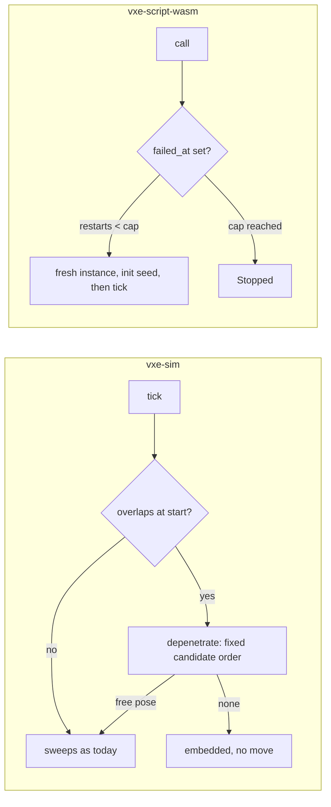

# 0016: The post-overnight fix pass: depenetration, a logic that restarts after a trap, and the review nits

> **Status:** approved (2026-10-17)
> **Created:** 2026-10-17
> **Milestone:** M3 (depenetration), M5 (restart) and M7 (the HUD nits) in `docs/roadmap.md`
> **Related ADRs:** [ADR-0005](../adrs/0005-vertical-cylinder-collision-by-integer-conservative-advancement.md)
> (its "no depenetration" consequence closes with a dated Outcome),
> [ADR-0010](../adrs/0010-game-logic-as-a-component-behind-a-logic-trait.md) (its fail-stop
> Outcome is overturned by a dated Outcome, the owner's call of 2026-10-17)
> **Prerequisite:** none. Touches `vxe-sim`, `vxe-script-wasm`, `vxe-net`, the fly-through's
> HUD and `vxe-world` comments; independent of Plans 0006, 0013 and 0015.
> **Source:** `docs/decisions-pending.md` D6 (the owner overturned two overnight calls) and
> D7 item 3; Plan 0004 Followup 1; Plan 0010 Followups (the first three) and Plan 0014
> Followups (two comment nits).

## TL;DR

Three small things the owner asked for after the overnight run, in one dev pass. A body that
an edit fills into is lifted to the nearest free pose instead of staying embedded; a hosted
logic that traps is restarted from its seed on the next tick, up to a cap, instead of
staying stopped for the run; and the five review nits from Plans 0010 and 0014 are fixed
(a shown HUD allocates nothing per frame, the memory estimate counts the brick-array pool,
two stale comments, an unused parameter, two missing doc comments). The first thing a
reader sees is the level walk test: a fill on the body's feet is followed by a tick that
ends with the body standing on the new floor.

## Context & problem

**Depenetration.** `sweep` reports `started_overlapping` and moves nothing
(`crates/vxe-sim/src/sweep.rs:132-136`); `tick` never reads the flag
(`controller.rs:257`), so a body an edit fills into stays embedded, every sweep returning
0. `Walk::at_camera` refuses to place an overlapping body (`apps/flythrough/src/fly.rs:99`),
so only an edit onto the body causes it. Plan 0004 recorded it as a known gap and ADR-0005
as a negative consequence; the owner overturned the call on 2026-10-17.

**Restart after a trap.** Plan 0011's amendment chose fail-stop: after a trap (fuel,
memory, a guest or host panic) `try_tick` returns `LogicError::Stopped { tick, since }`
without touching the instance again (`crates/vxe-script-wasm/src/host.rs:365-391`), and
the server logs the inputs, applies submitted ops and suppresses the broadcast
(`crates/vxe-net/src/server.rs:218-264`). The rejected alternative (a), a fresh instance
with `init` again, was recorded with its hazard: "the restarted logic believes it is at
the start of the run while the world holds every edit since; `init`'s own ops apply a
second time". The owner chose (a) anyway; the plan keeps the hazard visible by capping the
restarts and reporting each one.

**The nits.** Plan 0010's review: the HUD's rows `Vec` (`apps/flythrough/src/main.rs:957-962`),
the `last_edit` clone (`:935`) and the ms-formatting closure (`apps/flythrough/src/hud.rs:356`)
allocate every frame while the HUD is shown; `cpu_bytes_estimate` (`hud.rs:231-234`) counts
`Full` bricks and chunks but not the brick-array pool (`World::pool_len`,
`crates/vxe-world/src/store.rs:235`), and the "pool" row reports mirror slots;
`MarchTimer::read_ms` has an unused `_queue` (`crates/vxe-render/src/marcher.rs:510`);
`HudOverlay` and its `scale` lack doc comments (`hud.rs:49`, `:55`). Plan 0014: the "4 Mi"
comment (`main.rs:92`) means 2 Mi voxels, 4 MiB, and `CapsuleRow::nearest`
(`crates/vxe-world/src/shape.rs:379`) should state the `i128` range its closed form stays
within.

Budgets touched: none moves. `nfr.md` §8's controller tick (2.6 µs on terrain) is re-read
because the tick gains an overlap test at its start.

## Decision

Depenetration lives in the controller, not in the sweep, so `sweep` keeps its contract
(`a_body_that_starts_overlapping_does_not_move` stays as it is): at the start of `tick`,
if the body overlaps solid, the controller searches a fixed, integer sequence of candidate
poses and takes the first free one, reporting the lift in the tick's result; a body with no
free pose within reach stays and reports `embedded`. The host restarts a trapped logic on
the next tick with a fresh instance and `init(seed)`, at most `max_restarts` times per
session (default 8), then stops as today; each restart is reported. The nits are fixed as
the reviews worded them. We rejected depenetration inside `sweep` (it would change what
every caller of `sweep` sees and the pinned sweep test), and an unbounded restart loop (a
logic that traps every tick would re-instantiate the component every tick, a server-side
cost the guest controls).

## Architecture diagram



## Implementation phases

Each phase ships as its own commit. `dev` implements all phases in one session with no review
between phases. The architect reviews once at the end, in a fresh session.

### Phase 1: Depenetration in the controller
- **Owner skill:** dev
- **What:** `tick` tests the body against the world first; when it overlaps, it tries, in
  this order and stops at the first free pose: up by 1 voxel at a time to `step_height`,
  then for each distance `d` from 1 voxel to `climb_height` in voxel steps the six offsets
  `+x, -x, +y, -y, +z, -z` scaled by `d` (a fixed order, so the result is a function of the
  world and the body alone); the move is recorded in a new `MoveResult::lifted: Fixed3`
  (zero when nothing was lifted) and `MoveResult::embedded: bool`. The course feed
  (`crates/vxe-sim/tests/course.rs:10-37`) is not changed, so the pinned hash stands.
- **Files touched:** `crates/vxe-sim/src/controller.rs`, `crates/vxe-sim/src/lib.rs`
  (`MoveResult` fields), `crates/vxe-sim/tests/controller.rs` (new cases),
  `apps/flythrough/src/fly.rs` (the walk test gains a fill-on-the-body step; the fly-through
  prints the lift once), `docs/adrs/0005-*.md` (a dated Outcome at the close, by the
  architect), `docs/nfr.md` §8 (the controller tick re-read).
- **Done when:**
  - On F1 with the body standing on the floor, a fill that raises the floor by 2 voxels
    under the whole footprint is followed by one tick whose result has `lifted == [0, 0,
    512]`, `embedded == false`, and `!overlaps` afterwards; the body's horizontal position
    is unchanged.
  - A fill that raises the floor by `step_height + 1` voxel is answered by a lift along the
    first free horizontal offset when one exists at distance 1, and otherwise by an upward
    lift at the smallest distance that frees the body; the test pins both with exact poses.
  - A body enclosed in solid on all sides within `climb_height` reports `embedded == true`,
    `lifted == 0` and moves nothing; the next tick reports the same.
  - `random_walks_on_the_level_never_freeze_or_overlap` gains a fill on the body every 50th
    walk and still asserts `!overlaps` after every tick.
  - `crates/vxe-sim/tests/course.rs` still pins `0x0c80_8031_d14f_27eb`; the sweep test
    `a_body_that_starts_overlapping_does_not_move` is unchanged.
  - The `60 ticks of the F6 staircase` bench reads within 10 % of 156 µs (2.6 µs per tick),
    quiet box, recorded in the log.

### Phase 2: A trapped logic restarts from its seed, up to a cap
- **Owner skill:** dev
- **What:** `WasmConfig::max_restarts` (default 8); after a failed call at tick `T`, the
  next call instantiates a fresh component, runs `init(seed)` and then the requested
  `tick`, and the report carries `LogicError::Restarted { tick, after: T, restarts: n }`
  for that tick's failure record; after `max_restarts` restarts the logic stops with
  `Stopped { tick, since }` as today. `init`'s ops apply on the world as it is.
- **Files touched:** `crates/vxe-script-wasm/src/host.rs`, `crates/vxe-net/src/logic.rs`
  (`LogicError::Restarted`), `crates/vxe-net/src/server.rs` (the report), the tests in
  `crates/vxe-script-wasm/tests/determinism.rs`, `apps/flythrough/src/main.rs` (prints each
  restart), `docs/adrs/0010-*.md` (a dated Outcome at the close, by the architect),
  `docs/nfr.md` §4 (the component paragraph).
- **Done when:**
  - `after_running_out_of_fuel_the_logic_is_stopped` becomes `..._restarts_then_stops`: with
    `spin`, ticks 0 to 9 report `Fuel{0}`, then `Restarted{1, 0, 1}` with `Fuel{1}` ...
    through the eighth restart, and ticks 9 onward report `Stopped{tick, 8}`; the test
    states the exact sequence.
  - `edits_applied_before_a_failure_stay_and_resimulate`: with `hog` at `max_restarts = 1`,
    the op log holds the edit applied before the memory trap and the edit `init` applies on
    restart, in that order; re-simulation from the log gives an equal hash and equal log
    bytes, and a second session gives an identical report and log.
  - `a_failed_init_stops_the_logic_from_tick_zero` holds with `max_restarts = 0`, and with
    the default it restarts once per tick until the cap, each attempt failing in `init`.
  - `ECHO_HASH` (`0x8f7d_4016_15d9_5c4d`) is unchanged.
  - `WasmConfig { max_restarts: 0, .. }` reproduces today's fail-stop exactly (the existing
    sequences under that setting).

### Phase 3: The review nits
- **Owner skill:** dev
- **What:** the five items as the reviews worded them.
- **Files touched:** `apps/flythrough/src/main.rs` (rows buffer reused; `last_edit` taken
  by reference or swapped; the "4 Mi" comment), `apps/flythrough/src/hud.rs` (the ms
  formatter writes into a reused `String`; `WorldSample` gains `pool_arrays`;
  `cpu_bytes_estimate` adds `pool_arrays × 1024`; the "pool" row relabelled `gpu pool`;
  doc comments on `HudOverlay` and `scale`), `crates/vxe-render/src/marcher.rs`
  (`read_ms(&self, device)`), its callers (`main.rs`, `crates/vxe-render/tests/hud.rs`),
  `crates/vxe-world/src/shape.rs` (the `nearest` comment states the `i128` range),
  `apps/flythrough/tests/golden/hud.png` (re-blessed on lavapipe for the relabelled row).
- **Done when:**
  - A test in `apps/flythrough` (or `hud.rs`) renders 100 frames with the HUD shown and
    asserts, through a counting allocator or `HudOverlay::allocations()` counter, that
    frames 2 to 100 allocate 0 bytes in the HUD's update and encode.
  - `cpu_bytes_counts_full_brick_voxels_and_chunks` becomes `..._and_the_pool`: the estimate
    with 4096 pooled arrays is the old value plus 4 194 304.
  - `fixed_stats_format_to_their_rows` shows `gpu pool` on the pool row; `hud.png` is
    re-blessed and matches bit-exactly on lavapipe.
  - `cargo clippy --workspace --all-targets -- -D warnings` passes with `_queue` gone and
    `missing_docs` clean on `HudOverlay` and `scale`; the two comments read as the reviews
    asked.

## Data shapes

```rust
// illustrative
pub struct MoveResult {
    // ... as today
    /// The offset the controller lifted the body by before sweeping, zero when none.
    pub lifted: Fixed3,
    /// The body overlapped solid at the start and no free pose was within reach.
    pub embedded: bool,
}
pub struct WasmConfig {
    // ... as today
    /// Fresh instances started after a failure before the logic stops for good.
    pub max_restarts: u32, // default 8
}
pub enum LogicError {
    // ... as today
    Restarted { tick: u64, after: u64, restarts: u32 },
}
```

## Budgets

- `nfr.md` §8 controller tick: an overlap test per tick (one `overlaps` call, about the
  cost of a sweep's box gather); the bench is re-read and must stay under the 20 µs line.
- `nfr.md` §4 component boundary: a restart costs an instantiation (the TTFF reading of
  Plan 0011: tens of milliseconds for the fly-through's component, read in the log), paid
  at most `max_restarts` times.
- Nothing else moves. The HUD's "no per-frame allocation" is a property, asserted in a test.

## Risks & open questions

- **Determinism of depenetration.** The candidate order is fixed and integer; the result
  depends only on the world and the body. The course hash is unchanged because the course
  never starts a tick overlapping (its harness asserts `!overlaps` after every tick).
- **A restart re-applies `init`'s ops.** Recorded in ADR-0010's new Outcome; the report
  makes every restart visible, and the cap bounds the damage. A consumer that wants
  fail-stop sets `max_restarts = 0`.
- **Restart cost under a trap loop.** Eight instantiations at most, then stop.
- **The HUD golden** changes for one label; it is re-blessed on lavapipe in the same commit.

## What this plan does NOT do

- Snapshot restore of a logic's state (ADR-0010 rejected it; it needs its own ADR).
- Depenetration for bodies other than the controller's cylinder, or a notification to the
  game beyond `MoveResult`.
- Plan 0010's remaining followups (the gate after full residency) and Plan 0014's
  remaining items.

## Implementation log

> Written by `dev`: one row per phase as its commit lands, then the close block. **The phases
> above are the contract. This section records what happened.** Observations, never
> conclusions: no pass list, no self-assessment. Deviations and unmet done-whens are
> **always** disclosed. Keep it shorter than `## Implementation phases`.

| phase | owner | state | commit |
|---|---|---|---|
| 1: Depenetration in the controller | dev | not started | |
| 2: A trapped logic restarts from its seed | dev | not started | |
| 3: The review nits | dev | not started | |

### Notes

_(Deviations from the plan, with the commit, stated without justification. Done-whens not
satisfiable as stated, and what was done instead. Followups noticed and not acted on. One line
each. Empty is fine.)_

### Close triggers

_(Facts for the architect. No recommendations, and no suggested version bump.)_

- **What shipped:**
- **Public API changed:**
- **Budget readings:**
- **Gate at the tip:**
- **Outstanding `human` phases:**

## Followups

- None at draft time.
