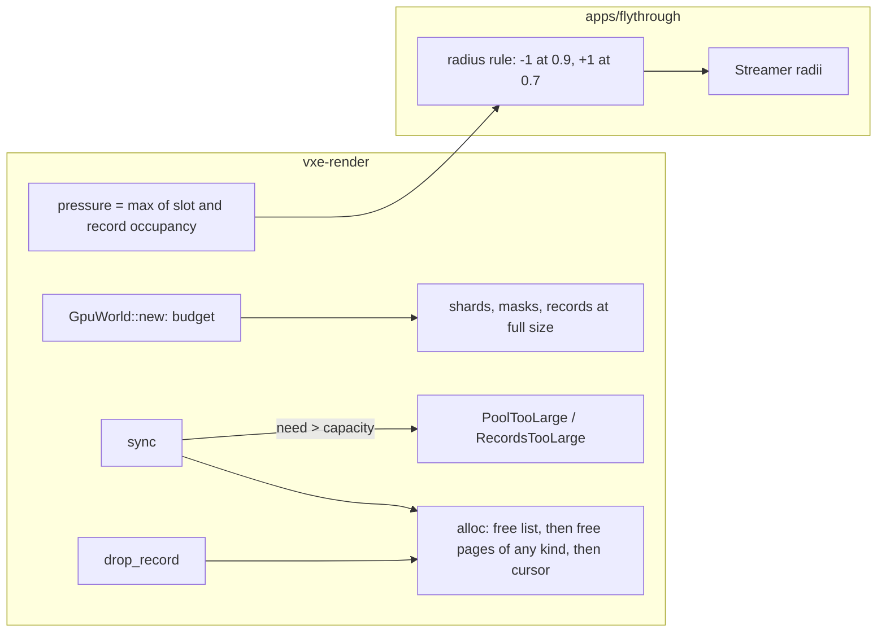

# 0017: The mirror reserves its budget: fixed buffers, empty pages that change kind, and a pressure signal the streamer follows

> **Status:** in-progress (2026-10-20)
> **Created:** 2026-10-17
> **Milestone:** M2 in `docs/roadmap.md` (the footprint work that lets Plan 0013's radius be chosen against content)
> **Related ADRs:** [ADR-0013](../adrs/0013-mirror-reserves-its-vram-budget-up-front.md)
> (proposed; this plan implements it), [ADR-0004](../adrs/0004-palette-narrowed-sharded-brick-pool.md)
> (whose growth Outcome it supersedes in part), ADR-0003 (the residency radii the pressure
> rule moves).
> **Prerequisite:** none. Touches `gpu_world.rs`, which Plans 0013 and 0015 also touch;
> merge order resolves the conflicts. Best taken after Plan 0015 so the 72-byte mask slot is
> reserved once.
> **Unblocks:** [Plan 0013](0013-contour-default-shadow-origin-and-streamed-footprint.md)
> Phase 5, which waits for this plan (the owner's call, 2026-10-18). When this plan merges to
> main, continue Plan 0013 on its branch: merge main into `plan-0013`, then Phases 5 and 7
> (its human Phases 4 and 6 are done).
> **Source:** `docs/decisions-pending.md` (answered and deleted; read it with `git show 880982c:docs/decisions-pending.md`) D1 and D7 item 4; ADR-0004's Outcome; `nfr.md` §3's
> two recorded misses.

## TL;DR

The mirror's buffers grow by half again, copy themselves on the GPU when they do, and never
shrink, so allocated VRAM runs 1.44x to 1.93x above live bytes and the budget line is failed
by content that fits. This plan makes the mirror reserve its budget once at creation and
never create another buffer, lets an empty page serve either kind so attribute and plain
slots share one high-water mark, and gives the application a pressure figure (the larger of
pool-slot and record occupancy, amended 2026-10-20) that the fly-through's streamer answers by lowering the full-detail radius a chunk
at a time. The first thing a reader sees is `allocated_bytes` equal to the budget from the
first frame, and the autopilot's peak live at the interim radius 14 with contour under
3 GB with no out-of-memory stop.

## Context & problem

`grow_to` (`crates/vxe-render/src/gpu_world.rs:1560-1626`) allocates `max(need, 1.5 x
current)` rounded to 4096-slot pages, copies the old slots and masks in one submit, and the
record buffer does the same in 1024-record pages (`:1429-1471`). `drop_record` pushes freed
slots onto their kind's free list (`:850-853`); no page or buffer is ever released, and
`page_kind` only grows (`:370-371, 1481-1492`). `allocated_bytes` (`:695-701`) is the sum
of the buffer sizes; `mirror_bytes` (`:683-689`) the live slots. The readings: 1.69 GB live
against 2.43 GB allocated under motion at the defaults; 3.31 GB live against 4.10 GB
allocated with contour, then `wgpu error: Out of Memory` on the 8 GiB card (`nfr.md` §3).
Plan 0013's footprint table (D1) had to be read on allocated bytes, which sank every
16-chunk row; the owner chose radius 14 as the interim and asked for this rule.

The mechanism, from the code: a plateau reached by grows has about 4 % slack; the
streamer's hysteresis pushes live past it under motion and one more step adds half again;
with attribute pages the two kinds cannot serve each other, so the pool tracks the sum of
each kind's peak; and during a grow the old and new shard coexist, about 2.5x the old
shard, uncounted, which is the plausible cause of the OOM.

Budgets touched: `nfr.md` §3 world VRAM (allocated becomes the budget; live is the reading
against it), §7 time to first frame (the reservation at startup), §2 streaming line (the
grow copies, a hitch source, disappear).

## Decision

`MirrorConfig` carries `budget_bytes`; `GpuWorld::new` splits it over the shards and the
record buffer by the adapter's limits and creates every buffer once; `grow_to` becomes a
capacity check that fails the sync before any write, as `PoolTooLarge` and
`RecordsTooLarge` do today. A page tracks its live slot count; at zero it returns to a
free-page list that either kind draws from. `GpuWorld::pressure()` returns the larger of
pool-slot occupancy and record occupancy (amended 2026-10-20; it was live over budget), and
the fly-through's streamer lowers `r_full` by one chunk when pressure exceeds
0.9 for 30 consecutive frames and raises it by one when pressure has been under 0.7 for
300 frames, between a floor of 6 and the configured radius. We rejected compaction (slots
move, every record and attribute address with them, and the copy is itself a hitch), growth
by exact need (hundreds of copies over a flight) and per-page buffers (binding arrays,
rejected in ADR-0004); ADR-0013 records them.

## Amendment 2026-10-20: records for the sphere, pressure on what runs out, a reachable budget

Phase 3's third done-when failed (Implementation log, Resume notes): at `--mirror-budget 1024`
the pool ran out before any radius change. Two causes. Phase 1 reserves a record for every
chunk of the 51^3 window cube, 132 651 records or 348 076 224 B (32.4 % of 1 GiB), while
57 777 are live at rest; pressure was live bytes over the whole reservation, so it peaked near
0.78 and the 0.9 trigger never fired. And the rule moves only `r_full`: at its floor (6, 24)
the LOD ring alone needs 1285.5 MiB at rest (`world_budget --stream 6,24`), so no budget near
1 GiB is reachable. The owner chose the three changes below. The LOD radius never moves;
ADR-0013 stands, with a dated Outcome on the pressure definition. Phase 3 re-opens Phase 1's
record count (one `dev` phase, no new step), and Phase 4 reads the result.

**1. Records for the residency sphere.** A record is `RECORD_BYTES` = 4 x (16 brick-bit
words + 512 entries + 128 palette words) = 2624 B. The streamer evicts a chunk once
`d2 > (r_lod + h)^2`, so after a poll one focus holds at most the lattice chunks of that
ball: `chunks_in_ball(25)` = 65 267 at the defaults (at rest `chunks_in_ball(24)` = 57 777,
which is `world_budget`'s 925 + 56 852). The streamed mirror reserves
`ceil(chunks_in_ball(max(r_lod, r_full) + h) / PRESSURE_LOW)` = ceil(65 267 / 0.7) =
**93 239 records, 244 659 136 B (233.3 MiB)**, against the cube's 348 076 224 B: 103 417 088 B
less. The division by 0.7 keeps the record term below the rule's restore line whenever the
streamer keeps its radius (0.620 at rest, at most 0.69999 in motion). Moving `r_full` does not
change the record count (a LOD-only chunk holds a record too), so a record term that crossed
0.7 would block every restore and one past 0.9 would walk `r_full` to its floor for nothing;
with exactly 65 267 records it would read 0.885 at rest and reach 1.0 in motion. It reaches 1
only when residency outgrows the sphere (several foci), which no radius rule cures, and
`RecordsTooLarge` reports it. A mirror given no record count keeps the window's `W^3`, so
the level and the tests are unchanged.

**2. Pressure on what runs out.** `pressure() = max(slot occupancy, record occupancy)`, with
slot occupancy `(live_slots() + 2 x live_attr_slots()) / reserved_slots()` (a brick in an
attribute page holds its two attribute slots too) and record occupancy `mirrored_chunks() /
reserved_records()`. Slot occupancy falls as bricks are freed, unlike the high-water mark
`pool_slots()`. With attribute pages a pool can fail a little below 1.0 (each kind's partly
filled page, four unused slots an attribute page); the 0.1 between trigger and exhaustion
covers it. Live over budget stays a reported figure: it is not the trigger, and it counts the
chunk table and material rows that lie outside the reservation (Phase 1's `allocated_bytes`
note).

**3. A budget the r_full-only rule can reach: `--mirror-budget 1930`.** A page is
`PAGE_BYTES` = 4096 x (512 + 72) = 2 392 064 B. Live slots from `world_budget --stream R_FULL,R_LOD
--seed 1` (face, h 1, at rest, this commit's tree) and the Phase 3 reading at 3072 MiB,
against 743 pages (3 043 328 slots):

| residency | what it stands for | live slots | slot occupancy |
|---|---|---|---|
| 6, 24 | the floor at rest | 1 709 813 | 0.562 |
| 7, 25 | the floor in motion: everything its hysteresis keeps | 1 957 717 | 0.643 |
| 15, 24 | `r_full` 14 with its hysteresis, at rest | 2 602 153 | 0.855 |
| 16, 24 | the start at rest | 2 798 808 | 0.920 |
| 16, 24 flight peak (measured, 3072 run) | the start in motion | 2 928 253 to 2 961 907 | 0.962 to 0.973 |
| 17, 25 | the start in motion, everything kept (a bound) | 3 241 039 | 1.065 |

The window: the rule must fire at the start, 2 798 808 / S > 0.9, so at most 759 pages; the
pool must hold the measured start peak even if the rule were late, S >= 2 961 907, so at least
724 pages; the floor must sit under the trigger with its hysteresis, S >= 1 957 717 / 0.9, at
least 532 pages (implied). 743 pages sits mid-window. Budget = 743 x 2 392 064 + 93 239 x
2624 + `PLACEHOLDER_BYTES` 2624 = 1 777 303 552 + 244 659 136 + 2624 = 2 021 965 312 B
(1928.3 MiB); `--mirror-budget 1930` (2 023 751 680 B) reserves floor(1 779 089 920 / 2 392 064)
= 743 pages. 2048 MiB reserves 795 pages, where the start reads 0.859 at rest and about 0.91
only at the flight's peak, too briefly to promise the 30 frames: it does not reliably decrease.
At 3072 MiB the split is 1244 pages and the measured peak reads 0.581, records at most 0.69999:
no change. Projection, a guess from at-rest figures: 16 to 15 demotes nothing (the keep
radius 16 still holds ball 16), 30 frames later 15 to 14 demotes the 16-shell and slots fall
to about 0.855, between the two lines, so `r_full` rests at 14 after two decreases. The
(17, 25) bound does not fit, so zero `PoolTooLarge` at 1930 rests on the measured peak and
the rule acting; it is a reading, not a proof. Peak live over budget at 1930, without the
rule, would be 1 881 891 684 / 2 023 751 680 = 0.930.

## Architecture diagram



## Implementation phases

### Phase 1: One reservation, no second buffer
- **Owner skill:** dev
- **What:** `MirrorConfig::budget_bytes` (the fly-through default is the `nfr.md` §3 line,
  3 GB, overridable by `--mirror-budget MiB`; tests pass small budgets); `ShardLayout`
  gains the split (records get `RECORD_BYTES` per chunk of the window's capacity, capped by
  the binding; the rest goes to pool pages across the shards in order; masks follow the
  pool); every buffer is created in `new`; `grow_to` only checks; `SyncStats` counts
  `buffers_created` and `copies`.
- **Amended 2026-10-20:** the streamed mirror's record count ("a record per chunk of the
  window's capacity") is re-done in Phase 3 (see the Amendment); this phase's done-whens stand
  as written and were read against the window's `W^3`.
- **Files touched:** `crates/vxe-render/src/gpu_world.rs`, `crates/vxe-render/tests/mirror.rs`,
  `apps/flythrough/tests/level_mirror.rs`, `apps/flythrough/src/main.rs` and `lib.rs`
  (the flag and the default sized from the world: the level's extent, or the radii),
  `apps/flythrough/examples/world_budget.rs` (prints the budget a radius needs; fixes the
  material row to `MATERIAL_FLOATS`), `README.md`.
- **Done when:**
  - `allocated_bytes()` equals the budget (rounded down to whole pages and records) right
    after `new`, and is unchanged after any number of syncs, evictions and window moves;
    `SyncStats::buffers_created == 0` and `copies == 0` over a whole
    `a_following_window_mirrors_the_streamed_residency` run.
  - A sync whose pool need exceeds the reservation fails with `PoolTooLarge { need,
    capacity }` before writing, as `a_world_past_four_shards_fails` asserts today with the
    budget in place of the layout limit; records likewise.
  - On lavapipe the level test passes a 256 MiB budget and reads `live_pool_bytes() ==
    196 407 296` as today.
  - `--mirror-budget 3072` on the dev box creates the buffers in under 50 ms (a guess; the
    log records the reading) and the first frame of the streamed cave is within 10 % of
    Plan 0002's reading.

### Phase 2: Empty pages change kind
- **Owner skill:** dev
- **What:** per-page live counts; a page whose count reaches zero leaves its kind's cursor
  and free lists and joins `free_pages`; `alloc` takes a free page of any former kind
  before advancing the cursor, re-kinding it; attribute pages are issued the same way.
- **Files touched:** `crates/vxe-render/src/gpu_world.rs`, `crates/vxe-render/tests/mirror.rs`.
- **Done when:**
  - Kind churn: a test alternates 20 times between a residency where 8 chunks are full with
    attributes and one where the same 8 are LOD-only, in a following window; the pages ever
    issued stay at most `ceil(peak slots of one kind / page slots) + 1` per kind, where the
    old code issues one new page per promotion (the test asserts the bound on
    `pages_issued()`).
  - `attribute_pages_hold_full_bricks_and_plain_pages_mip_bricks` still holds (a page is of
    one kind while it has live slots).
  - No slot number changes for a live brick (the attribute addressing stays valid): a
    readback after the churn decodes every live brick to its CPU voxels.

### Phase 3: Pressure, and the streamer follows it
- **Owner skill:** dev
- **What:** `GpuWorld::pressure() -> f32`; `Streamer::set_radii` if the radii are fixed at
  creation (they are read from `StreamConfig` at `stream.rs`; the plan assumes a setter is
  needed); the fly-through's rule above, printing each change and showing it on the HUD.
  Amended 2026-10-20, re-opening Phase 1's record count: `pressure()` is the larger of slot
  and record occupancy; `MirrorConfig::record_chunks: Option<u64>` (none keeps the window's
  `W^3`); `vxe_world::chunks_in_ball(r)`, the lattice chunks with `d2 <= r^2` in the
  streamer's metric; the fly-through's streamed mirror reserves
  `ceil(chunks_in_ball(max(r_lod, r_full) + h) / PRESSURE_LOW)` records; `world_budget`
  prints its budget lines with that record count; `README.md` lists `--residency`,
  `--mirror-budget` and the rule.
- **Files touched:** `crates/vxe-render/src/gpu_world.rs`, `crates/vxe-world/src/stream.rs`,
  `crates/vxe-world/src/lib.rs`, `apps/flythrough/src/main.rs`, `apps/flythrough/src/lib.rs`,
  `apps/flythrough/src/hud.rs`, `apps/flythrough/examples/world_budget.rs`,
  `crates/vxe-render/tests/mirror.rs`, `crates/vxe-world/tests/stream.rs`, `README.md`.
- **Done when:**
  - `pressure()` equals `max((live_slots() + 2 x live_attr_slots()) / reserved_slots(),
    mirrored_chunks() / reserved_records())` within `1e-6`; one mirror test drives it past 0.9
    on slots with records under 0.5, another on records with slots under 0.5.
  - `chunks_in_ball(24) == 57_777` and `chunks_in_ball(25) == 65_267`; the fly-through's
    record count at r_full 16, r_lod 24, h 1 is 93 239; a mirror given `record_chunks` reserves
    exactly that many and `allocated_bytes()` still equals its budget rounded down.
  - `Streamer::set_radii(r_full - 1, r_lod)` demotes the chunks at the old edge to LOD-only
    within the next polls, and a later `set_radii` back promotes them; the hashes of their
    voxels after the round trip equal the originals (persistence, `tests/persist.rs`'s
    helpers); in the same test the resident chunk count after every poll is at most
    `chunks_in_ball(r_lod + h)`.
  - Headless `flythrough --autopilot --mirror-budget 1930` (r_full 16, r_lod 24, h 1, seed 1,
    no `--look`) prints a reservation of 3 043 328 slots and 93 239 records, finishes its
    flight with zero `PoolTooLarge` and zero `RecordsTooLarge` syncs, prints at least one
    radius decrease and none below 6, and reports peak pressure under 1.0 and peak live /
    budget under 0.95 (0.930 projected without the rule; the Amendment projects two decreases,
    to 14, a guess). The same run at 3072 prints no change.

### Phase 4: Readings and the budget line
- **Owner skill:** dev
- **What:** the readings `nfr.md` §3 and §7 need, and the roadmap note.
- **Files touched:** `docs/nfr.md`, `docs/roadmap.md`.
- **Done when:**
  - `--autopilot --headless` at r_full 16 / r_lod 24 and at 14 / 22, each with and without
    `--look contour`, dev box, two runs each: peak live, budget, the split (pages and
    records), peak pressure with its slot and record terms, radius changes, the reservation
    time, first-frame time, and no OOM; recorded in §3 with machine and commit. Timing runs
    hold the perf lock and state the 1-minute load: Phase 1 read 414 to 513 ms first frames
    (one 12 % over Plan 0002's 457 ms) under build load 9.6 to 11.
  - Phase 3's `--mirror-budget 1930` run, twice: radius changes, the final `r_full`, peak
    pressure, failed syncs, recorded in §3 as the pressure rule's reading.
  - §7 records the reservation time as a reading in place of Phase 1's under-50 ms guess.
  - §3's line reads "live bytes against the reserved budget", with the readings replacing
    Plan 0002's allocated figures.

## Data shapes

```rust
// illustrative
pub struct MirrorConfig {
    // ... as today
    /// VRAM reserved for pool shards, masks and records, split by the adapter's limits.
    pub budget_bytes: u64,
    /// Records to reserve; `None` reserves the window's W^3 (amended 2026-10-20).
    pub record_chunks: Option<u64>,
}
pub struct SyncStats {
    // ... as today
    pub buffers_created: u32, // 0 after `new`
    pub copies: u32,          // 0 after `new`
}
impl GpuWorld {
    pub fn pressure(&self) -> f32; // max(slot occupancy, record occupancy)
    pub fn pages_issued(&self) -> u32;
}
```

The split: `records = min(record_chunks (else window capacity) x RECORD_BYTES, binding limit)`;
`pool = budget - records`, in whole pages, filling shard 0 to its limit, then 1, and so on; masks are
`MASK_BYTES x pool slots`.

## Budgets

- **§3 world VRAM:** allocated equals the budget (3 GB by default); live is the reading.
  Projection for radius 14 with contour: 2.56 GB live at rest (D1's table), plus the
  hysteresis transient, under 3 GB; the Phase 4 reading decides. From the 2026-10-20
  amendment, records take 244 659 136 B of the budget at r_lod 24 (93 239, the sphere) rather
  than 348 076 224 B (the cube), and pressure is the larger of slot and record occupancy; the
  pressure rule's own reading is the Phase 3 run at 1930 MiB.
- **§7 first frame:** one reservation of 3 GB at startup. Phase 1 read 69.6 to 86.0 ms on the
  dev box under build load against a guess of under 50 ms; a throwaway probe put
  `create_buffer` near 18 ms per GiB, so the time follows the budget, not the split. The
  reading replaces the guess; Phase 4 re-reads it with the first frame.
- **§2 streaming line:** the grow copies (up to about 2 GB each on the GPU) no longer occur;
  the autopilot's p99 frame is re-read in Phase 4 beside Plan 0002's 51.8 to 60.7 ms.

## Risks & open questions

- **A 6 GB card with a 3 GB budget** plus the frame targets and attribute pages: the
  reservation makes the failure explicit at startup; the baseline card is not on hand, and
  the portable profile sets a smaller budget.
- **Re-kinding and the attribute pass.** The pass addresses attributes by slot inside the
  page; a page is only re-kinded when empty, so no live brick moves.
- **Streamer radii at runtime.** If `Streamer` cannot change radii without a rebuild, Phase
  3 adds the setter in `vxe-world`; the residency tests cover it.
- **The 1930 MiB gate rests on a measurement.** The bound on the start in motion (17, 25)
  does not fit 743 pages; the gate holds because the measured flight peak does and the rule
  acts within its first 60 frames. If a run fails it, the Phase 3 log records the peak and
  the frame of each change, and the window (724 to 759 pages) is re-derived, not widened.
- **The record term is inert by sizing.** It stays under 0.7 only while the streamer keeps its
  radius around one focus; an application with several foci passes its own `record_chunks`.
- **Determinism:** none; the mirror is render-side. `chunks_in_ball` is integer arithmetic.

## What this plan does NOT do

- Size-classed brick slots (ADR-0012's mirror-slot plan): the reservation is in 512-byte
  slots today and in 64-byte units then.
- Compaction or shrinking.
- A VRAM query from the adapter: the budget stays configuration.

## Implementation log

> Written by `dev`: one row per phase as its commit lands, then the close block. **The phases
> above are the contract. This section records what happened.** Observations, never
> conclusions: no pass list, no self-assessment. Deviations and unmet done-whens are
> **always** disclosed. Keep it shorter than `## Implementation phases`.

| phase | owner | state | commit |
|---|---|---|---|
| 1: One reservation, no second buffer | dev | done | 3b9ea25 |
| 2: Empty pages change kind | dev | done | cd90f89 |
| 3: Pressure, and the streamer follows it | dev | done (stopped at fc98db0 on the 1024 MiB done-when; amended at 8f41540) | 06d1f17 |
| 4: Readings and the budget line | dev | done | e5ce0b5 |

### Notes

_(Deviations from the plan, with the commit, stated without justification. Done-whens not
satisfiable as stated, and what was done instead. Followups noticed and not acted on. One line
each. Empty is fine.)_

- Phase 1: the budget covers the pool shards (placeholders included), masks and records; the chunk table and material rows are outside it, and `allocated_bytes()` now sums only those three kinds of buffer (it counted the table and materials before). `mirror_bytes()` counts the material rows written instead of the materials buffer's size. (Phase 1 commit)
- Phase 1: the materials buffer is still created at the first sync, sized to the table (`look.rs` asserts its size equals the rows); `SyncStats::buffers_created` counts pool, mask and record buffers only. Both new `SyncStats` fields are zero by construction (no path creates or copies after `new`); the test also asserts the six reserved buffers are the same handles after the run. (Phase 1 commit)
- Phase 1: `pool_slots()` is now the pages handed out (the high-water mark) rather than the buffer capacity, and `shards_in_use()` follows it; `reserved_slots()`, `reserved_records()`, `ShardLayout::{reserved_slots, reserved_records, with_budget, reserved_bytes}`, `budget_for`, `PAGE_BYTES`, `PLACEHOLDER_BYTES` and `DEFAULT_BUDGET_BYTES` are new. (Phase 1 commit)
- Phase 1: `MirrorConfig::new` defaults the budget to 3 GiB clamped to the device, so tests outside Files touched (`golden.rs`, `look.rs`, `walk.rs`, `translucent.rs`, `hud_golden.rs`, `hero.rs`) reserve lavapipe's four 128 MiB shards; the mirror tests in Files touched pass 64 MiB, the level tests 256 MiB. (Phase 1 commit)
- Phase 1: the fly-through's level default is `level_mirror_budget` (its `Full` bricks plus the 64 Ki dig headroom, in attribute pages under `--look`, and a record per extent chunk); the streamed default is 3 GiB with records for the window's `W^3`. `POOL_HEADROOM_BRICKS` moved from `main.rs` to `lib.rs`. (Phase 1 commit)
- Phase 1 added an `update` call at the top of `init_stream` described as overlapping generation with the reservation; `main` already starts the workers before the device opens, so the call was a no-op and the first-frame difference across those runs was load. Removed in the Phase 3 commit.
- Phase 1 done-when not met as stated: the 3072 MiB reservation took 69.6 to 86.0 ms against the 50 ms guess; the streamed first frame read 513, 447 and 414 ms against Plan 0002's 457 ms, one run 12 % over (see Close triggers). (Phase 1 commit)
- Phase 2: the churn bound counts "page slots" per kind as the brick slots a page of that kind hands out (1364 attribute, 4096 plain). The churn test drives the tiers by moving chunks between the store and `insert_lod` in a following window, not through a `Streamer`. It read 2 pages issued for peaks of 584 plain and 1343 attribute slots (bound 4); the old code was not run against it. (Phase 2 commit)
- Phase 2: `pages_issued()`, `free_pages()` and `spare_slots()` are new; `a_following_window_mirrors_the_streamed_residency` and `lod_records_decode_to_the_mips_and_demotion_frees_the_full_slots` now accept an evicted slot in a free page, and assert `live_slots() + spare_slots() == pool_slots()`. `an_empty_attribute_page_serves_plain_slots` is a second test beside the churn one: page 0 goes attribute, free, plain, attribute with `pages_issued()` at 4. (Phase 2 commit)
- Phase 2: a page re-kinded from plain to attribute keeps the stale masks of its former plain bricks in its attribute slots; nothing reads a mask there, and the fresh-mirror test that asserts those masks are zero still holds. (Phase 2 commit)
- Phase 3: `--residency R_FULL,R_LOD` added to the fly-through (Phase 4's runs at 14/22 need it; the `plan-0013` branch adds a flag of the same name and form, so the merge will meet it twice). (fc98db0)
- Phase 3: a streamed sync that fails past the reservation no longer ends the fly-through: it prints the first failure, counts them for the autopilot report, and leaves the chunks queued. The one counter (`syncs past the reservation`) covers `PoolTooLarge` and `RecordsTooLarge` together. (fc98db0)
- Phase 3: the HUD's pressure row appears only with a reading (`HudStats::pressure`), so `HudStats::fixed()` and the HUD golden are unchanged. (fc98db0)
- Phase 3 (amended): `apps/flythrough/tests/level_mirror.rs`, outside the amended Files touched, gained `record_chunks: None` in its one `MirrorConfig` literal so it compiles. `flythrough::PRESSURE_LOW` and `stream_record_chunks` live in `lib.rs` (the count is `ceil(ball x 10 / 7)` in integers). `settle` in `tests/stream.rs` replaces `wait_idle` in the set_radii test so every poll's resident count is checked. (Phase 3 commit)
- Between Phases 3 and 4, a commit outside any phase row: the autopilot's report line adds the reserved slots and records and the peak of each pressure term, which Phase 4's done-when reads; `main.rs` only. (the commit after 06d1f17)
- Phase 4: with `--look contour` at the default 3072 MiB, every run failed some syncs past the reservation (548, 113 at 16/24; 22, 89 at 14/22) while slot occupancy read 0.911 to 0.946: the pool ran out of pages below 1.0. Those syncs wrote nothing, their chunks stayed queued, the rule's next decrease cleared them, and every flight finished with a matching hash. `pool_need` counts neither pages that empty during the same sync nor the free single slots of the other kind, so with two kinds it reports need before the slots are all used. Not acted on. (Phase 4 commit)
- Phase 4: no first-frame reading on a quiet box: the 1-minute load stayed between 10.6 and 23.2 through every run because other lanes were building. (Phase 4 commit)
- Review fix, finding 1 (major, `pool_need` credits nothing for tier changes): `pool_need` now replays the selection in order, crediting each tier change's freed slots to its kind and each page those frees empty as a free page less its spare slots, before that chunk's own allocations; `select` records each chunk's new slots per kind. Tests `a_demotion_that_empties_attribute_pages_fits_a_full_pool`, `a_plain_demotion_fits_a_full_pool` and `a_selection_past_the_reservation_net_of_its_frees_still_fails_untouched`; run once against the old `pool_need` (gpu_world.rs stashed): the first two failed with `PoolTooLarge { needed: 6291456, limit: 4194304 }` and `{ needed: 2134528, limit: 2097152 }`, the third still failed but with `needed: 2621440` where the new count reads 2359296. (fix commit for finding 1)
- Review fix, finding 2 (major, contour's failed syncs): the fly-through records the pressure and its two terms at each failed sync, prints at the first one each pool reading it has (plain free slots, spare slots, free pages, pages issued, `r_full`), and the autopilot report prints the count, the pressure and term ranges at failure and the longest run of consecutive failed syncs. Done-when not met: failed syncs remain (see Resume notes); `nfr.md` §3's contour rows are not replaced. (fix commit for finding 2)
- Review fix, finding 1 follow-up: the two tier-change tests' comments state the old check's failure as a property of a check without the credit (comment-hygiene gate). (fix commit for finding 2)
- The resume notes the Amendment cites were deleted when Phase 3 landed; they read at fc98db0.
- Phase 3 (amended): the first 1930 MiB run also raised `r_full` once, 14 to 15 at pressure 0.676, 15 s into the flight; it ended at 15. (Phase 3 commit)

### Resume notes

_(Fix pass, 2026-10-20; deleted when finding 2 lands.)_

- **Readings after both fixes** (7112269 plus the reporting change, `flythrough --autopilot --headless`, seed 1, 15 workers, RTX 3080 Laptop GPU, Ryzen 9 5900HS, exclusive perf lock, default 3072 MiB):
  - Contour 16/24, run 1 (load 10.06 to 21.59): 0 failed syncs; `r_full` 16 to 12, ending at 13; peak pressure 0.9114 (slots 0.9114, records 0.6197).
  - Contour 16/24, run 2 (load 16.78 to 14.81): **9 failed syncs**, pressure at failure 0.9083 to 0.9083 (slots 0.9083, records 0.1866), longest run 6 consecutive syncs. At the first failure: `brick pool needs 2610954240 bytes; the reservation holds 2608857088`, 461 468 free plain single slots, 462 491 spare slots of both kinds, 0 free pages, 1244 of 1244 pages issued, `r_full` 13. Then `r_full` 13 to 12 at 0.908.
  - Contour 14/22, run 1 (load 21.59 to 16.78): 0 failed syncs, 0 radius changes, peak pressure 0.8975.
  - Contour 14/22, run 2 (load 14.81 to 18.24): **20 failed syncs**, pressure at failure 0.9060 to 0.9060 (slots 0.9060, records 0.4231), longest run 20 consecutive syncs. At the first failure: `needs 2657091584 bytes; holds 2654994432`, 474 677 free plain single slots, 476 885 spare slots, 0 free pages, 1265 of 1265 pages issued, `r_full` 14. Then `r_full` 14 to 13 at 0.934.
  - Face 1930 MiB gate (load 18.24 to 15.22): 0 failed syncs, `r_full` 16 to 15 to 14 at 0.920, back to 15 at 0.576; peak pressure 0.9197, peak live / budget 0.8836.
  - Every return hash matched; no out-of-memory stop.
- **Diagnosis.** Every failure came with pressure above 0.9 (0.906 and 0.908), so the rule did fire; no failure occurred at or below 0.9. The pool ran out of pages while about 9 % of its slots were spare. Almost all of those (461 468 and 474 677) were free single slots of plain pages. A page with even one live mip-brick stays plain, so those slots cannot serve the attribute pages the promotions need. The 2 097 152 B shortfall at each first failure is exactly one page.
- **Question for the architect** (the remedies change the plan's contract): (a) a page-occupancy term in `pressure()`, pages holding a live slot over reserved pages, so the trigger sees the fragmentation; or (b) a sync that uploads the nearest-first prefix of the selection that fits, instead of failing the whole selection.
- **Gate at this commit:** `cargo nextest run --workspace` 402 run, 402 passed, 4 skipped (perf lock, load 15.36); doctests 7 passed; clippy, fmt and `cargo deny check` clean; doc-links and comment-hygiene pass.

### Close triggers

_(Facts for the architect. No recommendations, and no suggested version bump.)_

- **What shipped:** the mirror reserves its pool shards, masks and records once from `MirrorConfig::budget_bytes` and never creates or copies another (3b9ea25); an emptied page joins a free-page set either kind takes (cd90f89); `GpuWorld::pressure` (the larger of slot and record occupancy), `MirrorConfig::record_chunks`, `vxe_world::chunks_in_ball`, `Streamer::set_radii`, and the fly-through's radius rule with its HUD row, `--mirror-budget` and `--residency` (fc98db0, 06d1f17, ef37395); `nfr.md` §3 and §7 and the roadmap note (e5ce0b5).
- **Public API changed:** `vxe-render`: `MirrorConfig::{budget_bytes, record_chunks}` (a struct literal must name them), `SyncStats::{buffers_created, copies}`, `ShardLayout::{reserved_slots, reserved_records, with_budget, reserved_bytes}`, `budget_for`, `PAGE_BYTES`, `PLACEHOLDER_BYTES`, `DEFAULT_BUDGET_BYTES`, `GpuWorld::{reserved_slots, reserved_records, pages_issued, free_pages, spare_slots, pressure}`; `allocated_bytes()` now sums only the reserved buffers, `pool_slots()` is the pages handed out, `shards_in_use()` follows it, `mirror_bytes()` counts material rows written; `MirrorError` messages say "the reservation holds". `vxe-world`: `Streamer::set_radii`, `chunks_in_ball`. `flythrough` lib: `STREAM_MIRROR_BUDGET`, `POOL_HEADROOM_BRICKS` (moved from `main.rs`), `level_pool_slots`, `level_mirror_budget`, `PRESSURE_LOW`, `stream_record_chunks`; `hud::{Pressure, PRESSURE_HIGH}`, `HudStats::pressure`.
- **Budget readings:**
  - Phase 1, `flythrough --headless --frames 30 --mirror-budget 3072` (streamed, seed 1), NVIDIA GeForce RTX 3080 Laptop GPU, Ryzen 9 5900HS, release, exclusive perf lock, 1-minute load 9.60 to 10.97 (other lanes building): `mirror: reserved 3220946112 B of a 3221225472 B budget (4919296 slots over 2 shards, 132651 records)` in 82.3, 79.3 and 69.6 ms; device ready 380, 314, 300 ms; first frame 513, 447, 414 ms. Base d11d0cb alternated with it: first frame 1970 (cold, device 1910 ms), 375, 367 ms. Two earlier runs, before the no-op `init_stream` update (load 15.96 to 16.60): reserved in 86.0 and 80.2 ms, first frame 570 and 526 ms against base 3521 (cold) and 446 ms. A throwaway probe on the same GPU (not committed): `create_buffer` of 256 MiB, 1 GiB, 2 GiB took 4.2, 18.2, 36.3 ms; `GpuWorld::with_config` at 3 GiB 51.2 to 53.6 ms.
  - Phase 3, `flythrough --autopilot --headless --mirror-budget 3072` (r_full 16, r_lod 24, h 1, 15 workers), RTX 3080 Laptop GPU, exclusive perf lock, 1-minute load 19.37 to 25.08: reserved in 85.4 ms; full residency after 10 263 ms at 1 786 641 644 B live, pressure 0.555; flight peak 1 881 891 684 B live, peak live / budget 0.5843, 0 radius changes, 0 syncs past the reservation; return hash match; march GPU p99 13.479 ms at 1280x720. With `--mirror-budget 1024` (load 14.26 to 6.10): reserved 1 072 873 152 B (1 241 088 slots, 132 651 records) in 20.9 ms, then the failed sync above and no full residency in 600 s.
  - Phase 3 (amended, 06d1f17), `flythrough --autopilot --headless --mirror-budget 1930`, r_full 16, r_lod 24, h 1, seed 1, 15 workers, RTX 3080 Laptop GPU, exclusive perf lock, 1-minute load 24.13 to 23.03: `reserved 2021964224 B of a 2023751680 B budget (3043328 slots over 1 shards, 93239 records)` in 63.0 ms; full residency at 13 093 ms, 1 786 641 644 B live, pressure 0.920; `r_full 16 -> 15` at 0.920 (13 172 ms), `15 -> 14` at 0.920 (13 386 ms), `14 -> 15` at 0.676 (28 075 ms); 0 syncs past the reservation; peak pressure 0.9197, peak live / budget 0.8836; return hash match. At `--mirror-budget 3072` (load 21.59 to 20.16): 5 095 424 slots and 93 239 records reserved in 94.9 ms, pressure 0.620 at full residency, peak pressure 0.6363, peak live / budget 0.5780, 0 radius changes, 0 failed syncs.
  - Phase 4 (ef37395): the autopilot matrix at 16/24 and 14/22, face and contour, two runs each, and the second 1930 MiB run, are in `nfr.md` §3 ("The reserved budget" and "The pressure rule's gate") with machine, load and commit; §7 holds the reservation and first-frame times. No run stopped on out-of-memory.
  - Phase 1, `flythrough --level --headless --frames 3`, same machine: `reserved 271524864 B of a 271526464 B budget (450560 slots over 2 shards, 3200 records) in 4.2 ms`, 232 436 992 B live; with `--look contour` `reserved 797779456 B of a 797780544 B budget (1351680 slots over 1 shards, 3200 records) in 49.9 ms`, 680 491 136 B live.
- **Gate after the fix pass (bf9ac5f; the run preceded only a comment edit in `mirror.rs`):** `cargo build` exit 0; `cargo nextest run --workspace --test-threads 4` exit 0, 402 run, 402 passed, 4 skipped (perf lock, load 15.36); `cargo test --doc --workspace` 7 passed; clippy, fmt and `cargo deny check` exit 0; doc-links and comment hygiene pass. Failed syncs remain with contour (Resume notes).
- **Gate at the first close (e5ce0b5):** `cargo build` exit 0; `cargo nextest run --workspace --test-threads 4` exit 0, 398 run, 398 passed, 4 skipped (perf lock, load 19.76); `cargo test --doc --workspace` exit 0, 7 passed; `cargo clippy --workspace --all-targets -- -D warnings` exit 0; `cargo fmt --all --check` exit 0; `cargo deny check` exit 0 (advisories, bans, licenses, sources ok); `check-doc-links` 128 links resolve; comment hygiene OK; index rows OK. The worktree needed `scripts/build-guests.sh` before the wasm tests pass.
- **Outstanding `human` phases:** none.

## Followups

- None at draft time.
