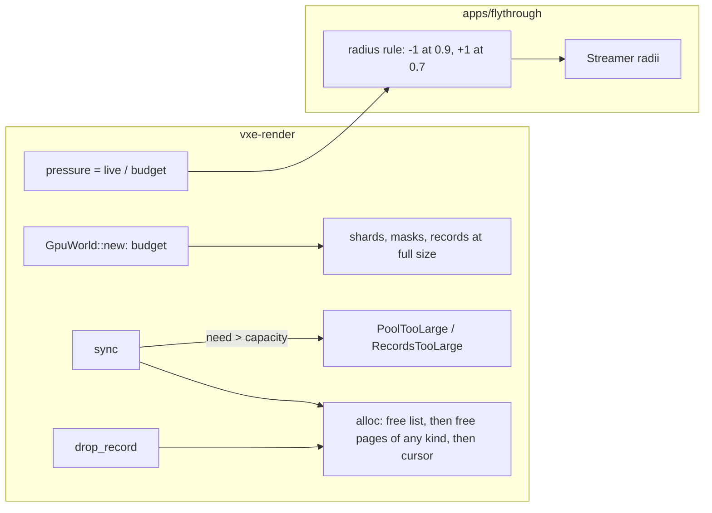

# 0017: The mirror reserves its budget: fixed buffers, empty pages that change kind, and a pressure signal the streamer follows

> **Status:** draft
> **Created:** 2026-10-17
> **Milestone:** M2 in `docs/roadmap.md` (the footprint work that lets Plan 0013's radius be chosen against content)
> **Related ADRs:** [ADR-0013](../adrs/0013-mirror-reserves-its-vram-budget-up-front.md)
> (proposed; this plan implements it), [ADR-0004](../adrs/0004-palette-narrowed-sharded-brick-pool.md)
> (whose growth Outcome it supersedes in part), ADR-0003 (the residency radii the pressure
> rule moves).
> **Prerequisite:** none. Touches `gpu_world.rs`, which Plans 0013 and 0015 also touch;
> merge order resolves the conflicts. Best taken after Plan 0015 so the 72-byte mask slot is
> reserved once.
> **Source:** `docs/decisions-pending.md` D1 and D7 item 4; ADR-0004's Outcome; `nfr.md` §3's
> two recorded misses.

## TL;DR

The mirror's buffers grow by half again, copy themselves on the GPU when they do, and never
shrink, so allocated VRAM runs 1.44x to 1.93x above live bytes and the budget line is failed
by content that fits. This plan makes the mirror reserve its budget once at creation and
never create another buffer, lets an empty page serve either kind so attribute and plain
slots share one high-water mark, and gives the application a pressure figure (live over
budget) that the fly-through's streamer answers by lowering the full-detail radius a chunk
at a time. The first thing a reader sees is `allocated_bytes` equal to the budget from the
first frame, and the autopilot's peak live at the interim radius 14 with contour under
3 GB with no out-of-memory stop.

## Context & problem

`grow_to` (`crates/vxe-render/src/gpu_world.rs:1560-1626`) allocates `max(need, 1.5 x
current)` rounded to 4096-slot pages, copies the old slots and masks in one submit, and the
record buffer does the same in 1024-record pages (`:1429-1471`). `drop_record` pushes freed
slots onto their kind's free list (`:850-853`); no page or buffer is ever released, and
`page_kind` only grows (`:370-371, 1481-1492`). `allocated_bytes` (`:695-701`) is the sum
of the buffer sizes; `mirror_bytes` (`:683-689`) the live slots. The readings: 1.69 GB live
against 2.43 GB allocated under motion at the defaults; 3.31 GB live against 4.10 GB
allocated with contour, then `wgpu error: Out of Memory` on the 8 GiB card (`nfr.md` §3).
Plan 0013's footprint table (D1) had to be read on allocated bytes, which sank every
16-chunk row; the owner chose radius 14 as the interim and asked for this rule.

The mechanism, from the code: a plateau reached by grows has about 4 % slack; the
streamer's hysteresis pushes live past it under motion and one more step adds half again;
with attribute pages the two kinds cannot serve each other, so the pool tracks the sum of
each kind's peak; and during a grow the old and new shard coexist, about 2.5x the old
shard, uncounted, which is the plausible cause of the OOM.

Budgets touched: `nfr.md` §3 world VRAM (allocated becomes the budget; live is the reading
against it), §7 time to first frame (the reservation at startup), §2 streaming line (the
grow copies, a hitch source, disappear).

## Decision

`MirrorConfig` carries `budget_bytes`; `GpuWorld::new` splits it over the shards and the
record buffer by the adapter's limits and creates every buffer once; `grow_to` becomes a
capacity check that fails the sync before any write, as `PoolTooLarge` and
`RecordsTooLarge` do today. A page tracks its live slot count; at zero it returns to a
free-page list that either kind draws from. `GpuWorld::pressure()` returns live over
budget, and the fly-through's streamer lowers `r_full` by one chunk when pressure exceeds
0.9 for 30 consecutive frames and raises it by one when pressure has been under 0.7 for
300 frames, between a floor of 6 and the configured radius. We rejected compaction (slots
move, every record and attribute address with them, and the copy is itself a hitch), growth
by exact need (hundreds of copies over a flight) and per-page buffers (binding arrays,
rejected in ADR-0004); ADR-0013 records them.

## Architecture diagram



## Implementation phases

### Phase 1: One reservation, no second buffer
- **Owner skill:** dev
- **What:** `MirrorConfig::budget_bytes` (the fly-through default is the `nfr.md` §3 line,
  3 GB, overridable by `--mirror-budget MiB`; tests pass small budgets); `ShardLayout`
  gains the split (records get `RECORD_BYTES` per chunk of the window's capacity, capped by
  the binding; the rest goes to pool pages across the shards in order; masks follow the
  pool); every buffer is created in `new`; `grow_to` only checks; `SyncStats` counts
  `buffers_created` and `copies`.
- **Files touched:** `crates/vxe-render/src/gpu_world.rs`, `crates/vxe-render/tests/mirror.rs`,
  `apps/flythrough/tests/level_mirror.rs`, `apps/flythrough/src/main.rs` and `lib.rs`
  (the flag and the default sized from the world: the level's extent, or the radii),
  `apps/flythrough/examples/world_budget.rs` (prints the budget a radius needs; fixes the
  material row to `MATERIAL_FLOATS`), `README.md`.
- **Done when:**
  - `allocated_bytes()` equals the budget (rounded down to whole pages and records) right
    after `new`, and is unchanged after any number of syncs, evictions and window moves;
    `SyncStats::buffers_created == 0` and `copies == 0` over a whole
    `a_following_window_mirrors_the_streamed_residency` run.
  - A sync whose pool need exceeds the reservation fails with `PoolTooLarge { need,
    capacity }` before writing, as `a_world_past_four_shards_fails` asserts today with the
    budget in place of the layout limit; records likewise.
  - On lavapipe the level test passes a 256 MiB budget and reads `live_pool_bytes() ==
    196 407 296` as today.
  - `--mirror-budget 3072` on the dev box creates the buffers in under 50 ms (a guess; the
    log records the reading) and the first frame of the streamed cave is within 10 % of
    Plan 0002's reading.

### Phase 2: Empty pages change kind
- **Owner skill:** dev
- **What:** per-page live counts; a page whose count reaches zero leaves its kind's cursor
  and free lists and joins `free_pages`; `alloc` takes a free page of any former kind
  before advancing the cursor, re-kinding it; attribute pages are issued the same way.
- **Files touched:** `crates/vxe-render/src/gpu_world.rs`, `crates/vxe-render/tests/mirror.rs`.
- **Done when:**
  - Kind churn: a test alternates 20 times between a residency where 8 chunks are full with
    attributes and one where the same 8 are LOD-only, in a following window; the pages ever
    issued stay at most `ceil(peak slots of one kind / page slots) + 1` per kind, where the
    old code issues one new page per promotion (the test asserts the bound on
    `pages_issued()`).
  - `attribute_pages_hold_full_bricks_and_plain_pages_mip_bricks` still holds (a page is of
    one kind while it has live slots).
  - No slot number changes for a live brick (the attribute addressing stays valid): a
    readback after the churn decodes every live brick to its CPU voxels.

### Phase 3: Pressure, and the streamer follows it
- **Owner skill:** dev
- **What:** `GpuWorld::pressure() -> f32`; `Streamer::set_radii` if the radii are fixed at
  creation (they are read from `StreamConfig` at `stream.rs`; the plan assumes a setter is
  needed); the fly-through's rule above, printing each change and showing it on the HUD.
- **Files touched:** `crates/vxe-render/src/gpu_world.rs`, `crates/vxe-world/src/stream.rs`,
  `apps/flythrough/src/main.rs`, `apps/flythrough/src/hud.rs`, `crates/vxe-render/tests/mirror.rs`,
  `crates/vxe-world/tests/stream.rs`.
- **Done when:**
  - `pressure()` equals `mirror_bytes() / allocated_bytes()` within `1e-6`.
  - `Streamer::set_radii(r_full - 1, r_lod)` demotes the chunks at the old edge to LOD-only
    within the next polls, and a later `set_radii` back promotes them; the hashes of their
    voxels after the round trip equal the originals (persistence, `tests/persist.rs`'s
    helpers).
  - Headless `flythrough --autopilot --mirror-budget 1024` finishes its flight with zero
    `PoolTooLarge` syncs, prints at least one radius decrease, and ends with
    `peak live / budget` under 0.95; the same run at 3072 prints no change.

### Phase 4: Readings and the budget line
- **Owner skill:** dev
- **What:** the readings `nfr.md` §3 and §7 need, and the roadmap note.
- **Files touched:** `docs/nfr.md`, `docs/roadmap.md`.
- **Done when:**
  - `--autopilot --headless` at r_full 16 / r_lod 24 and at 14 / 22, each with and without
    `--look contour`, dev box, two runs each: peak live, budget, peak pressure, radius
    changes, first-frame time, and no OOM; recorded in §3 with machine and commit.
  - §3's line reads "live bytes against the reserved budget", with the readings replacing
    Plan 0002's allocated figures.

## Data shapes

```rust
// illustrative
pub struct MirrorConfig {
    // ... as today
    /// VRAM reserved for pool shards, masks and records, split by the adapter's limits.
    pub budget_bytes: u64,
}
pub struct SyncStats {
    // ... as today
    pub buffers_created: u32, // 0 after `new`
    pub copies: u32,          // 0 after `new`
}
impl GpuWorld {
    pub fn pressure(&self) -> f32; // mirror_bytes / allocated_bytes
    pub fn pages_issued(&self) -> u32;
}
```

The split: `records = min(window capacity x RECORD_BYTES, binding limit)`; `pool = budget -
records`, in whole pages, filling shard 0 to its limit, then 1, and so on; masks are
`MASK_BYTES x pool slots`.

## Budgets

- **§3 world VRAM:** allocated equals the budget (3 GB by default); live is the reading.
  Projection for radius 14 with contour: 2.56 GB live at rest (D1's table), plus the
  hysteresis transient, under 3 GB; the Phase 4 reading decides.
- **§7 first frame:** one reservation of 3 GB at startup; a guess of under 50 ms, read in
  Phase 1.
- **§2 streaming line:** the grow copies (up to about 2 GB each on the GPU) no longer occur;
  the autopilot's p99 frame is re-read in Phase 4 beside Plan 0002's 51.8 to 60.7 ms.

## Risks & open questions

- **A 6 GB card with a 3 GB budget** plus the frame targets and attribute pages: the
  reservation makes the failure explicit at startup; the baseline card is not on hand, and
  the portable profile sets a smaller budget.
- **Re-kinding and the attribute pass.** The pass addresses attributes by slot inside the
  page; a page is only re-kinded when empty, so no live brick moves.
- **Streamer radii at runtime.** If `Streamer` cannot change radii without a rebuild, Phase
  3 adds the setter in `vxe-world`; the residency tests cover it.
- **Determinism:** none; the mirror is render-side.

## What this plan does NOT do

- Size-classed brick slots (ADR-0012's mirror-slot plan): the reservation is in 512-byte
  slots today and in 64-byte units then.
- Compaction or shrinking.
- A VRAM query from the adapter: the budget stays configuration.

## Implementation log

> Written by `dev`: one row per phase as its commit lands, then the close block. **The phases
> above are the contract. This section records what happened.** Observations, never
> conclusions: no pass list, no self-assessment. Deviations and unmet done-whens are
> **always** disclosed. Keep it shorter than `## Implementation phases`.

| phase | owner | state | commit |
|---|---|---|---|
| 1: One reservation, no second buffer | dev | not started | |
| 2: Empty pages change kind | dev | not started | |
| 3: Pressure, and the streamer follows it | dev | not started | |
| 4: Readings and the budget line | dev | not started | |

### Notes

_(Deviations from the plan, with the commit, stated without justification. Done-whens not
satisfiable as stated, and what was done instead. Followups noticed and not acted on. One line
each. Empty is fine.)_

### Close triggers

_(Facts for the architect. No recommendations, and no suggested version bump.)_

- **What shipped:**
- **Public API changed:**
- **Budget readings:**
- **Gate at the tip:**
- **Outstanding `human` phases:**

## Followups

- None at draft time.
