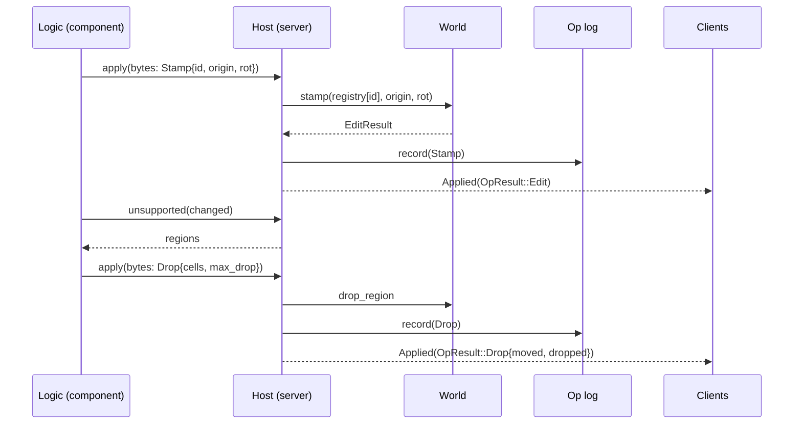

# 0018: Stamp, drop and remove as op kinds 2 to 4 through the server, the log and the logic host

> **Status:** in-progress
> **Created:** 2026-10-17
> **Milestone:** M5 (the simulation split, completed for every op) and M8 (collapse through the log) in `docs/roadmap.md`
> **Related ADRs:** [ADR-0014](../adrs/0014-prefab-identity-in-the-op-log.md) (proposed; how a
> stamp names its prefab), [ADR-0007](../adrs/0007-server-op-log-byte-channel-shared-and-owned-clients.md)
> (the log and the clients), [ADR-0008](../adrs/0008-collapse-as-capped-support-flood-and-rigid-vertical-drop.md)
> (collapse ops "replicate through the op log like any edit"), [ADR-0010](../adrs/0010-game-logic-as-a-component-behind-a-logic-trait.md)
> (ops cross the boundary as bytes; a support query import was anticipated).
> **Prerequisite:** none; Plan 0016's restart change touches the same `vxe-net` report type,
> so the second to merge resolves it.
> **Source:** `docs/decisions-pending.md` (answered and deleted; read it with `git show 880982c:docs/decisions-pending.md`) D7 item 1; Plan 0008's followup (stamp as kind 2);
> Plan 0009's followup (drop and remove as kinds 3 and 4); Plan 0007's gating of `--vault`,
> `P` and collapse under `--save`.

## TL;DR

Only shape edits go through the server today; the fly-through's `P` stamp and its collapse
write to the world directly, which is why they are refused under `--save` and `--replay`.
This plan gives stamp, drop and remove their wire kinds, routes them through `submit`, the
op log, `Host::apply` and the clients' desync check, moves the coarse grid into the server
so a logic can ask which regions an edit left unsupported, and moves the fly-through's
stamp and collapse policy into its dig logic. The first thing a reader sees is a saved
session with a `P` stamp and a falling slab replaying to the same hash on both CI arms.

## Context & problem

`Op` has one variant and derives `Copy` (`crates/vxe-world/src/log.rs:34-48`);
`decode_op` refuses kinds 2 to 4 (`wire.rs:242-246`) and a log test pins that
(`tests/log.rs:338-357`). `World::stamp(prefab, origin, rot)` (`stamp.rs:236-307`),
`drop_region(cells, max_drop)` and `remove_region(cells, rubble, fraction, max_depth)`
(`collapse.rs:434`, `:546`) exist with their own result types, whose `dropped` and
`placed` fields are lost in `edit_result()`. `Host::apply` takes an `EditOp`
(`crates/vxe-net/src/logic.rs:63-73`); the WIT `apply` takes wire bytes, so a new kind
needs no WIT change, but a wider answer does. `find_unsupported` needs a `CoarseGrid`,
which the fly-through owns (`main.rs:640+`), not the server. The fly-through stamps in
`stamp_at_aim` straight on the server's `Arc<World>` (`main.rs:371-378`) and collapses in
`Coarse::collapse` and `Coarse::fall` the same way (`:686-769`), eight voxels per frame.
`Message::Applied` carries an `EditResult` only; the owned client's `check` compares
`EditResult`s (`client.rs:162-174`).

Budgets touched: `nfr.md` §4 logs (new entry sizes), §4 tick overhead (the grid update in
the server tick), §8 coarse grid update (now on the server's path).

## Decision

Kinds 2, 3 and 4 get wire encodings; `Op` becomes `Edit | Stamp | Drop | Remove` and
`Clone`; results become `OpResult::{Edit, Drop, Remove}` end to end (messages, the WIT
answer, the owned client's check). A stamp names its prefab by content id against a
registry on the server (ADR-0014), and the save header carries the prefabs it names
(`LOG_FORMAT` 2). The server owns a `CoarseGrid` kept current from every applied result,
and `Host` gains `unsupported(changed cells) -> Vec<Region>` so the logic decides what
falls. The fly-through's `P` becomes a `Stamp` input its dig logic turns into a stamp op,
and the dig logic runs the support query after its carves and issues drop or remove ops
per tick; the `--save` and `--replay` gates go. We rejected keeping collapse in the
application with a direct world write under a "not logged" flag (the owner's D7 asked for
the log), and a separate region log beside the op log (two streams to keep in order).

## Architecture diagram



## Implementation phases

### Phase 1: Wire kinds 2 to 4 and the save header's prefab table
- **Owner skill:** dev
- **What:** `Op::{Stamp, Drop, Remove}` with their encodings (sizes below), `u32` counts
  for cell lists, `LOG_FORMAT` 2 with the prefab table, `LogEntry` and `Op` as `Clone`,
  `resimulate` over references.
- **Files touched:** `crates/vxe-world/src/{log.rs, wire.rs, prefab.rs}`,
  `crates/vxe-world/tests/log.rs`, `crates/vxe-net/src/server.rs` (`resimulate`),
  `apps/flythrough/tests/{determinism.rs, replay.rs}` (header length).
- **Done when:**
  - Entry sizes, asserted: a stamp 34 bytes (12 + kind 1 + id 8 + origin 12 + rotation 1);
    a drop `21 + 12n` (12 + kind 1 + max_drop 4 + count 4 + cells); a remove `31 + 12n`
    (12 + kind 1 + rubble 2 + fraction 8 + max_depth 4 + count 4 + cells); the kind-1 sizes
    (47, 65, 75) and the boundary (13) are unchanged.
  - `OP_LOG_HASH` `0x5ac8_737d_db0f_ccec` is unchanged (kind-1 bytes identical).
  - A save with one vault stamp has a header of `60 + 4 + 8 + 8 716` bytes and decodes;
    the same file with one byte of the vault's content flipped is refused with
    `PrefabMismatch { id }`; a format-1 file still decodes (no table).
  - `every_tag_round_trips` covers the three new kinds, including a drop with 4 096 cells
    and a rotation index of 23; an unknown kind 5 is still `UnknownKind`.

### Phase 2: The server applies every kind, with full results
- **Owner skill:** dev
- **What:** `PrefabRegistry` on the server (`Server::register_prefab(Arc<Prefab>)`, refusing
  a duplicate id with different content), `OpResult`, `submit(Op)`, `TickHost` applying all
  kinds, `Message::Applied(OpResult)`, the owned client checking `OpResult` equality, the
  shared client passing it through; the server's `CoarseGrid` updated from each result's
  touched region.
- **Files touched:** `crates/vxe-net/src/{server.rs, client.rs, message.rs, logic.rs}`,
  `crates/vxe-net/tests/*.rs`, `crates/vxe-world/src/collapse.rs` (results keep their
  fields), `crates/vxe-world/src/coarse.rs` (an update-from-aabb entry point if missing).
- **Done when:**
  - A session that submits a vault stamp at `(32, 32, 32)` rotation 0, then a carve of the
    pillar under a 3 x 3 slab, then `drop_region` of the slab by 8 four times and
    `remove_region` of a second slab with rubble 1/4: the owned client's world hash equals
    the server's after every tick; the log replays from seed to the same hash; the test
    pins the hash (blessed on Linux, the Windows arm confirms).
  - `Applied(OpResult::Drop { dropped: 8, .. })` reaches a shared client for each of the
    four drops and `Remove { placed, .. }` for the removal, with the counts the direct
    `World` calls return.
  - A stamp of an unregistered id is `Refused(EditError::UnknownPrefab(id))`, logged as a
    refusal (not an op), and the owned client reports no desync.
  - The server's coarse grid after the session equals a grid built fresh from the world
    (`CoarseGrid::build == server.coarse()`).

### Phase 3: The host and the component: every kind through `apply`, and `unsupported`
- **Owner skill:** dev
- **What:** `Host::apply(Op) -> Result<OpResult, EditError>`; the WIT answer tag 0 carries an
  `OpResult` encoding (kind byte, then the result); a new import `unsupported(changed:
  list<cell>) -> list<region>` with `SupportParams` and `Anchors` configured on the server;
  the guest crate's helpers.
- **Files touched:** `crates/vxe-script-wasm/wit/logic.wit`, `src/{host.rs, guest.rs, lib.rs}`,
  `crates/vxe-net/src/logic.rs`, `crates/vxe-script-wasm/guests/echo` (echoes every kind),
  `crates/vxe-script-wasm/tests/equality.rs`.
- **Done when:**
  - The echo logic hosted as a component and linked natively give byte-equal op logs and
    equal world hashes on an input script that stamps, drops and removes; `ECHO_HASH`
    stays `0x8f7d_4016_15d9_5c4d` on the old script and a second pinned hash covers the
    new one.
  - `unsupported` from the component after a carve under the test slab returns one region
    with the slab's 9 cells and its material counts, equal to the native call.
  - A component asking to stamp an unknown id receives answer tag 1 with
    `UnknownPrefab(id)` and is not trapped.

### Phase 4: The fly-through: `P` and collapse through the logic, the gates gone
- **Owner skill:** dev
- **What:** `P` sends a `Stamp` input; the dig logic turns it into `Op::Stamp` with the
  vault's id (registered at startup on server and client); after each carve the logic calls
  `unsupported` and queues regions: `fall` mode issues `Drop { max_drop: 8 }` per tick until
  `dropped == 0`, `crumble` mode issues `Remove`; `R` becomes an input that flips the mode;
  the `--vault`, `P` and collapse gates under `--save`/`--replay` are removed; the module
  docs at `main.rs:36-43` say what is logged now (everything).
- **Files touched:** `apps/flythrough/logic/src/lib.rs`, `apps/flythrough/src/{main.rs,
  lib.rs, cave.rs}`, `apps/flythrough/tests/{replay.rs, determinism.rs}`, `README.md`.
- **Done when:**
  - `flythrough --level --seed 1 --headless --save s.vxl` driven by a scripted input list
    (a `P` stamp, a dig under a ledge, 20 ticks of falling, `R`, a second dig, 5 ticks)
    writes a file whose replay with `--replay s.vxl` prints the same world hash; the hash
    is pinned in `tests/replay.rs` and the Windows arm confirms it.
  - The same session with `--logic wasm` gives the same file bytes and hash as native.
  - `--level --vault --save` is accepted (the vault placement at generation is not an op;
    the save records the generation extent and seed as before).
  - The interactive `P`, `R` and collapse behave as before by eye (a windowed check for the
    owner, listed in the log, not a phase).

### Phase 5: Readings
- **Owner skill:** dev
- **What:** `nfr.md` §4 logs (the new entry sizes), §4 tick overhead with the grid update
  (`cargo bench -p vxe-net --bench tick` beside the Plan 0007 reading of 84.7 µs per 100
  inputs), §8 coarse update on the server path.
- **Files touched:** `docs/nfr.md`, `crates/vxe-net/benches/tick.rs`.
- **Done when:** the three readings are in `nfr.md` with machine, commit and load; the tick
  overhead with the grid stays under the 100 µs line or the miss is recorded.

## Data shapes

```rust
// illustrative
pub enum Op {
    Edit(EditOp),
    Stamp { prefab: u64, origin: VoxelCoord, rot: u8 }, // rot indexes Rot::all()
    Drop { cells: Vec<CellCoord>, max_drop: i32 },
    Remove { cells: Vec<CellCoord>, rubble: MaterialId, fraction: (u32, u32), max_depth: i32 },
}
pub enum OpResult { Edit(EditResult), Drop(DropResult), Remove(RemoveResult) }
pub enum EditError { NotResident(ChunkCoord), UnknownPrefab(u64), /* Plan 0019 adds OutOfRange */ }
// save header, LOG_FORMAT 2: the 60 fixed bytes, then prefab count u32, then per prefab
// id u64, size 3 x u32, voxels u16 x n, mask u64 x ceil(n / 64)
```

## Budgets

- **§4 logs:** a stamp 34 B; a drop `21 + 12n`; a remove `31 + 12n`; a 4 096-cell region
  49 173 B per op; a falling slab re-sends its cells each tick (about 9 cells in the test,
  129 B per tick).
- **§4 tick overhead:** the coarse update (13.5 µs per radius-1 m carve, §8) joins the
  server tick; the bench's 100 carves per tick add about 1.35 ms by that reading, which is
  the edit work, not overhead; the overhead line (100 µs per 100 inputs) is re-read.
- **§4 saves:** plus the prefab table, once per prefab.

## Risks & open questions

- **Determinism:** every new op is integer and already deterministic as a `World` call;
  the ordering risk is the grid update, which runs on the server thread in op order. The
  pinned hashes gain two vectors (Phase 2 and Phase 4) confirmed on both arms.
- **`Op` loses `Copy`.** `resimulate` and any `*e` pattern on `LogEntry` change; the
  compiler finds them.
- **A region op from a stale query:** the logic may issue a drop for cells an earlier op
  already moved; `drop_region` answers with `dropped == 0` and the logic stops, as the
  fly-through does today.
- **The client's registry.** Both sides register the vault at startup; a game registers its
  assets the same way. A missing id is a desync, by ADR-0014.

## What this plan does NOT do

- Prefab content over the channel, late join, snapshots (M9).
- Range checks on the new ops' fields (Plan 0019 covers shapes; cell lists are capped by
  `max_region` on the server, which refuses a longer list as `OutOfRange` once Plan 0019
  adds the variant).
- The cosmetic rigid-body layer (M8, after M6).

## Implementation log

> Written by `dev`: one row per phase as its commit lands, then the close block. **The phases
> above are the contract. This section records what happened.** Observations, never
> conclusions: no pass list, no self-assessment. Deviations and unmet done-whens are
> **always** disclosed. Keep it shorter than `## Implementation phases`.

| phase | owner | state | commit |
|---|---|---|---|
| 1: Wire kinds 2 to 4 and the prefab table | dev | done | e1b17d3 |
| 2: The server applies every kind | dev | done | committed with this row |
| 3: The host and the component | dev | not started | |
| 4: The fly-through through the logic | dev | not started | |
| 5: Readings | dev | not started | |

### Notes

- Phase 1: `EditError::UnknownPrefab`, its wire error tag (3; tag 2 left to Plan 0019's
  `OutOfRange`) and `OpResult` with its wire encoding (`encode_op_result`, kind byte 1, 3 or 4)
  landed here, in `crates/vxe-world/src/edit.rs` (not in any phase's Files touched) and `wire.rs`.
- Phase 1: `PrefabRegistry` and `PrefabCollision` live in `vxe-world` (`prefab.rs`), so the
  server, the clients and `LogFile.prefabs` share one type; `Op::apply` and `World::replay`
  take a registry. `Op::Stamp.rot` is a `Rot`, its wire byte the `Rot::all` index.
- Phase 1: compile-only edits outside the phase's Files touched: `vxe-net` `client.rs`,
  `test_logic.rs`, `tests/{logic,shared}.rs`; `vxe-script-wasm` `src/host.rs`,
  `tests/determinism.rs`; `vxe-world` `benches/replay.rs` (header 60 -> 64);
  `apps/flythrough` `src/{lib,main}.rs`, `tests/component.rs` (`LogFile.prefabs`). The
  server and client pass an empty registry until Phase 2; the host and `EchoLogic` treat the
  new kinds as undecodable until Phase 3.
- Phase 2: `Server::with_prefabs(world, prefabs, logic, seed)` registers prefabs before
  `init`; `Server::resimulate` gained a `prefabs` argument (callers in
  `vxe-script-wasm/tests/{equality,determinism}.rs` and `apps/flythrough/src/lib.rs` updated
  outside the phase's Files touched, as are `apps/flythrough/src/main.rs` and
  `tests/replay.rs`, which read `OpResult::edit_result()`); `Event::Desync.ours` is `Option<OpResult>` (`None` when
  the client refused). The coarse grid's new entry point is `CoarseGrid::update_aabb`.
- Phase 2: `Message::Applied` grew by the result's kind byte (96 bytes for the shared test's
  carve, was 95); `tests/owned.rs`' desync assertion now names the client's own empty
  `OpResult::Edit` where it compared against an empty `EditResult`.
- Phase 2: the session test is `crates/vxe-net/tests/kinds.rs` on a 2³-chunk air world with a
  floor and two slabs on pillars; `KINDS_HASH` `0x2077_5c41_d63d_17c5` blessed on Linux x86_64,
  the Windows arm not yet run.

### Close triggers

_(Facts for the architect. No recommendations, and no suggested version bump.)_

- **What shipped:**
- **Public API changed:**
- **Budget readings:**
- **Gate at the tip:**
- **Outstanding `human` phases:**

## Followups

- None at draft time.
