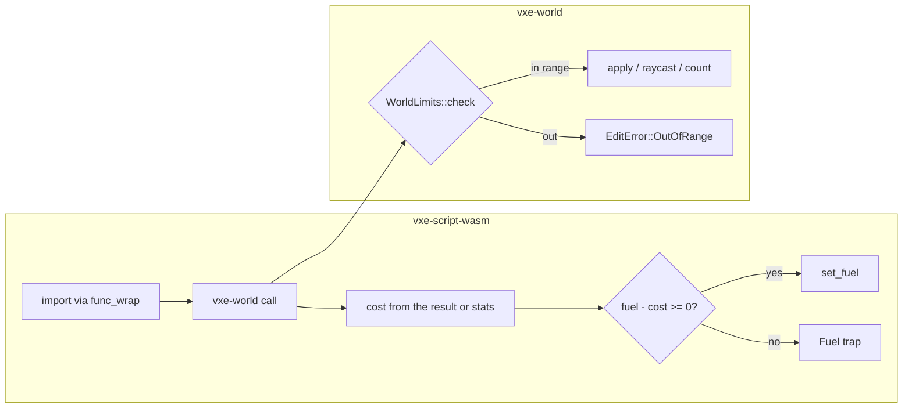

# 0019: Host calls charged by their work, and a world that refuses out-of-range shapes and queries

> **Status:** draft
> **Created:** 2026-10-17
> **Milestone:** M5 in `docs/roadmap.md` (the logic host's safety) and M1's edit contract
> **Related ADRs:** [ADR-0010](../adrs/0010-game-logic-as-a-component-behind-a-logic-trait.md)
> (its Outcome records that host-call work is unmetered), ADR-0002 (the edit contract: every
> op returns what it changed, or an error).
> **Prerequisite:** none; it adds an `EditError` variant and a wire error tag that Plan 0018
> also touches, so the second to merge resolves it.
> **Source:** `docs/decisions-pending.md` D7 item 2; Plan 0011 Followups ("bounded or metered
> host-call work" and "`vxe-world` range checks on shapes").

## TL;DR

A component is metered by fuel for its own instructions but not for the work it causes:
a `count_in_box` from `i32::MIN` to `i32::MAX` visits about 2^78 chunk coordinates, a
raycast with `max = i64::MAX` walks until it leaves the lattice, and a sphere of radius
`i64::MAX` overflows the fixed-point math (a panic in debug, a wrong answer in release).
This plan makes `vxe-world` validate every shape, ray and box against a documented range
and refuse the rest with `EditError::OutOfRange`, and makes the host charge fuel for each
import by the work it did, so a greedy query ends the tick as a fuel trap. The first thing
a reader sees is the overflow test in `vxe-script-wasm` turned from "a trap, not a panic"
into "refused with `OutOfRange`, no trap".

## Context & problem

Fuel is set per call (`crates/vxe-script-wasm/src/host.rs:413-415`) and counts guest
instructions only. The four imports (`wit/logic.wit:8-29`) cost the host: `apply` decodes
and runs `World::apply` over every chunk in the shape's bounds (`edit.rs:324-346`);
`raycast` has no step cap (`raycast.rs:86`); `count_in_box` visits every chunk coordinate
in the box, resident or not (`query.rs:105-112`). The imports get `&mut State` and cannot
reach the store's fuel; `shadow_timers` shows the `func_wrap` form that can
(`host.rs:229-246`). `catch_unwind` turns a host panic into a trap (`host.rs:159-175`),
which is how the overflow test passes today (`tests/determinism.rs:422-438`, debug only).

`shape.rs:3-5` documents exactness within ±2^30 fixed-point units (±4 M voxels) and nothing
enforces it: `v ± r` (`shape.rs:41-42`), `f - FIXED_HALF` (`fixed.rs:37`), `r * r`
(`shape.rs:66`), the capsule's `i128` products past 2^30, the raycast's `o * den * one`
(`raycast.rs:155`) and `to_i32`'s clamp (`edit.rs:304-306`), which aliases chunks silently.
Release builds wrap (`Cargo.toml:81-85` sets no `overflow-checks`). The wire decoder accepts
any `i64` (`wire.rs:242-273`) and a log test round-trips a box from `i64::MIN` to `i64::MAX`.
`EditError` has one variant (`edit.rs:49-63`) and one wire tag (`wire.rs:47`).

Budgets touched: `nfr.md` §4 component boundary (the per-call cost gains a fuel read and
write; the 2 µs line is re-read) and a new line for metered work.

## Decision

`vxe-world` gains `WorldLimits` (coordinates and radii within ±2^30 fixed units; a ray's
`max_t` at most 2^22 fixed units, 16 384 voxels; a box query at most 2^30 voxels and 1 024
per axis; all configurable, with the documented defaults) and every shape, ray and box is
validated at the API boundary before any arithmetic, returning `EditError::OutOfRange
{ what }` with wire tag 2; `World::apply` keeps the `to_i32` clamp as a debug assertion that
can no longer fire. The host charges fuel per import after it returns: `apply` by the
voxels in the shape's bounds plus 64 per touched chunk, `raycast` by its steps, `count_in_box`
by the voxel arrays it read (`count_in_box_with_stats`), `material_at` a constant, at
10 fuel units per voxel-equivalent; a charge past the remaining fuel is the same
`LogicError::Fuel` trap as an instruction overrun. We rejected per-import extent caps alone
(a cap says nothing about a thousand small calls) and a wall-clock budget (the host must
not read the clock on the server path; `clippy.toml` denies it).

## Architecture diagram



## Implementation phases

### Phase 1: `WorldLimits` and `OutOfRange`
- **Owner skill:** dev
- **What:** the limits type with its defaults, `Shape::check(&limits)`, checks in
  `World::apply`, `raycast`, `count_in_box` and the region queries, the error variant and
  its wire tag, the decoder unchanged (range is the world's call, not the format's).
- **Files touched:** `crates/vxe-world/src/{limits.rs (new), shape.rs, edit.rs, raycast.rs,
  query.rs, wire.rs, lib.rs}`, `crates/vxe-world/tests/{edits.rs, shapes.rs, log.rs}`,
  `crates/vxe-net/src/server.rs` (the refusal reaches `Refused`), `docs/nfr.md` §4.
- **Done when:**
  - `EditOp::sphere(Fixed3([0; 3]), i64::MAX, Carve)` applied to `solid3_world()` returns
    `Err(OutOfRange { what: Radius })` and changes nothing, in debug and in release
    (`cargo test --release -p vxe-world` runs the case).
  - A sphere of radius exactly `2^30` at the origin is accepted; `2^30 + 1` is refused; a
    box whose `max` is `i64::MIN` is refused; a capsule whose endpoints are `±2^30` is
    accepted and a longer one refused; a reversed box still gives an empty result.
  - `World::raycast` with `max_t = 2^22 + 1` is refused and with `2^22` runs; a ray that
    runs the full `2^22` (16 384 voxels) through an empty world returns `None` within a
    counted `steps <= 16 384 / 64 + 2 = 258` (absent chunks are 64-voxel cells).
  - `count_in_box` over 1 025 voxels on one axis is refused; over `1 024^3` it runs and
    `QueryStats.voxel_arrays_read` is reported.
  - `every_tag_round_trips` keeps its extreme values (the format accepts them; the world
    refuses them) and a new test replays a log holding an out-of-range op to a `Refused`
    entry on both the server and an owned client, with no desync.
  - The determinism vector's hashes are unchanged.

### Phase 2: Fuel charged by work
- **Owner skill:** dev
- **What:** the four imports re-registered through `func_wrap` with `StoreContextMut`, a
  `WorkRates` struct on `WasmConfig` (per voxel, per step, per array, per call), the charge
  after each import, the `Fuel` trap on overrun, `Hit` gaining `steps` through a
  `raycast_with_stats` and `count_in_box_with_stats` on the host path.
- **Files touched:** `crates/vxe-script-wasm/src/host.rs`, `crates/vxe-world/src/raycast.rs`,
  `crates/vxe-net/src/logic.rs` (if `Host` carries stats), `crates/vxe-script-wasm/tests/determinism.rs`,
  `crates/vxe-script-wasm/guests/probe` or a new `greedy` guest, `benches/boundary.rs`.
- **Done when:**
  - A `greedy` guest that asks `count_in_box` over `1 024^3` voxels of a solid world in one
    tick traps with `Fuel{tick}` at the default fuel (its charge is `10 x 2^30`, above
    `fuel_per_tick`); the same guest over `64^3` completes.
  - A guest that casts 10 000 rays of `max_t = 2^22` through an empty world traps with
    `Fuel{tick}`; 100 such rays complete, and the fuel left after the tick, read through a
    test hook, equals `fuel_per_tick` minus the charged sum exactly.
  - The echo logic's 100 carves per tick stay under fuel, and `ECHO_HASH` is unchanged;
    `WorkRates::ZERO` reproduces today's accounting (no charge).
  - `cargo bench -p vxe-script-wasm --bench boundary`, quiet box, paired with the parent:
    the per-call cost is within 0.3 µs of the parent's reading (the 2 µs line holds or the
    miss is recorded).

### Phase 3: Readings and the lines
- **Owner skill:** dev
- **What:** `nfr.md` §4: the component paragraph gains "host-call work is charged to fuel
  at the configured rates", the per-call reading, and the limits as the documented range.
- **Files touched:** `docs/nfr.md`, `docs/adrs/0010-*.md` (a dated Outcome at the close, by
  the architect).
- **Done when:** the readings are in `nfr.md` with machine, commit and load.

## Data shapes

```rust
// illustrative
pub struct WorldLimits {
    pub coord_max: i64,      // 1 << 30 fixed units, inclusive, on every coordinate and radius
    pub ray_max_t: i64,      // 1 << 22
    pub query_axis_max: u32, // 1024 voxels
    pub query_voxels_max: u64, // 1 << 30
}
pub enum EditError { NotResident(ChunkCoord), OutOfRange { what: Field } }
pub struct WorkRates { pub per_voxel: u64, pub per_step: u64, pub per_array: u64, pub per_call: u64 }
// defaults 10, 10, 5120 (one array of 512 voxels), 100
```

## Budgets

- **§4 component boundary:** a fuel read and write per import, about tens of nanoseconds;
  the 2 µs per-call line is re-read in Phase 2.
- **§4, new:** "a host import's work is charged to the tick's fuel at `WorkRates`"; the
  greedy cases above are the asserted bound.
- Nothing else moves; the checks are a handful of comparisons per op.

## Risks & open questions

- **Determinism.** Charges come from integer counts the world already produces (voxel
  counts, steps, arrays read), so a trap lands on the same tick on both arms; the
  equality test covers a charged session. Rates are part of `WasmConfig`, which ADR-0010's
  Outcome says the save header does not yet record; a replay with different rates can trap
  at a different tick, which is the same hazard as a different `fuel_per_tick` today, noted
  in the Outcome.
- **The limits break no consumer**: ±4 M voxels is 400 km at 10 cm; the level is 1 280.
- **A charge after the work** means one greedy call still runs to completion before the
  trap; the range limits bound that single call (at most `2^30` voxels for a query).

## What this plan does NOT do

- Metering the native `Host` (a native logic is trusted code).
- Capping the cell lists of Plan 0018's region ops (that plan's server refuses lists longer
  than `max_region` using this plan's variant).
- Any change to the wire format's accepted ranges.

## Implementation log

> Written by `dev`: one row per phase as its commit lands, then the close block. **The phases
> above are the contract. This section records what happened.** Observations, never
> conclusions: no pass list, no self-assessment. Deviations and unmet done-whens are
> **always** disclosed. Keep it shorter than `## Implementation phases`.

| phase | owner | state | commit |
|---|---|---|---|
| 1: `WorldLimits` and `OutOfRange` | dev | not started | |
| 2: Fuel charged by work | dev | not started | |
| 3: Readings and the lines | dev | not started | |

### Notes

_(Deviations from the plan, with the commit, stated without justification. Done-whens not
satisfiable as stated, and what was done instead. Followups noticed and not acted on. One line
each. Empty is fine.)_

### Close triggers

_(Facts for the architect. No recommendations, and no suggested version bump.)_

- **What shipped:**
- **Public API changed:**
- **Budget readings:**
- **Gate at the tip:**
- **Outstanding `human` phases:**

## Followups

- None at draft time.
