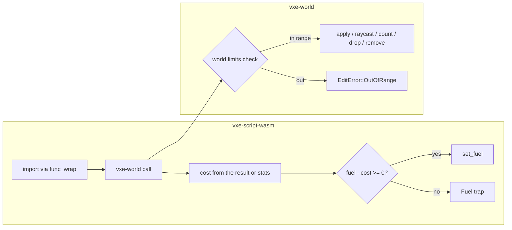

# 0019: Host calls charged by their work, and a world that refuses out-of-range shapes and queries

> **Status:** in-progress
> **Created:** 2026-10-17
> **Amended:** 2026-10-20, owner-approved, after Phase 1 stopped on the questions in its resume
> notes: `World::raycast` and `World::count_in_box` return `Result`, and their callers are in
> Files touched; the limits are per world (`store.rs`); a ray's reach is capped per axis, not
> only its `max_t`; a capsule's per-axis length is capped at `2^30`, derived below; an edit's
> voxel bounds are capped at 1 024 per axis; `count_in_box` is charged by the voxels it
> counts; the cap on drop and remove cell lists moves here from Plan 0018.
> **Milestone:** M5 in `docs/roadmap.md` (the logic host's safety) and M1's edit contract
> **Related ADRs:** [ADR-0010](../adrs/0010-game-logic-as-a-component-behind-a-logic-trait.md)
> (its Outcome records that host-call work is unmetered), ADR-0002 (the edit contract: every
> op returns what it changed, or an error).
> **Prerequisite:** none; it adds an `EditError` variant and a wire error tag that Plan 0018
> also touches, so the second to merge resolves it. Plan 0018 has closed; its op variants
> (`Stamp`, `Drop`, `Remove`) and `UnknownPrefab` (error tag 3) are in this branch's base.
> **Source:** `docs/decisions-pending.md` (answered and deleted; read it with `git show 880982c:docs/decisions-pending.md`) D7 item 2; Plan 0011 Followups ("bounded or metered
> host-call work" and "`vxe-world` range checks on shapes"); Plan 0018's followup "cell lists
> in drop and remove ops are not capped".

## TL;DR

A component is metered by fuel for its own instructions but not for the work it causes:
a `count_in_box` from `i32::MIN` to `i32::MAX` visits about 2^78 chunk coordinates, a
raycast with `max = i64::MAX` walks until it leaves the lattice, and a sphere of radius
`i64::MAX` overflows the fixed-point math (a panic in debug, a wrong answer in release).
This plan makes `vxe-world` validate every shape, ray, box and region cell list against the
world's limits and refuse the rest with `EditError::OutOfRange`, and makes the host charge
fuel for each import by the work it did, so a greedy query ends the tick as a fuel trap. The
first thing a reader sees is the overflow test in `vxe-script-wasm` turned from "a trap, not
a panic" into "refused with `OutOfRange`, no trap".

## Context & problem

Fuel is set per call (`crates/vxe-script-wasm/src/host.rs:413-415`) and counts guest
instructions only. The four imports (`wit/logic.wit:8-29`) cost the host: `apply` decodes
and runs `World::apply`, which walks every chunk coordinate in the shape's bounds before it
can fail with `NotResident` (`edit.rs:326-365`); `raycast` has no step cap
(`raycast.rs:98`), and its reach is `|dir| x max_t / 256`, so a large `dir` reaches as far
as a large `max_t`; `count_in_box` visits every chunk coordinate in the box, resident or not
(`query.rs:45-47`). The imports get `&mut State` and cannot reach the store's fuel;
`shadow_timers` shows the `func_wrap` form that can (`host.rs:229-246`). `catch_unwind`
turns a host panic into a trap (`host.rs:159-175`), which is how the overflow test passed
before Phase 1 (`tests/determinism.rs:422-438`, debug only).

`shape.rs:3-5` claims exactness "for coordinates within ±2^30 fixed-point units of each
other", and the landed `WorldLimits` checks each coordinate against ±2^30 on its own. That
lets a capsule's ends lie `2^31` apart on an axis, and then `ww * len2` (`shape.rs:331`, and
the same product in `CapsuleRow::contains`) reaches `81 x 2^122`, about `2^128.3`, past
`i128::MAX`. Elsewhere `v ± r` (`shape.rs:41-42`), `f - FIXED_HALF` (`fixed.rs:37`), `r * r`
(`shape.rs:66`), the raycast's `o * den * one` (`raycast.rs:249`) and `to_i32`'s clamp
(`edit.rs:315-320`), which aliases chunks silently, are safe only inside a range nothing
enforced. Release builds wrap (`Cargo.toml:81-85` sets no `overflow-checks`). The wire
decoder accepts any `i64` (`wire.rs`) and a log test round-trips a box from `i64::MIN` to
`i64::MAX`. Plan 0018's `Drop` and `Remove` ops carry cell lists of any length; each cell is
a brick-sized column scan.

Budgets touched: `nfr.md` §4 component boundary (the per-call cost gains a fuel read and
write; the 2 µs line is re-read) and a new line for metered work.

## Decision

`vxe-world` gains `WorldLimits`, held per `World` (`World::limits`, `World::with_limits`;
`WorldLimits::DEFAULT` for every constructor), and every shape, ray, box query and region
cell list is validated before any arithmetic, returning `EditError::OutOfRange { what }`
with wire tag 2 and nothing changed. The limits and their defaults:

| field | default | refuses, as `Field::` |
|---|---|---|
| `coord_max` | `2^30` fixed units | any coordinate or radius beyond it: `Coord`, `Radius` |
| `capsule_axis_max` | `2^30` fixed units | a capsule with `abs(b[k] - a[k])` beyond it on any axis: `CapsuleLength` |
| `edit_axis_max` | 1 024 voxels | a shape whose `voxel_bounds` span more on any axis: `EditExtent` |
| `ray_reach_max` | `2^22` fixed units | a ray with `abs(dir[k]) x max(max_t, 0) > 256 x ray_reach_max` on any axis: `RayLength` |
| `query_axis_max` | 1 024 voxels | a box query wider on any axis: `QueryAxis` |
| `query_voxels_max` | `2^30` voxels | a box query holding more: `QueryVolume` |
| `region_cells_max` | 4 096 cells | a `drop_region` or `remove_region` cell list longer: `RegionCells` |

`World::raycast` returns `Result<Option<Hit>, EditError>` and `World::count_in_box` (and
`count_in_box_with_stats`) `Result<Vec<..>, EditError>`. The `Host` trait and the WIT world
keep their signatures: the server's `Host` maps a refused ray to no hit and a refused count
to an empty list, so the boundary does not change in this plan. `World::apply` keeps the
`to_i32` clamp as a debug assertion that can no longer fire.

The host charges fuel per import after it returns, at `WorkRates` on `WasmConfig`: every
call `per_call`; `apply` additionally `per_voxel` times the voxels in the shape's voxel
bounds plus 64 `per_voxel` per touched chunk; `raycast` `per_step` times its steps;
`count_in_box` `per_voxel` times the voxels it counted (the sum of the returned counts, the
box's resident volume); `material_at` `per_call` only. A refused call is charged `per_call`
only. A charge past the remaining fuel is the same `LogicError::Fuel` trap as an instruction
overrun. We rejected per-import extent caps alone (a cap says nothing about a thousand small
calls) and a wall-clock budget (the host must not read the clock on the server path;
`clippy.toml` denies it).

### Where each bound comes from

- **Ray reach, per axis.** The ray is `origin + dir x t / 256`, so at `t = max_t` it has
  moved `dir[k] x max_t / 256` fixed units along axis `k`. Capping that product, computed
  in `i128` (two `i64` magnitudes multiply to at most `2^126`, exact), bounds the walk
  whatever `dir` is. `2^22` fixed units is 16 384 voxels per axis; with `abs(dir) = 256`
  along an axis (the convention of every caller: the fly-through's `REACH` of 100 voxels,
  the autopilot's 300 and `hero`'s 400), the limit is `max_t <= 2^22`, as before. An empty
  world's walk skips 64-voxel cells, and a 16 384-voxel unaligned span crosses at most 257
  chunk boundaries per axis: at most `1 + 257 = 258` steps along an axis, `1 + 3 x 257 = 772`
  on a diagonal. Inside the range the walk's `i128` products stay below `2^104`.
- **Capsule length, per axis.** `segment_dist2` and `CapsuleRow::contains` form `ww x len2`
  with `len2 = |b - a|^2` and `ww = |p - a|^2`. With `C = coord_max` bounding `abs(r)` and
  every coordinate, and `L` bounding `abs(b[k] - a[k])`, a tested point `p` lies inside the
  shape's voxel bounds (each axis within `[min(a, b) - r, max(a, b) + r]`; `apply` clips
  every chunk and brick box to them before `coverage` takes its midpoint), so
  `abs(p[k] - a[k]) <= L + C`. Then `ww <= 3 (L + C)^2`, `len2 <= 3 L^2`, and
  `ww x len2 <= 9 L^2 (L + C)^2`. By Cauchy-Schwarz `t^2 <= ww x len2`, `r^2 x len2 <= 3 C^2
  L^2` is smaller, and `coverage`'s `reach^2 x den` with `reach = r + h`, `h < 2^14` (half a
  chunk's diagonal), is below `3 (C + 2^14)^2 L^2`, smaller again. Exactness needs
  `9 L^2 (L + C)^2 <= 2^127 - 1`, that is `L (L + C) <= 2^63.5 / 3`, about `4.35 x 10^18`.
  With `C = 2^30` the largest safe `L` is `(-C + sqrt(C^2 + 4 x 4.35 x 10^18)) / 2`, about
  `1.616 x 10^9` fixed units (`2^30.59`, 6.3 M voxels). The default takes the power of two
  below it, `L = 2^30`: `9 x 2^60 x (2^31)^2 = 9 x 2^122`, about `2^125.17`, a factor of 3.6
  under `i128::MAX`. Without the cap, ends at `±2^30` give `L = 2^31` and `81 x 2^122`,
  which overflows. `CapsuleRow::nearest`'s closed form needs components at most `2^31`
  apart, which the cap keeps. The sphere's `i64` sums stay below `3 x 2^60` for any point in
  its bounds, and the box multiplies nothing. **The shape module's claim is restated in
  Phase 1:** sphere and box are exact for coordinates and radii within `±coord_max`; the
  capsule also needs each axis of `b - a` within `capsule_axis_max`; both for points within
  the shape's voxel bounds (`Shape::contains` on a point far outside them is not covered).
- **Edit extent.** `voxel_bounds` is computed after the range check (it is exact there), and
  a shape spanning more than `edit_axis_max` voxels on an axis is refused before the
  residency walk. 1 024 voxels span at most 17 chunks per axis, so the walk visits at most
  `17^3 = 4 913` chunk coordinates before it applies or fails `NotResident`. Every existing
  legitimate edit passes with room: the fly-through's dig is a capsule of at most `REACH`
  (100 voxels) with radius at most 30 voxels, at most `100 + 2 x 30 + 1 = 161` voxels per
  axis; the autopilot's dig `300 + 2 x 10 + 1 = 321`; the fill sphere 7 and the `B` bench's
  carves 21; `hero --carve R` is `2R + 1`; the determinism vector's largest op is its
  256-voxel box and the replay session's widest dig 181. Collapse, stamps and the vault do
  not go through `World::apply`: `Drop` and `Remove` are bounded by `region_cells_max`, and a
  stamp by its registered prefab (the vault is 16^3).
- **Region cells.** 4 096 is `vxe_net::DEFAULT_SUPPORT.max_region`, the largest region the
  support query reports, so every region a logic gets from `unsupported` can be dropped or
  removed whole. A game that raises `max_region` raises `region_cells_max` with it.
- **Box queries** keep the landed defaults. `world_budget` counts over the whole level
  (20 x 20 x 8 chunks: 1 280 voxels on x and y, `838 860 800` voxels), so it builds its world
  `with_limits` sized to its extent.

## Architecture diagram



## Implementation phases

### Phase 1: `WorldLimits` and `OutOfRange`
- **Owner skill:** dev
- **What:** the limits type with the defaults above, held per world; `Shape::check(&limits)`
  covering coordinates, radii, capsule length and edit extent; the checks in `World::apply`,
  `raycast`, `count_in_box`, `count_in_box_with_stats`, `drop_region` and `remove_region`,
  each against `self.limits()`; `raycast` and the box queries returning `Result`, with every
  caller updated; the error variant and its wire tag, the decoder unchanged (range is the
  world's call, not the format's); the shape and limits module docs restated as in "Where
  each bound comes from". Resume from the landed work in the Implementation log; the field
  list and tag order are those of Data shapes (the landed `Direction` and `ray_max_t` go;
  nothing has shipped the old tags).
- **Files touched:** `crates/vxe-world/src/{limits.rs, shape.rs, edit.rs, raycast.rs,
  query.rs, store.rs, collapse.rs, wire.rs, lib.rs}`, `crates/vxe-world/tests/{edits.rs,
  shapes.rs, log.rs, queries.rs, collapse.rs, stamp.rs, stream.rs}`,
  `crates/vxe-net/src/server.rs` (the refusal reaches `Refused`; the `Host` impl maps
  refused queries), `crates/vxe-net/tests/{logic.rs, kinds.rs}`,
  `crates/vxe-script-wasm/{tests/determinism.rs, benches/boundary.rs}` (their `Host` impls
  on a `World`), `apps/flythrough/src/main.rs`, `apps/flythrough/examples/{hero.rs,
  world_budget.rs}`, `apps/flythrough/tests/{support/mod.rs, determinism.rs, replay.rs}`,
  `docs/nfr.md` §4.
- **Done when:**
  - `EditOp::sphere(Fixed3([0; 3]), i64::MAX, Carve)` applied to `solid3_world()` returns
    `Err(OutOfRange { what: Radius })` and changes nothing, in debug and in release
    (`cargo test --release -p vxe-world` runs the case). A sphere of radius `2^30` at the
    origin returns `Err(OutOfRange { what: EditExtent })` and changes nothing.
  - `Shape::check` with `WorldLimits { edit_axis_max: u32::MAX, ..DEFAULT }`: a sphere of
    radius `2^30` passes and `2^30 + 1` is `Radius`; a box whose `max` is `i64::MIN` is
    `Coord`; a capsule from `[-2^29; 3]` to `[2^29; 3]` (`2^30` per axis) passes, one from
    `[-2^30, 0, 0]` to `[2^30, 0, 0]` (both ends in range, `2^31` apart) is
    `CapsuleLength`; a reversed box in range applies as an empty edit.
  - The extreme accepted capsule (ends `[-2^29; 3]` and `[2^29; 3]`, radius `2^30`):
    `Shape::contains` and `row_span` on the eight corner centres of its voxel bounds and
    on its midpoint run in a debug build, where `i128` overflow panics, without panicking;
    the midpoint is inside and the corners are outside.
  - On `World::new` (nothing resident), a box `[0, 1024 x 256)` on every axis returns
    `Err(NotResident(_))` (the check passed) and `[0, 1025 x 256)` on x returns
    `Err(OutOfRange { what: EditExtent })`. The determinism vector, the replay sessions
    (digs, the vault stamp, collapse) and the fly-through's dig tests pass unchanged.
  - `World::raycast` with `dir = [256, 0, 0]`: `max_t = 2^22` is `Ok`, `2^22 + 1` is
    `Err(OutOfRange { what: RayLength })`; `dir = [2^40, 0, 0]` with `max_t = 1` is
    `RayLength`; `dir = [256; 3]` with `max_t = 2^22` is `Ok`; an origin coordinate of
    `2^30 + 1` is `Coord`. The same refused ray through the server's `Host` is `None`.
  - `count_in_box` over 1 025 voxels on one axis is `Err(OutOfRange { what: QueryAxis })`;
    over `1 024^3` it is `Ok`. A world built `with_limits` with `query_axis_max: 2048`
    accepts the 1 025-voxel box. `cargo run --release -p flythrough --example world_budget`
    prints the level's air count, not a refusal.
  - A `Drop` and a `Remove` of 4 097 cells are refused with `OutOfRange { what:
    RegionCells }`, changing nothing, on the server and on an owned client, with no desync;
    4 096 cells pass the check.
  - `every_tag_round_trips` keeps its extreme values (the format accepts them; the world
    refuses them) and covers every `Field`'s tag; a log holding an out-of-range op replays
    to a `Refused` entry on both the server and an owned client, with no desync.
  - The determinism vector's hashes are unchanged.

### Phase 2: Fuel charged by work
- **Owner skill:** dev
- **What:** the four imports re-registered through `func_wrap` with `StoreContextMut`, a
  `WorkRates` struct on `WasmConfig` (per voxel, per step, per call), the charge after each
  import as the Decision states it, the `Fuel` trap on overrun, a `raycast_with_stats`
  that returns the steps the walk took, and a test hook that reads the fuel left after a
  tick.
- **Files touched:** `crates/vxe-script-wasm/src/host.rs`, `crates/vxe-world/src/raycast.rs`,
  `crates/vxe-net/src/logic.rs` (if `Host` carries stats), `crates/vxe-script-wasm/tests/determinism.rs`,
  `crates/vxe-script-wasm/guests/probe` or a new `greedy` guest, `benches/boundary.rs`.
- **Done when:**
  - A `greedy` guest that asks `count_in_box` over `1 024^3` voxels of a resident solid
    world in one tick traps with `Fuel{tick}` at the default fuel: it counted `2^30` voxels,
    a charge of `10 x 2^30 = 10 737 418 240`, above `fuel_per_tick` (`10^10`). The same
    guest over `64^3` (a charge of `10 x 2^18 + 100 = 2 621 540`) completes, and over
    `1 024^3` of a world with nothing resident (no voxels counted) completes.
  - `raycast_with_stats` along `[256, 0, 0]` with `max_t = 2^22` from a voxel centre
    through an empty world returns no hit in at most 258 steps; along `[256; 3]`, at most
    772.
  - A guest casting 100 such rays: its fuel left after the tick under the default rates is
    lower than under `WorkRates::ZERO` by exactly `100 x (100 + 10 x s)`, `s` the steps
    `raycast_with_stats` reports for that ray. With `fuel_per_tick` set to the `ZERO`-rate
    run's consumption plus half that charge, the tick traps with `Fuel{tick}`.
  - A refused call (a ray with `max_t = 2^22 + 1`) costs `per_call` and nothing else, by
    the same fuel-left comparison.
  - The echo logic's 100 carves per tick stay under fuel, and `ECHO_HASH` is unchanged;
    `WorkRates::ZERO` reproduces today's accounting (no charge).
  - `cargo bench -p vxe-script-wasm --bench boundary`, quiet box, paired with the parent:
    the per-call cost is within 0.3 µs of the parent's reading (the 2 µs line holds or the
    miss is recorded).

### Phase 3: Readings and the lines
- **Owner skill:** dev
- **What:** `nfr.md` §4: the component paragraph gains "host-call work is charged to fuel
  at the configured rates", the per-call reading, and the limits as the documented range.
- **Files touched:** `docs/nfr.md`, `docs/adrs/0010-*.md` (a dated Outcome at the close, by
  the architect, recording the charging rule: `count_in_box` by voxels counted, `raycast`
  by steps, `apply` by the shape's bounds).
- **Done when:** the readings are in `nfr.md` with machine, commit and load.

## Data shapes

```rust
// illustrative
pub struct WorldLimits {
    pub coord_max: i64,         // 1 << 30 fixed units, inclusive, every coordinate and radius
    pub capsule_axis_max: i64,  // 1 << 30 fixed units, inclusive, per axis of b - a
    pub edit_axis_max: u32,     // 1024 voxels per axis of an edit's voxel bounds
    pub ray_reach_max: i64,     // 1 << 22 fixed units per axis: |dir[k]| * max_t <= 256 * this
    pub query_axis_max: u32,    // 1024 voxels
    pub query_voxels_max: u64,  // 1 << 30
    pub region_cells_max: u32,  // 4096 cells
}
// Wire field byte = index + 1, in this order.
pub enum Field { Coord, Radius, CapsuleLength, EditExtent, RayLength, QueryAxis, QueryVolume, RegionCells }
pub enum EditError { NotResident(ChunkCoord), UnknownPrefab(u64), OutOfRange { what: Field } }
impl World {
    pub fn limits(&self) -> WorldLimits;
    pub fn with_limits(self, limits: WorldLimits) -> Self;
    pub fn raycast(&self, origin: Fixed3, dir: [i64; 3], max_t: i64) -> Result<Option<Hit>, EditError>;
    pub fn count_in_box(&self, lo: impl Into<VoxelCoord>, hi: impl Into<VoxelCoord>)
        -> Result<Vec<(MaterialId, u64)>, EditError>;
}
pub struct WorkRates { pub per_voxel: u64, pub per_step: u64, pub per_call: u64 }
// defaults 10, 10, 100
```

## Budgets

- **§4 component boundary:** a fuel read and write per import, about tens of nanoseconds;
  the 2 µs per-call line is re-read in Phase 2.
- **§4, new:** "a host import's work is charged to the tick's fuel at `WorkRates`"; the
  greedy cases above are the asserted bound.
- Nothing else moves; the checks are a handful of comparisons per op, and the limits'
  worst cases are stated above (4 913 chunk coordinates per edit, 772 ray steps, `2^30`
  voxels per query, 4 096 cells per region op).

## Risks & open questions

- **Determinism.** Charges come from integer counts the world already produces (voxel
  counts, steps, the shape's bounds), so a trap lands on the same tick on both arms; the
  equality test covers a charged session. Rates are part of `WasmConfig`, which ADR-0010's
  Outcome says the save header does not yet record; a replay with different rates can trap
  at a different tick, which is the same hazard as a different `fuel_per_tick` today, noted
  in the Outcome.
- **Limits are world configuration.** A server and an owned client whose worlds hold
  different limits refuse different ops and desync, as with a different material table.
  Both sides build their worlds the same way; the log header does not record the limits, the
  same gap as the rates.
- **The limits break no consumer**: ±4 M voxels is 400 km at 10 cm; the level is 1 280
  voxels; the widest legitimate edit is 321 voxels against 1 024.
- **A charge after the work** means one greedy call still runs to completion before the
  trap; the limits bound that single call (`2^30` voxels for a query or an edit's bounds,
  772 steps for a ray, 4 096 cells for a region op). A single edit of the full 1 024^3
  bounds is charged above the default `fuel_per_tick` and traps; a logic that needs one
  raises its fuel.

## What this plan does NOT do

- Metering the native `Host` (a native logic is trusted code).
- Changing the `Host` trait's or the WIT world's query signatures; a refusal reads as no hit
  or an empty count across the boundary.
- Checking `World::trace_materials` and `EditOp::tool_along_ray`: local callers (audio, the
  autopilot), not reachable from a logic import.
- Capping `max_drop` and `max_depth` on region ops: each column scan stops at the first
  non-resident chunk.
- Any change to the wire format's accepted ranges.

## Implementation log

> Written by `dev`: one row per phase as its commit lands, then the close block. **The phases
> above are the contract. This section records what happened.** Observations, never
> conclusions: no pass list, no self-assessment. Deviations and unmet done-whens are
> **always** disclosed. Keep it shorter than `## Implementation phases`.

| phase | owner | state | commit |
|---|---|---|---|
| 1: `WorldLimits` and `OutOfRange` | dev | partial: stopped on a plan question (resume notes below) | committed with this row |
| 2: Fuel charged by work | dev | not started | |
| 3: Readings and the lines | dev | not started | |

### Resume notes (Phase 1, stopped on a plan question)

- **Landed:** `WorldLimits` (`DEFAULT`: `coord_max` 2^30, `ray_max_t` 2^22, 1 024 per axis,
  2^30 voxels) and `Field` in `crates/vxe-world/src/limits.rs`; `Shape::check`;
  `EditError::OutOfRange { what: Field }`, wire error tag 2 with a field byte (index in
  `Field::ALL` plus 1); `World::apply` checks against `WorldLimits::DEFAULT` first;
  `to_i32` keeps its clamp under a `debug_assert`. Tests: `tests/shapes.rs`
  `shapes_are_checked_against_the_documented_range`, `tests/edits.rs`
  `an_out_of_range_radius_is_refused_and_changes_nothing` and
  `a_reversed_box_in_range_is_an_empty_edit`, `tests/log.rs` `every_tag_round_trips` (the
  error tags), `vxe-net` `server::tests::an_out_of_range_op_is_refused_on_the_server_and_an_owned_client`.
- **Edits outside Phase 1's Files touched:** `apps/flythrough/tests/{determinism,replay}.rs`
  (`hash_result` gains the `OutOfRange` arm; no vector op is refused);
  `crates/vxe-script-wasm/tests/determinism.rs` (Phase 2's file: the overflow test now
  asserts a refusal with `OutOfRange { Radius }`, no trap, in every profile).
- **Not done, pending the owner's answer:** `World::raycast` and `World::count_in_box`
  refusals (their signatures return `Option`/`Vec`; refusing needs `Result`, whose callers
  lie outside Files touched); the limits as per-world configuration (`World` is defined in
  `store.rs`, outside Files touched); the ray done-whens (`max_t` 2^22 + 1, the 258-step
  bound) and the query done-whens (1 025 per axis, `1 024^3` with `voxel_arrays_read`).
- **Gate at this commit:** `cargo build --workspace --all-targets`; `cargo nextest run
  --workspace` 398 passed, 4 skipped (exclusive perf lock, 1-minute load 19.18); `cargo
  test --release -p vxe-world` all passed; `cargo test --workspace --doc` passed; clippy
  (workspace, `vxe-script-wasm`, `flythrough --features wasm`) clean; `cargo nextest run -p
  flythrough --features wasm` 96 passed, 3 skipped; fmt, comment hygiene and doc links clean.

### Notes

_(Deviations from the plan, with the commit, stated without justification. Done-whens not
satisfiable as stated, and what was done instead. Followups noticed and not acted on. One line
each. Empty is fine.)_

### Close triggers

_(Facts for the architect. No recommendations, and no suggested version bump.)_

- **What shipped:**
- **Public API changed:**
- **Budget readings:**
- **Gate at the tip:**
- **Outstanding `human` phases:**

## Followups

- None at draft time.
