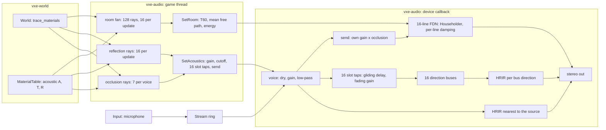

# 0020: Cavern reverb: a late tail sized by the room the listener sees, echoes from their walls, taps that glide, and the player's own voice in the cave

> **Status:** in-progress
> **Created:** 2026-10-17
> **Milestone:** M4 in `docs/roadmap.md`
> **Related ADRs:** [ADR-0015](../adrs/0015-late-reverb-as-a-shared-fdn-from-a-listener-ray-fan.md) (the tail, the fan, the skin-depth rule, the direction buses), ADR-0006 (mixer on the callback, probes on the caller's thread)
> **Prerequisite:** Plan 0006 closed. Its open finding (clicks while the listener moves) transfers here as Phase 1; this plan changes the tap semantics Plan 0006's Phase 4 tests pin, so the close review of 0006 runs first, against the tree as it stands.
> **References:** `docs/references/room-acoustics.md`
> **Amended:** 2026-10-20, inside Phase 1 (its code on 919cb63), from the resume notes and the
> owner's answers: Phase 1's walking done-when (0.5 dB and 0.1 rad per block) was unsatisfiable,
> since an ideal click-free render of the same walk steps 5.24 dB and 1.05 rad, and its Doppler
> figure was ten times low (0.258 rad per block, not 0.026). It becomes per-slot continuity,
> ramped gains and a click index against an ideal reference render, with the bounds derived
> from the probe cadence; Phases 2 and 4 inherit the click index in place of their RMS-step
> bounds on moving sounds. Phase 6's tail key is `Y` (`R` toggles collapse rubble), its room
> lines are read headlessly without `--audio`, and the `--mic` and fly-through walk checks that
> need a device move to Phase 7.
> **Amended:** 2026-10-20, inside Phase 4 (its code on d1fd30f), from the resume notes and the
> owner's answer: the room-step bound (`K` at most twice the held render's) compared a beating
> sum of tones with a single steady tone, so it measured the tail's crest, not clicks (2.0031
> against 1.9998). It becomes a per-window bound of `K` by 1.25 times that window's own crest
> factor, with a bite: one line's delay jumped by half a hum period must score at least four
> times the bound.
> **Amended:** 2026-10-20, after Phase 7's verdicts (log row at 2daa388): checks 2, 3, 5 (large
> room) and 6 fail, and a burst was heard on re-entering a chamber. Phases 8 to 13 are the
> listening fix pass: the room estimate's edge cases and a tail that never repitches or bursts
> (8), echoes that glide at the walk's own rate and reach a 100 m room (9), the direct path under
> motion measured and an optional propagation delay (10), the echo and tail levels and a tail
> pre-delay made live settings (11), a re-listen (12, `human`) and the chosen values pinned (13).
> Causes named below are hypotheses unless marked as read from the code. ADR-0015 carries a dated
> Outcome; a superseding ADR follows at the close.
> **Owner decisions, 2026-10-20, on the fix pass:** (1) the direct path's propagation delay
> is built as a toggle (`U`, `--direct-delay`), off by default, and decided by ear in Phase 12;
> (2) a room change hands the tail over between two networks with an input crossfade
> (`TailLines::Handover`, the default), with the glide kept as the `O` toggle for comparison.
> **Amended:** 2026-10-20, after Phase 11 (79cce8e), from the log's Notes (Phases 9 and 11): the
> tail's line lengths clamp at `REVERB_MAX_DELAY_FRAMES = 4 800`, so in `--room 100` from the
> centre 15 of the 16 lines take 4 799 frames and the tail reads -29.9 dB against the room's
> -22.6 dB. Phase 11b raises the cap to cover every mean free path the fan can report.
> **Owner decision, 2026-10-20:** fix first, then re-listen. All of Phase 12 waits for
> Phase 11b.
> **Amended:** 2026-10-20, after Phase 12's verdicts (log row 12, 5cc48d3). The echo gain each
> room wanted fell as the room grew (+30, +15, +12, +6 dB from 4 m to 100 m) and only the 4 m
> room wanted the tail lowered (-15 dB). Owner decisions: (1) the echo level **scales with room
> size**, fitted to those picks, so Phase 13 is rewritten around a new mechanism, a room curve
> keyed by the mean free path the mixer already receives, for both the echo gain and the tail
> level; (2) the echo wobble while moving is **pinned now and fixed later**: a followup, not a
> phase. The pre-delay, `Handover` and the direct delay (off) are pinned as heard.

## TL;DR

`vxe-audio` gets a late reverb that grows with the cavern: a fan of 128 rays from the listener
measures the visible room's volume and surface, Eyring's formula turns them into a decay time,
and one shared sixteen-line feedback delay network renders a tail of that length and level. The
sixteen early-reflection taps stop clicking while the listener walks, because each tap's delay
glides to its new value and its gain fades instead of being swapped, and each tap is heard from
its wall's direction through a shared bus with that direction's HRIR. A microphone can be
played as a streamed voice at the listener with its direct path muted, so the player hears
their own voice come back off the cave. The first thing the owner hears: `--room 36` with the
looping knock has a tail of about 7 s and `--room 4` about 0.75 s, and walking toward a hum
no longer clicks.

## Context & problem

Plan 0006 shipped the mixer, the HRTF path, occlusion and sixteen early taps per voice, and
passed its listening checks except one: clicks while the listener translates with reflections
on. Measured cause (Plan 0006 log, 2026-10-17): a re-probe fires whenever the listener has
moved 0.1 m, which while walking is every frame or two, and each one replaces all taps with a
5.3 ms crossfade. A listener step of 0.1 m moves an echo path by up to 0.2 m, 28 frames, so the
echo sum jumps in phase and level every 33 ms. The recording showed no sample discontinuity.

There is no late tail at all, and the owner's requirement is explicit: "bigger cavern, bigger
echo". The consumer's P1 need is "early reflections and reverb from ray probes"
(`project-context.md`, Audio). The echoes also all arrive from the source's direction, because
the taps are summed into the voice's mono signal before its HRIR; a slap off the far wall
should come from the far wall.

Budgets touched (`nfr.md` section 9): the mixer block (0.36 ms static, 0.67 ms turning with 32
voices, dev box), `Acoustics::update` (about 1.0 ms accepted as the ceiling, D2b), audio RAM.

## Decision

ADR-0015 records the choice and the alternatives. In one paragraph: taps are keyed by their ray
direction and glide (delay through a fractionally interpolated read at a bounded rate, gain
through the existing 50 ms smoother); each tap sums into one of sixteen shared direction buses
that are spatialised with the HRIR of their direction; `Acoustics` traces a 128-direction fan
from the listener in slices of sixteen rays per call and derives volume, surface, absorption,
Eyring's `T60` and the tail's energy; the mixer owns one sixteen-line Householder feedback
delay network whose line lengths follow the mean free path and whose gains follow `T60`,
fed by every voice's occlusion-scaled send. A face keeps `(1 - A) ^ 0.2` of the amplitude
(one 10 cm skin in and out), which gives rock-like absorption from the existing rows. We
rejected convolution (cost, a dependency, a rebuild per room change), a baked field (the world
is dug), more taps without a tail (nothing scales), and a coarse-grid flood fill (connected
caves run to the cap).

## Architecture diagram



## Implementation phases

Each phase ships as its own commit. `dev` implements all phases in one session with no review
between phases. The architect reviews once at the end, in a fresh session. Every phase carries
exactly one `**Owner skill:**`: `dev` or `human`.

Constants named below are proposals the dev pins in code with a doc comment; the ones in
capitals are the plan's names for them.

### Phase 1: Taps keyed by direction that glide instead of swapping

- **Owner skill:** dev
- **What:** `AcousticTargets.taps` becomes slot-indexed, one slot per reflection direction
  (`MAX_TAPS == REFLECTION_RAYS`, asserted), with gain 0 meaning no hit; `tap_count` goes.
  `reflections()` returns `[Option<Reflection>; REFLECTION_RAYS]` and `taps()` returns
  `[Tap; REFLECTION_RAYS]`. The mixer keeps per-voice, per-slot state `{delay: f32, gain: f32}`:
  the delay moves toward its target by at most `TAP_SLEW_FRAMES_PER_FRAME = 0.05` per frame and
  is read by linear interpolation between the two ring samples around it; the gain moves
  through the `SMOOTHING_SECONDS` one-pole. A slot whose target delay differs from its current
  delay by more than `TAP_JUMP_FRAMES = 480` (10 ms, a hit that moved to another wall) fades to
  silence first (gain below `1e-3`), then takes the new delay and fades in. A fresh voice starts
  at its targets as today. The one-block tap crossfade, `old_taps` and `fading` are deleted.
  `set_reflections(false)` now sends all-zero gains, so the echoes fade out in 50 ms rather
  than swapping away. The keep factor of a reflection becomes
  `(1 - A) ^ (2 * REFLECTION_SKIN_METRES / 1 m)` with `REFLECTION_SKIN_METRES = 0.1`
  (ADR-0015); `Reflection.keep` carries it. A `#[doc(hidden)]` readout of a voice's slot
  states (delay, gain, target) serves the walking test.
- **Files touched:** `crates/vxe-audio/src/{acoustics.rs, mixer.rs, voice.rs, lib.rs}`,
  `crates/vxe-audio/tests/reflections.rs` (re-derived figures), a new
  `crates/vxe-audio/tests/walking.rs`, `apps/flythrough/src/main.rs` (the `E` key path),
  `docs/plans/0020-...md` (log).
- **Done when:**
  - `tests/walking.rs`: a corridor world (rock at `y >= 5 m` and `y <= -5 m` and at
    `z <= -2 m`, cave row `A = 0.3, T = 0.5`), a 440 Hz hum (440 whole cycles per 1 s loop, so
    its seam adds nothing) at `(8 m, 1 m, 0)`, the listener walking from `x = 0` to `x = 6 m`
    at 3 m/s facing `+x`, with `Acoustics::update` called every 3 mixer blocks (16 ms of audio)
    with the advanced position, reflections on, HRTF path, rendered for 2 s. **The arithmetic
    the bounds follow from:**
    - The listener moves `3 x 256 / 48000 = 0.016 m` per block. Every wall is parallel to the
      walk, so each ray's hit distance is constant and its hit point moves with the listener:
      a slot's excess path `|L - H| + |H - S| - |L - S|` changes by at most `2 v dt = 0.032 m`
      per block, `0.032 x 48000 / 343 = 4.48` frames. That is each echo's Doppler: up to
      `2v / c = 1.75` percent, 7.7 Hz at 440 Hz, its phase moving
      `2 pi 440 x 0.032 / 343 = 0.258` rad per block against the direct path.
    - A voice is re-probed only once the listener has moved more than `PROBE_MOVE_METRES =
      0.1`: here every third update (0.144 m, 9 blocks). A slot's target therefore steps by up
      to `2 x 0.144 x 139.9 = 40.3` frames per probe, and the glide covers that at
      `TAP_SLEW_FRAMES_PER_FRAME x 256 = 12.8` frames per block within 4 blocks. The walk's
      4.48 frames per block is the average; the per-block bound is the slew cap, because
      targets arrive in steps. A swap moves the read point by the whole step at once.
    - Why the level and phase steps of the output are not bounded: at the walk's start ten
      sounding slots sum to a gain of 0.689 against the direct path's 0.124, so the output is a
      sum of beating phasors; an ideal click-free render of this walk steps 5.24 dB and 1.05
      rad per block (resume notes).

    After the first 100 ms, read through the slot readout at every block edge:
    - **Per-slot continuity.** No slot's delay moves more than 12.8 frames in a block (plus
      `1e-3`). Every sounding slot's delay is within 42 frames of its ideal excess-path delay
      (unrounded, at that block's listener position): 40.3 frames of walk between two probes
      plus 1.5 frames for rounding the two targets. No slot changes wall, so no slot takes the
      jump path: a sounding slot's gain never falls below `TAP_SILENT`.
    - **Ramped gains.** At each block edge every slot's gain moves toward its target by at
      most `1 - e^(-256 / (48000 x 0.05)) = 0.1012` of the distance (plus `1e-6`), and never
      past it.
    - **Click index against an ideal reference.** The reference is the same walk rendered mono
      in the test with nothing that can click: the direct path and every slot evaluated at
      each block edge from the exact walk position (unrounded delays), delays and gains
      interpolated linearly per sample, an analytic 440 Hz sine. The click index `K` of a
      signal `x`, per 200 ms window (9600 frames, hop 4800), is
      `max |x[n+1] - 2 x[n] + x[n-1]| / (w^2 sqrt(2) rms(x))` with `w = 2 pi 440 / 48000`
      rad per frame. A pure 440 Hz tone scores 1.00; a smooth sum of tones near 440 Hz scores
      about its envelope's crest, a few; a step of size `d` scores at least
      `d / (w^2 sqrt(2) rms)`, so one slot of gain 0.069 swapped by 20 frames (a step of about
      0.075 at a window rms of about 0.18) scores about 90. Asserted: the mixer's largest `K`
      over windows and ears is at most twice the reference's largest `K`. The test bites: the
      reference re-rendered with each slot's delay held between the mixer's probe blocks and
      stepped at them (a swap with no crossfade) scores at least four times that bound. Both
      references' and the mixer's `K` are printed; if the mixer's exceeds the bound, `dev`
      stops with the figures rather than loosening it.
    - The log records the mixer's `K` at the parent commit d11d0cb (a scratch copy of the
      test), for the comparison.
  - `tests/reflections.rs`: the 1160-sample echo test and the occlusion-multiplier test pass
    with their expected gains re-derived for the keep factor `0.7 ^ 0.2 = 0.9312` (the plan's
    arithmetic: the tap gain of the Phase 4 wall becomes `0.9312 / path` times the occlusion
    multiplier); the rendered ratios `0.1136` and `0.6452` are re-derived the same way and the
    new figures stated in the test names.
  - A test that sets reflections off mid-hum sees the echo sum fade out with no block-to-block
    output RMS step above 0.5 dB.
  - The fly-through walk toward, away from and across the hum opens the output device and a
    window, so it is Phase 7 check 1 (amended 2026-10-20), `stream errors` line included.

### Phase 2: Early echoes from their wall's direction

- **Owner skill:** dev
- **What:** The mixer gains sixteen bus buffers of one block each, one per reflection
  direction, with per-bus HRIR state (nearest direction index, history of `taps - 1` frames,
  the one-block raised-cosine crossfade on a direction change). Each voice's slot `i` tap
  output sums into bus `i` instead of into the voice's dry signal. After all voices, each bus
  with any input this block is convolved with the HRIR nearest to `d_i` in the listener's frame
  (both ears) and added to the output. On the panning path a bus pans with constant power on
  its direction. All buffers are sized once at construction.
- **Files touched:** `crates/vxe-audio/src/{mixer.rs, hrtf.rs}`,
  `crates/vxe-audio/tests/reflections.rs`, `crates/vxe-audio/benches/mixer.rs`.
- **Done when:**
  - A world with rock only at `y >= 5 m` (to the listener's left; the listener at the origin
    faces `+x`, up `+z`), a 2 kHz tone burst of 100 ms at `(2 m, 0, 0)`: in the window from
    the end of the direct burst plus the HRIR length to 150 ms later, the left ear's energy
    exceeds the right ear's by at least 3 dB; with the rock at `y <= -5 m` instead, the right
    ear's exceeds the left's by at least 3 dB; the direct burst's interaural level is within
    1 dB of the pack's own interaural level for the front direction at 2 kHz (read from the
    pack as `tests/mixer.rs` does). Before this phase the echo window's interaural level is
    that of the front direction, so the test discriminates.
  - The 1160-sample echo of Phase 1 still peaks at the same frame, now in the bus of the `+x`
    ray.
  - `tests/walking.rs` holds with the buses: its slot assertions are unchanged, and the
    mixer's click index, per ear, is still at most twice the mono reference's (the listener
    faces `+x` throughout, so no bus changes HRIR during the walk).
  - `bench mixer` reports the static and turning 32-voice figures with buses; proposal: at
    most 0.55 ms static and 1.0 ms turning on the dev box (today 0.36 and 0.67; the buses add
    `16 x 2 x 128 x 256 = 1 048 576` multiply-adds per block, half of the 32-voice FIR load).
  - The allocation-counting test in `tests/mixer.rs` still counts zero allocations in `render`.

### Phase 3: The room fan

- **Owner skill:** dev
- **What:** `Acoustics` traces `ROOM_RAYS = 128` fixed directions (a Fibonacci sphere, the same
  construction as the reflection set at 128) from the listener, `ROOM_RAYS_PER_UPDATE = 16`
  per `update` call, through `World::trace_materials` to `REFLECTION_RANGE_METRES`. For each
  ray: the first solid run gives the hit distance `r` and the entry face, recovered from the
  fixed-point hit point (the axis whose coordinate lands on a voxel boundary; ties take the
  axis of largest `|dir|`), and `cos(theta) = |dir_axis| / |dir|` floored at
  `ROOM_COS_FLOOR = 0.1`; a miss counts as a hit at the range with `alpha = 1` and
  `cos = 1`. From a complete fan: `V = (4 pi / 3N) sum r^3`, `S = (4 pi / N) sum r^2 / cos`,
  `alpha` the `r^2 / cos`-weighted mean of `1 - keep(m)^2` clamped to `[0.02, 0.98]`,
  `mean_free_path = 4V / S`, `T60 = clamp(0.161 V / (-S ln(1 - alpha)), 0.05 s,
  settings.max_t60_s)`, `energy = min(16 pi (1 - alpha) / (S alpha), 16)`. A fan restarts when
  the listener has moved more than `ROOM_MOVE_METRES = 1.0` since the last fan began or
  `ROOM_INTERVAL_SECONDS = 0.5` of audio time has passed; otherwise no room ray is traced. A
  completed fan sends `Command::SetRoom(RoomTargets)` and is readable as
  `Acoustics::room() -> Option<RoomEstimate>`. `set_reverb(false)` sends `energy = 0`.
- **Files touched:** `crates/vxe-audio/src/{acoustics.rs, command.rs, lib.rs}`, a new
  `crates/vxe-audio/tests/room.rs`, `apps/flythrough/benches/acoustics.rs`.
- **Done when:**
  - `tests/room.rs`, a 12 m cube of air (voxels `[0, 120)^3`, rock outside, cave row
    `A = 0.3`), listener at the centre and at `(8 m, 6.3 m, 5.8 m)`: after 8 `update` calls the
    estimate reads `V` within 4 percent of 1728 m^3, `S` within 4 percent of 864 m^2, mean free
    path within 4 percent of 8.0 m, `alpha` within 0.001 of 0.1330, `T60` within 4 percent of
    2.26 s (quadrature at 128 directions checked 2026-10-17: within 2 percent at both points).
  - A 4 m cube from 1.7 m off its centre: mean free path within 5 percent of 2.667 m.
  - An all-air world: the estimate's `energy` is at most `1e-4` (the plan's arithmetic for a
    50 m sphere of misses at `alpha = 0.98` is `3.3e-5`, 45 dB down).
  - No `SetRoom` is sent before the first fan completes, none while the listener is still and
    less than 0.5 s has passed, and one within 8 calls after a 1.1 m move.
  - `bench acoustics` with 32 sources and the fan active: at most 1.1 ms per call (today
    1.03 ms; 16 rays of about 100 steps at 40 ns are about 0.07 ms).

### Phase 4: The tail

- **Owner skill:** dev
- **What:** `Mixer` owns a `Reverb` of `REVERB_LINES = 16` delay lines, each
  `REVERB_MAX_DELAY_FRAMES = 4800` (100 ms) plus a block long, mixed by the Householder matrix
  `I - (2/N) 1 1^T` (two passes of `N` adds per sample), with a first-order low-pass per line
  whose gain at DC is `10 ^ (-3 M_i / (T60 f_s))` and at 4 kHz the same for
  `T60 * settings.hf_ratio` (Smith, "Delay-Line Damping Filter Design"). Line `i`'s target
  length is `clamp(mean_free_path / c * f_s * spread_i, 32, 4800)` with
  `spread_i = 0.5 * 3 ^ (i / 15)`, rounded to the nearest prime; the current length glides
  toward it by at most `REVERB_DELAY_SLEW_FRAMES_PER_FRAME = 0.02` through a fractional read,
  and the per-line gains are recomputed every block from the current lengths and the smoothed
  `T60`. The input is the sum over voices of the own-gained sample times the voice's smoothed
  `send` (the occlusion multiplier from `AcousticTargets.send`), scaled so the impulse
  response's energy (both ears averaged) equals `RoomTargets.energy * settings.level ^ 2`: the
  closed form `b^2 = energy * (1 - mean_i g_i^2) / N` or, if the Phase 4 energy test shows it
  off by more than 1 dB, a one-off numeric calibration at construction. Two decorrelated
  outputs (disjoint halves of the lines with alternating signs) add to the stereo output.
  `ReverbSettings { hf_ratio: 0.5, level: 1.0, max_t60_s: 8.0 }` (`Default`) is set through
  `Mixer::set_reverb_settings`.
- **Files touched:** `crates/vxe-audio/src/{reverb.rs (new), mixer.rs, command.rs, lib.rs}`,
  a new `crates/vxe-audio/tests/reverb.rs`, `crates/vxe-audio/benches/mixer.rs`.
- **Done when:**
  - `tests/reverb.rs`: a unit impulse at `(1 m, 0, 0)` with reflections off and
    `SetRoom { t60_s: 2.26, mean_free_path_m: 8.0, energy: 0.379 }`: the backward-integrated
    (Schroeder) decay curve of the output, fitted between 10 and 30 dB below its value at
    50 ms and extrapolated to 60 dB, gives `T60` within 10 percent of 2.26 s; the tail's energy
    from frame 128 on, averaged over the ears, is within 2 dB of 0.379; the normalized echo
    density (Abel and Huang) of the tail at 100 ms and 300 ms is printed and recorded in the
    log.
  - Three closed cubes of 4, 12 and 36 m (cave row `A = 0.3`), listener at the centre, a unit
    impulse 2 m ahead, reflections and tail on, probed to completion: the same fit gives `T60`
    within 20 percent of 0.75, 2.26 and 6.77 s (Eyring with `alpha = 0.1330`, mean free paths
    2.667, 8 and 24 m) and strictly increasing; the direct impulse's peak is within 1 percent of
    the render with the tail off.
  - A hum with the room stepped from `(8 m, 2.26 s)` to `(24 m, 6.77 s)`: no line's length
    moves more than `0.02 x 256 = 5.12` frames in a block; every line is within one frame of
    its target 4 s after the step (the longest glides, lines 14 and 15, are about 3120 frames:
    about 1560 to 4680 and 1680 to the 4800 cap, 3.25 s at 0.02 per frame).
  - **Click index against the window's own crest** (amended 2026-10-20; it replaces "at most
    twice the held render's `K`"). For every 200 ms window of the 4 s after the step (Phase
    1's windows, 9600 frames, hop 4800), per ear: `K_w <= 1.25 C_w`, where `K_w` is Phase 1's
    click index and `C_w = max |x| / (sqrt(2) rms(x))` over the same window (a pure tone scores
    1.00 on both). Why this and not the held render: the held render is one steady 440 Hz tone
    (`K = 1`), while gliding lines shift the recirculating hum by up to 2 percent per pass, so
    the output is a beating sum of tones whose `K` follows its envelope. The arithmetic: for
    `x = sum a_k cos(w_k n + p_k)`, `x'' = -w^2 x + sum a_k (w^2 - w_k^2) cos(...)` (the
    discrete `2 (1 - cos w)` differs from `w^2` by `w^2 / 12`, 0.03 percent), so
    `K_w <= C_w + max_k |1 - (w_k / w)^2| x sum |a_k| / (sqrt(2) rms)`. Here the lines lengthen,
    so recirculated components sit below 440 Hz and the second term shrinks `K` (measured
    `K_w / C_w` at most 0.874: 2.003 against 2.293); 1.25 holds for components up to about
    6 percent off 440 Hz with `sum |a_k|` up to twice the window's peak, either way. A click
    cannot hide under it: a step `d` raises `K_w` by about `d / (w^2 sqrt(2) rms) = 213 d / rms`
    (`w^2 = 0.003317`) and leaves `C_w` almost unchanged, so at the worst measured crest
    (2.42, bound 3.03) a step above 1.4 percent of the window's rms fails. The held render's
    `K` and every window's `K_w`, `C_w` and ratio are printed; if a window fails, `dev` stops
    with the figures rather than loosening the multiple.
  - **The bound bites.** The same render with line 15's read point jumped by 55 frames (half a
    440 Hz period, so the jump's difference signal has about twice the line's amplitude) through
    a `#[doc(hidden)]` hook beside `Mixer::reverb_lines`, at four instants 0.5, 1.5, 2.5 and
    3.5 s after the step, each offset by a further 27 frames (a quarter period, so at least one
    jump lands at least `sin(pi / 4) = 0.707` of the way from a zero crossing of the difference),
    alternating `+55` and `-55`: the largest `K_w / (1.25 C_w)` over its windows and ears is at
    least 4. The plan's arithmetic: the 8 m tail (energy 0.379) gives each of the 8 lines on an
    ear a 440 Hz amplitude of about 0.11 against an output rms of about 0.42 with the hum at
    2 m, so a jump scores about `2 x 0.11 x 0.707 / (0.004691 x 0.42) = 79` against a bound of
    at most 3.03, a factor of about 26; 4 leaves room for a line that happens to be weak at
    440 Hz. The factor is printed.
  - The mode-density floor holds: the sum of the line lengths for the 36 m cube
    (about 49 100 frames) exceeds `0.15 * T60 * f_s` (48 800); the test asserts the
    inequality for the three cubes.
  - `bench mixer`, 32 voices with buses and the tail: static at most 0.6 ms, turning at most
    1.0 ms on the dev box. RAM printed: the tail's lines `16 x (4800 + 256) x 4 = 323 584` B.
  - The allocation count in `render` is still zero.

### Phase 5: A streamed voice and the microphone

- **Owner skill:** dev
- **What:** `Stream` is a single-producer, single-consumer ring of
  `STREAM_CAPACITY_FRAMES = 4800` mono frames (100 ms) with atomic head and tail, allocated once;
  `Stream::writer()` pushes slices without blocking and reports frames dropped;
  `Command::PlayStream(VoiceId, StreamReader, PlayParams)` plays it as a voice that reads a
  block per render and fills an underrun with zeros. `PlayParams.direct: bool` (default `true`)
  when `false` mutes the voice's direct path and its own HRIR and keeps its taps and its send.
  `Input::open(stream_writer)` opens the default `cpal` input device at 48 kHz (mono, or the
  first channel of a wider format) on its own callback that writes into the ring; it reports
  the device name and the device's period in frames. `AudioError::Format` for a device that
  cannot open 48 kHz, as `Output` does.
- **Files touched:** `crates/vxe-audio/src/{stream.rs (new), input.rs (new), voice.rs,
  mixer.rs, command.rs, lib.rs}`, a new `crates/vxe-audio/tests/stream.rs`.
- **Done when:**
  - A writer thread pushes a 440 Hz tone in 480-frame pieces while the mixer renders 1 s: from
    the second block on, the output equals the same tone played from a `Sound` at the same
    position, sample for sample within `1e-6`.
  - The writer pauses for 50 ms mid-tone: the output has zeros for the gap and resumes; the
    largest block-to-block RMS step at the gap's edges is reported, not bounded (a real
    underrun is a gap by nature).
  - `direct: false` in an all-air world renders silence (every sample `0.0`); with the Phase 2
    left wall it renders energy only in the echo window.
  - `render` still allocates nothing; `Input::open` is exercised by the fly-through only, like
    `Output::open`.

### Phase 6: The fly-through: rooms, toggles, the microphone and the readings

- **Owner skill:** dev
- **What:** `--room <metres>` runs the fly-through in a closed cube of air of that edge inside
  rock (a `RoomSource` beside `CaveSource`, extent sized to the room plus 2 m of rock), the
  listener spawned at its centre. `Y` toggles the tail (`Acoustics::set_reverb`; amended
  2026-10-20: `R` already toggles collapse rubble, and `Y` is free and sits by the other sound
  keys `T`, `H` and `J`), `E` keeps toggling the early taps. `--absorption <A>` overrides the
  cave row's `A` (default stays 0.3). `--mic` (implies `--audio`) opens the input device, plays it as a streamed
  voice at the listener with `direct: false`, prints the device, its period and a headphones
  warning, and the `F1` line gains `mic: <device>, <n> frames dropped`. `F1` and
  `--audio-debug` print the room line:
  `room: V <m3> S <m2> mfp <m> alpha <a> T60 <s> energy <dB>` whenever a fan completes.
  `--room-line` (implied by `--room`) prints the room line whenever a fan completes and, without
  `--audio`, runs `Acoustics` with no output device: its commands are dropped and its block
  clock never advances, so a fan completes after 8 frames and restarts only on a 1 m move. The
  acoustics bench traces the fan; the mixer bench renders with buses and the tail. The readings
  go into `nfr.md` section 9 (dev box, quiet-box protocol of Plan 0006's close).
- **Files touched:** `apps/flythrough/src/{main.rs, cave.rs, hud.rs}`,
  `apps/flythrough/benches/acoustics.rs`, `crates/vxe-audio/benches/mixer.rs`, `docs/nfr.md`.
- **Done when:**
  - Every run below is headless and opens no audio device (amended 2026-10-20: `--audio`
    opens the real output device even under `--headless`): `cargo run --release -p
    flythrough -- --room 12 --headless --frames 600` prints a room line whose `mfp` is within
    4 percent of 8.0 m and `T60` within 4 percent of 2.26 s (the fly-through's own table at
    `A = 0.3`).
  - `--room 36 --headless --frames 600` prints `T60` within 4 percent of 6.77 s; `--room 4`
    within 5 percent of 0.75 s.
  - `--seed 1 --room-line --headless --frames 600` prints a room line (the spawn pocket: a 3 m
    sphere has mean free path 4 m, so about 1.1 s if the pocket were closed; the value is
    recorded, not asserted, since the pocket opens into the cave).
  - `Y` and `--mic` are wired, and `--mic` without a usable input device prints the
    `AudioError` and runs on without it; the `--mic` device line and the 60 s with no
    `stream errors` line need the window and the microphone, so they are Phase 7 check 5.
  - The three budget readings are in `nfr.md` with machine and commit.

### Phase 7: Listening checks

- **Owner skill:** human
- **What:** The owner listens (headset worn swapped, as before), with `--audio-debug` for the
  recording, and writes the verdict into the log. `dev` sends a push notification when the
  phases are committed and these are ready (batched, one notification).
- **Done when:** Each check is a verdict in the log, pass or not, with what was heard:
  1. **No clicks while moving:** `cargo run --release -p flythrough -- --seed 1 --audio`, dig,
     `J`, walk toward, away from, across and up and down past the hum with `E` on: no clicks,
     and no `stream errors` line. Turning still has none.
  2. **Bigger cavern, bigger echo:** `--room 4`, `--room 12`, `--room 36`, each with `T` (the
     looping knock) and a `J` note: the tail is audibly longer and louder from room to room, the
     knock's slaps are audibly farther apart in the bigger rooms, `Y` removes the tail and `E`
     removes the slaps; `F1` reads about 0.75, 2.3 and 6.8 s.
  3. **Echoes from their walls:** `--room 12`, stand 2 m from a wall with the knock source on
     the far side of the room: the first slap comes from the near wall's side; turning the
     head keeps it on the wall.
  4. **The cave:** `--seed 1`, walk from the spawn pocket into the first large chamber and into
     a tunnel: the tail grows and shrinks within about a second each way, and `F1`'s room line
     follows.
  5. **Your own voice:** `--room 36 --mic`, speak or clap: the voice returns off the walls and
     tails for seconds; `--room 4 --mic`: a short, tight room. Note whether the slap feels late
     (the device latency is printed; a compensation is the plan's first followup if it does).
     The run prints the input device and its period, and no `stream errors` line over 60 s
     (moved from Phase 6, 2026-10-20).
  6. **The Doppler glide:** walking fast past the hum with `E` on, is the echoes' pitch glide
     heard, and if so, does it read as motion or as an artefact? While walking, each echo's
     pitch runs at the 5 percent slew cap for a few blocks after each probe and then holds,
     about 21 times a second at 3 m/s (Risks). A verdict either way.

### The listening fix pass (Phases 8 to 14 with 11b, amended 2026-10-20)

What the code says, read for this amendment (facts, not hypotheses):

- **The tail's level** is the diffuse-field figure `16 pi (1 - alpha) / (S alpha)` against a
  unit-energy direct impulse at 1 m, the same at every source distance. With the cave row
  (`alpha = 0.1330`) it is +5.3 dB in the 4 m cube, -4.2 dB at 12 m, -13.8 dB at 36 m and
  -22.6 dB at 100 m, so the direct sound (falling 6 dB per doubling from 1 m) equals the tail
  at 0.54, 1.62, 4.87 and 13.5 m. Past that critical distance the decorrelated tail carries
  more energy than the direct path, which matches check 2.
- **The echo level** is `keep / path`, the image source's spreading: a slap off a wall 50 m away
  is `0.9312 / 100`, -40.6 dB against 1 m. Echoes and tail share no level control;
  `ReverbSettings.level` scales the tail and is reachable only through `Mixer`, not through a
  `Command`, so the fly-through cannot change it while running.
- **The reach.** A voice's echo line is `MAX_DELAY_FRAMES = 9600` (200 ms, 68.6 m of excess
  path; a tap past it is silent), and reflection and room rays stop at
  `REFLECTION_RANGE_METRES = 50`. In `--room 100` from the centre the walls are at 50 to 86.6 m:
  most room rays miss, so the fan reads near open air, and the axis echo (excess 100 m,
  13 994 frames, 292 ms) is past the line. `--room 100` cannot be re-listened as built.
- **The direct path has no propagation delay** (`mixer.rs`: the taps' delays are the excess over
  it), so it has no Doppler; it is the HRIR nearest to the source per block (one-block
  raised-cosine crossfade on a change), the smoothed `1 / max(d, 1 m)` gain times the occlusion
  multiplier, and a one-pole low-pass whose cutoff follows the probed solid thickness.
- **Tail lengths glide** at up to 0.02 frames per frame on every room change (`reverb.rs`), and
  a recirculating signal is shifted on every pass through a gliding line; a fan completes every
  metre or 0.5 s, so in a cave the lines glide most of the time.
- **A fan from inside a solid** (the fly-through flies through rock): every ray hits at `t = 0`,
  so `S = 0` and `from_sums` returns `energy = 16` (+12 dB), `T60 = 0.05 s` and mean free path 0.
  An all-miss fan (open air) gives `S = 4 pi 50^2` and energy `3.3e-5`, not 0. The burst lead in
  the log names the `S = 0` branch; the code confirms that branch exists and that only a fan
  begun in a solid reaches it (outside the cave extent `World::raycast` reads missing chunks as
  air, so open air misses).
- **The tail's input gain** `b` is recomputed every block from the smoothed `T60` and the
  current lengths and then smoothed itself, while the loop gains follow the smoothed `T60`
  directly; energy already in the lines keeps the level it was fed at.

Hypotheses this pass tests (none verified by listening or measurement):

- **H1, the burst:** crossing the cave's shell gives fans with energy 16 and `T60` 0.05 s; on
  re-entry the stored tail and a `b` that lags the rising `T60` overshoot the chamber's steady
  level, and every voice's taps and occlusion re-open in the same 50 ms. Phase 8 tests it.
- **H2, "a Doppler with no pitch" with echoes off:** the gliding tail lines repitch the tail
  while walking through a cave (each pass shifts it by up to 2 percent); and/or the direct
  path's HRIR switches or occlusion cutoff sweep; and/or the absence of any Doppler on the direct
  path while the level and direction sweep as in a pass-by. Phases 8 and 10 separate them.
- **H3, "walking feels very fast":** the echoes' delay runs at the 5 percent slew cap for a few
  blocks after each probe and then holds, a staircase whose pitch is up to 2.9 times the
  physical `2v / c = 1.75` percent at 3 m/s. Phase 9 tests it.

### Phase 8: The room estimate's edge cases and a tail that neither repitches nor bursts

- **Owner skill:** dev
- **What:**
  - `RoomEstimate`: a fan whose rays all miss gives `energy = 0` exactly; `S == 0` gives
    `energy = 0` (not 16). A fan begun with the listener's voxel solid is discarded: no
    `SetRoom`, `room()` unchanged, a `#[doc(hidden)]` count of discarded fans.
  - The tail hands over instead of gliding (`TailLines::Handover`, the default): the mixer owns
    two networks. A room whose mean free path differs from the fed network's by more than
    `TAIL_HANDOVER_RATIO = 1.15` (either way) sets the other, silent network's lengths at
    once, and the input crossfades to it over `SMOOTHING_SECONDS`; the old network keeps its
    lengths and rings out at its own decay with no input. A room within the ratio updates the
    fed network's decay and energy in place, its lengths unchanged. If a handover is due while
    the old network still rings, the ringing one fades to silence over 50 ms first, then is
    cleared and takes the new lengths. `TailLines::Glide` keeps today's gliding lengths, for
    comparison by ear (Phase 11's key); the mode is `ReverbSettings.lines`.
  - On any in-place change of decay, the input gain and the loop gains move so that the tail's
    output energy never overshoots the new steady state (the dev picks the mechanism, for
    example `b` from the larger of the current and target `T60` while the decay rises).
  - `--audio-debug` prints every `SetRoom` the fly-through sends (the room line, energy in dB)
    and every discarded fan, so the re-test's stdout shows what the tail was asked for.
- **Files touched:** `crates/vxe-audio/src/{acoustics.rs, reverb.rs, mixer.rs, lib.rs}`,
  `crates/vxe-audio/tests/{room.rs, reverb.rs}`, a new `crates/vxe-audio/tests/reentry.rs`,
  `crates/vxe-audio/benches/mixer.rs`, `apps/flythrough/src/main.rs`, `docs/plans/0020-...md`
  (log).
- **Done when:**
  - `tests/room.rs`: an all-air world gives `energy == 0.0`; a listener inside a solid block
    sends no `SetRoom` over 16 calls, `room()` keeps the previous estimate, and the discarded
    count is nonzero. The cube figures of Phase 3 hold unchanged.
  - `tests/reentry.rs` (the burst, end to end). World: the 12 m cube of air (voxels
    `[0, 120)^3`, cave row `A = 0.3, T = 0.5`) inside a rock shell 2 m thick, air beyond it. A
    440 Hz hum at `(8, 6, 6) m`, gain 1. The listener holds at `(6, 6, 6) m` for 3 s, flies
    `+x` at 12 m/s (the fly-through's boost speed) to `(20, 6, 6) m` (through the shell,
    `x` in `[12, 14] m`), holds 1 s, flies back at 12 m/s and holds 3 s, `Acoustics::update`
    every 3 blocks with the listener's position (as `tests/walking.rs` does). Two renders:
    (a) reflections off, `direct: false`, so the output is the tail alone; (b) reflections on,
    direct on, the full output. Per render, `R_ss` is the largest 50 ms window RMS (both ears)
    over the last second of the first hold. Asserted: every 50 ms window from the start of the
    first flight to the end has RMS at most `R_ss x 10^(1.5 / 20)` (1.5 dB over the chamber's
    own steady level), in both renders. Printed: the largest window in dB against `R_ss`, the
    `SetRoom` sequence (energy, `T60`, mean free path) and the discarded fans.
  - **The bite, and a stop rule.** The same test against the parent tree's `acoustics.rs` and
    `reverb.rs` (a scratch copy, as Phase 1 did) is run and its figures logged. If the parent
    passes the 1.5 dB bound, H1 is not what the owner heard: `dev` logs it, keeps the test, adds
    a mixer-only case (the rooms `(2.26 s, 8 m, 0.379)`, then `(0.05 s, 0 m, 16)` for 0.5 s,
    then `(2.26 s, 8 m, 0.379)` again, the hum steady) under the same bound, and the Phase 12
    stdout capture is the next evidence.
  - `tests/reverb.rs`, **no repitch.** A hum 2 m away, `direct: false`, reflections off, the
    room alternating between `(2.26 s, 8 m, 0.379)` and `(2.83 s, 10 m, 0.243)` every 0.33 s for
    4 s (a walk through a cave: 10 / 8 = 1.25, past the handover ratio). In `Handover` mode,
    through the `#[doc(hidden)]` line readout extended to both networks: no line's length
    changes while its network holds any nonzero sample. Printed for both modes: the fraction of
    the tail's energy within 3 Hz of 440 Hz over the last 2 s (Hann window, 1 s, hop 0.5 s).
    The plan's expectation, a guess: near 1 for `Handover`, far lower for `Glide`; if `Glide`
    is not lower, H2's tail branch is falsified and the log says so.
  - The Phase 4 tests run in both modes where they apply: the decay fits, the energy within
    2 dB, the direct peak and the mode-density floor in both; the room-step glide and the
    line-jump bite in `Glide` only.
  - `bench mixer`: static at most 0.6 ms and turning at most 1.0 ms on the dev box with both
    networks running (a handover in progress); RAM printed (two networks, 647 168 B).
  - The allocation count in `render` is still zero.

### Phase 9: Echoes that glide at the walk's own rate and reach a 100 m room

- **Owner skill:** dev
- **What:**
  - **Rate.** A tap slot's delay moves toward its target at
    `(target - delay) / max(blocks since the voice's previous SetAcoustics, 1)` frames per
    block, capped at `TAP_SLEW_FRAMES_PER_FRAME x 256`, instead of always at the cap: a probe's
    step is spread over the interval the walk took to make it, so the echo's pitch runs at the
    walk's own rate instead of alternating between 5 percent and none. The jump path and the
    gain smoother are unchanged.
  - **Reach.** `MAX_DELAY_FRAMES` becomes 28 800 (600 ms, 205.8 m of excess path) and
    `REFLECTION_RANGE_METRES` 100 m, for reflection and room rays both. In `--room 100` from the
    centre every room ray hits (the corners are 86.6 m away) and the farthest single bounce is
    `2 x 86.6 = 173.2` m, 24 238 frames, inside the line. `reflections()` moves from
    `World::trace_materials` (which walks the whole range) to `World::raycast` (first solid voxel
    and its entry), as the fan did in Phase 3, so a doubled range costs nothing on a hit.
- **Files touched:** `crates/vxe-audio/src/{acoustics.rs, mixer.rs, voice.rs}`,
  `crates/vxe-audio/tests/{walking.rs, reflections.rs, room.rs}`,
  `apps/flythrough/benches/acoustics.rs`, `crates/vxe-audio/benches/mixer.rs`,
  `docs/plans/0020-...md` (log).
- **Done when:**
  - `tests/walking.rs`, the Phase 1 walk (3 m/s, `Acoustics::update` every 3 blocks, a probe
    every 9 blocks, a target step of at most 40.3 frames). **The arithmetic:** the physical rate
    is at most `2v / c x 256 = 4.48` frames per block; spread over 9 blocks a 40.3-frame step is
    4.48 frames per block. After the first 200 ms, every sounding slot's per-block delay change
    is at most `1.25 x 4.48 = 5.6` frames (today's cap is 12.8, which the parent reaches: the
    bite) and differs from the ideal excess-path delay's change over the same block by at most
    1.0 frame; every sounding slot stays within 46 frames of its ideal delay (one step of 40.3
    behind, plus one block of walk, 4.48, plus 1.5 for rounding). The click index bound of
    Phase 2 holds. Printed: the largest per-block change and the largest deviation from the
    ideal change, mixer and parent.
  - A 12 m/s walk (the boost speed, physical rate `2v / c = 7.0` percent, past the 5 percent
    cap) is printed, not bounded: the largest lag behind the ideal delay over a 2 s walk.
  - `tests/reflections.rs`: the existing figures hold within one frame of delay and `1e-4` of
    gain with `raycast`. New: a 100 m cube (voxels `[0, 1000)^3`), a voice at the listener at
    the centre with `direct: false`, tail off, a unit impulse: the first nonzero sample of the
    output is at or after frame 13 994 (`100 m / 343 m/s x 48 000 = 13 994.2`) and the output's
    peak lies within 13 994 plus the HRIR length (128 frames); the parent renders silence here
    (the bite).
  - `tests/room.rs`: the 100 m cube from the centre reads `V` within 4 percent of `1e6 m^3` and
    `T60` at the 8 s cap (Eyring gives 18.8 s), energy within 4 percent of `5.46e-3`
    (-22.6 dB); an all-air world still reads energy 0.
  - `bench acoustics` (32 sources, fan active): at most 1.1 ms on the dev box. `bench mixer`
    static and turning within Phase 8's figures. RAM printed: echo lines
    `64 x (28 800 + 256) x 4 = 7 438 336` B for the pool (was 2 523 136, +4.9 MB; `nfr.md`'s
    "200 ms delay lines" proposal becomes 600 ms at the close).

### Phase 10: The direct path under motion

- **Owner skill:** dev
- **What:** `Mixer::set_direct_delay(bool)` (default off until Phase 13; Phase 11 folds it into
  `MixSettings.direct_delay`). On, the direct
  path is read from the voice's echo line at `d / c` frames (`d` the source's distance this
  block, capped at `MAX_DELAY_FRAMES`) through the fractional read the taps use, and every tap
  reads at its excess plus that same delay, so the direct path and every echo carry the
  physical Doppler of the listener's and the source's motion. The target delay follows the
  positions the mixer already has per block; since the listener arrives once per game frame
  (every 3 blocks at 60 Hz), the delay is smoothed (proposal: the one-pole of
  `SMOOTHING_SECONDS` on the target, capped at the tap slew) so a frame's position step does
  not become a pitch staircase. A voice with `direct: false` at the listener has `d = 0`. Off,
  the direct path is today's.
- **Files touched:** `crates/vxe-audio/src/{mixer.rs, voice.rs, lib.rs}`, a new
  `crates/vxe-audio/tests/motion.rs`, `crates/vxe-audio/benches/mixer.rs`,
  `docs/plans/0020-...md` (log).
- **Done when:** `tests/motion.rs`, an all-air world, a 440 Hz hum at `(0, 1 m, 0)`, the
  listener walking from `x = -6 m` to `x = 6 m` at 3 m/s facing `+x`, its position sent every
  3 blocks, reflections and tail off, HRTF path. Each ear's frequency per block is read by
  demodulating at 440 Hz, averaging over the block and differencing the unwrapped phase.
  **The arithmetic:** a listener moving at `v` toward a fixed source hears `f (1 + v_r / c)`
  with `v_r` the approach speed, `3 x 6 / sqrt(37) = 2.96` m/s at the walk's ends, so 443.80 Hz
  coming and 436.20 Hz going; the head's interaural delay changes at most
  `(0.0875 m / 343 m/s) x 2 x (v / 1 m)`, which moves an ear's phase by at most 0.67 Hz at
  440 Hz.
  - Off: every block's frequency, each ear, from 100 ms on, is within 2.2 Hz (0.5 percent) of
    440 Hz. If it is not, the HRIR switching or the gain and cutoff path is implicated and
    `dev` stops with the per-block figures (the block, the HRIR index change, the gain and
    cutoff) rather than loosening the bound.
  - On: every block's frequency is within 1.0 Hz of `440 (1 + v_r / c)` at that block's
    position (0.67 Hz of interaural delay and 0.33 Hz for the smoothing and the 3-block
    position steps); the readings at the walk's ends are printed against 443.80 and 436.20 Hz.
    The off render fails this bound by at least 3 Hz at the ends (the bite).
  - The same walk in the Phase 1 corridor: every `SetAcoustics` sent carries gain 1 and the
    open cutoff (nothing crosses the direct or side rays there), so in an unobstructed walk the
    direct path's only changes are distance, direction and (on) delay. Printed only, for
    the log: the per-probe occlusion gain and cutoff along the fly-through's seed-1 spawn
    pocket to its first chamber, through `apps/flythrough/benches/acoustics.rs`'s world, so the
    cave's own probe changes under a walk are on record.
  - `tests/walking.rs` with `direct_delay` on: the click index bound of Phase 2 holds.
  - `bench mixer` static and turning within Phase 8's figures with `direct_delay` on.

### Phase 11: Echo level, tail level and tail pre-delay as live settings

- **Owner skill:** dev
- **What:** `MixSettings { echo_gain: f32, direct_delay: bool, reverb: ReverbSettings }`,
  applied by `Mixer::set_mix` and `Command::SetMix` (so a running output can change it), in
  place of `Mixer::set_reverb_settings` and `Mixer::set_direct_delay`. The
  echo gain scales the buses' input through the one-pole smoother. `ReverbSettings` gains
  `predelay_s` (0 to 0.2 s, a mono input line of 9 600 frames plus a block, 39 424 B; a change
  crossfades between the old and the new read point over `SMOOTHING_SECONDS`, so it never
  glides or clicks). The fly-through binds, each printing one
  `mix:` line (`echoes <dB>, tail <dB>, pre-delay <ms>, tail lines <mode>, direct delay
  <on|off>`) and adding it to `F1`:
  - `[` and `]`: echo gain down and up by 3 dB (from -12 to +30 dB);
  - `-` and `=`: tail level down and up by 3 dB (from -30 to +6 dB);
  - `9` and `0`: pre-delay down and up by 10 ms (0 to 200 ms);
  - `O`: tail lines `Handover` or `Glide`; `U`: direct delay on or off.
  Flags `--echo-db`, `--tail-db`, `--predelay-ms`, `--tail-glide` and `--direct-delay` set the
  same at start, so a chosen balance can be replayed. (Free keys checked against `main.rs` and
  `fly.rs` at 2daa388.)
- **Files touched:** `crates/vxe-audio/src/{mixer.rs, reverb.rs, command.rs, lib.rs}`,
  `crates/vxe-audio/tests/reverb.rs`, a new `crates/vxe-audio/tests/balance.rs`,
  `apps/flythrough/src/main.rs`, `docs/plans/0020-...md` (log).
- **Done when:**
  - `tests/balance.rs`, the 12 m cube, listener at the centre, a unit impulse 2 m ahead, each
    setting applied 0.5 s before the impulse. Echoes alone (`direct: false`, tail off): echo
    gain +6 dB multiplies the output energy by `10^0.6 = 3.98` within 1 percent. Tail alone
    (`direct: false`, reflections off): tail level -6 dB multiplies it by `10^-0.6 = 0.251`
    within 1 percent. Changing one leaves the other's render bit-identical.
  - Pre-delay 40 ms (1 920 frames), tail alone: every sample before frame `1 920 + 31` (the
    shortest prime line) is exactly 0, and the tail's energy is within 0.1 dB of the
    no-pre-delay render's.
  - A pre-delay step from 0 to 40 ms under a steady hum: the Phase 4 crest-relative click index
    bound (`K_w <= 1.25 C_w`) holds in every window.
  - **The balance table, printed and logged** (the owner's reference for Phase 12): for the 4,
    12, 36 and 100 m cubes at default settings, with a source 2 m ahead, the direct, early (the
    buses alone) and tail energies of a unit impulse in dB, and the energy of each in the first
    80 ms after the direct sound.
  - `Command::SetMix` reaches the mixer in the fly-through: `--room 12 --headless --frames 60`
    with `--echo-db 6 --tail-db -9 --predelay-ms 30` prints the `mix:` line with those values.
  - The allocation count in `render` is still zero.

### Phase 11b: Tail lines long enough for every room the fan can report

Added 2026-10-20 after Phase 11 (owner: fix first, then re-listen; Phase 12 waits for it).
Numbered 11b so Phases 12 and 13 keep their numbers and the log's commands.

What the code says (`reverb.rs` at 79cce8e, read for this amendment): line `i`'s target is
`mfp / c x f_s x spread_i`, `spread_i = 0.5 x 3^(i / 15)` (0.5 to 1.5), clamped to
`[32, REVERB_MAX_DELAY_FRAMES = 4 800]` and rounded to the nearest prime. Every line takes the
same input and the same filter design, so lines of equal length carry equal signals, and the
Householder feedback (each line minus twice the mean) keeps them equal. The left ear sums lines
0 to 7 and the right lines 8 to 15, each with alternating signs. From the 100 m cube's centre
(fan mfp 65.65 m, `65.65 / 343 x 48 000 = 9 187` frames) line 0 is 4 591 and lines 1 to 15 are
4 799: the right ear's tail is exactly zero and the left's is `y_0 - y_1`, about 2 lines' worth
of the 16 the energy calibration assumes (`10 log10(2/16) = -9.0` dB if the two are
uncorrelated, a guess; read: -7.3 dB, -29.9 against -22.6). The clamp bites from mfp
`4 800 / 1.5 / 48 000 x 343 = 22.9` m (line 15) up; below that nothing here changes.

- **Owner skill:** dev
- **What:**
  - **The cap covers the fan's bound.** The fan's `mfp = 4V/S = (4/3) sum r^3 / sum (r^2 / cos)`
    with `r <= REFLECTION_RANGE_METRES` and `cos <= 1`, so `mfp <= (4/3) x 100 = 133.3` m (an
    all-miss fan reads exactly that). Line 15 at that bound wants
    `1.5 x 133.33 / 343 x 48 000 = 27 988.3` frames. `REVERB_MAX_DELAY_FRAMES` becomes 28 000
    (583 ms), so no estimate the fan sends clamps a line; a unit test pins
    `REVERB_MAX_DELAY_FRAMES >= 1.5 x (4/3) x REFLECTION_RANGE_METRES / SPEED_OF_SOUND x RATE`,
    so a longer range fails a test instead of collapsing the tail. A consumer's `SetRoom` with a
    larger mfp still clamps: the clamp lands on the largest prime at or below the cap (27 997,
    so a clamped length is still prime, where `nearest_prime(28 000)` would give 28 001 and the
    `min` a composite 28 000), and the lines' readout says so.
  - Nothing else moves: the spread, the prime rule, the Handover/Glide mechanics, the energy
    calibration, `REVERB_MIN_DELAY_FRAMES`, the pre-delay line.
  - **Clearing a network** (`Network::clear`, run on the callback when a handover takes a
    network or a fade finishes) now fills `16 x 28 256` floats (1.81 MB) in one block instead
    of 323 584 B. If the bench's clear block (below) is too slow, the dev may zero only each
    line's `target + 1` samples behind the write point (all the new length will read before it
    is overwritten), which costs in proportion to the room; either way, no allocation.
  - **Rejected:** a cap sized for `--room 100` from the centre only (the dev lane's +1.4 MB
    estimate; 15 360 frames, 320 ms, covers mfp up to 73.2 m, `2 x 16 x 15 616 x 4 = 1 998 848`
    B, +1 351 680 B). A cave chamber with an opening reads mfp up to 133 m with a nonzero
    energy (a partial miss), and there 9 of the 16 lines would sit at 15 359 again.
- **RAM, the arithmetic:** `RING = 28 000 + 256 = 28 256` floats; two networks hold
  `2 x 16 x 28 256 x 4 = 3 616 768` B, against `2 x 16 x 5 056 x 4 = 647 168` B today:
  **+2 969 600 B (+2.97 MB)**. (The dev lane's +1.4 MB is the rejected 320 ms cap above.) The
  audio RAM row in `## Budgets` is amended to match; there is no audio RAM ceiling in `nfr.md`
  section 9 to break.
- **Files touched:** `crates/vxe-audio/src/reverb.rs`, `crates/vxe-audio/tests/{reverb.rs,
  balance.rs}`, `crates/vxe-audio/benches/mixer.rs`, `docs/plans/0020-...md` (log).
- **Done when:**
  - **100 m, distinct lines.** In the 100 m cube (voxels `[0, 1000)^3`, the balance test's
    world), after the fan from the centre lands: the 16 targets read through `reverb_lines()`
    are 16 distinct primes, strictly increasing, every one below `REVERB_MAX_DELAY_FRAMES`.
    Expected at mfp 65.65 m (printed, not pinned; the fan's f32 mfp may move a prime): 4 591,
    4 943, 5 323, 5 717, 6 151, 6 619, 7 129, 7 669, 8 243, 8 887, 9 551, 10 273, 11 059,
    11 903, 12 809, 13 781. The parent's 4 591 and fifteen 4 799 are printed beside them.
  - **At the bound.** A unit test in `reverb.rs`: `target_length(i, 133.334)` for `i` in 0..16
    gives 16 distinct primes below the cap (the last 27 983); `target_length(15, 1000.0)` is
    27 997.
  - **100 m, the tail's level.** `tests/balance.rs`: the 100 m row's tail energy (tail alone,
    both ears, 9 s) is within **1.0 dB** of `10 log10(room.energy)` from that cube's fan
    (5.461e-3, -22.6 dB), against -29.9 dB today (7.3 dB short: the bite). The same 1.0 dB
    bound is asserted for the 4, 12 and 36 m rows, which read +4.7 against +5.3, -4.4 against
    -4.2 and -13.7 against -13.8 dB at 79cce8e (0.6, 0.2 and 0.1 dB off). Each row also prints
    the tail energy per ear; the 100 m right ear, exactly 0 today, is asserted nonzero (the
    ears take different line halves, so no equal-energy bound is derived here; the printed
    left-right difference of the four rows is the reference). **Stop rule:** if
    the 100 m tail is still more than 1.0 dB from the target with 16 distinct lines, equal
    lines were not the whole cause: `dev` stops and logs the per-ear energies and the 16
    lengths rather than loosening the bound.
  - **4, 12 and 36 m unchanged or re-pinned with reasons.** A unit test in `reverb.rs` pins
    `target_length(i, mfp)` for mfp 2.666 m (191, 199, 211, 233, 251, 269, 293, 311, 337, 359,
    389, 419, 449, 479, 521, 557) and 7.999 m (557, 601, 647, 701, 751, 809, 863, 937, 1 009,
    1 087, 1 163, 1 249, 1 361, 1 451, 1 559, 1 669), equal to the parent's, since no line
    reaches 4 800 below 22.9 m. At 23.998 m (the 36 m room) only line 15 changes, 4 799 to
    5 039; the Phase 4 cube test's line sum for the 36 m cube rises by that line's difference
    (48 820 plus about 240, printed; its floor 48 584 is untouched). The Phase 4 to 11 tests
    otherwise hold their bounds unchanged; one that moves says so in the log with its old and
    new figure. Known: `a_room_that_grows_under_a_hum_glides_its_lines` (8 m to 24 m in
    `Glide`) now glides line 15 from 1 669 to 5 039 frames, `3 370 / (0.02 x 48 000) = 3.51` s
    of its 4 s window (was `3 130 / 960 = 3.26` s), so "on target after 4 s" still holds; its
    line-15 jump bite still scores at least 4.
  - **No allocation on the callback.** `the_tail_renders_without_allocating` and
    `a_changing_balance_renders_without_allocating` still count 0, with a handover (a network
    cleared) inside the counted span.
  - **`bench mixer` re-read** (dev box, release, exclusive perf lock, load average and top
    processes stated): static and turning, both networks running, with this phase and with the
    parent 79cce8e (a scratch copy of `reverb.rs`), three alternating runs each, medians.
    Asserted by reading, not in code: the new medians within 5 percent of the parent's in the
    same session (the larger rings change the cache footprint, 1.81 MB per network against
    the 5900HS's 512 KB of L2 per core; the per-frame work is unchanged). Printed: the RAM line
    (tail lines 3 616 768 B) and the time of one block that clears a network, against a static
    block; if the clearing block exceeds a static block by more than 0.25 ms (a guess: 1.8 MB
    at 10 to 20 GB/s is 0.09 to 0.18 ms), the dev takes the partial clear above. **Still owed
    either way:** the 0.6 ms static and 1.0 ms turning bounds have not been shown met on a
    quiet box since Phase 8 (Close triggers); this phase's reading does not settle them and the
    quiet-box re-read stays owed to the close.

### Phase 12: Re-listening

- **Owner skill:** human
- **What:** The owner listens as in Phase 7 (headset swapped, `--audio-debug`), with stdout
  captured: every run is `cargo run --release -p flythrough -- <flags> --audio-debug 2>&1 | tee
  listening/<check>.log`, so the `SetRoom`, `mix:` and `stream errors` lines are on file beside
  the recording. `dev` sends one push notification when Phases 8 to 11b are committed; no
  check starts before Phase 11b lands (owner, 2026-10-20).
- **Done when:** each item is a verdict in the log, with the settings chosen:
  1. **Direction with the tail (check 2 again):** `--room 4`, `--room 12`, `--room 36`, knock
     and note. Step the tail level (`-`, `=`) and the pre-delay (`9`, `0`) until the knock's
     direction holds with the tail on; record the tail level and pre-delay per room, and
     whether one setting serves all three.
  2. **Echoes against the tail (check 3 again):** `--room 12`, 2 m from a wall, knock across the
     room: step the echo gain (`[`, `]`) until the slap is clear; the slap's side is judged.
  3. **The large room's return (check 5 again):** `--room 100 --mic` from the centre (the axis
     walls' return at 292 ms, the corners' at up to 505 ms): does the voice come back late and
     strong, then tail? Record the echo gain and tail level that make it; then `--room 4 --mic`
     at the same settings still reads as a short, tight room (or record the conflict). The
     input device line, its period, and no `stream errors` line over 60 s.
  4. **Motion (check 6 again):** `--seed 1`, walking (3 m/s) and boosting (12 m/s) past the hum
     with echoes on, then off: `O` between `Handover` and `Glide`, `U` direct delay on and off.
     Which combination reads as motion and which as an artefact.
  5. **Re-entry:** fly out through the cave's shell and back into a chamber with the hum and a
     knock playing: a burst or not; the log file shows the `SetRoom` lines around it.
  6. **Check 1 again, briefly:** walking past the hum with the chosen settings, no clicks.

### Phase 13: Echo gain and tail level by room size, and the chosen settings pinned

Rewritten 2026-10-20 after Phase 12 (owner: scale the echo level by room size, fitted to the
picks). The picks were taken from each cube's centre, one per room, with the room line read
beside them (`listening/p12-*.log`):

| Run | Room line mfp (m) | Echoes (dB) | Tail (dB) | Criterion |
|---|---|---|---|---|
| `--room 4` | 2.666 | +30 (the range's top step) | -15 | the knock's direction holds |
| `--room 12` | 7.999 | +15 | 0 | the knock's direction holds |
| `--room 36` | 23.998 (24.07 in the run) | +12 | 0 | the knock's direction holds |
| `--room 100 --mic` | 69.0 (63.6 to 71.1 in the run) | +6 | 0 | the voice returns late and strong |
| `--room 12`, 2 m from a wall | about 8.0 | +9 | 0 | the slap is clear |

**The input is the mean free path the mixer already holds.** `Command::SetRoom` carries
`RoomTargets.mean_free_path_m` to the mixer on every completed fan, including while the tail is
off (energy 0, mfp still set; the logs show both), so no new probe, command or thread is
needed. Rejected: `T60` (clamped at 8 s from the 36 m room up, and it moves with absorption,
which the picks did not vary); the volume (not in `RoomTargets`; the fan's `V` and the mfp rank
the cubes the same); a per-voice key such as the echo's path length (the picks are one
setting per room, heard over every tap at once).

**The curve is piecewise linear in `log(mfp)` through the picks, flat outside them.** Knots
(mfp in metres, dB), from the table: echoes `(2.67, +30)`, `(8.0, +15)`, `(24.0, +12)`,
`(69.0, +6)`; tail `(2.67, -15)`, `(8.0, 0)`. Between two knots `(m_a, d_a)` and `(m_b, d_b)`,
`d = d_a + (d_b - d_a) log(mfp / m_a) / log(m_b / m_a)`. Below the first knot the curve holds
its first value, above the last its last. Rejected: a least-squares line in `log10(mfp)`. Over
all four picks it reads `33.87 - 15.93 log10(mfp)` with residuals -2.9, +4.5, -0.1, -1.4 dB
(12 m is 4.5 dB under its pick); over the three unclipped picks, `24.18 - 9.60 log10(mfp)`, it
gives +20.1 dB at 4 m, 10 dB under the setting the owner heard there. A line fits no pick and
puts the one clipped pick furthest off; the knots reproduce every pick exactly.

**The 4 m pick is pinned as heard, not extrapolated.** It sat at the top step (+30 dB), so the
owner may have wanted more, but the pair he judged was echoes +30 with the tail at -15, and a
value above +30 has not been heard. The curve holds +30 below 2.67 m. The live trim (below)
reaches +12 dB over the curve, so a later listen can go past it; a new pick replaces the knot.
**The 2 m-from-a-wall pick is a floor, not a fifth knot:** its criterion was the least gain at
which the slap is clear, at the same mfp as the centre pick, and the curve's +15 dB there meets
it (a 2 m wall's taps are already louder by their shorter path). A room-size curve cannot also
key on the listener's distance to a wall, and the owner asked for room size.

**The tail level scales the same way,** from the same curve type with its own knots: -15 dB at
2.67 m and below, 0 dB from 8.0 m up (-9.47 dB at 4.0 m). Only the 4 m room asked for it, and
the 12 m knot is the nearest room heard at 0 dB; nothing between 4 and 12 m was heard, so the
interpolation there is a guess, recorded as one.

- **Owner skill:** dev
- **What:**
  - **`RoomCurve`** in `vxe-audio`: up to `ROOM_CURVE_POINTS = 8` knots `(mfp_m, db)` in a fixed
    array plus a count (no allocation; `Copy`, so it rides in `MixSettings` through
    `Command::SetMix`). `RoomCurve::new(&[(f32, f32)]) -> Result<RoomCurve, AudioError>` rejects
    zero or more than 8 knots, a non-finite value, an mfp at or below 0 and mfps that do not
    strictly increase. `RoomCurve::flat(db)`. `RoomCurve::db_at(mfp_m) -> f32` as above; an
    mfp that is not finite or is at or below 0 reads the **last** knot (the largest room's
    value, so a degenerate room never asks for the loudest echoes). The curve knows no
    gameplay: the knots are the engine's defaults, and a consumer passes its own.
  - **`MixSettings`** gains `echo_by_room: RoomCurve` (default the echo knots above);
    `ReverbSettings` gains `level_by_room: RoomCurve` (default the tail knots). `echo_gain` and
    `ReverbSettings.level` stay, as trims multiplied on top, default 1.0.
    `MixSettings::flat()` sets both curves to `RoomCurve::flat(0.0)` and is otherwise the
    default: the echo and tail levels of Phases 1 to 12.
  - **The mixer applies them.** The echo target is `echo_gain x 10^(echo_by_room.db_at(mfp)
    / 20)`, recomputed on `SetMix` and on `SetRoom` (never per block), where `mfp` is the
    latest `SetRoom`'s; before the first `SetRoom`, `mfp` reads as no room (the last knot). It
    moves through the existing echo-gain one-pole, so a room change ramps the buses over
    `SMOOTHING_SECONDS`. The tail's curve value multiplies `level` where `level` enters the
    input gain `b` today (Phase 4's note), evaluated at the mfp of the room each network takes,
    so a handover carries it with the room's own energy and the stored tail keeps the level it
    was fed at; nothing new is smoothed.
  - **Pinned as heard:** `predelay_s` 0, `lines` `TailLines::Handover`, `direct_delay` false.
  - **The fly-through:** `[`, `]`, `-` and `=` step the trims by 3 dB, each from -24 to +12 dB;
    `--echo-db` and `--tail-db` set the trims; a new `--flat-mix` flag starts from
    `MixSettings::flat()`, so the Phase 12 runs replay with their absolute settings. The `mix:`
    line becomes `mix: echoes <trim> dB (room <curve> dB at mfp <m> m), tail <trim> dB (room
    <curve> dB), pre-delay <ms>, tail lines <mode>, direct delay <on|off>` (with `--flat-mix`,
    `room flat`), printed again whenever a room changes the curve's value by 0.5 dB or more and
    on `F1`.
- **Files touched:** `crates/vxe-audio/src/{mixer.rs, reverb.rs, lib.rs}`, a new
  `crates/vxe-audio/src/room_curve.rs`, `crates/vxe-audio/tests/{balance.rs, reverb.rs}`, the
  affected `crates/vxe-audio/tests/*.rs`, `crates/vxe-audio/benches/mixer.rs`,
  `apps/flythrough/src/main.rs`, `docs/plans/0020-...md` (log).
- **Done when:**
  - **The curve, unit tests in `room_curve.rs`.** The default echo curve reads +30, +15, +12 and
    +6 dB at its knots exactly, and the tail curve -15 and 0. Between knots (within 0.01 dB):
    echoes 24.475 dB and tail -9.475 dB at 4.0 m; echoes 13.107 at 16 m, 9.098 at 40 m and
    6.283 at 65.648 m (the 100 m cube's centre fan); tail 0 at 16 m. Clamped: 30 and -15 at
    1.0 m; 6 and 0 at 133.33 m (an all-miss fan). The last knot (6 and 0) for mfp 0, -1 and
    NaN. `RoomCurve::new` rejects each malformed input listed above.
  - **The defaults, pinned.** A test asserts `MixSettings::default()` field by field: echo trim
    1.0, the four echo knots, direct delay off, tail trim 1.0, the two tail knots, pre-delay 0,
    `Handover`, and `hf_ratio` and `max_t60_s` unchanged from Phase 11b.
  - **The curve reaches the output, `tests/balance.rs`.** For the 4, 12, 36 and 100 m cubes,
    listener at the centre, a unit impulse 2 m ahead, settings and room 0.5 s before it:
    echoes alone at the defaults over echoes alone at `MixSettings::flat()` is
    `10^(echo_by_room.db_at(mfp) / 10)` within 1 percent, `mfp` that cube's fan (expected
    about +30, +15.0, +12.0 and +6.3 dB; printed). Tail alone, the same ratio against
    `level_by_room` within 1 percent (expected -15, about 0, 0, 0 dB). The direct path's energy
    is bit-identical between the two.
  - **A room change ramps, it does not step.** Under a steady 440 Hz hum with echoes alone, a
    `SetRoom` from the 12 m room (mfp 8.0) to the 36 m room (mfp 24.0) moves the buses' gain
    from +15 to +12 dB: the per-window click index bound of Phase 4 (`K_w <= 1.25 C_w`) holds in
    every window across the change, and 0.25 s after it the echoes' energy over the last
    100 ms is `10^(-0.3)` of the energy before it within 2 percent (the room's tap pattern held
    fixed, so only the gain moves). A `SetRoom` with mfp 0 after the 4 m room drops the echo
    target to +6 dB, not +30.
  - **Before any room:** a mixer that has received no `SetRoom` renders echoes at the last knot
    (+6 dB over flat) within 1 percent.
  - **Physics tests do not move.** Every test whose figures were derived before this phase
    (`tests/{walking, motion, reentry, reverb, mixer, room}.rs`, the 1160-sample echo, the
    Phase 11 balance-ratio and pre-delay cases) sets `MixSettings::flat()` and keeps its bound
    and figures; one that cannot says so in the log with its old and new figure. The Phase 8
    re-entry flight is run once more at the defaults and its two figures printed beside the
    flat ones.
  - **The fly-through, headless:** `--room 4 --headless --frames 60` prints `mix: echoes +0 dB
    (room +30.0 dB at mfp 2.666 m), tail +0 dB (room -15.0 dB), ...`, and `--room 12`
    `room +15.0 dB` and `room -0.0 dB` (or `+0.0`); `--flat-mix --echo-db 9` prints `room
    flat` with the trim +9. A `main.rs` test checks the trims' clamps at -24 and +12.
  - The balance table of Phase 11 re-printed at the defaults and logged, beside the flat one.
  - The allocation count in `render` is still zero, with a `SetRoom` every block.
  - `bench mixer` (dev box, release, exclusive perf lock, load average and top processes
    stated): static and turning medians of three alternating runs against the parent's,
    within 5 percent in the same session (the curve is evaluated per command, not per block).
  - The gate (build, nextest, doctests, clippy, fmt, deny, the three doc scripts) exits 0; the
    three budget readings are in the log with machine and commit.

### Phase 14: Confirmation listen at the room-curve defaults

Added 2026-10-20 (owner: yes, batched into the next live session with Plan 0023's windowed
flight). Phase 13's curve sets levels at room sizes nobody picked, between the cubes and in
every cave chamber; this listen checks them by ear before the close.

- **Owner skill:** human
- **What:** Headset, `--audio-debug`, stdout captured as in Phase 12: every run is
  `target/release/flythrough <flags> --audio-debug 2>&1 | tee listening/p14-<check>.log`, at
  the defaults (no `--echo-db`, `--tail-db` or `--flat-mix`). The trims (`[`, `]`, `-`, `=`)
  are the escape hatch: if a run sounds wrong, step them until it is right and the final
  `mix:` line in the log is the record. `dev` sends one push notification when Phase 13 is
  committed, batched with Plan 0023's live check.
- **Done when:** each item is a verdict in the log with the final `mix:` line (trim and curve
  value) of its run:
  1. **`--room 4`** and **`--room 12`**, knock and note from the centre: the knock's direction
     holds at trims 0, as at the Phase 12 picks; or the trims that make it, per room.
  2. **The cave, `--seed 1`:** walk from the spawn pocket through at least one chamber and one
     tunnel with the hum and knock playing: do the echo and tail levels follow the space
     without a level jump at room changes (the `mix:` lines show each curve change of 0.5 dB
     or more)? A chamber where the trims had to move is named with its room line's mfp.
  3. The echo wobble is not judged here (a followup); a verdict that it got worse at the new
     echo level is recorded if heard.
  A nonzero trim in any verdict goes to the architect as a re-fit of the knots (a followup or
  an amendment), not a change by `dev`.

## Data shapes

```rust
// illustrative
pub struct Tap { pub delay_frames: u32, pub gain: f32 }          // slot-indexed; gain 0 = no hit
pub struct AcousticTargets {
    pub gain: f32, pub cutoff_hz: f32,
    pub taps: [Tap; REFLECTION_RAYS],
    pub send: f32,                                                // reverb send: the occlusion multiplier, 0 when off
}
pub struct Reflection { pub point: [f32; 3], pub keep: f32 }      // keep = (1 - A) ^ 0.2
pub struct RoomEstimate {
    pub volume_m3: f32, pub surface_m2: f32, pub mean_free_path_m: f32,
    pub absorption: f32, pub t60_s: f32, pub energy: f32,
}
pub struct RoomTargets { pub t60_s: f32, pub mean_free_path_m: f32, pub energy: f32 }
pub struct ReverbSettings { pub hf_ratio: f32, pub level: f32, pub max_t60_s: f32 }
pub enum Command { /* as today, plus */ SetRoom(RoomTargets), PlayStream(VoiceId, StreamReader, PlayParams) }
pub struct PlayParams { pub position: [f32; 3], pub gain: f32, pub looping: bool, pub direct: bool }
// Phases 8 to 11 (amended 2026-10-20)
pub enum TailLines { Handover, Glide }
pub struct ReverbSettings { pub hf_ratio: f32, pub level: f32, pub max_t60_s: f32, pub predelay_s: f32, pub lines: TailLines }
pub struct MixSettings { pub echo_gain: f32, pub direct_delay: bool, pub reverb: ReverbSettings }
// Command gains SetMix(MixSettings)
// Phase 13 (amended 2026-10-20 after Phase 12)
pub struct RoomCurve { knots: [(f32, f32); ROOM_CURVE_POINTS], len: u8 }   // (mfp m, dB), log-linear
// MixSettings gains echo_by_room: RoomCurve; ReverbSettings gains level_by_room: RoomCurve
```

Mixer-side state per voice: `[TapState { delay: f32, gain: f32 }; 16]` (128 B). Buses: 16 x
one block of scratch plus 16 x `taps - 1` frames of history (about 24.5 KB). Reverb: 16 lines of
5056 `f32` (323 584 B), per-line filter state, the Householder scratch. Amended 2026-10-20 (Phase 11b): two networks of 16 lines of 28 256 `f32` (3 616 768 B). A stream: 4800 `f32`.

## Budgets

| Figure (`nfr.md` section 9) | Today (dev box, quiet box) | Proposal after this plan | How the close measures it |
|---|---|---|---|
| Mixer block, 32 HRTF voices, static | 0.3619 ms | at most 0.6 ms (buses `1.05 M` MACs, about +0.17 ms; tail about 30 k flops; gliding taps about +10 percent on the tap work) | `cargo bench -p vxe-audio --bench mixer` |
| Mixer block, 32 voices, turning 90 degrees per block | 0.6667 ms | at most 1.0 ms (every bus may crossfade in the same block, +0.17 ms more). Fallback if over: 8 buses of two rays each, an amendment | same bench |
| `Acoustics::update`, 32 sources, all due | 1.0294 ms | at most 1.1 ms with a fan slice (16 rays, about 0.07 ms); the slice runs only while a fan is in progress | `cargo bench -p flythrough --bench acoustics` |
| Audio RAM | pack 3 194 204 B, delay lines 2 523 136 B for 64 voices | + 323 584 B tail, about 24.5 KB buses, 8 KB tap state, 19.2 KB per stream. Amended 2026-10-20: + 323 584 B second network (Phase 8), delay lines 7 438 336 B for 600 ms (Phase 9, +4.9 MB), + 39 424 B pre-delay (Phase 11); tail lines 3 616 768 B for two networks of 28 256-frame rings (Phase 11b, +2 969 600 B) | printed by the mixer bench |
| Baseline CPU | not on hand | the 1.0 ms callback proposal stands | dev reference until the baseline exists |

The GPU and the frame are untouched. The fly-through's `F1` callback maximum with 8 voices is
re-read in Phase 7.

## Risks & open questions

- **Turning cost.** Sixteen buses that all change HRIR in one block double the bus FIR work for
  that block. If the turning reading exceeds 1.0 ms on the dev box, the fallback is 8 buses
  (pairs of neighbouring directions), recorded as an amendment, not a silent change.
- **The star-shaped assumption.** A tunnel that opens into a hall measures the hall along the
  line of sight, and a listener in a doorway sees two rooms. The estimate is "the room as seen
  from here", and the owner's cave walk (Phase 7, check 4) judges whether that is right often
  enough. Multi-bounce segment statistics are the second pass if not (ADR-0015, Alternative D).
- **Grazing hits.** `r^2 / cos` with the cosine floored at 0.1 can overstate the surface of a
  long corridor by up to a factor of ten on those rays; a longer corridor then reads as more
  absorbent. The 4 percent cube figure does not cover corridors; Phase 6 records the seed-1
  spawn estimate for a first look.
- **Rows with `A = 0`.** The default row blocks completely and would absorb nothing; the
  `alpha` floor of 0.02 caps `T60` at `0.04025 * mfp / 0.0202`, about 16 s for an 8 m room,
  clamped to `max_t60_s = 8`. A consumer who forgets acoustic rows gets an 8 s tail and a room
  line that says so.
- **Doppler on the echoes.** An echo's excess path changes by up to `2v`, so at 3 m/s its
  pitch moves by up to `2v / c = 1.75` percent (7.7 Hz at 440 Hz, 0.258 rad per 256-frame
  block) while the direct path has none; echoes beat against the direct path and each other
  at up to that rate, which is why Phase 1 bounds no output level or phase step (amended
  2026-10-20; the plan said 0.026 rad). The probe cadence makes the glide a staircase: a voice
  is re-probed after 0.1 m of listener movement (every 48 ms at 3 m/s), its targets step by up
  to 40 frames, and the slots cover the step at the slew cap of 0.05 frames per frame, 5
  percent, for about 3 blocks, then hold. The pitch therefore alternates between 5 percent and
  none about 21 times a second. Phase 7 check 6 decides; spreading each step over the probe
  interval, or the alternative of a 50 ms crossfade of tap sets, stays available as a
  followup.
- **Known issue, pinned as is (owner, 2026-10-20): echoes wobble while the listener moves.**
  Phase 12 checks 4 and 6: no clicks, but with echoes on the sounds wobble under motion, and the
  walk is "much cleaner without echo"; `Handover` against `Glide` and the direct delay made no
  difference. Unverified leads: the taps' pitch glide (Phase 9's rate per probe interval), the
  sixteen buses' per-block HRIR changes, and the beating of up to sixteen echoes against the
  direct path at up to `2v / c`. Phase 13's room curve raises the echoes (+15 dB in a 12 m
  room), so it makes the wobble louder, and its gain ramps on each room change add one more
  candidate. Not fixed in this plan: the Followups carry it.
- **Microphone latency.** The input period plus the output period (about 10 to 20 ms on
  PipeWire) delays every echo of the voice by the same, about 5 m of extra path. Compensation
  (subtracting the measured latency from the streamed voice's tap delays, floored at 0) is the
  first followup if the owner hears it. Speakers feed back through the tail; `--mic` warns.
- **Threading.** The input callback writes the ring, the output callback reads it; the ring is
  lock-free and fixed. The fan takes one chunk read lock at a time, like the other probes.
- **Determinism.** Nothing here is deterministic by contract (section 6); the fan's directions
  are fixed and no RNG is introduced.

## What this plan does NOT do

- **A source's own room** (a voice in a side chamber heard with that chamber's tail) and
  coupled rooms: the second pass, if the cave walk asks for it.
- **Per-band absorption** from the material table (four-band textures): the table's row is a
  triple; `hf_ratio` is the only spectral control.
- **HRTF direction interpolation, a device-rate resampler, a probe worker thread:** ADR-0006's
  followups, untouched.
- **Air absorption with distance, source directivity.** Doppler on the direct path is an
  option from Phase 10 (amended 2026-10-20), off unless Phase 13 pins the owner's choice.
- **Voice chat over the network as a positional source:** M9; the streamed voice of Phase 5 is
  the mechanism it will use.
- **Latency compensation for the microphone echo:** the first followup, pending Phase 7.
- **The echo wobble under motion** (Phase 12): pinned as heard, a followup.
- **An echo level keyed by the listener's distance to a wall,** or by anything but the room's
  mean free path: Phase 13's curve keys on room size only.

## Implementation log

> Written by `dev`: one row per phase as its commit lands, then the close block. **The phases
> above are the contract. This section records what happened.** Observations, never conclusions:
> no pass list, no self-assessment. Deviations and unmet done-whens are **always** disclosed.
> Keep it shorter than `## Implementation phases`.

| phase | owner | state | commit |
|---|---|---|---|
| 1: Taps keyed by direction that glide | dev | done (d9736b9). Code first at 919cb63 (stopped there on the unamended done-when: 5.1828 dB, 2.8656 rad; parent 6.9117 dB, 0.7593 rad; ideal render 5.2407 dB, 1.0492 rad). Walk: 42 probes, largest glide 12.800 frames per block, largest distance from the ideal delay 34.81 frames; click index mixer 2.027, ideal reference 1.883, stepped reference 272.854; mixer at parent d11d0cb (scratch copy) 1.997. Reflections-off fade: largest RMS step 0.4249 dB (parent 0.7349). 1160-sample echo ratio 0.1810; rendered ratios 0.1272 and 0.7773. `E` path unchanged. | d9736b9 |
| 2: Early echoes from their wall's direction | dev | done. Echo window left over right: wall left +10.53 dB, wall right -6.25 dB; direct burst -0.71 dB both, pack's front at 2 kHz -0.71 dB. 1160-sample echo peaks at frame 1205 = 1160 + 45 (the front response's left peak; direct at 38 with the left response); echo ratio 0.0998 against 0.9312/10.2888 x 2 x 0.2320/0.4209. Rendered ratios now 0.1369 and 0.6758. Walk: click index mixer 2.326 (ideal 1.883, stepped 272.854). Reflections-off fade 0.2155 dB. `bench mixer` (dev box, release, exclusive perf lock, load average 6.10): static 0.5500 ms, turning 0.8948 ms; RAM: buses 24 512 B, tap slots 8 192 B for 64 voices. Allocation test 0. | 4dccd0f |
| 3: The room fan | dev | done. 12 m cube from the centre: V 1702.2, S 854.0, mfp 7.973, alpha 0.13296, T60 2.249 s, energy 0.3838; from (8, 6.3, 5.8) m: V 1738.0, S 878.3, mfp 7.915, T60 2.233 s. 4 m cube 1.7 m off centre: mfp 2.613 (2.667). Open air: energy 3.27e-5, alpha 0.98. Cadence test: no SetRoom in calls 1 to 7, one at 8, none in 20 still calls, one within 8 after 1.1 m, a new fan at block 94. Seed-1 level spawn (acoustics bench): V 220.8, S 273.2, mfp 3.233, T60 0.912 s, energy 1.200. `bench acoustics` (dev box, release, exclusive perf lock, load average 5.56): 0.9517 ms; with `trace_materials` for the fan (first build) 1.18 to 1.19 ms against 0.81 to 0.89 ms with the fan disabled (load average 14.2). | 2fbd7b9 |
| 4: The tail | dev | done. Code first at d1fd30f (stopped there on the unamended room-step bound: K 2.0031 and 1.7398 against twice the held render's 0.9999). Unit impulse at 1 m, room (2.26 s, 8 m, 0.379): Schroeder T60 2.039 s; tail energy from frame 128 0.3708 (-0.10 dB); echo density 100 ms 0.758 (left) 0.640 (right), 300 ms 1.067 and 1.014. Cubes 4, 12, 36 m: fitted T60 0.689, 2.030, 5.968 s (fan 0.752, 2.249, 6.748 s); direct peak equal with and without the tail; line sums 5468, 16 320, 48 820 against floors 5416, 16 194, 48 584. Room step: largest line move 5.120 frames per block, every line on target 4 s after; largest K_w / (1.25 C_w) 0.7616 (K_w / C_w 0.631 to 0.906); line 15 jumped 34.42; held render K 0.9999. Allocation count 0. Walk click index 2.326 with the tail live. `bench mixer` (dev box, release, exclusive perf lock, load average 5.81, d1fd30f): static 0.4955 ms, turning 0.8497 ms; tail lines 323 584 B. | 9167a05 |
| 5: A streamed voice and the microphone | dev | done. A writer thread in 480-frame pieces against the same tone from a `Sound`: largest difference from the second block 0 (bit-identical). A 2400-frame underrun from frame 24 064: silent from the HRIR's end to the resuming block; left block RMS into the gap 0.13892, 0.04571, 0, out of it 0 then 0.12097. `direct: false`: all air renders every sample 0.0; with the left wall nothing before the first echo (frame 1494) and energy 11.91 after. Allocation count 0 with a stream, its taps and a completed room. `Input::open` not run (needs a device; Phase 7 check 5). | d7eb1f8 |
| 6: The fly-through: rooms, toggles, the microphone and the readings | dev | done. Headless, no device, release, exclusive perf lock (load average 19.6): `--room 12` room line mfp 7.999 m, T60 2.257 s, energy -4.1 dB; `--room 36` T60 6.770 s (mfp 23.998); `--room 4` T60 0.752 s (mfp 2.666); `--seed 1 --room-line` V 7420.6 m3, S 1845.7 m2, mfp 16.082 m, T60 4.537 s, energy -7.5 dB. `Y` and `--mic` wired; `--mic` not run (device; Phase 7). Readings into `nfr.md` section 9 (see Close triggers). | 20acb91 |
| 7: Listening checks | human | in progress (owner, 2026-10-20, headset swapped, `--audio-debug`, 1652cf2). Check 1, no clicks while moving (`--seed 1`, dig, `J` and `H`, walking past with echoes on): pass for clicks, and standing still and turning sound clean. While walking, the pitch shifts so much that the walk feels much faster than it is; carried to check 6 (the Doppler glide). Recording kept untracked at `listening/check1-moving.wav`. Check 2, rooms 4, 12 and 36 with the knock and a note: **direction is lost with the tail on.** With `Y` off the knock's direction is heard; with it on, it is not. A finding for a fix pass: the tail's energy is the diffuse-field figure `16 pi (1 - a) / (S a)` against a unit direct impulse (the `--room 12` line reads -4.1 dB), so past a critical distance of a metre or two the decorrelated tail outweighs the direct sound. Recordings `listening/check2-room*.wav`. Check 3, `--room 12`, knock across the room, 2 m from the near wall: **the balance is wrong, echoes too quiet and the tail too loud**; the slap's side is not judged at this balance. Recording `listening/check3-walls.wav`. Check 4, the cave (`--seed 1`, spawn pocket to the first large chamber to a tunnel): **pass**, the tail follows the space (the level finding of checks 2 and 3 stands). Recording `listening/check4-cave.wav`. Check 5, the voice (`--mic`): `--room 4` **passes**, short and tight. `--room 36` **does not read as a large chamber**: the owner expects the voice to come back late and at nearly full strength, as when yelling in a natural cave (a distinct return after up to a second, then its tail), and hears instead a return that is too early and too weak under the tail. The same balance finding as checks 2 and 3, plus the timing and strength of the large-room return. Recordings `listening/check5-mic-room*.wav`. The input device worked; the device line and the 60 s with no `stream errors` line were not read, so they are owed with the re-test. Check 6, the glide (`--seed 1`, walking fast past the hum, echoes on then off): **reads as an artefact, not motion**, and with echoes off too. Both sound "like a Doppler but with no pitch really", which points at the direct path under motion, not only the echoes' slew. Also heard, unprompted: after flying out of the world's bounds and back into a chamber, **a loud burst, everything arriving at once at a high level**. Unverified lead: `RoomEstimate` gives a room with no surface `energy` 16.0 (the clamp's maximum) rather than 0, so open air may ask for the loudest tail. Recording `listening/check6-glide.wav`. Verdict on Phase 7: checks 1 and 4 pass; 2, 3, 5 (large room) and 6 do not; a fix pass is owed before the plan can close. | |
| 8: Room edge cases, a tail that neither repitches nor bursts | dev | done. Merge of main first (3c6841e; `World::raycast` now returns a `Result`, a refused room ray counts as a miss). Open air: energy 0.0 (V 523 598.8 m3, alpha 0.98). Listener 1.5 m inside the rock: 0 `SetRoom` over 16 calls, `room()` unchanged, 16 fans discarded. Cube figures of Phase 3 unchanged. `tests/reentry.rs` flight (50 ms windows, hop 25 ms, both ears pooled): tail alone -0.01 dB over the chamber's steady level, full output +0.38 dB, 13 fans discarded in the shell; parent 3c6841e (scratch copy of `acoustics.rs`, `reverb.rs`, `mixer.rs`, `lib.rs`): +0.92 dB and +1.01 dB, no fan completes in the shell at 12 m/s (a fan restarts after 1 m, 5.2 updates at 0.192 m each). The parent passes the 1.5 dB bound, so per the stop rule the mixer-only case was added (rooms (2.26 s, 8 m, 0.379), (0.05 s, 0 m, 16) for 0.5 s, (2.26 s, 8 m, 0.379), the hum 2 m away, tail alone): first hold's largest window +1.96 dB over its steady level (the switch-on); back in the chamber: Handover +2.62 dB (+0.67 dB over the first hold's largest), Glide +19.11 dB (+17.16), parent +34.10 dB (+32.14). No repitch (8 m / 10 m every 0.33 s for 4 s): 11 handovers, 1 length change, on a network holding no signal; energy within 3 Hz of 440 Hz over the last 2 s: Handover 0.9221, Glide 0.0864. Phase 4 tests in both modes: T60 2.039 s, tail energy -0.10 dB; cubes 0.689, 2.030, 5.968 s; direct peaks equal; line sums 5468, 16 320, 48 820. Glide room step: 5.120 frames per block, on target after 4 s, K_w / (1.25 C_w) 0.7657, line-15 jump 35.203. Allocation count 0 (a room per block). `bench mixer` (dev box, release, exclusive perf lock, load average 4.83 to 5.56; gdb and a python process each at 99 % CPU): static 0.6507 ms, turning 1.1220 ms with both networks running; the same bench with one network at the same load: 0.6810 ms and 1.1449 ms. RAM: tail lines 647 168 B (two networks). | 9eba122 |
| 9: Echoes at the walk's own rate, reaching a 100 m room | dev | done. Walk at 3 m/s (42 probes, every 9 blocks), after 200 ms: largest per-block change 3.889 frames (parent 9eba122, scratch copy of `mixer.rs`, `voice.rs`, `acoustics.rs`: 12.800), largest difference from the ideal change 0.259 frames (parent 11.427), largest distance from the ideal delay 34.81 frames; click index mixer 1.789, ideal reference 1.883, stepped reference 272.854. Boost at 12 m/s (125 probes): largest distance behind the ideal delay 225.81 frames (parent the same). `reflections()` through `World::raycast` against the first solid run of `trace_materials` (two wall scenes, two listeners in a walled box): delay difference 0 frames, gain 2.98e-8; the existing figures unchanged (1160 frames, 0.1369, 0.6758). 100 m cube, voice at the listener at the centre, direct off, tail off: tap delays 13 994 to 22 041 frames, first nonzero sample at 13 994, peak 0.00385 at 14 035; the parent renders silence. Fan from the centre: V 985 149 m3, S 60 026 m2, mfp 65.65 m, T60 8.0 s (the cap), energy 5.461e-3 (5.463e-3). `bench mixer` (dev box, release, exclusive perf lock, load average 13.63 to 9.78; two `game.exe` processes at 80 to 90 % CPU): static 0.7405 ms, turning 1.1387 ms; RAM: echo lines 116 224 B per voice, 7 438 336 B for the pool. `bench acoustics` (same run): 0.7370 ms. | 3c684c8 |
| 10: The direct path under motion | dev | done. `tests/motion.rs`, open air, walk from -6 m to 6 m at 3 m/s past a 440 Hz hum 1 m aside, both ears: off, largest distance from 440 Hz 0.451 Hz; on, largest distance from `440 (1 + v_r / c)` 0.848 Hz; at the ends on 443.25 Hz at 0.107 s (Doppler 443.79) and 436.21 Hz at 3.973 s (436.21), off 440.00 Hz at both, 3.790 Hz from the Doppler (the bite, at least 3 Hz). Corridor walk (84 probes, delay off and on): every `SetAcoustics` gain 1.0 and cutoff 20 000 Hz. Seed-1 spawn, a source at the spawn heard along 20 m of `+x` (`bench acoustics`' print): gain 1.000 and 20 000 Hz to 3 m, 0.087 to 0.138 and 1 905 to 494 Hz in rock from 4 to 7 m, 0.046 to 0.048 and 400 Hz from 8 m on. `tests/walking.rs` with the delay on: click index left 1.666, right 1.819, ideal reference 1.883. `bench mixer` (dev box, release, exclusive perf lock, load average 13.93 to 10.39; firefox and other processes above 100 % CPU): static 0.7072 ms off, 0.8798 ms on; turning 1.2466 ms off, 1.4170 ms on. | 73b0ce0 |
| 11: Echo level, tail level and pre-delay as live settings | dev | done. `tests/balance.rs`, 12 m cube, impulse 2 m ahead, settings 0.5 s before: echo gain +6 dB multiplies the echoes' energy by 3.9805 (3.9811), tail level -6 dB the tail's by 0.2512 (0.2512); echoes-alone with the tail at -6 dB and tail-alone with echoes at +6 dB bit-identical to the defaults. Pre-delay 40 ms (1 920 frames): first nonzero frame 2 477 (557 without), every sample before 1 951 zero, energy +0.0002 dB. Pre-delay step 0 to 40 ms under the hum: largest K_w / (1.25 C_w) 0.8027. Allocation count 0 with the balance changed every block. Balance table at the defaults, unit impulse 2 m ahead, dB of energy (whole; first 80 ms): 4 m direct -10.9, early -6.9, tail +4.7 (-10.9, -6.9, +4.3); 12 m -10.2, -16.4, -4.4 (-10.2, -16.4, -6.2); 36 m -10.2, -26.0, -13.7 (-10.2, none, -19.4); 100 m -10.2, -34.9, -29.9 (-10.2, none, none). `--room 12 --headless --frames 60 --echo-db 6 --tail-db -9 --predelay-ms 30` (no device): prints `mix: echoes +6 dB, tail -9 dB, pre-delay 30 ms, tail lines handover, direct delay off`. `bench mixer` (dev box, release, exclusive perf lock, load average 18.04 to 14.08): static 0.7865 ms off, 0.9495 ms with the direct delay; turning 1.3199 ms and 1.6277 ms; RAM: pre-delay line 39 424 B. | 79cce8e |
| 11b: Tail lines long enough for every room the fan can report | dev | done. `REVERB_MAX_DELAY_FRAMES` 28 000; a clamped line takes 27 997. Unit tests: at mfp 133.334 m 9 323 to 27 983, 16 distinct primes; `target_length(15, 1000.0)` 27 997; mfp 2.666 and 7.999 m as the plan lists; 23.998 m line 15 5 039, the other 15 under 4 800. 100 m cube from the centre (mfp 65.648 m): targets 4 591, 4 943, 5 323, 5 717, 6 151, 6 619, 7 127, 7 669, 8 243, 8 887, 9 551, 10 273, 11 059, 11 903, 12 809, 13 781 (the plan's guess had 7 129 for line 6); parent 4 591 and fifteen 4 799. Tail energy against the room's (`tests/balance.rs`, tail alone, both ears averaged): 4 m +4.70 against +5.40 dB (-0.70), 12 m -4.35 against -4.16 (-0.19), 36 m -13.73 against -13.70 (-0.03), 100 m -22.56 against -22.63 (+0.06; parent -29.9). Left minus right: +1.16, +1.50, +1.65, +2.22 dB; 100 m right ear -23.82 dB (parent 0). Changed figures: the 36 m cube's line sum 49 042 (was 48 820; fan mfp 23.918 m, line 15 5 021; floor 48 584), its fitted T60 5.977 s (was 5.968); Glide room step K_w / (1.25 C_w) 0.7593 (was 0.7657), line-15 jump 31.248 (was 35.203), on target after 4 s; walk click index 1.808 (was 1.789), delay on 1.655 and 1.811 (was 1.666 and 1.819). Allocation counts 0 (a room every 8 blocks in the balance test, every block in the tail test). `bench mixer` (dev box, release, exclusive perf lock, load average 10.29 to 10.92 at the ends, 18 over 15 min; claude at 238 %, two game.exe and a python3 at about 100 % CPU), three alternating runs against the parent 0a3fafb's `reverb.rs` (scratch build): static 0.7069, 0.7233, 0.7164 ms (median 0.7164) against 0.8832, 0.8646, 0.7657 (0.8646); turning 1.1811, 1.2872, 1.2117 (1.2117) against 2.1032, 1.3790, 1.2224 (1.3790). A block that clears a network, median over 40: 0.7954, 0.8495, 0.8207 ms against the other blocks' 0.6798, 0.7257, 0.7206 (+0.10 to +0.12 ms); the full clear is kept. RAM: tail lines 3 616 768 B. Phase 12's commands are unchanged. | committed with this row |
| 11b: Tail lines long enough for every room the fan can report | dev | owed (added 2026-10-20; Phase 12 waits for it). | |
| 12: Re-listening | human | done (owner, 2026-10-20, 22:27 to 22:45, Blackwire C3220 USB headset, `target/release/flythrough <flags> --audio-debug`, stdout in `listening/p12-<id>.log`; only check 6's recording kept, `listening/p12-6.wav`, the others overwritten). Final `mix:` per run and verdict: (1) `--room 4` echoes +30 dB (the top step), tail -15 dB, pre-delay 0; `--room 12` echoes +15, tail 0, pre-delay 0; `--room 36` echoes +12, tail 0, pre-delay 0: the knock's direction holds in all three at those settings; no single setting chosen; the pre-delay was not used. (2) `--room 12` 2 m from a wall: slap clear at echoes +9 dB; its side: owner not sure. (3) `--room 100 --mic` (T60 8.000 s, mfp 69.0 m) at echoes +6, tail 0: the voice returns late and strong, then tails, "quite natural"; 78 s, no `stream errors` line; `mic: Default Audio Device, 48000 Hz, 1 ch, f32`, `mic: period 1024 frames (21.3 ms)`. `--room 4 --mic` ran at echoes +0, tail 0 (not stepped to the 100 m settings): a short, tight room. (4) `--seed 1` walking and boosting: "much cleaner without echo"; `O` handover against glide: no difference heard; `U` direct delay: no difference heard, off kept. (5) re-entry: no burst; 24 discarded fans then `out of the solid after 24 discarded fans`. (6) walking past the hum at the defaults: no clicks; with echoes on the sounds wobble while moving. `stream errors`: 1 in `p12-1a` (early, at load average 25 from other lanes' builds, paused from 22:29), 0 in every other run. | |

### Notes

- Merge of main (3c6841e, before Phase 8): conflicts in `apps/flythrough/src/main.rs` and `docs/plans/README.md`; `World::raycast` returns `Result<Option<Hit>, EditError>` since Plan 0019, and `acoustics.rs` (not in the merge's scope of any phase) counts a refused room ray as a miss.
- Phase 8: the mixer-only case (added by the stop rule) asserts from the chamber room's return on, against the first hold's largest window (the tail's own switch-on, +1.96 dB over its steady level) plus 1.5 dB, in `Handover` only; `Glide` is printed. The plan's window span would include the commanded energy-16 room itself.
- Phase 8: a fan due while the listener's voxel is solid is discarded before any ray and retried at the next update, so a run inside rock counts one discarded fan per update; `--audio-debug` prints a line when a run starts and one when it ends, not one per fan.
- Phase 8: the handover's input crossfade is equal power (`sin`, `cos`), a ringing network's fade-out linear over 50 ms; a cleared network takes the pending room at the start of the next block. A network handed back a room whose lengths it already holds is still faded and cleared.
- Phase 8: in-place decay changes: `b` from the larger of the smoothed and target `T60`, up through the smoother and down within the block; a longer decay with less energy holds the old decay for `T60_old x dB / 60` (the energy drop in dB) before it rises. In `Glide`, the rock room's return still overshoots (+19.11 dB, above).
- Phase 11: `Command::SetMix` reaching the mixer of a running output is not run headless: without `--audio` the fly-through has no mixer, and `--audio` opens the device. The headless run prints the `mix:` line from the flags; `the_balance_flags_and_steps` (in `main.rs`) checks the flags' `MixSettings`, and `tests/balance.rs` applies every setting through `Command::SetMix`. The live path is Phase 12's.
- Phase 11: a pre-delay change asked for while a crossfade runs waits for it (the latest wins); the crossfade is linear between two reads of the same line. `Mixer::mix()` returns the last `MixSettings` applied; `Mixer::predelay_bytes()` is new. `tests/{walking, motion, reentry}.rs` and `benches/mixer.rs` (outside Phase 11's Files touched) moved mechanically from `set_direct_delay` and `set_reverb_settings` to `set_mix`.
- Phase 11, noticed and not acted on: the balance table's 100 m tail reads -29.9 dB against the room's -22.6 dB. 15 of the 16 lines sit at the same 4 799 frames there (Phase 9's note); a hypothesis, not measured: each ear's alternating-sign sum of near-equal line outputs cancels, which the energy calibration does not model; the 80 ms columns read nothing for the 36 and 100 m echoes and the 100 m tail (first arrivals past 80 ms).
- Phase 10: the frequency per block is read from a Hann window of 2 182 frames (20 periods of 440 Hz) centred on each block, not the block's own 256 frames: over one block the demodulation's 880 Hz image leaves up to 0.056 rad of phase ripple, 3.3 Hz. The bite reads "the off render is at least 3 Hz from the Doppler at the ends" (3.80 Hz is the most it can be).
- Phase 10: `tests/walking.rs` (the delay-on click index) and `apps/flythrough/benches/acoustics.rs` (the seed-1 walk print) are outside Phase 10's Files touched. The walk print takes a source at the spawn and the fly-through's first heading, `+x`, for 20 m; the plan names no chamber coordinates.
- Phase 10: with the delay on, the direct path reads the delay line with its own smoothed distance-and-acoustic gain (the line carries the own gain); both gain smoothers advance every block, so switching the delay off glides it to 0 and returns to the undelayed path at equal gain. Tap and direct reads step a 32.32 fixed-point position instead of a float per frame (the delay-on static figure read 2.04 ms against 0.99 ms off with a float read and a modulo, load average 10.4).
- Phase 8: the comment hygiene gate flagged plan-relative narration in `tests/reentry.rs`'s module doc after the phase's commit (the file was untracked when the gate ran); fixed in 9440967.
- Phase 9: `tests/walking.rs`'s slot checks start at 200 ms and replace the 12.8-frame glide bound with Phase 9's 5.6 frames, the 1.0-frame match to the ideal change and the 46-frame distance; `slot_figures` skips a sounding slot with no ideal hit at a block's ends (none in the 3 m/s walk, asserted). The 12 m/s walk runs from `x = -8 m` so its 2 s stay inside the corridor.
- Phase 9: a slot's rate is set when its target arrives, `|target - delay| / max(frames since the previous targets, 256)` per frame, capped at the slew; a slot at its target holds until the next.
- Phase 9, noticed and not acted on: the tail's line lengths clamp at `REVERB_MAX_DELAY_FRAMES` (4 800, nearest prime 4 799). From the 100 m cube's centre (mfp 65.6 m, 9 180 frames of travel) 15 of the 16 lines take 4 799 frames, the same length; the 36 m cube already puts lines 14 and 15 at the cap. `--room 100` (Phase 12 check 3) hears that tail.
- Phase 8: `bench mixer` is over its bounds (0.6 and 1.0 ms) at this load; the one-network run at the same load reads higher still, so the figure is the box's load, and a quiet-box re-read is owed. The tail's ring reads now wrap with a compare instead of a modulo, and a line holding a whole length reads one sample per frame.
- Fix pass, M1 (the tail sinks into subnormals), committed with this line: `reverb.rs` flushes the low-pass state and every value written into a line to exactly 0 below `FLUSH_BELOW = 1e-20` (400 dB under full scale, far above `f32::MIN_POSITIVE`), as a select in the per-sample loop, with no FPU mode set. New test `a_silent_tail_rings_out_to_zero_not_subnormals`: an impulse in a 0.75 s room, then 30 s of silence. Fixed: 0 subnormal samples in the last 10 s, last block exactly zero. Unfixed `reverb.rs` (4b1309d): 780 771 subnormal samples in the last 10 s, last block peak 8e-45. `bench mixer`, dev box, release, exclusive perf lock, load average 2.90 to 3.67 (top processes 19 %, 11 % and 6.6 % CPU): static 0.5492 ms (0.5147 to 0.5866), turning 0.8945 ms (0.8722 to 0.9180). An earlier reading at load average 15.2 (0.9957 ms and 1.8844 ms) is superseded.
- Fix pass, nit (`main.rs` test doc comments), committed with this line: `collapse_is_off_under_save_and_replay` and `room_mic_and_absorption_parse` each carry their own doc comment.
- Fix pass, nit (`reverb.rs` read comment), committed with this line: the comment states a read of at least 1 frame (a target is at least 32; `jump` clamps to 1) and what the read takes at 1.
- Fix pass, nit (`mixer.rs` module doc lines 10 and 13 over 100 columns), committed with this line: rewrapped.
- Fix pass, nit (`benches/mixer.rs` doc line 5 over 100 columns), committed with this line: rewrapped.
- Followup from the review, not acted on (m1): the walking test's click index does not separate the parent d11d0cb (1.997) from the gliding taps (2.326); left to the architect with Phase 7 check 1.
- Followup from the review, not acted on (m3): an `Output::play_stream` that hands out a stream voice's id, so the fly-through need not reserve `VoiceId(u32::MAX)`.

- `tests/mixer.rs` and `benches/mixer.rs` (not in Phase 1's Files touched) changed
  mechanically for the removed `tap_count` (now `send`); no assertion changed.
- `AcousticTargets.send` landed in Phase 1 (the only phase whose Files touched hold both
  `voice.rs` and `acoustics.rs`); it is the occlusion multiplier, 1 by default.
- Phase 6: `--room` takes metres from 1 to 100 and rejects `--level`, `--autopilot`, `--vault`, `--save` and `--replay`; `--walk` and `G` work in a room. The microphone plays as `VoiceId(u32::MAX)`, outside the output's numbering. Its period prints once its first callback has run. Each completed fan prints the room line, and the `F1` block (and `--frames`' exit) prints the last one too.
- Phase 6: the readings in `nfr.md` were taken with the box not quiet (load average 1.87 to 2.98, other processes above 7 % CPU), against the quiet-box protocol; the box never reached it within 28 minutes of waiting while other lanes ran.
- Phase 6: `hud.rs` needed no change.
- Phase 5: `Stream::new()` returns the writer and the reader; a `StreamMonitor` (from the writer) reads the dropped-frame count, and `Input` exposes it. The ring's slots are atomics holding the frames' bits, so it has no `unsafe`.
- Phase 5: `Command` no longer derives `Clone` (a stream has one reader); `StreamReader` compares equal by identity. `AudioError` gained `NoInputDevice`, and `Format`'s message reads "48 kHz f32 (stereo for output)".
- Phase 5: `tests/mixer.rs` (not in Phase 5's Files touched) gained `direct: true` in its two `PlayParams` literals.
- Phase 4: the input gain is `b^2 = 2 E level^2 / (N mean_w [G / (1 - G)])` (mean over 64 frequencies of the lines' mean damped loop gain), not the plan's `E (1 - mean g^2) / N`, which read 0.0783 against 0.379 (-6.85 dB): the plan's form leaves out the damping filters and the split of the lines between the ears.
- Phase 4: the first room sets the lengths and decay at once but the input gain rises from 0 through the smoother: with an instant first gain the walk's click index read 20.89 when the first fan landed under the hum. The impulse tests play 0.5 s after the room arrives.
- Phase 4: `voice.rs` (not in Phase 4's Files touched) gained the voice's smoothed send.
- Phase 4: the jump hook is `#[doc(hidden)] Mixer::jump_reverb_line`; a jumped line glides back to its target.
- Phase 3: the fan's rays use `World::raycast` (first solid voxel, its exact entry face; ties to the lowest axis) instead of `World::trace_materials` and the face recovered from the hit point: the full-range `trace_materials` walk measured 0.3 ms per slice.
- Phase 3: `mixer.rs` (not in Phase 3's Files touched) gained an ignoring arm for `Command::SetRoom`; the decay time is clamped in `acoustics.rs` at `MAX_T60_SECONDS = 8`, since `ReverbSettings` arrives in Phase 4.
- Phase 3: `set_reverb` resends the last estimate's targets (energy 0 when off) at the next update, besides completed fans carrying energy 0 while off.
- Phase 2: `tests/walking.rs` (not in Phase 2's Files touched): the reflections-off fade test plays a 375 Hz hum (two cycles per block) in whole blocks, since a steady 440 Hz tone's block RMS ripples by 0.398 dB and the buses' smaller left-ear echo share brought the 440 Hz step to 0.5079 dB; its level-change check reads both ears.
- Phase 2: a voice now lives `max(tap tail, HRIR length - 1)` frames past its end (was the sum); the buses ring out on their own.
- Phase 2: the 1160-sample echo test asserts the echo at `1160 +` the front response's peak frame and the ratio scaled by the two responses' peaks, since the echo is no longer filtered with the direct path's response.
- A tap's gain follows the one-pole at block edges and moves linearly within a block (one
  multiply per sample instead of a dependent chain); a silent slot takes a new delay at once.


### Close triggers

- **What shipped:** feature.
- **Public API changed:** `vxe-audio`:
  - Changed:
    - `AcousticTargets`: `tap_count` is gone; `taps` is slot-indexed; `send` is new.
    - `reflections()` returns `[Option<Reflection>; 16]`.
    - `taps()` returns `[Tap; 16]`.
    - `Reflection.keep` is `(1 - A) ^ 0.2`.
    - `PlayParams.direct` is new.
    - `Command` gained `SetRoom`, `PlayStream` and `SetMix`, and lost `Clone`.
    - `ReverbSettings` gained `lines` and `predelay_s`.
    - `MAX_DELAY_FRAMES` is 28 800 (600 ms); `REFLECTION_RANGE_METRES` is 100; `REVERB_MAX_DELAY_FRAMES` is 28 000 (583 ms).
    - `RoomEstimate.energy` is 0 for a fan with no hit or no surface; a fan due with the listener's voxel solid is discarded.
    - `reflections()` stops at the first solid voxel (`World::raycast`).
    - `Mixer::reverb_bytes` counts both tail networks.
    - `AudioError` gained `NoInputDevice`, and the `Format` message changed.
  - New:
    - `reflection_keep`, `REFLECTION_SKIN_METRES`.
    - `TAP_SLEW_FRAMES_PER_FRAME`, `TAP_JUMP_FRAMES`, `TAP_SILENT`.
    - `room_directions`, `RoomEstimate`, `RoomTargets`.
    - `ROOM_RAYS`, `ROOM_RAYS_PER_UPDATE`, `ROOM_COS_FLOOR`, `ROOM_MOVE_METRES`, `ROOM_INTERVAL_SECONDS`, `MAX_T60_SECONDS`.
    - `Acoustics::{set_reverb, reverb_on, room, last_room_rays}`.
    - `ReverbSettings`, `ReverbLine`, `REVERB_LINES`, `REVERB_MAX_DELAY_FRAMES`, `REVERB_MIN_DELAY_FRAMES`, `REVERB_DELAY_SLEW_FRAMES_PER_FRAME`.
    - `Mixer::reverb_bytes` (`set_reverb_settings` and `reverb_settings` came and went within the plan; `set_mix` replaces them).
    - `MixSettings`, `Mixer::{set_mix, mix, predelay_bytes}`.
    - `TailLines`, `TAIL_HANDOVER_RATIO`, `REVERB_MAX_PREDELAY_FRAMES`, `ReverbSettings::predelay_frames`.
    - `Stream`, `StreamWriter`, `StreamReader`, `StreamMonitor`, `STREAM_CAPACITY_FRAMES`.
    - `Input`.
  - `#[doc(hidden)]`: `Mixer::{tap_slots, reverb_lines, reverb_networks, jump_reverb_line}`, `TapSlot`, `ReverbNetwork`, `Acoustics::discarded_fans`.
  - Fly-through flags: `--room`, `--room-line`, `--absorption`, `--mic`, `--echo-db`, `--tail-db`, `--predelay-ms`, `--tail-glide`, `--direct-delay`; keys `Y`, `[`, `]`, `-`, `=`, `9`, `0`, `O`, `U`; `--audio-debug` prints each room sent and runs of discarded fans.
- **Budget readings** (dev box, Ryzen 9 5900HS, release, exclusive perf lock):
  - **Fix pass (Phases 8 to 11), mixer:** every reading taken at load average 4.8 to 18 with other processes near or above 100 % CPU; the 0.6 ms static and 1.0 ms turning bounds are not shown met, and a quiet-box re-read is owed. Phase 8 (two networks): 0.6507 and 1.1220 ms, one network at the same load 0.6810 and 1.1449 ms. Phase 9: 0.7405 and 1.1387 ms. Phase 10: 0.7072 and 1.2466 ms off, 0.8798 and 1.4170 ms with the direct delay. Phase 11: 0.7865 and 1.3199 ms off, 0.9495 and 1.6277 ms with the direct delay.
  - **Fix pass, `Acoustics::update`** (100 m rays, `raycast` reflections; load average 13.6 to 9.8): 0.7370 ms.
  - **Fix pass, audio RAM:** tail lines 3 616 768 B (two networks of 28 256-frame rings, Phase 11b; 647 168 B before it); echo lines 116 224 B per voice, 7 438 336 B for 64 voices; pre-delay line 39 424 B.
  - **Mixer after the M1 fix** (load average 2.90 to 3.67): static 0.5492 ms, turning 0.8945 ms.
  - **Mixer, 32 voices with buses and tail** (code of d7eb1f8; load average 1.87, with other processes above 7 % CPU): static 0.5078 ms, turning 0.8786 ms.
  - **Mixer, earlier readings:** 0.5500 and 0.8948 ms at 4dccd0f (buses only, load average 6.10); 0.4955 and 0.8497 ms at d1fd30f (load average 5.81).
  - **`Acoustics::update`** with the fan: 0.8388 ms (load average 2.69 to 2.98) and 0.9517 ms at 2fbd7b9 (load average 5.56).
  - **Audio RAM:**
    - Tail lines 323 584 B.
    - Buses 24 512 B.
    - Tap state 8 192 B for 64 voices.
    - Stream ring 19 200 B.
- **Gate at the fix pass (7dfb1dc):** the same commands, every one exit 0. Doctests: 7 passed, 1 ignored. `cargo nextest run --workspace` (after `scripts/build-guests.sh`; exclusive perf lock, load average 3.27): 409 run, 409 passed, 4 skipped.
- **Gate at the tip (20acb91):**

  | Command | Result |
  |---|---|
  | `cargo build` | exit 0 |
  | `cargo clippy --workspace --all-targets -- -D warnings` | exit 0 |
  | `cargo fmt --all --check` | exit 0 |
  | `cargo test --doc --workspace` | exit 0; 7 passed, 1 ignored |
  | `cargo deny check` | exit 0 |
  | `scripts/check-comment-hygiene.mjs`, `check-doc-links.mjs`, `check-index-rows.mjs` | all OK |
  | `cargo nextest run --workspace` (after `scripts/build-guests.sh`; exclusive perf lock, load average 3.48) | 408 run, 408 passed, 4 skipped |

- **Gate after Phase 11 (79cce8e):** `cargo build`, `cargo clippy --workspace --all-targets -- -D warnings`, `cargo fmt --all --check`, `cargo deny check`, the three doc scripts: exit 0. Doctests: 7 passed, 1 ignored. `cargo nextest run --workspace` (after `scripts/build-guests.sh`; exclusive perf lock, load average 22.71): 499 run, 499 passed, 3 skipped.
- **Phase 11b, mixer** (three alternating runs, load average 10.3 to 18): static median 0.7164 ms against the parent's 0.8646, turning 1.2117 against 1.3790.
- **Outstanding `human` phases:** Phase 12 (the re-listen, commands in its log row; it also owes Phase 7's `--mic` device line and the 60 s with no `stream errors` line). Phase 13 (dev) follows its verdicts.

## Followups

- Microphone echo latency compensation, if Phase 7 check 5 hears the slap late.
- A source's own room and coupled rooms (second pass of the room model).
- Multi-bounce segment statistics for the mean free path, if the cave walk finds the fan's
  star-shaped estimate wrong too often.
- **The echo wobble while moving** (Phase 12 checks 4 and 6, owner 2026-10-20: pinned now,
  fixed later). With echoes on, sounds wobble while the listener walks; without echoes the
  walk is clean. A future plan measures it first, headlessly: the walk of `tests/walking.rs`
  at the Phase 13 defaults, separating the taps' pitch glide, the buses' HRIR changes and the
  echoes' beating against the direct path (leads in Risks), then fixes the one that measures.
- A re-pick of the 4 m echo knot above +30 dB, if a later listen at the Phase 13 defaults asks
  for more (the trim reaches +42 dB there); the tail between 4 and 12 m was never heard.
