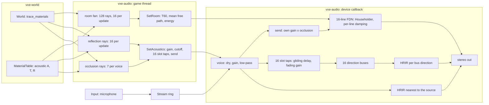

# 0020: Cavern reverb: a late tail sized by the room the listener sees, echoes from their walls, taps that glide, and the player's own voice in the cave

> **Status:** approved (2026-10-17)
> **Created:** 2026-10-17
> **Milestone:** M4 in `docs/roadmap.md`
> **Related ADRs:** [ADR-0015](../adrs/0015-late-reverb-as-a-shared-fdn-from-a-listener-ray-fan.md) (the tail, the fan, the skin-depth rule, the direction buses), ADR-0006 (mixer on the callback, probes on the caller's thread)
> **Prerequisite:** Plan 0006 closed. Its open finding (clicks while the listener moves) transfers here as Phase 1; this plan changes the tap semantics Plan 0006's Phase 4 tests pin, so the close review of 0006 runs first, against the tree as it stands.
> **References:** `docs/references/room-acoustics.md`

## TL;DR

`vxe-audio` gets a late reverb that grows with the cavern: a fan of 128 rays from the listener
measures the visible room's volume and surface, Eyring's formula turns them into a decay time,
and one shared sixteen-line feedback delay network renders a tail of that length and level. The
sixteen early-reflection taps stop clicking while the listener walks, because each tap's delay
glides to its new value and its gain fades instead of being swapped, and each tap is heard from
its wall's direction through a shared bus with that direction's HRIR. A microphone can be
played as a streamed voice at the listener with its direct path muted, so the player hears
their own voice come back off the cave. The first thing the owner hears: `--room 36` with the
looping knock has a tail of about 7 s and `--room 4` about 0.75 s, and walking toward a hum
no longer clicks.

## Context & problem

Plan 0006 shipped the mixer, the HRTF path, occlusion and sixteen early taps per voice, and
passed its listening checks except one: clicks while the listener translates with reflections
on. Measured cause (Plan 0006 log, 2026-10-17): a re-probe fires whenever the listener has
moved 0.1 m, which while walking is every frame or two, and each one replaces all taps with a
5.3 ms crossfade. A listener step of 0.1 m moves an echo path by up to 0.2 m, 28 frames, so the
echo sum jumps in phase and level every 33 ms. The recording showed no sample discontinuity.

There is no late tail at all, and the owner's requirement is explicit: "bigger cavern, bigger
echo". The consumer's P1 need is "early reflections and reverb from ray probes"
(`project-context.md`, Audio). The echoes also all arrive from the source's direction, because
the taps are summed into the voice's mono signal before its HRIR; a slap off the far wall
should come from the far wall.

Budgets touched (`nfr.md` section 9): the mixer block (0.36 ms static, 0.67 ms turning with 32
voices, dev box), `Acoustics::update` (about 1.0 ms accepted as the ceiling, D2b), audio RAM.

## Decision

ADR-0015 records the choice and the alternatives. In one paragraph: taps are keyed by their ray
direction and glide (delay through a fractionally interpolated read at a bounded rate, gain
through the existing 50 ms smoother); each tap sums into one of sixteen shared direction buses
that are spatialised with the HRIR of their direction; `Acoustics` traces a 128-direction fan
from the listener in slices of sixteen rays per call and derives volume, surface, absorption,
Eyring's `T60` and the tail's energy; the mixer owns one sixteen-line Householder feedback
delay network whose line lengths follow the mean free path and whose gains follow `T60`,
fed by every voice's occlusion-scaled send. A face keeps `(1 - A) ^ 0.2` of the amplitude
(one 10 cm skin in and out), which gives rock-like absorption from the existing rows. We
rejected convolution (cost, a dependency, a rebuild per room change), a baked field (the world
is dug), more taps without a tail (nothing scales), and a coarse-grid flood fill (connected
caves run to the cap).

## Architecture diagram



## Implementation phases

Each phase ships as its own commit. `dev` implements all phases in one session with no review
between phases. The architect reviews once at the end, in a fresh session. Every phase carries
exactly one `**Owner skill:**`: `dev` or `human`.

Constants named below are proposals the dev pins in code with a doc comment; the ones in
capitals are the plan's names for them.

### Phase 1: Taps keyed by direction that glide instead of swapping

- **Owner skill:** dev
- **What:** `AcousticTargets.taps` becomes slot-indexed, one slot per reflection direction
  (`MAX_TAPS == REFLECTION_RAYS`, asserted), with gain 0 meaning no hit; `tap_count` goes.
  `reflections()` returns `[Option<Reflection>; REFLECTION_RAYS]` and `taps()` returns
  `[Tap; REFLECTION_RAYS]`. The mixer keeps per-voice, per-slot state `{delay: f32, gain: f32}`:
  the delay moves toward its target by at most `TAP_SLEW_FRAMES_PER_FRAME = 0.05` per frame and
  is read by linear interpolation between the two ring samples around it; the gain moves
  through the `SMOOTHING_SECONDS` one-pole. A slot whose target delay differs from its current
  delay by more than `TAP_JUMP_FRAMES = 480` (10 ms, a hit that moved to another wall) fades to
  silence first (gain below `1e-3`), then takes the new delay and fades in. A fresh voice starts
  at its targets as today. The one-block tap crossfade, `old_taps` and `fading` are deleted.
  `set_reflections(false)` now sends all-zero gains, so the echoes fade out in 50 ms rather
  than swapping away. The keep factor of a reflection becomes
  `(1 - A) ^ (2 * REFLECTION_SKIN_METRES / 1 m)` with `REFLECTION_SKIN_METRES = 0.1`
  (ADR-0015); `Reflection.keep` carries it.
- **Files touched:** `crates/vxe-audio/src/{acoustics.rs, mixer.rs, voice.rs, lib.rs}`,
  `crates/vxe-audio/tests/reflections.rs` (re-derived figures), a new
  `crates/vxe-audio/tests/walking.rs`, `apps/flythrough/src/main.rs` (the `E` key path),
  `docs/plans/0020-...md` (log).
- **Done when:**
  - `tests/walking.rs`: a corridor world (rock at `y >= 5 m` and `y <= -5 m` and at
    `z <= -2 m`, cave row `A = 0.3, T = 0.5`), a 440 Hz hum at `(8 m, 1 m, 0)`, the listener
    walking from `x = 0` to `x = 6 m` at 3 m/s facing `+x`, with `Acoustics::update` called
    every 3 mixer blocks (16 ms of audio) with the advanced position, reflections on, HRTF
    path. Over the rendered 2 s, after the first 100 ms: the largest block-to-block step of the
    output's RMS (per 256-frame block, each ear) is at most 0.5 dB, and the largest per-block
    step of the output's 440 Hz phase (the measure Plan 0006's fix pass used) is at most
    0.1 rad. The bound covers the direct path's distance change (about 0.03 dB per block at
    3 m/s) and the glide's Doppler (0.026 rad per block at 440 Hz). The log records the same
    two figures measured at the parent commit, for the comparison.
  - `tests/reflections.rs`: the 1160-sample echo test and the occlusion-multiplier test pass
    with their expected gains re-derived for the keep factor `0.7 ^ 0.2 = 0.9312` (the plan's
    arithmetic: the tap gain of the Phase 4 wall becomes `0.9312 / path` times the occlusion
    multiplier); the rendered ratios `0.1136` and `0.6452` are re-derived the same way and the
    new figures stated in the test names.
  - A test that sets reflections off mid-hum sees the echo sum fade out with no block-to-block
    output RMS step above 0.5 dB.
  - The fly-through, `--seed 1 --audio`, `J` then walking toward, away from and across the hum:
    the dev confirms no `stream errors` line; the owner's ear is Phase 7.

### Phase 2: Early echoes from their wall's direction

- **Owner skill:** dev
- **What:** The mixer gains sixteen bus buffers of one block each, one per reflection
  direction, with per-bus HRIR state (nearest direction index, history of `taps - 1` frames,
  the one-block raised-cosine crossfade on a direction change). Each voice's slot `i` tap
  output sums into bus `i` instead of into the voice's dry signal. After all voices, each bus
  with any input this block is convolved with the HRIR nearest to `d_i` in the listener's frame
  (both ears) and added to the output. On the panning path a bus pans with constant power on
  its direction. All buffers are sized once at construction.
- **Files touched:** `crates/vxe-audio/src/{mixer.rs, hrtf.rs}`,
  `crates/vxe-audio/tests/reflections.rs`, `crates/vxe-audio/benches/mixer.rs`.
- **Done when:**
  - A world with rock only at `y >= 5 m` (to the listener's left; the listener at the origin
    faces `+x`, up `+z`), a 2 kHz tone burst of 100 ms at `(2 m, 0, 0)`: in the window from
    the end of the direct burst plus the HRIR length to 150 ms later, the left ear's energy
    exceeds the right ear's by at least 3 dB; with the rock at `y <= -5 m` instead, the right
    ear's exceeds the left's by at least 3 dB; the direct burst's interaural level is within
    1 dB of the pack's own interaural level for the front direction at 2 kHz (read from the
    pack as `tests/mixer.rs` does). Before this phase the echo window's interaural level is
    that of the front direction, so the test discriminates.
  - The 1160-sample echo of Phase 1 still peaks at the same frame, now in the bus of the `+x`
    ray.
  - `bench mixer` reports the static and turning 32-voice figures with buses; proposal: at
    most 0.55 ms static and 1.0 ms turning on the dev box (today 0.36 and 0.67; the buses add
    `16 x 2 x 128 x 256 = 1 048 576` multiply-adds per block, half of the 32-voice FIR load).
  - The allocation-counting test in `tests/mixer.rs` still counts zero allocations in `render`.

### Phase 3: The room fan

- **Owner skill:** dev
- **What:** `Acoustics` traces `ROOM_RAYS = 128` fixed directions (a Fibonacci sphere, the same
  construction as the reflection set at 128) from the listener, `ROOM_RAYS_PER_UPDATE = 16`
  per `update` call, through `World::trace_materials` to `REFLECTION_RANGE_METRES`. For each
  ray: the first solid run gives the hit distance `r` and the entry face, recovered from the
  fixed-point hit point (the axis whose coordinate lands on a voxel boundary; ties take the
  axis of largest `|dir|`), and `cos(theta) = |dir_axis| / |dir|` floored at
  `ROOM_COS_FLOOR = 0.1`; a miss counts as a hit at the range with `alpha = 1` and
  `cos = 1`. From a complete fan: `V = (4 pi / 3N) sum r^3`, `S = (4 pi / N) sum r^2 / cos`,
  `alpha` the `r^2 / cos`-weighted mean of `1 - keep(m)^2` clamped to `[0.02, 0.98]`,
  `mean_free_path = 4V / S`, `T60 = clamp(0.161 V / (-S ln(1 - alpha)), 0.05 s,
  settings.max_t60_s)`, `energy = min(16 pi (1 - alpha) / (S alpha), 16)`. A fan restarts when
  the listener has moved more than `ROOM_MOVE_METRES = 1.0` since the last fan began or
  `ROOM_INTERVAL_SECONDS = 0.5` of audio time has passed; otherwise no room ray is traced. A
  completed fan sends `Command::SetRoom(RoomTargets)` and is readable as
  `Acoustics::room() -> Option<RoomEstimate>`. `set_reverb(false)` sends `energy = 0`.
- **Files touched:** `crates/vxe-audio/src/{acoustics.rs, command.rs, lib.rs}`, a new
  `crates/vxe-audio/tests/room.rs`, `apps/flythrough/benches/acoustics.rs`.
- **Done when:**
  - `tests/room.rs`, a 12 m cube of air (voxels `[0, 120)^3`, rock outside, cave row
    `A = 0.3`), listener at the centre and at `(8 m, 6.3 m, 5.8 m)`: after 8 `update` calls the
    estimate reads `V` within 4 percent of 1728 m^3, `S` within 4 percent of 864 m^2, mean free
    path within 4 percent of 8.0 m, `alpha` within 0.001 of 0.1330, `T60` within 4 percent of
    2.26 s (quadrature at 128 directions checked 2026-10-17: within 2 percent at both points).
  - A 4 m cube from 1.7 m off its centre: mean free path within 5 percent of 2.667 m.
  - An all-air world: the estimate's `energy` is at most `1e-4` (the plan's arithmetic for a
    50 m sphere of misses at `alpha = 0.98` is `3.3e-5`, 45 dB down).
  - No `SetRoom` is sent before the first fan completes, none while the listener is still and
    less than 0.5 s has passed, and one within 8 calls after a 1.1 m move.
  - `bench acoustics` with 32 sources and the fan active: at most 1.1 ms per call (today
    1.03 ms; 16 rays of about 100 steps at 40 ns are about 0.07 ms).

### Phase 4: The tail

- **Owner skill:** dev
- **What:** `Mixer` owns a `Reverb` of `REVERB_LINES = 16` delay lines, each
  `REVERB_MAX_DELAY_FRAMES = 4800` (100 ms) plus a block long, mixed by the Householder matrix
  `I - (2/N) 1 1^T` (two passes of `N` adds per sample), with a first-order low-pass per line
  whose gain at DC is `10 ^ (-3 M_i / (T60 f_s))` and at 4 kHz the same for
  `T60 * settings.hf_ratio` (Smith, "Delay-Line Damping Filter Design"). Line `i`'s target
  length is `clamp(mean_free_path / c * f_s * spread_i, 32, 4800)` with
  `spread_i = 0.5 * 3 ^ (i / 15)`, rounded to the nearest prime; the current length glides
  toward it by at most `REVERB_DELAY_SLEW_FRAMES_PER_FRAME = 0.02` through a fractional read,
  and the per-line gains are recomputed every block from the current lengths and the smoothed
  `T60`. The input is the sum over voices of the own-gained sample times the voice's smoothed
  `send` (the occlusion multiplier from `AcousticTargets.send`), scaled so the impulse
  response's energy (both ears averaged) equals `RoomTargets.energy * settings.level ^ 2`: the
  closed form `b^2 = energy * (1 - mean_i g_i^2) / N` or, if the Phase 4 energy test shows it
  off by more than 1 dB, a one-off numeric calibration at construction. Two decorrelated
  outputs (disjoint halves of the lines with alternating signs) add to the stereo output.
  `ReverbSettings { hf_ratio: 0.5, level: 1.0, max_t60_s: 8.0 }` (`Default`) is set through
  `Mixer::set_reverb_settings`.
- **Files touched:** `crates/vxe-audio/src/{reverb.rs (new), mixer.rs, command.rs, lib.rs}`,
  a new `crates/vxe-audio/tests/reverb.rs`, `crates/vxe-audio/benches/mixer.rs`.
- **Done when:**
  - `tests/reverb.rs`: a unit impulse at `(1 m, 0, 0)` with reflections off and
    `SetRoom { t60_s: 2.26, mean_free_path_m: 8.0, energy: 0.379 }`: the backward-integrated
    (Schroeder) decay curve of the output, fitted between 10 and 30 dB below its value at
    50 ms and extrapolated to 60 dB, gives `T60` within 10 percent of 2.26 s; the tail's energy
    from frame 128 on, averaged over the ears, is within 2 dB of 0.379; the normalized echo
    density (Abel and Huang) of the tail at 100 ms and 300 ms is printed and recorded in the
    log.
  - Three closed cubes of 4, 12 and 36 m (cave row `A = 0.3`), listener at the centre, a unit
    impulse 2 m ahead, reflections and tail on, probed to completion: the same fit gives `T60`
    within 20 percent of 0.75, 2.26 and 6.77 s (Eyring with `alpha = 0.1330`, mean free paths
    2.667, 8 and 24 m) and strictly increasing; the direct impulse's peak is within 1 percent of
    the render with the tail off.
  - A hum with the room stepped from `(8 m, 2.26 s)` to `(24 m, 6.77 s)`: no block-to-block
    output RMS step above 0.5 dB, and every line is within one frame of its target 4 s after
    the step (the longest glide is about 3360 frames at 0.02 per frame).
  - The mode-density floor holds: the sum of the line lengths for the 36 m cube
    (about 49 100 frames) exceeds `0.15 * T60 * f_s` (48 800); the test asserts the
    inequality for the three cubes.
  - `bench mixer`, 32 voices with buses and the tail: static at most 0.6 ms, turning at most
    1.0 ms on the dev box. RAM printed: the tail's lines `16 x (4800 + 256) x 4 = 323 584` B.
  - The allocation count in `render` is still zero.

### Phase 5: A streamed voice and the microphone

- **Owner skill:** dev
- **What:** `Stream` is a single-producer, single-consumer ring of
  `STREAM_CAPACITY_FRAMES = 4800` mono frames (100 ms) with atomic head and tail, allocated once;
  `Stream::writer()` pushes slices without blocking and reports frames dropped;
  `Command::PlayStream(VoiceId, StreamReader, PlayParams)` plays it as a voice that reads a
  block per render and fills an underrun with zeros. `PlayParams.direct: bool` (default `true`)
  when `false` mutes the voice's direct path and its own HRIR and keeps its taps and its send.
  `Input::open(stream_writer)` opens the default `cpal` input device at 48 kHz (mono, or the
  first channel of a wider format) on its own callback that writes into the ring; it reports
  the device name and the device's period in frames. `AudioError::Format` for a device that
  cannot open 48 kHz, as `Output` does.
- **Files touched:** `crates/vxe-audio/src/{stream.rs (new), input.rs (new), voice.rs,
  mixer.rs, command.rs, lib.rs}`, a new `crates/vxe-audio/tests/stream.rs`.
- **Done when:**
  - A writer thread pushes a 440 Hz tone in 480-frame pieces while the mixer renders 1 s: from
    the second block on, the output equals the same tone played from a `Sound` at the same
    position, sample for sample within `1e-6`.
  - The writer pauses for 50 ms mid-tone: the output has zeros for the gap and resumes; the
    largest block-to-block RMS step at the gap's edges is reported, not bounded (a real
    underrun is a gap by nature).
  - `direct: false` in an all-air world renders silence (every sample `0.0`); with the Phase 2
    left wall it renders energy only in the echo window.
  - `render` still allocates nothing; `Input::open` is exercised by the fly-through only, like
    `Output::open`.

### Phase 6: The fly-through: rooms, toggles, the microphone and the readings

- **Owner skill:** dev
- **What:** `--room <metres>` runs the fly-through in a closed cube of air of that edge inside
  rock (a `RoomSource` beside `CaveSource`, extent sized to the room plus 2 m of rock), the
  listener spawned at its centre. `R` toggles the tail (`Acoustics::set_reverb`), `E` keeps
  toggling the early taps. `--absorption <A>` overrides the cave row's `A` (default stays
  0.3). `--mic` opens the input device, plays it as a streamed voice at the listener with
  `direct: false`, prints the device, its period and a headphones warning, and the `F1` line
  gains `mic: <device>, <n> frames dropped`. `F1` and `--audio-debug` print the room line:
  `room: V <m3> S <m2> mfp <m> alpha <a> T60 <s> energy <dB>` whenever a fan completes. The
  acoustics bench traces the fan; the mixer bench renders with buses and the tail. The readings
  go into `nfr.md` section 9 (dev box, quiet-box protocol of Plan 0006's close).
- **Files touched:** `apps/flythrough/src/{main.rs, cave.rs, hud.rs}`,
  `apps/flythrough/benches/acoustics.rs`, `crates/vxe-audio/benches/mixer.rs`, `docs/nfr.md`.
- **Done when:**
  - `cargo run --release -p flythrough -- --room 12 --audio --headless --frames 600` prints a
    room line whose `mfp` is within 4 percent of 8.0 m and `T60` within 4 percent of 2.26 s
    (the fly-through's own table at `A = 0.3`).
  - `--room 36 --headless --frames 600` prints `T60` within 4 percent of 6.77 s; `--room 4`
    within 5 percent of 0.75 s.
  - `--seed 1 --audio --headless --frames 600` prints a room line (the spawn pocket: a 3 m
    sphere has mean free path 4 m, so about 1.1 s if the pocket were closed; the value is
    recorded, not asserted, since the pocket opens into the cave).
  - `--mic` on the dev box prints the input device and period and no `stream errors` line
    over 60 s (headless is not possible for an input device; the dev runs it with the window).
  - The three budget readings are in `nfr.md` with machine and commit.

### Phase 7: Listening checks

- **Owner skill:** human
- **What:** The owner listens (headset worn swapped, as before), with `--audio-debug` for the
  recording, and writes the verdict into the log. `dev` sends a push notification when the
  phases are committed and these are ready (batched, one notification).
- **Done when:** Each check is a verdict in the log, pass or not, with what was heard:
  1. **No clicks while moving:** `cargo run --release -p flythrough -- --seed 1 --audio`, dig,
     `J`, walk toward, away from, across and up and down past the hum with `E` on: no clicks.
     Turning still has none.
  2. **Bigger cavern, bigger echo:** `--room 4`, `--room 12`, `--room 36`, each with `T` (the
     looping knock) and a `J` note: the tail is audibly longer and louder from room to room, the
     knock's slaps are audibly farther apart in the bigger rooms, `R` removes the tail and `E`
     removes the slaps; `F1` reads about 0.75, 2.3 and 6.8 s.
  3. **Echoes from their walls:** `--room 12`, stand 2 m from a wall with the knock source on
     the far side of the room: the first slap comes from the near wall's side; turning the
     head keeps it on the wall.
  4. **The cave:** `--seed 1`, walk from the spawn pocket into the first large chamber and into
     a tunnel: the tail grows and shrinks within about a second each way, and `F1`'s room line
     follows.
  5. **Your own voice:** `--room 36 --mic`, speak or clap: the voice returns off the walls and
     tails for seconds; `--room 4 --mic`: a short, tight room. Note whether the slap feels late
     (the device latency is printed; a compensation is the plan's first followup if it does).
  6. **The Doppler glide:** walking fast past the hum with `E` on, is the echoes' pitch glide
     heard, and if so, does it read as motion or as an artefact? A verdict either way.

## Data shapes

```rust
// illustrative
pub struct Tap { pub delay_frames: u32, pub gain: f32 }          // slot-indexed; gain 0 = no hit
pub struct AcousticTargets {
    pub gain: f32, pub cutoff_hz: f32,
    pub taps: [Tap; REFLECTION_RAYS],
    pub send: f32,                                                // reverb send: the occlusion multiplier, 0 when off
}
pub struct Reflection { pub point: [f32; 3], pub keep: f32 }      // keep = (1 - A) ^ 0.2
pub struct RoomEstimate {
    pub volume_m3: f32, pub surface_m2: f32, pub mean_free_path_m: f32,
    pub absorption: f32, pub t60_s: f32, pub energy: f32,
}
pub struct RoomTargets { pub t60_s: f32, pub mean_free_path_m: f32, pub energy: f32 }
pub struct ReverbSettings { pub hf_ratio: f32, pub level: f32, pub max_t60_s: f32 }
pub enum Command { /* as today, plus */ SetRoom(RoomTargets), PlayStream(VoiceId, StreamReader, PlayParams) }
pub struct PlayParams { pub position: [f32; 3], pub gain: f32, pub looping: bool, pub direct: bool }
```

Mixer-side state per voice: `[TapState { delay: f32, gain: f32 }; 16]` (128 B). Buses: 16 x
one block of scratch plus 16 x `taps - 1` frames of history (about 24.5 KB). Reverb: 16 lines of
5056 `f32` (323 584 B), per-line filter state, the Householder scratch. A stream: 4800 `f32`.

## Budgets

| Figure (`nfr.md` section 9) | Today (dev box, quiet box) | Proposal after this plan | How the close measures it |
|---|---|---|---|
| Mixer block, 32 HRTF voices, static | 0.3619 ms | at most 0.6 ms (buses `1.05 M` MACs, about +0.17 ms; tail about 30 k flops; gliding taps about +10 percent on the tap work) | `cargo bench -p vxe-audio --bench mixer` |
| Mixer block, 32 voices, turning 90 degrees per block | 0.6667 ms | at most 1.0 ms (every bus may crossfade in the same block, +0.17 ms more). Fallback if over: 8 buses of two rays each, an amendment | same bench |
| `Acoustics::update`, 32 sources, all due | 1.0294 ms | at most 1.1 ms with a fan slice (16 rays, about 0.07 ms); the slice runs only while a fan is in progress | `cargo bench -p flythrough --bench acoustics` |
| Audio RAM | pack 3 194 204 B, delay lines 2 523 136 B for 64 voices | + 323 584 B tail, about 24.5 KB buses, 8 KB tap state, 19.2 KB per stream | printed by the mixer bench |
| Baseline CPU | not on hand | the 1.0 ms callback proposal stands | dev reference until the baseline exists |

The GPU and the frame are untouched. The fly-through's `F1` callback maximum with 8 voices is
re-read in Phase 7.

## Risks & open questions

- **Turning cost.** Sixteen buses that all change HRIR in one block double the bus FIR work for
  that block. If the turning reading exceeds 1.0 ms on the dev box, the fallback is 8 buses
  (pairs of neighbouring directions), recorded as an amendment, not a silent change.
- **The star-shaped assumption.** A tunnel that opens into a hall measures the hall along the
  line of sight, and a listener in a doorway sees two rooms. The estimate is "the room as seen
  from here", and the owner's cave walk (Phase 7, check 4) judges whether that is right often
  enough. Multi-bounce segment statistics are the second pass if not (ADR-0015, Alternative D).
- **Grazing hits.** `r^2 / cos` with the cosine floored at 0.1 can overstate the surface of a
  long corridor by up to a factor of ten on those rays; a longer corridor then reads as more
  absorbent. The 4 percent cube figure does not cover corridors; Phase 6 records the seed-1
  spawn estimate for a first look.
- **Rows with `A = 0`.** The default row blocks completely and would absorb nothing; the
  `alpha` floor of 0.02 caps `T60` at `0.04025 * mfp / 0.0202`, about 16 s for an 8 m room,
  clamped to `max_t60_s = 8`. A consumer who forgets acoustic rows gets an 8 s tail and a room
  line that says so.
- **Doppler on the echoes.** Up to 1.7 percent at 3 m/s while the direct path has none. The
  slew cap of 0.05 frames per frame bounds it at 5 percent in any case. Phase 7 check 6 decides;
  the alternative (a 50 ms crossfade of tap sets) stays available as a followup.
- **Microphone latency.** The input period plus the output period (about 10 to 20 ms on
  PipeWire) delays every echo of the voice by the same, about 5 m of extra path. Compensation
  (subtracting the measured latency from the streamed voice's tap delays, floored at 0) is the
  first followup if the owner hears it. Speakers feed back through the tail; `--mic` warns.
- **Threading.** The input callback writes the ring, the output callback reads it; the ring is
  lock-free and fixed. The fan takes one chunk read lock at a time, like the other probes.
- **Determinism.** Nothing here is deterministic by contract (section 6); the fan's directions
  are fixed and no RNG is introduced.

## What this plan does NOT do

- **A source's own room** (a voice in a side chamber heard with that chamber's tail) and
  coupled rooms: the second pass, if the cave walk asks for it.
- **Per-band absorption** from the material table (four-band textures): the table's row is a
  triple; `hf_ratio` is the only spectral control.
- **HRTF direction interpolation, a device-rate resampler, a probe worker thread:** ADR-0006's
  followups, untouched.
- **Air absorption with distance, Doppler on the direct path, source directivity.**
- **Voice chat over the network as a positional source:** M9; the streamed voice of Phase 5 is
  the mechanism it will use.
- **Latency compensation for the microphone echo:** the first followup, pending Phase 7.

## Implementation log

> Written by `dev`: one row per phase as its commit lands, then the close block. **The phases
> above are the contract. This section records what happened.** Observations, never conclusions:
> no pass list, no self-assessment. Deviations and unmet done-whens are **always** disclosed.
> Keep it shorter than `## Implementation phases`.

| phase | owner | state | commit |
|---|---|---|---|
| 1: Taps keyed by direction that glide | dev | not started | |
| 2: Early echoes from their wall's direction | dev | not started | |
| 3: The room fan | dev | not started | |
| 4: The tail | dev | not started | |
| 5: A streamed voice and the microphone | dev | not started | |
| 6: The fly-through: rooms, toggles, the microphone and the readings | dev | not started | |
| 7: Listening checks | human | not started | |

### Notes

_(Deviations from the plan, with the commit, stated without justification. Done-whens not
satisfiable as stated, and what was done instead. Followups noticed and not acted on. One line
each. Empty is fine.)_

### Close triggers

_(Facts for the architect. No recommendations, and no suggested version bump.)_

- **What shipped:** feature / fix-only / docs-chore-only
- **Public API changed:** types, traits, functions, shader interfaces, config (list them, or none)
- **Budget readings:** each `nfr.md` figure touched, with its measured value, machine and commit
- **Gate at the tip:** the commands run (build, nextest, doctests, clippy, fmt, deny), exit codes, test counts
- **Outstanding `human` phases:** which, or none

## Followups

- Microphone echo latency compensation, if Phase 7 check 5 hears the slap late.
- A source's own room and coupled rooms (second pass of the room model).
- Multi-bounce segment statistics for the mean free path, if the cave walk finds the fan's
  star-shaped estimate wrong too often.
