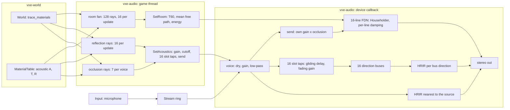

# 0020: Cavern reverb: a late tail sized by the room the listener sees, echoes from their walls, taps that glide, and the player's own voice in the cave

> **Status:** in-progress
> **Created:** 2026-10-17
> **Milestone:** M4 in `docs/roadmap.md`
> **Related ADRs:** [ADR-0015](../adrs/0015-late-reverb-as-a-shared-fdn-from-a-listener-ray-fan.md) (the tail, the fan, the skin-depth rule, the direction buses), ADR-0006 (mixer on the callback, probes on the caller's thread)
> **Prerequisite:** Plan 0006 closed. Its open finding (clicks while the listener moves) transfers here as Phase 1; this plan changes the tap semantics Plan 0006's Phase 4 tests pin, so the close review of 0006 runs first, against the tree as it stands.
> **References:** `docs/references/room-acoustics.md`
> **Amended:** 2026-10-20, inside Phase 1 (its code on 919cb63), from the resume notes and the
> owner's answers: Phase 1's walking done-when (0.5 dB and 0.1 rad per block) was unsatisfiable,
> since an ideal click-free render of the same walk steps 5.24 dB and 1.05 rad, and its Doppler
> figure was ten times low (0.258 rad per block, not 0.026). It becomes per-slot continuity,
> ramped gains and a click index against an ideal reference render, with the bounds derived
> from the probe cadence; Phases 2 and 4 inherit the click index in place of their RMS-step
> bounds on moving sounds. Phase 6's tail key is `Y` (`R` toggles collapse rubble), its room
> lines are read headlessly without `--audio`, and the `--mic` and fly-through walk checks that
> need a device move to Phase 7.
> **Amended:** 2026-10-20, inside Phase 4 (its code on d1fd30f), from the resume notes and the
> owner's answer: the room-step bound (`K` at most twice the held render's) compared a beating
> sum of tones with a single steady tone, so it measured the tail's crest, not clicks (2.0031
> against 1.9998). It becomes a per-window bound of `K` by 1.25 times that window's own crest
> factor, with a bite: one line's delay jumped by half a hum period must score at least four
> times the bound.

## TL;DR

`vxe-audio` gets a late reverb that grows with the cavern: a fan of 128 rays from the listener
measures the visible room's volume and surface, Eyring's formula turns them into a decay time,
and one shared sixteen-line feedback delay network renders a tail of that length and level. The
sixteen early-reflection taps stop clicking while the listener walks, because each tap's delay
glides to its new value and its gain fades instead of being swapped, and each tap is heard from
its wall's direction through a shared bus with that direction's HRIR. A microphone can be
played as a streamed voice at the listener with its direct path muted, so the player hears
their own voice come back off the cave. The first thing the owner hears: `--room 36` with the
looping knock has a tail of about 7 s and `--room 4` about 0.75 s, and walking toward a hum
no longer clicks.

## Context & problem

Plan 0006 shipped the mixer, the HRTF path, occlusion and sixteen early taps per voice, and
passed its listening checks except one: clicks while the listener translates with reflections
on. Measured cause (Plan 0006 log, 2026-10-17): a re-probe fires whenever the listener has
moved 0.1 m, which while walking is every frame or two, and each one replaces all taps with a
5.3 ms crossfade. A listener step of 0.1 m moves an echo path by up to 0.2 m, 28 frames, so the
echo sum jumps in phase and level every 33 ms. The recording showed no sample discontinuity.

There is no late tail at all, and the owner's requirement is explicit: "bigger cavern, bigger
echo". The consumer's P1 need is "early reflections and reverb from ray probes"
(`project-context.md`, Audio). The echoes also all arrive from the source's direction, because
the taps are summed into the voice's mono signal before its HRIR; a slap off the far wall
should come from the far wall.

Budgets touched (`nfr.md` section 9): the mixer block (0.36 ms static, 0.67 ms turning with 32
voices, dev box), `Acoustics::update` (about 1.0 ms accepted as the ceiling, D2b), audio RAM.

## Decision

ADR-0015 records the choice and the alternatives. In one paragraph: taps are keyed by their ray
direction and glide (delay through a fractionally interpolated read at a bounded rate, gain
through the existing 50 ms smoother); each tap sums into one of sixteen shared direction buses
that are spatialised with the HRIR of their direction; `Acoustics` traces a 128-direction fan
from the listener in slices of sixteen rays per call and derives volume, surface, absorption,
Eyring's `T60` and the tail's energy; the mixer owns one sixteen-line Householder feedback
delay network whose line lengths follow the mean free path and whose gains follow `T60`,
fed by every voice's occlusion-scaled send. A face keeps `(1 - A) ^ 0.2` of the amplitude
(one 10 cm skin in and out), which gives rock-like absorption from the existing rows. We
rejected convolution (cost, a dependency, a rebuild per room change), a baked field (the world
is dug), more taps without a tail (nothing scales), and a coarse-grid flood fill (connected
caves run to the cap).

## Architecture diagram



## Implementation phases

Each phase ships as its own commit. `dev` implements all phases in one session with no review
between phases. The architect reviews once at the end, in a fresh session. Every phase carries
exactly one `**Owner skill:**`: `dev` or `human`.

Constants named below are proposals the dev pins in code with a doc comment; the ones in
capitals are the plan's names for them.

### Phase 1: Taps keyed by direction that glide instead of swapping

- **Owner skill:** dev
- **What:** `AcousticTargets.taps` becomes slot-indexed, one slot per reflection direction
  (`MAX_TAPS == REFLECTION_RAYS`, asserted), with gain 0 meaning no hit; `tap_count` goes.
  `reflections()` returns `[Option<Reflection>; REFLECTION_RAYS]` and `taps()` returns
  `[Tap; REFLECTION_RAYS]`. The mixer keeps per-voice, per-slot state `{delay: f32, gain: f32}`:
  the delay moves toward its target by at most `TAP_SLEW_FRAMES_PER_FRAME = 0.05` per frame and
  is read by linear interpolation between the two ring samples around it; the gain moves
  through the `SMOOTHING_SECONDS` one-pole. A slot whose target delay differs from its current
  delay by more than `TAP_JUMP_FRAMES = 480` (10 ms, a hit that moved to another wall) fades to
  silence first (gain below `1e-3`), then takes the new delay and fades in. A fresh voice starts
  at its targets as today. The one-block tap crossfade, `old_taps` and `fading` are deleted.
  `set_reflections(false)` now sends all-zero gains, so the echoes fade out in 50 ms rather
  than swapping away. The keep factor of a reflection becomes
  `(1 - A) ^ (2 * REFLECTION_SKIN_METRES / 1 m)` with `REFLECTION_SKIN_METRES = 0.1`
  (ADR-0015); `Reflection.keep` carries it. A `#[doc(hidden)]` readout of a voice's slot
  states (delay, gain, target) serves the walking test.
- **Files touched:** `crates/vxe-audio/src/{acoustics.rs, mixer.rs, voice.rs, lib.rs}`,
  `crates/vxe-audio/tests/reflections.rs` (re-derived figures), a new
  `crates/vxe-audio/tests/walking.rs`, `apps/flythrough/src/main.rs` (the `E` key path),
  `docs/plans/0020-...md` (log).
- **Done when:**
  - `tests/walking.rs`: a corridor world (rock at `y >= 5 m` and `y <= -5 m` and at
    `z <= -2 m`, cave row `A = 0.3, T = 0.5`), a 440 Hz hum (440 whole cycles per 1 s loop, so
    its seam adds nothing) at `(8 m, 1 m, 0)`, the listener walking from `x = 0` to `x = 6 m`
    at 3 m/s facing `+x`, with `Acoustics::update` called every 3 mixer blocks (16 ms of audio)
    with the advanced position, reflections on, HRTF path, rendered for 2 s. **The arithmetic
    the bounds follow from:**
    - The listener moves `3 x 256 / 48000 = 0.016 m` per block. Every wall is parallel to the
      walk, so each ray's hit distance is constant and its hit point moves with the listener:
      a slot's excess path `|L - H| + |H - S| - |L - S|` changes by at most `2 v dt = 0.032 m`
      per block, `0.032 x 48000 / 343 = 4.48` frames. That is each echo's Doppler: up to
      `2v / c = 1.75` percent, 7.7 Hz at 440 Hz, its phase moving
      `2 pi 440 x 0.032 / 343 = 0.258` rad per block against the direct path.
    - A voice is re-probed only once the listener has moved more than `PROBE_MOVE_METRES =
      0.1`: here every third update (0.144 m, 9 blocks). A slot's target therefore steps by up
      to `2 x 0.144 x 139.9 = 40.3` frames per probe, and the glide covers that at
      `TAP_SLEW_FRAMES_PER_FRAME x 256 = 12.8` frames per block within 4 blocks. The walk's
      4.48 frames per block is the average; the per-block bound is the slew cap, because
      targets arrive in steps. A swap moves the read point by the whole step at once.
    - Why the level and phase steps of the output are not bounded: at the walk's start ten
      sounding slots sum to a gain of 0.689 against the direct path's 0.124, so the output is a
      sum of beating phasors; an ideal click-free render of this walk steps 5.24 dB and 1.05
      rad per block (resume notes).

    After the first 100 ms, read through the slot readout at every block edge:
    - **Per-slot continuity.** No slot's delay moves more than 12.8 frames in a block (plus
      `1e-3`). Every sounding slot's delay is within 42 frames of its ideal excess-path delay
      (unrounded, at that block's listener position): 40.3 frames of walk between two probes
      plus 1.5 frames for rounding the two targets. No slot changes wall, so no slot takes the
      jump path: a sounding slot's gain never falls below `TAP_SILENT`.
    - **Ramped gains.** At each block edge every slot's gain moves toward its target by at
      most `1 - e^(-256 / (48000 x 0.05)) = 0.1012` of the distance (plus `1e-6`), and never
      past it.
    - **Click index against an ideal reference.** The reference is the same walk rendered mono
      in the test with nothing that can click: the direct path and every slot evaluated at
      each block edge from the exact walk position (unrounded delays), delays and gains
      interpolated linearly per sample, an analytic 440 Hz sine. The click index `K` of a
      signal `x`, per 200 ms window (9600 frames, hop 4800), is
      `max |x[n+1] - 2 x[n] + x[n-1]| / (w^2 sqrt(2) rms(x))` with `w = 2 pi 440 / 48000`
      rad per frame. A pure 440 Hz tone scores 1.00; a smooth sum of tones near 440 Hz scores
      about its envelope's crest, a few; a step of size `d` scores at least
      `d / (w^2 sqrt(2) rms)`, so one slot of gain 0.069 swapped by 20 frames (a step of about
      0.075 at a window rms of about 0.18) scores about 90. Asserted: the mixer's largest `K`
      over windows and ears is at most twice the reference's largest `K`. The test bites: the
      reference re-rendered with each slot's delay held between the mixer's probe blocks and
      stepped at them (a swap with no crossfade) scores at least four times that bound. Both
      references' and the mixer's `K` are printed; if the mixer's exceeds the bound, `dev`
      stops with the figures rather than loosening it.
    - The log records the mixer's `K` at the parent commit d11d0cb (a scratch copy of the
      test), for the comparison.
  - `tests/reflections.rs`: the 1160-sample echo test and the occlusion-multiplier test pass
    with their expected gains re-derived for the keep factor `0.7 ^ 0.2 = 0.9312` (the plan's
    arithmetic: the tap gain of the Phase 4 wall becomes `0.9312 / path` times the occlusion
    multiplier); the rendered ratios `0.1136` and `0.6452` are re-derived the same way and the
    new figures stated in the test names.
  - A test that sets reflections off mid-hum sees the echo sum fade out with no block-to-block
    output RMS step above 0.5 dB.
  - The fly-through walk toward, away from and across the hum opens the output device and a
    window, so it is Phase 7 check 1 (amended 2026-10-20), `stream errors` line included.

### Phase 2: Early echoes from their wall's direction

- **Owner skill:** dev
- **What:** The mixer gains sixteen bus buffers of one block each, one per reflection
  direction, with per-bus HRIR state (nearest direction index, history of `taps - 1` frames,
  the one-block raised-cosine crossfade on a direction change). Each voice's slot `i` tap
  output sums into bus `i` instead of into the voice's dry signal. After all voices, each bus
  with any input this block is convolved with the HRIR nearest to `d_i` in the listener's frame
  (both ears) and added to the output. On the panning path a bus pans with constant power on
  its direction. All buffers are sized once at construction.
- **Files touched:** `crates/vxe-audio/src/{mixer.rs, hrtf.rs}`,
  `crates/vxe-audio/tests/reflections.rs`, `crates/vxe-audio/benches/mixer.rs`.
- **Done when:**
  - A world with rock only at `y >= 5 m` (to the listener's left; the listener at the origin
    faces `+x`, up `+z`), a 2 kHz tone burst of 100 ms at `(2 m, 0, 0)`: in the window from
    the end of the direct burst plus the HRIR length to 150 ms later, the left ear's energy
    exceeds the right ear's by at least 3 dB; with the rock at `y <= -5 m` instead, the right
    ear's exceeds the left's by at least 3 dB; the direct burst's interaural level is within
    1 dB of the pack's own interaural level for the front direction at 2 kHz (read from the
    pack as `tests/mixer.rs` does). Before this phase the echo window's interaural level is
    that of the front direction, so the test discriminates.
  - The 1160-sample echo of Phase 1 still peaks at the same frame, now in the bus of the `+x`
    ray.
  - `tests/walking.rs` holds with the buses: its slot assertions are unchanged, and the
    mixer's click index, per ear, is still at most twice the mono reference's (the listener
    faces `+x` throughout, so no bus changes HRIR during the walk).
  - `bench mixer` reports the static and turning 32-voice figures with buses; proposal: at
    most 0.55 ms static and 1.0 ms turning on the dev box (today 0.36 and 0.67; the buses add
    `16 x 2 x 128 x 256 = 1 048 576` multiply-adds per block, half of the 32-voice FIR load).
  - The allocation-counting test in `tests/mixer.rs` still counts zero allocations in `render`.

### Phase 3: The room fan

- **Owner skill:** dev
- **What:** `Acoustics` traces `ROOM_RAYS = 128` fixed directions (a Fibonacci sphere, the same
  construction as the reflection set at 128) from the listener, `ROOM_RAYS_PER_UPDATE = 16`
  per `update` call, through `World::trace_materials` to `REFLECTION_RANGE_METRES`. For each
  ray: the first solid run gives the hit distance `r` and the entry face, recovered from the
  fixed-point hit point (the axis whose coordinate lands on a voxel boundary; ties take the
  axis of largest `|dir|`), and `cos(theta) = |dir_axis| / |dir|` floored at
  `ROOM_COS_FLOOR = 0.1`; a miss counts as a hit at the range with `alpha = 1` and
  `cos = 1`. From a complete fan: `V = (4 pi / 3N) sum r^3`, `S = (4 pi / N) sum r^2 / cos`,
  `alpha` the `r^2 / cos`-weighted mean of `1 - keep(m)^2` clamped to `[0.02, 0.98]`,
  `mean_free_path = 4V / S`, `T60 = clamp(0.161 V / (-S ln(1 - alpha)), 0.05 s,
  settings.max_t60_s)`, `energy = min(16 pi (1 - alpha) / (S alpha), 16)`. A fan restarts when
  the listener has moved more than `ROOM_MOVE_METRES = 1.0` since the last fan began or
  `ROOM_INTERVAL_SECONDS = 0.5` of audio time has passed; otherwise no room ray is traced. A
  completed fan sends `Command::SetRoom(RoomTargets)` and is readable as
  `Acoustics::room() -> Option<RoomEstimate>`. `set_reverb(false)` sends `energy = 0`.
- **Files touched:** `crates/vxe-audio/src/{acoustics.rs, command.rs, lib.rs}`, a new
  `crates/vxe-audio/tests/room.rs`, `apps/flythrough/benches/acoustics.rs`.
- **Done when:**
  - `tests/room.rs`, a 12 m cube of air (voxels `[0, 120)^3`, rock outside, cave row
    `A = 0.3`), listener at the centre and at `(8 m, 6.3 m, 5.8 m)`: after 8 `update` calls the
    estimate reads `V` within 4 percent of 1728 m^3, `S` within 4 percent of 864 m^2, mean free
    path within 4 percent of 8.0 m, `alpha` within 0.001 of 0.1330, `T60` within 4 percent of
    2.26 s (quadrature at 128 directions checked 2026-10-17: within 2 percent at both points).
  - A 4 m cube from 1.7 m off its centre: mean free path within 5 percent of 2.667 m.
  - An all-air world: the estimate's `energy` is at most `1e-4` (the plan's arithmetic for a
    50 m sphere of misses at `alpha = 0.98` is `3.3e-5`, 45 dB down).
  - No `SetRoom` is sent before the first fan completes, none while the listener is still and
    less than 0.5 s has passed, and one within 8 calls after a 1.1 m move.
  - `bench acoustics` with 32 sources and the fan active: at most 1.1 ms per call (today
    1.03 ms; 16 rays of about 100 steps at 40 ns are about 0.07 ms).

### Phase 4: The tail

- **Owner skill:** dev
- **What:** `Mixer` owns a `Reverb` of `REVERB_LINES = 16` delay lines, each
  `REVERB_MAX_DELAY_FRAMES = 4800` (100 ms) plus a block long, mixed by the Householder matrix
  `I - (2/N) 1 1^T` (two passes of `N` adds per sample), with a first-order low-pass per line
  whose gain at DC is `10 ^ (-3 M_i / (T60 f_s))` and at 4 kHz the same for
  `T60 * settings.hf_ratio` (Smith, "Delay-Line Damping Filter Design"). Line `i`'s target
  length is `clamp(mean_free_path / c * f_s * spread_i, 32, 4800)` with
  `spread_i = 0.5 * 3 ^ (i / 15)`, rounded to the nearest prime; the current length glides
  toward it by at most `REVERB_DELAY_SLEW_FRAMES_PER_FRAME = 0.02` through a fractional read,
  and the per-line gains are recomputed every block from the current lengths and the smoothed
  `T60`. The input is the sum over voices of the own-gained sample times the voice's smoothed
  `send` (the occlusion multiplier from `AcousticTargets.send`), scaled so the impulse
  response's energy (both ears averaged) equals `RoomTargets.energy * settings.level ^ 2`: the
  closed form `b^2 = energy * (1 - mean_i g_i^2) / N` or, if the Phase 4 energy test shows it
  off by more than 1 dB, a one-off numeric calibration at construction. Two decorrelated
  outputs (disjoint halves of the lines with alternating signs) add to the stereo output.
  `ReverbSettings { hf_ratio: 0.5, level: 1.0, max_t60_s: 8.0 }` (`Default`) is set through
  `Mixer::set_reverb_settings`.
- **Files touched:** `crates/vxe-audio/src/{reverb.rs (new), mixer.rs, command.rs, lib.rs}`,
  a new `crates/vxe-audio/tests/reverb.rs`, `crates/vxe-audio/benches/mixer.rs`.
- **Done when:**
  - `tests/reverb.rs`: a unit impulse at `(1 m, 0, 0)` with reflections off and
    `SetRoom { t60_s: 2.26, mean_free_path_m: 8.0, energy: 0.379 }`: the backward-integrated
    (Schroeder) decay curve of the output, fitted between 10 and 30 dB below its value at
    50 ms and extrapolated to 60 dB, gives `T60` within 10 percent of 2.26 s; the tail's energy
    from frame 128 on, averaged over the ears, is within 2 dB of 0.379; the normalized echo
    density (Abel and Huang) of the tail at 100 ms and 300 ms is printed and recorded in the
    log.
  - Three closed cubes of 4, 12 and 36 m (cave row `A = 0.3`), listener at the centre, a unit
    impulse 2 m ahead, reflections and tail on, probed to completion: the same fit gives `T60`
    within 20 percent of 0.75, 2.26 and 6.77 s (Eyring with `alpha = 0.1330`, mean free paths
    2.667, 8 and 24 m) and strictly increasing; the direct impulse's peak is within 1 percent of
    the render with the tail off.
  - A hum with the room stepped from `(8 m, 2.26 s)` to `(24 m, 6.77 s)`: no line's length
    moves more than `0.02 x 256 = 5.12` frames in a block; every line is within one frame of
    its target 4 s after the step (the longest glides, lines 14 and 15, are about 3120 frames:
    about 1560 to 4680 and 1680 to the 4800 cap, 3.25 s at 0.02 per frame).
  - **Click index against the window's own crest** (amended 2026-10-20; it replaces "at most
    twice the held render's `K`"). For every 200 ms window of the 4 s after the step (Phase
    1's windows, 9600 frames, hop 4800), per ear: `K_w <= 1.25 C_w`, where `K_w` is Phase 1's
    click index and `C_w = max |x| / (sqrt(2) rms(x))` over the same window (a pure tone scores
    1.00 on both). Why this and not the held render: the held render is one steady 440 Hz tone
    (`K = 1`), while gliding lines shift the recirculating hum by up to 2 percent per pass, so
    the output is a beating sum of tones whose `K` follows its envelope. The arithmetic: for
    `x = sum a_k cos(w_k n + p_k)`, `x'' = -w^2 x + sum a_k (w^2 - w_k^2) cos(...)` (the
    discrete `2 (1 - cos w)` differs from `w^2` by `w^2 / 12`, 0.03 percent), so
    `K_w <= C_w + max_k |1 - (w_k / w)^2| x sum |a_k| / (sqrt(2) rms)`. Here the lines lengthen,
    so recirculated components sit below 440 Hz and the second term shrinks `K` (measured
    `K_w / C_w` at most 0.874: 2.003 against 2.293); 1.25 holds for components up to about
    6 percent off 440 Hz with `sum |a_k|` up to twice the window's peak, either way. A click
    cannot hide under it: a step `d` raises `K_w` by about `d / (w^2 sqrt(2) rms) = 213 d / rms`
    (`w^2 = 0.003317`) and leaves `C_w` almost unchanged, so at the worst measured crest
    (2.42, bound 3.03) a step above 1.4 percent of the window's rms fails. The held render's
    `K` and every window's `K_w`, `C_w` and ratio are printed; if a window fails, `dev` stops
    with the figures rather than loosening the multiple.
  - **The bound bites.** The same render with line 15's read point jumped by 55 frames (half a
    440 Hz period, so the jump's difference signal has about twice the line's amplitude) through
    a `#[doc(hidden)]` hook beside `Mixer::reverb_lines`, at four instants 0.5, 1.5, 2.5 and
    3.5 s after the step, each offset by a further 27 frames (a quarter period, so at least one
    jump lands at least `sin(pi / 4) = 0.707` of the way from a zero crossing of the difference),
    alternating `+55` and `-55`: the largest `K_w / (1.25 C_w)` over its windows and ears is at
    least 4. The plan's arithmetic: the 8 m tail (energy 0.379) gives each of the 8 lines on an
    ear a 440 Hz amplitude of about 0.11 against an output rms of about 0.42 with the hum at
    2 m, so a jump scores about `2 x 0.11 x 0.707 / (0.004691 x 0.42) = 79` against a bound of
    at most 3.03, a factor of about 26; 4 leaves room for a line that happens to be weak at
    440 Hz. The factor is printed.
  - The mode-density floor holds: the sum of the line lengths for the 36 m cube
    (about 49 100 frames) exceeds `0.15 * T60 * f_s` (48 800); the test asserts the
    inequality for the three cubes.
  - `bench mixer`, 32 voices with buses and the tail: static at most 0.6 ms, turning at most
    1.0 ms on the dev box. RAM printed: the tail's lines `16 x (4800 + 256) x 4 = 323 584` B.
  - The allocation count in `render` is still zero.

### Phase 5: A streamed voice and the microphone

- **Owner skill:** dev
- **What:** `Stream` is a single-producer, single-consumer ring of
  `STREAM_CAPACITY_FRAMES = 4800` mono frames (100 ms) with atomic head and tail, allocated once;
  `Stream::writer()` pushes slices without blocking and reports frames dropped;
  `Command::PlayStream(VoiceId, StreamReader, PlayParams)` plays it as a voice that reads a
  block per render and fills an underrun with zeros. `PlayParams.direct: bool` (default `true`)
  when `false` mutes the voice's direct path and its own HRIR and keeps its taps and its send.
  `Input::open(stream_writer)` opens the default `cpal` input device at 48 kHz (mono, or the
  first channel of a wider format) on its own callback that writes into the ring; it reports
  the device name and the device's period in frames. `AudioError::Format` for a device that
  cannot open 48 kHz, as `Output` does.
- **Files touched:** `crates/vxe-audio/src/{stream.rs (new), input.rs (new), voice.rs,
  mixer.rs, command.rs, lib.rs}`, a new `crates/vxe-audio/tests/stream.rs`.
- **Done when:**
  - A writer thread pushes a 440 Hz tone in 480-frame pieces while the mixer renders 1 s: from
    the second block on, the output equals the same tone played from a `Sound` at the same
    position, sample for sample within `1e-6`.
  - The writer pauses for 50 ms mid-tone: the output has zeros for the gap and resumes; the
    largest block-to-block RMS step at the gap's edges is reported, not bounded (a real
    underrun is a gap by nature).
  - `direct: false` in an all-air world renders silence (every sample `0.0`); with the Phase 2
    left wall it renders energy only in the echo window.
  - `render` still allocates nothing; `Input::open` is exercised by the fly-through only, like
    `Output::open`.

### Phase 6: The fly-through: rooms, toggles, the microphone and the readings

- **Owner skill:** dev
- **What:** `--room <metres>` runs the fly-through in a closed cube of air of that edge inside
  rock (a `RoomSource` beside `CaveSource`, extent sized to the room plus 2 m of rock), the
  listener spawned at its centre. `Y` toggles the tail (`Acoustics::set_reverb`; amended
  2026-10-20: `R` already toggles collapse rubble, and `Y` is free and sits by the other sound
  keys `T`, `H` and `J`), `E` keeps toggling the early taps. `--absorption <A>` overrides the
  cave row's `A` (default stays 0.3). `--mic` (implies `--audio`) opens the input device, plays it as a streamed
  voice at the listener with `direct: false`, prints the device, its period and a headphones
  warning, and the `F1` line gains `mic: <device>, <n> frames dropped`. `F1` and
  `--audio-debug` print the room line:
  `room: V <m3> S <m2> mfp <m> alpha <a> T60 <s> energy <dB>` whenever a fan completes.
  `--room-line` (implied by `--room`) prints the room line whenever a fan completes and, without
  `--audio`, runs `Acoustics` with no output device: its commands are dropped and its block
  clock never advances, so a fan completes after 8 frames and restarts only on a 1 m move. The
  acoustics bench traces the fan; the mixer bench renders with buses and the tail. The readings
  go into `nfr.md` section 9 (dev box, quiet-box protocol of Plan 0006's close).
- **Files touched:** `apps/flythrough/src/{main.rs, cave.rs, hud.rs}`,
  `apps/flythrough/benches/acoustics.rs`, `crates/vxe-audio/benches/mixer.rs`, `docs/nfr.md`.
- **Done when:**
  - Every run below is headless and opens no audio device (amended 2026-10-20: `--audio`
    opens the real output device even under `--headless`): `cargo run --release -p
    flythrough -- --room 12 --headless --frames 600` prints a room line whose `mfp` is within
    4 percent of 8.0 m and `T60` within 4 percent of 2.26 s (the fly-through's own table at
    `A = 0.3`).
  - `--room 36 --headless --frames 600` prints `T60` within 4 percent of 6.77 s; `--room 4`
    within 5 percent of 0.75 s.
  - `--seed 1 --room-line --headless --frames 600` prints a room line (the spawn pocket: a 3 m
    sphere has mean free path 4 m, so about 1.1 s if the pocket were closed; the value is
    recorded, not asserted, since the pocket opens into the cave).
  - `Y` and `--mic` are wired, and `--mic` without a usable input device prints the
    `AudioError` and runs on without it; the `--mic` device line and the 60 s with no
    `stream errors` line need the window and the microphone, so they are Phase 7 check 5.
  - The three budget readings are in `nfr.md` with machine and commit.

### Phase 7: Listening checks

- **Owner skill:** human
- **What:** The owner listens (headset worn swapped, as before), with `--audio-debug` for the
  recording, and writes the verdict into the log. `dev` sends a push notification when the
  phases are committed and these are ready (batched, one notification).
- **Done when:** Each check is a verdict in the log, pass or not, with what was heard:
  1. **No clicks while moving:** `cargo run --release -p flythrough -- --seed 1 --audio`, dig,
     `J`, walk toward, away from, across and up and down past the hum with `E` on: no clicks,
     and no `stream errors` line. Turning still has none.
  2. **Bigger cavern, bigger echo:** `--room 4`, `--room 12`, `--room 36`, each with `T` (the
     looping knock) and a `J` note: the tail is audibly longer and louder from room to room, the
     knock's slaps are audibly farther apart in the bigger rooms, `Y` removes the tail and `E`
     removes the slaps; `F1` reads about 0.75, 2.3 and 6.8 s.
  3. **Echoes from their walls:** `--room 12`, stand 2 m from a wall with the knock source on
     the far side of the room: the first slap comes from the near wall's side; turning the
     head keeps it on the wall.
  4. **The cave:** `--seed 1`, walk from the spawn pocket into the first large chamber and into
     a tunnel: the tail grows and shrinks within about a second each way, and `F1`'s room line
     follows.
  5. **Your own voice:** `--room 36 --mic`, speak or clap: the voice returns off the walls and
     tails for seconds; `--room 4 --mic`: a short, tight room. Note whether the slap feels late
     (the device latency is printed; a compensation is the plan's first followup if it does).
     The run prints the input device and its period, and no `stream errors` line over 60 s
     (moved from Phase 6, 2026-10-20).
  6. **The Doppler glide:** walking fast past the hum with `E` on, is the echoes' pitch glide
     heard, and if so, does it read as motion or as an artefact? While walking, each echo's
     pitch runs at the 5 percent slew cap for a few blocks after each probe and then holds,
     about 21 times a second at 3 m/s (Risks). A verdict either way.

## Data shapes

```rust
// illustrative
pub struct Tap { pub delay_frames: u32, pub gain: f32 }          // slot-indexed; gain 0 = no hit
pub struct AcousticTargets {
    pub gain: f32, pub cutoff_hz: f32,
    pub taps: [Tap; REFLECTION_RAYS],
    pub send: f32,                                                // reverb send: the occlusion multiplier, 0 when off
}
pub struct Reflection { pub point: [f32; 3], pub keep: f32 }      // keep = (1 - A) ^ 0.2
pub struct RoomEstimate {
    pub volume_m3: f32, pub surface_m2: f32, pub mean_free_path_m: f32,
    pub absorption: f32, pub t60_s: f32, pub energy: f32,
}
pub struct RoomTargets { pub t60_s: f32, pub mean_free_path_m: f32, pub energy: f32 }
pub struct ReverbSettings { pub hf_ratio: f32, pub level: f32, pub max_t60_s: f32 }
pub enum Command { /* as today, plus */ SetRoom(RoomTargets), PlayStream(VoiceId, StreamReader, PlayParams) }
pub struct PlayParams { pub position: [f32; 3], pub gain: f32, pub looping: bool, pub direct: bool }
```

Mixer-side state per voice: `[TapState { delay: f32, gain: f32 }; 16]` (128 B). Buses: 16 x
one block of scratch plus 16 x `taps - 1` frames of history (about 24.5 KB). Reverb: 16 lines of
5056 `f32` (323 584 B), per-line filter state, the Householder scratch. A stream: 4800 `f32`.

## Budgets

| Figure (`nfr.md` section 9) | Today (dev box, quiet box) | Proposal after this plan | How the close measures it |
|---|---|---|---|
| Mixer block, 32 HRTF voices, static | 0.3619 ms | at most 0.6 ms (buses `1.05 M` MACs, about +0.17 ms; tail about 30 k flops; gliding taps about +10 percent on the tap work) | `cargo bench -p vxe-audio --bench mixer` |
| Mixer block, 32 voices, turning 90 degrees per block | 0.6667 ms | at most 1.0 ms (every bus may crossfade in the same block, +0.17 ms more). Fallback if over: 8 buses of two rays each, an amendment | same bench |
| `Acoustics::update`, 32 sources, all due | 1.0294 ms | at most 1.1 ms with a fan slice (16 rays, about 0.07 ms); the slice runs only while a fan is in progress | `cargo bench -p flythrough --bench acoustics` |
| Audio RAM | pack 3 194 204 B, delay lines 2 523 136 B for 64 voices | + 323 584 B tail, about 24.5 KB buses, 8 KB tap state, 19.2 KB per stream | printed by the mixer bench |
| Baseline CPU | not on hand | the 1.0 ms callback proposal stands | dev reference until the baseline exists |

The GPU and the frame are untouched. The fly-through's `F1` callback maximum with 8 voices is
re-read in Phase 7.

## Risks & open questions

- **Turning cost.** Sixteen buses that all change HRIR in one block double the bus FIR work for
  that block. If the turning reading exceeds 1.0 ms on the dev box, the fallback is 8 buses
  (pairs of neighbouring directions), recorded as an amendment, not a silent change.
- **The star-shaped assumption.** A tunnel that opens into a hall measures the hall along the
  line of sight, and a listener in a doorway sees two rooms. The estimate is "the room as seen
  from here", and the owner's cave walk (Phase 7, check 4) judges whether that is right often
  enough. Multi-bounce segment statistics are the second pass if not (ADR-0015, Alternative D).
- **Grazing hits.** `r^2 / cos` with the cosine floored at 0.1 can overstate the surface of a
  long corridor by up to a factor of ten on those rays; a longer corridor then reads as more
  absorbent. The 4 percent cube figure does not cover corridors; Phase 6 records the seed-1
  spawn estimate for a first look.
- **Rows with `A = 0`.** The default row blocks completely and would absorb nothing; the
  `alpha` floor of 0.02 caps `T60` at `0.04025 * mfp / 0.0202`, about 16 s for an 8 m room,
  clamped to `max_t60_s = 8`. A consumer who forgets acoustic rows gets an 8 s tail and a room
  line that says so.
- **Doppler on the echoes.** An echo's excess path changes by up to `2v`, so at 3 m/s its
  pitch moves by up to `2v / c = 1.75` percent (7.7 Hz at 440 Hz, 0.258 rad per 256-frame
  block) while the direct path has none; echoes beat against the direct path and each other
  at up to that rate, which is why Phase 1 bounds no output level or phase step (amended
  2026-10-20; the plan said 0.026 rad). The probe cadence makes the glide a staircase: a voice
  is re-probed after 0.1 m of listener movement (every 48 ms at 3 m/s), its targets step by up
  to 40 frames, and the slots cover the step at the slew cap of 0.05 frames per frame, 5
  percent, for about 3 blocks, then hold. The pitch therefore alternates between 5 percent and
  none about 21 times a second. Phase 7 check 6 decides; spreading each step over the probe
  interval, or the alternative of a 50 ms crossfade of tap sets, stays available as a
  followup.
- **Microphone latency.** The input period plus the output period (about 10 to 20 ms on
  PipeWire) delays every echo of the voice by the same, about 5 m of extra path. Compensation
  (subtracting the measured latency from the streamed voice's tap delays, floored at 0) is the
  first followup if the owner hears it. Speakers feed back through the tail; `--mic` warns.
- **Threading.** The input callback writes the ring, the output callback reads it; the ring is
  lock-free and fixed. The fan takes one chunk read lock at a time, like the other probes.
- **Determinism.** Nothing here is deterministic by contract (section 6); the fan's directions
  are fixed and no RNG is introduced.

## What this plan does NOT do

- **A source's own room** (a voice in a side chamber heard with that chamber's tail) and
  coupled rooms: the second pass, if the cave walk asks for it.
- **Per-band absorption** from the material table (four-band textures): the table's row is a
  triple; `hf_ratio` is the only spectral control.
- **HRTF direction interpolation, a device-rate resampler, a probe worker thread:** ADR-0006's
  followups, untouched.
- **Air absorption with distance, Doppler on the direct path, source directivity.**
- **Voice chat over the network as a positional source:** M9; the streamed voice of Phase 5 is
  the mechanism it will use.
- **Latency compensation for the microphone echo:** the first followup, pending Phase 7.

## Implementation log

> Written by `dev`: one row per phase as its commit lands, then the close block. **The phases
> above are the contract. This section records what happened.** Observations, never conclusions:
> no pass list, no self-assessment. Deviations and unmet done-whens are **always** disclosed.
> Keep it shorter than `## Implementation phases`.

| phase | owner | state | commit |
|---|---|---|---|
| 1: Taps keyed by direction that glide | dev | done (d9736b9). Code first at 919cb63 (stopped there on the unamended done-when: 5.1828 dB, 2.8656 rad; parent 6.9117 dB, 0.7593 rad; ideal render 5.2407 dB, 1.0492 rad). Walk: 42 probes, largest glide 12.800 frames per block, largest distance from the ideal delay 34.81 frames; click index mixer 2.027, ideal reference 1.883, stepped reference 272.854; mixer at parent d11d0cb (scratch copy) 1.997. Reflections-off fade: largest RMS step 0.4249 dB (parent 0.7349). 1160-sample echo ratio 0.1810; rendered ratios 0.1272 and 0.7773. `E` path unchanged. | d9736b9 |
| 2: Early echoes from their wall's direction | dev | done. Echo window left over right: wall left +10.53 dB, wall right -6.25 dB; direct burst -0.71 dB both, pack's front at 2 kHz -0.71 dB. 1160-sample echo peaks at frame 1205 = 1160 + 45 (the front response's left peak; direct at 38 with the left response); echo ratio 0.0998 against 0.9312/10.2888 x 2 x 0.2320/0.4209. Rendered ratios now 0.1369 and 0.6758. Walk: click index mixer 2.326 (ideal 1.883, stepped 272.854). Reflections-off fade 0.2155 dB. `bench mixer` (dev box, release, exclusive perf lock, load average 6.10): static 0.5500 ms, turning 0.8948 ms; RAM: buses 24 512 B, tap slots 8 192 B for 64 voices. Allocation test 0. | 4dccd0f |
| 3: The room fan | dev | done. 12 m cube from the centre: V 1702.2, S 854.0, mfp 7.973, alpha 0.13296, T60 2.249 s, energy 0.3838; from (8, 6.3, 5.8) m: V 1738.0, S 878.3, mfp 7.915, T60 2.233 s. 4 m cube 1.7 m off centre: mfp 2.613 (2.667). Open air: energy 3.27e-5, alpha 0.98. Cadence test: no SetRoom in calls 1 to 7, one at 8, none in 20 still calls, one within 8 after 1.1 m, a new fan at block 94. Seed-1 level spawn (acoustics bench): V 220.8, S 273.2, mfp 3.233, T60 0.912 s, energy 1.200. `bench acoustics` (dev box, release, exclusive perf lock, load average 5.56): 0.9517 ms; with `trace_materials` for the fan (first build) 1.18 to 1.19 ms against 0.81 to 0.89 ms with the fan disabled (load average 14.2). | 2fbd7b9 |
| 4: The tail | dev | done. Code first at d1fd30f (stopped there on the unamended room-step bound: K 2.0031 and 1.7398 against twice the held render's 0.9999). Unit impulse at 1 m, room (2.26 s, 8 m, 0.379): Schroeder T60 2.039 s; tail energy from frame 128 0.3708 (-0.10 dB); echo density 100 ms 0.758 (left) 0.640 (right), 300 ms 1.067 and 1.014. Cubes 4, 12, 36 m: fitted T60 0.689, 2.030, 5.968 s (fan 0.752, 2.249, 6.748 s); direct peak equal with and without the tail; line sums 5468, 16 320, 48 820 against floors 5416, 16 194, 48 584. Room step: largest line move 5.120 frames per block, every line on target 4 s after; largest K_w / (1.25 C_w) 0.7616 (K_w / C_w 0.631 to 0.906); line 15 jumped 34.42; held render K 0.9999. Allocation count 0. Walk click index 2.326 with the tail live. `bench mixer` (dev box, release, exclusive perf lock, load average 5.81, d1fd30f): static 0.4955 ms, turning 0.8497 ms; tail lines 323 584 B. | 9167a05 |
| 5: A streamed voice and the microphone | dev | done. A writer thread in 480-frame pieces against the same tone from a `Sound`: largest difference from the second block 0 (bit-identical). A 2400-frame underrun from frame 24 064: silent from the HRIR's end to the resuming block; left block RMS into the gap 0.13892, 0.04571, 0, out of it 0 then 0.12097. `direct: false`: all air renders every sample 0.0; with the left wall nothing before the first echo (frame 1494) and energy 11.91 after. Allocation count 0 with a stream, its taps and a completed room. `Input::open` not run (needs a device; Phase 7 check 5). | d7eb1f8 |
| 6: The fly-through: rooms, toggles, the microphone and the readings | dev | done. Headless, no device, release, exclusive perf lock (load average 19.6): `--room 12` room line mfp 7.999 m, T60 2.257 s, energy -4.1 dB; `--room 36` T60 6.770 s (mfp 23.998); `--room 4` T60 0.752 s (mfp 2.666); `--seed 1 --room-line` V 7420.6 m3, S 1845.7 m2, mfp 16.082 m, T60 4.537 s, energy -7.5 dB. `Y` and `--mic` wired; `--mic` not run (device; Phase 7). Readings into `nfr.md` section 9 (see Close triggers). | 20acb91 |
| 7: Listening checks | human | not started | |

### Notes

- Fix pass, M1 (the tail sinks into subnormals), committed with this line: `reverb.rs` flushes the low-pass state and every value written into a line to exactly 0 below `FLUSH_BELOW = 1e-20` (400 dB under full scale, far above `f32::MIN_POSITIVE`), as a select in the per-sample loop, with no FPU mode set. New test `a_silent_tail_rings_out_to_zero_not_subnormals`: an impulse in a 0.75 s room, then 30 s of silence. Fixed: 0 subnormal samples in the last 10 s, last block exactly zero. Unfixed `reverb.rs` (4b1309d): 780 771 subnormal samples in the last 10 s, last block peak 8e-45. `bench mixer`, dev box, release, exclusive perf lock, load average 2.90 to 3.67 (top processes 19 %, 11 % and 6.6 % CPU): static 0.5492 ms (0.5147 to 0.5866), turning 0.8945 ms (0.8722 to 0.9180). An earlier reading at load average 15.2 (0.9957 ms and 1.8844 ms) is superseded.
- Fix pass, nit (`main.rs` test doc comments), committed with this line: `collapse_is_off_under_save_and_replay` and `room_mic_and_absorption_parse` each carry their own doc comment.

- `tests/mixer.rs` and `benches/mixer.rs` (not in Phase 1's Files touched) changed
  mechanically for the removed `tap_count` (now `send`); no assertion changed.
- `AcousticTargets.send` landed in Phase 1 (the only phase whose Files touched hold both
  `voice.rs` and `acoustics.rs`); it is the occlusion multiplier, 1 by default.
- Phase 6: `--room` takes metres from 1 to 100 and rejects `--level`, `--autopilot`, `--vault`, `--save` and `--replay`; `--walk` and `G` work in a room. The microphone plays as `VoiceId(u32::MAX)`, outside the output's numbering. Its period prints once its first callback has run. Each completed fan prints the room line, and the `F1` block (and `--frames`' exit) prints the last one too.
- Phase 6: the readings in `nfr.md` were taken with the box not quiet (load average 1.87 to 2.98, other processes above 7 % CPU), against the quiet-box protocol; the box never reached it within 28 minutes of waiting while other lanes ran.
- Phase 6: `hud.rs` needed no change.
- Phase 5: `Stream::new()` returns the writer and the reader; a `StreamMonitor` (from the writer) reads the dropped-frame count, and `Input` exposes it. The ring's slots are atomics holding the frames' bits, so it has no `unsafe`.
- Phase 5: `Command` no longer derives `Clone` (a stream has one reader); `StreamReader` compares equal by identity. `AudioError` gained `NoInputDevice`, and `Format`'s message reads "48 kHz f32 (stereo for output)".
- Phase 5: `tests/mixer.rs` (not in Phase 5's Files touched) gained `direct: true` in its two `PlayParams` literals.
- Phase 4: the input gain is `b^2 = 2 E level^2 / (N mean_w [G / (1 - G)])` (mean over 64 frequencies of the lines' mean damped loop gain), not the plan's `E (1 - mean g^2) / N`, which read 0.0783 against 0.379 (-6.85 dB): the plan's form leaves out the damping filters and the split of the lines between the ears.
- Phase 4: the first room sets the lengths and decay at once but the input gain rises from 0 through the smoother: with an instant first gain the walk's click index read 20.89 when the first fan landed under the hum. The impulse tests play 0.5 s after the room arrives.
- Phase 4: `voice.rs` (not in Phase 4's Files touched) gained the voice's smoothed send.
- Phase 4: the jump hook is `#[doc(hidden)] Mixer::jump_reverb_line`; a jumped line glides back to its target.
- Phase 3: the fan's rays use `World::raycast` (first solid voxel, its exact entry face; ties to the lowest axis) instead of `World::trace_materials` and the face recovered from the hit point: the full-range `trace_materials` walk measured 0.3 ms per slice.
- Phase 3: `mixer.rs` (not in Phase 3's Files touched) gained an ignoring arm for `Command::SetRoom`; the decay time is clamped in `acoustics.rs` at `MAX_T60_SECONDS = 8`, since `ReverbSettings` arrives in Phase 4.
- Phase 3: `set_reverb` resends the last estimate's targets (energy 0 when off) at the next update, besides completed fans carrying energy 0 while off.
- Phase 2: `tests/walking.rs` (not in Phase 2's Files touched): the reflections-off fade test plays a 375 Hz hum (two cycles per block) in whole blocks, since a steady 440 Hz tone's block RMS ripples by 0.398 dB and the buses' smaller left-ear echo share brought the 440 Hz step to 0.5079 dB; its level-change check reads both ears.
- Phase 2: a voice now lives `max(tap tail, HRIR length - 1)` frames past its end (was the sum); the buses ring out on their own.
- Phase 2: the 1160-sample echo test asserts the echo at `1160 +` the front response's peak frame and the ratio scaled by the two responses' peaks, since the echo is no longer filtered with the direct path's response.
- A tap's gain follows the one-pole at block edges and moves linearly within a block (one
  multiply per sample instead of a dependent chain); a silent slot takes a new delay at once.


### Close triggers

- **What shipped:** feature.
- **Public API changed:** `vxe-audio`:
  - Changed:
    - `AcousticTargets`: `tap_count` is gone; `taps` is slot-indexed; `send` is new.
    - `reflections()` returns `[Option<Reflection>; 16]`.
    - `taps()` returns `[Tap; 16]`.
    - `Reflection.keep` is `(1 - A) ^ 0.2`.
    - `PlayParams.direct` is new.
    - `Command` gained `SetRoom` and `PlayStream` and lost `Clone`.
    - `AudioError` gained `NoInputDevice`, and the `Format` message changed.
  - New:
    - `reflection_keep`, `REFLECTION_SKIN_METRES`.
    - `TAP_SLEW_FRAMES_PER_FRAME`, `TAP_JUMP_FRAMES`, `TAP_SILENT`.
    - `room_directions`, `RoomEstimate`, `RoomTargets`.
    - `ROOM_RAYS`, `ROOM_RAYS_PER_UPDATE`, `ROOM_COS_FLOOR`, `ROOM_MOVE_METRES`, `ROOM_INTERVAL_SECONDS`, `MAX_T60_SECONDS`.
    - `Acoustics::{set_reverb, reverb_on, room, last_room_rays}`.
    - `ReverbSettings`, `ReverbLine`, `REVERB_LINES`, `REVERB_MAX_DELAY_FRAMES`, `REVERB_MIN_DELAY_FRAMES`, `REVERB_DELAY_SLEW_FRAMES_PER_FRAME`.
    - `Mixer::{set_reverb_settings, reverb_settings, reverb_bytes}`.
    - `Stream`, `StreamWriter`, `StreamReader`, `StreamMonitor`, `STREAM_CAPACITY_FRAMES`.
    - `Input`.
  - `#[doc(hidden)]`: `Mixer::{tap_slots, reverb_lines, jump_reverb_line}`, `TapSlot`.
  - Fly-through flags: `--room`, `--room-line`, `--absorption`, `--mic`, and the `Y` key.
- **Budget readings** (dev box, Ryzen 9 5900HS, release, exclusive perf lock):
  - **Mixer after the M1 fix** (load average 2.90 to 3.67): static 0.5492 ms, turning 0.8945 ms.
  - **Mixer, 32 voices with buses and tail** (code of d7eb1f8; load average 1.87, with other processes above 7 % CPU): static 0.5078 ms, turning 0.8786 ms.
  - **Mixer, earlier readings:** 0.5500 and 0.8948 ms at 4dccd0f (buses only, load average 6.10); 0.4955 and 0.8497 ms at d1fd30f (load average 5.81).
  - **`Acoustics::update`** with the fan: 0.8388 ms (load average 2.69 to 2.98) and 0.9517 ms at 2fbd7b9 (load average 5.56).
  - **Audio RAM:**
    - Tail lines 323 584 B.
    - Buses 24 512 B.
    - Tap state 8 192 B for 64 voices.
    - Stream ring 19 200 B.
- **Gate at the tip (20acb91):**

  | Command | Result |
  |---|---|
  | `cargo build` | exit 0 |
  | `cargo clippy --workspace --all-targets -- -D warnings` | exit 0 |
  | `cargo fmt --all --check` | exit 0 |
  | `cargo test --doc --workspace` | exit 0; 7 passed, 1 ignored |
  | `cargo deny check` | exit 0 |
  | `scripts/check-comment-hygiene.mjs`, `check-doc-links.mjs`, `check-index-rows.mjs` | all OK |
  | `cargo nextest run --workspace` (after `scripts/build-guests.sh`; exclusive perf lock, load average 3.48) | 408 run, 408 passed, 4 skipped |

- **Outstanding `human` phases:** Phase 7 (listening checks 1 to 6, including the `--mic` device line and the 60 s with no `stream errors` line).

## Followups

- Microphone echo latency compensation, if Phase 7 check 5 hears the slap late.
- A source's own room and coupled rooms (second pass of the room model).
- Multi-bounce segment statistics for the mean free path, if the cave walk finds the fan's
  star-shaped estimate wrong too often.
