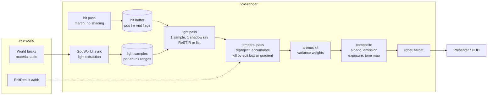

# 0024: Direct light that holds in the dark: a hit buffer, emissive voxels as light samples, one shadow ray per pixel, and an SVGF-family denoiser whose history dies where the world was edited

> **Status:** approved (2026-10-20)
> **Created:** 2026-10-20
> **Milestone:** M2 in `docs/roadmap.md` (the lighting plan; direct light and the denoiser only,
> see "What this plan does NOT do")
> **Related ADRs:** [ADR-0018](../adrs/0018-direct-light-per-pixel-one-sample-from-a-hit-buffer-with-svgf-history-killed-by-edits.md)
> (proposed with this plan: the lighting family and the rejected ones),
> [ADR-0011](../adrs/0011-contour-planes-in-attribute-pages-with-procedural-detail.md) (the
> plane hit and its shadow-ray origin, which the hit buffer carries),
> [ADR-0012](../adrs/0012-mask-first-brick-with-per-brick-palette-planes.md) (the masks the
> coarse shadow walk reads; its mirror-slot plan comes after this one),
> [ADR-0013](../adrs/0013-mirror-reserves-its-vram-budget-up-front.md) (the light-sample buffer
> is reserved the same way), [ADR-0001](../adrs/0001-rust-library-workspace-wgpu-compute-ray-marching.md)
> **Source:** the owner's interview answers, 2026-10-20 (scope: direct light and the denoiser
> first; emission changes by the `Replace` op and by a render-side scale; four mechanisms kept
> switchable until seen; sequenced after Plan 0023 and before ADR-0012's mirror-slot plan;
> family A with C inside), the two M2 design inputs (the traversal review of 2026-10-17 and
> `docs/references/voxel-optimizations.md`), `docs/nfr.md` §2 and §3.
> **Starts after:** [Plan 0023](done/0023-render-thread-cpu-attribute-hitch-and-streaming-line.md)
> closes (the attribute hitch and the streaming line; this plan adds light extraction to that
> line and must not be measured under the hitch). ADR-0012's mirror-slot plan (surface-only
> attributes in size-classed slots) comes **after** this plan: this plan changes what the march
> writes (a hit buffer), not what it reads, so the slot plan rebases on it.

## TL;DR

The marcher stops shading. A hit pass writes one compact record per pixel (position, normal,
material, plane flag); a light pass reads it and picks one light sample per pixel, the headlamp
or an emissive voxel chosen by resampling from a buffer of light samples the mirror extracts at
upload, and casts one shadow ray; a temporal pass accumulates the lit result against last
frame's by reprojecting the hit position, and kills its history wherever an edit's bounding box
touched the world; an a-trous pass filters what is left by its variance; a composite pass
multiplies the albedo back, adds emission, applies exposure and tone mapping, and writes the
`rgba8` the presenter already draws. The frame renders a list of views, one on a flat screen.
Four mechanisms stay switchable in the fly-through until the owner has seen them: the
shadow ray's walk (coarse 2^3 blocks or full voxels), the light sampler (reservoir reuse or a
flat candidate list), the history killer (edit regions or A-SVGF's gradient), and the lighting
resolution (half or full). The first thing a reader sees is Phase 1's hit buffer rendering
today's headlamp image through four passes instead of one, and Phase 3's dark cave with a
glowing ore vein as the only light.

## Context & problem

The consumer's P0 rendering bar (`project-context.md`, Rendering): mostly dark scenes with few
lights that look good and stay stable; emissive voxels as light sources with emission
changeable at runtime; denoising that survives disocclusion from digging without heavy
ghosting. Today the renderer has one analytic spot lamp shaded inside the primary-ray kernel
with one shadow ray, no emissive light, no history, and an `rgba8` target. The cave's materials
have no emission.

What is settled before this plan:

- **The cost of a ray.** Plan 0015's walk reads the streamed spawn at 1.95 ms and the level at
  1.45 ms at 1080p on the dev box, headlamp shadow ray included; the default contour look
  reads 1.43 to 1.47 ms at the level on a quiet box (`nfr.md` §2). The baseline GPU is two to
  three times slower (a projection, `nfr.md` §1), so one full-resolution ray per pixel costs
  about 2 to 4 ms there. The §2 lighting line of 6.0 ms buys about two full-resolution rays
  per pixel on the baseline, or eight at half resolution. That arithmetic is why the half-
  resolution tier and the coarse shadow walk are modes of this plan, not afterthoughts.
- **The two design inputs** from the traversal review (roadmap, M2): split the march from the
  shading so secondary rays run as coherent dispatches (Laine, Karras, Aila 2013), and let
  secondary rays stop at the 2^3 block level of the masks (Teardown's 1-bit shadow volume).
- **The material table is fixed after `World::generate`** (ADR-0012 fixes the translucent
  class by there being no mutable path). "Emission changeable at runtime" therefore has two
  mechanisms, both already partly in place: the `Replace` edit op swaps a voxel's material id
  for a brighter or darker row through the op log (authoritative, deterministic), and this
  plan adds a render-side per-material emission scale the client sets per frame (visual only,
  for "the crystal glows when sound reaches it").
- **The mirror holds no mips for full chunks** (`gpu_world.rs`: a LOD record holds mips, a full
  chunk's record holds bricks), so cone tracing "over the mips we already own" has no pyramid
  to read in the near field. That rules it out of this plan and is recorded in ADR-0018.
- **The golden harness** compares pixels on lavapipe (at most 0.1 % of pixels differ by more
  than 2/255) and re-blesses with `VXE_BLESS=1`. A stochastic renderer seeded by pixel and
  frame index is deterministic on one adapter, so the harness stays as it is.

`nfr.md` figures touched: §2 "Lighting" (6.0 ms), "Denoise" (3.0 ms), "Streaming, upload, light
extraction" (1.0 ms, this plan adds the extraction), "Upscale, tone map, post" (1.5 ms, this
plan adds exposure and tone mapping, not the upscaler), and §3 "Everything else in VRAM"
(1.5 GB, this plan adds the frame's buffers).

## Decision

**We light the frame per pixel from one sample, denoise it with an SVGF-family filter, and
kill history by the world's edit boxes** (ADR-0018). The march writes a hit buffer and nothing
else. The light pass estimates direct irradiance at each hit from one light sample: the
headlamp by next-event estimation, and one emissive voxel by resampled importance sampling
over `M` candidates from the light-sample buffer, with temporal and spatial reservoir reuse
(ReSTIR, Bitterli 2020) as a mode and the plain candidate list (Teardown's recipe with `K`
samples) as the other. One shadow ray per pixel per frame, through the full walk or a coarse
walk that treats any 2^3 block with a set bit as solid. The temporal pass reprojects by hit
position through the previous view (the world does not move; only the camera and the edits
do), accumulates irradiance and its moments, and resets history in every pixel whose hit lies
inside an edit box of this frame, dilated by one voxel; A-SVGF's gradient test (Schied 2018)
is the other mode. An a-trous wavelet filter with variance weights runs four iterations. The
denoiser filters albedo-demodulated irradiance, so a material edge never blurs. Lighting runs
at full internal resolution or at half with a depth-and-normal-aware upsample. Every pass is a
compute dispatch in `vxe-render`, WGSL only, no adapter feature beyond what the march uses.

We rejected a per-voxel irradiance cache (view-independent, ghost-free, but 0.5 to 1 GB per
streamed world at our surface density, and a lagging headlamp), a clustered light list with a
blur and no reservoirs as the only sampler (no answer for a vein of thousands of emitters; it
survives here as the flat-list mode), and NRD-style recurrent blur as the filter (a port of a
larger design before we have measured the simpler one). The reasons are in ADR-0018.

## Architecture diagram



## Implementation phases

Each phase ships as its own commit. `dev` implements all phases in one session with no review
between phases. The architect reviews once at the end, in a fresh session. Phase 1 is the
walking skeleton. Every golden this plan changes is re-blessed on lavapipe in the phase that
changes it, with the count of changed pixels in the log.

### Phase 1: The hit buffer, a view list, and today's image through four passes
- **Owner skill:** dev
- **What:** `march.wgsl` becomes the hit pass: it writes a per-pixel hit record and no colour.
  A new `shade` entry (the light pass's first form) reads the record and shades the headlamp
  with its one shadow ray as today; a composite pass applies exposure and tone mapping and
  writes `rgba8`. `Params` takes a list of views (`View`: origin, basis, four tangent
  half-angles, pixel rectangle); the fly-through passes one. Timestamps per pass through
  `PassTimer`. The existing view modes (`normals`, `hitmask`, `albedo`, `steps`) read the hit
  buffer or the counters and stay.
- **Files touched:** `crates/vxe-render/src/shaders/march.wgsl`, new
  `crates/vxe-render/src/shaders/light.wgsl`, `composite.wgsl`, `crates/vxe-render/src/marcher.rs`
  (becomes the frame: `Frame` with its passes and targets; `Marcher` stays as the name of
  the hit pass), `camera.rs` (the `View`), `lib.rs`, `apps/flythrough/src/main.rs`,
  `apps/flythrough/tests/golden.rs`, `look.rs`, `support/mod.rs`, `docs/nfr.md`.
- **Done when:** the `hitmask` and `normals` views render byte for byte what they rendered
  before this phase on the three opaque golden scenes (they read the hit buffer now). The
  shaded goldens are re-blessed once, with the pixel count in the log, because the
  composite's tone map replaces the march's `pow(c, 1/2.2)`; with exposure 1.0 and the tone
  map set to the identity clamp, the carve golden differs from the old one in no pixel by more
  than 2/255 (the test keeps that mode to prove the split moved no light). An asymmetric view
  with tangents (left `t`, right 0, up `t_y`, down `t_y`) over 160 x 180 pixels renders the
  left half of the symmetric 320 x 180 view with no pixel differing by more than 2/255. The
  hit pass at the level's spawn (`flythrough --level --headless --seed 1 --render 1920x1080
  --frames 300`) reads less than the march did at 2796062 (1.43 to 1.47 ms) because the
  shadow ray has left it, and the sum of hit plus shade passes is recorded beside it. The hit
  kernel's register count and the old march's are read on the dev box's AMD iGPU with
  `RADV_DEBUG=shaderstats` (the mechanism the roadmap's input asks for; the NVIDIA driver
  prints none), and both go in the log.

### Phase 2: Emissive voxels become light samples at upload
- **Owner skill:** dev
- **What:** `GpuWorld::sync` extracts, for every `Full` brick it writes whose palette holds a
  material with non-zero emission, the exposed emissive voxels (a set mask bit with at least
  one of six neighbours clear inside the brick; a voxel on the brick's face counts as exposed)
  into a light-sample buffer reserved once at creation (ADR-0013's rule), with a per-chunk
  range that a record rewrite or an eviction frees. A chunk above the per-chunk cap keeps
  every `k`-th sample by index. A per-material emission scale buffer (`f32` per row, 1.0 by
  default) is written from `Frame::set_emission_scale`. The fly-through's ore becomes
  emissive and `--emissive-ore` off keeps it dark; a key pulses the scale.
- **Files touched:** `crates/vxe-render/src/gpu_world.rs` (extraction, the buffer, the
  ranges), `marcher.rs`, `apps/flythrough/src/cave.rs`, `main.rs`, `tests/` (a new
  `lights.rs`), `docs/nfr.md`.
- **Done when:** a world with a 4 x 4 x 4 cube of an emissive material at voxels 2..6 of one
  brick holds exactly 56 light samples after a sync (64 voxels less the 8 interior ones); a
  carve of the corner voxel (2, 2, 2) leaves 55; a `Replace` of the cube's material by a
  non-emissive twin leaves 0; and after the chunk leaves the window the range is free and
  `light_samples()` reads 0. A chunk with 10 000 emissive surface voxels and a cap of 8192
  holds 5000 (every second by index). The extraction's render-thread cost at the streamed
  spawn's first sync and in the autopilot flight is read beside the streaming line.

### Phase 3: The light pass: one sample, one shadow ray, the dark cave
- **Owner skill:** dev
- **What:** the light pass estimates direct irradiance at each hit from the headlamp
  (next-event estimation, as today) and from one emissive voxel face: `M` candidates drawn
  uniformly from the light-sample buffer, resampled by unshadowed contribution (emission times
  scale times both cosines over distance squared times the buffer's total area), and one
  shadow ray to the winner. Blue noise (a 128 x 128 CC0 texture under
  `crates/vxe-render/assets/`, offset per frame) drives every random number; a `(pixel,
  frame)` seed makes a frame deterministic on one adapter. The pass writes HDR irradiance and
  the chosen sample's contribution split from the headlamp's. The composite multiplies the
  albedo back and adds the hit's own emission. The fly-through gets `--lamp off`.
- **Files touched:** `light.wgsl`, `composite.wgsl`, `marcher.rs`, `apps/flythrough/src/main.rs`,
  `tests/lights.rs`, `tests/golden.rs`.
- **Done when:** in a closed box of 20 x 20 x 10 interior voxels whose whole ceiling is an
  emissive material with emission `[1, 1, 1]` and whose other walls are the non-emissive rock,
  the irradiance at the floor's centre pixel, averaged over 64 frames read back one by one with
  the lamp off and every filter off, is within 5 % of 1.741 (the analytic value: the form
  factor of a point at the centre of a 2h x 2h rectangle at distance h is 4 x 0.13853 = 0.5541,
  and E = pi x L x F). A golden of the dark cave with the lamp off, lit only by its ore vein,
  is blessed; with `--emissive-ore` off the same view is black in every pixel.

### Phase 4: The coarse shadow walk
- **Owner skill:** dev
- **What:** a named mode of `march` that stops at the 2^3 block level of the opaque masks and
  treats any block with a set bit as solid, so a shadow ray reads chunk bits, brick bits and
  one mask line per brick and never a voxel or the pool. The light pass's shadow ray takes
  the mode from the params; the primary ray never does.
- **Files touched:** `march.wgsl`, `light.wgsl`, `marcher.rs`, `apps/flythrough/src/main.rs`,
  `tests/golden.rs`, `docs/nfr.md`.
- **Done when:** on the slab scene of `headlamp_slab_casts_the_computed_shadow` with a
  one-voxel hole through the slab, the full walk lights at least one floor pixel through the
  hole and the coarse walk lights none of them; on the slab golden the coarse walk darkens at
  least as many pixels as the full walk. The light pass's time at the streamed spawn and the
  level is read with each walk on the dev box, and the steps view's loads per ray for the
  shadow ray in each mode go in `nfr.md`.

### Phase 5: Temporal accumulation, and history that dies in an edit box
- **Owner skill:** dev
- **What:** the temporal pass projects each hit position through the previous frame's view,
  reads last frame's irradiance, moments and age at that pixel, accepts it when the previous
  hit's depth, normal and material agree within thresholds, and blends at alpha 0.2 (moments
  the same). `Frame::invalidate(aabb)` collects the frame's edit boxes (up to 64; more flushes
  all history) and the pass resets age to 0 in every pixel whose hit lies inside a box dilated
  by one voxel. The fly-through passes every `EditResult.aabb` of the frame, including the
  server's replies for replayed and logic-driven ops.
- **Files touched:** new `temporal.wgsl`, `marcher.rs`, `apps/flythrough/src/main.rs`,
  `fly.rs`, `tests/lights.rs`.
- **Done when:** with a static camera over the cavity scene for 16 frames and then a radius-4
  sphere carve at a known surface point, the age texture reads 0 in every pixel whose hit lies
  inside the carve's `aabb` dilated by one voxel and 16 in every other hit pixel; one more
  frame reads 1 and 17. A camera that moves one voxel sideways between frames keeps age at
  least 1 in at least 95 % of the pixels that hit the same surface (reprojection holds), and
  a pixel whose hit changed material reads 0.

### Phase 6: The a-trous filter and the composite, and the carve that does not ghost
- **Owner skill:** dev
- **What:** four a-trous iterations (5 x 5 kernel, steps 1, 2, 4, 8) weighted by depth,
  normal and the variance estimated from the accumulated moments (the first frames after a
  reset use a 7 x 7 spatial variance), on irradiance only; the composite multiplies the albedo
  back, adds emission and the translucent layers (composited in the hit pass's second walk as
  today, unlit by emissive samples), and applies exposure and tone mapping. `--filter off`
  shows the raw frame.
- **Files touched:** new `atrous.wgsl`, `composite.wgsl`, `marcher.rs`,
  `apps/flythrough/src/main.rs`, `tests/golden.rs`, `tests/lights.rs`.
- **Done when:** the dark-cave golden with the vein is blessed after 32 accumulated frames
  and, in the same test, the frame right after a radius-6 carve through the vein's wall shows
  no pixel inside the carve's dilated `aabb` within 2/255 of its pre-carve value (no stale
  light survives), while pixels farther than 16 pixels from the box's projection differ by no
  more than 8/255 from the previous frame. The filter pass reads under 3.0 ms at 1080p on the
  dev box with all four iterations (the §2 denoise line, as a dev-box reading).

### Phase 7: Reservoir reuse against the flat list
- **Owner skill:** dev
- **What:** the light pass's sampler gains temporal reuse (the reprojected pixel's reservoir,
  capped at 20 x `M` effective samples) and spatial reuse (5 neighbours in a 30-pixel radius,
  depth and normal tested), with the shadow ray on the final sample only. The flat list is the
  same code with reuse off and `K = M` candidates.
- **Files touched:** `light.wgsl`, `marcher.rs`, `apps/flythrough/src/main.rs`,
  `tests/lights.rs`, `docs/nfr.md`.
- **Done when:** on the box-with-vein scene at 320 x 180 on lavapipe, the relative RMSE of one
  frame's irradiance against a 1024-frame average of the flat list is lower with reuse on than
  with it off at the same one shadow ray per pixel, and the ratio goes in the log (a property,
  not a threshold). The light pass's time with each sampler at the streamed spawn goes in
  `nfr.md`.

### Phase 8: A-SVGF's gradient as the other history killer
- **Owner skill:** dev
- **What:** one pixel per 3 x 3 stratum re-shades last frame's sample at last frame's hit with
  this frame's lights and the same random numbers; the difference, filtered over the strata,
  becomes a per-pixel history weight that shortens accumulation where the light changed. A
  mode of the temporal pass; the edit-box reset stays available in both.
- **Files touched:** new `gradient.wgsl`, `temporal.wgsl`, `marcher.rs`,
  `apps/flythrough/src/main.rs`, `tests/lights.rs`.
- **Done when:** with a static camera in the dark cave and the headlamp's cone turned 30
  degrees in one frame, pixels that left the cone fall under 10 % of their lit value within 2
  frames in gradient mode, where plain accumulation at alpha 0.2 needs 11 (0.8^11 = 0.086);
  the gradient pass's time at 1080p goes in `nfr.md`.

### Phase 9: The half-resolution tier
- **Owner skill:** dev
- **What:** the light, temporal, a-trous and gradient passes run at half the internal
  resolution on a half-size hit buffer sampled from the full one (the lower-left of each
  2 x 2, alternating per frame), and the composite upsamples irradiance with depth and normal
  weights to the full-resolution hit buffer. A mode of `Frame`, `--lighting half` in the
  fly-through.
- **Files touched:** `composite.wgsl`, `marcher.rs`, `apps/flythrough/src/main.rs`,
  `tests/golden.rs`, `docs/nfr.md`.
- **Done when:** the dark-cave golden at half resolution is blessed and the mean absolute
  difference from the full-resolution golden is under 6/255 per channel; the frame's passes
  at 1080p in both tiers, with each of the other three toggles in its default, are read at the
  streamed spawn and the level on the dev box and recorded in `nfr.md` §2 against the lighting
  and denoise lines.

### Phase 10: The fly-through's switches, HUD rows and autopilot readings
- **Owner skill:** dev
- **What:** keys for the four toggles and the lamp, HUD rows for every pass's GPU time and
  for the light-sample count, `--lighting`, `--shadow-walk`, `--sampler`, `--history` flags,
  the emission pulse key, and the autopilot printing the per-pass p50 and p99 over its flight
  plus the extraction's render-thread cost. The frame's VRAM goes in `Frame::frame_bytes`.
- **Files touched:** `apps/flythrough/src/main.rs`, `hud.rs`, `fly.rs`, `README.md` of the app
  if it lists keys, `docs/nfr.md` §3.
- **Done when:** `flythrough --autopilot --headless --seed 1` prints p50 and p99 for hit,
  light, temporal, a-trous, composite and extraction, and `frame_bytes` at 1080p reads under
  300 MB (the projection in `## Budgets`); the parse test pins every new flag and its refusal
  of an unknown value.

### Phase 11: The owner's windowed check
- **Owner skill:** human
- **What:** the owner flies the dark cave with the lamp on and off, digs through the vein's
  wall, and tries each toggle, on the dev box. The decision per toggle is recorded in the
  Implementation log and ADR-0018's Outcome; the defaults change to the choice.
- **Files touched:** this plan's log, `docs/adrs/0018-...md` at the close.
- **Done when:** the owner has recorded a choice, or "keep both", for each of the four toggles.

## Data shapes

```rust
// illustrative: one view of the frame (VR-readiness decision in docs/roadmap.md)
#[repr(C)]
pub struct View {
    pub origin: [f32; 3], pub _pad0: f32,
    pub right: [f32; 3], pub tan_left: f32,
    pub up: [f32; 3], pub tan_right: f32,
    pub fwd: [f32; 3], pub tan_up: f32,
    pub rect: [u32; 4],  // x, y, w, h in the internal target
    pub tan_down: f32, pub _pad1: [f32; 3],
}

// illustrative: the hit buffer, two storage textures per pixel
// rgba32float: world position xyz (voxels), t (BIG on a miss)
// rgba16uint:  octahedral normal u, v; material id; flags (bit 0 hit, bit 1 plane hit,
//              bit 2 translucent seen)

// illustrative: one light sample, 8 bytes, in a buffer reserved once (ADR-0013)
#[repr(C)]
pub struct LightSample {
    pub chunk: u32,        // record index; the chunk's origin comes from the record
    pub voxel: u16,        // index in the chunk, x fastest
    pub material: u16,
}
// per chunk: a range (start, len) in the buffer; freed with the record

// illustrative: the frame's modes, bits of LightingParams.flags
// bit 0 lamp, bit 1 coarse shadow walk, bit 2 reservoir reuse, bit 3 gradient history,
// bit 4 half resolution, bit 5 filter off, bit 6 identity tone map (tests)
```

Frame buffers at 1920 x 1080 (2 073 600 pixels), full-resolution lighting, arithmetic:

| buffer | format | bytes per pixel | copies | MB |
|---|---|---|---|---|
| hit position + t | rgba32float | 16 | 2 (this and last frame) | 66.4 |
| hit normal + material + flags | rgba16uint | 8 | 2 | 33.2 |
| irradiance (lamp + emissive) | rgba16float | 8 | 2 | 33.2 |
| moments + age | rgba16float | 8 | 2 | 33.2 |
| reservoir (sample, weight, M, W) | rgba32uint | 16 | 2 | 66.4 |
| a-trous ping-pong | rgba16float | 8 | 2 | 33.2 |
| gradient strata (1/9 of pixels) | rgba16float | 8 / 9 | 1 | 1.8 |
| composite target | rgba8unorm | 4 | 1 | 8.3 |

About 276 MB, plus 8 MiB for 2^20 light samples and 64 KiB of blue noise, against §3's
1.5 GB "everything else" line. Half-resolution lighting cuts every row but the first two and
the last to a quarter: about 125 MB.

## Budgets

| `nfr.md` figure | line | projection (dev box, 1080p, full-res lighting) | how the close measures it |
|---|---|---|---|
| §2 Primary rays | 3.0 ms | the hit pass, under the march's 1.43 to 1.95 ms (shadow ray gone) | `flythrough --headless --seed 1 --render 1920x1080 --frames 3000` and `--level ... --frames 300`, median of the last 30, three runs, per-pass timestamps |
| §2 Lighting | 6.0 ms | light pass 1.5 to 2.5 ms (one shadow ray plus resampling), temporal 0.3 ms; half-res 0.5 to 0.8 ms | same runs, each toggle combination of Phases 4, 7, 8, 9 |
| §2 Denoise | 3.0 ms | four a-trous iterations 1.2 to 2.0 ms, gradient 0.3 ms | same runs |
| §2 Upscale, tone map, post | 1.5 ms | composite 0.2 ms (no upscaler in this plan) | same runs |
| §2 Streaming, upload, light extraction | 1.0 ms | extraction under 0.1 ms per sync at the streamed defaults (a popcount per emissive brick) | the autopilot's render-thread timers |
| §3 Everything else in VRAM | 1.5 GB | about 276 MB (table above) | `Frame::frame_bytes` printed by the autopilot |

Projected baseline (two to three times the dev box): full-resolution lighting plus denoise
reads 8 to 14 ms against 9 ms; the half-resolution tier reads 3 to 5 ms. The floor tier is
therefore half resolution, as the roadmap's "Floor, profiles and scene scale" decision says,
and the close names which tier the §2 lines are read at. **No baseline reading exists**; the
card is not on hand (`nfr.md` §1), and this plan's close records dev-box readings labelled as
such.

## Risks & open questions

- **The filter is where the budget goes.** SVGF's authors read about 10 ms at 1080p on a 2017
  Titan X, which is near the baseline's class. Four iterations at half resolution is the
  mitigation; if the dev box reads over 3 ms at full resolution, the half-resolution tier is the
  floor's default and the close says so.
- **Sparse light is the quality risk** (roadmap, Risks). The analytic box (Phase 3), the age
  test (Phase 5) and the no-ghost test (Phase 6) are the measurable bar; the owner's eye
  (Phase 11) is the final one.
- **Reprojection by hit position** has no motion vectors, so a moving entity (M6) will ghost
  until entities write their own; this plan's world is static but for edits, and the roadmap's
  M6 paragraph gets a note.
- **Determinism of the frame** holds per adapter: a `(pixel, frame)` seed through blue noise.
  Lavapipe and NVIDIA differ in float, as they do today; goldens are blessed on lavapipe only.
  Nothing here touches `vxe-world`.
- **The light-sample cap** (8192 per chunk, 2^20 total) is a guess; a cave with more emissive
  surface than that subsamples deterministically and the HUD shows the count. The close reads
  the fly-through's vein count against it.
- **Translucent voxels** are composited unlit by emissive samples and uninvalidated by history
  (they are added in the composite, after the filter). Glass that glows is M8's media plan.
- **Threading.** Extraction runs inside `sync` on the render thread, within the streaming line
  that Plan 0023 is bounding; if Plan 0023 moves narrowing to the stream workers, extraction
  goes with it (it reads the same decoded palette and mask).
- **Adapter features.** `rgba16float` and `rgba32float` storage textures and `TIMESTAMP_QUERY`
  are what the march and HUD already use or check; no subgroups, no 64-bit atomics, no
  bindless. The light-sample buffer is one more storage binding (the limit is raised by
  `limits_for` already).

## What this plan does NOT do

- **Indirect light.** No bounce, no probes, no cone tracing. The next lighting plan adds one
  diffuse bounce into this denoiser with per-chunk probes as its fallback (M2, "indirect light
  from probes in both tiers").
- **The upscaler.** Internal resolution equals output resolution; the presenter's scaled blit
  stays. The FSR 2 port or a TAA upscaler of our own is its own plan with its own ADR (M2).
- **Surface-only attribute storage** (ADR-0012's mirror-slot plan), which follows this plan.
- **Entities, volumetrics, loot highlighting** (M6, M8). Entities need motion vectors in the
  temporal pass; that is a note in the roadmap, not work here.
- **A mutable material table.** Emission changes by the `Replace` op or by the render-side
  scale, not by editing a row.
- **Baseline-GPU readings.** The card is not on hand.

## Implementation log

> Written by `dev`: one row per phase as its commit lands, then the close block. **The phases
> above are the contract. This section records what happened.** Observations, never conclusions:
> no pass list, no self-assessment. Deviations and unmet done-whens are **always** disclosed.
> Keep it shorter than `## Implementation phases`.

| phase | owner | state | commit |
|---|---|---|---|
| 1: The hit buffer, a view list, and today's image through four passes | dev | not started | |
| 2: Emissive voxels become light samples at upload | dev | not started | |
| 3: The light pass: one sample, one shadow ray, the dark cave | dev | not started | |
| 4: The coarse shadow walk | dev | not started | |
| 5: Temporal accumulation, and history that dies in an edit box | dev | not started | |
| 6: The a-trous filter and the composite, and the carve that does not ghost | dev | not started | |
| 7: Reservoir reuse against the flat list | dev | not started | |
| 8: A-SVGF's gradient as the other history killer | dev | not started | |
| 9: The half-resolution tier | dev | not started | |
| 10: The fly-through's switches, HUD rows and autopilot readings | dev | not started | |
| 11: The owner's windowed check | human | not started | |

### Notes

_(Deviations from the plan, with the commit, stated without justification. Done-whens not
satisfiable as stated, and what was done instead. Followups noticed and not acted on. One line
each. Empty is fine.)_

### Close triggers

_(Facts for the architect. No recommendations, and no suggested version bump.)_

- **What shipped:** feature / fix-only / docs-chore-only
- **Public API changed:** types, traits, functions, shader interfaces, config (list them, or none)
- **Budget readings:** each `nfr.md` figure touched, with its measured value, machine and commit
- **Gate at the tip:** the commands run (build, nextest, doctests, clippy, fmt, deny), exit codes, test counts
- **Outstanding `human` phases:** which, or none

## Followups

- The indirect-light plan (one bounce into this denoiser, probes as the fallback).
- The upscaler plan (FSR 2 port or a TAA upscaler; ADR).
- Motion vectors for entities in the temporal pass (M6).
