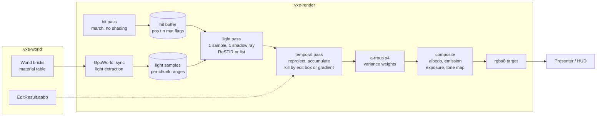

# 0024: Direct light that holds in the dark: a hit buffer, emissive voxels as light samples, one shadow ray per pixel, and an SVGF-family denoiser whose history dies where the world was edited

> **Status:** in-progress: the close review of 2026-10-21 returned fix Phases 13 to 15 (see
> "Close review of 2026-10-21" below); not closed
> **Created:** 2026-10-20
> **Amended:** 2026-10-21 by the owner's ruling at the Phase 6 stop: Phase 6's bars rewritten,
> a new Phase 7 (near-emitter candidates and bounded light extraction) inserted before reservoir
> reuse, later phases renumbered (see "Amendment of 2026-10-21" below). Amended again
> 2026-10-21 by the close review: Phases 13 to 15 added
> **Milestone:** M2 in `docs/roadmap.md` (the lighting plan; direct light and the denoiser only,
> see "What this plan does NOT do")
> **Related ADRs:** [ADR-0018](../adrs/0018-direct-light-per-pixel-one-sample-from-a-hit-buffer-with-svgf-history-killed-by-edits.md)
> (proposed with this plan: the lighting family and the rejected ones),
> [ADR-0025](../adrs/0025-light-candidates-from-a-power-over-distance-table-of-near-emitter-chunks.md)
> (proposed with the amendment of 2026-10-21: where a candidate's light sample comes from),
> [ADR-0011](../adrs/0011-contour-planes-in-attribute-pages-with-procedural-detail.md) (the
> plane hit and its shadow-ray origin, which the hit buffer carries),
> [ADR-0012](../adrs/0012-mask-first-brick-with-per-brick-palette-planes.md) (the masks the
> coarse shadow walk reads; its mirror-slot plan comes after this one),
> [ADR-0013](../adrs/0013-mirror-reserves-its-vram-budget-up-front.md) (the light-sample buffer
> is reserved the same way), [ADR-0001](../adrs/0001-rust-library-workspace-wgpu-compute-ray-marching.md)
> **Source:** the owner's interview answers, 2026-10-20 (scope: direct light and the denoiser
> first; emission changes by the `Replace` op and by a render-side scale; four mechanisms kept
> switchable until seen; sequenced after Plan 0023 and before ADR-0012's mirror-slot plan;
> family A with C inside), the two M2 design inputs (the traversal review of 2026-10-17 and
> `docs/references/voxel-optimizations.md`), `docs/nfr.md` §2 and §3.
> **Starts after:** [Plan 0023](done/0023-render-thread-cpu-attribute-hitch-and-streaming-line.md)
> closes (the attribute hitch and the streaming line; this plan adds light extraction to that
> line and must not be measured under the hitch). ADR-0012's mirror-slot plan (surface-only
> attributes in size-classed slots) comes **after** this plan: this plan changes what the march
> writes (a hit buffer), not what it reads, so the slot plan rebases on it.

## TL;DR

The marcher stops shading. A hit pass writes one compact record per pixel (position, normal,
material, plane flag); a light pass reads it and picks one light sample per pixel, the headlamp
or an emissive voxel chosen by resampling from a buffer of light samples the mirror extracts at
upload, and casts one shadow ray; a temporal pass accumulates the lit result against last
frame's by reprojecting the hit position, and kills its history wherever an edit's bounding box
touched the world; an a-trous pass filters what is left by its variance; a composite pass
multiplies the albedo back, adds emission, applies exposure and tone mapping, and writes the
`rgba8` the presenter already draws. The frame renders a list of views, one on a flat screen.
Four mechanisms stay switchable in the fly-through until the owner has seen them: the
shadow ray's walk (coarse 2^3 blocks or full voxels), the light sampler (reservoir reuse or a
flat candidate list), the history killer (edit regions or A-SVGF's gradient), and the lighting
resolution (half or full). The first thing a reader sees is Phase 1's hit buffer rendering
today's headlamp image through four passes instead of one, and Phase 3's dark cave with a
glowing ore vein as the only light.

## Context & problem

The consumer's P0 rendering bar (`project-context.md`, Rendering): mostly dark scenes with few
lights that look good and stay stable; emissive voxels as light sources with emission
changeable at runtime; denoising that survives disocclusion from digging without heavy
ghosting. Today the renderer has one analytic spot lamp shaded inside the primary-ray kernel
with one shadow ray, no emissive light, no history, and an `rgba8` target. The cave's materials
have no emission.

What is settled before this plan:

- **The cost of a ray.** Plan 0015's walk reads the streamed spawn at 1.95 ms and the level at
  1.45 ms at 1080p on the dev box, headlamp shadow ray included; the default contour look
  reads 1.43 to 1.47 ms at the level on a quiet box (`nfr.md` §2). The baseline GPU is two to
  three times slower (a projection, `nfr.md` §1), so one full-resolution ray per pixel costs
  about 2 to 4 ms there. The §2 lighting line of 6.0 ms buys about two full-resolution rays
  per pixel on the baseline, or eight at half resolution. That arithmetic is why the half-
  resolution tier and the coarse shadow walk are modes of this plan, not afterthoughts.
- **The two design inputs** from the traversal review (roadmap, M2): split the march from the
  shading so secondary rays run as coherent dispatches (Laine, Karras, Aila 2013), and let
  secondary rays stop at the 2^3 block level of the masks (Teardown's 1-bit shadow volume).
- **The material table is fixed after `World::generate`** (ADR-0012 fixes the translucent
  class by there being no mutable path). "Emission changeable at runtime" therefore has two
  mechanisms, both already partly in place: the `Replace` edit op swaps a voxel's material id
  for a brighter or darker row through the op log (authoritative, deterministic), and this
  plan adds a render-side per-material emission scale the client sets per frame (visual only,
  for "the crystal glows when sound reaches it").
- **The mirror holds no mips for full chunks** (`gpu_world.rs`: a LOD record holds mips, a full
  chunk's record holds bricks), so cone tracing "over the mips we already own" has no pyramid
  to read in the near field. That rules it out of this plan and is recorded in ADR-0018.
- **The golden harness** compares pixels on lavapipe (at most 0.1 % of pixels differ by more
  than 2/255) and re-blesses with `VXE_BLESS=1`. A stochastic renderer seeded by pixel and
  frame index is deterministic on one adapter, so the harness stays as it is.

`nfr.md` figures touched: §2 "Lighting" (6.0 ms), "Denoise" (3.0 ms), "Streaming, upload, light
extraction" (1.0 ms, this plan adds the extraction), "Upscale, tone map, post" (1.5 ms, this
plan adds exposure and tone mapping, not the upscaler), and §3 "Everything else in VRAM"
(1.5 GB, this plan adds the frame's buffers).

## Decision

**We light the frame per pixel from one sample, denoise it with an SVGF-family filter, and
kill history by the world's edit boxes** (ADR-0018). The march writes a hit buffer and nothing
else. The light pass estimates direct irradiance at each hit from one light sample: the
headlamp by next-event estimation, and one emissive voxel by resampled importance sampling
over `M` candidates from the light-sample buffer, with temporal and spatial reservoir reuse
(ReSTIR, Bitterli 2020) as a mode and the plain candidate list (Teardown's recipe with `K`
samples) as the other. Candidates come from a per-frame table of the emitter chunks within a
light radius of the camera, weighted by power over squared distance, and only those chunks hold
light samples on the GPU (ADR-0025, added by the amendment of 2026-10-21). One shadow ray per pixel per frame, through the full walk or a coarse
walk that treats any 2^3 block with a set bit as solid. The temporal pass reprojects by hit
position through the previous view (the world does not move; only the camera and the edits
do), accumulates irradiance and its moments, and resets history in every pixel whose hit lies
inside an edit box of this frame, dilated by one voxel; A-SVGF's gradient test (Schied 2018)
is the other mode. An a-trous wavelet filter with variance weights runs four iterations. The
denoiser filters albedo-demodulated irradiance, so a material edge never blurs. Lighting runs
at full internal resolution or at half with a depth-and-normal-aware upsample. Every pass is a
compute dispatch in `vxe-render`, WGSL only, no adapter feature beyond what the march uses.

We rejected a per-voxel irradiance cache (view-independent, ghost-free, but 0.5 to 1 GB per
streamed world at our surface density, and a lagging headlamp), a clustered light list with a
blur and no reservoirs as the only sampler (no answer for a vein of thousands of emitters; it
survives here as the flat-list mode), and NRD-style recurrent blur as the filter (a port of a
larger design before we have measured the simpler one). The reasons are in ADR-0018.

## Amendment of 2026-10-21

Dev stopped at Phase 6 (Implementation log, Notes) with three bars unmet and two earlier
readings over their lines. The owner ruled, and this amendment carries the ruling:

- **Phase 6's no-ghost bar** counted pixels that are right to come back to their old value:
  the ore's own emission, which carries no history, and rim surfaces the carve left standing.
  It now asks that every pixel in the dilated box reads age 0 (the mechanism) and that the
  pixels whose non-emissive surface the carve removed all change (the effect).
- **Phase 6's far-field bar** asked that no pixel move more than 8/255, while a static frame
  already moves up to 53/255 at its worst pixel. It is now a p99.9 bar against the previous
  frame, with a control that flushes all history and must fail it. The alternative, comparing
  against the same frame index rendered without the carve, does not isolate the carve: the
  carve changes the light-sample buffer, which re-maps every pixel's candidate draws, and the
  newly exposed ore changes the far light legitimately, so the twin differs by one frame's
  sampling noise everywhere anyway. The p99.9 form is the golden harness's own (0.1 % of
  pixels) and is behavioral: a history flush or a box that leaks moves far more than 0.1 %.
- **Phase 6's 3.0 ms filter bar** moves to Phase 10 at half resolution, as `## Risks` allows;
  Phase 6 records the full-resolution reading.
- **A new Phase 7** fixes the light pass's far candidates (5.3 to 12.2 ms against the 6.0 ms
  line, Phase 4's reading) and the extraction's hitch and filling pool (p99 13.3 ms; 997 740 of
  1 048 576 samples at the flight's end, Phase 2's reading) before reservoir reuse builds on
  the sampler. ADR-0025 records the candidate source and the rejected alternatives. The old
  Phases 7 to 11 are now 8 to 12.

Phase 6 counts as done against the amended bars once dev re-reads them at the tip. Dev's log
entries above the amendment are left as written; their phase numbers from 7 up are the old
ones.

## Close review of 2026-10-21

The plan does not close yet. The mechanism is sound and its tests defend their claims, but the
owner's eye (Phase 12, the bar `## Risks` names as final) found the glowing vein's light
unstable on a still camera, and a requirement unmet. Phases 13 to 15 fix those; the review's
rulings on each disclosed miss follow.

**Blocks the close, fixed by Phase 13.** Static emissive light shimmers in shadow while
nothing moves, worst at half resolution and with the flat list. The cause is in
`temporal.wgsl`: the blend never falls below `ALPHA = 0.2`, so a still pixel averages about
nine frames of a one-sample estimate forever, and an emitter's shadow ray is a coin flip per
frame in a penumbra. The consumer's bar is lights that "look good and stay stable"
(`## Context & problem`). Edit boxes and the gradient already kill history where the world or
the light changed (ADR-0018), which is what lets a still pixel keep a long history. The
headlamp is a point light whose shadow ray carries no sampling noise, so its part needs no
long history and must not lag the camera it rides on.

**Blocks the close, fixed by Phase 14.** The owner can't tell which mode is on: the mode line
reaches stdout, and the window shows it only in the stats HUD's row behind `F2`. The owner's
requirement, for this plan and every later one, is that the window shows the current mode or
at least the change. Phase 12 also asked that the defaults change to the owner's picks, and
only `F4` (reuse) has been picked.

**Blocks the close, Phase 15.** Phase 12's done-when needs a choice or "keep both" for each
toggle. `F3`, `F5` and `F6` have none. The owner re-flies after Phases 13 and 14.

**Accepted as recorded misses, no fix phase:**

- **Phase 6 bar 1, second clause** (654 of 7580 removed-surface pixels within 2/255 under
  Phase 7's draw). The clause assumed that a surface revealed behind a removed one differs from
  it, but dark rock revealed behind dark rock reads the same. The clause's mechanism, age 0 in
  every pixel of the dilated box, is asserted and holds. The test prints the count, and that
  is how it stays.
- **Phase 7 bar 4 at full resolution** (light pass 5.7 to 11.5 ms against 4.0). Full-resolution
  lighting plus the a-trous at full reads 12 to 16 ms on the dev box, which projects to 24 to
  48 ms on the baseline. `## Budgets` already makes half resolution the floor tier, and at half
  the light pass reads 1.85 to 2.92 ms, under the bar. The bar is met at the half tier and
  missed at full, and `nfr.md` §2 says so. Which tier is the default is the owner's call
  (Phase 15), not this miss's.
- **Phase 7 bar 3** (extraction p99 2.26 ms, max 6.69 ms, against 1.0 and 3.0; quiet box). It's
  a render-thread CPU cost inside the streaming line, and the owner saw no hitch in the streamed
  flight ("3 is all good"). `## Risks` (Threading) already names the remedy, which is to
  extract on the stream workers beside the decode. That moves work across threads, and it
  belongs with ADR-0012's mirror-slot plan (Plan 0028), which rewrites what the workers hand
  the mirror. It goes to Followups with the readings, not to a fix phase here.
- **Phase 11 `frame_bytes`** (308.7 MB at full, 195.4 MB at half, against a 300 MB
  projection). The table left out three targets, and the §3 line it draws on is 1.5 GB. The
  reading replaces the projection in `nfr.md` §3 at the close.

**Not defects:**

- **The coarse shadow walk reads darker.** That is its contract. Any 2^3 block with a set bit
  is solid, so a ray that grazes rock within a block is shadowed (Teardown's trade, ADR-0018).
  The owner saw no gain in quality, and it is no cheaper than the half tier's full walk.
  Phase 14 makes the full walk the default and keeps coarse as a switch.
- **`F5` shows no difference on a still camera.** That is expected. The two history killers
  differ only when the light changes without an edit: the `M` pulse, or a lamp that turns.
  Phase 15 tests `F5` that way.

**The default lighting tier** is a decision for the owner, framed in the review's report. The
review recommends half resolution, provided Phase 13 gives it a still image. The plan's
budgets assume half as the floor, and full resolution doesn't fit the frame on the baseline.
Phase 14 implements the default the owner picks, and Phase 15 confirms it by eye.

## Architecture diagram



## Implementation phases

Each phase ships as its own commit. `dev` implements all phases in one session with no review
between phases. The architect reviews once at the end, in a fresh session. Phase 1 is the
walking skeleton. Every golden this plan changes is re-blessed on lavapipe in the phase that
changes it, with the count of changed pixels in the log.

### Phase 1: The hit buffer, a view list, and today's image through four passes
- **Owner skill:** dev
- **What:** `march.wgsl` becomes the hit pass: it writes a per-pixel hit record and no colour.
  A new `shade` entry (the light pass's first form) reads the record and shades the headlamp
  with its one shadow ray as today; a composite pass applies exposure and tone mapping and
  writes `rgba8`. `Params` takes a list of views (`View`: origin, basis, four tangent
  half-angles, pixel rectangle); the fly-through passes one. Timestamps per pass through
  `PassTimer`. The existing view modes (`normals`, `hitmask`, `albedo`, `steps`) read the hit
  buffer or the counters and stay.
- **Files touched:** `crates/vxe-render/src/shaders/march.wgsl`, new
  `crates/vxe-render/src/shaders/light.wgsl`, `composite.wgsl`, `crates/vxe-render/src/marcher.rs`
  (becomes the frame: `Frame` with its passes and targets; `Marcher` stays as the name of
  the hit pass), `camera.rs` (the `View`), `lib.rs`, `apps/flythrough/src/main.rs`,
  `apps/flythrough/tests/golden.rs`, `look.rs`, `support/mod.rs`, `docs/nfr.md`.
- **Done when:** the `hitmask` and `normals` views render byte for byte what they rendered
  before this phase on the three opaque golden scenes (they read the hit buffer now). The
  shaded goldens are re-blessed once, with the pixel count in the log, because the
  composite's tone map replaces the march's `pow(c, 1/2.2)`; with exposure 1.0 and the tone
  map set to the identity clamp, the carve golden differs from the old one in no pixel by more
  than 2/255 (the test keeps that mode to prove the split moved no light). An asymmetric view
  with tangents (left `t`, right 0, up `t_y`, down `t_y`) over 160 x 180 pixels renders the
  left half of the symmetric 320 x 180 view with no pixel differing by more than 2/255. The
  hit pass at the level's spawn (`flythrough --level --headless --seed 1 --render 1920x1080
  --frames 300`) reads less than the march did at 2796062 (1.43 to 1.47 ms) because the
  shadow ray has left it, and the sum of hit plus shade passes is recorded beside it. The hit
  kernel's register count and the old march's are read on the dev box's AMD iGPU with
  `RADV_DEBUG=shaderstats` (the mechanism the roadmap's input asks for; the NVIDIA driver
  prints none), and both go in the log.

### Phase 2: Emissive voxels become light samples at upload
- **Owner skill:** dev
- **What:** `GpuWorld::sync` extracts, for every `Full` brick it writes whose palette holds a
  material with non-zero emission, the exposed emissive voxels (a set mask bit with at least
  one of six neighbours clear inside the brick; a voxel on the brick's face counts as exposed)
  into a light-sample buffer reserved once at creation (ADR-0013's rule), with a per-chunk
  range that a record rewrite or an eviction frees. A chunk above the per-chunk cap keeps
  every `k`-th sample by index. A per-material emission scale buffer (`f32` per row, 1.0 by
  default) is written from `Frame::set_emission_scale`. The fly-through's ore becomes
  emissive and `--emissive-ore` off keeps it dark; a key pulses the scale.
- **Files touched:** `crates/vxe-render/src/gpu_world.rs` (extraction, the buffer, the
  ranges), `marcher.rs`, `apps/flythrough/src/cave.rs`, `main.rs`, `tests/` (a new
  `lights.rs`), `docs/nfr.md`.
- **Done when:** a world with a 4 x 4 x 4 cube of an emissive material at voxels 2..6 of one
  brick holds exactly 56 light samples after a sync (64 voxels less the 8 interior ones); a
  carve of the corner voxel (2, 2, 2) leaves 55; a `Replace` of the cube's material by a
  non-emissive twin leaves 0; and after the chunk leaves the window the range is free and
  `light_samples()` reads 0. A chunk with 10 000 emissive surface voxels and a cap of 8192
  holds 5000 (every second by index). The extraction's render-thread cost at the streamed
  spawn's first sync and in the autopilot flight is read beside the streaming line.

### Phase 3: The light pass: one sample, one shadow ray, the dark cave
- **Owner skill:** dev
- **What:** the light pass estimates direct irradiance at each hit from the headlamp
  (next-event estimation, as today) and from one emissive voxel face: `M` candidates drawn
  uniformly from the light-sample buffer, resampled by unshadowed contribution (emission times
  scale times both cosines over distance squared times the buffer's total area), and one
  shadow ray to the winner. Blue noise (a 128 x 128 CC0 texture under
  `crates/vxe-render/assets/`, offset per frame) drives every random number; a `(pixel,
  frame)` seed makes a frame deterministic on one adapter. The pass writes HDR irradiance and
  the chosen sample's contribution split from the headlamp's. The composite multiplies the
  albedo back and adds the hit's own emission. The fly-through gets `--lamp off`.
- **Files touched:** `light.wgsl`, `composite.wgsl`, `marcher.rs`, `apps/flythrough/src/main.rs`,
  `tests/lights.rs`, `tests/golden.rs`.
- **Done when:** in a closed box of 20 x 20 x 10 interior voxels whose whole ceiling is an
  emissive material with emission `[1, 1, 1]` and whose other walls are the non-emissive rock,
  the irradiance at the floor's centre pixel, averaged over 64 frames read back one by one with
  the lamp off and every filter off, is within 5 % of 1.741 (the analytic value: the form
  factor of a point at the centre of a 2h x 2h rectangle at distance h is 4 x 0.13853 = 0.5541,
  and E = pi x L x F). A golden of the dark cave with the lamp off, lit only by its ore vein,
  is blessed; with `--emissive-ore` off the same view is black in every pixel.

### Phase 4: The coarse shadow walk
- **Owner skill:** dev
- **What:** a named mode of `march` that stops at the 2^3 block level of the opaque masks and
  treats any block with a set bit as solid, so a shadow ray reads chunk bits, brick bits and
  one mask line per brick and never a voxel or the pool. The light pass's shadow ray takes
  the mode from the params; the primary ray never does.
- **Files touched:** `march.wgsl`, `light.wgsl`, `marcher.rs`, `apps/flythrough/src/main.rs`,
  `tests/golden.rs`, `docs/nfr.md`.
- **Done when:** on the slab scene of `headlamp_slab_casts_the_computed_shadow` with a
  one-voxel hole through the slab, the full walk lights at least one floor pixel through the
  hole and the coarse walk lights none of them; on the slab golden the coarse walk darkens at
  least as many pixels as the full walk. The light pass's time at the streamed spawn and the
  level is read with each walk on the dev box, and the steps view's loads per ray for the
  shadow ray in each mode go in `nfr.md`.

### Phase 5: Temporal accumulation, and history that dies in an edit box
- **Owner skill:** dev
- **What:** the temporal pass projects each hit position through the previous frame's view,
  reads last frame's irradiance, moments and age at that pixel, accepts it when the previous
  hit's depth, normal and material agree within thresholds, and blends at alpha 0.2 (moments
  the same). `Frame::invalidate(aabb)` collects the frame's edit boxes (up to 64; more flushes
  all history) and the pass resets age to 0 in every pixel whose hit lies inside a box dilated
  by one voxel. The fly-through passes every `EditResult.aabb` of the frame, including the
  server's replies for replayed and logic-driven ops.
- **Files touched:** new `temporal.wgsl`, `marcher.rs`, `apps/flythrough/src/main.rs`,
  `fly.rs`, `tests/lights.rs`.
- **Done when:** with a static camera over the cavity scene for 16 frames and then a radius-4
  sphere carve at a known surface point, the age texture reads 0 in every pixel whose hit lies
  inside the carve's `aabb` dilated by one voxel and 16 in every other hit pixel; one more
  frame reads 1 and 17. A camera that moves one voxel sideways between frames keeps age at
  least 1 in at least 95 % of the pixels that hit the same surface (reprojection holds), and
  a pixel whose hit changed material reads 0.

### Phase 6: The a-trous filter and the composite, and the carve that does not ghost
- **Owner skill:** dev
- **What:** four a-trous iterations (5 x 5 kernel, steps 1, 2, 4, 8) weighted by depth,
  normal and the variance estimated from the accumulated moments (the first frames after a
  reset use a 7 x 7 spatial variance), on irradiance only; the composite multiplies the albedo
  back, adds emission and the translucent layers (composited in the hit pass's second walk as
  today, unlit by emissive samples), and applies exposure and tone mapping. `--filter off`
  shows the raw frame.
- **Files touched:** new `atrous.wgsl`, `composite.wgsl`, `marcher.rs`,
  `apps/flythrough/src/main.rs`, `tests/golden.rs`, `tests/lights.rs`.
- **Done when** (amended 2026-10-21): the dark-cave golden with the vein is blessed after 32
  accumulated frames, and in the same test, on the frame right after a radius-6 carve through
  the vein's wall:
  1. **No stale light in the box.** Every hit pixel inside the carve's `aabb` dilated by one
     voxel reads age 0, and every pixel whose pre-carve hit voxel lay inside the carved sphere
     and whose pre-carve material has zero emission differs from its pre-carve value by more
     than 2/255 in at least one channel. Not counted: pixels showing an emissive material
     (their emission is added in the composite and carries no history) and rim surfaces the
     carve left standing (the filter rightly brings their fresh estimate back to the converged
     value).
  2. **Nothing disturbed far from it.** Of the pixels farther than 16 pixels from the box's
     projection, at most 0.1 % (p99.9) differ from the previous frame by more than 8/255. A
     control in the same test, the same carve with every pixel's history flushed
     (`Frame::invalidate` past its 64 boxes), exceeds that bar, so the bar bites on the defect
     it guards against (history killed outside the box). Both counts go in the log.

  The filter pass (variance and four iterations) at 1080p full-resolution lighting is read on
  the dev box and recorded in `nfr.md` §2; its 3.0 ms bar is taken at half resolution in
  Phase 10, as `## Risks` allows.

### Phase 7: Near-emitter candidates and bounded light extraction
- **Owner skill:** dev
- **What:** ADR-0025. The mirror keeps each full chunk's exposed-emitter lists on the CPU as
  today and adds the chunk's power (the sum over its samples of the material's emitted
  luminance times the sample's exposed face count, without the render-side scale). A chunk
  holds a range of the light-sample buffer only while it lies within `light_radius` chunks of
  the focus chunk (`MirrorConfig::light_radius`, default 4, a guess the close reads) and
  releases it beyond `light_radius + 1`. Ranges are written nearest first under a per-sync
  sample budget (`MirrorConfig::light_sync_samples`, default 16 384 samples, 256 KiB, a
  guess), each chunk at most once per sync however many of its bricks the sync wrote, the rest
  carried over; a chunk the buffer cannot fit evicts the farthest range instead of losing its
  light, and `SyncStats` counts `light_evicted`, `light_refused` (a chunk left without a range
  because nothing farther could be evicted) and the oldest carried-over chunk's age. Each frame
  `Frame` builds a table of the chunks within `light_radius` of the camera that hold a range,
  in chunk-coordinate order: `(start, len, cumulative weight)` with weight
  `power / max(d^2, 64^2)`, `d` the camera's distance to the chunk's box in voxels, at most
  1024 entries in a 16 KiB uniform (a radius-4 ball holds at most 257 chunks). A candidate
  draws a chunk by binary search over the weights and a sample uniformly in its range, and its
  resampling weight uses that source pdf, `(w / W) / len`, in place of `1 / span`. The uniform
  draw over the buffer stays as a test-only setting. `--light-radius N` in the fly-through.
- **Files touched:** `crates/vxe-render/src/gpu_world.rs` (residency by radius, the budget,
  eviction, the power, the counters), `marcher.rs` (the table and its uniform), `light.wgsl`,
  `apps/flythrough/src/main.rs`, `tests/lights.rs`, `crates/vxe-render/tests/mirror.rs`,
  `tests/golden.rs` (the dark-cave goldens re-blessed for the new noise, with the counts in the
  log), `docs/nfr.md`.
- **Done when:**
  1. **Near emitters win, unbiased inside the radius** (headless, lavapipe): Phase 3's closed
     box, inside one chunk, gains a flat emissive wall of the ceiling's material outside it, 64 x 64 voxels (4096
     samples, one exposed face each) in one chunk whose box lies 192 to 256 voxels from the
     camera (inside the radius, so in the table) and hidden from the box's floor by its walls.
     The floor-centre irradiance averaged over 64 frames (lamp off, filters off) is within 5 %
     of 1.741, and one frame's relative RMSE against 1.741 over those 64 frames is at most half
     of the uniform draw's on the same scene (the ratio in the log). Arithmetic for the margin
     (a projection): the uniform draw puts 400 / 4496 = 8.9 % of the candidates on the
     ceiling's 400 samples; the table weighs the ceiling's chunk 400 / 64^2 = 0.098 against
     the wall's at most 4096 / 192^2 = 0.111, so about 47 % of the draws; with 8 candidates the
     count of ceiling candidates alone has a relative spread of about 1.13 against 0.38.
  2. **The pool stays bounded and nothing is dropped** (headless): a mirror reserving 4096
     samples, fed chunks whose samples total more, holds the nearest chunks' samples in full
     and evicts the farthest first; a chunk moved beyond `light_radius + 1` has no range on
     the next sync, and one moved inside it has its range within the syncs its budget allows.
     Over `flythrough --autopilot --headless --seed 1` the peak of `light_samples()` stays
     under 262 144 (a quarter of the reservation; the flight's 997 740 filled the whole
     `r_full` 12 to 16 window, and a radius-4 ball is `(4/12)^3` to `(4/16)^3` of it, about
     15 600 to 37 000 at that density) with `light_refused` 0.
  3. **Extraction stops hitching** (quiet box): over the same flight `SyncStats::light_us`
     reads p99 under 1.0 ms and max under 3.0 ms per frame (against 13.3 and 48.9 ms; the
     §2 streaming line is 1.0 ms for everything in it, so this is the share extraction may
     take, not the line met), and no chunk inside the radius waits longer than 250 ms for its
     range (the deferral bound Plan 0023 set for the attribute pass).
  4. **The light pass under its line** (quiet box): with the ore emissive, the lamp on and the
     default 8 candidates, the light pass reads under 4.0 ms at 1080p at the level's spawn
     (`--level --frames 300`) and the settled streamed spawn (`--frames 3000`), with each
     shadow walk, median of the last 30 frames, three runs each (against 5.3 to 12.2 ms).
     Light plus temporal (0.5 ms) then leaves about 1.5 ms of the 6.0 ms lighting line for
     Phase 8's reuse.

  Phase 3's analytic box, Phase 5's age tests and Phase 6's two bars still hold under the new
  draw. The quiet box means the exclusive perf lock and a 1-minute load under 2 at each start,
  as `nfr.md` §2's quiet readings; 1 and 2 need no quiet box.

### Phase 8: Reservoir reuse against the flat list
- **Owner skill:** dev
- **What:** the light pass's sampler gains temporal reuse (the reprojected pixel's reservoir,
  capped at 20 x `M` effective samples) and spatial reuse (5 neighbours in a 30-pixel radius,
  depth and normal tested), with the shadow ray on the final sample only. The flat list is the
  same code with reuse off and `K = M` candidates. Both draw their candidates from Phase 7's
  table.
- **Files touched:** `light.wgsl`, `marcher.rs`, `apps/flythrough/src/main.rs`,
  `tests/lights.rs`, `docs/nfr.md`.
- **Done when:** on the box-with-vein scene at 320 x 180 on lavapipe, the relative RMSE of one
  frame's irradiance against a 1024-frame average of the flat list is lower with reuse on than
  with it off at the same one shadow ray per pixel, and the ratio goes in the log (a property,
  not a threshold). The light pass's time with each sampler at the streamed spawn goes in
  `nfr.md`.

### Phase 9: A-SVGF's gradient as the other history killer
- **Owner skill:** dev
- **What:** one pixel per 3 x 3 stratum re-shades last frame's sample at last frame's hit with
  this frame's lights and the same random numbers; the difference, filtered over the strata,
  becomes a per-pixel history weight that shortens accumulation where the light changed. A
  mode of the temporal pass; the edit-box reset stays available in both.
- **Files touched:** new `gradient.wgsl`, `temporal.wgsl`, `marcher.rs`,
  `apps/flythrough/src/main.rs`, `tests/lights.rs`.
- **Done when:** with a static camera in the dark cave and the headlamp's cone turned 30
  degrees in one frame, pixels that left the cone fall under 10 % of their lit value within 2
  frames in gradient mode, where plain accumulation at alpha 0.2 needs 11 (0.8^11 = 0.086);
  the gradient pass's time at 1080p goes in `nfr.md`.

### Phase 10: The half-resolution tier
- **Owner skill:** dev
- **What:** the light, temporal, a-trous and gradient passes run at half the internal
  resolution on a half-size hit buffer sampled from the full one (the lower-left of each
  2 x 2, alternating per frame), and the composite upsamples irradiance with depth and normal
  weights to the full-resolution hit buffer. A mode of `Frame`, `--lighting half` in the
  fly-through.
- **Files touched:** `composite.wgsl`, `marcher.rs`, `apps/flythrough/src/main.rs`,
  `tests/golden.rs`, `docs/nfr.md`.
- **Done when:** the dark-cave golden at half resolution is blessed and the mean absolute
  difference from the full-resolution golden is under 6/255 per channel; the frame's passes
  at 1080p in both tiers, with each of the other three toggles in its default, are read at the
  streamed spawn and the level on the dev box and recorded in `nfr.md` §2 against the lighting
  and denoise lines. Phase 6's filter bar, moved here by the amendment of 2026-10-21: with
  half-resolution lighting at 1080p output the a-trous pass (variance and four iterations)
  reads under 3.0 ms at both spawns on a quiet box (Phase 6 read 4.56 to 4.73 ms at full
  resolution; a quarter of the pixels projects to about 1.2 ms, a projection).

### Phase 11: The fly-through's switches, HUD rows and autopilot readings
- **Owner skill:** dev
- **What:** keys for the four toggles and the lamp, HUD rows for every pass's GPU time and
  for the light-sample count, `--lighting`, `--shadow-walk`, `--sampler`, `--history` flags,
  the emission pulse key, and the autopilot printing the per-pass p50 and p99 over its flight
  plus the extraction's render-thread cost, the peak light-sample count and Phase 7's
  `light_evicted` and `light_refused`. The frame's VRAM goes in `Frame::frame_bytes`.
  The `hero` example gains `--frames N` (default 64) so the accumulation and filter settle
  before it writes its still, takes the lighting flags, and places an emissive ore vein in
  view of the headlamp; the close re-shoots `docs/images/hero.png` with it.
- **Files touched:** `apps/flythrough/src/main.rs`, `hud.rs`, `fly.rs`,
  `apps/flythrough/examples/hero.rs`, the root `README.md` (flags, keys, the hero caption),
  `docs/nfr.md` §3.
- **Done when:** `flythrough --autopilot --headless --seed 1` prints p50 and p99 for hit,
  light, temporal, a-trous, composite and extraction, and `frame_bytes` at 1080p reads under
  300 MB (the projection in `## Budgets`); the parse test pins every new flag and its refusal
  of an unknown value; `cargo run --release -p flythrough --example hero -- --frames 64`
  writes a still of the dark cave lit by the headlamp and a glowing vein, and the README's
  caption names the pose and flags that regenerate it (the owner's ask of 2026-10-20: a hero
  worth looking at once the lighting is in).

### Phase 12: The owner's windowed check
- **Owner skill:** human
- **What:** the owner flies the dark cave with the lamp on and off, digs through the vein's
  wall, and tries each toggle, on the dev box. The decision per toggle is recorded in the
  Implementation log and ADR-0018's Outcome; the defaults change to the choice.
- **Files touched:** this plan's log, `docs/adrs/0018-...md` at the close.
- **Done when:** the owner has recorded a choice, or "keep both", for each of the four toggles.

### Phase 13: Static emissive light holds still (close review fix)
- **Owner skill:** dev
- **What:** the temporal pass gives the emissive part a long history and leaves the lamp's
  part short. The light pass writes the lamp's irradiance and the emissive estimate apart; how
  they are stored is dev's call, and any added target goes into `frame_bytes`. The emissive
  part blends at `max(1 / (age + 1), 1 / H)`, where `H` is `Lighting::emissive_history`
  (default 32 frames, a guess Phase 15 judges), `--emissive-history N` in the fly-through and the
  hero. The lamp's part keeps today's `max(0.2, 1 / (age + 1))`. Edit boxes still reset both, and
  the gradient mode still raises both blends. In the edit-box mode, a frame whose emission scale
  for any material differs from the previous frame's blends the emissive part at no less than
  0.2, so the `M` pulse lags no more than it does today. The variance the a-trous reads comes
  from the moments as today. Measure first: before changing anything, record the base
  commit's flicker readings (below) in the log.
- **Files touched:** `light.wgsl`, `temporal.wgsl`, `atrous.wgsl` and `composite.wgsl` if the
  split reaches them, `marcher.rs`, `apps/flythrough/src/main.rs`,
  `apps/flythrough/examples/hero.rs`, `tests/lights.rs`, `tests/golden.rs`, `docs/nfr.md`.
- **Done when** (headless, lavapipe, 320 x 180):
  1. **The vein holds still.** On the dark cave's golden pose with the lamp off, the filter on
     and a still camera, settle 64 frames, then read 32 composited `rgba8` frames. Take each
     hit pixel's largest channel difference between consecutive frames (31 pairs). Read four
     configurations: full and half, each with the list and with reuse. In every one, the mean
     over pixels and pairs is at most a quarter of the base commit's reading of the same
     configuration, and at most 0.1 % of (pixel, pair) values exceed 4/255. Half with reuse
     reads a mean no higher than the base commit's full with reuse, which is the configuration
     the owner judged stillest. All eight means go in the log. The arithmetic for "a quarter":
     an exponential average's frame-to-frame step scales with its blend, and 1/32 against 0.2
     is about a sixth.
  2. **Nothing lags that moved.** The Phase 9 cone turn in the edit-box mode reads no slower
     than at the base commit: at least 67 % of the pixels that left the cone are under 10 %
     of their lit value at frame 11, and all of them by frame 22. The gradient mode still takes
     all of them within 2 frames. On Phase 3's emissive-ceiling box with the filter off, an
     emission-scale step from 1.0 to 0.25 in the edit-box mode brings the floor centre's
     accumulated irradiance within 10 % of its new value within 11 frames.
  3. **The earlier bars still hold:** Phase 3's analytic box, Phase 5's age tests, Phase 6's
     two amended bars (age 0 in the box; far pixels p99.9 with the flushed control failing),
     Phase 7 bars 1 and 2, Phase 8's reuse ratio, and Phase 10's mean absolute difference under
     6/255 after re-blessing `dark_cave.png` and `dark_cave_half.png`, with the changed counts
     in the log.
  4. **The cost** (quiet box, dev box, 1080p): the temporal pass reads under 0.3 ms at half and
     under 1.0 ms at full, at both spawns. `frame_bytes` reads under 345 MB at full, which is
     308.7 MB plus one rgba16float pair (33.2 MB), with any added target listed in the log.

### Phase 14: The mode on screen, and the defaults (close review fix)
- **Owner skill:** dev
- **What:** the window shows the lighting mode without the stats HUD. For 3 s after start,
  and for 3 s after any change made by `F3` to `F7`, by `M` or by `F6`'s applied resolution, the
  text overlay draws a one-line banner: `lighting_modes`, plus the pulse state and the emissive
  history. The banner is visible with `F2` off and sits where it hides none of the HUD rows
  when `F2` is on. The banner's clock is the frame loop's time, so a headless test can drive
  it. The defaults change to the owner's picks: sampler `reuse` (`F4`, Phase 12), shadow walk
  `full` (Phase 12: coarse is darker and gains nothing), and the lighting tier the owner picks
  at this review. History stays `edits` until Phase 15. The `Lighting` and `Frame` defaults,
  the fly-through's flags and the hero's flags all move together. Every golden that the new
  defaults change is re-blessed, with the counts in the log. Also fill in the plan's
  `### Close triggers` block, which is still the template's.
- **Files touched:** `apps/flythrough/src/main.rs`, `hud.rs`, `apps/flythrough/tests/hud_golden.rs`
  (and a new golden), `crates/vxe-render/src/marcher.rs` (defaults), `apps/flythrough/examples/hero.rs`,
  `tests/golden.rs`, the root `README.md` (keys, the banner, the defaults), `docs/nfr.md`.
- **Done when:**
  1. A headless HUD golden, `mode_banner.png`, shows the banner with the stats HUD off.
  2. A test drives the frame clock and asserts four things: each of `F3` to `F7` and `M`
     changes the banner's text to the new mode, the banner reads empty 3 s after the last
     change, and it is shown again on the next change.
  3. A parse test pins the new defaults. With no lighting flags, the fly-through starts with
     sampler `reuse`, shadow walk `full`, history `edits` and the chosen tier, and prints them.
  4. Quiet box, 1080p, the defaults, median of the last 30 frames, three runs: the light pass
     reads under 4.0 ms at the level's spawn and the settled streamed spawn (Phase 7 bar 4 at
     the default). The light pass plus temporal reads under the 6.0 ms lighting line, and the
     a-trous under the 3.0 ms denoise line. The readings replace the flat-list ones in `nfr.md` §2.
     If the owner picks full resolution, these bars are read and recorded as missed, not
     waived.
  5. `docs/images/hero.png` is re-shot at the defaults, and the README's caption names its
     flags.

### Phase 15: The owner's windowed re-check (close review)
- **Owner skill:** human
- **What:** the owner flies the level with the lamp off at the defaults. They hold the camera
  still in front of a vein, then turn on `M` and toggle `F5` while it pulses (the gradient
  mode drops the old light faster). They dig through a vein's wall, toggle `F3` and `F6`
  while watching the banner, and try `--emissive-history` at 16, 32 and 64.
- **Files touched:** this plan's log, then ADR-0018's Outcome at the close.
- **Done when:** the owner has recorded whether a vein's light holds still on a still camera
  at the default tier. They have also recorded a choice, or "keep both", for `F3` (shadow
  walk), `F5` (history killer) and `F6` (tier), and a value for the emissive history. If the
  light still shimmers, the owner says whether the plan closes with that as a followup or
  goes back to `dev`.

## Data shapes

```rust
// illustrative: one view of the frame (VR-readiness decision in docs/roadmap.md)
#[repr(C)]
pub struct View {
    pub origin: [f32; 3], pub _pad0: f32,
    pub right: [f32; 3], pub tan_left: f32,
    pub up: [f32; 3], pub tan_right: f32,
    pub fwd: [f32; 3], pub tan_up: f32,
    pub rect: [u32; 4],  // x, y, w, h in the internal target
    pub tan_down: f32, pub _pad1: [f32; 3],
}

// illustrative: the hit buffer, two storage textures per pixel
// rgba32float: world position xyz (voxels), t (BIG on a miss)
// rgba16uint:  octahedral normal u, v; material id; flags (bit 0 hit, bit 1 plane hit,
//              bit 2 translucent seen)

// illustrative: one light sample, 8 bytes, in a buffer reserved once (ADR-0013)
#[repr(C)]
pub struct LightSample {
    pub chunk: u32,        // record index; the chunk's origin comes from the record
    pub voxel: u16,        // index in the chunk, x fastest
    pub material: u16,
}
// per chunk: a range (start, len) in the buffer; freed with the record
// (Phase 7: held only within light_radius + 1 of the focus chunk, evicted farthest first)

// illustrative (Phase 7, ADR-0025): the per-frame candidate table, a 16 KiB uniform
struct LightChunk { start: u32, len: u32, cdf: f32, _pad: u32 }  // cdf: cumulative weight
// weight = power / max(d^2, 64^2); entries in chunk-coordinate order, at most 1024

// illustrative: the frame's modes, bits of LightingParams.flags
// bit 0 lamp, bit 1 coarse shadow walk, bit 2 reservoir reuse, bit 3 gradient history,
// bit 4 half resolution, bit 5 filter off, bit 6 identity tone map (tests)
```

Frame buffers at 1920 x 1080 (2 073 600 pixels), full-resolution lighting, arithmetic:

| buffer | format | bytes per pixel | copies | MB |
|---|---|---|---|---|
| hit position + t | rgba32float | 16 | 2 (this and last frame) | 66.4 |
| hit normal + material + flags | rgba16uint | 8 | 2 | 33.2 |
| irradiance (lamp + emissive) | rgba16float | 8 | 2 | 33.2 |
| moments + age | rgba16float | 8 | 2 | 33.2 |
| reservoir (sample, weight, M, W) | rgba32uint | 16 | 2 | 66.4 |
| a-trous ping-pong | rgba16float | 8 | 2 | 33.2 |
| gradient strata (1/9 of pixels) | rgba16float | 8 / 9 | 1 | 1.8 |
| composite target | rgba8unorm | 4 | 1 | 8.3 |

About 276 MB, plus 8 MiB for 2^20 light samples and 64 KiB of blue noise, against §3's
1.5 GB "everything else" line. Half-resolution lighting cuts every row but the first two and
the last to a quarter: about 125 MB.

## Budgets

| `nfr.md` figure | line | projection (dev box, 1080p, full-res lighting) | how the close measures it |
|---|---|---|---|
| §2 Primary rays | 3.0 ms | the hit pass, under the march's 1.43 to 1.95 ms (shadow ray gone) | `flythrough --headless --seed 1 --render 1920x1080 --frames 3000` and `--level ... --frames 300`, median of the last 30, three runs, per-pass timestamps |
| §2 Lighting | 6.0 ms | light pass 1.5 to 2.5 ms (one shadow ray plus resampling), temporal 0.3 ms; half-res 0.5 to 0.8 ms. Read at Phase 4: 5.3 to 12.2 ms with uniform candidates; Phase 7's bar is under 4.0 ms | same runs, each toggle combination of Phases 4, 8, 9, 10 |
| §2 Denoise | 3.0 ms | four a-trous iterations 1.2 to 2.0 ms, gradient 0.3 ms. Read at Phase 6: 4.56 to 4.73 ms at full resolution; the bar is taken at half resolution (Phase 10) | same runs |
| §2 Upscale, tone map, post | 1.5 ms | composite 0.2 ms (no upscaler in this plan) | same runs |
| §2 Streaming, upload, light extraction | 1.0 ms | extraction under 0.1 ms per sync at the streamed defaults (a popcount per emissive brick). Read at Phase 2: p99 13.3 ms over the flight; Phase 7's bar is p99 under 1.0 ms, max under 3.0 ms | the autopilot's render-thread timers |
| §3 Everything else in VRAM | 1.5 GB | about 276 MB (table above) | `Frame::frame_bytes` printed by the autopilot |

Projected baseline (two to three times the dev box): full-resolution lighting plus denoise
reads 8 to 14 ms against 9 ms; the half-resolution tier reads 3 to 5 ms. The floor tier is
therefore half resolution, as the roadmap's "Floor, profiles and scene scale" decision says,
and the close names which tier the §2 lines are read at. **No baseline reading exists**; the
card is not on hand (`nfr.md` §1), and this plan's close records dev-box readings labelled as
such.

## Risks & open questions

- **The filter is where the budget goes.** SVGF's authors read about 10 ms at 1080p on a 2017
  Titan X, which is near the baseline's class. Four iterations at half resolution is the
  mitigation; if the dev box reads over 3 ms at full resolution, the half-resolution tier is the
  floor's default and the close says so.
- **Sparse light is the quality risk** (roadmap, Risks). The analytic box (Phase 3), the age
  test (Phase 5) and the no-ghost test (Phase 6) are the measurable bar; the owner's eye
  (Phase 12) is the final one.
- **Reprojection by hit position** has no motion vectors, so a moving entity (M6) will ghost
  until entities write their own; this plan's world is static but for edits, and the roadmap's
  M6 paragraph gets a note.
- **Determinism of the frame** holds per adapter: a `(pixel, frame)` seed through blue noise.
  Lavapipe and NVIDIA differ in float, as they do today; goldens are blessed on lavapipe only.
  Nothing here touches `vxe-world`.
- **The light-sample cap** (8192 per chunk, 2^20 total) is a guess; a cave with more emissive
  surface than that subsamples deterministically and the HUD shows the count. The close reads
  the fly-through's vein count against it. Since Phase 7 the total holds only the chunks within
  the light radius, and a full buffer evicts the farthest range.
- **The light radius** (4 chunks, 25.6 m) is a guess and a bias: an emitter beyond it lights
  nothing, and the table's weights are camera-centred, so a far pixel lit by a far emitter is
  noisier than a near one (ADR-0025's Negative). The owner's eye (Phase 12) and the showcase
  cavern (Followups) judge it; per-hit bins are ADR-0025's next step if it reads noisy.
- **Translucent voxels** are composited unlit by emissive samples and uninvalidated by history
  (they are added in the composite, after the filter). Glass that glows is M8's media plan.
- **Threading.** Extraction runs inside `sync` on the render thread, within the streaming line
  that Plan 0023 is bounding; if Plan 0023 moves narrowing to the stream workers, extraction
  goes with it (it reads the same decoded palette and mask).
- **Adapter features.** `rgba16float` and `rgba32float` storage textures and `TIMESTAMP_QUERY`
  are what the march and HUD already use or check; no subgroups, no 64-bit atomics, no
  bindless. The light-sample buffer is one more storage binding (the limit is raised by
  `limits_for` already).

## What this plan does NOT do

- **Indirect light.** No bounce, no probes, no cone tracing. The next lighting plan adds one
  diffuse bounce into this denoiser with per-chunk probes as its fallback (M2, "indirect light
  from probes in both tiers").
- **The upscaler.** Internal resolution equals output resolution; the presenter's scaled blit
  stays. The FSR 2 port or a TAA upscaler of our own is its own plan with its own ADR (M2).
- **Surface-only attribute storage** (ADR-0012's mirror-slot plan), which follows this plan.
- **Entities, volumetrics, loot highlighting** (M6, M8). Entities need motion vectors in the
  temporal pass; that is a note in the roadmap, not work here.
- **A mutable material table.** Emission changes by the `Replace` op or by the render-side
  scale, not by editing a row.
- **Baseline-GPU readings.** The card is not on hand.

## Implementation log

> Written by `dev`: one row per phase as its commit lands, then the close block. **The phases
> above are the contract. This section records what happened.** Observations, never conclusions:
> no pass list, no self-assessment. Deviations and unmet done-whens are **always** disclosed.
> Keep it shorter than `## Implementation phases`.

| phase | owner | state | commit |
|---|---|---|---|
| 1: The hit buffer, a view list, and today's image through four passes | dev | done | 8df37d2 |
| 2: Emissive voxels become light samples at upload | dev | done | c3c83b0 |
| 3: The light pass: one sample, one shadow ray, the dark cave | dev | done | 7ee7bd6 |
| 4: The coarse shadow walk | dev | done | a414473 |
| 5: Temporal accumulation, and history that dies in an edit box | dev | done | 1a907f7 |
| 6: The a-trous filter and the composite, and the carve that does not ghost | dev | done at the amended bars, bar 1 second clause missed (Notes) | 5f08a2e, 907841f |
| 7: Near-emitter candidates and bounded light extraction | dev | done; bar 3 missed (p99, max), bar 4 missed at full resolution (Notes) | 3a71e15 |
| 8: Reservoir reuse against the flat list | dev | done | 0975e2b |
| 9: A-SVGF's gradient as the other history killer | dev | done | e74c9e5 |
| 10: The half-resolution tier | dev | done; the 3.0 ms a-trous bar met | 3c2de1d |
| 11: The fly-through's switches, HUD rows and autopilot readings | dev | done; `frame_bytes` at 1080p over 300 MB (Notes) | 1b896b3 |
| 12: The owner's windowed check | human | done (live session 4, 2026-10-21; observations below) | none (docs) |
| 13: Static emissive light holds still (close review fix) | dev | done; bar 1's quarter missed for full with reuse; bar 4 met on the quiet box (Notes) | 152d1f1 |
| 14: The mode on screen, and the defaults (close review fix) | dev | done; Phase 9's cone-turn bars under the new reuse default are an owner question (Notes) | 390d1fe, e9a8e6a, committed with this row |
| 15: The owner's windowed re-check (close review) | human | not started | |

Phase 13 observations (merge a59199d is the base): the base's flicker (mean step / share
above 4/255) read full list 0.6617 / 1.1052 %, full reuse 0.5655 / 1.1490 %, half list
0.9759 / 3.0944 %, half reuse 1.0420 / 4.4029 %; after the change full list 0.1537 /
0.0013 %, full reuse 0.1563 / 0.0015 %, half list 0.1830 / 0.0097 %, half reuse 0.1647 /
0.0027 % (ratios 0.232, 0.276, 0.188, 0.158). The cone turn in the edit-box mode reads 67.1 %
under 10 % at frame 11 and all by frame 21; the gradient mode all within 2 frames. The
emission step from 1.0 to 0.25 leaves 0.072 of the change after 11 frames. Phase 6 under the
change: 12 486 in the box, 0 not at age 0; 676 of 7541 removed-surface pixels within 2/255;
far 0 of 31 680, the flushed control 9633. Phase 10's mean absolute difference 2.085, 1.361,
0.693. Re-blessed (changed / by more than 2/255, of 57 600): dark_cave 33 514 / 9142,
dark_cave_half 33 705 / 10 051, and from the irradiance's split f16 rounding with no pixel over
2/255: primary 799, headlamp 853, lod 875, translucent 243, look_contour 742, look_detail 247,
look_gradient27 696, look_trilinear8 616, hud 554. Loaded indicative cost (load 4.0 to 6.8,
not quiet): temporal 0.508 / 0.505 ms at full and 0.137 / 0.135 ms at half (level /
streamed); `frame_bytes` unchanged at 308 736 000 B (no target added).

### Notes

_(Deviations from the plan, with the commit, stated without justification. Done-whens not
satisfiable as stated, and what was done instead. Followups noticed and not acted on. One line
each. Empty is fine.)_

- Phase 1: the frame is three passes (hit, light, composite), not four; the "four passes" of the
  phase title have no fourth pass in the phase's What.
- Phase 1: files touched outside the list: `apps/flythrough/examples/hero.rs`,
  `apps/flythrough/tests/hud_golden.rs`, `crates/vxe-render/tests/{walk,translucent,mirror,shader_portability}.rs`
  (the `Marcher` to `Frame` rename, the identity tone map in the walk and translucent pixel
  helpers, the validation of each frame shader compiled after `march.wgsl`).
- Phase 1: the hit buffer stores the shading normal before detail; the light pass and the
  composite re-run the detail noise from it. The entry face's axis is a flag field (bits 3..5)
  so the shadow ray's offset normal is recovered.
- Phase 1: a third hit-pass target, `layer` (rgba16float, 8 B per pixel), holds the translucent
  layers in front of the hit (the steps view's counters in that view); the `## Data shapes`
  table has no row for it.
- Phase 1: `View` carries `aspect` and two CPU-rounded ratios beside the four tangents
  (96 bytes), so a symmetric view rounds as the single-pass march did and an asymmetric
  sub-view takes bit-identical rays.
- Phase 1: the light pass writes irradiance `E = PI x lit` and the composite shades
  `albedo x E / PI`; the default tone map is the ACES fit (Narkowicz 2015) before `pow(1/2.2)`.
- Phase 1: the "three opaque golden scenes" are read as the carve scene, its LOD ring at
  level 1, and the slab-and-wall occluder scene; their pre-split hitmask and normals views are
  frozen as `tests/golden/split_*.png` and ae58f0c's `primary.png` as `primary_pre_split.png`.
- Phase 2: a light sample is 16 bytes (world voxel `i32 x 3`, material and six face bits), not
  the 8-byte `LightSample` of `## Data shapes`: a chunk-local index needs 18 bits and no
  record-to-chunk-origin buffer exists. 2^20 samples reserve 16 MiB.
- Phase 2: only `Full` bricks are scanned, as the phase says; a uniform emissive brick yields
  no sample.
- Phase 2: the ore emission and `--emissive-ore` live in `apps/flythrough/src/lib.rs`
  (`ORE_EMISSION`, `with_emissive_ore`), not `cave.rs`, which holds no floating point. The
  pulse key is `M` (0.25 to 1.75, a 1.5 s cycle). `SyncStats` gains `light_bricks`,
  `light_samples`, `light_us`; `MirrorConfig` gains `light_samples`, `light_chunk_cap`
  (`tests/level_mirror.rs` and `crates/vxe-render/tests/mirror.rs` touched for the literals).
- Phase 2: the extraction reads over the plan's 0.1 ms projection (`docs/nfr.md` §2, "Light
  extraction inside `sync`"); the autopilot's flight ends with 997 740 of 1 048 576 samples.
- Phase 3: no CC0 blue-noise file was fetched; `crates/vxe-render/assets/blue_noise_128.r8`
  is generated by void and cluster with the committed `blue_noise_128.py` (seeded, every byte
  value 64 times). Each random dimension is that texture shifted by a hashed offset plus a
  per-frame Weyl rotation.
- Phase 3: a candidate picks one of the sample's exposed faces that face the hit and a uniform
  point on it; the default is 8 candidates (`Lighting::candidates`). The irradiance texture's
  alpha holds the emissive part's luminance. `readback::read_rgba16f` added
  (`crates/vxe-render/src/readback.rs`, outside the list). `OTHER_STORAGE_BUFFERS` is 6 and
  `limits_for` asks for 10 storage buffers per stage (`tests/mirror.rs` shard-layout inputs
  moved to match).
- Phase 3: the dark-cave golden is shot from a pose facing a vein (voxel (264, 120, 376), yaw
  15 degrees), not the spawn pose, from which one ray in 4920 meets ore.
- Phase 3: with the level's 417 388 samples the light pass reads 6.684 ms at 1080p (2.223 ms
  frame with `--emissive-ore off`), one run, RTX 3080 Laptop GPU, exclusive perf lock, load
  12.6.
- Phase 4: the coarse walk leaves the first and last 3.5 voxels of a shadow ray to the full
  walk (a 2^3 block's diagonal is 3.46), else the block a ray starts in or aims at shadows it.
  The hole of the done-when is in the slab's edge row (y 67, z 62): an interior hole's light
  lands on wall the slab hides from the camera beside the lamp, so no interior hole lights a
  visible pixel in either walk. `--shadow-walk` is added here; with `--view steps` the light
  pass writes the lamp shadow ray's counters and the exit prints them.
- Phase 4: the light pass reads 5.3 to 12.2 ms at 1080p with the ore emissive, over the 6.0 ms
  lighting line (`docs/nfr.md` §2, "The light pass by shadow walk"); uniform candidates over
  the whole buffer pick far emitters. Followup noticed: a spatial structure over the light
  samples (per-chunk or near-first candidates) is not in this plan.
- Phase 5: reprojection takes the four bilinear taps of the projected position, each accepted
  on the same material, a normal within 0.8 in cosine and a position within `0.5 + 0.03 t`
  voxels; the age is the accepted taps' weighted age plus one, the blend
  `max(0.2, 1 / (age + 1))`. History is kept per frame loop: `Frame::encode` keeps it and
  `Frame::advance` swaps the double-buffered hit buffer and history; `Frame::render` draws one
  frame alone without it (every existing golden is such a frame, so none changed);
  `Frame::step` is advance-then-encode for tests. The edit boxes are a 2 KiB uniform. `fly.rs`
  was not touched: the fly-through invalidates from `Run::edited`, which every applied op of
  the client's events passes through, and from the autopilot's direct carve.
  `readback::read_rgba32f` and `read_rgba16u` added.
- Phase 6: the filter is a variance pass (moments, or 7 x 7 spatial moments below 4 frames
  of age) and four 5 x 5 B3-spline iterations at strides 1, 2, 4, 8 weighted by plane
  distance (sigma 1 voxel), `max(n.n', 0)^128` and luminance over `4 sqrt(var)` (var 3 x 3
  blurred); all in one timed pass `atrous`. `--filter off` shows the light pass's raw
  irradiance. The light pass clamps the emissive estimate's luminance at `2 PI lum(Le)`: a
  candidate on a face beside the hit read up to 1884 and flickered static frames by up to
  214/255 (after the clamp: p99 3/255, max 53/255). The lamp-geometry checks
  (`headlamp_shadows_only_remove_light`'s darker-pixel count, the slab band, the asymmetric
  view, the identity tone map) run with the filter off; their goldens are blessed filtered.
- Phase 6 at the amended bars: bar 1's age clause holds (19 056 hit pixels in the dilated box,
  0 not at age 0); its second clause is missed: of 8110 pixels whose non-emissive pre-carve
  hit voxel the carve removed, 1779 stay within 2/255. All 1779 show rock before and after,
  2646 of the 3558 counted over the test's two rigs lie 3 or more voxels behind the removed
  surface (rock revealed behind it) and 2332 were at 8/255 or less before (dark). The test
  prints the count instead of asserting it. Bar 2 holds: 2 of 28 980 far pixels over 8/255;
  the flushed control 780 of 28 980. Under Phase 7's draw (re-blessed `dark_cave.png`, 56 578
  pixels changed, 28 422 by more than 2/255): 12 486 in the box, 0 not at age 0; 654 of 7580
  removed-surface pixels within 2/255; far 5 of 31 680, the control 8340 of 31 680. Full-resolution a-trous at 1080p reads 4.56 to 4.73 ms
  (`docs/nfr.md` §2, "Denoise"); its 3.0 ms bar is Phase 10's.
- Phase 7: the candidate table lives in 1025 sample-sized slots past the light-sample
  reservation (`GpuWorld::light_table_base`), written by `Frame` each frame, not a 16 KiB
  uniform: dynamically indexed per pixel, the uniform read 9.42 ms against 7.45 ms in the
  buffer at the level (loaded box). Exposure now reads across brick faces inside the chunk
  (only a chunk's face counts as exposed), and a written brick rescans its six in-chunk
  neighbours; under Phase 2's rule every brick-face voxel counted, which made a buried wall
  of the bar-1 scene read 2.06 faces per voxel. The bar-1 wall sits at x = 257, one voxel in
  from chunk 4's face, so its rock-facing faces are not counted. The light radius uses squared
  chunk distance; the fly-through sets the mirror's focus to the camera on the level too.
  `SyncStats` gains `light_evicted`, `light_refused`, `light_oldest_wait` (syncs; the
  autopilot converts to ms by the tick times). `CandidateDraw::Uniform` is the test-only draw.
- Phase 7 bars 3 and 4 on the quiet box (d367d8f's binary, `docs/nfr.md` §2, "Quiet-box
  readings of Plan 0024's owed bars"): extraction p99 2.255 ms and max 6.693 ms over the
  flight, missed against 1.0 and 3.0 ms (the wait inside the radius 0 ms, met); the light
  pass at 1080p 7.495 to 8.240 ms (level, full walk), 5.713 to 6.051 (level, coarse), 11.450
  to 11.539 (streamed, full), 8.765 to 8.989 (streamed, coarse), missed against 4.0 ms; at
  half resolution 1.845 to 1.873 (level) and 2.897 to 2.915 ms (streamed). Phase 10's half
  a-trous 1.108 to 1.169 ms, met against 3.0 ms.
- Phase 7 bars 1 and 2: the table's 64-frame mean is 1.7914 (+2.91 %), relative RMSE 0.3953
  against the uniform draw's 1.1403 (ratio 0.347); the bounded-pool test holds; the
  autopilot's light-sample peak is 18 522 with 0 refused. Bars 3 and 4 are waiting for the
  quiet box; the loaded readings (`docs/nfr.md` §2, "Light candidates from the near-emitter
  table") are over both: extraction p99 2.4 to 3.6 ms, max 6.4 to 10.0 ms; light pass 7.4 to
  13.2 ms.
- Phase 8: the reservoir (rgba32uint, two copies) holds the kept point, W as bfloat16 rounded
  to nearest (truncation biased reuse low frame after frame), M (capped at 20 x candidates
  after merging, the weights scaled with it) and the face; a reused reservoir's emitter
  radiance is looked up through the walk at the voxel behind its face. Temporal reuse takes
  the reprojected pixel, spatial reuse five taps within 30 pixels of it from last frame's
  reservoirs (not this frame's), each on the same surface (material, normal within 0.9, a
  voxel of the tangent plane); one pass. The "box-with-vein" scene is Phase 3's box with a
  staircase vein in its +y wall, and the RMSE counts the hit pixels not showing the vein: on
  the dark cave's vein the ore's own faces, lit by neighbouring ore at contact, dominate both
  errors (list 4.40, reuse 4.38 to 4.50 relative RMSE). `--sampler list|reuse` added here;
  the default stays the list.
- Phase 9: the gradient pass runs before the light pass (the irradiance texture still holds
  last frame's), one pixel per 3 x 3 stratum of last frame's pixels by a hash of the stratum
  and the frame; it re-shades last frame's hit with this frame's lamp and last frame's
  reservoir sample (its current radiance and visibility under last frame's W), so with the
  flat list too it needs no random numbers. The temporal pass raises its blend weight to
  `min(1, 2 lambda)`, lambda averaged over the 3 x 3 strata around the reprojected pixel's,
  and lowers the age by that fraction; the gain of 2 is not in the plan (at gain 1 a pixel
  whose light fell to a tenth keeps a tenth). `LightParams::turn` turns the lamp's cone from
  the camera's forward. The bar is read on the filtered irradiance: on the accumulated one,
  8 % of the pixels that left the cone read a fresh one-frame estimate above 10 % of their
  lit value after the reset. `--history edits|gradient` added here.
- Phase 10: the half tier samples one full pixel of each 2 x 2 by a cycle over the four per
  frame ((0, 1), (1, 0), (1, 1), (0, 0)), not the lower-left alone; a `downsample` entry in
  `composite.wgsl` copies them into the lighting grid's own hit buffer, timed within the hit
  pass. The lighting passes take the grid's size, scale and offsets from `Params`, map a
  lighting pixel to its full one for its ray and reproject last frame's full pixel onto last
  frame's grid; the spatial reuse radius stays 30 lighting pixels. The composite upsamples
  from the four grid pixels around a full pixel by bilinear weight times
  `max(n.n', 0)^32 exp(-plane distance)`. `Frame::set_resolution` replaces the lighting
  targets and drops the history; `--lighting full|half` added here. The 3.0 ms a-trous bar at
  half resolution read 1.1 to 1.2 ms on the loaded box; the quiet reading is owed.
- Phase 11: the toggle keys are `F3` (shadow walk), `F4` (sampler), `F5` (history killer),
  `F6` (lighting resolution, applied on the next frame since it needs the device) and `F7`
  (lamp): the letters free of the fly-through's bindings (`C` is down) ran out. The HUD gains
  two rows after the march row, shown once a timed frame has run: every pass's GPU time,
  yellow over the lighting or denoise line, and the light samples with the modes; the
  `hud.png` fixture has none, so its golden is unchanged. `fly.rs` was not touched.
- Phase 11 done-when not met: `frame_bytes` at 1080p reads 308 736 000 B with full-resolution
  lighting against the 300 MB projection (195 379 200 B at half); the extra over the plan's
  276 MB table is the translucent layers and the light pass's raw irradiance (8 B each, not in
  the table) and the gradient strata.
- Phase 11: the hero example draws with the fly-through's default look (contour, rock detail),
  the ore emissive, the light radius around the eye and `--exposure` (the still uses 0.08:
  the lamp's 1200 intensity saturates near walls under ACES at 1.0); `--frames`,
  `--lighting`, `--shadow-walk`, `--sampler`, `--history`, `--lamp`, `--filter` as the
  fly-through's.
- Merge a59199d (main at e8f347a, Plan 0027): the light-sample writes go through the staging
  belt in the sync's encoder and ranges are zeroed with `clear_buffer` there; the emissive cube
  test reads back a range refilled in the same sync and one refilled a sync later.
- Phase 13: the light pass stores the emissive irradiance in rgb and the lamp's (white) in
  alpha; the temporal pass keeps both in the accumulation texture, so no target is added. The
  emissive part blends at `max(1 / (age + 1), 1 / H)`, H from `Params::emissive_history`. The
  moments blend between the two paces by the lamp's share of the history's luminance, not at
  0.2 as before: at 0.2 the variance steering the filter kept the image moving (full list
  0.204). The emission-change boost holds for the frame of the change and the 11 after it
  (`EMISSION_CHANGE_FRAMES`), not one frame: a single frame at 0.2 leaves a step 58 % unsettled
  after 11. The half tier now samples the lower-left pixel of each 2 x 2 every frame, not a
  cycle of the four: the cycle moved the upsampled image of a still camera (half list 0.475
  with it). The dark-cave carve now picks its target inside the scene's extent.
- Phase 13 bars not met as stated: bar 1's quarter for full with reuse reads 0.1563 against
  0.1414 (the other three and every share hold; the test prints that mean instead of
  asserting it); bar 2's emission step is read as under 10 % of the change left (0.072),
  since at 0.2 a 4:1 step is 26 % above its new value after 11 frames; bar 4 is waiting for
  the quiet box.
- Phase 13 bar 4 read on the quiet box at Phase 14 (`docs/nfr.md` §2, "Quiet-box readings
  at the lighting defaults"): temporal 0.134 to 0.145 ms at half and 0.553 to 0.559 ms at full,
  both spawns; `frame_bytes` 308 736 000 B at full.
- Phase 14 (390d1fe): the walk and look harness (`LookRig`) and the three emissive-ceiling
  tests pin full-resolution lighting, which the half default would otherwise blur; the
  hit-buffer `full_px` in `march.wgsl` (not in the phase's files) clamps to the target, since
  the half grid's last row and column map past an odd-sized target.
- Phase 14 (e9a8e6a, `temporal.wgsl`, not in the phase's files): the gradient mode's age cut
  `floor(age * (1 - lambda))` is now rounded. Lambda reads f16 and bfloat16 rounding wherever
  emitted light reaches, and the floor pinned the age: after 32 still frames in the dark cave
  39 048 (list) and 42 450 (reuse) of 57 600 hit pixels read age 0, all 57 600 read 31 after
  the change (`the_gradient_keeps_history_where_nothing_changed`). Before it, the cone turn in
  the gradient mode with reuse took 27 frames for every pixel.
- Phase 14 deviation (e9a8e6a): the cone-turn test runs both samplers. The whole-light bars
  (gradient within 2 frames; edit-box 67 % at frame 11 and all by 22) are asserted with the
  flat list, the sampler they were set with; with reuse they are printed, and the edit-box
  mode asserts with both that the lamp part keeps under 10 % of its change at frame 11 (0.0857
  read).
- Phase 9's and Phase 13 bar 2's cone-turn bars not met under the reuse default (owner
  question; Phase 14's own done-whens hold): with reuse,
  the gradient mode has 1 of 9320 pixels over 10 % at frame 2 (all by frame 3); its emissive
  part reads 6.337, the firefly ceiling, against a settled 0.542, after the gradient's lambda
  near 1 at the turn replaced both parts' history with one frame's estimate, and reuse carries
  the same kept point into the next frames. The edit-box mode with reuse reads 51.3 % at frame
  11 (all by 18) against 67 %: the lamp part decays as at the base, and a pixel keeping more
  than 1.4 % of its lit value as static emissive light stays over 10 % at 0.8^11, which more
  pixels do under reuse.
- Phase 14: `docs/nfr.md` §2's d367d8f quiet table (flat list) is replaced by the defaults'
  readings, as the phase says; its figures stay in the Phase 7 note above.

Phase 14 observations: the banner shows for 3 s after the start and after each `F3` to `F7`
and `M` change, by the frame loop's clock, under the HUD rows or alone with `F2` off;
`mode_banner.png` blessed at 390d1fe. Defaults: half lighting, full shadow walk, reservoir
reuse, edit-box history. Re-blessed at the reuse default (changed / by more than 2/255, of
57 600): dark_cave 54 212 / 21 728, dark_cave_half 52 864 / 22 952; `dark_cave.png` now has
45 728 pixels at 16/255 or more (29 103 at Phase 6) from 5616 light samples, and
`dark_cave_half.png`'s mean absolute difference from it is 4.189, 2.896, 1.565. The cone turn
(e9a8e6a): list gradient all by frame 2 (0.998 at 1), list edit-box 67.1 % at frame 11 and all
by 21; reuse gradient all by frame 3, reuse edit-box 51.3 % at 11, all by 18. Quiet readings
at the defaults (`docs/nfr.md` §2, "Quiet-box readings at the lighting defaults", load 0.83 to
1.98): light 2.335 to 2.441 ms (level) and 3.315 to 3.355 ms (streamed); light plus temporal
2.470 to 3.489 ms; a-trous 1.102 to 1.197 ms; at full resolution light 10.528 to 14.526 ms,
a-trous 4.960 to 5.269 ms. Extraction over the flight p99 2.210, max 6.123 ms (load 0.90).
`docs/images/hero.png` re-shot at the defaults on the RTX 3080 Laptop GPU (6142 light samples
in reach), same pose and flags.

Phase 1 observations: hitmask and normals of the three scenes byte-identical to ae58f0c; the
identity-tone-mapped carve's largest channel difference from ae58f0c's is 0/255; the
asymmetric half view's is 0/255. Re-blessed on lavapipe (pixels changed / by more than 2/255,
of 57 600): primary 33 724 / 32 432, headlamp 34 095 / 32 847, lod 33 731 / 32 464,
translucent 33 683 / 32 933, cutaway_level 57 600 / 57 600, look_contour 34 175 / 33 107,
look_detail 32 178 / 30 934, look_gradient27 34 011 / 32 946, look_trilinear8 33 722 / 32 595,
hud 23 870 / 22 289. Timings and register counts: `docs/nfr.md` §2, "The hit pass, split from
the shading".

Phase 3 observations: the box's floor-centre irradiance over 64 frames reads 1.7388 against
1.7408 (-0.11 %), 400 samples; `dark_cave.png` has 23 691 samples and 23 842 of 57 600 pixels
at 16/255 or more, and 0 non-black pixels with the ore's emission off.

Phase 4 observations: the slab without a hole darkens 823 pixels in either walk; through the
edge-row hole the full walk lights 45 pixels and the coarse walk 0 of them.

Phase 5 observations: after 16 static frames and the radius-4 carve, 1296 hit pixels in the
dilated box read age 0 and 56 304 outside read 16; the next frame 1 and 17. After a one-voxel
sideways step 54 133 of 55 268 unchanged-material pixels keep history (97.95 %) and all 2332
pixels whose material a `Replace` changed read 0.

Phase 8 observations: on the box with a vein, one frame's relative RMSE against a 1024-frame
flat-list average over 55 140 pixels reads 0.4101 with the list and 0.2855 with reuse (ratio
0.696). On the emissive-ceiling box, reuse reads a floor-centre mean of 1.6970 against the
list's 1.7238 over 384 frames and 16 pixels.

Phase 9 observations: after the cone turned 30 degrees, of 11 655 pixels that left it the
gradient mode had 99.8 % under 10 % of their lit value after one frame and all after two; the
edit-box mode had 0.1 % at frame 9, 67.1 % at 11, all at 22.

Phase 10 observations: `dark_cave_half.png` blessed; its mean absolute difference from
`dark_cave.png` is 2.716, 1.775 and 0.920 of 255 (red, green, blue). Both tiers' passes:
`docs/nfr.md` §2, "Both lighting tiers at 1080p output".

Phase 11 observations: over the autopilot's flight at 1920 x 1080 (load 2.6) the passes read
p50 / p99 hit 0.226 / 2.851, light 1.646 / 11.863, temporal 0.281 / 0.468, a-trous 5.234 /
6.263, composite 0.253 / 0.276 ms; extraction p50 0.173, p99 2.928 ms; `frame_bytes`
308 736 000 B; at half resolution (load 4.3) light 0.417 / 2.861, temporal 0.076 / 0.133,
a-trous 1.276 / 1.539 ms and 195 379 200 B. `docs/images/hero.png` re-shot at voxel
(148, 280, 484), yaw 135, pitch -10, exposure 0.08, 64 frames.

Phase 12 observations (the owner's windowed check, live session 4, 2026-10-21, run log
`live/session4-20261021-1911.log` in the worktree, untracked):
- Lamp on, level: "difficult to see with lamp on how glowing the veins"; the owner judged by
  the lamp-off run.
- Streamed world: "3 is all good".
- Lamp off, level: "now is the picture I like the most, however there is a slight problem -
  light on shadow is constantly moving, without me doing anything. Its an interesting effect
  in case I would see a fire light, that is moving by itself, or ashes. but for a constant
  light emitted by veins it looks strange. but effect by itself is beautiful". Temporal
  shimmer of static emissive light in shadow with the camera still. Least at "lighting full,
  shadow walk full, sampler reuse, history edits"; most at "lighting half, sampler list";
  "with half effect is more, sampler list also increases effect".
- F4 sampler: reuse chosen; it beats the list at both resolutions.
- F5 history killer: "f5 doesnt do anything"; no visible difference on a still camera.
- F6 lighting resolution: full looks best. Half is the only tier under the 4.0 ms light line
  (Phase 7 bar 4) but shimmers more: an open conflict for the close review; no default picked
  here.
- F3 shadow walk: "shadow walk coarse is darker, but there is no significant change in
  quality". Coarse is visibly darker; possibly over-occlusion, an observation for the
  reviewer.
- Unmet owner requirement, for this plan and every later one: "I should be seeing what mode
  we have at the moment, or at least a change". The F3 to F7 mode line goes to stdout only
  (`lighting_modes` printed in `apps/flythrough/src/main.rs`), invisible in a fullscreen
  window.

Phase 6 observations: `dark_cave.png` re-blessed after 32 accumulated frames (34 273 pixels
changed, 32 137 by more than 2/255), 29 103 of 57 600 pixels at 16/255 or more; with the ore
dark every pixel is black. The frame after the radius-6 carve: 19 056 pixels hit in the
dilated box, 6147 of them within 2/255 of their pre-carve value; 28 980 pixels lie farther
than 16 pixels from the box's projection, 2 of them changed by more than 8/255, the largest
15/255. Re-blessed for the filter (changed / by more than 2/255): primary 23 958 / 3184,
headlamp 24 929 / 3872, lod 24 431 / 3465, translucent 13 733 / 353, cutaway_level 224 / 0,
look_contour 27 259 / 3643, look_detail 32 898 / 21 073, look_gradient27 27 651 / 3593,
look_trilinear8 25 639 / 3071, hud 15 831 / 2109.

### Close triggers

_(Facts for the architect. No recommendations, and no suggested version bump.)_

- **What shipped:** feature (the frame's hit, gradient, light, temporal, a-trous and composite
  passes; light samples extracted by the mirror; the fly-through's lighting keys, flags, HUD
  rows and mode banner) plus the close-review fixes of Phases 13 and 14.
- **Public API changed:** `vxe-render`: `Frame` (the frame passes, `set_lighting`,
  `set_resolution`, `frame_bytes`, the target accessors), `Lighting`, `LightingResolution`
  (default `Half`), `Sampler` (default `Reuse`), `ShadowWalk`, `HistoryKill`, `ToneMap`,
  `CandidateDraw`, `View` and `MAX_VIEWS`, `MAX_EDITS`, `FRAME_PASSES`, `GRADIENT_STRATUM`,
  `DEFAULT_EMISSIVE_HISTORY`, `LightParams::turn`, the `Params` lighting fields, the
  `LIGHT_WGSL`, `GRADIENT_WGSL`, `TEMPORAL_WGSL`, `ATROUS_WGSL` and `COMPOSITE_WGSL` sources;
  `GpuWorld`'s light samples (`LightSample`, `light_buffer`, `light_range`, `light_chunks`,
  `light_table_base`, `light_radius`, `light_span`, `light_samples`), `MirrorConfig`'s
  `light_samples`, `light_chunk_cap`, `light_radius`, `light_sync_samples`, `SyncStats`'
  `light_*` counters, `exposed_emitters`, `thin_samples`; storage buffers per stage raised to
  10. `flythrough`: `hud::Modes`, `ModeKey`, the banner; flags `--lighting`, `--shadow-walk`,
  `--sampler`, `--history`, `--emissive-history`, `--filter`, `--lamp`, `--emissive-ore`,
  `--light-radius`; keys `F3` to `F7`, `M`; the hero example's lighting flags and `--frames`.
- **Budget readings** (RTX 3080 Laptop GPU, Ryzen 9 5900HS, 1080p, the release binary of
  e9a8e6a's tree, exclusive perf lock, quiet box, 2026-10-22, `docs/nfr.md` §2 "Quiet-box
  readings at the lighting defaults"): at the default half tier the light pass 2.335 to 2.441
  ms (level) and 3.315 to 3.355 ms (streamed) against 4.0; light plus temporal 2.470 to 3.489
  ms against the 6.0 ms lighting line; a-trous 1.102 to 1.197 ms against the 3.0 ms denoise
  line; temporal 0.134 to 0.145 ms against 0.3. At full resolution light 10.528 to 14.526 ms
  (missed), a-trous 4.960 to 5.269 ms (over the line), temporal 0.553 to 0.559 ms against 1.0.
  Light extraction over the autopilot's flight p50 0.150, p99 2.210, max 6.123 ms against p99
  1.0 and max 3.0 (missed; a followup). `Frame::frame_bytes` 195 379 200 B at half and
  308 736 000 B at full (§3, against the 300 MB projection and 1.5 GB line). Every run's
  1-minute load is in `nfr.md`. No iGPU or baseline reading was taken.
- **Gate at the tip:** `cargo build --workspace` exit 0; `cargo nextest run --workspace
  --test-threads 2` under the perf lock and a 6 GB cap: 580 run, 580 passed, 4 skipped, exit
  0; `cargo test --doc --workspace` 7 passed; `cargo clippy --workspace --all-targets -- -D
  warnings` exit 0; `cargo fmt --all --check` exit 0; `cargo deny check` exit 0 (advisories,
  bans, licenses, sources ok); `check-doc-links`, `check-comment-hygiene`, `check-index-rows`
  OK. Run on e9a8e6a plus this commit's README, `nfr.md`, goldens and `hero.png`.
- **Outstanding `human` phases:** Phase 15 (the owner's windowed re-check), and the owner's
  answer on the cone-turn bars under the reuse default (Notes).

## Followups

- The indirect-light plan (one bounce into this denoiser, probes as the fallback).
- The upscaler plan (FSR 2 port or a TAA upscaler; ADR).
- Motion vectors for entities in the temporal pass (M6).
- Light extraction off the render thread (close review, 2026-10-21): Phase 7 bar 3 read p99
  2.255 ms and max 6.693 ms on the quiet box, against 1.0 and 3.0. The fix is to extract
  exposed emitters on the stream workers beside the decode, with Plan 0028, which rewrites what
  the workers hand the mirror.
- Deliberate flicker as a material emission property (owner, 2026-10-21, live session 4):
  fire and embers flicker by design, so static veins can stay steady.
- A showcase cave for the hero and demos (owner, 2026-10-20, for later): a large cavern
  with several ore materials of different emission colours and intensities as its light
  sources, generated by the testbed's source behind a flag. Testbed content, no engine work;
  after this plan's lighting and the indirect-light plan.
