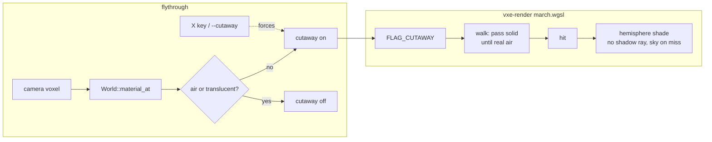

# 0025: The cutaway view: a camera in rock or outside the world sees through the hull to the first cavern's walls

> **Status:** approved (2026-10-20)
> **Created:** 2026-10-20
> **Milestone:** M7 in `docs/roadmap.md` (debug views); a tool, not a frame stage
> **Related ADRs:** none (the rejected options are product choices for a debug view, named
> under Decision; no revisitable architecture tradeoff)
> **Source:** the owner's request of 2026-10-20: flying out of bounds in the demo shows a
> black screen, and the wish is Source's "noclip outside the map" look, where the map reads
> as a transparent dollhouse of lit rooms.

## TL;DR

When the camera's cell is not air (outside the level's extent, beyond residency, or clipped
into rock), the primary ray passes through solid voxels until it has crossed real air inside
the world, then hits the next surface as usual. From outside, every cavern's far wall shows
through the hull and rock with no cavern behind it becomes sky; the result is the dollhouse
look of the owner's screenshot. Those hits are shaded by a fixed hemisphere light with no
shadow ray, because no lamp reaches them. The mode switches on by itself when the camera
leaves air, a key forces it on or off, and a flag sets the start state. Two phases. The
first thing a reader sees is a headless test where a camera buried in rock sees the cavity's
far wall facing it, and a golden of the level from outside.

## Context & problem

Source's look comes from one-sided polygons: outside the map, backface culling hides the
near walls and shows the far walls of each room, lit by their lightmaps. Our marcher has no
faces to cull and no baked light. Out of bounds today: the camera is not clamped
(`apps/flythrough/src/fly.rs`), chunks outside the extent are absent in the chunk table and
walked as empty 64^3 cells, so the ray hits the level's outer rock at a distance the
headlamp's inverse-square falloff cannot light (intensity 1200 at one voxel is 0.012 at
30 m), hence black. The same happens in the streamed cave past the residency window, and
when the camera clips into a wall.

The rule that reproduces Source's picture in voxel terms: Source draws the first air-to-solid
crossing whose air is the map's own air (the void outside is not air). For us: a ray that
starts in a non-air cell ignores solid until it has entered an empty cell of a resident chunk
(an empty chunk, a uniform-air brick, a clear block or an empty voxel of a full brick), then
marches normally. Absent chunks are not air. A ray that crosses solid from absent space to
absent space misses.

No `nfr.md` line is touched: the mode is off whenever the camera is in air, which is every
frame of play. Its cost from outside the level is read as a diagnostic.

## Decision

**A `cutaway` flag of the march makes a ray that starts outside air pass through solid until
it has crossed real air, and shades its hits with a hemisphere light and no shadow ray.** In
the fly-through the mode is automatic (on when `World::material_at` of the camera's voxel is
neither air nor translucent, including the not-resident case, off otherwise), with the `X`
key cycling auto, on and off, and `--cutaway auto|on|off` setting the start state. The miss
colour in the mode is a flat sky grey-blue so rooms read against it. We rejected clamping the
camera to the extent, because the demo wants to go outside; a translucent hull material,
because it changes the world and the look and costs the translucent walk; and lighting the
exterior with the lamp at no falloff, because the hull then hides every room.

## Architecture diagram



## Implementation phases

Each phase ships as its own commit. `dev` implements both in one session; the architect
reviews once at the end, in a fresh session.

### Phase 1: The walk rule and its headless proof
- **Owner skill:** dev
- **What:** `march.wgsl` gains `FLAG_CUTAWAY` (bit 10 of `Params::flags`) and a `passing`
  state of the walk: set at the start when the flag is set, cleared on the first empty cell of
  a resident chunk, and while set a solid cell is stepped through (a uniform solid brick as
  one 8^3 cell, a solid voxel of a full brick as one voxel). The translucent walk is
  unchanged. `LookParams` gains `cutaway: bool`.
- **Files touched:** `crates/vxe-render/src/shaders/march.wgsl`, `crates/vxe-render/src/marcher.rs`,
  `apps/flythrough/tests/look.rs` (or a new `cutaway.rs`), `tests/support/mod.rs`.
- **Done when:** on `cavity_world()` (solid material 3 over chunks `[-2, 2)^3`, a radius-40
  sphere carved about voxel `[0, 0, 0]`'s centre), with cutaway on, a camera at voxel
  `(-100, 0.5, 0.5)` looking along +x reads the centre pixel of the `normals` view as
  `(0, 128, 128)` within 2 per channel (the far wall at x = 41 faces -x, toward the camera)
  and white in `hitmask`; a camera at `(-200, 0.5, 0.5)`, outside the extent in absent
  chunks, reads the same two values; a ray from that outside camera aimed parallel to +x at
  `y = 60`, which crosses rock only, reads black in `hitmask`. With cutaway off, the
  outside camera's centre pixel reads a normal of `(0, 128, 128)` or `(0, 0, 0)` and the
  test asserts only that it differs from the cutaway reading in the `hitmask` or `normals`
  view (the hull is hit, or the ray starts inside it). The three opaque goldens are
  unchanged byte for byte with the flag clear.

### Phase 2: The dollhouse shading, the automatic trigger and the key
- **Owner skill:** dev
- **What:** in cutaway mode `shade` uses a hemisphere light, `albedo * (0.3 + 0.7 * (0.5 +
  0.5 * n.y))` with detail applied as usual and no shadow ray or lamp, and a miss writes a
  flat sky colour. The fly-through reads the camera's voxel each frame through
  `World::material_at` and sets the flag unless the `X` key forced a state; `--cutaway` sets
  the start state; the HUD shows a `cutaway` row when active; the autopilot is unaffected.
- **Files touched:** `march.wgsl`, `marcher.rs`, `apps/flythrough/src/main.rs`, `fly.rs`,
  `hud.rs`, `apps/flythrough/tests/golden.rs`, `docs/nfr.md` (a diagnostic reading).
- **Done when:** a golden `cutaway_level.png` of the level (`--level --seed 1`) from a
  camera 20 m outside the extent's -x face, looking +x at the centre, is blessed on lavapipe
  and shows at least 20 % of its pixels as sky and at least 20 % as lit rock (colour bins,
  `bins_covering`); the parse test pins `--cutaway auto`, `on`, `off` and refuses `--cutaway
  x`; a headless test places the camera in rock and asserts the look's `cutaway` flag is set
  after one update and clear after moving the camera into the spawn pocket; the steps view
  from that outside camera at 1080p on the dev box is read (mean steps, p99) and recorded
  as a diagnostic under `nfr.md` §2, since a ray through the hull steps uniform bricks eight
  voxels at a time and full bricks one voxel at a time.

## Data shapes

```rust
// illustrative
pub const FLAG_CUTAWAY: u32 = 1 << 10;   // Params::flags
pub struct LookParams { /* ... */ pub cutaway: bool }
pub enum CutawayMode { Auto, On, Off }   // the fly-through's --cutaway and X key
```

## Budgets

No `nfr.md` line moves: the mode is off whenever the camera is in air. Phase 2 records the
steps-view cost from outside the level on the dev box as a diagnostic.

## Risks & open questions

- **Cost through thick rock.** A full brick's solid voxels are stepped one at a time, so a
  ray through a surface-heavy region can take hundreds of steps; the cave's interior rock is
  uniform bricks, stepped eight at a time. A debug view tolerates it; the reading says how
  much.
- **The streamed cave from outside residency** shows the window's caverns and sky beyond; LOD
  mip cells are stepped at their size.
- **Plan 0024** moves shading into a light pass; this flag's rule lives in the walk and its
  shading is a few lines, so the rebase is small. The hit buffer then carries the cutaway hit
  like any other.
- **Merge with Plan 0023** touches `main.rs` in different places; this lane runs in a
  worktree and rebases on whichever lands first.

## What this plan does NOT do

- Cull by face: there are no faces. A cavern's near wall is seen through, its far wall drawn,
  which is Source's picture exactly.
- Light the exterior for play. The headlamp and Plan 0024's lights are unchanged.
- Clamp or teleport the camera.

## Implementation log

> Written by `dev`: one row per phase as its commit lands, then the close block. **The phases
> above are the contract. This section records what happened.** Observations, never conclusions:
> no pass list, no self-assessment. Deviations and unmet done-whens are **always** disclosed.
> Keep it shorter than `## Implementation phases`.

| phase | owner | state | commit |
|---|---|---|---|
| 1: The walk rule and its headless proof | dev | not started | |
| 2: The dollhouse shading, the automatic trigger and the key | dev | not started | |

### Notes

_(Deviations from the plan, with the commit, stated without justification. Done-whens not
satisfiable as stated, and what was done instead. Followups noticed and not acted on. One line
each. Empty is fine.)_

### Close triggers

_(Facts for the architect. No recommendations, and no suggested version bump.)_

- **What shipped:** feature / fix-only / docs-chore-only
- **Public API changed:** types, traits, functions, shader interfaces, config (list them, or none)
- **Budget readings:** each `nfr.md` figure touched, with its measured value, machine and commit
- **Gate at the tip:** the commands run (build, nextest, doctests, clippy, fmt, deny), exit codes, test counts
- **Outstanding `human` phases:** which, or none

## Followups

- A depth or hit-position view for tests, once Plan 0024's hit buffer exists.
