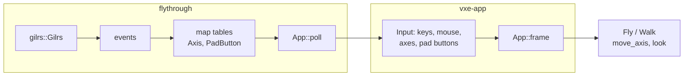

# 0026: Gamepad flight for demos: generic axes and pad buttons in the shell's input, gilrs in the testbed only

> **Status:** in-progress
> **Created:** 2026-10-20
> **Milestone:** M7 in `docs/roadmap.md` (tooling); a testbed feature, no frame stage
> **Related ADRs:** [ADR-0019](../adrs/0019-gamepad-input-as-generic-axes-in-the-shell-fed-by-the-testbed.md)
> (proposed with this plan: where the gamepad dependency lives)
> **Source:** the owner's request of 2026-10-20 (a DualSense on USB for demos), the probe of
> the same day (gilrs 0.11.2 reports it as "PS5 Controller" with SDL mappings on this box,
> and the device's udev ACL already grants the seat user access), and the owner's answers
> (fly-through only, the default mapping, analog flight speed, hot-plug).

## TL;DR

`vxe-app`'s `Input` gains analog axes and pad buttons that know nothing about any gamepad
library, and the `App` trait gains a `poll` hook the shell calls before each frame. The
fly-through owns `gilrs`, polls it in that hook, and feeds the axes and buttons; `Fly` and
`Walk` read keys and axes through one merged accessor. Left stick moves at a speed set by its
deflection, right stick looks, R2 digs, L2 fills, and the rest of the mapping is the table
below. A pad plugged in after launch is picked up and the HUD names it with its battery. The
first thing a reader sees is Phase 1: flying the cave with the sticks.

## Context & problem

The fly-through takes keys and mouse through `vxe_app::Input`, a snapshot the shell hands to
`App::frame` immutably, filled from `winit` events; `winit` has no gamepad support. `Fly`
moves by held keys at a fixed speed (`SPEED` 30 voxels/s, `BOOST` x4) and looks by mouse
counts; `Walk` builds a `MoveInput` the same way. The owner wants to run demos from a sofa
with a DualSense.

The standard Rust gamepad crate is `gilrs` (0.11.2, Apache-2.0/MIT): evdev through udev on
Linux, Windows Gaming Input on Windows, SDL's controller database for mappings. The probe of
2026-10-20 in a scratch project built it against the pinned toolchain and listed the
DualSense as `PS5 Controller`, `SdlMappings`, `Charging(5)`. Its Linux tree adds
`gilrs-core`, `libudev-sys`, `inotify`, `inotify-sys`, `nix`, `uuid`, `vec_map` and `fnv`,
every one under a licence `deny.toml` already allows; `libudev-sys` links the system libudev,
so CI's Ubuntu arm needs `libudev-dev`. `default-features = false` does not compile (a
compile error that is not target-gated in `gilrs-core` 0.6.8), so the crate keeps its
defaults. Dependencies are a cost (`CLAUDE.md`), which is why the crate stays out of the
engine crates (ADR-0019).

No `nfr.md` line is touched. Polling is a few events per frame.

## Decision

**The shell's `Input` carries generic axes and pad buttons; the testbed feeds them from
`gilrs`.** `Input` gains `Axis` (`MoveX`, `MoveY`, `LookX`, `LookY`, `TriggerL`, `TriggerR`),
`PadButton` (`South`, `East`, `West`, `North`, `L1`, `R1`, `L3`, `R3`, `DpadUp`, `DpadDown`,
`DpadLeft`, `DpadRight`, `Start`, `Select`), `axis()`, `pad_held()`, `pad_pressed()` and
their setters, and `App::poll(&mut self, input: &mut Input)` runs before every `frame` with
a no-op default. The fly-through keeps a `Pad` (a `gilrs::Gilrs` and the active gamepad id),
drains its events in `poll`, maps them through two plain tables, and treats a failed
`Gilrs::new` as no pad. `Fly` and `Walk` read `move_axis(input, plus_key, minus_key, axis)`,
the sum of the key pair and the axis clamped to `[-1, 1]`. Stick deflection passes a radial
dead zone of 0.15 and a squared response, flight speed is `SPEED x BOOST` times that response
at full deflection with `R3` latching boost, and look adds `LOOK_RATE` 2.5 rad/s times the
response to the mouse's turn. We rejected `gilrs` inside `vxe-app` behind a feature (the
optional shell would carry a native dependency for every consumer) and a private pad state
beside `Input` in the fly-through (two input sources for `Fly` and `Walk`); ADR-0019 has the
reasons.

The DualSense mapping, through SDL's names:

| pad | action | key or mouse it mirrors |
|---|---|---|
| left stick | move (x right, y forward); deflection sets speed | `W` `A` `S` `D`, `Shift` |
| right stick | look | mouse |
| R2 | dig | left click |
| L2 | fill | right click |
| L1 / R1 | down / up in flight | `C` / `Space` |
| Cross (South) | jump or climb when walking | `Space` |
| D-pad up / down | dig radius up / down | scroll |
| Triangle (North) | walk / fly | `G` |
| Square (West) | cutaway: auto, on, off (Plan 0025) | `X` |
| Circle (East) | knock | `H` |
| Options (Start) | HUD | `F2` |
| R3 | boost latch | `Shift` |

## Architecture diagram



## Implementation phases

Each phase ships as its own commit. `dev` implements both in one session; the architect
reviews once at the end, in a fresh session.

### Phase 1: Axes in the shell, sticks in the fly-through
- **Owner skill:** dev
- **What:** `Input`'s axes and pad buttons with setters and `end_frame` semantics (axes
  persist, pad presses clear); `App::poll`; `gilrs` pinned in the workspace table and used
  by the fly-through under `--pad on|off` (default on in a window, never in headless or
  autopilot runs); `Fly` and `Walk` read merged movement and look; the response curve and
  analog speed; `libudev-dev` in CI's apt list.
- **Files touched:** `crates/vxe-app/src/input.rs`, `shell.rs`, `lib.rs`, `Cargo.toml`
  (workspace table), `apps/flythrough/Cargo.toml`, new `apps/flythrough/src/pad.rs`,
  `fly.rs`, `main.rs`, `.github/workflows/ci.yml`, `Cargo.lock`.
- **Done when:** headless tests on `Fly` and `Walk`: `MoveY` at 1.0 for `dt` 0.1 s moves
  the camera 3.0 voxels along its heading (`SPEED x dt`, the key pair's distance) and
  `MoveY` at 0.1 moves it 0 (inside the dead zone); `MoveY` 0.5 moves it
  `3.0 x ((0.5 - 0.15) / 0.85)^2 = 0.5086` voxels within 1e-3; with boost latched, 12.0;
  `W` held plus `MoveY` 1.0 still moves 3.0 (clamped); `LookX` at 1.0 for 0.1 s turns yaw by
  0.25 rad and adds to a mouse delta in the same frame; `Walk::input` with `MoveY` 1.0 gives
  the same `wish` as `W` held and `South` held sets `jump`. The mapping from every
  `gilrs::Axis` and `gilrs::Button` the table names to its `Axis` or `PadButton` is pinned by
  a test over the table's rows. The parse test pins `--pad on`, `off` and refuses `--pad x`.
  `cargo deny check` is green with the new crates.

### Phase 2: Buttons, hot-plug and the HUD
- **Owner skill:** dev
- **What:** `handle_input` takes the table's buttons beside its keys (dig, fill, radius,
  walk, cutaway, knock, HUD, boost); `Connected` and `Disconnected` events swap the active
  pad and print one line; the HUD gains a `pad` row with the name and `power_info`; the
  startup printout names the pad or `pad: none`.
- **Files touched:** `apps/flythrough/src/pad.rs`, `main.rs`, `hud.rs`.
- **Done when:** a headless test drives `handle_input` with `R2` pressed through `Input`'s
  setters and asserts a dig op reached the server (the same assertion the left-click test
  makes), and `DpadUp` twice raises the dig radius by two scroll steps; the connect line and
  the HUD row come from a `Pad` fed synthetic connect and disconnect transitions (a small
  state type tested without a device). The owner's sofa check is not a phase: it is the
  demo.

## Data shapes

```rust
// illustrative: vxe-app
pub enum Axis { MoveX, MoveY, LookX, LookY, TriggerL, TriggerR }
pub enum PadButton { South, East, West, North, L1, R1, L3, R3,
                     DpadUp, DpadDown, DpadLeft, DpadRight, Start, Select }
impl Input {
    pub fn axis(&self, a: Axis) -> f32;           // [-1, 1], persists across frames
    pub fn pad_held(&self, b: PadButton) -> bool;
    pub fn pad_pressed(&self, b: PadButton) -> bool;
    pub fn set_axis(&mut self, a: Axis, v: f32);
    pub fn pad_down(&mut self, b: PadButton);
    pub fn pad_up(&mut self, b: PadButton);
}
pub trait App { fn poll(&mut self, input: &mut Input) {} /* ... */ }
```

## Budgets

None. The poll drains a handful of events per frame; the HUD row costs nothing measurable.

## Risks & open questions

- **`Gilrs::new` on a box without udev** (CI, a container) may fail; the fly-through treats
  it as no pad and never calls it headless, so no test depends on a device.
- **Windows** builds the `windows` crate through gilrs's default `wgi` feature; the CI arm
  compiles it, which costs build time, not correctness.
- **Stick axis sign:** gilrs reports `LeftStickY` positive up; the table maps it to `MoveY`
  positive forward.
- **Plan 0025's `X` key** is mapped to Square; if 0025 lands after this plan, the row waits
  for it.

## What this plan does NOT do

- Put a gamepad library in any engine crate (ADR-0019).
- Rumble, remapping by file, or a second pad.
- Touchpad, motion sensors or the DualSense's adaptive triggers.

## Implementation log

> Written by `dev`: one row per phase as its commit lands, then the close block. **The phases
> above are the contract. This section records what happened.** Observations, never conclusions:
> no pass list, no self-assessment. Deviations and unmet done-whens are **always** disclosed.
> Keep it shorter than `## Implementation phases`.

| phase | owner | state | commit |
|---|---|---|---|
| 1: Axes in the shell, sticks in the fly-through | dev | done | b59c980 |
| 2: Buttons, hot-plug and the HUD | dev | done | committed with this row |

### Notes

- Phase 1: `L2`/`R2` arrive from gilrs as `ButtonChanged(LeftTrigger2/RightTrigger2)` values, so
  `pad.rs`'s axis table keys on an `AxisSource` (a gilrs axis or a gilrs button) rather than
  `gilrs::Axis` alone.
- Phase 1: `Input` gains `release_pad()` (zeroes the axes, releases the pad buttons), beyond the
  plan's data shapes; `Pad::poll` calls it when the active pad disconnects.
- Phase 1: the `R3` boost latch lets go when the move stick returns inside the dead zone; the
  plan names a latch without saying what releases it.
- Phase 1: the lock adds `objc2-io-kit` (gilrs-core's macOS backend) beside the crates the
  plan's context lists; no new duplicate in `cargo deny check`.
- Phase 1: b59c980 carried a plan-relative comment in `pad.rs` that `check-comment-hygiene` did
  not see while the file was untracked; reworded in the Phase 2 commit.
- Phase 2: no left-click `handle_input` test existed to mirror; the new test drives a left click
  and `R2` on two fresh runs and asserts the server applied the same `EditResult` for both.
- Phase 2: `R2`/`L2` dig and fill on a press edge with hysteresis (press at 0.5 pull, release
  under 0.3), held in `Run`; the D-pad adds one scroll line per press to the scroll delta.
- Phase 2: Square (West) is not wired: Plan 0025's cutaway (`X`) is not on this branch.
- Phase 2: the HUD's pad row is `HudStats::pad: Option<PadRow>`, `None` without a pad source, so
  `HudStats::fixed()` (the HUD golden's fixture) keeps its twelve rows; the main.rs allocation
  test sets a pad row and now counts 13 rows.
- Phase 2: the newest connected pad is active; a disconnect of the active pad hands back to the
  previous connected one. Power is read on connect and every 120 polls.
- Phase 2: the startup line prints only in windowed, non-autopilot runs (`pad: none` under
  `--pad off` or when gilrs fails).
- Owner check (human, not run here): `cargo run --release -p flythrough -- --level` with the
  DualSense on USB, then unplug and replug it; expected startup line `pad: PS5 Controller
  (charging N%)`, a disconnect and a connect line, and the `pad` row on the HUD (`Options`).

### Close triggers

_(Facts for the architect. No recommendations, and no suggested version bump.)_

- **What shipped:** feature / fix-only / docs-chore-only
- **Public API changed:** types, traits, functions, shader interfaces, config (list them, or none)
- **Budget readings:** each `nfr.md` figure touched, with its measured value, machine and commit
- **Gate at the tip:** the commands run (build, nextest, doctests, clippy, fmt, deny), exit codes, test counts
- **Outstanding `human` phases:** which, or none

## Followups

- Rumble on a dig, scaled by voxels removed (gilrs force feedback), if a demo wants it.
