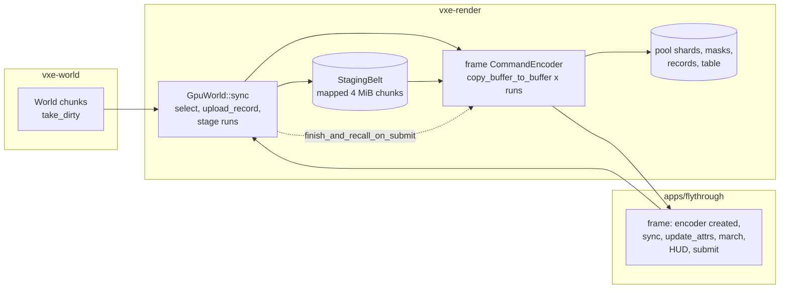

# 0027: Mirror uploads through a staging belt and copy commands: the streaming line's copies

> **Status:** in-progress: every phase implemented; awaiting the close review (2026-10-21)
> **Created:** 2026-10-21
> **Milestone:** M2 in `docs/roadmap.md` (the streaming line, `nfr.md` §2, a recorded miss
> since Plan 0002; this is the plan ADR-0017's Outcome asked for)
> **Related ADRs:** [ADR-0022](../adrs/0022-mirror-uploads-through-a-staging-belt-and-copy-commands.md)
> (proposed with this plan), [ADR-0017](../adrs/0017-mirror-cpu-work-bounded-in-the-frame-loop-narrowing-on-stream-workers.md)
> (the frame loop's shape, which stands; its Outcome names this plan),
> [ADR-0013](../adrs/0013-mirror-reserves-its-vram-budget-up-front.md) (the reservation and
> deferral rules `sync` keeps)
> **Source:** Plan 0023's Phase 5 entry profile and its Followups; the owner's call of
> 2026-10-21 (the copies get their own ADR and plan after Plan 0024, apart from the
> mirror-slot plan); the owner's choice of the belt (2026-10-21).
> **Starts:** independent of Plan 0024 (it touches `gpu_world.rs` and the frame loop's
> encoder order, not the march or the light passes); whichever of the two merges second
> rebases its `apps/flythrough/src/main.rs` frame-loop hunk.

## TL;DR

`GpuWorld::sync` stops calling `Queue::write_buffer`. It writes each staged run into a slice
of a persistently mapped staging belt and records a `copy_buffer_to_buffer` into the frame's
command encoder, which the caller submits as it does today. The bytes, the order of effects,
the selection and the deferral rules are unchanged; what goes is the fresh staging
allocation and its first-touch page faults on every call, which Plan 0023's profile put at
41.8 % of `sync`. The first thing a reader sees is the mirror tests passing byte for byte
through the belt, then the quiet-box streaming line read again with the copies gone, and a
windowed run that prints its frame-time summary at exit.

## Context & problem

The streaming line (`nfr.md` §2: 1.0 ms of render-thread CPU per frame) misses at p50 4.9
to 5.0 ms in plain flight after Plan 0023, with `sync` as nearly all of it. The profile's
shares inside `sync`: `Queue::write_buffer` 41.8 %, `upload_record` self 33.6 % (narrowing),
palette scans 8.8 %, `sync` self 5.7 %, `enqueue` 4.8 %. `write_buffer`'s samples are its own
self time and unresolved `libc`, not driver work: the mirror already coalesces runs
(`stage`, `stage_record`, `flush_table`), so each call is large, and the cost is the staging
allocation `wgpu-core` makes per call and the page faults of touching it. ADR-0022 says why a
belt and not the alternatives.

The consumer requirement is `project-context.md`'s World row (stacked levels generated in the
background while the current one plays) and the Rendering row's stable image: a frame that
spends 5 ms of CPU on uploads is a frame the floor cannot afford. The `nfr.md` figures
touched are §2's streaming line and §3's RAM (the belt's mapped chunks).

## Decision

We give `GpuWorld` a `wgpu::util::StagingBelt` with 4 MiB chunks and make `sync` take the
frame's `CommandEncoder` (ADR-0022). Every run that `flush_stage`, `write_masks`,
`flush_records`, `flush_table` and `write_materials` write today becomes a belt write plus a
copy command; `sync` ends with `finish_and_recall_on_submit(encoder)`. The frame loop creates
its encoder before `sync` and submits it after the HUD as now, so the copies precede the
attribute pass and the march in the same submission. Syncs outside a frame (the bench's
immediate sync, the level's first sync, tests) record into an encoder of their own and
submit it. We rejected `write_buffer_with` (keeps the per-call allocation), worker-side
narrowing as the next step (attacks the other share) and a mapped ring of our own (the belt
is that ring with `wgpu`'s own recall); ADR-0022 has the reasons.

## Architecture diagram



## Implementation phases

Each phase ships as its own commit. `dev` implements all phases in one session with no review
between phases. The architect reviews once at the end, in a fresh session. Phase 1 is the
walking skeleton.

### Phase 1: The belt under `sync`, byte for byte
- **Owner skill:** dev
- **What:** `GpuWorld` owns a `StagingBelt` (chunk size `BELT_CHUNK_BYTES = 4 MiB`, usages
  `COPY_SRC`). `sync(&mut self, world, queue, encoder: &mut wgpu::CommandEncoder)` replaces
  every `queue.write_buffer` in `flush_stage`, `write_masks`, `flush_records`,
  `write_table_run` and `write_materials` with a belt write into a slice and a
  `copy_buffer_to_buffer` into `encoder`, and ends with `finish_and_recall_on_submit`.
  `SyncStats.writes` counts copy commands as it counted writes. `GpuWorld::belt_chunks()`
  reports the belt's chunk count (active, closed and free). The `queue` parameter stays
  for `update_attrs`'s uniform. A `sync_now(world, device, queue)` helper in the mirror
  tests' support module creates an encoder, syncs, submits and polls to completion. The
  fly-through's frame loop creates its encoder before `sync`; its bench sync, first-level
  sync and `--frames` paths make and submit their own encoder. `world_budget` and
  `level_mirror` follow.
- **Files touched:** `crates/vxe-render/src/gpu_world.rs`, `crates/vxe-render/src/lib.rs`,
  `crates/vxe-render/tests/mirror.rs`, `crates/vxe-render/tests/translucent.rs`,
  `crates/vxe-render/tests/walk.rs` (where they sync), `apps/flythrough/src/main.rs`,
  `apps/flythrough/tests/level_mirror.rs`, `apps/flythrough/tests/support/mod.rs`,
  `apps/flythrough/examples/world_budget.rs` (if it syncs), `apps/flythrough/examples/hero.rs`.
- **Done when:** every test in `crates/vxe-render/tests/mirror.rs` passes through
  `sync_now` with no assertion changed; the staged-bytes test (a brick's slot bytes against
  its narrowed voxels, from Plan 0021) reads the pool back through `readback.rs` after a belt
  sync and finds the same bytes it found through `write_buffer`; the level's first sync still
  reads 232 436 992 B live (`level_mirror.rs`); every golden under `apps/flythrough/tests/golden/`
  renders byte for byte (the march reads the same bytes); after a 60 s headless autopilot
  flight at the defaults, `belt_chunks()` reads at most 3, and after 300 frames of
  `--level --frames 300` at most 2; a sync that stages more than one chunk's worth in one
  frame (a test with a 16 MiB sync budget on the level's first sync) completes and reads
  the same bytes.

### Phase 2: The streaming line, re-read
- **Owner skill:** dev
- **What:** the Phase 1 binary and the pre-plan binary (`git archive` of the merge base,
  built beside it) fly the autopilot alternately on a quiet box, plain and default, under
  `nfr.md` §9's quiet-box protocol; a `perf record --call-graph fp` of one plain flight of the
  Phase 1 binary attributes `sync`'s samples as Plan 0023's Phase 5 profile did. Readings go
  in `nfr.md` §2 under the streaming line and in the Implementation log.
- **Files touched:** `docs/nfr.md`, this plan's log.
- **Done when:** in plain flight, `sync` p50 reads at most 3.0 ms (from 4.9 to 5.0 ms, the
  arithmetic of removing the 41.8 % share) and `update + poll + sync` p50 at most 3.2 ms, in
  both runs; `Queue::write_buffer` is absent from the profile and the belt's own symbols plus
  `copy_buffer_to_buffer` recording together read under 5 % of `sync`; the default look's
  `update_attrs` p99 and carry-over age, the residency p95 and the return hash are within
  Plan 0023's Phase 6 readings (no regression: hash match, carry-over age max 0 ms at the
  8192 cap, residency p95 under 500 ms); `sync` max and p99 are recorded against the 16 ms
  frame with no bar (the bursts are `poll` and `apply_events`, not the copies). The 1.0 ms
  line stays a recorded miss, now with narrowing as its largest share, which the plan's log
  states with the profile's number.

### Phase 3: The windowed frame-time summary and the autopilot's ring
- **Owner skill:** dev
- **What:** a windowed run prints at exit the p50, p99 and max of the render thread's frame
  CPU, of `update + poll + sync`, and of the march's GPU time (when the timer is on), over the
  run, the summary Plan 0023's Followups owe. The autopilot's unready-near counter recomputes
  its ring when the pressure rule changes `r_full` (the same Followups), so the default
  look's count carries a signal.
- **Files touched:** `apps/flythrough/src/main.rs`, `apps/flythrough/src/fly.rs` (if the
  timers live there), the root `README.md` (the exit summary, one line).
- **Done when:** `flythrough --level --seed 1 --frames 300` (headless) prints a `frames:`
  summary line whose three p50 values are each within 10 % of the HUD's medians over the same
  run read by the existing stats path; a headless autopilot run at the default look reports an
  unready-near count under 10 % of its frames once residency settles (today 5894 of 5904,
  which the stale ring produced), and the test that drives the autopilot's counters pins the
  recompute on a `set_radii` call.

### Phase 4: The owner's windowed flight
- **Owner skill:** human
- **What:** the owner flies the default look at 2530 x 1378 with sustained fast passes, as in
  Plan 0023 Phase 7, and reads the exit summary. The expected outcome is no visible change
  and a frame-CPU p50 lower than before; the deferral streaks and the 40 fps saturation are
  Plan 0028's, not this plan's.
- **Files touched:** this plan's log.
- **Done when:** the owner has recorded the summary's three p50 and p99 values and a verdict
  in the Implementation log.

## Data shapes

```rust
// illustrative: the belt in GpuWorld
pub const BELT_CHUNK_BYTES: u64 = 4 << 20;
pub struct GpuWorld {
    // ...
    belt: wgpu::util::StagingBelt,
}
impl GpuWorld {
    pub fn sync(
        &mut self, world: &World, queue: &wgpu::Queue, encoder: &mut wgpu::CommandEncoder,
    ) -> Result<SyncStats, MirrorError>;
    pub fn belt_chunks(&self) -> usize;
}

// illustrative: one staged run becomes
// let mut view = self.belt.write_buffer(encoder, &self.shards[shard], offset, size, device);
// view.copy_from_slice(bytes);
```

RAM: two or three 4 MiB mapped chunks per mirror (8 to 12 MiB), counted under §3's RAM line
and reported by `belt_chunks()`. VRAM: the chunks are host-visible buffers, not pool bytes;
they are not part of the ADR-0013 reservation.

## Budgets

| `nfr.md` figure | line | projection (dev box) | how the close measures it |
|---|---|---|---|
| §2 Streaming, upload, light extraction | 1.0 ms | `sync` p50 from 4.9 to 5.0 ms to about 2.9 ms (the 41.8 % share removed), still a miss; narrowing is then the largest share | Phase 2: quiet-box autopilot, plain and default, paired with the pre-plan binary; the `perf` profile |
| §2 the frame bar of Plan 0023 (GPU-credited frames flown) | the default flies at least as many frames as plain | unchanged or better | the same runs |
| §3 World in RAM | 4 GB | +8 to 12 MiB of mapped belt chunks | `belt_chunks()` times the chunk size, printed by the autopilot |
| §5 residency latency | 500 ms p95 | unchanged | the same runs |

No reading on the slow adapter: this plan moves CPU work, not GPU work; the iGPU reading of
the frame is Plan 0028's and Plan 0024's.

## Risks & open questions

- **Recall depends on submission and polling.** A belt chunk returns to the free list when the
  submission that copied from it completes and the device is polled; the windowed loop polls
  through its present and submit, the headless tests through `sync_now`. A caller that syncs
  without submitting grows the belt (ADR-0022's negative consequence); `belt_chunks()` pins
  it in Phase 1.
- **Encoder order.** The copies must be recorded before the attribute pass and the march in
  the same encoder; Phase 1 moves the frame loop's `create_command_encoder` above `sync`. A
  sync that fails with an empty selection records nothing.
- **Lavapipe.** The belt's `map_async` callbacks run on `device.poll`; the tests' helper
  polls with `PollType::wait_indefinitely()` as `readback.rs` does.
- **Determinism.** Nothing in `vxe-world` changes; the mirror's bytes are the same, held by
  the staged-bytes test and the goldens.
- **Threading.** `sync` still runs on the render thread; the belt is owned by `GpuWorld` and
  touched by no other thread.

## What this plan does NOT do

- **Narrowing on the stream workers** (ADR-0017's hook): after Plan 0028 removes most of the
  narrowing, what is left is re-profiled; the hook is the step after, if the line still
  misses.
- **The mirror's byte layout, the attribute pages, the pressure rule:** Plan 0028.
- **Light extraction** (Plan 0024 Phase 2 adds it to `sync` and to this line).
- **The level's first-sync palette scan** (about 190 ms since Plan 0021): the belt applies
  to it, and Phase 2 records the first-sync time, without a bar.
- **A VRAM query from the adapter**, a resize of the belt's chunk size at runtime.

## Implementation log

> Written by `dev`: one row per phase as its commit lands, then the close block. **The phases
> above are the contract. This section records what happened.** Observations, never conclusions:
> no pass list, no self-assessment. Deviations and unmet done-whens are **always** disclosed.
> Keep it shorter than `## Implementation phases`.

| phase | owner | state | commit |
|---|---|---|---|
| 1: The belt under `sync`, byte for byte | dev | done: `mirror.rs` 41 tests through `sync_now` (new: `submitted_syncs_reuse_one_belt_chunk`); staged-bytes test reads back through the belt; level first sync 232 436 992 B live, 1132 writes; all 10 goldens re-blessed with no byte change (`VXE_BLESS=1`, `git status` clean); new `syncs_past_one_belt_chunk_build_the_same_mirror` (16 MiB budget, every buffer equal to the unbudgeted mirror's); `belt_chunks()` peak 1 over a headless autopilot flight (2346 frames, load 13), 0 after `--level --frames 300` (1 trim at the first sync) | 843c5a3 |
| 2: The streaming line, re-read | dev | done with a disclosed miss: quiet re-read meets both p50 bars (plain `sync` 1.397 to 1.662 ms, `update + poll + sync` 1.715 to 1.994 ms); the belt reads 25.4 % of `sync` against under 5 %, recorded as a miss (owner's option (a), 2026-10-21); readings in `nfr.md` §2 | 1533cc7, 6bd1c41, 598fb17 |
| 3: The windowed frame-time summary and the autopilot's ring | dev | done: `--level --headless --seed 1 --frames 300`, 8 runs (5 at load 15 to 18, 3 at 1.2 to 1.4, exclusive perf lock): frame CPU p50 0.082, 0.070, 0.065, 0.067, 0.068, 0.067, 0.067, 0.079 ms against the `frame` line's median of the last 30 0.071, 0.070, 0.073, 0.074, 0.073, 0.075, 0.072, 0.074 ms; march GPU p50 equal to that median in all 8; `update + poll + sync` p50 0.001 ms against the HUD's 0.001 ms; default autopilot unready-near 0 of 7965 (load 13.4) and 0 of 10 963 (load 1.2), 2 ring recomputes each, hash match; `the_unready_ring_is_recomputed_on_set_radii` | b4b524d |
| 4: The owner's windowed flight | human | done (owner, 2026-10-21 19:11, live session 4, `./target/release/flythrough --seed 1` from this worktree at b4b524d, default look, 2560x1440, stdout in `plan-0024/live/session4-20261021-1911.log`, first section): verdict "flight 1 went fine but fps were around 30": no visible change, no hitches. `frames: 5245 frames; frame CPU p50 10.223 ms, p99 53.354 ms, max 888.607 ms; update + poll + sync p50 4.432 ms, p99 36.548 ms, max 885.390 ms; march GPU p50 6.571 ms, p99 25.926 ms, max 63.062 ms over 4326 timed frames` | committed with this row |

### Notes

_(Deviations from the plan, with the commit, stated without justification. Done-whens not
satisfiable as stated, and what was done instead. Followups noticed and not acted on. One line
each. Empty is fine.)_

- Phase 1: the belt is replaced when a sync leaves it holding more than `BELT_KEEP_CHUNKS = 3`
  chunks (`GpuWorld::belt_trims()` counts it); without it the level's unbudgeted first sync
  keeps about 56 mapped chunks for the mirror's life.
- Phase 1: `belt_chunks()` counts the distinct chunk buffers the belt has handed out (the belt
  exposes no count); `Belt::write` uses `StagingBelt::allocate` plus its own
  `copy_buffer_to_buffer`, which is what `StagingBelt::write_buffer` does.
- Phase 1: `crates/vxe-render/tests` has no support module; `sync_now` is a `SyncNow` trait in
  `mirror.rs` and in `apps/flythrough/tests/support/mod.rs`; `translucent.rs` and `walk.rs`
  submit their one sync inline.
- Phase 1: files outside `Files touched` changed for the new `sync` signature:
  `apps/flythrough/tests/golden.rs`, `hud_golden.rs`, `look.rs` (call sites only).
- Phase 1: the autopilot and the `--frames` exit print a `staging belt` line.
- Phase 2: the box was not quiet. Every run held the exclusive perf lock at a 1-minute load of
  12.1 to 17.4, with other projects' processes (a game under Wine, gdb, python) at 25 to 92 %
  CPU for the whole session. Binaries: `fly-base` (`git archive` of ae58f0c), `fly-p1`
  (843c5a3), both release; RTX 3080 Laptop GPU, Ryzen 9 5900HS; `flythrough --autopilot
  --headless --seed 1 [--look plain]`, alternated base, p1 per look, two rounds.
- Phase 2, plain: base `sync` p50 4.469 and 4.405 ms, `update + poll + sync` p50 4.498 and
  4.428 ms over 3429 and 3453 frames; p1 `sync` p50 3.200 and 2.902 ms (bar 3.0),
  `update + poll + sync` p50 3.254 and 2.968 ms (bar 3.2) over 4493 and 4943 frames. p1
  `sync` p99 9.202 and 8.852 ms, max 15.452 and 16.832 ms (base p99 16.231 and 17.020, max
  32.086 and 36.041). Residency p95 364 and 364 ms (base 420, 430); hash match in all four;
  belt peak 2 chunks, 0 trims.
- Phase 2, default: base flew 9428 and 7796 frames, p1 13 029 and 13 223; `update_attrs` p99
  base 7.717 and 8.107 ms, p1 7.699 and 7.650 ms (Plan 0023 Phase 6 quiet: 5.528, 6.024);
  carry-over age max 0 ms in all four; residency p95 base 226 and 247 ms, p1 197 and 190 ms;
  hash match in all four; `r_full` 12 at the end in all four; belt peak 1 chunk, 0 trims.
- Phase 2, profile: `perf record -F 999 --call-graph fp` of one plain flight of a
  frame-pointer build of 843c5a3 (`CARGO_TARGET_DIR=target/fp`, line tables), load 17.4: 4717
  frames, hash match, `sync` p50 3.111 ms. Render thread 38 121 samples, 14 896 under
  `GpuWorld::sync`; nearest-leaf attribution: `upload_record`/`upload_brick` 39.2 %, the belt
  28.9 %, `entry_matches`/`first_appearance` 10.5 %, flushes and `write_masks` outside the
  belt 6.8 %, the fit check 4.1 %, `select`/`reconcile_window` 3.3 %, `sync` self 2.6 %,
  `drop_record` 1.8 %, `enqueue` 1.3 %, `stage` 0.8 %, `unqueue` 0.6 %.
  `Queue::write_buffer` has no samples.
- Phase 2, the belt's share (done-when: under 5 %): 4306 samples, 28.9 % of `sync`. 3575 of
  them (24.0 %) sit in `BufferViewMut::drop` (its `MapContext` lock and sub-range remove, the
  first locked instruction after `copy_from_slice` into the mapped chunk); 355 (2.4 %) in
  `copy_buffer_to_buffer` recording. The memcpy itself has almost no samples of its own.
  Not met as stated.
- Phase 2, quiet re-read (owner's option (c), 2026-10-21): same binaries, exclusive perf lock,
  memory cap; before each run a gate held until the 1-minute load was under 2 and no process
  but the `claude` sessions was above 7 % CPU over 3 s (start loads 0.26 to 1.91, top other
  process 0.7 to 2.3 %); alternated base, p1 per look, three rounds.
  | reading | base (3 runs) | p1 (3 runs) | bar |
  |---|---|---|---|
  | plain `sync` p50 | 3.344, 3.278, 3.687 ms | 1.397, 1.662, 1.439 ms | at most 3.0 ms |
  | plain `update + poll + sync` p50 | 3.395, 3.325, 3.783 ms | 1.831, 1.994, 1.715 ms | at most 3.2 ms |
  | plain `sync` p99 / max | 8.940 / 15.080, 8.701 / 19.998, 12.353 / 35.615 ms | 5.941 / 8.786, 6.346 / 8.842, 6.087 / 9.607 ms | none |
  | plain frames flown | 5696, 5805, 5280 | 8296, 8183, 8299 | none |
  | plain residency p95 | 329, 327, 393 ms | 261, 258, 262 ms | under 500 ms |
  | default `update_attrs` p99 | 3.971, 4.047, 3.916 ms | 3.727, 3.700, 3.609 ms | within Plan 0023 Phase 6 (5.528, 6.024) |
  | default carry-over age max | 0, 0, 0 ms | 0, 0, 0 ms | 0 ms |
  | default residency p95 | 151, 147, 150 ms | 129, 131, 129 ms | under 500 ms |
  | default frames flown | 15 735, 15 282, 15 585 | 19 273, 19 730, 19 851 | at least plain's |
  | return hash | match x6 | match x6 | match |
  | belt peak chunks | n/a | plain 2, default 1; 0 trims | at most 3 |
- Phase 2, quiet profile re-take (gate start load 1.48, frame-pointer build of 843c5a3, one
  plain flight, 8383 frames, hash match, `sync` p50 1.102 ms): render thread 43 876 samples,
  14 739 under `sync`; `upload_record`/`upload_brick` 43.2 %, the belt 25.4 %,
  `entry_matches`/`first_appearance` 9.9 %, flushes and `write_masks` 6.4 %, the fit check
  4.8 %, `select` 3.2 %, `sync` self 3.2 %, `drop_record` 1.8 %, `stage` 0.9 %, `unqueue`
  0.7 %, `enqueue` 0.6 %; `Queue::write_buffer` no samples. The belt's 3749: 3027 (20.5 %) in
  `BufferViewMut::drop`, 339 (2.3 %) in `copy_buffer_to_buffer` recording. The under-5 % bar is
  not met.
- Phase 3: the `frames:` line is printed from `Drop for Run`, so every run prints it at exit,
  windowed or headless; the series live in the HUD state (`Hud::run`). The ring follows the
  streamer's configured `r_full` each flight frame rather than a call beside `set_radii`; the
  test drives `Streamer::set_radii` and the ring.
- Phase 3, frame CPU against the existing path: the existing median covers the last 30 frames
  of a `--frames` run, which are the ones the march timer resolves and reads back; the
  `frames:` p50 covers all 300. Two of eight runs read outside 10 % (0.082 against 0.071 ms,
  0.065 against 0.073 ms), one at -10.7 %. Not met as stated in those runs.

- Phase 4: about 30 fps on the fast passes, against about 40 fps in Plan 0023 Phase 7 (at
  2530x1378; this flight rendered 2560x1440, 5.7 % more pixels).
- Phase 4, observations on why the `frames:` p50s (10.2 ms CPU plus 6.6 ms march GPU) do not
  add up to 33 ms: frame CPU runs from the frame's start to its submit and leaves out
  `get_current_texture` and `present` in `vxe-app`'s shell (`AutoNoVsync`, no vsync wait, but
  acquire blocks while the swapchain's images are in flight); on the 4326 timed frames (stats
  overlay shown) `MarchTimer::read_ms` waits on `device.poll(wait_indefinitely)` after the
  submit, outside frame CPU, so CPU and GPU serialize and the whole submission's GPU time is
  paid, of which the march is one pass (the attribute pass, the presenter at 2560x1440 and the
  HUD are not in the GPU figure); the 47 `B` benches each synced 23 to 27 ms; the mirror sat
  at its 3 GiB budget with 47 deferral streaks (up to 150 syncs) and `r_full` moving 12 to 16,
  Plan 0028's territory. The second `F1` line read cpu 24.737 ms, gpu march 8.488 ms.
- Phase 4: frame CPU max 888.607 ms with `update + poll + sync` max 885.390 ms in the same
  run: one streaming step of about 0.9 s, which the log does not attribute further.

### Close triggers

_(Facts for the architect. No recommendations, and no suggested version bump.)_

- **What shipped:** feature.
- **Public API changed:** `GpuWorld::sync(world, queue, encoder: &mut wgpu::CommandEncoder)`
  (the encoder is new; every caller changed); `GpuWorld::belt_chunks()`,
  `GpuWorld::belt_trims()`; `vxe_render::gpu_world::BELT_CHUNK_BYTES` (re-exported at the
  crate root) and `BELT_KEEP_CHUNKS`; `SyncStats::writes` now counts belt copy commands. The
  fly-through prints a `staging belt` line (autopilot, `--frames` exit) and a `frames:` line
  at every exit.
- **Budget readings:** dev reference, RTX 3080 Laptop GPU, Ryzen 9 5900HS, release. §2
  streaming line (quiet box, exclusive perf lock, 843c5a3 against ae58f0c, three paired runs):
  plain `sync` p50 1.397 to 1.662 ms (bar 3.0), `update + poll + sync` p50 1.715 to 1.994 ms
  (bar 3.2), against the 1.0 ms line still a miss; belt 25.4 % of `sync` against under 5 %, a
  recorded miss (owner, 2026-10-21). §3 RAM: belt peak 2 chunks (8 MiB) plain, 1 chunk (4 MiB)
  default, 0 trims. §5 residency p95: plain 258 to 262 ms, default 129 to 131 ms (500 ms).
  Default look: `update_attrs` p99 3.61 to 3.73 ms, carry-over age max 0 ms, hash match.
  Windowed (owner, b4b524d, 2560x1440): frame CPU p50 10.223 ms, p99 53.354 ms; `update +
  poll + sync` p50 4.432 ms; march GPU p50 6.571 ms; about 30 fps.
- **Gate at the tip (b4b524d code; later commits docs only):** `cargo build --workspace
  --all-targets` 0; `cargo nextest run` 534 passed, 4 skipped, 0; `cargo test --doc
  --workspace` 0 failures; `cargo clippy --workspace --all-targets -- -D warnings` 0; `cargo
  fmt --all --check` 0; `cargo deny check` ok; `check-comment-hygiene`, `check-doc-links`,
  `check-index-rows` OK.
- **Outstanding `human` phases:** none.

## Followups

- Narrowing on the stream workers (ADR-0017's hook), if the line still misses after Plan 0028.
