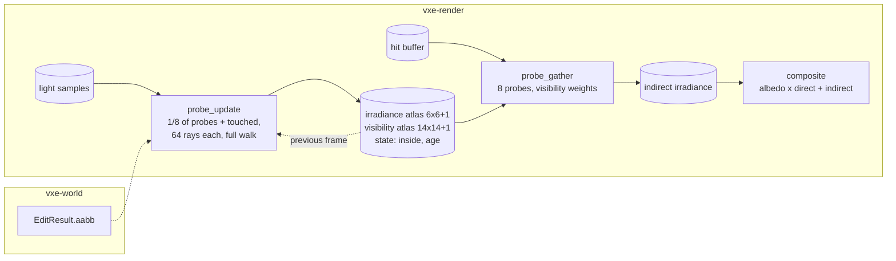

# 0029: Indirect light from a probe volume that scrolls with the camera

> **Status:** in-progress (2026-10-22)
> **Created:** 2026-10-21
> **Milestone:** M2 in `docs/roadmap.md` (the indirect-light plan after Plan 0024; "indirect
> light from probes in both tiers", the floor decision of 2026-10-17)
> **Related ADRs:** [ADR-0023](../adrs/0023-indirect-light-from-a-scrolling-probe-volume.md)
> (proposed with this plan: the probe volume and the rejected per-pixel bounce),
> [ADR-0018](../adrs/0018-direct-light-per-pixel-one-sample-from-a-hit-buffer-with-svgf-history-killed-by-edits.md)
> (the direct estimator the probe rays reuse, the hit buffer the gather reads),
> [ADR-0013](../adrs/0013-mirror-reserves-its-vram-budget-up-front.md) (the atlases are
> reserved once)
> **Source:** Plan 0024's Followups (the indirect-light plan); the owner's choice of the probe
> family (2026-10-21); `docs/references/voxel-optimizations.md` (DDGI).
> **Starts after:** Plan 0024 closes. This plan is drafted against Plan 0024's data shapes
> (`Frame`, `View`, the hit buffer, `light.wgsl`'s estimator, `composite.wgsl`,
> `Frame::invalidate`) and names them as that plan does; the names dev finds in the tree win.

## TL;DR

A grid of 32 x 32 x 32 irradiance probes at 1.6 m spacing follows the camera. Each frame, one
eighth of the probes and every probe an edit touched trace 64 rays each through the full walk;
a ray returns the reflected radiance at its hit (albedo over pi times the direct estimate
there plus the probe irradiance there, so bounces compound), and the probe blends it into a
6 x 6 octahedral irradiance map and a 14 x 14 visibility map. A gather pass reads the eight
probes around each hit pixel with visibility weights and writes an indirect irradiance that
the composite adds to the direct one. The first thing a reader sees is a test box whose walls
glow and whose floor reads the furnace value, then the dark cave's walls lit by the vein
around the corner.

## Context & problem

After Plan 0024 a surface that faces no light is black. The consumer's dark cave
(`project-context.md`, Rendering) is read by its indirect light: the far wall of a headlamp's
cavern, the rock behind a glowing vein, the underside of a ledge. The roadmap's M2 lists the
Sibenik reference whose "soft light" is baked occlusion we do not store, and names probes as
the fallback GI in both tiers. ADR-0023 chooses the probe volume and says why not a per-pixel
bounce, cone tracing, a per-voxel cache or radiance cascades.

Cost facts: a full-walk ray costs about 0.9 ms per million at 1080p on the dev box (Plan
0015); 32 768 probes at one eighth per frame are 4096 probes x 64 rays = 262 144 rays, plus
two coarse shadow rays each (Plan 0024 Phase 4's walk), so about 0.25 ms of full walk and
under 0.3 ms of shadow walk, a projection. The gather reads 8 probes x 2 texels per hit
pixel, about 0.3 to 0.5 ms at 1080p. The §2 lighting line is 6.0 ms; Plan 0024's direct light
projects 1.5 to 2.5 ms there. Memory: 32 768 x (8 x 8 x 8 + 16 x 16 x 4) B = 50.3 MB of
atlases plus 32 KiB of state, under §3's 1.5 GB "everything else" beside Plan 0024's 276 MB.

The furnace arithmetic that the headless proof rests on. In a closed box whose every wall
emits radiance `L_e = 1` with albedo `rho = 0.5`, the radiance everywhere is `L = L_e / (1 -
rho) = 2` and the irradiance at any wall point is `pi L = 2 pi`. Plan 0024's direct estimator
at a wall point sees emitters over its whole hemisphere, so its expected direct irradiance is
`pi L_e = pi`. The indirect irradiance is therefore `pi` (about 3.14). A probe ray in this
plan returns reflected radiance only (the hit's emission is not added, because the direct
estimator already samples every emissive voxel), `rho / pi x (E_direct + E_probe)` at the
hit, so the probes' fixed point is `E = pi rho / (1 - rho) = pi` as well: the two agree, which
is the test.

## Decision

We build ADR-0023's volume in `vxe-render`: a `ProbeVolume` with two atlases reserved once,
a state buffer, an origin in probe steps, an update pass (`probe_update.wgsl`) that traces and
blends a slice of probes per frame plus the edit-touched ones, and a gather pass
(`probe_gather.wgsl`) that writes an indirect irradiance texture at the lighting resolution,
which `composite.wgsl` adds before multiplying the albedo back. Probe rays are shaded by the
same functions as Plan 0024's light pass (next-event estimation of the headlamp, one emissive
sample from the light-sample buffer, coarse shadow rays), reading the previous frame's probe
irradiance at the hit for the bounce. The volume is one per `Frame`, shared by its views, and
identical in both lighting tiers. We rejected the per-pixel bounce, cone tracing, the
per-voxel cache and radiance cascades (ADR-0023).

## Architecture diagram



## Implementation phases

Each phase ships as its own commit. `dev` implements all phases in one session with no review
between phases. The architect reviews once at the end, in a fresh session.

### Phase 1: The volume, the gather, and a constant probe
- **Owner skill:** dev
- **What:** `ProbeVolume` (atlases, state, origin, `set_origin`, `write_test_irradiance` for
  tests), the gather pass reading the hit buffer and writing the indirect texture, and the
  composite adding it. `Frame::indirect(bool)` and the fly-through's `--indirect off`.
- **Files touched:** new `crates/vxe-render/src/probes.rs`, new
  `crates/vxe-render/src/shaders/probe_gather.wgsl`, `composite.wgsl`, `marcher.rs` (the
  `Frame`), `apps/flythrough/src/main.rs`, new `apps/flythrough/tests/indirect.rs`.
- **Done when:** on the cavity scene at 320 x 180 on lavapipe with the lamp off, no emissive
  material, the filter off and the identity tone map, every probe preset to irradiance
  `[1, 1, 1]` with visibility "unoccluded" makes every hit pixel read its material's albedo
  over pi within 2/255 per channel, and every probe preset to `[pi, pi, pi]` makes it read the
  albedo within 2/255; every miss pixel reads 0; with `--indirect off` every pixel reads 0;
  probes carrying the inside flag change no pixel whatever irradiance they are preset to, and
  with every probe inside every pixel reads 0.
- **Amended 2026-10-22 (architect):** the done-when above replaces the drafted one, confirming
  the dev's two deviations. (a) The composite computes `albedo x E / pi`, so an irradiance of 1
  is albedo over pi and pi is the albedo; the drafted "reads its albedo at `[1, 1, 1]`" was an
  arithmetic slip. (b) The gather renormalises its weights over live probes, which is how
  ADR-0023's "zero weight" for an inside probe reads, and is what lets a floor whose probe cell
  is half in rock read the furnace value; the drafted "half the albedo between one live and one
  inside probe" assumed an unrenormalised gather and is dropped.

### Phase 2: The update pass and the furnace
- **Owner skill:** dev
- **What:** the update pass: a slice of 4096 probes per frame in round robin, 64 spherical
  Fibonacci directions rotated per frame by a blue-noise angle, full-walk rays, reflected
  radiance at the hit from Plan 0024's estimator plus the previous atlas's irradiance at the
  hit, octahedral blend at the hysteresis schedule below, the visibility
  map's mean and squared distance, back-face hits as negative distance and the inside flag
  over a quarter of back faces. The gather's Chebyshev visibility weight.
- **Hysteresis (amended 2026-10-22, architect):** 0 on a probe slot's first update (never
  traced, or holding another probe), 0.5 for the next 8 updates and for every edit-touched
  probe, 0.97 after that. The drafted 0.97 from the second update converges by about 0.985 per
  update in the furnace, leaving `0.985^32 = 0.62` of the starting error after 256 frames (32
  updates per probe), so the furnace bar could not be met; the schedule as built keeps 0.97's
  steady-state noise and lag and reaches the fixed point in the first dozen updates.
- **Open item for Phase 4 (architect, 2026-10-22):** the furnace floor settles at 2.97, about
  5 % below pi, from frame 72 on, inside the 10 % bar but undiagnosed (the probe rays'
  face-normal shading, the floor's cell half in rock and the estimator's emissive sample are
  the candidates). Phase 4 investigates it or records the residual and its suspected cause in
  the log; it is not a new bar.
- **Files touched:** new `crates/vxe-render/src/shaders/probe_update.wgsl`,
  `probe_gather.wgsl`, `probes.rs`, `light.wgsl` (its estimator as callable functions),
  `tests/indirect.rs`.
- **Done when:** in a closed box of 24 x 24 x 12 interior voxels whose six walls are an
  emissive material with emission `[1, 1, 1]` and albedo 0.5, with the lamp off, the gathered
  indirect irradiance at the floor's centre pixel, read back after 256 frames, is within 10 %
  of pi (3.14; the furnace arithmetic above), and the probe nearest the box's centre holds
  within 10 % of pi in every irradiance texel; two such boxes side by side, separated by a
  2-voxel wall, only one of them emissive, read the dark box's floor-centre indirect under 2 %
  of the lit box's after 256 frames (no leak); a probe placed inside solid rock reads the
  inside flag after its first update and its texels are never read by the gather.

### Phase 3: Scrolling and edits
- **Owner skill:** dev
- **What:** the origin follows the camera in whole probe steps; a scrolled-in probe starts at
  age 0; `Frame::invalidate(aabb)` also marks every probe whose cell the box touches for the
  next update at hysteresis 0.5; a probe whose cell an edit filled re-tests the inside flag.
- **Files touched:** `probes.rs`, `probe_update.wgsl`, `marcher.rs`, `tests/indirect.rs`.
- **Done when:** after a camera jump of 20 probe steps along `x`, the 12 x 32 x 32 probes
  that stay read back texel for texel what they held before the jump and the entering probes
  read age 0; in the two-box scene, a radius-4 carve through the dividing wall at the frame
  after convergence makes the dark box's floor-centre indirect reach, within 32 frames, at
  least 70 % of its own settled value (its reading at frame 256 after the carve) and at least
  10 times its pre-carve value (the touched probes refresh at once and the rest within four
  slices), and filling the hole back drops it under 5 % of the lit box's within 64 frames.
- **Amended 2026-10-22 (owner):** the carve bar is a refresh-speed bar, not an absolute one;
  the radius-4 carve stays. The drafted "above 20 % of the lit box's" was a physics error: a
  flux balance gives the dark box's floor about `pi L A / ((1 - rho) S)` against the lit box's
  pi, with A the opening's area and S = 2304 voxels^2 the dark box's wall, which is about 4 %
  for a radius-4 opening. Measured on lavapipe: 4.8 % of the lit box's at frame 32, 6.6 %
  settled, so 73 % of settled at frame 32. What the phase defends is that an edit refreshes
  the probes it touches at once, which the new bar measures directly.

### Phase 4: The cave, the switches and the readings
- **Owner skill:** dev
- **What:** HUD rows for the update and gather passes' GPU time and the live probe count;
  `--indirect off|on`, `--probe-spacing` (16 voxels default; 8 as a test of the finer cascade
  the ADR names); the autopilot prints both passes' p50 and p99 and the volume's bytes in
  `Frame::frame_bytes`; a golden of the cavity scene lit only by an emissive vein around a
  corner from the camera after 64 frames.
- **Files touched:** `apps/flythrough/src/main.rs`, `hud.rs`, `apps/flythrough/tests/golden.rs`,
  `tests/indirect.rs`, the root `README.md` (flags, keys), `docs/nfr.md` §2 and §3.
- **Done when:** `indirect.png` is blessed and with `--indirect off` the same view differs in
  at least 20 % of its hit pixels by more than 8/255 (the vein's bounce light is what the
  golden shows); the update plus gather passes read at most 1.5 ms at 1080p at the streamed
  spawn on the dev box (median of the last 30 of 3000 frames, three runs), and the full §2
  lighting line (Plan 0024's light pass plus temporal plus this plan's two passes, at full
  resolution) at most 6.0 ms there; both passes are also read on the slow adapter (`nfr.md`
  §1) with no bar; `frame_bytes` rises by 50.3 MB plus the state buffer and no more.
- *Amended 2026-10-22 (owner, at the Phase 4 readings):* (1) the update plus gather bar is
  1.7 ms on the dev box (read 1.625 to 1.663 ms at the streamed spawn, half tier), and the
  probe rays per update and the share of probes refreshed per frame become engine settings
  (`Lighting` or `Frame` setters, documented defaults 64 rays and one eighth, shown on the HUD
  row) so a slow-adapter profile can trade them; a test pins that changing either changes the
  dispatch's ray count by the stated factor, and the slow adapter is read once more at 32 rays
  and at one sixteenth, labelled, with no bar; (2) the §2 lighting line is read at the default
  half tier, at most 6.0 ms (read 4.42 to 4.48 ms streamed); the full tier is a quality mode
  whose reading is recorded with no bar; (3) `frame_bytes` rises by the atlases and state plus
  the update list, ray buffer and uniform (4 227 104 B) and the gather's output texture
  (4 147 200 B at 1080p half), 58 837 024 B in all, and no more.

### Phase 5: The owner's windowed check
- **Owner skill:** human
- **What:** the owner flies the dark cave with the lamp on and off, around the vein's
  corners, and digs into a dark room next to a lit one, with `--indirect` toggled; a verdict
  on the softness (1.6 m spacing) and on leaks, and whether the finer spacing is wanted.
- **Files touched:** this plan's log, ADR-0023's Outcome at the close.
- **Done when:** the owner has recorded a verdict and the spacing choice in the log.
- **Amended 2026-10-22 (owner, Phase 5):** verdict recorded in the log (session 7, runs 6 to
  9): the bounce light is wanted; the spacing stays 1.6 m (16 voxels), `--probe-spacing 8` is
  not adopted ("it takes a lot of time to settle"); the light that lingers on the walls after
  the lamp goes off is fixed now, in Phases 6 and 7 below. The lag is the probe history: a
  settled probe blends at 0.97 and one probe in 8 refreshes a frame, so a stale value keeps
  `0.97 + 0.03 rho` of itself per update when its bounce reads stale neighbours, 0.985 at
  albedo 0.5: `ln 0.1 / ln 0.985` = 152 updates x 8 = about 1220 frames (20 s at 60 fps) to
  fall to a tenth in a closed room, and 75.6 x 8 = about 605 frames (10 s) with no bounce.

### Phase 6: A light change drops the probe history
- **Owner skill:** dev
- **What:** a light change the frame knows about restarts the probes' history the way an edit
  does, for every probe, through the hysteresis and not through extra rays.
  - **The signals.** (a) `Lighting::lamp` changes in `Frame::set_lighting`; (b) a lamp
    parameter changes between encodes: `LightParams`'s `intensity`, `inner`, `outer`, `turn`,
    `offset_right`, `offset_down` or `shadows` (not `masks` or `skips`, which the walk keeps
    byte-identical, and not the camera's motion, which moves the lamp every frame and which the
    volume follows at its normal rate); (c) `Lighting::candidates` changes to or from 0
    (emissive light on or off) or between values; (d) `Frame::set_emission_scale` changes a
    scale (the existing `emission_changed_at` mark). Any further "static light changed"
    signal dev finds in the tree is added and named in the log. Exposure and the tone map are
    after the light and are not signals.
  - **The rule.** A change opens a window of `S` encoded frames, `S` the slice count
    (`Lighting::probe_slices`, 8 by default), so the round robin visits every probe exactly
    once inside it; a change inside an open window restarts it. A probe the window's update
    visits whose age is past the young updates (settled) blends at hysteresis 0 and restarts
    at age 1, so its next 8 updates blend at 0.5 as an edit-touched probe's do; a probe already
    young restarts at age 1 and blends at 0.5. An edit-touched probe visited outside its slice
    inside the window follows the same rule on each visit. This replaces the brief's "0.5 for
    the next 8 updates" because 0.5 alone is too slow when the bounce reads stale neighbours:
    with no direct light, a probe's new estimate is at most `rho` times the largest irradiance
    its rays hit, so one cycle of 8 frames at hysteresis `h` keeps at most `h + (1 - h) rho`
    of the largest stale value, 0.75 at `h` 0.5 and `rho` 0.5, and `0.75^8 = 0.100` misses a
    tenth after the 8 young updates. With the first update at 0: after `k` cycles the largest
    stale value is at most `0.5 x 0.75^(k-1)` of its start, 0.089 at `k` 7 (56 frames) and
    0.067 at `k` 8 (64 frames); in a room whose reflectance is below 0.5 it falls faster.
  - **Which probes.** All of them, for every signal. For the lamp that is the right set. For an
    emission scale, the set "probes within the light radius of chunks holding that material"
    is rejected: the frame keeps no per-chunk material index (and Plan 0028, approved, drops the chunk
    palette the mirror had), and narrowing the set saves no rays, because the probes refresh
    in their slices either way. The cost of "all" is that a probe the change did not affect
    shows one 64-ray estimate unsmoothed for one update, then 0.5 for 8: a noise bump, not a
    cost in rays. While the fly-through's ore pulse (`M`) changes the scale every frame, every
    probe stays at 0.5 (age restarting at 1), which is noisier than 0.97 and is the re-check's
    call.
  - **Not built:** a faster refresh inside the window (one in 4 for 8 frames would cost about
    1.4 ms more on the dev box for those frames, twice the update pass). It is the fallback if
    Phase 7 finds the 1-second fade too slow, and it is not started without the owner.
  - The cost is a uniform word or flag for the window and a branch in the blend's hysteresis
    choice: no extra rays, no new buffer, `frame_bytes` unchanged.
- **Files touched:** `crates/vxe-render/src/marcher.rs` (the signals, the window),
  `crates/vxe-render/src/probes.rs`, `crates/vxe-render/src/shaders/probe_update.wgsl`,
  `apps/flythrough/tests/indirect.rs`.
- **Done when:**
  - **Lamp off.** In a closed box of 24 x 24 x 12 interior voxels whose walls are a
    non-emissive material of albedo 0.5, no emissive material anywhere, the camera at the
    box's centre looking at the floor with the lamp on, indirect on and the default 64 rays and
    one eighth: after 256 frames the floor-centre pixel's gathered indirect `F0` is above 0;
    the lamp is then switched off through `Frame::set_lighting`, and the floor-centre indirect
    is under 10 % of `F0` at every frame from frame 96 after the switch on (12 cycles,
    `0.5 x 0.75^11 = 0.021` of the largest probe texel, which covers a floor value down to
    a fifth of that texel). The test prints the first frame it falls under 10 % (the
    uniform-room arithmetic puts it near frame 53); the log records it and, as the comparison,
    the same frame count with the window disabled (expected near 1220 frames, or "not reached
    in N frames").
  - **Emission step.** In Phase 2's furnace box after 256 frames (floor-centre indirect `F0`
    near pi), `set_emission_scale(wall, 0.0)` brings the floor-centre indirect under 10 % of
    `F0` at every frame from frame 64 after the step (8 cycles, 0.067 in a uniform room);
    stepping the scale back to 1 brings it to at least 90 % of `F0` by frame 64.
  - **No signal, no change.** Encoding 256 frames with the lamp and the scales unchanged opens
    no window (the test reads the window state or the hysteresis the blend used); a camera
    move alone opens none.
  - **The bars hold:** every existing `tests/indirect.rs` test, the furnace, the leak, the
    scroll and the carve bars, `indirect.png` and `mode_banner.png` unchanged; update plus
    gather at most 1.7 ms at the streamed spawn on the dev box (median of the last 30 of 3000
    frames, one run, the Phase 4 method), recorded with its delta to Phase 4's readings;
    `frame_bytes` unchanged.

### Phase 7: The owner's re-check of the lingering light
- **Owner skill:** human
- **What:** the owner flies the level, digs into a dark room, and toggles the lamp (`F7`) on
  and off a few times with indirect on, then the ore pulse (`M`) beside a vein; a verdict on
  how long the walls keep the light after the lamp goes off, and on any flicker or noise when
  the lamp toggles or while the ore pulses.
- **Files touched:** this plan's log.
- **Done when:** the owner has recorded a verdict on the lingering and on the noise in the
  log; a "still too slow" names the fallback (Phase 6's faster refresh) as an amendment.
- *Amended 2026-10-22 (owner, at the Phase 7 check):* the owner's verdict, live session 8,
  run 3: "there is still some delay and it feels very unnatural really, in real situation I
  would be blinded at first seconds when high light is turned off, and gradually my eyes would
  be accustomed to darkness and I would see normally again". The owner chose the fallback
  (Phase 8). The eye adaptation the owner describes is exposure, not light transport, and gets
  its own plan.

### Phase 8: The faster refresh inside the light-change window (amended 2026-10-22, owner)
- **Owner skill:** dev
- **What:** while a light-change window is open, the update pass refreshes one probe in 4
  per frame instead of the setting's share, and every update inside the window blends at
  hysteresis 0 (not only the first), so a probe sheds the old light at the rate its stale
  neighbours do: each cycle keeps about the albedo-weighted half of the bounce from the
  previous cycle, `0.5^k` after `k` visits in a uniform room of albedo 0.5. The window is
  four visits per probe: 16 frames at one in 4. After it, Phase 6's rule (age restart, 0.5
  for 8 updates) smooths the noise back down. The share and the window length are constants
  beside Phase 6's, named and documented; `Lighting::probe_slices` still sets the share
  outside the window.
- **Files touched:** `crates/vxe-render/src/marcher.rs`, `crates/vxe-render/src/probes.rs`,
  `crates/vxe-render/src/shaders/probe_update.wgsl`, `apps/flythrough/tests/indirect.rs`,
  `docs/nfr.md` §2.
- **Done when:**
  - **Lamp off.** Phase 6's lamp-off box: the floor-centre indirect is under 10 % of `F0`
    at every frame from frame 24 after the switch on (`0.5^4 = 0.0625` of the brightest probe
    texel after the window's 16 frames, a floor value down to about two thirds of that
    texel, plus one cycle of margin at one in 8 after the window); the test prints the first
    frame under 10 % (expected near 16), and the log records Phase 6's 58 beside it.
  - **Emission step.** The furnace box with the scale stepped to 0: under 10 % of `F0` from
    frame 24 on; stepped back to 1: at least 90 % of `F0` by frame 64.
  - **No signal, no change** and **the bars hold**, as in Phase 6.
  - **The cost is the window's only.** At the streamed spawn on the dev box, update plus
    gather outside a window still reads at most 1.7 ms (one run); inside a window (the lamp
    toggled every 64 frames for the run) the frames inside it read at most 1.7 + 1.5 ms. The
    slow adapter is read the same way, labelled, with no bar.

### Phase 9: The owner's re-check of the faster fade
- **Owner skill:** human
- **What:** as Phase 7: the level, a dark room, `F7` toggled a few times with indirect on, the
  ore pulse beside a vein; a verdict on the fade and on the noise during the window.
- **Files touched:** this plan's log.
- **Done when:** the owner has recorded the verdict in the log.

## Data shapes

```rust
// illustrative: the volume
pub const PROBES_PER_AXIS: u32 = 32;
pub const PROBE_SPACING_VOXELS: u32 = 16;             // 1.6 m
pub const IRRADIANCE_TEXELS: u32 = 6;                  // + 1 border each side in the atlas
pub const VISIBILITY_TEXELS: u32 = 14;                 // + 1 border
pub struct ProbeVolume {
    irradiance: wgpu::Buffer,    // storage buffer, 4 x f16 per texel, 8 x 8 texels per probe
                                 //   (6 x 6 + border), 32 768 x 512 B = 16.8 MB
    visibility: wgpu::Buffer,    // storage buffer, 2 x f16 per texel, 16 x 16 texels per probe
                                 //   (14 x 14 + border), 32 768 x 1024 B = 33.6 MB
    state: wgpu::Buffer,         // u32 per slot: inside flag, age, the probe tag; 128 KiB
    origin: [i32; 3],            // in probe steps, world voxel = origin * 16 + index * 16
    slice: u32,                  // 0..8, the round-robin cursor
}
// probe (x, y, z) -> toroidal slot (x, y, z) mod 32, tagged with the probe it holds, so a
// scroll moves no data; a direction -> octahedral uv within the slot's texels
// update: 4096 probes x 64 rays per frame; touched probes added to the slice
```

**Amended 2026-10-22 (architect):** the atlases are storage buffers, not the drafted
`rgba16float` and `rg16float` storage textures. lavapipe, RADV (Cezanne) and the RTX 3080
offer read-write storage of those formats only under
`Features::TEXTURE_ADAPTER_SPECIFIC_FORMAT_FEATURES`, which the engine does not request and
which would be a backend-dependent path. The bytes per texel are the same, so the atlases stay
50.3 MB; the state grows to a `u32` per slot (128 KiB) to carry the slot's tag, and toroidal
tagged slots replace a scroll copy. ADR-0023's "texture atlases" is a storage detail its
Outcome records at the close; the decision it records is unchanged.

## Budgets

| `nfr.md` figure | line | projection (dev box, 1080p) | how the close measures it |
|---|---|---|---|
| §2 Lighting (with Plan 0024's passes) | 6.0 ms | update 0.5 to 0.8 ms, gather 0.3 to 0.5 ms, on top of direct 1.5 to 2.5 ms | Phase 4 runs at the streamed spawn and the level, three each, both adapters |
| §3 Everything else in VRAM | 1.5 GB | +50.3 MB atlases, +128 KiB state (amended 2026-10-22, architect: a `u32` per slot) | `frame_bytes` |
| §2 Streaming line | 1.0 ms | unchanged (no CPU work per frame beyond the origin step and the touched list) | the autopilot's render-thread timers |

## Risks & open questions

- **Probes in rock** are the quality risk in a cave: a room narrower than 1.6 m may hold no
  live probe. Phase 2's leak test and Phase 5's eye are the bar; `--probe-spacing 8` is the
  measured fallback (eight times the probes, 400 MB, which only a finer inner cascade would
  make affordable), and DDGI's probe relocation the design fallback.
- **The bounce reads the previous atlas while the slice writes the current one**: the atlas
  is double-buffered or the slice reads probes outside itself; Phase 2 picks the former (two
  atlases, 100 MB) only if the readback test shows a race on lavapipe.
- **Determinism** per adapter, as Plan 0024: a `(probe, ray, frame)` seed through blue noise;
  the furnace tolerance is 10 % for that reason. Nothing touches `vxe-world`.
- **Adapter features:** `rgba16float` and `rg16float` storage textures with read and write
  in the same pass are not guaranteed; the update writes a new slice texture and copies, or
  uses storage buffers for the atlases if lavapipe refuses the format (a Phase 1 check, logged).
  Resolved 2026-10-22 (architect): storage buffers, see Data shapes.
- **The mirror window:** probe rays that leave the window see air; the volume's 25.6 m
  half-extent is inside `r_full` 16 (102 m) and inside the settled 12 (77 m).
- **Threading:** none; every pass is a compute dispatch on the frame's encoder.

## What this plan does NOT do

- **A per-pixel bounce or ReSTIR GI** (ADR-0023 Alternative A): a later quality mode.
- **Specular or glossy indirect**: the material table has roughness, and nothing here reads
  it; a followup with the entities plan if the eye asks.
- **Probes for the LOD ring or the far field**: the volume is near-field only.
- **A finer inner cascade**: Phase 5's call, its own plan.
- **Translucent voxels** as receivers or emitters of indirect light: M8's media plan.

## Implementation log

> Written by `dev`: one row per phase as its commit lands, then the close block. **The phases
> above are the contract. This section records what happened.** Observations, never conclusions:
> no pass list, no self-assessment. Deviations and unmet done-whens are **always** disclosed.
> Keep it shorter than `## Implementation phases`.

| phase | owner | state | commit |
|---|---|---|---|
| 1: The volume, the gather, and a constant probe | dev | done: `ProbeVolume` (atlases and state in one storage buffer), gather pass, composite term, `Lighting::indirect`, `--indirect`; `tests/indirect.rs` 2 tests | 6dfd37f |
| 2: The update pass and the furnace | dev | done: trace and blend dispatches, Chebyshev weight, `light.wgsl` split into `draw_candidates`/`resolve_emissive`/`emissive_estimate`; furnace floor 2.975 after 256 frames (-5.3 % of pi), centre probe texels 2.856 to 2.981; dark box 0.36 % of the lit; 63 solid probes flagged inside, gather unchanged with their texels at 1000 (lavapipe) | f9da073 |
| 3: Scrolling and edits | dev | stopped at a done-when: origin follows the camera (tagged slots), `Frame::invalidate` adds touched probes to the next update; scroll test passes (12 288 stayed byte for byte, 20 480 entered at age 0); the carve bar (20 % within 32 frames) is not reached, test committed `#[ignore]` pending the owner | 545390f |
| 3 (after the 518b522 amendment) | dev | done: carve test on the amended bar: dark floor 0.01069 before, 0.12354 at frame 32 = 71.5 % of settled 0.17273 (frame 256) and 11.6x the pre-carve; after the fill, 2.78 % of the lit box's at frame 64, peaking at 3.23 % at frame 26 (lavapipe) | d90e9ab |
| 4: The cave, the switches and the readings | dev | done (after the c444a61 amendment): `F8`, `--probe-spacing`, HUD rows, autopilot bytes line, `indirect.png` blessed (100 % of 57 600 hit pixels differ from indirect off by more than 8/255); `Lighting::probe_rays`/`probe_slices`, `--probe-rays`, `--probe-slices`; update plus gather 1.625 to 1.663 ms, lighting line at half 4.42 to 4.48 ms, `frame_bytes` +58 837 024 B; readings in `nfr.md` §2 and §3 on both adapters | 83ae737, 68b3bdb, db7b057, 979dd35 |
| 5: The owner's windowed check | human | done (owner, 2026-10-22, live session 7, runs 6 to 9, about 2530x1378, RTX 3080 Laptop; architect's record): bounce light wanted, 1.6 m spacing kept, the lingering light after the lamp goes off to be fixed now (Phases 6 and 7); verdicts in Notes | |
| 6: A light change drops the probe history | dev | done: light-change window (lamp, its parameters, shadow walk, candidates, emission scale) of one slice cycle, settled probes at hysteresis 0, ages restart at 1; lamp off under 10 % of F0 from frame 58 (1418 with the window off), emission 0 from frame 50, back to 94.0 % at frame 64; update plus gather 1.490 ms streamed (dev box); `frame_bytes` 254 216 224 B unchanged | b3f7cb1, 54b25f0 |
| 7: The owner's re-check of the lingering light | human | done (architect's record of the owner's verdict, live session 8 run 3, 2026-10-22: still some delay, "feels very unnatural"; the fallback chosen) | |
| 8: The faster refresh inside the light-change window | dev | done: in a window (16 frames) one probe in 4 a frame, every update at hysteresis 0 (`WINDOW_SLICES`, `WINDOW_VISITS`, `WINDOW_FRAMES`); lamp off under 10 % of F0 from frame 14 (Phase 6: 58), emission 0 from frame 14, back to 100.4 % at frame 64; dev box update plus gather 1.465 ms outside a window, 2.403 ms inside; `--lamp-toggle N`; readings in `nfr.md` §2 | committed with this row |
| 9: The owner's re-check of the faster fade | human | not started | |

### Notes

- Phase 5 (architect's record of the owner's words, 2026-10-22, live session 7; log
  `live/session7-20261022-1307.log` in the plan-0030 worktree, runs 6 to 9, window about
  2530x1378, RTX 3080 Laptop):
  - Run 6 (streamed cave, indirect on): "bounce light makes it better, bit costs
    performance". Exit summary: frame CPU p50 13.2 ms, p99 25.4 ms; march GPU p50 10.7 ms,
    p99 25.0 ms.
  - Run 7 (lamp off): "same, looks better but performance is bad - i've got 10fps". Exit
    summary: frame CPU p50 19.4 ms, p99 105 ms; `update + poll + sync` p99 104 ms; march GPU
    p50 13.2 ms, p99 36.9 ms.
  - Run 8 (level, dig into a dark room): "this is much better. but when I turn off the light
    I still see a bit of it on the walls for a while".
  - Run 9 (`--probe-spacing 8`): "feels off - it takes a lot of time to settle".
  - The owner's decisions: fix the lag now (Phase 6 amendment); finer spacing not adopted,
    1.6 m (16 voxels) stays the default.
- Scope restated 2026-10-22 under the owner's standing "go" (2026-10-21): phases 1 to 4 `dev`,
  stop at Phase 5 (`human`).
- Tree names for the plan's 0024-era ones: `Frame::invalidate(min, max)` as named; the hit
  buffer is `Frame::hit_positions`/`hit_records`, the gather reads the lighting grid's copy
  (`Targets::lit_pos`/`lit_info`); `Frame::indirect(bool)` is the field `Lighting::indirect`
  (set through `Frame::set_lighting`), default off in the library and on in the fly-through.
- Phase 1: the atlases are storage buffers, not `rgba16float`/`rg16float` textures: lavapipe,
  RADV (Cezanne) and the RTX 3080 offer read-write storage of both formats only under
  `Features::TEXTURE_ADAPTER_SPECIFIC_FORMAT_FEATURES`, which the engine's devices do not
  request (checked 2026-10-22 with `Adapter::get_texture_format_features`). Same bytes per
  texel; the state is a `u32` per probe (128 KiB), not a `u8` (32 KiB); toroidal slots with a
  per-slot tag replace a scroll copy.
- Phase 1: `limits_for` (`crates/vxe-render/src/lib.rs`, outside the phase's files) requests 12
  storage buffers per stage, two more for the probe passes; `shader_portability.rs` (outside
  the files) validates the new shaders.
- Phase 1 done-when, as stated, conflicts with ADR-0023's gather and Phase 2: (a) a probe
  irradiance of `[1, 1, 1]` composites to `albedo / PI` under the composite's `albedo E / PI`,
  not the albedo; the test asserts `albedo / PI` at 1 and the albedo at `PI`; (b) "a pixel
  between one live and one inside probe reads half the albedo" needs an unrenormalized gather,
  while ADR-0023's "zero weight" renormalized over live probes is what lets the furnace floor
  (whose probe cell is half in rock) read `PI`; the gather renormalizes, and the test asserts
  instead that inside probes preset to 50 change no pixel and that all-inside probes give 0.
- Phase 2: the update is two dispatches (trace into a ray buffer of 4 MiB in the scratch
  buffer, then blend), so a ray's bounce reads the atlas as it stood before the frame's blend;
  no double-buffered atlas.
- Phase 2: hysteresis is 0 for a slot's first update (slot never traced or holding another
  probe), 0.5 for the next 8 updates and for edit-touched probes, 0.97 after; the plan's 0.97
  from the second update converges by `0.985` per update in the furnace (`0.985^32 = 0.62` of
  the start error after 256 frames), so the furnace bar is not reachable with it.
- Phase 2: a probe ray's hit is shaded with its face (or contour-plane) normal, not the
  pixel's normal modes or detail.
- Phase 3 done-when not satisfiable as stated: the radius-4 carve through the dividing wall
  (aabb x 44..45, y 28..36, z 27..35) brings the dark box's floor-centre indirect to 4.8 % of
  the lit box's at frame 32 and 6.6 % at frame 256 (lavapipe, f9da073 plus this phase); a
  radius-8 carve reads 18.1 % at frame 32 and 22.2 % at frame 256. The flux balance agrees:
  an opening of area A into a box of wall area S = 2304 voxels^2 at albedo 0.5 gives about
  `PI L A / ((1 - rho) S)` against the lit box's PI, about 4 % at radius 4. The test
  `a_hole_in_the_wall_lights_the_dark_box_and_filling_it_darkens_it_again` was committed
  ignored at 545390f; the owner chose the refresh-speed bar (518b522) and the test carries it
  un-ignored. The frame-32 margin over 70 % is 1.5 points.
- Phase 4: update plus gather at the streamed spawn on the dev box read 1.625, 1.661, 1.663 ms
  (release, 83ae737, RTX 3080 Laptop, 1080p, half lighting, loads 6.2/4.2/2.8), over the
  drafted 1.5 ms and under the amended 1.7 ms (c444a61); the update pass is 1.36 to 1.39 of it.
- Phase 4: the §2 lighting line at the half tier reads 4.42 to 4.48 ms streamed (the amended
  bar, 6.0 ms); the full tier, recorded with no bar under the amendment, reads 14.89 to
  15.06 ms, of which light plus temporal is 12.2 to 12.3 ms.
- Phase 4: `frame_bytes` rises by 58 837 024 B, the amended bar's sum: atlases and state
  (50 462 720 B), the update list, ray buffer and uniform (4 227 104 B) and the gather's
  lighting-grid target (4 147 200 B at 1080p half); the drafted bar (atlases and state only)
  was exceeded by 8 374 304 B.
- Phase 4 amendment (db7b057): `Lighting::probe_rays` (clamped 1..=64, default 64) and
  `Lighting::probe_slices` (8, 16 or 32, default 8), `Frame::traced_probe_rays()`,
  `ProbeVolume::update_list(frame, slices, touched)`; the test
  `the_probe_settings_scale_the_rays_a_frame_traces` asserts 262 144, 131 072, 131 072 and
  65 536 rays a frame (lavapipe); the mode line and banner read `indirect on at 64 rays 1/8`,
  `mode_banner.png` reblessed. Slow adapter (db7b057's release binary, RADV, streamed, half):
  `--probe-rays 32` update 6.202 to 6.249 ms (loaded, 7.94), `--probe-slices 16` 4.162 to
  4.234 ms (load 0.86), gather 1.546 to 1.547 ms in both.
- Phase 8: a window frame's update list is the 8192 probes of its one-in-4 slice, which is
  `MAX_UPDATES`. Edit-touched probes outside the slice are not added in a window frame, since
  the window revisits every probe within 4 frames; buffers and `frame_bytes` are unchanged.
- Phase 8 outside the files: `--lamp-toggle N` in `apps/flythrough/src/main.rs` (switches the
  lamp every N frames as `F7` does; at exit, the probes plus gather median of the last 30 frames
  outside and inside the windows) and its row in the root `README.md`; it is how the in-window
  reading is taken.
- Phase 8 readings (lavapipe, exclusive perf lock, load 15.5, loaded):
  - Lamp off: F0 4.58594; first frame under 10 % of F0 is 14 (Phase 6: 58; with the window
    off: 1418). The window is open for frames 1 to 16.
  - Emission step to 0: F0 2.9746; first frame under 10 % is 14, and every frame from 24 to 96
    is under it. Back to 1: frame 64 reads 2.9863 (100.4 % of F0), first at 90 % at frame 14.
  - No change: no window in 256 still or 16 moving frames. A change traces 8192 x 64 rays a
    frame in the window and 4096 x 64 after its 16 frames.
- Phase 8 timing readings (release, streamed spawn, one run each, exclusive perf lock): in
  `nfr.md` §2 under "The light-change window". RTX 3080 Laptop: 1.465 ms plain (load 1.26);
  under `--lamp-toggle 64` (load 1.76), 1.515 ms outside a window and 2.403 ms inside. Radeon
  Cezanne on RADV, selected with `VK_DRIVER_FILES`: 9.479 ms plain; 9.298 ms outside and
  16.476 ms inside.
- Phase 8: `frame_bytes` reads 254 216 224 B (autopilot, `autopilot: frame targets`),
  unchanged.
- Phase 8 gate (exclusive perf lock):
  - `cargo nextest run --workspace --test-threads 2` (load 2.03): 594 passed, 5 skipped,
    exit 0. This includes `indirect.png`, `mode_banner.png` and the furnace, leak, scroll,
    carve and settings tests.
  - `cargo test --doc`: 7 passed, 1 ignored.
  - clippy `-D warnings`, `fmt --check`, `cargo deny check`, `check-doc-links`,
    `check-comment-hygiene` and `check-index-rows`: exit 0.
- Merge of main (99e7bee, Plans 0028 and 0030) into plan-0029:
  - Conflicts in `marcher.rs`, `lib.rs`, `hud.rs`, `main.rs`, `tests/golden.rs` and `nfr.md`;
    both sides are kept.
  - `FRAME_PASSES` has 10 passes: hit, gradient, light, temporal, atrous, probes, gather,
    composite, upscale, sharpen.
  - `limits_for` requests 11 storage buffers: 4 shards, 5 others (0028 dropped the mask
    buffer) and the probe passes' 2.
  - `Targets::bytes` keeps 0030's output-size target and histories plus the gather's 8 B per
    lighting pixel.
  - `History` holds 0030's lamp ring beside the probe light key.
  - The HUD keeps the live-probe lighting row and 0030's upscale row.
- After the merge (exclusive perf lock):
  - `cargo nextest run --workspace --test-threads 2 --no-fail-fast` (load 4.82): 613 passed,
    8 skipped, exit 0.
  - `cargo test --doc`: 7 passed, 1 ignored.
  - clippy `-D warnings`, fmt, deny, `check-doc-links` (301 links), `check-comment-hygiene`
    and `check-index-rows`: exit 0.
  - Lamp-off test: first frame under 10 % is 14 (lavapipe, load 5.63).
- After the merge, `--lamp-toggle 64` at the streamed spawn, one run per adapter. Both runs
  are loaded, so indicative only.
  - RTX 3080 Laptop (load 7.29): outside a window 1.725 ms, inside 2.779 ms. The quiet
    reading before the merge was 1.515 and 2.403 ms.
  - Radeon Cezanne RADV (load 8.14): outside 10.556 ms, inside 18.442 ms. Before the merge,
    9.298 and 16.476 ms.
  - The dev-box outside-window figure is over the 1.7 ms bar at that load. The load stayed
    over 2 (13.9 after 30 minutes), so a quiet retake is still owed.
- Phase 6: the window compares, between encodes with history, `Lighting::lamp`, the
  `LightParams` the last `params_for` placed (`masks` and `skips` normalized), the shadow walk,
  `Lighting::candidates` and `emission_changed_at`. It counts `Lighting::slices()` encoded frames
  that ran a probe update, and a change inside it restarts it. `ProbeUniform`'s first pad word
  is `light_window`. The extra signal found in the tree is `Lighting::shadow_walk`: the probe
  rays' lamp shadows take the frame's shadow walk.
- Phase 6 API outside the plan's text: `Frame::probe_light_window()` (the test reads the window
  through it) and `ProbeVolume::set_light_restarts(bool)` (default on; the comparison turns it
  off; `set_probe_spacing` carries it over).
- Phase 6 readings (lavapipe, b3f7cb1's tree, exclusive perf lock, load 5.6, loaded):
  - Lamp off in the dull box: F0 4.58594; the first frame under 10 % of F0 is 58, and every
    frame from 96 to 160 is under it. The window is open for frames 1 to 8 after the switch
    and closed after them.
  - The same switch with the restart off (`the_lamp_off_fade_without_the_window`,
    `#[ignore]`): first frame under 10 % is 1418, in 1600 frames.
  - Furnace emission step: F0 2.9746; at scale 0 the first frame under 10 % is 50, and every
    frame from 64 to 96 is under it. Back at 1: frame 64 reads 2.7949 (94.0 % of F0), first
    at 90 % at frame 50.
  - No change: 256 still frames and 16 moving frames open no window. A lamp-intensity change
    and candidates 8 to 4 each open one, and it closes after 8 frames.
  - The 1 x 1 floor value steps once every 8 frames.
- Phase 6 dev-box reading (release, b3f7cb1's tree, RTX 3080 Laptop, `flythrough --headless
  --seed 1 --render 1920x1080 --frames 3000`, streamed spawn, half lighting, indirect on at 64
  rays and one in 8, median of the last 30, one run, exclusive perf lock, 1-minute load 0.71
  at the start): probes 1.250 ms, gather 0.240 ms, update plus gather 1.490 ms. That is 0.135
  to 0.173 ms under Phase 4's 1.625 to 1.663 ms (83ae737). The autopilot (`--autopilot
  --headless --seed 1 --render 1920x1080`, load 1.47) reads `frame targets 254216224 B` and
  probes p50 1.048 ms, p99 1.288 ms.
- Phase 6 gate (b3f7cb1's tree, exclusive perf lock):
  - `cargo nextest run --workspace --test-threads 2` (load 5.77 at the start): 594 passed,
    5 skipped, exit 0. This includes `indirect.png`, `mode_banner.png` and the furnace, leak,
    scroll and carve tests.
  - `cargo test --doc`: 7 passed, 1 ignored.
  - clippy `-D warnings`, `fmt --check`, `cargo deny check`, `check-doc-links`,
    `check-comment-hygiene` and `check-index-rows`: exit 0.
- Phase 6: a `flythrough --help` without `--headless` was run once by mistake. It exited at
  once with no output.
- Phase 4 gate on db7b057's tree plus this row's docs (2026-10-22, exclusive perf lock, load
  0.19): `cargo nextest run --workspace --test-threads 2` 591 passed, 4 skipped, exit 0;
  `cargo test --doc` 7 passed, 1 ignored; clippy `-D warnings`, `fmt --check`, `cargo deny
  check`, `check-doc-links` (258 links), `check-comment-hygiene`, `check-index-rows` all exit 0.
- Phase 4: the slow adapter (AMD Radeon, Cezanne, RADV) is selected with
  `VK_DRIVER_FILES=/usr/share/vulkan/icd.d/radeon_icd.json`; `--adapter` is not on this
  branch. Readings there: update 7.76 to 7.83 ms, gather 1.55 ms streamed at half.
- Phase 4 outside the files: `Frame::set_probe_spacing` (`marcher.rs`),
  `ProbeVolume::pinned_origin` (`probes.rs`), and in `probe_update.wgsl` the blend skips an
  inside probe's texels and the visibility rays under 0.83 in cosine (1.525 to 1.274 ms in a
  tuning run); `tests/hud_golden.rs`'s `mode_banner.png` is reblessed for the new
  `indirect` word in the banner.
- Phase 4, the furnace's open item: the light pass's direct estimate at the furnace floor
  centre reads 3.0814 over 248 frames (-1.92 % of pi); with the probe rays' emissive estimate
  at 2 candidates instead of 8 (a tuning run, reverted) the furnace floor fell from -5.3 % to
  -12.2 % of pi, so the residual follows the direct estimator's bias at the probe rays' hits
  (its firefly clamp and few-candidate resampling), not the probes' blend or gather.
- Phase 4: the vein golden's vein emits 8 times the fly-through's ore over the partition's
  whole -x face; a 16 x 16 patch at 4 times read 5/255 at the centre, under the 8/255 bar.
- Phase 3: after the fill the dark/lit ratio rises from 1.95 % (frame 1) to 3.23 % (frame 26)
  before falling: the dark box's probe the fill box does not touch (x 64.5) still holds the
  opened light and refreshes only in its slice.
- Phase 3: the scroll test turns the update off for the jump's frame, so "the probes that
  stay" are compared before any update can rewrite them.
- Phase 3: edit boxes past `MAX_EDITS` in one frame touch no probe; touched probes past 4096
  outside the frame's slice wait for their slice.
- Phase 2: the furnace's converged floor reads 2.97 (about -5.3 % of pi) frame after frame from
  frame 72 on; the residual is not diagnosed.

### Close triggers

_(Facts for the architect. No recommendations, and no suggested version bump.)_

- **What shipped:** feature / fix-only / docs-chore-only
- **Public API changed:** types, traits, functions, shader interfaces, config (list them, or none)
- **Budget readings:** each `nfr.md` figure touched, with its measured value, machine and commit
- **Gate at the tip:** the commands run (build, nextest, doctests, clippy, fmt, deny), exit codes, test counts
- **Outstanding `human` phases:** which, or none

## Followups

- The showcase cave (owner, 2026-10-20): several ore materials with different emission
  colours as the light sources, after this plan.
- Phase 5 (owner's flight, 2026-10-22): the streaming-sync p99 spikes in flight, `update +
  poll + sync` p99 104 ms in run 7 (frame CPU p99 105 ms, the owner's "10fps"), are the
  streaming line's known misses, not this plan's passes: Plan 0023's streaming line and
  Plan 0027's Followups (the windowed `update + poll + sync` and the unattributed streaming
  step), carried by Plan 0028's windowed reading. No new work here.
