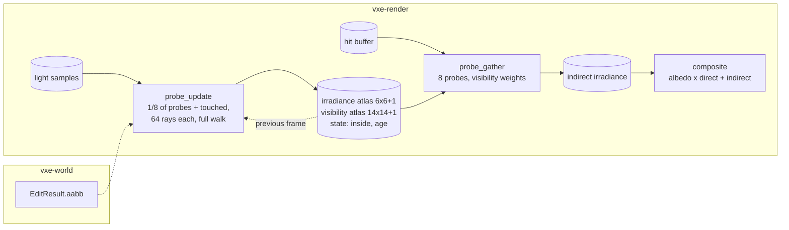

# 0029: Indirect light from a probe volume that scrolls with the camera

> **Status:** in-progress (2026-10-22)
> **Created:** 2026-10-21
> **Milestone:** M2 in `docs/roadmap.md` (the indirect-light plan after Plan 0024; "indirect
> light from probes in both tiers", the floor decision of 2026-10-17)
> **Related ADRs:** [ADR-0023](../adrs/0023-indirect-light-from-a-scrolling-probe-volume.md)
> (proposed with this plan: the probe volume and the rejected per-pixel bounce),
> [ADR-0018](../adrs/0018-direct-light-per-pixel-one-sample-from-a-hit-buffer-with-svgf-history-killed-by-edits.md)
> (the direct estimator the probe rays reuse, the hit buffer the gather reads),
> [ADR-0013](../adrs/0013-mirror-reserves-its-vram-budget-up-front.md) (the atlases are
> reserved once)
> **Source:** Plan 0024's Followups (the indirect-light plan); the owner's choice of the probe
> family (2026-10-21); `docs/references/voxel-optimizations.md` (DDGI).
> **Starts after:** Plan 0024 closes. This plan is drafted against Plan 0024's data shapes
> (`Frame`, `View`, the hit buffer, `light.wgsl`'s estimator, `composite.wgsl`,
> `Frame::invalidate`) and names them as that plan does; the names dev finds in the tree win.

## TL;DR

A grid of 32 x 32 x 32 irradiance probes at 1.6 m spacing follows the camera. Each frame, one
eighth of the probes and every probe an edit touched trace 64 rays each through the full walk;
a ray returns the reflected radiance at its hit (albedo over pi times the direct estimate
there plus the probe irradiance there, so bounces compound), and the probe blends it into a
6 x 6 octahedral irradiance map and a 14 x 14 visibility map. A gather pass reads the eight
probes around each hit pixel with visibility weights and writes an indirect irradiance that
the composite adds to the direct one. The first thing a reader sees is a test box whose walls
glow and whose floor reads the furnace value, then the dark cave's walls lit by the vein
around the corner.

## Context & problem

After Plan 0024 a surface that faces no light is black. The consumer's dark cave
(`project-context.md`, Rendering) is read by its indirect light: the far wall of a headlamp's
cavern, the rock behind a glowing vein, the underside of a ledge. The roadmap's M2 lists the
Sibenik reference whose "soft light" is baked occlusion we do not store, and names probes as
the fallback GI in both tiers. ADR-0023 chooses the probe volume and says why not a per-pixel
bounce, cone tracing, a per-voxel cache or radiance cascades.

Cost facts: a full-walk ray costs about 0.9 ms per million at 1080p on the dev box (Plan
0015); 32 768 probes at one eighth per frame are 4096 probes x 64 rays = 262 144 rays, plus
two coarse shadow rays each (Plan 0024 Phase 4's walk), so about 0.25 ms of full walk and
under 0.3 ms of shadow walk, a projection. The gather reads 8 probes x 2 texels per hit
pixel, about 0.3 to 0.5 ms at 1080p. The §2 lighting line is 6.0 ms; Plan 0024's direct light
projects 1.5 to 2.5 ms there. Memory: 32 768 x (8 x 8 x 8 + 16 x 16 x 4) B = 50.3 MB of
atlases plus 32 KiB of state, under §3's 1.5 GB "everything else" beside Plan 0024's 276 MB.

The furnace arithmetic that the headless proof rests on. In a closed box whose every wall
emits radiance `L_e = 1` with albedo `rho = 0.5`, the radiance everywhere is `L = L_e / (1 -
rho) = 2` and the irradiance at any wall point is `pi L = 2 pi`. Plan 0024's direct estimator
at a wall point sees emitters over its whole hemisphere, so its expected direct irradiance is
`pi L_e = pi`. The indirect irradiance is therefore `pi` (about 3.14). A probe ray in this
plan returns reflected radiance only (the hit's emission is not added, because the direct
estimator already samples every emissive voxel), `rho / pi x (E_direct + E_probe)` at the
hit, so the probes' fixed point is `E = pi rho / (1 - rho) = pi` as well: the two agree, which
is the test.

## Decision

We build ADR-0023's volume in `vxe-render`: a `ProbeVolume` with two atlases reserved once,
a state buffer, an origin in probe steps, an update pass (`probe_update.wgsl`) that traces and
blends a slice of probes per frame plus the edit-touched ones, and a gather pass
(`probe_gather.wgsl`) that writes an indirect irradiance texture at the lighting resolution,
which `composite.wgsl` adds before multiplying the albedo back. Probe rays are shaded by the
same functions as Plan 0024's light pass (next-event estimation of the headlamp, one emissive
sample from the light-sample buffer, coarse shadow rays), reading the previous frame's probe
irradiance at the hit for the bounce. The volume is one per `Frame`, shared by its views, and
identical in both lighting tiers. We rejected the per-pixel bounce, cone tracing, the
per-voxel cache and radiance cascades (ADR-0023).

## Architecture diagram



## Implementation phases

Each phase ships as its own commit. `dev` implements all phases in one session with no review
between phases. The architect reviews once at the end, in a fresh session.

### Phase 1: The volume, the gather, and a constant probe
- **Owner skill:** dev
- **What:** `ProbeVolume` (atlases, state, origin, `set_origin`, `write_test_irradiance` for
  tests), the gather pass reading the hit buffer and writing the indirect texture, and the
  composite adding it. `Frame::indirect(bool)` and the fly-through's `--indirect off`.
- **Files touched:** new `crates/vxe-render/src/probes.rs`, new
  `crates/vxe-render/src/shaders/probe_gather.wgsl`, `composite.wgsl`, `marcher.rs` (the
  `Frame`), `apps/flythrough/src/main.rs`, new `apps/flythrough/tests/indirect.rs`.
- **Done when:** on the cavity scene at 320 x 180 on lavapipe with the lamp off, no emissive
  material, the filter off and the identity tone map, every probe preset to irradiance
  `[1, 1, 1]` with visibility "unoccluded" makes every hit pixel read its material's albedo
  over pi within 2/255 per channel, and every probe preset to `[pi, pi, pi]` makes it read the
  albedo within 2/255; every miss pixel reads 0; with `--indirect off` every pixel reads 0;
  probes carrying the inside flag change no pixel whatever irradiance they are preset to, and
  with every probe inside every pixel reads 0.
- **Amended 2026-10-22 (architect):** the done-when above replaces the drafted one, confirming
  the dev's two deviations. (a) The composite computes `albedo x E / pi`, so an irradiance of 1
  is albedo over pi and pi is the albedo; the drafted "reads its albedo at `[1, 1, 1]`" was an
  arithmetic slip. (b) The gather renormalises its weights over live probes, which is how
  ADR-0023's "zero weight" for an inside probe reads, and is what lets a floor whose probe cell
  is half in rock read the furnace value; the drafted "half the albedo between one live and one
  inside probe" assumed an unrenormalised gather and is dropped.

### Phase 2: The update pass and the furnace
- **Owner skill:** dev
- **What:** the update pass: a slice of 4096 probes per frame in round robin, 64 spherical
  Fibonacci directions rotated per frame by a blue-noise angle, full-walk rays, reflected
  radiance at the hit from Plan 0024's estimator plus the previous atlas's irradiance at the
  hit, octahedral blend at the hysteresis schedule below, the visibility
  map's mean and squared distance, back-face hits as negative distance and the inside flag
  over a quarter of back faces. The gather's Chebyshev visibility weight.
- **Hysteresis (amended 2026-10-22, architect):** 0 on a probe slot's first update (never
  traced, or holding another probe), 0.5 for the next 8 updates and for every edit-touched
  probe, 0.97 after that. The drafted 0.97 from the second update converges by about 0.985 per
  update in the furnace, leaving `0.985^32 = 0.62` of the starting error after 256 frames (32
  updates per probe), so the furnace bar could not be met; the schedule as built keeps 0.97's
  steady-state noise and lag and reaches the fixed point in the first dozen updates.
- **Open item for Phase 4 (architect, 2026-10-22):** the furnace floor settles at 2.97, about
  5 % below pi, from frame 72 on, inside the 10 % bar but undiagnosed (the probe rays'
  face-normal shading, the floor's cell half in rock and the estimator's emissive sample are
  the candidates). Phase 4 investigates it or records the residual and its suspected cause in
  the log; it is not a new bar.
- **Files touched:** new `crates/vxe-render/src/shaders/probe_update.wgsl`,
  `probe_gather.wgsl`, `probes.rs`, `light.wgsl` (its estimator as callable functions),
  `tests/indirect.rs`.
- **Done when:** in a closed box of 24 x 24 x 12 interior voxels whose six walls are an
  emissive material with emission `[1, 1, 1]` and albedo 0.5, with the lamp off, the gathered
  indirect irradiance at the floor's centre pixel, read back after 256 frames, is within 10 %
  of pi (3.14; the furnace arithmetic above), and the probe nearest the box's centre holds
  within 10 % of pi in every irradiance texel; two such boxes side by side, separated by a
  2-voxel wall, only one of them emissive, read the dark box's floor-centre indirect under 2 %
  of the lit box's after 256 frames (no leak); a probe placed inside solid rock reads the
  inside flag after its first update and its texels are never read by the gather.

### Phase 3: Scrolling and edits
- **Owner skill:** dev
- **What:** the origin follows the camera in whole probe steps; a scrolled-in probe starts at
  age 0; `Frame::invalidate(aabb)` also marks every probe whose cell the box touches for the
  next update at hysteresis 0.5; a probe whose cell an edit filled re-tests the inside flag.
- **Files touched:** `probes.rs`, `probe_update.wgsl`, `marcher.rs`, `tests/indirect.rs`.
- **Done when:** after a camera jump of 20 probe steps along `x`, the 12 x 32 x 32 probes
  that stay read back texel for texel what they held before the jump and the entering probes
  read age 0; in the two-box scene, a radius-4 carve through the dividing wall at the frame
  after convergence makes the dark box's floor-centre indirect reach, within 32 frames, at
  least 70 % of its own settled value (its reading at frame 256 after the carve) and at least
  10 times its pre-carve value (the touched probes refresh at once and the rest within four
  slices), and filling the hole back drops it under 5 % of the lit box's within 64 frames.
- **Amended 2026-10-22 (owner):** the carve bar is a refresh-speed bar, not an absolute one;
  the radius-4 carve stays. The drafted "above 20 % of the lit box's" was a physics error: a
  flux balance gives the dark box's floor about `pi L A / ((1 - rho) S)` against the lit box's
  pi, with A the opening's area and S = 2304 voxels^2 the dark box's wall, which is about 4 %
  for a radius-4 opening. Measured on lavapipe: 4.8 % of the lit box's at frame 32, 6.6 %
  settled, so 73 % of settled at frame 32. What the phase defends is that an edit refreshes
  the probes it touches at once, which the new bar measures directly.

### Phase 4: The cave, the switches and the readings
- **Owner skill:** dev
- **What:** HUD rows for the update and gather passes' GPU time and the live probe count;
  `--indirect off|on`, `--probe-spacing` (16 voxels default; 8 as a test of the finer cascade
  the ADR names); the autopilot prints both passes' p50 and p99 and the volume's bytes in
  `Frame::frame_bytes`; a golden of the cavity scene lit only by an emissive vein around a
  corner from the camera after 64 frames.
- **Files touched:** `apps/flythrough/src/main.rs`, `hud.rs`, `apps/flythrough/tests/golden.rs`,
  `tests/indirect.rs`, the root `README.md` (flags, keys), `docs/nfr.md` §2 and §3.
- **Done when:** `indirect.png` is blessed and with `--indirect off` the same view differs in
  at least 20 % of its hit pixels by more than 8/255 (the vein's bounce light is what the
  golden shows); the update plus gather passes read at most 1.5 ms at 1080p at the streamed
  spawn on the dev box (median of the last 30 of 3000 frames, three runs), and the full §2
  lighting line (Plan 0024's light pass plus temporal plus this plan's two passes, at full
  resolution) at most 6.0 ms there; both passes are also read on the slow adapter (`nfr.md`
  §1) with no bar; `frame_bytes` rises by 50.3 MB plus the state buffer and no more.

### Phase 5: The owner's windowed check
- **Owner skill:** human
- **What:** the owner flies the dark cave with the lamp on and off, around the vein's
  corners, and digs into a dark room next to a lit one, with `--indirect` toggled; a verdict
  on the softness (1.6 m spacing) and on leaks, and whether the finer spacing is wanted.
- **Files touched:** this plan's log, ADR-0023's Outcome at the close.
- **Done when:** the owner has recorded a verdict and the spacing choice in the log.

## Data shapes

```rust
// illustrative: the volume
pub const PROBES_PER_AXIS: u32 = 32;
pub const PROBE_SPACING_VOXELS: u32 = 16;             // 1.6 m
pub const IRRADIANCE_TEXELS: u32 = 6;                  // + 1 border each side in the atlas
pub const VISIBILITY_TEXELS: u32 = 14;                 // + 1 border
pub struct ProbeVolume {
    irradiance: wgpu::Buffer,    // storage buffer, 4 x f16 per texel, 8 x 8 texels per probe
                                 //   (6 x 6 + border), 32 768 x 512 B = 16.8 MB
    visibility: wgpu::Buffer,    // storage buffer, 2 x f16 per texel, 16 x 16 texels per probe
                                 //   (14 x 14 + border), 32 768 x 1024 B = 33.6 MB
    state: wgpu::Buffer,         // u32 per slot: inside flag, age, the probe tag; 128 KiB
    origin: [i32; 3],            // in probe steps, world voxel = origin * 16 + index * 16
    slice: u32,                  // 0..8, the round-robin cursor
}
// probe (x, y, z) -> toroidal slot (x, y, z) mod 32, tagged with the probe it holds, so a
// scroll moves no data; a direction -> octahedral uv within the slot's texels
// update: 4096 probes x 64 rays per frame; touched probes added to the slice
```

**Amended 2026-10-22 (architect):** the atlases are storage buffers, not the drafted
`rgba16float` and `rg16float` storage textures. lavapipe, RADV (Cezanne) and the RTX 3080
offer read-write storage of those formats only under
`Features::TEXTURE_ADAPTER_SPECIFIC_FORMAT_FEATURES`, which the engine does not request and
which would be a backend-dependent path. The bytes per texel are the same, so the atlases stay
50.3 MB; the state grows to a `u32` per slot (128 KiB) to carry the slot's tag, and toroidal
tagged slots replace a scroll copy. ADR-0023's "texture atlases" is a storage detail its
Outcome records at the close; the decision it records is unchanged.

## Budgets

| `nfr.md` figure | line | projection (dev box, 1080p) | how the close measures it |
|---|---|---|---|
| §2 Lighting (with Plan 0024's passes) | 6.0 ms | update 0.5 to 0.8 ms, gather 0.3 to 0.5 ms, on top of direct 1.5 to 2.5 ms | Phase 4 runs at the streamed spawn and the level, three each, both adapters |
| §3 Everything else in VRAM | 1.5 GB | +50.3 MB atlases, +128 KiB state (amended 2026-10-22, architect: a `u32` per slot) | `frame_bytes` |
| §2 Streaming line | 1.0 ms | unchanged (no CPU work per frame beyond the origin step and the touched list) | the autopilot's render-thread timers |

## Risks & open questions

- **Probes in rock** are the quality risk in a cave: a room narrower than 1.6 m may hold no
  live probe. Phase 2's leak test and Phase 5's eye are the bar; `--probe-spacing 8` is the
  measured fallback (eight times the probes, 400 MB, which only a finer inner cascade would
  make affordable), and DDGI's probe relocation the design fallback.
- **The bounce reads the previous atlas while the slice writes the current one**: the atlas
  is double-buffered or the slice reads probes outside itself; Phase 2 picks the former (two
  atlases, 100 MB) only if the readback test shows a race on lavapipe.
- **Determinism** per adapter, as Plan 0024: a `(probe, ray, frame)` seed through blue noise;
  the furnace tolerance is 10 % for that reason. Nothing touches `vxe-world`.
- **Adapter features:** `rgba16float` and `rg16float` storage textures with read and write
  in the same pass are not guaranteed; the update writes a new slice texture and copies, or
  uses storage buffers for the atlases if lavapipe refuses the format (a Phase 1 check, logged).
  Resolved 2026-10-22 (architect): storage buffers, see Data shapes.
- **The mirror window:** probe rays that leave the window see air; the volume's 25.6 m
  half-extent is inside `r_full` 16 (102 m) and inside the settled 12 (77 m).
- **Threading:** none; every pass is a compute dispatch on the frame's encoder.

## What this plan does NOT do

- **A per-pixel bounce or ReSTIR GI** (ADR-0023 Alternative A): a later quality mode.
- **Specular or glossy indirect**: the material table has roughness, and nothing here reads
  it; a followup with the entities plan if the eye asks.
- **Probes for the LOD ring or the far field**: the volume is near-field only.
- **A finer inner cascade**: Phase 5's call, its own plan.
- **Translucent voxels** as receivers or emitters of indirect light: M8's media plan.

## Implementation log

> Written by `dev`: one row per phase as its commit lands, then the close block. **The phases
> above are the contract. This section records what happened.** Observations, never conclusions:
> no pass list, no self-assessment. Deviations and unmet done-whens are **always** disclosed.
> Keep it shorter than `## Implementation phases`.

| phase | owner | state | commit |
|---|---|---|---|
| 1: The volume, the gather, and a constant probe | dev | done: `ProbeVolume` (atlases and state in one storage buffer), gather pass, composite term, `Lighting::indirect`, `--indirect`; `tests/indirect.rs` 2 tests | 6dfd37f |
| 2: The update pass and the furnace | dev | done: trace and blend dispatches, Chebyshev weight, `light.wgsl` split into `draw_candidates`/`resolve_emissive`/`emissive_estimate`; furnace floor 2.975 after 256 frames (-5.3 % of pi), centre probe texels 2.856 to 2.981; dark box 0.36 % of the lit; 63 solid probes flagged inside, gather unchanged with their texels at 1000 (lavapipe) | f9da073 |
| 3: Scrolling and edits | dev | stopped at a done-when: origin follows the camera (tagged slots), `Frame::invalidate` adds touched probes to the next update; scroll test passes (12 288 stayed byte for byte, 20 480 entered at age 0); the carve bar (20 % within 32 frames) is not reached, test committed `#[ignore]` pending the owner | 545390f |
| 3 (after the 518b522 amendment) | dev | done: carve test on the amended bar: dark floor 0.01069 before, 0.12354 at frame 32 = 71.5 % of settled 0.17273 (frame 256) and 11.6x the pre-carve; after the fill, 2.78 % of the lit box's at frame 64, peaking at 3.23 % at frame 26 (lavapipe) | committed with this row |
| 4: The cave, the switches and the readings | dev | not started | |
| 5: The owner's windowed check | human | not started | |

### Notes

- Scope restated 2026-10-22 under the owner's standing "go" (2026-10-21): phases 1 to 4 `dev`,
  stop at Phase 5 (`human`).
- Tree names for the plan's 0024-era ones: `Frame::invalidate(min, max)` as named; the hit
  buffer is `Frame::hit_positions`/`hit_records`, the gather reads the lighting grid's copy
  (`Targets::lit_pos`/`lit_info`); `Frame::indirect(bool)` is the field `Lighting::indirect`
  (set through `Frame::set_lighting`), default off in the library and on in the fly-through.
- Phase 1: the atlases are storage buffers, not `rgba16float`/`rg16float` textures: lavapipe,
  RADV (Cezanne) and the RTX 3080 offer read-write storage of both formats only under
  `Features::TEXTURE_ADAPTER_SPECIFIC_FORMAT_FEATURES`, which the engine's devices do not
  request (checked 2026-10-22 with `Adapter::get_texture_format_features`). Same bytes per
  texel; the state is a `u32` per probe (128 KiB), not a `u8` (32 KiB); toroidal slots with a
  per-slot tag replace a scroll copy.
- Phase 1: `limits_for` (`crates/vxe-render/src/lib.rs`, outside the phase's files) requests 12
  storage buffers per stage, two more for the probe passes; `shader_portability.rs` (outside
  the files) validates the new shaders.
- Phase 1 done-when, as stated, conflicts with ADR-0023's gather and Phase 2: (a) a probe
  irradiance of `[1, 1, 1]` composites to `albedo / PI` under the composite's `albedo E / PI`,
  not the albedo; the test asserts `albedo / PI` at 1 and the albedo at `PI`; (b) "a pixel
  between one live and one inside probe reads half the albedo" needs an unrenormalized gather,
  while ADR-0023's "zero weight" renormalized over live probes is what lets the furnace floor
  (whose probe cell is half in rock) read `PI`; the gather renormalizes, and the test asserts
  instead that inside probes preset to 50 change no pixel and that all-inside probes give 0.
- Phase 2: the update is two dispatches (trace into a ray buffer of 4 MiB in the scratch
  buffer, then blend), so a ray's bounce reads the atlas as it stood before the frame's blend;
  no double-buffered atlas.
- Phase 2: hysteresis is 0 for a slot's first update (slot never traced or holding another
  probe), 0.5 for the next 8 updates and for edit-touched probes, 0.97 after; the plan's 0.97
  from the second update converges by `0.985` per update in the furnace (`0.985^32 = 0.62` of
  the start error after 256 frames), so the furnace bar is not reachable with it.
- Phase 2: a probe ray's hit is shaded with its face (or contour-plane) normal, not the
  pixel's normal modes or detail.
- Phase 3 done-when not satisfiable as stated: the radius-4 carve through the dividing wall
  (aabb x 44..45, y 28..36, z 27..35) brings the dark box's floor-centre indirect to 4.8 % of
  the lit box's at frame 32 and 6.6 % at frame 256 (lavapipe, f9da073 plus this phase); a
  radius-8 carve reads 18.1 % at frame 32 and 22.2 % at frame 256. The flux balance agrees:
  an opening of area A into a box of wall area S = 2304 voxels^2 at albedo 0.5 gives about
  `PI L A / ((1 - rho) S)` against the lit box's PI, about 4 % at radius 4. The test
  `a_hole_in_the_wall_lights_the_dark_box_and_filling_it_darkens_it_again` was committed
  ignored at 545390f; the owner chose the refresh-speed bar (518b522) and the test carries it
  un-ignored. The frame-32 margin over 70 % is 1.5 points.
- Phase 3: after the fill the dark/lit ratio rises from 1.95 % (frame 1) to 3.23 % (frame 26)
  before falling: the dark box's probe the fill box does not touch (x 64.5) still holds the
  opened light and refreshes only in its slice.
- Phase 3: the scroll test turns the update off for the jump's frame, so "the probes that
  stay" are compared before any update can rewrite them.
- Phase 3: edit boxes past `MAX_EDITS` in one frame touch no probe; touched probes past 4096
  outside the frame's slice wait for their slice.
- Phase 2: the furnace's converged floor reads 2.97 (about -5.3 % of pi) frame after frame from
  frame 72 on; the residual is not diagnosed.

### Close triggers

_(Facts for the architect. No recommendations, and no suggested version bump.)_

- **What shipped:** feature / fix-only / docs-chore-only
- **Public API changed:** types, traits, functions, shader interfaces, config (list them, or none)
- **Budget readings:** each `nfr.md` figure touched, with its measured value, machine and commit
- **Gate at the tip:** the commands run (build, nextest, doctests, clippy, fmt, deny), exit codes, test counts
- **Outstanding `human` phases:** which, or none

## Followups

- The showcase cave (owner, 2026-10-20): several ore materials with different emission
  colours as the light sources, after this plan.
