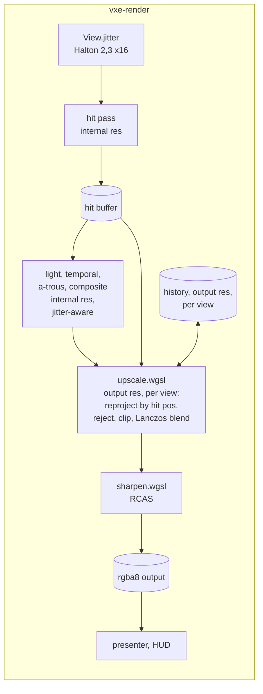

# 0030: A temporal upscaler of our own: jittered rays, reprojection by hit position, and a sharpening pass

> **Status:** in-progress
> **Created:** 2026-10-21
> **Amended:** 2026-10-22 by the owner's ruling at the Phase 2 stop (both of its unmet
> done-whens): a new Phase 3 makes Plan 0024's lighting passes jitter-aware and carries the
> still-camera bar, now read against a 2 x 2 supersampled native render; Phase 2's carve bar
> becomes an alpha-1 bar with the native difference as a reading; the old Phases 3 to 5 are
> now 4 to 6 (see "Amendment of 2026-10-22" below)
> **Milestone:** M2 in `docs/roadmap.md` (the upscaler plan; `nfr.md` §2's "with the upscaler
> allowed, internal resolution between 720p and 1080p")
> **Related ADRs:** [ADR-0024](../adrs/0024-own-temporal-upscaler-on-the-hit-buffer.md)
> (proposed with this plan: our own temporal upscaler, FSR 2 and spatial-only rejected),
> [ADR-0018](../adrs/0018-direct-light-per-pixel-one-sample-from-a-hit-buffer-with-svgf-history-killed-by-edits.md)
> (the hit buffer and reprojection by hit position this plan reuses)
> **Source:** Plan 0024's Followups (the upscaler plan); the owner's choice (2026-10-21);
> `docs/references/voxel-optimizations.md` (FSR 2, its cost and the port's size).
> **Starts after:** Plan 0024 closes. Drafted against Plan 0024's `Frame`, `View`, hit buffer,
> `temporal.wgsl` and `composite.wgsl`; the names dev finds in the tree win. Independent of
> Plan 0029 (the two touch `composite.wgsl` at different lines; the second to merge rebases).

## TL;DR

The frame renders at an internal resolution (720p for 1080p output at scale 1.5) with each
pixel's ray jittered by a sub-pixel offset that changes every frame. After the composite, an
upscale pass at output resolution reprojects last frame's output through the previous view by
the hit position, rejects it where the hit changed, clips it to the current neighbourhood's
colour box, and blends in the jittered sample with a Lanczos weight; a sharpening pass
(RCAS) follows, then the HUD. Plan 0024's temporal pass, a-trous filter and half tier stop
reacting to the jitter (amended 2026-10-22). The first thing a reader sees is a still camera
at scale 1.5 converging to an image closer to a 2 x 2 supersampled native render than a
bilinear blit is, with the hit pass costing 44 % of the native frame's rays.

## Context & problem

Every §2 lighting figure of Plan 0024 projects over the floor's lines at full resolution and
under them at half; the hit pass with contour alone projects at 3.9 to 5.8 ms on the floor at
1080p against the 3.0 ms line (`nfr.md` §2, Plan 0005's projection). The budget was written
with an upscaler, and without one the floor's 16.6 ms has no room for indirect light, entities
or volumetrics. ADR-0024 chooses a temporal upscaler of our own and says why not FSR 2 or a
spatial filter.

The facts the design uses: the marcher jitters a ray's direction per pixel at no cost; Plan
0024's hit buffer holds each pixel's world position, so reprojection through the previous view
is exact for the static world; its temporal pass already matches history that way and its edit
boxes say where history must die; RCAS is one function under MIT.

The consumer requirement is `project-context.md`'s Rendering row (stable at arm's length, 60
fps at 1080p on a mid-range card with an upscaler allowed). The `nfr.md` figures touched are
§2's upscale line (1.5 ms with tone map and post), the primary-ray and lighting lines at the
internal resolution, and §3's "everything else" (the history).

## Decision

We build ADR-0024's upscaler in `vxe-render`: `Frame` gains an internal size and an output
size; `View` carries a jitter; the hit pass offsets its ray by it; `upscale.wgsl` runs at the
output size per view with one history texture per view; `sharpen.wgsl` applies RCAS; the
presenter blits the sharpened output and the HUD draws on it. Plan 0024's lighting passes
are made jitter-aware: the temporal pass reprojects as if every ray went through its pixel's
centre and accepts history from the 3 x 3 previous pixels around the reprojected one, the
a-trous filter stops on jitter-stable inputs, and the half tier's sample pixel accounts for
the jitter (amended 2026-10-22, owner). Scale 1.0 with jitter off is byte for byte today's
single frame. We rejected porting FSR 2, a spatial-only upscaler and rendering
at output resolution with a lower lighting tier (ADR-0024).

## Amendment of 2026-10-22

Dev stopped at Phase 2 (Implementation log, resume notes) with the upscale pass written and
two of its four done-whens unmet as written. The owner ruled "both": fix the lighting and
change the carve bar. This amendment carries the ruling.

- **The still camera** read the upscaled image farther from native than the bilinear blit
  (4.699 against 3.333 in 1/255 at Plan 0024's defaults). Dev's split by lighting mode
  places the cause in Plan 0024's passes, not in the upscaler: at scale 1, where the upscaler
  only accumulates jitter, the image sits 50 % farther from a supersampled render than native
  does with the half tier and the a-trous on (3.099 against 2.066), and 3 % farther with both
  off (1.532 against 1.482). The temporal pass's history is resampled bilinearly onto a
  sample lattice that moves every frame, the a-trous and the half tier's sample pixel see a
  different hit each frame, and the upscaler's neighbourhood clip then tracks that motion. A
  new **Phase 3** makes those passes jitter-aware and carries the still-camera bar; Phase 2
  records the comparison as a reading.
- **The reference is a 2 x 2 supersampled native render**, not the plain one. The arithmetic
  at the defaults (dev's readings, 1/255): the supersampled render is 2.066 from plain native.
  Against plain native, an upscaler that converged to the supersampled image would read
  2.066, and one that copied native's stair-steps exactly would read 0, so the plain
  reference scores aliasing above resolved detail by up to 2.066. Against the supersampled
  render, the converged image reads 0, the native copy 2.066 and the bilinear blit 3.044;
  noise adds distance against either. Only the supersampled reference defends "the upscaler
  adds detail rather than noise". Plain native stays a reading beside it.
- **The carve bar** asked the upscaled frame to read within 8/255 of a native render inside
  the carve's box. The pixels over it (686 of 4900, up to 192/255, mean 14.26/255) are
  one-pixel slivers of voxel step faces that one sampling grid sees and the other does not,
  which no reprojection rule can fix. The bar now asks for the mechanism, every output pixel
  whose hit lies in the dilated edit box blending at alpha 1, and the native difference
  becomes a reading.
- **Phase 2's 3 x 3 history acceptance** (a deviation in the log) becomes the contract: with
  one previous pixel alone a still camera rejected 11.8 % of the output every frame.
- **The `frame_bytes` bar** (now Phase 5) follows the log: the composite's `rgba8` target
  stays at the output size while upscaling, and the resolve dispatch adds no target.

The old Phases 3 to 5 are now 4 to 6. The Implementation log's table is renumbered to match;
its entries are left as written.

## Architecture diagram



## Implementation phases

Each phase ships as its own commit. `dev` implements all phases in one session with no review
between phases. The architect reviews once at the end, in a fresh session.

### Phase 1: Internal resolution and the jitter
- **Owner skill:** dev
- **What:** `Frame::new` takes the internal and output sizes (`--internal-scale 1|1.5|2`,
  default 1 until Phase 5 reads the budgets); every Plan 0024 pass runs at the internal size;
  the composite's output is blitted to the output size by the presenter's existing scaled
  blit (the walking skeleton's upscaler is bilinear); `View.jitter` in internal pixels, set
  per frame from the Halton (2, 3) sequence, phase `frame % 16`, centred on zero; `--jitter
  off` zeroes it.
- **Files touched:** `crates/vxe-render/src/marcher.rs`, `camera.rs` (the `View`),
  `crates/vxe-render/src/shaders/march.wgsl` (the ray's sub-pixel offset),
  `apps/flythrough/src/main.rs`, `apps/flythrough/tests/golden.rs`, new
  `apps/flythrough/tests/upscale.rs`.
- **Done when:** at scale 1.0 with `--jitter off` every golden renders byte for byte; at
  scale 1.0 with jitter on, a static camera over the pillar scene averaged over 16 frames
  of the `hitmask` view shows, along the pillar's edge column, at least three distinct
  coverage values between 0 and 255 where the unjittered view shows only 0 and 255 (the
  jitter resolves sub-pixel coverage); at scale 1.5 for a 384 x 216 output the hit pass runs
  on 256 x 144 pixels and the presenter's blit fills the output; the parse test pins the two
  flags and their refusals.

### Phase 2: The upscale pass
- **Owner skill:** dev
- **What:** `upscale.wgsl` at the output size: for each output pixel, the nearest internal
  hit's world position reprojected through the previous view gives the history coordinate;
  the history is rejected when none of the 3 x 3 previous internal pixels around that
  coordinate agrees with the hit within Plan 0024's temporal thresholds (depth, normal,
  material; amended 2026-10-22, owner: one pixel alone rejected 11.8 % of a still camera's
  output every frame), when the hit lies in one of this frame's
  edit boxes (dilated by one voxel), or when the pixel was a miss; the accepted history is
  clipped to the YCoCg bounding box of the 3 x 3 internal neighbourhood (gamma 1.0); the
  current contribution is the composite's internal samples within a Lanczos-2 radius of the
  output pixel, weighted by the kernel at the jittered sample positions; blend alpha 0.1 (1.0
  on a reject). One history texture per view, swapped each frame.
- **Files touched:** new `crates/vxe-render/src/shaders/upscale.wgsl`, `marcher.rs`,
  `apps/flythrough/tests/upscale.rs`.
- **Done when** (amended 2026-10-22, owner): on the level at 256 x 144 internal and 384 x 216
  output, after 32 frames of a static camera with a radius-6 carve in view (the box given to
  the upscale pass), every output pixel whose hit (its nearest internal sample's) lies inside
  the carve's `aabb` dilated by one voxel blends at alpha 1.0 on the first frame after the
  carve (no ghost: the edit box rejects history), and that pixel count, more than zero, goes
  in the log; a camera that moves one voxel sideways between frames keeps history (alpha 0.1)
  in at least 95 % of the output pixels whose hit surface did not change; a pixel whose hit
  material changed reads the current sample (alpha 1.0). Readings, no bar: inside the carve's
  projected box, the upscaled frame's difference from a native render of the carved scene at
  the same frame count (max, mean, and the count over 8/255, of the box's pixels; 192/255,
  14.26/255 and 686 of 4900 at 284d132), and the still-camera distances from native (the
  bar moved to Phase 3).

### Phase 3: Lighting that ignores the jitter (amended 2026-10-22, owner)
- **Owner skill:** dev
- **What:** Plan 0024's temporal pass, a-trous filter and half tier stop reacting to the
  per-frame jitter, so that what the upscaler accumulates is sub-pixel detail and not
  lighting that moves with the sample grid.
  1. **The temporal pass reprojects with the jitter taken off.** Today `project_prev`
     subtracts the previous frame's jitter, so on a still camera each pixel's history is
     resampled bilinearly by the difference of two jitters every frame, which blurs it and
     straddles silhouettes. The pass instead reprojects as if both frames' rays went through
     their pixel centres (the hit projected through the previous view, minus this frame's
     jitter), so a still camera maps every pixel onto itself whatever the two jitters, and it
     accepts history from the 3 x 3 previous pixels around the reprojected one under Plan
     0024's thresholds, as `upscale.wgsl` does. How the 3 x 3 combine (the bilinear taps
     first and the best-agreeing neighbour when none accepts, or weights over all nine) is
     dev's call, in the log. The reservoir's temporal reuse and the gradient pass, where they
     reproject through the same function, follow the same rule; dev reads which do and logs
     it.
  2. **The a-trous filter stops on jitter-stable inputs:** the weight between two pixels on
     the same surface does not change when their rays move within their pixels (for example
     plane distance and normal taken from the hit's face or contour plane rather than the
     jittered point). Decide by measurement: if the filter's still-camera readings below
     need no change once items 1 and 3 are in, the log says so with the readings.
  3. **The half tier accounts for the jitter:** it keeps one fixed sample pixel per 2 x 2
     (Plan 0024 Phase 13: a cycle of the four moved a still image), and the downsample, the
     lighting grid's reprojection and the composite's upsample weights use the position the
     jittered ray went through, not the pixel's centre.
  4. The upscale pass's neighbourhood clip (box shape, gamma) may be retuned against the bars
     below, each tried setting and its reading in the log; alpha 0.1 and the Lanczos-2 kernel
     stay.

  With `--jitter off` every change reduces to Plan 0024's behaviour except the 3 x 3
  acceptance's effect on pixels the bilinear taps reject.
- **Files touched:** `crates/vxe-render/src/shaders/temporal.wgsl`, `atrous.wgsl`,
  `march.wgsl` (`project_prev`), `composite.wgsl` (the downsample and the upsample),
  `light.wgsl` and `gradient.wgsl` (their reprojection, where shared), `upscale.wgsl` (the
  clip), `crates/vxe-render/src/marcher.rs`, `apps/flythrough/tests/upscale.rs`,
  `tests/lights.rs`, `tests/golden.rs`.
- **Done when** (headless, lavapipe):
  1. **The still camera comes nearer the truth than a bilinear blit.** On the level (seed 1,
     the spawn pose) at 256 x 144 internal and 384 x 216 output, a static camera for 32
     frames at Plan 0024's defaults (lamp on, filter on, ore emissive): the upscale pass's
     output has a lower mean absolute difference per channel from a 2 x 2 supersampled
     native render (768 x 432, jitter off, the same 32 frames, box-filtered to 384 x 216)
     than the bilinear blit of the 256 x 144 render has (a property, not a threshold). The
     baseline at 284d132 against that reference: upscaled 4.369, bilinear 3.044, native
     2.066 (1/255). Against plain native (a reading): 4.699 against 3.333 at the defaults,
     2.807 against 2.724 with full-resolution lighting and the filter off, and a ratio of
     0.858 with the clip off as well (no emissive). The log records both references, their
     ratios, and the reading `the_upscalers_distance_from_native_under_each_lighting_mode`
     re-run at the tip, whose "jittered at scale 1" column against "native" (3.099 against
     2.066 at the defaults, 1.532 against 1.482 with the lighting parts off) is this
     phase's direct measure of lighting that ignores the jitter.
  2. **Jitter adds little flicker.** On Plan 0024 Phase 13 bar 1's rig (the dark cave's
     golden pose, lamp off, filter on, still camera, settle 64 frames, then 31 pairs of
     consecutive frames, each hit pixel's largest channel difference) at 320 x 180 output,
     scale 1.5 (213 x 120 internal) and the defaults, read on the upscale pass's output (before Phase 4's
     sharpening) with jitter on and with jitter off. Jitter on reads a mean at most 0.40/255
     above jitter off's, and a share of values over 4/255 at most 1.15 percentage points
     above it. The margin is what Plan 0024 Phase 13 won and no more: from the image the
     owner judged stillest at Plan 0024 Phase 12 (full, reuse: mean 0.5655, 1.149 % over
     4/255) to today's default (half, reuse: 0.1647, 0.0027 %); 0.5655 - 0.1647 = 0.4008
     and 1.1490 - 0.0027 = 1.1463, rounded. Those readings were taken on the composite at
     scale 1, so the margin is a transfer, not a derivation for this pipeline. All four
     figures go in the log.
  3. **Plan 0024's bars still hold** at jitter off and scale 1, as its tests assert them:
     its Phase 5 age tests, its Phase 6 two amended bars, its Phase 9 cone turn in the
     gradient mode, its Phase 13 stillness, cone turn and emission step (with the recorded
     full-reuse exception), and its Phase 10 mean absolute difference under 6/255. Every single-frame
     golden renders byte for byte; `dark_cave.png` and `dark_cave_half.png` render byte for
     byte or, where the 3 x 3 acceptance changes them, are re-blessed with the changed counts
     in the log. Phase 2's three bars still hold.
  4. Readings, no bar: with jitter on at scale 1 and a still camera, the share of hit pixels
     whose temporal age falls below 16 after 16 frames (0 at jitter off).

### Phase 4: The sharpening pass and the golden
- **Owner skill:** dev
- **What:** `sharpen.wgsl`, RCAS ported from FSR 1 (its MIT notice at the top of the file,
  `docs/references/voxel-optimizations.md` cites the source), with `--sharpen 0..1`
  (default 0.5, 0 bypasses); the HUD draws after it; a golden `upscaled.png` of the cavity
  scene at 256 x 144 internal, 384 x 216 output, after 32 frames.
- **Files touched:** new `crates/vxe-render/src/shaders/sharpen.wgsl`, `marcher.rs`,
  `apps/flythrough/src/main.rs`, `apps/flythrough/tests/golden.rs`.
- **Done when:** `upscaled.png` is blessed; at `--sharpen 0` the pass is the identity (byte
  for byte against the upscale pass's output); the sharpened output's edge contrast along the
  cavity's rim (the mean absolute gradient across the rim's pixels) is higher than the
  unsharpened's, and no pixel exceeds the 3 x 3 neighbourhood's maximum by more than 1/255
  (RCAS's clamp holds).

### Phase 5: The readings and the defaults
- **Owner skill:** dev
- **What:** HUD rows for the upscale and sharpen passes; the autopilot prints their p50 and
  p99 and the frame's passes at scale 1.0 and 1.5; readings on both adapters (`nfr.md` §1)
  at 1080p output; the fly-through's default scale is set from them (the owner's call in
  Phase 6 confirms it).
- **Files touched:** `apps/flythrough/src/main.rs`, `hud.rs`, the root `README.md` (flags),
  `docs/nfr.md` §2 and §3.
- **Done when:** upscale plus sharpen read at most 1.0 ms at 1080p output on the dev box
  (the §2 line is 1.5 ms with the composite's about 0.2 ms); at scale 1.5 the hit pass at the
  level's spawn reads at most 55 % of its scale-1.0 time (44 % of the rays, with a margin for
  the fixed cost per dispatch) and the sum of Plan 0024's light, temporal and a-trous passes
  at most 55 % of theirs; on the slow adapter the whole frame at scale 1.5 and 1080p output
  is read beside scale 1.0, with no bar; `frame_bytes` at scale 1.5 and 1080p output is
  Plan 0024's frame with its targets at the internal size, except the composite's `rgba8`
  target, which stays at the output size (8.3 MB; the upscale pass's resolve dispatch writes
  it whole), plus two output-resolution `rgba16float` histories (33.2 MB) and any target
  Phase 3 adds (listed in the log), and no more (amended 2026-10-22, owner: the composite
  target and the resolve dispatch, from the Phase 2 log).

### Phase 6: The owner's windowed check
- **Owner skill:** human
- **What:** the owner flies the default look at 2530 x 1378 output at scale 1.5 and 1.0,
  digs, sweeps the headlamp, holds still in front of a vein, and reads edges at arm's length;
  a verdict on ghosting, flicker (the lit image with jitter on against `--jitter off`) and
  sharpness, and the default scale.
- **Files touched:** this plan's log, ADR-0024's Outcome at the close.
- **Done when:** the owner has recorded a verdict and the default scale in the log.

## Data shapes

```rust
// illustrative: additions to Plan 0024's View and Frame
pub struct View { /* ... */ pub jitter: [f32; 2] /* internal pixels, in (-0.5, 0.5) */ }
pub struct Frame {
    internal: [u32; 2], output: [u32; 2],
    history: [wgpu::Texture; 2],   // rgba16float at the output size, per view, ping-pong
    // ...
}
// upscale params: the previous view, alpha, the edit boxes (Plan 0024's list), the kernel
// radius; sharpen params: sharpness in 0..1 mapped to RCAS's stop count.
```

VRAM at 1080p output: two `rgba16float` histories, 2 x 16.6 MB = 33.2 MB, plus the output
`rgba8` target (8.3 MB, which the composite target becomes); the internal-resolution buffers
of Plan 0024 shrink to 44 % at scale 1.5.

## Budgets

| `nfr.md` figure | line | projection (dev box, 1080p output) | how the close measures it |
|---|---|---|---|
| §2 Upscale, tone map, post | 1.5 ms | upscale with its resolve dispatch 0.4 to 0.7 ms, sharpen 0.1 to 0.2 ms, composite 0.2 ms | Phase 5, three runs, both adapters |
| §2 Primary rays | 3.0 ms | at scale 1.5, 44 % of the rays: the hit pass about 0.65 to 0.9 ms (dev), 1.7 to 2.6 ms (floor projection) | Phase 5 |
| §2 Lighting, Denoise | 6.0, 3.0 ms | 44 % of Plan 0024's readings at scale 1.5; Phase 3's 3 x 3 history acceptance reads up to nine previous pixels where Plan 0024 read four (a guess: within the 55 % bar's margin) | Phase 5 |
| §3 Everything else in VRAM | 1.5 GB | +33.2 MB history, −56 % of the internal buffers at scale 1.5 except the composite's `rgba8` target (8.3 MB, stays at the output size) | `frame_bytes`, Phase 5 |

## Risks & open questions

- **Ghosting, flicker and over-sharpening** are the known failure modes; Phase 2's reject and
  clip tests, Phase 3's flicker bar and Phase 6's eye are the bar. If the owner rejects it, FSR 2's port is the next
  plan (ADR-0024 Alternative A).
- **The denoiser on jittered samples** (amended 2026-10-22, owner): the draft assumed
  reprojection by world position made Plan 0024's passes indifferent to the jitter. Phase 2
  measured otherwise (the still camera at scale 1 sits 50 % farther from a supersampled
  render than native does with the half tier and the filter on), and Phase 3 fixes it. If
  Phase 3's bars cannot be met, `--jitter off` remains the fallback (the upscaler is then
  spatial) and the amplitude a parameter, and the owner decides between that and ADR-0024's
  Alternative A.
- **Translucent layers** are composited at internal resolution and upscaled with the rest;
  acceptable for M2, M8's media plan may want them at output resolution.
- **Determinism** per adapter as Plan 0024; the Halton sequence is fixed per frame index.
- **Adapter features:** `rgba16float` storage textures at output resolution, which Plan 0024
  already uses. Nothing else.
- **Threading:** none; compute passes on the frame's encoder.

## What this plan does NOT do

- **FSR 2, 3 or 4, DLSS, XeSS**: ADR-0024.
- **Dynamic resolution** (changing the scale per frame to hold 60 fps): a followup once the
  floor's readings exist on the slow adapter; the scale is a setting here.
- **Motion vectors for entities**: M6, as Plan 0024 records.
- **Anti-aliasing of the HUD**: it draws after the sharpen pass at output resolution, as now.

## Implementation log

> Written by `dev`: one row per phase as its commit lands, then the close block. **The phases
> above are the contract. This section records what happened.** Observations, never conclusions:
> no pass list, no self-assessment. Deviations and unmet done-whens are **always** disclosed.
> Keep it shorter than `## Implementation phases`.

| phase | owner | state | commit |
|---|---|---|---|
| 1: Internal resolution and the jitter | dev | done: 11 of 11 `assert_golden` renders (golden.rs, look.rs) byte-identical to 578c8d3's at scale 1 jitter off (dumped and compared with `cmp`); jitter on, 16-frame hit mask of the pillar: 396 edge pixels, 15 distinct values in (0, 255) (unjittered: 0 partial); 384 x 216 at 1.5: hit buffer 256 x 144, blit within 1.03/255 of bilinear; parse test pins `--internal-scale`, `--jitter` | 9900eee |
| 2: The upscale pass | dev | done: carve on the level (t = 30.5 voxels): 4749 output pixels hit in the dilated box, 0 blend history; readings in the projected box against native: max 192/255, mean 14.26/255, 686 of 4900 over 8/255; sideways step on the cavity: 67409 of 67443 unchanged pixels at alpha 0.1 (99.95 %), all 3317 changed-material pixels at alpha 1; still camera (reading): from native upscaled 4.699, bilinear 3.333 (1.410), from 2 x 2 supersampled 4.369, 3.044 (1.435), native 2.066 | committed with this row |
| 3: Lighting that ignores the jitter | dev | not started | |
| 4: The sharpening pass and the golden | dev | not started | |
| 5: The readings and the defaults | dev | not started | |
| 6: The owner's windowed check | human | not started | |

### Notes

- Scope restated 2026-10-22 (the owner's go of 2026-10-21 stands): phases 1 to 4 dev, stop
  at phase 5 (human). Lane: worktree `plan-0030` off 578c8d3.
- Phase 1: `Frame::new(device, w, h)` kept (internal = output); the two sizes come through a
  new `Frame::with_sizes(device, internal, output)` and `Frame::set_sizes`. The scale is
  `RenderScale` (`One`, `OneHalf`, `Two`; internal edge `round(output / scale)`).
- Phase 1: `View` grows `jitter: [f32; 2]` and `_pad2: [f32; 2]` (112 bytes); `project_prev`
  takes the previous view's jitter off, so the temporal pass and reservoir reuse reproject onto
  jittered sample positions. `Frame` jitter defaults off (library); the fly-through's
  `--jitter` defaults on.
- Phase 1: golden.rs needed no change; "every golden byte for byte" was read by dumping each
  `assert_golden` render at 578c8d3 and at the phase's tree and comparing with `cmp` (a local,
  uncommitted dump hook in `tests/support/mod.rs`). The split_* and hud goldens compare
  byte-exact in their own tests, which pass.
- Phase 1: "the pillar's edge column" read as the silhouette pixels of the unjittered mask
  (a pixel with a 4-neighbour on the other side).
- Phase 1: `crates/vxe-render/src/lib.rs` (outside the phase's list) re-exports `RenderScale`
  and `jitter_at`.
- Phase 2: stopped at 284d132 on two done-whens; amended 2026-10-22 (439d037). The scope now
  runs phases 1 to 5 (dev) and stops at 6 (human).
- Phase 2: the upscaler runs when the frame jitters or the internal size differs from the
  output; `Frame::set_jitter` takes the device (the targets change). While upscaling the
  composite's rgba8 target is the output size (the composite fills its top-left internal
  pixels; the upscale pass's resolve dispatch writes the whole); `FRAME_PASSES` gains
  "upscale" (the upscale and resolve dispatches). The history's alpha channel holds the blend
  weight of the current colour (the tests read it). `Params.history` bit 1 clears for one
  frame after a view-mode change (the upscaler's history then holds another view).
- Phase 2: `UPSCALE_WGSL` lives in `marcher.rs` with a naga validation unit test; the
  shader is not in `crates/vxe-render/tests/shader_portability.rs` (followup).

### Close triggers

_(Facts for the architect. No recommendations, and no suggested version bump.)_

- **What shipped:** feature / fix-only / docs-chore-only
- **Public API changed:** types, traits, functions, shader interfaces, config (list them, or none)
- **Budget readings:** each `nfr.md` figure touched, with its measured value, machine and commit
- **Gate at the tip:** the commands run (build, nextest, doctests, clippy, fmt, deny), exit codes, test counts
- **Outstanding `human` phases:** which, or none

## Followups

- Dynamic resolution against a frame-time target, once the slow adapter's frame readings
  exist.
