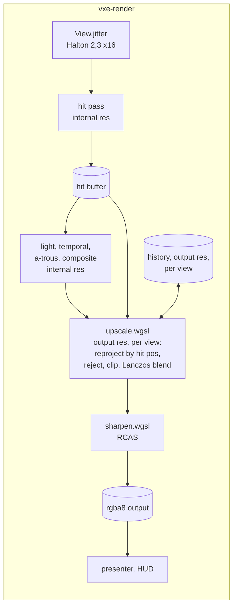

# 0030: A temporal upscaler of our own: jittered rays, reprojection by hit position, and a sharpening pass

> **Status:** in-progress
> **Created:** 2026-10-21
> **Milestone:** M2 in `docs/roadmap.md` (the upscaler plan; `nfr.md` §2's "with the upscaler
> allowed, internal resolution between 720p and 1080p")
> **Related ADRs:** [ADR-0024](../adrs/0024-own-temporal-upscaler-on-the-hit-buffer.md)
> (proposed with this plan: our own temporal upscaler, FSR 2 and spatial-only rejected),
> [ADR-0018](../adrs/0018-direct-light-per-pixel-one-sample-from-a-hit-buffer-with-svgf-history-killed-by-edits.md)
> (the hit buffer and reprojection by hit position this plan reuses)
> **Source:** Plan 0024's Followups (the upscaler plan); the owner's choice (2026-10-21);
> `docs/references/voxel-optimizations.md` (FSR 2, its cost and the port's size).
> **Starts after:** Plan 0024 closes. Drafted against Plan 0024's `Frame`, `View`, hit buffer,
> `temporal.wgsl` and `composite.wgsl`; the names dev finds in the tree win. Independent of
> Plan 0029 (the two touch `composite.wgsl` at different lines; the second to merge rebases).

## TL;DR

The frame renders at an internal resolution (720p for 1080p output at scale 1.5) with each
pixel's ray jittered by a sub-pixel offset that changes every frame. After the composite, an
upscale pass at output resolution reprojects last frame's output through the previous view by
the hit position, rejects it where the hit changed, clips it to the current neighbourhood's
colour box, and blends in the jittered sample with a Lanczos weight; a sharpening pass
(RCAS) follows, then the HUD. The first thing a reader sees is a still camera at scale 1.5
converging to an image closer to the native render than a bilinear blit, with the hit pass
costing 44 % of the native frame's rays.

## Context & problem

Every §2 lighting figure of Plan 0024 projects over the floor's lines at full resolution and
under them at half; the hit pass with contour alone projects at 3.9 to 5.8 ms on the floor at
1080p against the 3.0 ms line (`nfr.md` §2, Plan 0005's projection). The budget was written
with an upscaler, and without one the floor's 16.6 ms has no room for indirect light, entities
or volumetrics. ADR-0024 chooses a temporal upscaler of our own and says why not FSR 2 or a
spatial filter.

The facts the design uses: the marcher jitters a ray's direction per pixel at no cost; Plan
0024's hit buffer holds each pixel's world position, so reprojection through the previous view
is exact for the static world; its temporal pass already matches history that way and its edit
boxes say where history must die; RCAS is one function under MIT.

The consumer requirement is `project-context.md`'s Rendering row (stable at arm's length, 60
fps at 1080p on a mid-range card with an upscaler allowed). The `nfr.md` figures touched are
§2's upscale line (1.5 ms with tone map and post), the primary-ray and lighting lines at the
internal resolution, and §3's "everything else" (the history).

## Decision

We build ADR-0024's upscaler in `vxe-render`: `Frame` gains an internal size and an output
size; `View` carries a jitter; the hit pass offsets its ray by it; `upscale.wgsl` runs at the
output size per view with one history texture per view; `sharpen.wgsl` applies RCAS; the
presenter blits the sharpened output and the HUD draws on it. Scale 1.0 with jitter off is
byte for byte today's frame. We rejected porting FSR 2, a spatial-only upscaler and rendering
at output resolution with a lower lighting tier (ADR-0024).

## Architecture diagram



## Implementation phases

Each phase ships as its own commit. `dev` implements all phases in one session with no review
between phases. The architect reviews once at the end, in a fresh session.

### Phase 1: Internal resolution and the jitter
- **Owner skill:** dev
- **What:** `Frame::new` takes the internal and output sizes (`--internal-scale 1|1.5|2`,
  default 1 until Phase 4 reads the budgets); every Plan 0024 pass runs at the internal size;
  the composite's output is blitted to the output size by the presenter's existing scaled
  blit (the walking skeleton's upscaler is bilinear); `View.jitter` in internal pixels, set
  per frame from the Halton (2, 3) sequence, phase `frame % 16`, centred on zero; `--jitter
  off` zeroes it.
- **Files touched:** `crates/vxe-render/src/marcher.rs`, `camera.rs` (the `View`),
  `crates/vxe-render/src/shaders/march.wgsl` (the ray's sub-pixel offset),
  `apps/flythrough/src/main.rs`, `apps/flythrough/tests/golden.rs`, new
  `apps/flythrough/tests/upscale.rs`.
- **Done when:** at scale 1.0 with `--jitter off` every golden renders byte for byte; at
  scale 1.0 with jitter on, a static camera over the pillar scene averaged over 16 frames
  of the `hitmask` view shows, along the pillar's edge column, at least three distinct
  coverage values between 0 and 255 where the unjittered view shows only 0 and 255 (the
  jitter resolves sub-pixel coverage); at scale 1.5 for a 384 x 216 output the hit pass runs
  on 256 x 144 pixels and the presenter's blit fills the output; the parse test pins the two
  flags and their refusals.

### Phase 2: The upscale pass
- **Owner skill:** dev
- **What:** `upscale.wgsl` at the output size: for each output pixel, the nearest internal
  hit's world position reprojected through the previous view gives the history coordinate;
  the history is rejected when the previous hit buffer's depth, normal or material there
  disagrees beyond Plan 0024's temporal thresholds, when the hit lies in one of this frame's
  edit boxes (dilated by one voxel), or when the pixel was a miss; the accepted history is
  clipped to the YCoCg bounding box of the 3 x 3 internal neighbourhood (gamma 1.0); the
  current contribution is the composite's internal samples within a Lanczos-2 radius of the
  output pixel, weighted by the kernel at the jittered sample positions; blend alpha 0.1 (1.0
  on a reject). One history texture per view, swapped each frame.
- **Files touched:** new `crates/vxe-render/src/shaders/upscale.wgsl`, `marcher.rs`,
  `apps/flythrough/tests/upscale.rs`.
- **Done when:** on the level at 256 x 144 internal and 384 x 216 output with a static camera
  for 32 frames (lamp on, filter on, the Plan 0024 defaults), the output's mean absolute
  difference per channel from a native 384 x 216 render (scale 1.0, jitter off, the same 32
  frames) is lower than the bilinear blit's from the same reference, and both figures and
  their ratio go in the log (a property, not a threshold); the frame after a radius-6 carve
  in view reads, inside the carve's projected box, within 8/255 of a native render of the
  carved scene at the same frame count (no ghost: the edit box rejects history); a camera
  that moves one voxel sideways between frames keeps history (alpha 0.1) in at least 95 % of
  the output pixels whose hit surface did not change; a pixel whose hit material changed
  reads the current sample (alpha 1.0).

### Phase 3: The sharpening pass and the golden
- **Owner skill:** dev
- **What:** `sharpen.wgsl`, RCAS ported from FSR 1 (its MIT notice at the top of the file,
  `docs/references/voxel-optimizations.md` cites the source), with `--sharpen 0..1`
  (default 0.5, 0 bypasses); the HUD draws after it; a golden `upscaled.png` of the cavity
  scene at 256 x 144 internal, 384 x 216 output, after 32 frames.
- **Files touched:** new `crates/vxe-render/src/shaders/sharpen.wgsl`, `marcher.rs`,
  `apps/flythrough/src/main.rs`, `apps/flythrough/tests/golden.rs`.
- **Done when:** `upscaled.png` is blessed; at `--sharpen 0` the pass is the identity (byte
  for byte against the Phase 2 output); the sharpened output's edge contrast along the
  cavity's rim (the mean absolute gradient across the rim's pixels) is higher than the
  unsharpened's, and no pixel exceeds the 3 x 3 neighbourhood's maximum by more than 1/255
  (RCAS's clamp holds).

### Phase 4: The readings and the defaults
- **Owner skill:** dev
- **What:** HUD rows for the upscale and sharpen passes; the autopilot prints their p50 and
  p99 and the frame's passes at scale 1.0 and 1.5; readings on both adapters (`nfr.md` §1)
  at 1080p output; the fly-through's default scale is set from them (the owner's call in
  Phase 5 confirms it).
- **Files touched:** `apps/flythrough/src/main.rs`, `hud.rs`, the root `README.md` (flags),
  `docs/nfr.md` §2 and §3.
- **Done when:** upscale plus sharpen read at most 1.0 ms at 1080p output on the dev box
  (the §2 line is 1.5 ms with the composite's about 0.2 ms); at scale 1.5 the hit pass at the
  level's spawn reads at most 55 % of its scale-1.0 time (44 % of the rays, with a margin for
  the fixed cost per dispatch) and the sum of Plan 0024's light, temporal and a-trous passes
  at most 55 % of theirs; on the slow adapter the whole frame at scale 1.5 and 1080p output
  is read beside scale 1.0, with no bar; `frame_bytes` rises by two output-resolution
  `rgba16float` histories (33.2 MB at 1080p) and no more.

### Phase 5: The owner's windowed check
- **Owner skill:** human
- **What:** the owner flies the default look at 2530 x 1378 output at scale 1.5 and 1.0,
  digs, sweeps the headlamp, and reads edges at arm's length; a verdict on ghosting, flicker
  and sharpness, and the default scale.
- **Files touched:** this plan's log, ADR-0024's Outcome at the close.
- **Done when:** the owner has recorded a verdict and the default scale in the log.

## Data shapes

```rust
// illustrative: additions to Plan 0024's View and Frame
pub struct View { /* ... */ pub jitter: [f32; 2] /* internal pixels, in (-0.5, 0.5) */ }
pub struct Frame {
    internal: [u32; 2], output: [u32; 2],
    history: [wgpu::Texture; 2],   // rgba16float at the output size, per view, ping-pong
    // ...
}
// upscale params: the previous view, alpha, the edit boxes (Plan 0024's list), the kernel
// radius; sharpen params: sharpness in 0..1 mapped to RCAS's stop count.
```

VRAM at 1080p output: two `rgba16float` histories, 2 x 16.6 MB = 33.2 MB, plus the output
`rgba8` target (8.3 MB, which the composite target becomes); the internal-resolution buffers
of Plan 0024 shrink to 44 % at scale 1.5.

## Budgets

| `nfr.md` figure | line | projection (dev box, 1080p output) | how the close measures it |
|---|---|---|---|
| §2 Upscale, tone map, post | 1.5 ms | upscale 0.4 to 0.7 ms, sharpen 0.1 to 0.2 ms, composite 0.2 ms | Phase 4, three runs, both adapters |
| §2 Primary rays | 3.0 ms | at scale 1.5, 44 % of the rays: the hit pass about 0.65 to 0.9 ms (dev), 1.7 to 2.6 ms (floor projection) | Phase 4 |
| §2 Lighting, Denoise | 6.0, 3.0 ms | 44 % of Plan 0024's readings at scale 1.5 | Phase 4 |
| §3 Everything else in VRAM | 1.5 GB | +33.2 MB history, −56 % of the internal buffers at scale 1.5 | `frame_bytes` |

## Risks & open questions

- **Ghosting, flicker and over-sharpening** are the known failure modes; Phase 2's reject and
  clip tests and Phase 5's eye are the bar. If the owner rejects it, FSR 2's port is the next
  plan (ADR-0024 Alternative A).
- **The denoiser on jittered samples:** Plan 0024's temporal pass reprojects by world
  position, so jitter costs it no history, but the a-trous filter and reservoir reuse see a
  moving grid. Phase 1's jitter-on goldens at scale 1.0 show the effect; `--jitter off` is
  the fallback and the amplitude a parameter.
- **Translucent layers** are composited at internal resolution and upscaled with the rest;
  acceptable for M2, M8's media plan may want them at output resolution.
- **Determinism** per adapter as Plan 0024; the Halton sequence is fixed per frame index.
- **Adapter features:** `rgba16float` storage textures at output resolution, which Plan 0024
  already uses. Nothing else.
- **Threading:** none; compute passes on the frame's encoder.

## What this plan does NOT do

- **FSR 2, 3 or 4, DLSS, XeSS**: ADR-0024.
- **Dynamic resolution** (changing the scale per frame to hold 60 fps): a followup once the
  floor's readings exist on the slow adapter; the scale is a setting here.
- **Motion vectors for entities**: M6, as Plan 0024 records.
- **Anti-aliasing of the HUD**: it draws after the sharpen pass at output resolution, as now.

## Implementation log

> Written by `dev`: one row per phase as its commit lands, then the close block. **The phases
> above are the contract. This section records what happened.** Observations, never conclusions:
> no pass list, no self-assessment. Deviations and unmet done-whens are **always** disclosed.
> Keep it shorter than `## Implementation phases`.

| phase | owner | state | commit |
|---|---|---|---|
| 1: Internal resolution and the jitter | dev | done: 11 of 11 `assert_golden` renders (golden.rs, look.rs) byte-identical to 578c8d3's at scale 1 jitter off (dumped and compared with `cmp`); jitter on, 16-frame hit mask of the pillar: 396 edge pixels, 15 distinct values in (0, 255) (unjittered: 0 partial); 384 x 216 at 1.5: hit buffer 256 x 144, blit within 1.03/255 of bilinear; parse test pins `--internal-scale`, `--jitter` | 9900eee |
| 2: The upscale pass | dev | stopped: code at 284d132; 2 of 4 done-whens unmet as written (see resume notes) | 284d132 (wip) |
| 3: The sharpening pass and the golden | dev | not started | |
| 4: The readings and the defaults | dev | not started | |
| 5: The owner's windowed check | human | not started | |

### Notes

- Scope restated 2026-10-22 (the owner's go of 2026-10-21 stands): phases 1 to 4 dev, stop
  at phase 5 (human). Lane: worktree `plan-0030` off 578c8d3.
- Phase 1: `Frame::new(device, w, h)` kept (internal = output); the two sizes come through a
  new `Frame::with_sizes(device, internal, output)` and `Frame::set_sizes`. The scale is
  `RenderScale` (`One`, `OneHalf`, `Two`; internal edge `round(output / scale)`).
- Phase 1: `View` grows `jitter: [f32; 2]` and `_pad2: [f32; 2]` (112 bytes); `project_prev`
  takes the previous view's jitter off, so the temporal pass and reservoir reuse reproject onto
  jittered sample positions. `Frame` jitter defaults off (library); the fly-through's
  `--jitter` defaults on.
- Phase 1: golden.rs needed no change; "every golden byte for byte" was read by dumping each
  `assert_golden` render at 578c8d3 and at the phase's tree and comparing with `cmp` (a local,
  uncommitted dump hook in `tests/support/mod.rs`). The split_* and hud goldens compare
  byte-exact in their own tests, which pass.
- Phase 1: "the pillar's edge column" read as the silhouette pixels of the unjittered mask
  (a pixel with a 4-neighbour on the other side).
- Phase 1: `crates/vxe-render/src/lib.rs` (outside the phase's list) re-exports `RenderScale`
  and `jitter_at`.

### Resume notes (Phase 2, 2026-10-22; delete when Phase 2 lands)

All readings on lavapipe (software Vulkan), exclusive perf lock, commit 284d132.

- **Gate at 284d132:** clippy and fmt clean; `cargo nextest run --workspace`: 588 run, 586
  passed, 2 failed (the two tests below, assertions as the plan wrote them), 5 skipped; the 11
  `assert_golden` renders byte-identical to 578c8d3's (scale 1, jitter off: the upscaler does
  not run).
- **Met:** sideways step on the cavity at 256 x 144 -> 384 x 216: 67409 of 67443 unchanged
  output pixels blend history at alpha 0.1 (99.95 %); all 3317 output pixels whose nearest
  sample hit the replaced material take alpha 1 (the history's alpha channel holds the blend
  weight).
- **Unmet 1, the still camera** (level seed 1, spawn pose, 32 frames, Plan 0024 defaults, ore
  emissive): mean absolute difference from native 384 x 216 (jitter off), mean of r, g, b in
  1/255: upscaled 4.699, bilinear blit 3.333, ratio 1.410. The ignored reading
  `the_upscalers_distance_from_native_under_each_lighting_mode` splits it by lighting mode
  (upscaled / bilinear, ratio; then from a 2 x 2 supersampled native: upscaled, bilinear,
  native, jittered at scale 1):
  defaults 4.699 / 3.333, 1.410; 4.369, 3.044, 2.066, 3.099.
  no emissive 4.539 / 3.160, 1.436; 4.215, 2.867, 1.852, 2.910.
  full-res lighting 3.516 / 2.887, 1.218; 2.862, 2.306, 1.672, 2.012.
  filter off 3.576 / 3.181, 1.124; 3.120, 2.837, 1.835, 1.996.
  full-res lighting and filter off 2.807 / 2.724, 1.030; 2.117, 2.124, 1.482, 1.532.
  At scale 1 the jittered accumulation sits as near the supersampled render as native does
  only with the half-resolution lighting and the a-trous filter both off (1.532 vs 1.482);
  with both on it is 50 % farther (3.099 vs 2.066). Experiments not kept (same scene, no
  emissive): with the clip off and the lighting passes at full resolution with the filter off
  the ratio read 0.858; a min/max-only clip read 0.968 there and 1.434 at the defaults; the
  temporal pass with nearest-tap history, a looser temporal acceptance, half the jitter
  amplitude and an alpha scaled by the nearest sample's kernel weight each left the
  defaults' ratio between 1.27 and 1.78. Observed: the upscaler is nearer native than the
  bilinear blit only with Plan 0024's lighting passes' jitter-sensitive parts off.
- **Unmet 2, the carve** (same level, 32 frames, radius-6 carve at t = 30.5 voxels on the
  view axis, box given to both frames): inside the projected box (4900 output pixels) the
  upscaled frame differs from native by at most 192/255, mean 14.26/255, 686 pixels over
  8/255; 2834 box pixels changed by more than 8/255 from the frame before (the cavity shows
  in the first frame). The pixels over the bar lie on the one-pixel slivers of voxel step
  faces, present in one sampling grid and absent in the other.
- **Deviation:** the history is rejected when none of the 3 x 3 previous internal pixels
  around the reprojected point agrees (the plan: "there"); with one pixel alone 9763 of
  82944 output pixels (11.8 %) rejected every frame of a still camera, along every face edge,
  and 342 with the 3 x 3.
- **Deviation:** the composite's rgba8 target is the output size while upscaling (the
  composite fills its top-left internal pixels, the upscale pass's resolve dispatch writes
  the whole); FRAME_PASSES gains "upscale" (the upscale and resolve dispatches).
- **Open question to the owner** (verbatim in the final report): how should Phase 2's two
  unmet done-whens be resolved?

### Close triggers

_(Facts for the architect. No recommendations, and no suggested version bump.)_

- **What shipped:** feature / fix-only / docs-chore-only
- **Public API changed:** types, traits, functions, shader interfaces, config (list them, or none)
- **Budget readings:** each `nfr.md` figure touched, with its measured value, machine and commit
- **Gate at the tip:** the commands run (build, nextest, doctests, clippy, fmt, deny), exit codes, test counts
- **Outstanding `human` phases:** which, or none

## Followups

- Dynamic resolution against a frame-time target, once the slow adapter's frame readings
  exist.
