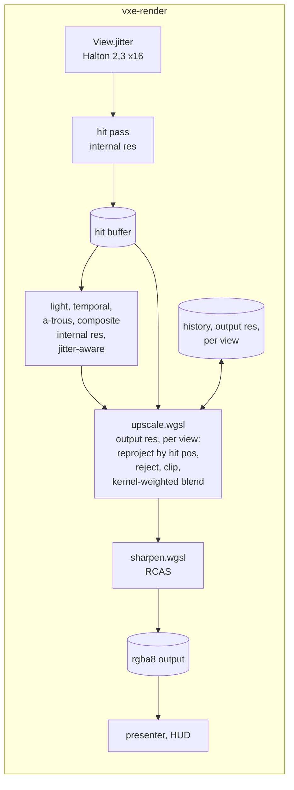

# 0030: A temporal upscaler of our own: jittered rays, reprojection by hit position, and a sharpening pass

> **Status:** in-progress
> **Created:** 2026-10-21
> **Amended:** 2026-10-22 by the owner's ruling at the Phase 2 stop (both of its unmet
> done-whens): a new Phase 3 makes Plan 0024's lighting passes jitter-aware and carries the
> still-camera bar, now read against a 2 x 2 supersampled native render; Phase 2's carve bar
> becomes an alpha-1 bar with the native difference as a reading; the old Phases 3 to 5 are
> now 4 to 6 (see "Amendment of 2026-10-22" below)
> **Amended 2026-10-22 (owner, Phase 6):** the owner's windowed check found the upscaled image
> blurry at both scales, with and without the contour look, and ruled "rework before close".
> New dev Phases 6 to 8 sharpen the reconstruction and the history fetch, restore rejection of
> light changes, and re-read the budgets; the windowed check becomes Phase 9 (see "Amendment of
> 2026-10-22 (owner, Phase 6)" below)
> **Milestone:** M2 in `docs/roadmap.md` (the upscaler plan; `nfr.md` §2's "with the upscaler
> allowed, internal resolution between 720p and 1080p")
> **Related ADRs:** [ADR-0024](../adrs/0024-own-temporal-upscaler-on-the-hit-buffer.md)
> (proposed with this plan: our own temporal upscaler, FSR 2 and spatial-only rejected),
> [ADR-0018](../adrs/0018-direct-light-per-pixel-one-sample-from-a-hit-buffer-with-svgf-history-killed-by-edits.md)
> (the hit buffer and reprojection by hit position this plan reuses)
> **Source:** Plan 0024's Followups (the upscaler plan); the owner's choice (2026-10-21);
> `docs/references/voxel-optimizations.md` (FSR 2, its cost and the port's size).
> **Starts after:** Plan 0024 closes. Drafted against Plan 0024's `Frame`, `View`, hit buffer,
> `temporal.wgsl` and `composite.wgsl`; the names dev finds in the tree win. Independent of
> Plan 0029 (the two touch `composite.wgsl` at different lines; the second to merge rebases).

## TL;DR

The frame renders at an internal resolution (720p for 1080p output at scale 1.5) with each
pixel's ray jittered by a sub-pixel offset that changes every frame. After the composite, an
upscale pass at output resolution reprojects last frame's output through the previous view by
the hit position, rejects it where the hit changed, clips it to the current neighbourhood's
colour box, and blends in the jittered samples with a kernel weight of their distance to the
output pixel (Lanczos-2 until Phase 6, a narrower kernel and a sharper history fetch after
it, amended 2026-10-22 at Phase 6); a sharpening pass
(RCAS) follows, then the HUD. Plan 0024's temporal pass, a-trous filter and half tier stop
reacting to the jitter (amended 2026-10-22). The first thing a reader sees is a still camera
at scale 1.5 converging to an image closer to a 2 x 2 supersampled native render than a
bilinear blit is, with the hit pass costing 44 % of the native frame's rays.

## Context & problem

Every §2 lighting figure of Plan 0024 projects over the floor's lines at full resolution and
under them at half; the hit pass with contour alone projects at 3.9 to 5.8 ms on the floor at
1080p against the 3.0 ms line (`nfr.md` §2, Plan 0005's projection). The budget was written
with an upscaler, and without one the floor's 16.6 ms has no room for indirect light, entities
or volumetrics. ADR-0024 chooses a temporal upscaler of our own and says why not FSR 2 or a
spatial filter.

The facts the design uses: the marcher jitters a ray's direction per pixel at no cost; Plan
0024's hit buffer holds each pixel's world position, so reprojection through the previous view
is exact for the static world; its temporal pass already matches history that way and its edit
boxes say where history must die; RCAS is one function under MIT.

The consumer requirement is `project-context.md`'s Rendering row (stable at arm's length, 60
fps at 1080p on a mid-range card with an upscaler allowed). The `nfr.md` figures touched are
§2's upscale line (1.5 ms with tone map and post), the primary-ray and lighting lines at the
internal resolution, and §3's "everything else" (the history).

## Decision

We build ADR-0024's upscaler in `vxe-render`: `Frame` gains an internal size and an output
size; `View` carries a jitter; the hit pass offsets its ray by it; `upscale.wgsl` runs at the
output size per view with one history texture per view; `sharpen.wgsl` applies RCAS; the
presenter blits the sharpened output and the HUD draws on it. Plan 0024's lighting passes
are made jitter-aware: the temporal pass reprojects as if every ray went through its pixel's
centre and accepts history from the 3 x 3 previous pixels around the reprojected one, the
a-trous filter stops on jitter-stable inputs, and the half tier's sample pixel accounts for
the jitter (amended 2026-10-22, owner). Scale 1.0 with jitter off is byte for byte today's
single frame. We rejected porting FSR 2, a spatial-only upscaler and rendering
at output resolution with a lower lighting tier (ADR-0024).

## Amendment of 2026-10-22

Dev stopped at Phase 2 (Implementation log, resume notes) with the upscale pass written and
two of its four done-whens unmet as written. The owner ruled "both": fix the lighting and
change the carve bar. This amendment carries the ruling.

- **The still camera** read the upscaled image farther from native than the bilinear blit
  (4.699 against 3.333 in 1/255 at Plan 0024's defaults). Dev's split by lighting mode
  places the cause in Plan 0024's passes, not in the upscaler: at scale 1, where the upscaler
  only accumulates jitter, the image sits 50 % farther from a supersampled render than native
  does with the half tier and the a-trous on (3.099 against 2.066), and 3 % farther with both
  off (1.532 against 1.482). The temporal pass's history is resampled bilinearly onto a
  sample lattice that moves every frame, the a-trous and the half tier's sample pixel see a
  different hit each frame, and the upscaler's neighbourhood clip then tracks that motion. A
  new **Phase 3** makes those passes jitter-aware and carries the still-camera bar; Phase 2
  records the comparison as a reading.
- **The reference is a 2 x 2 supersampled native render**, not the plain one. The arithmetic
  at the defaults (dev's readings, 1/255): the supersampled render is 2.066 from plain native.
  Against plain native, an upscaler that converged to the supersampled image would read
  2.066, and one that copied native's stair-steps exactly would read 0, so the plain
  reference scores aliasing above resolved detail by up to 2.066. Against the supersampled
  render, the converged image reads 0, the native copy 2.066 and the bilinear blit 3.044;
  noise adds distance against either. Only the supersampled reference defends "the upscaler
  adds detail rather than noise". Plain native stays a reading beside it.
- **The carve bar** asked the upscaled frame to read within 8/255 of a native render inside
  the carve's box. The pixels over it (686 of 4900, up to 192/255, mean 14.26/255) are
  one-pixel slivers of voxel step faces that one sampling grid sees and the other does not,
  which no reprojection rule can fix. The bar now asks for the mechanism, every output pixel
  whose hit lies in the dilated edit box blending at alpha 1, and the native difference
  becomes a reading.
- **Phase 2's 3 x 3 history acceptance** (a deviation in the log) becomes the contract: with
  one previous pixel alone a still camera rejected 11.8 % of the output every frame.
- **The `frame_bytes` bar** (now Phase 5) follows the log: the composite's `rgba8` target
  stays at the output size while upscaling, and the resolve dispatch adds no target.

The old Phases 3 to 5 are now 4 to 6. The Implementation log's table is renumbered to match;
its entries are left as written.

## Amendment of 2026-10-22 (owner, Phase 6)

The owner ran the windowed check on 2026-10-22 (live session 7, a window of about 2530 x 1378,
RTX 3080 Laptop, the binary of 7cc58a4) and ruled **rework before close**. The verdicts, in
the owner's words, are in the Implementation log's Notes. Run 4 (Plan 0024's frame: scale 1,
jitter off, no upscaler) "looks totally fine"; every run through the upscaler looks blurry, at
scale 1 a little less than at 1.5, with or without sharpening, and with or without the contour
look. The upscaler itself blurs; the contour look gets its own plan. Three new dev phases fix
the blur against measured sharpness and lamp bars, and the windowed check moves to Phase 9.

**What the tip builds** (`upscale.wgsl` at 7cc58a4), and the suspect in each:

- **The current colour** is the Lanczos-2 weighted mean of the 5 x 5 internal samples around
  the nearest one, the kernel in output pixels at each sample's jittered position, clamped to
  the 3 x 3 samples' RGB range, and blended at a fixed `UPSCALE_ALPHA` 0.1 whatever the
  samples' distance from the output pixel's centre. The converged pixel is then the average
  over the jitter of a full reconstruction about two output pixels wide: the kernel convolved
  with the jitter's one-internal-pixel box, wider than one pixel's footprint at both scales.
  A sample half a pixel away counts as much as one on the centre.
- **The history fetch** (`history_at`) is bilinear. On a still camera it reads the pixel's
  own centre (the reprojected centre is the output centre), so it costs nothing there; under
  any camera motion it resamples every frame. A bilinear tap at fraction `f` adds a variance
  of `f (1 - f)` px^2, and an EMA at alpha holds a sample `k` frames old at weight
  `alpha (1 - alpha)^k`, so the history carries `f (1 - f) (1 - alpha) / alpha` px^2 of added
  blur: at alpha 0.1 and 0.37 px of motion per frame, 0.233 x 9 = 2.10 px^2, a Gaussian of
  sigma 1.45 px whose 10 to 90 % edge rise is 2.56 sigma = 3.7 output pixels. The owner flew
  the camera; this alone predicts the blur he saw in motion.
- **No clip on a still pixel** (`CLIP_STILL`, Phase 3 item 4: history moved less than 0.01
  output pixels keeps its history unclipped). A change of light under a still camera (the
  lamp's cone sweeping, Plan 0024's emission step) enters only at alpha 0.1: a step leaves
  `0.9^k` of the old image after `k` frames, under 10 % only at `k = 22`, and a light moving
  at constant speed trails by `(1 - alpha) / alpha = 9` frames on top of Plan 0024's temporal
  pass (alpha 0.2: 4 frames, a step under 10 % at `0.8^11 = 0.086`, 11 frames). The headlamp
  lights the highest-contrast part of the image, which matches "esp with headlamp".
- **The history weight against the jitter cycle.** Alpha 0.1 averages about
  `(2 - alpha) / alpha = 19` samples, but the oldest of a 16-phase cycle weighs `0.9^15 =
  0.21` of the newest, so the cycle is unevenly weighted. At scale 1.5 an output pixel's
  footprint receives on average `1 / 2.25 = 0.44` internal samples a frame, about 7 a cycle.

**The sharpness measure.** Phase 4's rim gradient (the mean absolute gradient over pixels
whose 3 x 3 spans 16/255 or more) is nearly blind to blur: across a monotone edge the sum of
absolute differences is the step height however wide the edge, and a blurrier image only adds
pixels to the mask. It stays a reading. Two measures that do see blur, on luminance in output
pixels:

- **Edge spread** (ES): the 10 to 90 % rise across a straight voxel edge, by linear
  interpolation between pixel centres, per row, the mean over rows.
- **Gradient energy** (GE): the mean squared forward difference over a patch, both axes. A
  step of height `h` spread over `w` pixels has `GE` about `h^2 / w`.

The arithmetic for one straight edge at a uniformly random sub-pixel offset, step height 1:

| image | ES (px) | GE per edge row |
|---|---|---|
| point-sampled native (Plan 0024's frame, N) | 0.80 | 1.00 |
| 2 x 2 supersampled native, box-filtered to the output (the reference, R) | 1.20 | 0.75 |
| a one-pixel box footprint (an ideal converged jitter average at scale 1) | 1.33 | 0.667 |
| bilinear blit of a box-filtered render at scale 1.5 (B) | 2.25 | 0.374 (0.50 of R) |

Native's extra gradient energy over R's is its aliasing, so no anti-aliased image matches
native's GE. "At scale 1, jitter on, at least as sharp as Plan 0024's jitter-off frame" is read
as edges no wider than anti-aliasing over one pixel makes them: ES at most N's plus
1.33 - 0.80 = 0.53 px, and GE at least 0.85 of R's (the one-pixel box reads 0.889 of R).
"Scale 1.5 within a stated fraction" is the midpoint between the bilinear blit and the
reference, on both measures, taken from the readings (0.75 of R's GE and 1.72 px of ES in
the model).

The new phases:

- **Phase 6 (dev): a sharper reconstruction and history fetch.** It decomposes the tip's
  blur first, then replaces the bilinear history fetch with Catmull-Rom and the Lanczos-2
  mean with a narrow Blackman-Harris-like kernel over the 3 x 3 samples, the blend weighted
  by how near the samples lie to the output centre. It carries the sharpness bars, still and
  panning.
- **Phase 7 (dev): light changes and the history weight.** It restores rejection of a change
  of light under a still camera without giving back Phase 3's still-camera bar, and settles
  the history weight against the jitter cycle. It carries a headlamp sweep and a lamp step.
- **Phase 8 (dev): the readings again.** Phase 5's frame-time readings on both adapters and
  `frame_bytes`, after the change.
- **Phase 9 (human): the windowed re-check** (the old Phase 6, widened): the default, scale 1
  and Plan 0024's frame, headlamp on, with the contour look on and off, and the default scale.
  If the image is still blurry, the owner decides between keeping the upscaler opt-in
  (default scale 1, jitter off) and ADR-0024's Alternative A.

Phase 3 item 4's "alpha 0.1 and the Lanczos-2 kernel stay" held for Phase 3; Phases 6 and 7
may change both. Phase 3's, Phase 2's and Phase 4's bars, and Plan 0024's, still hold at every
new phase. The Implementation log's table gains rows 6 to 8 and its old row 6 becomes row 9;
its entries are left as written.

## Architecture diagram



## Implementation phases

Each phase ships as its own commit. `dev` implements all phases in one session with no review
between phases. The architect reviews once at the end, in a fresh session.

### Phase 1: Internal resolution and the jitter
- **Owner skill:** dev
- **What:** `Frame::new` takes the internal and output sizes (`--internal-scale 1|1.5|2`,
  default 1 until Phase 5 reads the budgets); every Plan 0024 pass runs at the internal size;
  the composite's output is blitted to the output size by the presenter's existing scaled
  blit (the walking skeleton's upscaler is bilinear); `View.jitter` in internal pixels, set
  per frame from the Halton (2, 3) sequence, phase `frame % 16`, centred on zero; `--jitter
  off` zeroes it.
- **Files touched:** `crates/vxe-render/src/marcher.rs`, `camera.rs` (the `View`),
  `crates/vxe-render/src/shaders/march.wgsl` (the ray's sub-pixel offset),
  `apps/flythrough/src/main.rs`, `apps/flythrough/tests/golden.rs`, new
  `apps/flythrough/tests/upscale.rs`.
- **Done when:** at scale 1.0 with `--jitter off` every golden renders byte for byte; at
  scale 1.0 with jitter on, a static camera over the pillar scene averaged over 16 frames
  of the `hitmask` view shows, along the pillar's edge column, at least three distinct
  coverage values between 0 and 255 where the unjittered view shows only 0 and 255 (the
  jitter resolves sub-pixel coverage); at scale 1.5 for a 384 x 216 output the hit pass runs
  on 256 x 144 pixels and the presenter's blit fills the output; the parse test pins the two
  flags and their refusals.

### Phase 2: The upscale pass
- **Owner skill:** dev
- **What:** `upscale.wgsl` at the output size: for each output pixel, the nearest internal
  hit's world position reprojected through the previous view gives the history coordinate;
  the history is rejected when none of the 3 x 3 previous internal pixels around that
  coordinate agrees with the hit within Plan 0024's temporal thresholds (depth, normal,
  material; amended 2026-10-22, owner: one pixel alone rejected 11.8 % of a still camera's
  output every frame), when the hit lies in one of this frame's
  edit boxes (dilated by one voxel), or when the pixel was a miss; the accepted history is
  clipped to the YCoCg bounding box of the 3 x 3 internal neighbourhood (gamma 1.0); the
  current contribution is the composite's internal samples within a Lanczos-2 radius of the
  output pixel, weighted by the kernel at the jittered sample positions; blend alpha 0.1 (1.0
  on a reject). One history texture per view, swapped each frame.
- **Files touched:** new `crates/vxe-render/src/shaders/upscale.wgsl`, `marcher.rs`,
  `apps/flythrough/tests/upscale.rs`.
- **Done when** (amended 2026-10-22, owner): on the level at 256 x 144 internal and 384 x 216
  output, after 32 frames of a static camera with a radius-6 carve in view (the box given to
  the upscale pass), every output pixel whose hit (its nearest internal sample's) lies inside
  the carve's `aabb` dilated by one voxel blends at alpha 1.0 on the first frame after the
  carve (no ghost: the edit box rejects history), and that pixel count, more than zero, goes
  in the log; a camera that moves one voxel sideways between frames keeps history (alpha 0.1)
  in at least 95 % of the output pixels whose hit surface did not change; a pixel whose hit
  material changed reads the current sample (alpha 1.0). Readings, no bar: inside the carve's
  projected box, the upscaled frame's difference from a native render of the carved scene at
  the same frame count (max, mean, and the count over 8/255, of the box's pixels; 192/255,
  14.26/255 and 686 of 4900 at 284d132), and the still-camera distances from native (the
  bar moved to Phase 3).

### Phase 3: Lighting that ignores the jitter (amended 2026-10-22, owner)
- **Owner skill:** dev
- **What:** Plan 0024's temporal pass, a-trous filter and half tier stop reacting to the
  per-frame jitter, so that what the upscaler accumulates is sub-pixel detail and not
  lighting that moves with the sample grid.
  1. **The temporal pass reprojects with the jitter taken off.** Today `project_prev`
     subtracts the previous frame's jitter, so on a still camera each pixel's history is
     resampled bilinearly by the difference of two jitters every frame, which blurs it and
     straddles silhouettes. The pass instead reprojects as if both frames' rays went through
     their pixel centres (the hit projected through the previous view, minus this frame's
     jitter), so a still camera maps every pixel onto itself whatever the two jitters, and it
     accepts history from the 3 x 3 previous pixels around the reprojected one under Plan
     0024's thresholds, as `upscale.wgsl` does. How the 3 x 3 combine (the bilinear taps
     first and the best-agreeing neighbour when none accepts, or weights over all nine) is
     dev's call, in the log. The reservoir's temporal reuse and the gradient pass, where they
     reproject through the same function, follow the same rule; dev reads which do and logs
     it.
  2. **The a-trous filter stops on jitter-stable inputs:** the weight between two pixels on
     the same surface does not change when their rays move within their pixels (for example
     plane distance and normal taken from the hit's face or contour plane rather than the
     jittered point). Decide by measurement: if the filter's still-camera readings below
     need no change once items 1 and 3 are in, the log says so with the readings.
  3. **The half tier accounts for the jitter:** it keeps one fixed sample pixel per 2 x 2
     (Plan 0024 Phase 13: a cycle of the four moved a still image), and the downsample, the
     lighting grid's reprojection and the composite's upsample weights use the position the
     jittered ray went through, not the pixel's centre.
  4. The upscale pass's neighbourhood clip (box shape, gamma) may be retuned against the bars
     below, each tried setting and its reading in the log; alpha 0.1 and the Lanczos-2 kernel
     stay.

  With `--jitter off` every change reduces to Plan 0024's behaviour except the 3 x 3
  acceptance's effect on pixels the bilinear taps reject.
- **Files touched:** `crates/vxe-render/src/shaders/temporal.wgsl`, `atrous.wgsl`,
  `march.wgsl` (`project_prev`), `composite.wgsl` (the downsample and the upsample),
  `light.wgsl` and `gradient.wgsl` (their reprojection, where shared), `upscale.wgsl` (the
  clip), `crates/vxe-render/src/marcher.rs`, `apps/flythrough/tests/upscale.rs`,
  `tests/lights.rs`, `tests/golden.rs`.
- **Done when** (headless, lavapipe):
  1. **The still camera comes nearer the truth than a bilinear blit.** On the level (seed 1,
     the spawn pose) at 256 x 144 internal and 384 x 216 output, a static camera for 32
     frames at Plan 0024's defaults (lamp on, filter on, ore emissive): the upscale pass's
     output has a lower mean absolute difference per channel from a 2 x 2 supersampled
     native render (768 x 432, jitter off, the same 32 frames, box-filtered to 384 x 216)
     than the bilinear blit of the 256 x 144 render has (a property, not a threshold). The
     baseline at 284d132 against that reference: upscaled 4.369, bilinear 3.044, native
     2.066 (1/255). Against plain native (a reading): 4.699 against 3.333 at the defaults,
     2.807 against 2.724 with full-resolution lighting and the filter off, and a ratio of
     0.858 with the clip off as well (no emissive). The log records both references, their
     ratios, and the reading `the_upscalers_distance_from_native_under_each_lighting_mode`
     re-run at the tip, whose "jittered at scale 1" column against "native" (3.099 against
     2.066 at the defaults, 1.532 against 1.482 with the lighting parts off) is this
     phase's direct measure of lighting that ignores the jitter.
  2. **Jitter adds little flicker.** On Plan 0024 Phase 13 bar 1's rig (the dark cave's
     golden pose, lamp off, filter on, still camera, settle 64 frames, then 31 pairs of
     consecutive frames, each hit pixel's largest channel difference) at 320 x 180 output,
     scale 1.5 (213 x 120 internal) and the defaults, read on the upscale pass's output (before Phase 4's
     sharpening) with jitter on and with jitter off. Jitter on reads a mean at most 0.40/255
     above jitter off's, and a share of values over 4/255 at most 1.15 percentage points
     above it. The margin is what Plan 0024 Phase 13 won and no more: from the image the
     owner judged stillest at Plan 0024 Phase 12 (full, reuse: mean 0.5655, 1.149 % over
     4/255) to today's default (half, reuse: 0.1647, 0.0027 %); 0.5655 - 0.1647 = 0.4008
     and 1.1490 - 0.0027 = 1.1463, rounded. Those readings were taken on the composite at
     scale 1, so the margin is a transfer, not a derivation for this pipeline. All four
     figures go in the log.
  3. **Plan 0024's bars still hold** at jitter off and scale 1, as its tests assert them:
     its Phase 5 age tests, its Phase 6 two amended bars, its Phase 9 cone turn in the
     gradient mode, its Phase 13 stillness, cone turn and emission step (with the recorded
     full-reuse exception), and its Phase 10 mean absolute difference under 6/255. Every single-frame
     golden renders byte for byte; `dark_cave.png` and `dark_cave_half.png` render byte for
     byte or, where the 3 x 3 acceptance changes them, are re-blessed with the changed counts
     in the log. Phase 2's three bars still hold.
  4. Readings, no bar: with jitter on at scale 1 and a still camera, the share of hit pixels
     whose temporal age falls below 16 after 16 frames (0 at jitter off).

### Phase 4: The sharpening pass and the golden
- **Owner skill:** dev
- **What:** `sharpen.wgsl`, RCAS ported from FSR 1 (its MIT notice at the top of the file,
  `docs/references/voxel-optimizations.md` cites the source), with `--sharpen 0..1`
  (default 0.5, 0 bypasses); the HUD draws after it; a golden `upscaled.png` of the cavity
  scene at 256 x 144 internal, 384 x 216 output, after 32 frames.
- **Files touched:** new `crates/vxe-render/src/shaders/sharpen.wgsl`, `marcher.rs`,
  `apps/flythrough/src/main.rs`, `apps/flythrough/tests/golden.rs`.
- **Done when:** `upscaled.png` is blessed; at `--sharpen 0` the pass is the identity (byte
  for byte against the upscale pass's output); the sharpened output's edge contrast along the
  cavity's rim (the mean absolute gradient across the rim's pixels) is higher than the
  unsharpened's, and no pixel exceeds the 3 x 3 neighbourhood's maximum by more than 1/255
  (RCAS's clamp holds).

### Phase 5: The readings and the defaults
- **Owner skill:** dev
- **What:** HUD rows for the upscale and sharpen passes; the autopilot prints their p50 and
  p99 and the frame's passes at scale 1.0 and 1.5; readings on both adapters (`nfr.md` §1)
  at 1080p output; the fly-through's default scale is set from them (the owner's call in
  Phase 9 confirms it).
- **Files touched:** `apps/flythrough/src/main.rs`, `hud.rs`, the root `README.md` (flags),
  `docs/nfr.md` §2 and §3.
- **Done when:** upscale plus sharpen read at most 1.0 ms at 1080p output on the dev box
  (the §2 line is 1.5 ms with the composite's about 0.2 ms); at scale 1.5 the hit pass at the
  level's spawn reads at most 55 % of its scale-1.0 time (44 % of the rays, with a margin for
  the fixed cost per dispatch) and the sum of Plan 0024's light, temporal and a-trous passes
  at most 55 % of theirs; on the slow adapter the whole frame at scale 1.5 and 1080p output
  is read beside scale 1.0, with no bar; `frame_bytes` at scale 1.5 and 1080p output is
  Plan 0024's frame with its targets at the internal size, except the composite's `rgba8`
  target, which stays at the output size (8.3 MB; the upscale pass's resolve dispatch writes
  it whole), plus two output-resolution `rgba16float` histories (33.2 MB) and any target
  Phase 3 adds (listed in the log), and no more (amended 2026-10-22, owner: the composite
  target and the resolve dispatch, from the Phase 2 log).

### Phase 6: A sharper reconstruction and history fetch (amended 2026-10-22, owner, Phase 6)
- **Owner skill:** dev
- **What:** the upscaled image converges as sharp as the anti-aliased native frame at scale
  1 and keeps that sharpness while the camera moves.
  1. **The sharpness rig, and the tip's readings first.** A fixture wall facing the camera,
     columns one voxel wide alternating two materials of contrasting albedo, the headlamp on,
     a still camera, 384 x 216 output; at two distances: arm's length (7 voxels, 0.7 m at 10
     cm), and the distance at which one voxel spans 1.5 to 2 output pixels (the high
     frequencies). Dev logs the pixels per voxel at both. The images: N (Plan 0024's frame,
     scale 1, jitter off), R (the 2 x 2 supersampled native render, box-filtered to the
     output, as Phase 3's still-camera reference), B (the bilinear blit of the 256 x 144
     render), U1 (the upscaler at scale 1, jitter on) and U1.5 (at scale 1.5), each after 32
     frames, the upscaler's at sharpening 0 and at the default 0.5. ES over the vertical
     stripe edges in the middle half of the image at arm's length, GE over the stripe patch at
     both distances, and Phase 4's rim gradient, all as defined in the amendment. Before any
     change, the log records them at 7cc58a4, and the tip's blur decomposed: the reading with
     the current colour taken from the nearest sample alone (no kernel), and under done-when
     3's pan with the history fetched by nearest texel, each switched alone.
  2. **The history fetch is Catmull-Rom** (the 5-tap form over bilinear taps, as Jimenez's
     filmic SMAA and common TAA implementations do it, or the 16 texel loads; dev's call)
     in place of `history_at`'s bilinear, its result kept non-negative and then clipped as
     today's box clips it.
  3. **The current colour is reconstructed with a narrow kernel over the 3 x 3 internal
     samples** around the nearest, in place of the Lanczos-2 mean over 5 x 5: a
     Blackman-Harris window of the jittered sample's distance to the output centre in output
     pixels, or its Gaussian fit `exp(-2.29 d^2)` (Karis, "High Quality Temporal
     Supersampling", 2014). Its width is dev's call, tuned against the bars, each tried value
     and its readings in the log; at scale 1.5 it must give every output pixel a non-zero
     weight from the 3 x 3 (the nearest sample lies within 0.75 output pixels on each axis,
     where the Gaussian fit still weighs `exp(-2.29 x 1.125) = 0.076`).
  4. **The blend is weighted by the samples' nearness.** The current colour's share of the
     blend falls with the kernel weight its samples carry this frame (for example alpha times
     the nearest sample's weight normalised to the weight at the centre, or an accumulated
     weight in the history's alpha channel, capped, as FSR 2 does); a sample half a pixel off
     the centre no longer counts as much as one on it. On a reject the pixel still takes the
     current colour alone (alpha 1).
- **Files touched:** `crates/vxe-render/src/shaders/upscale.wgsl`, `marcher.rs` (a sampler
  binding, if the 5-tap form is chosen), `apps/flythrough/tests/upscale.rs`, `tests/golden.rs`
  (`upscaled.png` re-blessed).
- **Done when** (headless, lavapipe, on the upscale pass's output at sharpening 0 unless
  stated):
  1. **Scale 1, jitter on, as sharp as Plan 0024's frame:** at arm's length U1's ES is at most
     N's plus 0.53 px, and at both distances U1's GE is at least 0.85 of R's (the arithmetic
     in the amendment: a one-pixel box footprint reads 1.33 px and 0.889).
  2. **Scale 1.5 within the midpoint:** U1.5's GE is at least `(1 + GE(B) / GE(R)) / 2` of
     R's at both distances, and its ES at arm's length at most `(ES(B) + ES(R)) / 2` (0.75
     and 1.72 px in the model; the bars are computed from the logged B and R readings).
  3. **Sharp in motion:** the camera translating parallel to the wall at 0.37 output pixels
     per frame for 64 frames after the 32 still ones, at scale 1 and at 1.5: on the last
     frame ES at most the still camera's plus 0.5 px and GE at least 0.75 of the still
     camera's. The margins are judgments; the amendment's arithmetic predicts the tip's
     bilinear fetch adds about 3.7 px of ES here, and the log records the tip's reading.
     *Amended 2026-10-22 (owner, at the Phase 6 question):* as written this cannot be met at
     scale 1.5 (one upscaled frame is already softer than the bar; with history nearly off
     in motion ES reads 1.752 against 1.734). Bar 3 is now, at arm's length only: on the
     last panning frame ES is at least 0.3 px below the old tip's (7cc58a4: U1 2.020, U1.5
     2.404, so at most 1.720 and 2.104 px) and GE is no lower than the old tip's, at scale 1
     and 1.5; the far-distance pan is a reading. The shipped candidate is the Gaussian of
     width 0.6, the Catmull-Rom fetch and the nearness-weighted blend with the current
     colour's weight at 0.5 where the history moved (read: U1 1.402, U1.5 2.012). The owner
     judges motion sharpness by eye in Phase 9; if it is still too soft there, the fallback
     is the upscaler opt-in with Plan 0024's frame as the default and an FSR 2 port
     (ADR-0024 Alternative A) as the next plan.
  4. **Nothing else gives way:** Phase 2's three bars, Phase 3's bars 1 to 3 (bar 2 read on
     the new output; the still camera's distances re-recorded), Phase 4's bars on the
     re-blessed `upscaled.png` (with its changed pixel counts in the log), and every Plan 0024
     golden byte for byte at scale 1 with the jitter off.
  5. Readings, no bar: each image's ES, GE and rim gradient at sharpening 0 and 0.5, at both
     distances, still and panning; the still-camera distances from R and from N.

### Phase 7: Light changes and the history weight (amended 2026-10-22, owner, Phase 6)
- **Owner skill:** dev
- **What:** a change of light under a still camera reaches the image about as fast as in
  Plan 0024's frame, and the history weight fits the jitter cycle.
  1. **Rejection of a light change returns.** `CLIP_STILL` leaves a still pixel unclipped
     because one frame's 3 x 3 does not span the jitter-averaged history (Phase 3 item 4: the
     still camera read 2.969 unclipped against 3.444 to 3.773 clipped). The replacement is
     decided by measurement against the bars below and Phase 3's bar 1, each tried mechanism
     and its readings in the log. Candidates: a clip on still pixels against a box that spans
     the jitter (for example the 3 x 3 widened by the variance the history has seen); a
     per-pixel light-change signal written by the light pass where a light's direct term at
     the hit changed by more than a stated fraction since last frame, on which the upscaler
     clips or raises alpha (a general mechanism, FSR 2's reactive mask built from what the
     light pass knows; it adds a target that Phase 8 lists); or both.
  2. **The history weight against the jitter cycle.** Dev reads alpha 0.1, 1/16 and the
     capped accumulated weight of Phase 6 item 4 (whichever Phase 6 kept) on the sharpness
     bars, the flicker bar and the lamp bars below, keeps one and logs the readings. The
     sequence length (16 phases) may change to 8 or 32 if a reading favours it.
- **Files touched:** `crates/vxe-render/src/shaders/upscale.wgsl`, `light.wgsl` and
  `marcher.rs` if the light-change signal is chosen, `apps/flythrough/tests/upscale.rs`.
- **Done when** (headless, lavapipe, 384 x 216 output, at scale 1 and at 1.5 with the jitter
  on; the reference is Plan 0024's frame, scale 1, jitter off, through the same lamp poses):
  1. **A sweeping headlamp lags at most 2 frames more than in Plan 0024's frame.** On the
     level at the spawn pose, a still camera, 32 frames settled, then the lamp's `turn` raised
     at a constant rate for 32 frames, the rate moving the spot by about 2 output pixels a
     frame (dev logs it in radians a frame). The lamp's contribution is the frame less a
     lamp-off render of the same pose; its luminance-weighted centroid along the sweep,
     behind the reference's, divided by the reference's centroid speed, is the lag in frames,
     the mean over the last 16 frames of the sweep. The upscaler's lag is at most the
     reference's plus 2. The arithmetic: an EMA lags a constant-speed ramp by
     `(1 - alpha) / alpha` frames, 4 for Plan 0024's temporal pass and 9 more for the tip's
     unclipped alpha 0.1, so the tip should read about 9 over (the passes in series and the
     age-dependent alpha make that approximate; the tip's reading goes in the log).
  2. **A lamp step settles within 2 frames of Plan 0024's frame.** The same pose settled 32
     frames, the lamp switched off: the frames until the mean absolute difference from the
     same pipeline's settled lamp-off image falls below 10 % of its first frame's value is at
     most the reference's plus 2 (the arithmetic: 22 frames for an unclipped alpha 0.1 alone,
     11 for Plan 0024's temporal pass alone; the tip's and the reference's counts in the log).
  3. **Phase 6's bars, Phase 3's bars 1 to 3 and Phase 2's three bars still hold**, with the
     still camera's distances re-recorded.
  4. Readings, no bar: during the sweep, the share of pixels outside the reference's lit spot
     (the lamp's contribution under 4/255) that the upscaler lights over 4/255 (the trail);
     Plan 0024 Phase 13's emission step on the upscaled output; the per-phase wobble of a
     still pixel over one jitter cycle.

### Phase 8: The readings again (amended 2026-10-22, owner, Phase 6)
- **Owner skill:** dev
- **What:** Phase 5's readings re-taken on the code of Phase 7: 1080p output, the level's
  spawn, release headless, the median of the last 30 of 300 frames, three runs, on the RTX
  3080 Laptop and the RADV iGPU, at scale 1.0 and 1.5; `frame_bytes`; `docs/nfr.md` §2 and §3
  updated. The fly-through's default scale stays 1.5 until Phase 9.
- **Files touched:** `docs/nfr.md` §2 and §3, the root `README.md` (if a flag changed), this
  plan's log.
- **Done when:** Phase 5's bars hold again (upscale plus sharpen at most 1.0 ms on the dev box
  at 1080p output and scale 1.5; the hit pass and the sum of light, temporal and a-trous at
  most 55 % of their scale-1.0 times); the iGPU's whole frame and upscale pass at both scales
  are read beside Phase 5's (20.149 to 20.876 ms and 4.786 to 4.872 ms at 1.5), with no bar;
  `frame_bytes` at scale 1.5 is Phase 5's 124 621 440 B plus any target Phase 7 added (listed
  in the log), and no more.

### Phase 9: The owner's windowed re-check (amended 2026-10-22, owner, Phase 6)
- **Owner skill:** human
- **What:** the old Phase 6, widened. In a window of about 2530 x 1378, headlamp on, the owner
  flies, digs, sweeps the headlamp, holds still in front of a vein and reads edges at arm's
  length in three runs: the default (scale 1.5, jitter on, sharpening 0.5), scale 1 with the
  jitter on, and Plan 0024's frame (scale 1, jitter off, no upscaler); each with the contour
  look on and off (the look toggle between contour and face). A verdict on sharpness,
  ghosting after digs, the lamp's smear and flicker, and the default scale. If the upscaled
  image is still blurry, the owner decides between keeping the upscaler opt-in (default scale
  1, jitter off: Plan 0024's frame unless asked for) and ADR-0024's Alternative A (FSR 2's
  port as the next plan).
- **Files touched:** this plan's log, ADR-0024's Outcome at the close.
- **Done when:** the owner's verdict per run and the default scale (or the opt-in and
  Alternative A decision) are recorded in the log; a default that differs from 1.5 lands as
  a dev fix before the close.

## Data shapes

```rust
// illustrative: additions to Plan 0024's View and Frame
pub struct View { /* ... */ pub jitter: [f32; 2] /* internal pixels, in (-0.5, 0.5) */ }
pub struct Frame {
    internal: [u32; 2], output: [u32; 2],
    history: [wgpu::Texture; 2],   // rgba16float at the output size, per view, ping-pong
    // ...
}
// upscale params: the previous view, alpha, the edit boxes (Plan 0024's list), the kernel
// radius; sharpen params: sharpness in 0..1 mapped to RCAS's stop count.
```

VRAM at 1080p output: two `rgba16float` histories, 2 x 16.6 MB = 33.2 MB, plus the output
`rgba8` target (8.3 MB, which the composite target becomes); the internal-resolution buffers
of Plan 0024 shrink to 44 % at scale 1.5.

## Budgets

| `nfr.md` figure | line | projection (dev box, 1080p output) | how the close measures it |
|---|---|---|---|
| §2 Upscale, tone map, post | 1.5 ms | upscale with its resolve dispatch 0.4 to 0.7 ms, sharpen 0.1 to 0.2 ms, composite 0.2 ms; Phase 6's 3 x 3 kernel reads 9 colour taps where Lanczos-2 read 25, and Catmull-Rom up to 16 history texels where bilinear read 4 (a guess: within 1.0 ms) | Phase 5, three runs, both adapters; re-read in Phase 8 |
| §2 Primary rays | 3.0 ms | at scale 1.5, 44 % of the rays: the hit pass about 0.65 to 0.9 ms (dev), 1.7 to 2.6 ms (floor projection) | Phase 5; re-read in Phase 8 |
| §2 Lighting, Denoise | 6.0, 3.0 ms | 44 % of Plan 0024's readings at scale 1.5; Phase 3's 3 x 3 history acceptance reads up to nine previous pixels where Plan 0024 read four (a guess: within the 55 % bar's margin) | Phase 5; re-read in Phase 8 |
| §3 Everything else in VRAM | 1.5 GB | +33.2 MB history, −56 % of the internal buffers at scale 1.5 except the composite's `rgba8` target (8.3 MB, stays at the output size), plus any target Phase 7 adds (a light-change mask, if chosen) | `frame_bytes`, Phase 5; re-read in Phase 8 |

## Risks & open questions

- **Ghosting, flicker and over-sharpening** are the known failure modes; Phase 2's reject and
  clip tests, Phase 3's flicker bar, Phases 6 and 7's sharpness and lamp bars and Phase 9's
  eye are the bar. If the owner rejects it, FSR 2's port is the next plan (ADR-0024
  Alternative A).
- **Catmull-Rom and a narrow kernel ring and flicker** (amended 2026-10-22, Phase 6): both
  have negative lobes or less smoothing than what they replace. The neighbourhood clip bounds
  the history's overshoot, and Phase 3's flicker bar is re-read at Phases 6 and 7; if the
  flicker bar and the sharpness bars cannot both be met, the log says which setting reads what
  and the owner decides at Phase 9.
- **The denoiser on jittered samples** (amended 2026-10-22, owner): the draft assumed
  reprojection by world position made Plan 0024's passes indifferent to the jitter. Phase 2
  measured otherwise (the still camera at scale 1 sits 50 % farther from a supersampled
  render than native does with the half tier and the filter on), and Phase 3 fixes it. If
  Phase 3's bars cannot be met, `--jitter off` remains the fallback (the upscaler is then
  spatial) and the amplitude a parameter, and the owner decides between that and ADR-0024's
  Alternative A.
- **Translucent layers** are composited at internal resolution and upscaled with the rest;
  acceptable for M2, M8's media plan may want them at output resolution.
- **Determinism** per adapter as Plan 0024; the Halton sequence is fixed per frame index.
- **Adapter features:** `rgba16float` storage textures at output resolution, which Plan 0024
  already uses. Nothing else.
- **Threading:** none; compute passes on the frame's encoder.

## What this plan does NOT do

- **FSR 2, 3 or 4, DLSS, XeSS**: ADR-0024.
- **Dynamic resolution** (changing the scale per frame to hold 60 fps): a followup once the
  floor's readings exist on the slow adapter; the scale is a setting here.
- **Motion vectors for entities**: M6, as Plan 0024 records.
- **Anti-aliasing of the HUD**: it draws after the sharpen pass at output resolution, as now.

## Implementation log

> Written by `dev`: one row per phase as its commit lands, then the close block. **The phases
> above are the contract. This section records what happened.** Observations, never conclusions:
> no pass list, no self-assessment. Deviations and unmet done-whens are **always** disclosed.
> Keep it shorter than `## Implementation phases`.

| phase | owner | state | commit |
|---|---|---|---|
| 1: Internal resolution and the jitter | dev | done: 11 of 11 `assert_golden` renders (golden.rs, look.rs) byte-identical to 578c8d3's at scale 1 jitter off (dumped and compared with `cmp`); jitter on, 16-frame hit mask of the pillar: 396 edge pixels, 15 distinct values in (0, 255) (unjittered: 0 partial); 384 x 216 at 1.5: hit buffer 256 x 144, blit within 1.03/255 of bilinear; parse test pins `--internal-scale`, `--jitter` | 9900eee |
| 2: The upscale pass | dev | done: carve on the level (t = 30.5 voxels): 4749 output pixels hit in the dilated box, 0 blend history; readings in the projected box against native: max 192/255, mean 14.26/255, 686 of 4900 over 8/255; sideways step on the cavity: 67409 of 67443 unchanged pixels at alpha 0.1 (99.95 %), all 3317 changed-material pixels at alpha 1; still camera (reading): from native upscaled 4.699, bilinear 3.333 (1.410), from 2 x 2 supersampled 4.369, 3.044 (1.435), native 2.066 | 4bc49d8 |
| 3: Lighting that ignores the jitter | dev | done: still camera from 2 x 2 supersampled: upscaled 2.969, bilinear 3.044 (0.975), native 2.066; from native 3.363, 3.333 (1.009); jittered at scale 1 against native from supersampled 2.013 vs 2.066 (284d132: 3.099); flicker at 1.5: jitter off mean 0.1212/255, 0.0020 % over 4/255, on 0.3185/255, 1.0176 % (+0.197, +1.016 pp; margins 0.40, 1.15); Plan 0024's tests pass at jitter off, 11 of 11 `assert_golden` renders byte-identical to 578c8d3 (`dark_cave*.png` unchanged); reading: age below 15 after 16 still frames, jitter on 216 of 82944 hit pixels (0.260 %), off 0 | 0b048ae |
| 4: The sharpening pass and the golden | dev | done: `upscaled.png` blessed (cavity, 256 x 144 -> 384 x 216, 32 frames, jitter on, sharpening 0.5); sharpening 0 writes each byte as its history value times 255, rounded (0 pixels differ); rim pixels (unsharpened 3 x 3 spanning 16/255 or more): 15914, mean absolute luminance gradient unsharpened 22.888, sharpened 24.100; 0 pixels over their unsharpened 3 x 3 maximum by more than 1/255; workspace nextest 593 run, 593 passed, 5 skipped | 11a5bc9 |
| 5: The readings and the defaults | dev | done: 1080p output, level spawn, release headless, median of last 30 of 300, 3 runs; RTX 3080 Laptop: upscale + sharpen 0.810 to 0.825 ms at 1.5 (0.889 to 0.899 at 1); hit at 1.5 / 1: 0.600 to 0.610 / 1.375 to 1.389 ms (43.5 %); light + temporal + a-trous 1.489 to 1.520 / 3.392 to 3.428 ms (43.8 %); RADV iGPU, no bar: frame 20.149 to 20.876 ms at 1.5, 38.658 to 40.955 at 1; `frame_bytes` 124 621 440 B at 1.5 = 86 835 840 (Plan 0024 frame at 1280 x 720) + 4 608 000 (rgba8 to output size) + 33 177 600 (histories), Phase 3 added no target; fly-through default scale 1.5 | 2a4c72f |
| 6: A sharper reconstruction and history fetch | dev | done: stripe wall, sharpening 0, arm's length (22.034 px/voxel) / 88 voxels (1.753 px/voxel); N ES 0.798 GE 0.00867 / 0.14138, R 1.186 0.00656 / 0.10586, B 1.718 0.00435 / 0.05063; at 7cc58a4's settings U1 1.465 0.00507 / 0.08105, U1.5 1.630 0.00449 / 0.06147, pan U1 2.020 0.00357, U1.5 2.404 0.00281; shipped U1 1.192 0.00621 / 0.09951, U1.5 1.252 0.00612 / 0.10024 (bars 1.328, 0.00558 / 0.08998; 1.452, 0.00546 / 0.07825), pan U1 1.436 0.00494, U1.5 1.780 0.00454 (bars 1.720, 0.00357; 2.104, 0.00281); still camera from 2 x 2 supersampled upscaled 2.840, bilinear 3.044, native 2.066, from native 2.965, 3.333; flicker at 1.5 off 0.1016/255 0.0029 %, on 0.2752/255 0.6377 %; carve 4749 in box, 0 blend; sideways 67409 of 67443 (99.95 %), 3317 at alpha 1; `upscaled.png` re-blessed (8044 of 82944 pixels, 9.70 %, over 2/255 from the old), rim 16695 px, 25.953 -> 27.469, 0 over max; workspace nextest 596 run, 596 passed, 6 skipped | 76f887f |
| 7: Light changes and the history weight | dev | done: level spawn, still camera, sweep 0.013 rad a frame (ideal centroid 1.811 px a frame); lag behind the ideal over the last 16 frames: reference 5.38, U1 5.82, U1.5 5.92 (Phase 6's code: 15.39, 15.26); lamp step to 10 %: reference 18 frames, U1 18, U1.5 18 (Phase 6's code: 32, 32); trail 1.121 % (U1), 2.605 % (U1.5) of the reference's dark pixels (Phase 6's: 12.198, 12.319 %); wobble over one jitter cycle reference 0.099/255, U1 0.858, U1.5 1.711; still alpha 0.1 kept (1/16: still camera 2.985 against bilinear 3.044, flicker on 0.2058/255 0.4326 %, wobble 0.653 / 1.285); Phase 6's, 3's and 2's bars hold (still camera 2.840 / 3.044, flicker on 0.2752/255 0.6377 %); workspace nextest 597 run, 597 passed, 7 skipped | committed with this row |
| 8: The readings again | dev | not started | |
| 9: The owner's windowed re-check (the old 6, first run 2026-10-22: rework, see Notes) | human | not started | |

### Notes

- Scope restated 2026-10-22 (the owner's go of 2026-10-21 stands): phases 1 to 4 dev, stop
  at phase 5 (human). Lane: worktree `plan-0030` off 578c8d3.
- Phase 1: `Frame::new(device, w, h)` kept (internal = output); the two sizes come through a
  new `Frame::with_sizes(device, internal, output)` and `Frame::set_sizes`. The scale is
  `RenderScale` (`One`, `OneHalf`, `Two`; internal edge `round(output / scale)`).
- Phase 1: `View` grows `jitter: [f32; 2]` and `_pad2: [f32; 2]` (112 bytes); `project_prev`
  takes the previous view's jitter off, so the temporal pass and reservoir reuse reproject onto
  jittered sample positions. `Frame` jitter defaults off (library); the fly-through's
  `--jitter` defaults on.
- Phase 1: golden.rs needed no change; "every golden byte for byte" was read by dumping each
  `assert_golden` render at 578c8d3 and at the phase's tree and comparing with `cmp` (a local,
  uncommitted dump hook in `tests/support/mod.rs`). The split_* and hud goldens compare
  byte-exact in their own tests, which pass.
- Phase 1: "the pillar's edge column" read as the silhouette pixels of the unjittered mask
  (a pixel with a 4-neighbour on the other side).
- Phase 1: `crates/vxe-render/src/lib.rs` (outside the phase's list) re-exports `RenderScale`
  and `jitter_at`.
- Phase 2: stopped at 284d132 on two done-whens; amended 2026-10-22 (439d037). The scope now
  runs phases 1 to 5 (dev) and stops at 6 (human).
- Phase 2: the upscaler runs when the frame jitters or the internal size differs from the
  output; `Frame::set_jitter` takes the device (the targets change). While upscaling the
  composite's rgba8 target is the output size (the composite fills its top-left internal
  pixels; the upscale pass's resolve dispatch writes the whole); `FRAME_PASSES` gains
  "upscale" (the upscale and resolve dispatches). The history's alpha channel holds the blend
  weight of the current colour (the tests read it). `Params.history` bit 1 clears for one
  frame after a view-mode change (the upscaler's history then holds another view).
- Phase 2: `UPSCALE_WGSL` lives in `marcher.rs` with a naga validation unit test; the
  shader is not in `crates/vxe-render/tests/shader_portability.rs` (followup).
- Phase 3 item 1: `project_prev` is the unjittered projection again; `reproject_centred(v, j,
  p)` (march.wgsl) is it less this frame's jitter. The temporal pass and the light pass's
  reservoir reuse use it; the gradient pass projects no hit (it reads last frame's pixels in
  place) and is unchanged. The upscale pass takes its previous-hit 3 x 3 around
  `floor(project_prev - jitter)` too. The temporal 3 x 3: the bilinear taps first; when none
  accepts, the accepted pixel of the 3 x 3 around the nearest whose position lies nearest the
  hit, taken alone.
- Phase 3 item 2: the a-trous filter is unchanged. Its edge weight is the plane distance and
  normal of face hits, which a ray moving inside its pixel on one face leaves at 0 and 1.
  Readings at the tip, upscaled / bilinear from supersampled: defaults 2.969 / 3.044, filter
  off 2.210 / 2.837 (the filter's cost remains, the bar holds with it on).
- Phase 3 item 3: no code change. The downsample copies the jittered hit of its sample pixel;
  every pixel of a frame carries the same jitter, so the composite's upsample weights (pixel
  index differences) equal those between the jittered positions; the lighting grid's
  reprojection goes through `reproject_centred`. Readings: full-res lighting 2.078 / 2.306.
- Phase 3 item 4, clip settings tried (still camera, upscaled / bilinear from supersampled,
  with item 1 in): 3 x 3 mean +-1 sigma inside min/max (Phase 2's) 3.710 / 3.044; min/max
  only 3.773; mean +-2 sigma inside min/max 3.763; gamma rising to 4 below 1 px of motion
  3.444; no clip 2.969. Kept: no clip where the history moved less than 0.01 output pixels
  (`CLIP_STILL`), Phase 2's box elsewhere. On a still camera the clip no longer catches a
  change of light alone (an emission step, the lamp switched): alpha 0.1 takes it in.
- Phase 3: `tests/golden.rs` and `tests/lights.rs` needed no change; the flicker rig and the
  age reading are in `tests/upscale.rs`. The age reading uses full-resolution lighting so the
  moments align with the hit buffer, and "below 16" reads "below 15": the first frame reads
  age 0, so 16 unbroken frames read 15.
- Phase 4: `sharpen.wgsl` takes over the resolve dispatch (the upscale pass writes only the
  history; the sharpening pass writes the frame's rgba8 image at every strength, its own
  timed pass "sharpen" in `FRAME_PASSES`). `Frame::set_sharpness(queue, s)`: library default
  0 (the image is the upscale output), the fly-through's `--sharpen` default 0.5; `s` maps to
  `2 (1 - s)` stops.
- Phase 4: the port adds a clamp of the result to the five taps' minimum and maximum after
  `FsrRcasF`'s [0, 1] limit. Without it 6.55 % of `upscaled.png`'s pixels differ from the
  clamped image by more than 2/255 (its neighbourhood-maximum count was not read).
- Phase 4: `docs/references/voxel-optimizations.md` cites FSR 2, not FSR 1; the shader names
  the FSR 1 repository and carries its MIT notice. The reference entry is an architect
  followup.
- Phase 4: the golden's comparison is written in golden.rs (`assert_golden` in
  `tests/support/mod.rs` is fixed at 320 x 180).
- Phase 5: the `--adapter` flag (Plan 0028) is not on this branch. The iGPU was selected with
  `VK_DRIVER_FILES=/usr/share/vulkan/icd.d/radeon_icd.json
  __EGL_VENDOR_LIBRARY_FILENAMES=/usr/share/glvnd/egl_vendor.d/50_mesa.json` (the only Vulkan
  ICD and EGL vendor left are Mesa's; the headless run prints "headless on AMD Radeon Graphics
  (RADV RENOIR)").
- Phase 5: readings ran on 11a5bc9's render code with Phase 5's report lines (the commit of
  this row); 1-minute load 4.7 to 10.4 under the exclusive perf lock (other lanes building).
  "Scale 1.0" is jitter on (the upscaler accumulating at 1080p); one run each with the jitter
  off: NVIDIA 5.210 ms, RADV 32.704 ms.
- Phase 5: the HUD's upscale row shows while the upscaler runs (upscale and sharpen times,
  the two sizes), yellow past 1.5 ms with the composite. The autopilot and the `--frames`
  report print the internal size and `frame_bytes`; their per-pass p50 and p99 cover the
  "upscale" and "sharpen" passes through `FRAME_PASSES`.
- Phase 5: the fly-through's default scale is 1.5 (`DEFAULT_SCALE`), pending Phase 6.
- Phase 6, the owner's windowed check, 2026-10-22 (architect, quoting the owner; an architect
  edit of this log, made only to record the owner's words): live session 7, log
  `live/session7-20261022-1307.log` in the lane's worktree, a window of about 2530 x 1378 on
  the RTX 3080 Laptop, the binary of 7cc58a4. Run 1 (default: scale 1.5, jitter on, sharpen
  0.5): "everything is really blurry, esp with headlamp". Run 2 (scale 1, jitter on): "looks a
  bit better, still blurry". Run 3 (scale 1.5, jitter off): skipped. Run 4 (Plan 0024's frame:
  scale 1, jitter off, no upscaler): "looks somewhat better, looks totally fine without
  contours". Run 5 (scale 1.5, sharpen 0): "looks very blurry even with no contours". The
  owner's conclusion: the upscaler itself blurs, independent of the contour look (which gets
  its own plan). Decision: rework before close (amended 2026-10-22: Phases 6 to 8 dev, the
  check moves to Phase 9). No default scale was chosen.
- Phase 6, before any change (7cc58a4's shader, `Upscaler::lanczos()`), the blur split, each
  switched alone: the current colour from the nearest sample alone reads U1 ES 1.323, GE
  0.00582 (far 0.09318), U1.5 1.610 / 0.00457 (far 0.06497); the history fetched by nearest
  texel reads pan U1 1.551 / 0.00487, U1.5 1.973 / 0.00440 (far pan GE 0.00277 and 0.00237
  against bilinear's 0.00551 and 0.00441). Readings in `the_upscalers_sharpness_readings`.
- Phase 6 rig: the stripe wall is air over chunks [0, 3)^3 with a wall face at x = 160, two
  voxels thick, y in [0, 192) alternating albedo 0.8 / 0.1 per voxel; the camera at (160 - d,
  96.3, 96.4) looking +x, the headlamp, exposure `d^2 / 1200` (at exposure 1 the near wall
  saturates). Every reading is the mean over 5 camera positions shifted by (j + 0.5) / 5
  output pixels (the stripes' period is near-whole in pixels, so one camera puts every edge at
  one sub-pixel offset: without it R read 1.596 px against the model's 1.20). ES counts
  boundaries inside the headlamp's inner cone, plateaus a quarter stripe either side, steps
  over 32/255 (the lamp's falloff otherwise widened N's edges to 1.97 px).
- Phase 6 tried (Catmull-Rom unless said; NEAR U1 ES / GE, U1.5 ES / GE, then FAR GE U1 /
  U1.5): Gaussian 0.6 nearness 1.196 / 0.00615, 1.234 / 0.00603, 0.09765 / 0.09541; 0.8
  1.354 / 0.00530, 1.410 / 0.00524; 1.0 1.568 / 0.00453, 1.539 / 0.00463; Gaussian 0.8 fixed
  blend 1.444 / 0.00503, 1.653 / 0.00432; Blackman-Harris 0.8 1.335 / 0.00542, 1.387 /
  0.00533; Gaussian 0.8 bilinear fetch, pan 2.046 and 2.516. Pan with Gaussian 0.6 and the
  unnormalised nearness blend, by the alpha where history moved: 0.1 1.864 / 2.252, 0.2 1.769
  / 2.194, 0.35 1.610 / 2.104, 0.5 1.402 / 2.012, 0.75 1.107 / 1.861, 1.0 0.868 / 1.752; the
  clip at 0.75 or 1.5 deviations and a Lanczos-2 history fetch changed it by under 0.03 px.
  Done-when 3 as first written was then unmet; amended at b796d2b (owner, option a).
- Phase 6 deviation: the shipped blend is `Blend::MeanNearness` (the nearest sample's weight
  divided by its mean weight at the frame's scale, at most 1) at 0.1 still and 0.2 in motion,
  not the amendment's unnormalised nearness at 0.5 in motion. With the unnormalised blend the
  mean share at scale 1.5 is about 0.022 still, the history keeps about half of the first
  frame after 32 frames, and Phase 3's still-camera bar failed: upscaled 3.678 against
  bilinear 3.044. Normalised, it reads 2.840; the 0.2 in motion keeps a mean share near the
  amendment's candidate (0.5 times a mean weight of 0.37 at scale 1, 0.22 at 1.5) and reads
  pan U1 1.436, U1.5 1.780 (the candidate: 1.402, 2.012).
- Phase 6: the settings are `vxe_render::marcher::Upscaler` (reconstruction, width, history
  fetch, blend, alpha, alpha_moving, clip_gamma), set by `Frame::set_upscaler`; one uniform
  (`UpTuning`, binding 8 of the upscale group, 48 B) written each encode with the frame's
  scale. `Upscaler::lanczos()` is 7cc58a4's upscaler. Catmull-Rom is the 16 `textureLoad`
  form: no sampler binding. The kernel's mean weight is computed on the CPU over a 32 x 32
  grid each encode.
- Phase 6: the Phase 2 sideways test read "keeps history" as alpha 0.1 within 1e-3; it now
  reads the current colour's weight above 0 and below 1 (the nearness blend varies it per
  pixel). Done-when 3 is read at arm's length only, as amended; the far pans are readings
  (shipped U1 0.05150, U1.5 0.04773 against still 0.09951 and 0.10024).
- Phase 6: Plan 0024's goldens pass their tests (`assert_golden`, at most 0.1 % of pixels
  over 2/255); at scale 1 with the jitter off the upscale pass is not dispatched, so their
  path is unchanged (not re-dumped with `cmp` as in Phase 1).
- Phase 7 item 1: the light-change signal is computed in the upscale pass, not written by
  the light pass, so it adds no target: the lamp's unshadowed term at the hit (light.wgsl's
  `lamp_lit` less the shadow ray) under this frame's lamp against the lamp of
  `Upscaler::change_frames` frames before (the frame keeps the last 32 lamps), changed by
  more than 10 % of the larger and 0.01; or an emission scale changed within
  `EMISSION_CHANGE_FRAMES`. Such a still pixel is clipped and blended as a moving one
  (`StillClip::LightChange`). Only `upscale.wgsl` and `marcher.rs` changed; `light.wgsl`
  did not. The camera's own motion moves the lamp too, so after a stop still pixels whose
  lamp term changed stay clipped for `change_frames` frames.
- Phase 7 tried, by `change_frames` (U1 / U1.5): 12: lag 6.01 / 6.11, step 27 / 26 frames
  (over the bar, 20), trail 8.284 / 8.920 %; 20: 5.84 / 5.94, 18 / 18, 1.890 / 4.264 %; 24:
  5.82 / 5.92, 18 / 18, 1.121 / 2.605 %; 32: 5.81 / 5.91, 18 / 18, 1.120 / 2.580 %. Kept 24.
  The reference's lamp step reads 18 frames, not the amendment's 11 (the lamp part's alpha
  0.2 under the filter and the composite).
- Phase 7 item 2: alpha 0.1 and 1/16 read (above); the capped accumulated weight was not
  read, since Phase 6 kept the normalised nearness blend instead. The jitter sequence stays
  16 phases (8 and 32 not read).
- Phase 7 readings: the lag is measured against an ideal, a single history-free frame of
  Plan 0024's pipeline at each turn, and the bar compares each pipeline's lag with the
  reference's. The emission step (ore 1.0 to 0.25, lamp off, against a settled 0.25 image)
  is too small on the level to read a settling count: the first and 64th frames' difference
  read 0.306 and 0.237/255 (reference), 0.320 and 0.136 (U1), 0.273 and 0.200 (U1.5).
- Followup: on the RADV iGPU the upscale pass reads 4.8 ms at 1080p output (25 Lanczos taps
  and 9 previous-hit taps per output pixel), against the 1.5 ms line's dev-box reading.

### Close triggers

_(Facts for the architect. No recommendations, and no suggested version bump.)_

- **What shipped:** feature
- **Public API changed:** `View` (`jitter`, `_pad2`; 112 bytes); `Params` (`output_size` for
  `_pad8`); `Frame::with_sizes`, `set_sizes`, `internal_size`, `output_size`, `set_jitter`,
  `jitter`, `upscaling`, `set_sharpness`, `sharpness`, `upscale_history`; `RenderScale`,
  `jitter_at`, `JITTER_PHASES`, `UPSCALE_WGSL`, `SHARPEN_WGSL`; `FRAME_PASSES` gains "upscale"
  and "sharpen" (8 passes); `Frame::target` is the output-size image while upscaling; shaders:
  new `upscale.wgsl`, `sharpen.wgsl`, `reproject_centred` in `march.wgsl` (`project_prev` no
  longer takes a jitter); fly-through flags `--internal-scale` (default 1.5), `--jitter`
  (default on), `--sharpen` (default 0.5).
- **Budget readings:** `nfr.md` §2 upscale line, RTX 3080 Laptop (Vulkan, 615.78.08), 1080p
  output, scale 1.5: upscale 0.729 to 0.748 + sharpen 0.076 to 0.081 + composite 0.142 to
  0.145 ms; primary rays (hit) 0.600 to 0.610 ms at 1.5 against 1.375 to 1.389 at 1; lighting
  and denoise (light + temporal + a-trous) 1.489 to 1.520 against 3.392 to 3.428; frame 3.053
  to 3.103 against 5.980 to 6.038. RADV RENOIR (Mesa 26.2.5): frame 20.149 to 20.876 ms at
  1.5 against 38.658 to 40.955 at 1, upscale 4.786 to 4.872. §3 `frame_bytes` 124 621 440 B
  at 1.5, 228 556 800 B at 1 with the jitter on. All on the render code of 11a5bc9.
- **Gate at the tip:** `cargo build` (via nextest) exit 0; `cargo nextest run --workspace
  --test-threads 2`: 595 run, 595 passed, 5 skipped; `cargo test --doc --workspace`: 7
  passed, 0 failed; `cargo clippy --workspace --all-targets -- -D warnings` exit 0; `cargo fmt
  --all --check` exit 0; `cargo deny check` exit 0 (advisories, bans, licenses, sources ok).
  The 11 `assert_golden` renders byte-identical to 578c8d3's.
- **Outstanding `human` phases:** Phase 9, the owner's windowed re-check.

## Followups

- Dynamic resolution against a frame-time target, once the slow adapter's frame readings
  exist.
