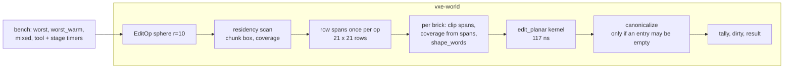

# 0031: Edit cost, third pass: a profile of the planar path, then its largest shares, to put the `B` line back under 2 ms

> **Status:** draft
> **Created:** 2026-10-21
> **Milestone:** M1's edit-cost line in `docs/roadmap.md` (`nfr.md` §4; the "one more
> optimization pass" the owner planned on 2026-10-20 when the line was raised to 2.2 ms)
> **Related ADRs:** [ADR-0012](../adrs/0012-mask-first-brick-with-per-brick-palette-planes.md)
> (the planar kernel this plan profiles around; its format does not change),
> [ADR-0002](../adrs/0002-brick-map-layout-and-per-chunk-locked-access.md) (the per-chunk
> locks and the dirty set the op path takes)
> **Source:** `nfr.md` §4's quiet-box re-read at 2796062 (`worst` 1.79 ms, the `B` line 2.06
> to 2.09 ms against the original 2 ms); Plan 0021's kernel readings (117 ns per carve
> brick-edit, the kernel about a fifth of the whole op); the owner's selection (2026-10-21).
> **Starts:** independent of every other plan; `vxe-world` and the bench only, with one
> reading through the fly-through's server path.

## TL;DR

The planar kernel is a fifth of an edit's cost; the rest is the op path around it. This plan
profiles `worst_warm` by symbol and by stage first, then attacks the two largest shares with
the levers the code shows (one span solve per op row instead of per brick row, a coverage
test from the spans instead of per brick, a canonical check only when an entry can have
emptied, fewer allocations per op), each paired against the previous tree on a quiet box,
with every pinned hash unchanged. The first thing a reader sees is a stage table that sums to
the bench, then the `B` line under 2 ms again.

## Context & problem

`nfr.md` §4: 100 radius-1 m carves cost at most 2.2 ms of CPU on the dev reference (raised
from 2 ms on 2026-10-20). The quiet-box re-read at 2796062 reads `worst` 1.79 ms and
`worst_warm` 1.79 ms in the bench, and the fly-through's `B` line (through the server: the
tick, the op log, the coarse-grid update after each op) 2.06 to 2.09 ms. The §4 tick
readings put the server's share at about 0.2 ms (grid updates 0.11 ms, tick overhead 0.09 ms
per 100 inputs), so the bench's 1.79 ms is what has to fall: to about 1.6 ms for the `B` line
to read under 2.0 ms.

What Plan 0021 measured: the planar kernel reads 117 ns per carve brick-edit and the 100
carves' brick-edits summed to 0.32 ms of the 1.5 ms `worst_warm` of that window, so about
four fifths of an edit is outside the kernel. The op path (`World::apply_with`) per op:
the residency scan over the shape's chunk box with a coverage test per chunk; per chunk a
write lock, then per brick row a coverage test per brick (`Shape::coverage`, a sphere
against a box in `i64`) and a `RowCache` that walks the sphere's spans for the brick row's
64 rows (`sphere_row_spans`, incremental, no square root in the common case); per brick a
64-entry span array, `shape_words`, the kernel, `canonicalize` (popcounts of every entry
over every plane) and the tally; per op the dirty set (a `Mutex<HashSet>`), the touched
list and the result's vectors. None of these shares has been read; the kernel bench reads
the kernel alone.

The consumer requirement is `project-context.md`'s Edits row: many small edits per frame at
interactive cost. The `nfr.md` figure touched is §4's cost line.

## Decision

We measure before we move. Phase 1 adds a stage breakdown to the bench and a profile with
line attribution, and the plan commits to the top two shares it finds among the levers below;
each lever is its own phase with a paired reading, and a lever that reads under 3 % is logged
and left. The levers, from the code, in the order the architect expects them to matter:

1. **One span solve per op row.** Solve the sphere's `(y, z)` row spans once per op over the
   op's whole `x` extent (at most 21 x 21 rows for radius 10) and clip per brick, instead of a
   `RowCache` walk per brick row (up to 16 brick rows x 64 rows, each a walk).
2. **Coverage from the spans.** A brick is `Inside` when its 64 rows' spans cover its full
   `x` extent, `Outside` when they are all empty, else `Partial`; no sphere-against-box test
   per brick, and the brick-row window falls out of the same pass.
3. **Canonical check only when an entry may have emptied.** Skip `canonicalize`'s popcounts
   when the kernel's changed count is below every entry's count before the edit (the tally
   knows both); a carve into a brick whose rock far exceeds the carve cannot empty an entry.
4. **Fewer allocations per op.** The `touched` and `changed_from` vectors sized from the
   chunk box; the dirty set marked once per chunk (already) through a `Vec` drained by
   `take_dirty` instead of a `HashSet` insert per chunk.

We rejected changing the brick format (ADR-0012 stands), SIMD intrinsics in `vxe-world` (the
crate is portable and deterministic; the kernel is word operations already), and a per-tick
batched coarse-grid update on the server (the grid is read between ops by the logic's
queries, so op order is observable).

## Architecture diagram



## Implementation phases

Each phase ships as its own commit. `dev` implements all phases in one session with no review
between phases. The architect reviews once at the end, in a fresh session. Every reading is
taken under `nfr.md` §9's quiet-box protocol, paired and alternated with the previous phase's
tree built from `git archive`.

### Phase 1: The stage table and the profile
- **Owner skill:** dev
- **What:** a `stages` arm of `cargo bench -p vxe-world --bench edits` that runs the `worst`
  ops through an instrumented copy of the op path (a `cfg(feature = "edit-stages")` timer
  set in `edit.rs`, off by default and denied by `clippy.toml`'s clock rule only outside the
  feature) and prints the summed time per stage: residency scan, span solving, per-brick
  coverage and span clipping, `shape_words`, the kernel, `canonicalize`, tally and dirty
  marking, result assembly; and a `perf record` of the `worst_warm` arm with line
  attribution, its top 15 symbols in the log.
- **Files touched:** `crates/vxe-world/benches/edits.rs`, `crates/vxe-world/src/edit.rs`,
  `crates/vxe-world/Cargo.toml` (the feature), `clippy.toml` (the feature's allowance, if
  the timer needs one), this plan's log.
- **Done when:** the stage table's sum is within 10 % of the `worst` median read in the same
  session; the table and the profile's top 15 are in the log; the log names the two largest
  stages and maps them to the levers above (or to a lever the profile shows that the list
  does not, which is added to the plan as a note); the stage timers compile out of the
  default build (`cargo build` has no clock in `vxe-world`, checked by the existing clippy
  denial).

### Phase 2: The first lever
- **Owner skill:** dev
- **What:** the lever that Phase 1's largest stage names (the architect expects lever 1, one
  span solve per op row, with lever 2 falling out of it).
- **Files touched:** `crates/vxe-world/src/edit.rs`, `shape.rs`, `tests/edits.rs`,
  `benches/edits.rs`.
- **Done when:** the determinism vector, the 2000-op oracle with the canonical check after
  every op, the kernel oracle and every pinned hash constant are unchanged; the capture test
  (`apply_capturing`) returns the same `RowSpans` per brick-edit as before the change for the
  `worst` ops (a new test compares the captured spans of 100 ops against the pre-change
  tree's, pinned as a hash); `worst_warm` falls by at least the stage's share less 3 % of the
  bench, or the phase logs the reading and the reason.

### Phase 3: The second lever
- **Owner skill:** dev
- **What:** the lever that Phase 1's second-largest stage names (the architect expects lever
  3, the canonical check, or lever 4).
- **Files touched:** `crates/vxe-world/src/edit.rs`, `packed.rs` (if lever 3),
  `store.rs` (if lever 4), `tests/edits.rs`.
- **Done when:** the same invariants as Phase 2; for lever 3, a test that a carve which
  empties an entry (a brick whose only ore voxel is carved) still canonicalises (the brick's
  palette loses the entry and `is_canonical` holds), and the oracle's canonical check after
  every op still passes; `worst_warm` falls by at least the stage's share less 3 %, or the
  phase logs the reading and the reason.

### Phase 4: The quiet-box readings and the line
- **Owner skill:** dev
- **What:** `worst`, `worst_warm`, `mixed`, `tool` and `tool_warm`, the replay bench, the
  server tick bench, and the fly-through's `B` line (`--level --seed 1 --headless --bench 1
  --frames 1`), paired with 2796062's tree; the readings replace §4's and the plan's log
  states whether the 2 ms figure is met.
- **Files touched:** `docs/nfr.md` §4, this plan's log.
- **Done when:** the `B` line reads under 2.0 ms and `worst_warm` at most 1.6 ms in three
  runs each on the quiet box (from 2.06 to 2.09 and 1.79 ms); `mixed`, `tool` and the replay
  and tick benches are recorded with no bar and no regression beyond noise (a paired
  difference inside the confidence intervals); the owner is asked at the close whether §4's
  line returns to 2.0 ms on the dev box.

## Data shapes

No format or API change. The stage timer is a feature-gated accumulator in `edit.rs`:

```rust
// illustrative, feature "edit-stages" only
#[cfg(feature = "edit-stages")]
pub struct EditStages { pub ns: [u64; 8] }  // scan, spans, coverage, words, kernel, canon, tally, result
```

## Budgets

| `nfr.md` figure | line | projection (dev box, quiet) | how the close measures it |
|---|---|---|---|
| §4 Edit cost, the bench (`worst_warm`) | 2.2 ms (2.0 asked) | 1.79 to about 1.5 to 1.6 ms | Phase 4, three paired runs |
| §4 the fly-through `B` line | 2.2 ms (2.0 asked) | 2.06 to 2.09 to under 2.0 ms | Phase 4 |
| §4 tick overhead, replay throughput | 100 µs, none | unchanged | Phase 4 |

No GPU figure moves; nothing here runs on an adapter.

## Risks & open questions

- **Determinism is the constraint on every lever**: equal voxels, equal counts, equal
  hashes on both CI arms; the span-capture hash and the oracle are the guard, and the
  Windows arm confirms on the first push.
- **The stage timer must not leak a clock into `vxe-world`'s default build**: the feature
  gate and clippy's denial are the gate; the bench crate enables the feature.
- **Lever 3's "may have emptied" test must be conservative**: when in doubt, canonicalise;
  the oracle's check after every op catches a wrong skip.
- **The gains may be smaller than the shares** (cache effects move between stages); the
  done-whens allow 3 % of slack and ask for the reading either way.
- **Threading:** unchanged; the op path holds the map read lock and one chunk write lock at
  a time, as today.

## What this plan does NOT do

- **A brick-format change, SIMD, or a cap on ops per frame.**
- **The `tool` case's 5.8 ms**: it has no line; it is recorded.
- **Batching the server's coarse-grid update per tick** (op order is observable).
- **The baseline or slow-adapter reading**: a CPU line, read on the dev box as §4 says.

## Implementation log

> Written by `dev`: one row per phase as its commit lands, then the close block. **The phases
> above are the contract. This section records what happened.** Observations, never conclusions:
> no pass list, no self-assessment. Deviations and unmet done-whens are **always** disclosed.
> Keep it shorter than `## Implementation phases`.

| phase | owner | state | commit |
|---|---|---|---|
| 1: The stage table and the profile | dev | not started | |
| 2: The first lever | dev | not started | |
| 3: The second lever | dev | not started | |
| 4: The quiet-box readings and the line | dev | not started | |

### Notes

_(Deviations from the plan, with the commit, stated without justification. Done-whens not
satisfiable as stated, and what was done instead. Followups noticed and not acted on. One line
each. Empty is fine.)_

### Close triggers

_(Facts for the architect. No recommendations, and no suggested version bump.)_

- **What shipped:** feature / fix-only / docs-chore-only
- **Public API changed:** types, traits, functions, shader interfaces, config (list them, or none)
- **Budget readings:** each `nfr.md` figure touched, with its measured value, machine and commit
- **Gate at the tip:** the commands run (build, nextest, doctests, clippy, fmt, deny), exit codes, test counts
- **Outstanding `human` phases:** which, or none

## Followups

- The remaining levers of the list, if Phase 4 misses the line with two.
