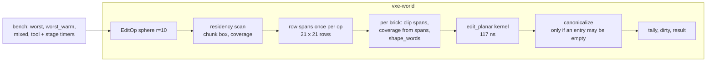

# 0031: Edit cost, third pass: a profile of the planar path, then its largest shares, to put the `B` line back under 2 ms

> **Status:** in-progress (2026-10-21): every phase implemented; awaiting the close review
> **Created:** 2026-10-21
> **Milestone:** M1's edit-cost line in `docs/roadmap.md` (`nfr.md` §4; the "one more
> optimization pass" the owner planned on 2026-10-20 when the line was raised to 2.2 ms)
> **Related ADRs:** [ADR-0012](../adrs/0012-mask-first-brick-with-per-brick-palette-planes.md)
> (the planar kernel this plan profiles around; its format does not change),
> [ADR-0002](../adrs/0002-brick-map-layout-and-per-chunk-locked-access.md) (the per-chunk
> locks and the dirty set the op path takes)
> **Source:** `nfr.md` §4's quiet-box re-read at 2796062 (`worst` 1.79 ms, the `B` line 2.06
> to 2.09 ms against the original 2 ms); Plan 0021's kernel readings (117 ns per carve
> brick-edit, the kernel about a fifth of the whole op); the owner's selection (2026-10-21).
> **Starts:** independent of every other plan; `vxe-world` and the bench only, with one
> reading through the fly-through's server path.

## TL;DR

The planar kernel is a fifth of an edit's cost; the rest is the op path around it. This plan
profiles `worst_warm` by symbol and by stage first, then attacks the two largest shares with
the levers the code shows (one span solve per op row instead of per brick row, a coverage
test from the spans instead of per brick, a canonical check only when an entry can have
emptied, fewer allocations per op), each paired against the previous tree on a quiet box,
with every pinned hash unchanged. The first thing a reader sees is a stage table that sums to
the bench, then the `B` line under 2 ms again.

## Context & problem

`nfr.md` §4: 100 radius-1 m carves cost at most 2.2 ms of CPU on the dev reference (raised
from 2 ms on 2026-10-20). The quiet-box re-read at 2796062 reads `worst` 1.79 ms and
`worst_warm` 1.79 ms in the bench, and the fly-through's `B` line (through the server: the
tick, the op log, the coarse-grid update after each op) 2.06 to 2.09 ms. The §4 tick
readings put the server's share at about 0.2 ms (grid updates 0.11 ms, tick overhead 0.09 ms
per 100 inputs), so the bench's 1.79 ms is what has to fall: to about 1.6 ms for the `B` line
to read under 2.0 ms.

What Plan 0021 measured: the planar kernel reads 117 ns per carve brick-edit and the 100
carves' brick-edits summed to 0.32 ms of the 1.5 ms `worst_warm` of that window, so about
four fifths of an edit is outside the kernel. The op path (`World::apply_with`) per op:
the residency scan over the shape's chunk box with a coverage test per chunk; per chunk a
write lock, then per brick row a coverage test per brick (`Shape::coverage`, a sphere
against a box in `i64`) and a `RowCache` that walks the sphere's spans for the brick row's
64 rows (`sphere_row_spans`, incremental, no square root in the common case); per brick a
64-entry span array, `shape_words`, the kernel, `canonicalize` (popcounts of every entry
over every plane) and the tally; per op the dirty set (a `Mutex<HashSet>`), the touched
list and the result's vectors. None of these shares has been read; the kernel bench reads
the kernel alone.

The consumer requirement is `project-context.md`'s Edits row: many small edits per frame at
interactive cost. The `nfr.md` figure touched is §4's cost line.

## Decision

We measure before we move. Phase 1 adds a stage breakdown to the bench and a profile with
line attribution, and the plan commits to the top two shares it finds among the levers below;
each lever is its own phase with a paired reading, and a lever that reads under 3 % is logged
and left. The levers, from the code, in the order the architect expects them to matter:

1. **One span solve per op row.** Solve the sphere's `(y, z)` row spans once per op over the
   op's whole `x` extent (at most 21 x 21 rows for radius 10) and clip per brick, instead of a
   `RowCache` walk per brick row (up to 16 brick rows x 64 rows, each a walk).
2. **Coverage from the spans.** A brick is `Inside` when its 64 rows' spans cover its full
   `x` extent, `Outside` when they are all empty, else `Partial`; no sphere-against-box test
   per brick, and the brick-row window falls out of the same pass.
3. **Canonical check only when an entry may have emptied.** Skip `canonicalize`'s popcounts
   when the kernel's changed count is below every entry's count before the edit (the tally
   knows both); a carve into a brick whose rock far exceeds the carve cannot empty an entry.
4. **Fewer allocations per op.** The `touched` and `changed_from` vectors sized from the
   chunk box; the dirty set marked once per chunk (already) through a `Vec` drained by
   `take_dirty` instead of a `HashSet` insert per chunk.

We rejected changing the brick format (ADR-0012 stands), SIMD intrinsics in `vxe-world` (the
crate is portable and deterministic; the kernel is word operations already), and a per-tick
batched coarse-grid update on the server (the grid is read between ops by the logic's
queries, so op order is observable).

## Architecture diagram



## Implementation phases

Each phase ships as its own commit. `dev` implements all phases in one session with no review
between phases. The architect reviews once at the end, in a fresh session. Every reading is
taken under `nfr.md` §9's quiet-box protocol, paired and alternated with the previous phase's
tree built from `git archive`.

### Phase 1: The stage table and the profile
- **Owner skill:** dev
- **What:** a `stages` arm of `cargo bench -p vxe-world --bench edits` that runs the `worst`
  ops through an instrumented copy of the op path (a `cfg(feature = "edit-stages")` timer
  set in `edit.rs`, off by default and denied by `clippy.toml`'s clock rule only outside the
  feature) and prints the summed time per stage: residency scan, span solving, per-brick
  coverage and span clipping, `shape_words`, the kernel, `canonicalize`, tally and dirty
  marking, result assembly; and a `perf record` of the `worst_warm` arm with line
  attribution, its top 15 symbols in the log.
- **Files touched:** `crates/vxe-world/benches/edits.rs`, `crates/vxe-world/src/edit.rs`,
  `crates/vxe-world/Cargo.toml` (the feature), `clippy.toml` (the feature's allowance, if
  the timer needs one), this plan's log.
- **Done when:** the stage table's sum is within 10 % of the `worst` median read in the same
  session; the table and the profile's top 15 are in the log; the log names the two largest
  stages and maps them to the levers above (or to a lever the profile shows that the list
  does not, which is added to the plan as a note); the stage timers compile out of the
  default build (`cargo build` has no clock in `vxe-world`, checked by the existing clippy
  denial).

### Phase 2: The first lever
- **Owner skill:** dev
- **What:** the lever that Phase 1's largest stage names (the architect expects lever 1, one
  span solve per op row, with lever 2 falling out of it).
- **Files touched:** `crates/vxe-world/src/edit.rs`, `shape.rs`, `tests/edits.rs`,
  `benches/edits.rs`.
- **Done when:** the determinism vector, the 2000-op oracle with the canonical check after
  every op, the kernel oracle and every pinned hash constant are unchanged; the capture test
  (`apply_capturing`) returns the same `RowSpans` per brick-edit as before the change for the
  `worst` ops (a new test compares the captured spans of 100 ops against the pre-change
  tree's, pinned as a hash); `worst_warm` falls by at least the stage's share less 3 % of the
  bench, or the phase logs the reading and the reason.

### Phase 3: The second lever
- **Owner skill:** dev
- **What:** the lever that Phase 1's second-largest stage names (the architect expects lever
  3, the canonical check, or lever 4).
- **Files touched:** `crates/vxe-world/src/edit.rs`, `packed.rs` (if lever 3),
  `store.rs` (if lever 4), `tests/edits.rs`.
- **Done when:** the same invariants as Phase 2; for lever 3, a test that a carve which
  empties an entry (a brick whose only ore voxel is carved) still canonicalises (the brick's
  palette loses the entry and `is_canonical` holds), and the oracle's canonical check after
  every op still passes; `worst_warm` falls by at least the stage's share less 3 %, or the
  phase logs the reading and the reason.

### Phase 4: The quiet-box readings and the line
- **Owner skill:** dev
- **What:** `worst`, `worst_warm`, `mixed`, `tool` and `tool_warm`, the replay bench, the
  server tick bench, and the fly-through's `B` line (`--level --seed 1 --headless --bench 1
  --frames 1`), paired with 2796062's tree; the readings replace §4's and the plan's log
  states whether the 2 ms figure is met.
- **Files touched:** `docs/nfr.md` §4, this plan's log.
- **Done when:** the `B` line reads under 2.0 ms and `worst_warm` at most 1.6 ms in three
  runs each on the quiet box (from 2.06 to 2.09 and 1.79 ms); `mixed`, `tool` and the replay
  and tick benches are recorded with no bar and no regression beyond noise (a paired
  difference inside the confidence intervals); the owner is asked at the close whether §4's
  line returns to 2.0 ms on the dev box.

## Data shapes

No format or API change. The stage timer is a feature-gated accumulator in `edit.rs`:

```rust
// illustrative, feature "edit-stages" only
#[cfg(feature = "edit-stages")]
pub struct EditStages { pub ns: [u64; 8] }  // scan, spans, coverage, words, kernel, canon, tally, result
```

## Budgets

| `nfr.md` figure | line | projection (dev box, quiet) | how the close measures it |
|---|---|---|---|
| §4 Edit cost, the bench (`worst_warm`) | 2.2 ms (2.0 asked) | 1.79 to about 1.5 to 1.6 ms | Phase 4, three paired runs |
| §4 the fly-through `B` line | 2.2 ms (2.0 asked) | 2.06 to 2.09 to under 2.0 ms | Phase 4 |
| §4 tick overhead, replay throughput | 100 µs, none | unchanged | Phase 4 |

No GPU figure moves; nothing here runs on an adapter.

## Risks & open questions

- **Determinism is the constraint on every lever**: equal voxels, equal counts, equal
  hashes on both CI arms; the span-capture hash and the oracle are the guard, and the
  Windows arm confirms on the first push.
- **The stage timer must not leak a clock into `vxe-world`'s default build**: the feature
  gate and clippy's denial are the gate; the bench crate enables the feature.
- **Lever 3's "may have emptied" test must be conservative**: when in doubt, canonicalise;
  the oracle's check after every op catches a wrong skip.
- **The gains may be smaller than the shares** (cache effects move between stages); the
  done-whens allow 3 % of slack and ask for the reading either way.
- **Threading:** unchanged; the op path holds the map read lock and one chunk write lock at
  a time, as today.

## What this plan does NOT do

- **A brick-format change, SIMD, or a cap on ops per frame.**
- **The `tool` case's 5.8 ms**: it has no line; it is recorded.
- **Batching the server's coarse-grid update per tick** (op order is observable).
- **The baseline or slow-adapter reading**: a CPU line, read on the dev box as §4 says.

## Implementation log

> Written by `dev`: one row per phase as its commit lands, then the close block. **The phases
> above are the contract. This section records what happened.** Observations, never conclusions:
> no pass list, no self-assessment. Deviations and unmet done-whens are **always** disclosed.
> Keep it shorter than `## Implementation phases`.

| phase | owner | state | commit |
|---|---|---|---|
| 1: The stage table and the profile | dev | done | a49c6a1 |
| 2: The first lever | dev | done | f3e2623 |
| 3: The second lever | dev | done | 8dad5ca |
| 4: The quiet-box readings and the line | dev | done | 6107041 |

### Notes

- Phase 1: the stages are timed in place, not in a copy of the op path: `apply_with` takes a
  `Stamps` sink, `NoStages` (empty, inlined) in the default build and `EditStages` under
  `edit-stages` through `#[doc(hidden)] World::apply_staged` (Phase 1 commit).
- Phase 1: the clock reads carry `#[allow(clippy::disallowed_methods, reason = ...)]` on the
  feature-gated code; `clippy.toml` is unchanged (Phase 1 commit).
- Phase 1: files beyond the list: `packed.rs` (`edit_planar` split into
  `edit_planar_uncanonical` and a `pub(crate)` `canonicalize`, so the two time apart) and
  `lib.rs` (the feature-gated `EditStages` re-export) (Phase 1 commit).
- Phase 1: ten stages, not eight: `lock` (the chunk write lock) and `clip` (the per-brick span
  array clipped from the brick row's) split out; the kernel's per-material counts land in
  `kernel` (Phase 1 commit).
- Phase 1: the `net` column subtracts one clock read (22 to 26 ns, read up front) per stage
  interval from `raw` (Phase 1 commit).
- Phase 1 stage table (`cargo bench -p vxe-world --bench edits --features edit-stages --
  '^(stages|worst)$'`, Ryzen 9 5900HS, Phase 1 tree on ae58f0c, exclusive perf lock, NOT
  quiet: 1-minute load 15.6 to 12.9, `java` 214 %, `game.exe` 76 %, two other lanes), us per
  100 ops, net, two runs: scan 13.6 / 15.1, lock 3.2 / 3.3, spans 411.0 / 433.3, coverage
  91.0 / 92.3, clip 513.7 / 543.0, words 229.1 / 242.3, kernel 169.3 / 182.9, canon 26.8 /
  26.0, tally 36.3 / 35.2, result 3.2 / 3.4; sum 1497.1 / 1576.8 against `worst` medians
  1.4958 / 1.6066 ms in the same runs (raw sums 1950.3 / 2052.0) (Phase 1 commit).
- Phase 1: earlier runs at load 7.9 to 18 (nine stages, then ten): net sum 2339.7 us against
  `worst` 2.4070 ms; 2967.3 us against 2.7157 ms (Phase 1 commit).
- Phase 1 profile (`perf record -F 2999` of `worst_warm` under `--profile-time 10`, bench
  profile with `debug = line-tables-only`, load 16 to 18, 220752 samples; the world's
  generation is in the samples): `World::apply_with` 69.91 %, `Arc<RwLock<Chunk>>::drop_slow`
  2.15, `Shape::coverage` 2.07, the generation closure 1.90, `packed::bounds_of` 1.47, `cfree`
  1.24, unresolved 0xa4fbe 0.94, 0x176545 0.92, `Brick::canonicalize` 0.77, `__libc_calloc`
  0.77, 0x17653b 0.71, 0x176540 0.67, 0x17654a 0.61, `int_sqrt::u64` 0.55, 0x176524 0.51.
  Top lines: `edit.rs` 656 (`if let Brick::Uniform` on the brick's first touch) 5.07 %,
  `cmp.rs:1916` 5.07, `edit.rs` 872 (`RowCache::span`'s return) 4.81, `cmp.rs:0` 3.72,
  `packed.rs` 341 (`shape_words`) 3.49, `edit.rs` 867 (`RowCache::span`'s solved bit) 3.47,
  `edit.rs` 683 (the clip's span store) 3.44 (Phase 1 commit).
- Phase 1: the two largest stages are `clip` (34 % of the net sum) and `spans` (27 %); `words`
  is third (15 %). `clip` maps to no lever of the list: its lever is the shape words built
  straight from the brick row's spans per brick (no 64-entry span array, no per-row cache
  lookup), which also removes `words`' `shape_words`. `spans` maps to lever 1. Phase 2 takes
  the `clip` lever and Phase 3 lever 1 (Phase 1 commit).
- Phase 1: the spans stage already solves each `(y, z)` row once per chunk (the brick row's
  cache covers its 64 rows for every brick); lever 1 removes only the repeat per chunk along
  `x` (215 chunk locks over 100 ops) and the walk restarts per brick row (Phase 1 commit).
- Phase 2: the lever is Phase 1's `clip` lever, not lever 1: `RowCache` solves every row of
  its brick row up front for every shape (the sphere as before, the box and capsule by
  `row_span` over the same window instead of at first use) and builds each brick's shape
  words from its 64 spans branch-free (`RowCache::words`); an `Inside` brick takes
  `box_words`; the captured spans are read back from the words (`spans_of`) (Phase 2 commit).
- Phase 2: `shape.rs` and `benches/edits.rs` are unchanged; full workspace nextest 555 passed, 4 skipped (Phase 2 commit).
- Phase 2: the capture test pins 2721 brick-edits and spans hash `0x7a19_1902_796c_af86`,
  read on the Phase 1 tree a49c6a1 and unchanged after (Phase 2 commit).
- Phase 2 paired reading (Ryzen 9 5900HS, exclusive perf lock, alternated a49c6a1 / Phase 2
  twice, `--features edit-stages`, NOT quiet: load 11.7 falling to 8.3, `game.exe` 96 %,
  `gdb` 70 %, other lanes): `worst_warm` 2.1642 / 1.0899 ms, then 1.5200 / 0.9633 ms (-37 %
  in the second pair); net stage sums 2048.6 / 1120.4 us, 1648.4 / 1013.9 us; second pair
  `clip` 563.8 to 283.3 us, `words` 250.6 to 22.4 us, `spans` 449.3 to 375.5 us, `kernel`
  190.2 to 164.5 us. Phase 1's `clip` share was 34 % (Phase 2 commit).
- Phase 3: the lever is lever 1 (Phase 1's second-largest stage, `spans`), not lever 3 or 4:
  `OpRows` holds every `(y, z)` row span of the op's bounds over their whole `x` extent, the
  sphere's walked once per op by `sphere_row_spans`, another shape's solved by `row_span` at
  first use; each brick's words read it directly (`OpRows::words`), and the brick-row
  `RowCache` is gone. Lever 2 (coverage from the spans) is not taken (Phase 3 commit).
- Phase 3: `shape.rs` is touched, outside the phase's list: `sphere_row_spans` writes
  `out[(y - ylo) + ny (z - zlo)]` over any extent, and `walked_spans_equal_solved_spans` also
  walks each sphere's whole bounds in one call (Phase 3 commit).
- Phase 3: a first cut that kept the per-brick-row copy from `OpRows` read no gain against
  f3e2623 (`worst_warm` 0.9023 / 0.8786 ms, 0.9104 / 0.9374 ms, load 18.0 to 8.6); it was
  replaced before the commit (Phase 3 commit).
- Phase 3 paired reading (Ryzen 9 5900HS, exclusive perf lock, alternated f3e2623 / Phase 3
  twice, `--features edit-stages`, NOT quiet: load 8.6 falling to 7.1, `game.exe` 88 %, two
  `python3` near 90 %): `worst_warm` 0.9547 / 0.8810 ms, then 0.9281 / 0.8726 ms (-6.0 % in
  the second pair); second pair `spans` 373.9 to 216.1 us, `clip` 281.0 to 349.7 us, net sums
  1009.8 / 903.0 us (Phase 3 commit).
- Phase 3 done-when not met as stated: `worst_warm` fell 6 to 8 %, under Phase 1's `spans`
  share (27 %) less 3 %. The stage was the per-row visit of each brick row's rows, which each
  brick still makes; one walk per op removes only the repeat per chunk along `x` and the
  brick-row copy (Phase 3 commit).
- Phase 3: full workspace nextest 555 passed, 4 skipped (Phase 3 commit).
- Phase 4: the readings are added to `nfr.md` §4's cost, replay and tick bullets beside the
  earlier ones, not in place of them; the §4 line (2.2 ms) is unchanged, at the
  orchestrator's instruction, for the owner's decision (Phase 4 commit).
- Phase 4: 2796062's tree read 1.32 ms `worst` and a 1.49 to 1.54 ms `B` line in this window,
  against 1.79 ms and 2.06 to 2.09 ms at `nfr.md`'s re-read (Phase 4 commit).
- Phase 4: two runs were aborted by the pre-run check (a `kworker` at 63 %, `chromium` at
  78 %, an `omarchy` script at 100 %, each gone within seconds) and rerun; the script waits
  for the 1-minute load to fall under 2 before each run (Phase 4 commit).
- Followup noticed: the `tool` case (3.58 ms) carries the capsule's lazy `row_span` solves in
  `clip`; no stage table was read for it.

### Close triggers

_(Facts for the architect. No recommendations, and no suggested version bump.)_

- **What shipped:** feature (a feature-gated stage timer and bench arm) and two perf changes
  to the op path.
- **Public API changed:** none in the default build. Under feature `edit-stages`:
  `#[doc(hidden)] World::apply_staged` and `#[doc(hidden)] EditStages`. New cargo feature
  `edit-stages` on `vxe-world`.
- **Budget readings** (dev reference, AMD Ryzen 9 5900HS, on AC, performance profile and
  governor, 8dad5ca, exclusive perf lock, 1-minute load 0.48 to 1.98 and no process above
  7 % CPU before each run, three runs alternated with 2796062, criterion medians):
  - §4 `worst_warm` 0.765 / 0.775 / 0.776 ms (2796062: 1.316 / 1.319 / 1.338); `worst`
    0.766 / 0.774 / 0.774 ms (1.318 / 1.316 / 1.337).
  - §4 fly-through `B` line 1.00 / 0.99 / 0.99 ms (2796062: 1.49 / 1.49 / 1.54).
  - §4 `mixed` 0.622 / 0.628 / 0.630 ms (1.044 / 1.047 / 1.055); `tool` 3.585 / 3.578 /
    3.590 ms (4.282 / 4.194 / 4.217); `tool_warm` 3.585 / 3.586 / 3.590 ms (4.284 / 4.195 /
    4.219).
  - Replay 61.29 / 61.29 / 61.20 ms (103.16 / 102.64 / 103.19).
  - Tick overhead 70.3 / 63.3 / 69.1 us per 100 inputs (64.7 / 63.5 / 70.4); grid updates
    77.2 / 84.6 / 73.0 us (88.9 / 86.0 / 78.3).
  - The Phase 4 bars: the `B` line under 2.0 ms and `worst_warm` at most 1.6 ms in three
    runs each are met; the §4 line is 2.2 ms and unchanged. Owner question: does §4's line
    return to 2.0 ms on the dev box?
- **Gate at the tip:** `cargo build` exit 0; `cargo nextest run --workspace` (after
  `scripts/build-guests.sh`) 555 passed, 4 skipped, exit 0 at 8dad5ca; `cargo test --doc
  --workspace` exit 0 at Phase 1; `cargo clippy --workspace --all-targets -- -D warnings`
  and `cargo clippy -p vxe-world --all-targets --features edit-stages -- -D warnings` exit 0;
  `cargo fmt --all --check` exit 0; `cargo deny check` exit 0 (advisories, bans, licenses,
  sources ok); `check-doc-links` 200 links resolve, `check-comment-hygiene` OK,
  `check-index-rows` OK.
- **Outstanding `human` phases:** none.

## Followups

- The remaining levers of the list, if Phase 4 misses the line with two.
