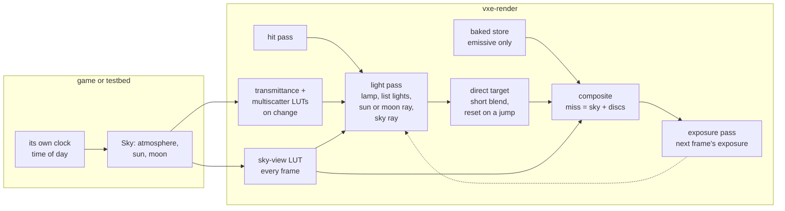

# 0032: Sun and sky: a Hillaire atmosphere, a time of day the game sets, the sun and moon as a directional sample, sky light from a sky ray, an outdoor testbed source

> **Status:** approved (2026-10-22), redesigned 2026-11-10 (review pass; owner chose the redesign)
> **Created:** 2026-10-22
> **Milestone:** M10: Outdoors in [`docs/roadmap.md`](../roadmap.md)
> **Related ADRs:** [ADR-0026](../adrs/0026-atmosphere-from-hillaire-luts-built-on-the-gpu-at-runtime.md)
> (proposed with this plan: the atmosphere model),
> [ADR-0027](../adrs/0027-the-sun-shadow-is-one-per-pixel-ray-in-the-light-pass.md) (proposed
> with this plan: the sun's shadow, and where the directional and sky terms are stored),
> [ADR-0044](../adrs/0044-direct-light-from-a-fixed-list-of-analytic-lights-one-shadow-ray-each.md)
> (proposed with Plan 0058: the coloured direct-light target the sun and the sky ray are added to),
> [ADR-0046](../adrs/0046-static-emissive-light-is-baked-per-chunk-when-a-chunk-loads-or-changes.md)
> (the baked emissive store, which takes no sun or sky term),
> [ADR-0043](../adrs/0043-emissive-light-from-a-world-space-per-face-table-and-a-lamp-bounce-probe-channel.md)
> (the probes are a lamp-only bounce channel, so they carry no sky light),
> [ADR-0018](../adrs/0018-direct-light-per-pixel-one-sample-from-a-hit-buffer-with-svgf-history-killed-by-edits.md)
> (the light pass, the temporal pass and the composite this plan extends),
> [ADR-0033](../adrs/0033-eye-adaptation-as-an-asymmetric-two-stage-exposure-on-the-gpu.md)
> (the exposure this plan's sky is metered by),
> [ADR-0034](../adrs/0034-fsr-2-ported-to-wgsl-as-the-default-upscaler-candidate.md) (FSR 2 at
> 1.5, the default upscaler the sky and the sun's shadow pass through),
> [ADR-0032](../adrs/0032-night-sky-drawn-analytically-on-miss-pixels-with-a-marched-aurora-shell.md)
> (Plan 0037's night sky, which draws on this plan's miss pixels)
> **Source:** the owner's answers of 2026-10-22 (outdoors is a general engine capability; the
> time of day is a parameter the game sets; Hillaire 2020 with per-frame LUTs; the sun's shadow
> is one per-pixel ray; every toggle shows its mode in the window; readings on both adapters),
> of 2026-11-03 (a stable image without flicker or aliasing comes first) and of 2026-11-10
> (redesign this plan on the lighting base as it stands; the order below).
> **Starts after:** Plan 0060, Plan 0061,
> [Plan 0058](0058-dynamic-lights-a-list-of-analytic-lights-dropped-carried-and-bounced.md),
> [Plan 0044](0044-hot-path-and-defect-pass.md),
> [Plan 0045](0045-structure-pass-split-the-mega-files-share-the-fixtures.md), the plan that
> removes the `own` upscaler and the render-profile plan (the last two are owed and take their
> numbers when drafted). **The base commit** in every bar is main after the last of those
> merges. Plan 0045 splits `marcher.rs`, `gpu_world.rs`, `march.wgsl` and the fly-through's
> `main.rs`, so every "Files touched" below names the file as it is at main 82ea836 and `dev`
> re-reads the paths at the base commit; the names `dev` finds in the tree win. Plan 0058
> builds the direct-light target this plan stores into, so the architect re-reads Phases 5 to 7
> and the Interface section against Plan 0058 at its close, before this lane starts.
> The names in this plan were checked against main at 82ea836.

## TL;DR

The frame gets a sky. A `Sky` the game sets each frame names the atmosphere, the sun and the
moon (direction, illuminance and angular radius). The engine holds no clock: the game turns its
own time into directions, through a helper the engine offers. Compute passes build Hillaire's
transmittance, multiple-scattering and sky-view LUTs (ADR-0026). A primary ray that leaves the
world shows the sky and the sun's or moon's disc. The light pass adds one directional sample
per lighting pixel, with a soft shadow ray toward the sun or the moon, and a cosine-weighted
sky ray for the sky's light (ADR-0027). Both land in the coloured direct-light target Plan 0058
builds, on its short blend. Nothing goes into the probes or the baked emissive store. The
fly-through gains an outdoor source of integer hills with a cave mouth that leads into a
roofed chamber, a source switch, a time of day, and a seeded forest for the worst daylight
case. The first thing a reader sees is Phase 1's headless golden of an empty world under a
noon sky. In the window they see Phase 3's hills under that sky, then Phase 5's sunlit hills
with soft shadows.

## Context & problem

Outdoors is a general engine capability (owner, 2026-10-22). The first consumer is underground
(`project-context.md`), so it sets the sky off and must see no change. Other consumers need
open sky with a dynamic day and night. This plan is the first of the outdoors batch: Plan 0033
builds the far field, Plan 0034 liquid surfaces, Plan 0035 aerial perspective and clouds, Plan
0036 weather and Plan 0037 the night sky. All of them read this plan's sky, through the
section "Interface for Plans 0033 to 0037".

Today a ray that leaves the mirror's window returns black, and the renderer has no directional
light. The lighting base this plan stands on, as the tree has it:

- **Emissive light is baked.** A cube face reads its emissive light from the per-chunk brick
  store (ADR-0046, Plan 0059); the light pass draws no emissive sample there, and the temporal
  pass writes the stored value with no screen history. The bake compiles `march.wgsl` and
  `light.wgsl` with the walk's origin replaced by the job's chunk, so a baked value does not
  depend on the camera or the frame.
- **The probe volume is the lamp's bounce channel** (ADR-0043). It shades the headlamp alone,
  runs only with the lamp on, and a probe ray that misses returns no radiance. It carries no
  sky light, and this plan does not change that.
- **The lamp's direct light** is a per-pixel sample on a short screen blend (`ALPHA` 0.2 in
  `temporal.wgsl`). Plan 0058 turns that into a coloured **direct** target with an accumulation
  pair on the same rule, for its list of analytic lights.
- **The exposure** (Plan 0040) is built: `Exposure`, `AutoExposure`, pre-exposed targets, the
  meter and `Frame::set_dt`.

So the sun and the sky need a home that is neither the store (it is static per bake) nor the
probes (lamp only). The direct target is that home: a dynamic light on a short blend, reset
where it changes.

Facts the design rests on:

- **Units and range.** Real sunlight is about 100 000 lux, and a full moon about 0.25, a ratio
  of 400 000. In frame units, a sunlit ground with albedo 0.3 should read about 200 times the
  ore's glow. That puts the sun's top-of-atmosphere illuminance near 3000 frame units, a guess
  the owner tunes. The lighting targets are `rgba16float`, whose largest finite value is
  65 504, so 3000 fits; pre-exposure (Plan 0040) keeps the moments finite.
- **The near field's reach.** The residency ball (`r_lod` 24 chunks of 64 voxels at 10 cm) is
  about 154 m. Rayleigh extinction in blue at sea level is 33.1e-6 per metre, so the optical
  depth to 154 m is 0.005. Aerial perspective is invisible inside the near field and is left to
  Plan 0035.
- **The mirror** gives a resident all-air chunk a record with `EMPTY_BIT`, and leaves a chunk
  that has not arrived absent. The walk skips both as air, so a lighting ray can tell "known
  air" from "unknown" at no cost.

`nfr.md` figures touched: §2 Lighting (the directional ray, the sky ray, the LUTs), §2
Upscale, tone map, post (the sky on miss pixels), §3 Everything else in VRAM (the LUTs), §3
World in VRAM and §5 streaming (read on the new outdoor source, a new kind of scene).

## Decision

We build ADR-0026's atmosphere and ADR-0027's directional light and sky ray in `vxe-render`,
behind a `Sky` that is `None` by default. With `None`, every existing image is byte for byte
the same and no ray is added.

1. **The sky.** `sky.rs` holds `Atmosphere` (Earth defaults from the paper), `Body`
   (direction, top-of-atmosphere illuminance in frame radiance units, angular radius), `Sky`
   (atmosphere, sun, moon, and the world's altitude mapping) and
   `body_direction(hour_angle, declination, latitude)`, a pure function for the game's use.
   Three passes, `sky_transmittance.wgsl`, `sky_multiscatter.wgsl` and `sky_view.wgsl`, build
   the LUTs. The first two run when `Atmosphere` changes and the third every frame.
   `sky.wgsl` holds the shared lookups, `sky_radiance(d)`, `transmittance(alt, mu)` and the
   discs.
2. **Misses.** The composite shades a primary miss with `sky_radiance(d)` plus the sun's and
   the moon's discs, with the translucent layers over it. A lighting ray (the directional
   shadow ray or the sky ray) whose walk enters an absent chunk inside the residency ball stops
   as occluded. A lighting ray that leaves the ball or the window has reached the sky. A sky
   ray that reaches the sky below the horizon returns 0: the ground there is unknown, and it
   is rock more often than lit sky.
3. **The directional sample** (ADR-0027). One disc-sampled shadow ray toward the sun, or
   toward the moon at night. Its value is the illuminance times the transmittance at the hit's
   altitude times `max(n.l, 0)` times the ray's visibility. It is added to the light pass's
   direct target (Plan 0058 Phase 2), beside the lamp and the list lights.
4. **Sky light.** Every lighting pixel with a hit casts a cosine-weighted sky ray about its
   shading normal, with the frame's shadow walk and a length cap. Its estimate
   `pi sky_radiance(d)` is added to the same direct target. There is no probe term and no
   second mechanism to cross-fade with. Phase 6 measures the estimate's frame-to-frame change
   before it fixes the number of rays.
5. **The change rule.** The direct accumulation blends at `max(ALPHA, 1 / (age + 1))`, so a
   drifting sun is followed by the blend alone and raises nothing. A **jump** (the body turns
   by more than its angular radius in one frame, the body in use switches, its illuminance
   changes, or the sky is set or cleared) raises a sky-change bit of this plan's own for that
   frame, on which every pixel of the direct accumulation takes the frame's sample as it is.
   Plan 0058's `LIGHTING_LIGHTS_CHANGED` is the list's alone and a moving sun never raises it;
   `LIGHTING_EMISSION_CHANGED` is not raised either, because the store did not change. For the
   upscalers, this plan adds its own now-and-then pair to Plan 0058's comparison: the key
   light and the sky's scale this frame and one frame older. A pixel is marked changed and
   reactive where its unshadowed key-light luminance differs between the two past Plan 0058's
   `change_abs` and `change_rel`, so a jump marks the sunlit pixels and a drift marks none.
6. **The baked store stays emissive only.** The bake takes no sun and no sky term, and a
   baked face is byte-equal with the sky on and off.
7. **The testbed.** `apps/flythrough/src/outdoor.rs` holds an integer heightfield of hills
   over the cave noise, with a carved tunnel from a hillside to a roofed chamber.
   `apps/flythrough/src/trees.rs` scatters seeded integer trees over the hills. The fly-through
   takes `--source ...|outdoor`, a key that cycles the source in process, and a time of day it
   owns. The mode banner shows the source, the time and the trees. The engine sees voxels and
   materials. Nothing in `crates/` names a tree.

We rejected Bruneton's tables, an analytic sky and a per-pixel atmosphere march (ADR-0026), and
a shadow heightmap, cascaded shadow maps and the sun as an emissive candidate (ADR-0027). For
where the sun and the sky ray are stored, ADR-0027 also rejects the baked store, a feed into
the lamp's probe channel and a target of their own. For sky light we rejected an unoccluded
hemisphere term because it lights a far cave's interior.

## Architecture diagram



## Interface for Plans 0033 to 0037

What the later outdoor plans may rely on. A name here is a contract; `dev` may add to it and
does not rename it without an architect amendment.

- **Rust, `vxe_render::sky`.** `Atmosphere`, `Body { direction, illuminance, angular_radius }`,
  `Sky { atmosphere, sun, moon, altitude_zero_z, metres_per_voxel, base_altitude_m, uniform }`,
  `body_direction(hour_angle, declination, latitude) -> [f32; 3]` and
  `Frame::set_sky(Option<Sky>)`. World axes are +x east, +y north, +z up. `Sky::uniform(L)` is
  the test sky: radiance `L` above the horizon, 0 below, no discs and no directional light.
  Setting an `Atmosphere` that differs rebuilds the transmittance and multiple-scattering LUTs
  on that frame.
- **WGSL, `sky.wgsl`.** `sky_radiance(d: vec3<f32>) -> vec3<f32>`, linear radiance in frame
  units, not pre-exposed, for a unit world direction `d`, read from the sky-view LUT (the sun's
  and the moon's in-scattering summed; no discs). `transmittance(alt_m: f32, mu: f32) ->
  vec3<f32>` from the transmittance LUT. `sky_altitude(p: vec3<f32>) -> f32`, a world position
  in voxels to metres above the planet's surface. `body_disc(d) -> vec3<f32>`, the sun's and
  the moon's discs as radiance. The LUTs, the sky uniform and a filtering sampler sit in frame
  group 0 at the next free bindings.
- **The key light.** The frame's body in use (the sun above the horizon, else the moon above
  it, else none) is in the sky uniform: its direction, illuminance and angular radius, and a
  `none` state. `key_light_at(p, n) -> vec3<f32>` in the light pass's source returns the
  unshadowed `E T(sky_altitude(p), l.z) max(n.l, 0)` for a hit. A later plan that attenuates
  the sun (a cloud shadow, a far-field occluder) multiplies the directional sample's
  visibility, at the one place the light pass computes it.
- **The direct target.** The directional sample and the sky ray are added to Plan 0058's
  `direct` target (`rgba16float` on the lighting grid, rgb the pre-exposed sum of the frame's
  direct terms, `a` its luminance) as linear rgb irradiance times `exposure_now()`, before
  albedo. Its accumulation pair blends at `max(ALPHA, 1 / (age + 1))` with the lamp's
  reprojection, edit-box and no-history resets (Plan 0058, Data shapes). No later plan may
  assume a long history there: a term that changes is followed to 90 % within eleven frames.
- **The change rule.** A sky jump (Decision 5) sets this plan's sky-change bit for one frame,
  and every pixel of the direct accumulation then takes that frame's sample. The sky uniform
  holds the key light and the sky's scale for this frame and for one frame older, and the
  upscalers' change and reactive mask compares `key_light_at` under the two. A later plan
  whose term changes the direct target frame to frame (a cloud shadow, a lightning flash)
  either stays under that comparison's thresholds or adds its own now-and-then pair there;
  it does not raise `LIGHTING_LIGHTS_CHANGED` or `LIGHTING_EMISSION_CHANGED`.
- **Lighting rays.** `march` takes a per-call argument that treats an absent chunk inside the
  residency ball as solid; the directional shadow ray and the sky ray pass it, primary rays
  and the bake never do. A lighting ray that leaves the ball or the window has reached the
  sky. `SKY_RAY_VOXELS` caps the sky ray; beyond the cap counts as sky. Plan 0033 replaces
  "leaving the ball is sky" with its far field.
- **Misses.** On a primary miss outside the cutaway the composite sets
  `c = (sky_radiance(d) + body_disc(d)) * exposure_now()` ahead of its variant select, so the
  display variant, FSR 2's HDR variant and the meter all carry it. A plan that draws on miss
  pixels (clouds, stars, an aurora) adds its absolute radiance at that point, times
  `exposure_now()`. A secondary ray of a later plan that misses reads `sky_radiance(d)`.
- **Exposure convention.** Absolute radiance is multiplied by `exposure_now()` where it enters
  a pre-exposed target, once. The meter reads the composite's `c / ex`, so anything added to
  `c` is metered.
- **The bake.** No sky, sun, cloud or weather term enters the bake's source or its bindings.
  A later plan that edits `light.wgsl` or `march.wgsl` keeps the baked-face test of Phase 5
  green.
- **What is not offered.** No sun or sky term in the probe volume, in the baked store or on
  translucent layers; no indirect bounce of sunlight; no sky light without a `Sky`.
- **The testbed.** `--source outdoor`, `--spawn outside|inside|forest`, `--time HH:MM`,
  `--day-length S`, `--sky on|off`, `--sun EL,AZ`, `--sun-radius DEG`, `--trees
  none|sparse|forest` and `--leaf-fill N`; `OutdoorSource`, the fixed columns `MOUTH` and
  `FOREST`, and the rows `grass`, `soil`, `bark` and `leaf` appended to `cave_materials()`.

## Implementation phases

Each phase ships as its own commit. `dev` implements all phases in one session with no review
between phases. The architect reviews once at the end, in a fresh session.

**Goldens.** Every golden this plan adds is blessed on lavapipe at 320 x 180 under the
harness's floor: at most 0.1 % of pixels differ by more than 2/255. Every existing golden must
stay byte-identical while `Sky` is `None`, and each phase's test run asserts it.

**Tests and tiers.** A phase gates on `node scripts/test-changed.mjs --profile quick` and, for
a render phase, `--profile gpu` under the perf lock; the tip gates on `cargo nextest run
--profile gate`. A test that opens a GPU device lives in a `tests/gpu_*.rs` file; a CPU-only
bar lives in a unit test or a file without the prefix, so it stays in the quick tier. Each
named test carries its expected wall time on lavapipe. **Every time below is an estimate:
nothing was run.** `dev` reads each test's time with `node scripts/test-times.mjs`; a test
over 30 s on lavapipe (60 s on CI) is marked `#[ignore = "soak"]` and leaves the gate, and the
phase then keeps a smaller variant of the same claim in the gate, as its done-when says. A
measurement that asserts nothing is `#[ignore]`d inside a `mod reading`. A reading taken by
running the fly-through is not a test and is named as a run.

**Slots, bits and keys.** This plan names no binding slot, `Params.lighting` bit or pad word.
Each addition takes the next free one, and `dev` reads the tree at the base commit. The keys
named below (`Tab`, `;`, `'`, `/` and `\`) are unbound at main 82ea836 and unclaimed by Plans
0058 (`Digit1` to `Digit5`), 0060 and 0061 (`V` and `,`); if a plan that merged earlier took one, `dev` picks a free key and the
README says which.

### Phase 1: The sky on a miss: transmittance and sky-view LUTs, single scattering
- **Owner skill:** dev
- **What:** `sky.rs` with `Atmosphere`, `Body`, `Sky` and `Frame::set_sky(Option<Sky>)`. The
  transmittance pass builds 256 x 64 `rgba16float` with 40 steps, indexed by altitude and view
  zenith cosine with the paper's mapping. The sky-view pass builds 192 x 108 `rgba16float`
  with 30 steps, single scattering only for now, for the sun alone, by absolute azimuth and a
  horizon-weighted elevation. In `sky.wgsl`, `sky_radiance(d)` is LUT radiance times the sun's
  illuminance. The composite builds its pre-exposed colour `c` with the absolute terms times
  `ex = exposure_now()` and ends in a select on `HDR_TARGET`; a primary miss outside the
  cutaway sets `c = sky_radiance(d) * ex` where the cutaway sets `CUTAWAY_SKY * ex`, so both
  variants and the meter (`meter_of(c / ex)`) carry the sky with no branch of their own. The
  cutaway's flat sky stays for the cutaway. The atmosphere's dirty flag decides when the
  transmittance pass runs. The LUT passes take their own names at the front of `FRAME_PASSES`.
  `Frame::frame_bytes` counts the LUTs.
- **Files touched:** new `crates/vxe-render/src/sky.rs`, new
  `crates/vxe-render/src/shaders/sky.wgsl`, `sky_transmittance.wgsl`, `sky_view.wgsl`,
  `composite.wgsl`, `marcher.rs` (the `Frame`, `FRAME_PASSES`, the HDR composite variant's
  source), `lib.rs` (the shader sources),
  `crates/vxe-render/tests/gpu_shader_portability.rs` (the new passes in its shader list), new
  `crates/vxe-render/tests/gpu_sky.rs`, `apps/flythrough/tests/gpu_golden.rs`, new golden
  `sky_empty_noon.png`.
- **Done when:**
  1. **Transmittance matches the closed form.**
     `the_transmittance_lut_matches_the_closed_form` in `gpu_sky.rs` (LUT read back; about
     3 s): with the default atmosphere, the texel for altitude 0 looking at the zenith reads
     `(0.9404, 0.8677, 0.7623)` within 1 % per channel. Arithmetic: the optical depth is
     Rayleigh `(5.802, 13.558, 33.1)e-6 x 8000 m = (0.0464, 0.1085, 0.2648)`, plus Mie
     extinction `4.40e-6 x 1200 m = 0.0053`, plus ozone `(0.650, 1.881, 0.085)e-6 x 15 000 m
     (the tent's area) = (0.0098, 0.0282, 0.0013)`, which sums to `(0.0614, 0.1420, 0.2714)`.
     The texel at the top of the atmosphere looking up reads 1.0 within 0.1 %.
  2. **The noon sky is blue.** `the_noon_sky_is_blue_and_bright_at_the_horizon` in
     `gpu_sky.rs` (about 3 s): after one frame of an empty world (no chunks) with the sun at
     elevation 45 degrees, the sky-view texel of the zenith reads blue > green > red, and the
     texel of elevation 5 degrees opposite the sun has a luminance above the zenith's.
  3. **No sky, no change.** With `Sky` `None`, every existing golden is byte-identical to the
     base commit, and `frame_bytes` reads the base commit's value (the existing golden tests
     and the `frame_bytes` test in `gpu_upscale.rs`; no new test).
  4. **Golden.** `sky_empty_noon_golden` in `gpu_golden.rs` (about 5 s; an empty world is the
     cheapest frame, so this golden stays in the gate): `sky_empty_noon.png`, an empty world,
     the camera looking south at the horizon, the sun at elevation 45 degrees behind the
     camera, manual exposure set so the zenith reads mid-grey.
  5. **FSR 2's path shows the sky.** `the_hdr_composite_carries_the_sky` in `gpu_sky.rs`
     (about 3 s): bar 4's pose through the HDR composite variant reads, at the top row's
     centre pixel, blue > green > red, and each channel within 1 % of the read-back sky-view
     radiance for that pixel's direction times the sun's illuminance times the frame's manual
     exposure.

### Phase 2: Multiple scattering, the moon, the discs and the time-of-day helper
- **Owner skill:** dev
- **What:** the multiple-scattering pass builds 32 x 32 `rgba16float` from 64 directions per
  texel and 20 steps. It uses the paper's `L_2nd / (1 - f_ms)` and is read by the sky-view
  pass. The sky-view pass sums the sun's and the moon's in-scattering. The composite draws
  the sun's disc as `E T / Omega` inside its angular radius, with a one-pixel smooth edge, and
  the moon's disc the same way, both ahead of the variant select. `body_direction(hour_angle,
  declination, latitude)` returns a unit vector in world axes (+x east, +y north, +z up).
- **Files touched:** new `crates/vxe-render/src/shaders/sky_multiscatter.wgsl`,
  `sky_view.wgsl`, `sky.wgsl`, `composite.wgsl`, `sky.rs` (the helper and its unit tests),
  `marcher.rs`, `crates/vxe-render/tests/gpu_shader_portability.rs`,
  `crates/vxe-render/tests/gpu_sky.rs`, `apps/flythrough/tests/gpu_golden.rs`, new goldens
  `sky_empty_sunset.png` and `sky_empty_night.png`.
- **Done when:**
  1. **The helper's geometry** (unit tests in `sky.rs`, no adapter, under 1 s). Hour angle 0,
     declination 0 and latitude 0 give `(0, 0, 1)` within 1e-6. Latitude 45 degrees,
     declination 0 and hour angle 0 give elevation 45 degrees toward the south. Hour angle 90
     degrees gives elevation 0 within 1e-6 rad toward the west. Hour angle 86.25 degrees
     (17:45 at 15 degrees per hour) gives elevation 2.65 degrees within 0.01: `sin(el) =
     cos(45) cos(86.25) = 0.7071 x 0.0654 = 0.0463`. A test reads the real sun's disc solid
     angle as `2 pi (1 - cos 4.651 mrad) = 6.80e-5` sr within 0.5 %.
  2. **Multiple scattering only adds.** `multiple_scattering_only_adds` in `gpu_sky.rs`
     (about 4 s): at noon, every sky-view texel above the horizon reads at least its
     single-scattering value in every channel (the test builds both).
  3. **The moon is the sun, scaled.** `the_moon_lights_the_sky_as_a_scaled_sun` in
     `gpu_sky.rs` (about 4 s): a frame with the sun 30 degrees below the horizon and the moon
     at direction `v` with illuminance `m` reads, in every sky-view texel, the day LUT built
     with the sun at `v`, times `m / E_sun`, within 1 %. A sun 30 degrees down lights no point
     of the atmosphere, because even the top's horizon dips only `acos(6360 / 6460) = 10.1`
     degrees.
  4. **Twilight darkens, then is dark.** `twilight_darkens_to_zero` in `gpu_sky.rs` (ten LUT
     builds, about 6 s; moon off): the zenith's luminance strictly falls for each sun
     elevation from 0 to -10 degrees in steps of 2 degrees, and reads exactly 0 at -12, -14,
     -16 and -18 degrees (bar 3's 10.1-degree dip).
  5. **Goldens.** `sky_empty_sunset_golden` and `sky_empty_night_golden` in `gpu_golden.rs`
     (about 5 s each): `sky_empty_sunset.png` (the sun at elevation 2.65 degrees in the west,
     camera facing it) and `sky_empty_night.png` (the sun at -45 degrees, the moon at 45
     degrees in the south with illuminance `E_sun / 400 000`, manual exposure set so the
     zenith reads visible).

### Phase 3: The outdoor source, the source switch and the time of day in the fly-through
- **Owner skill:** dev
- **What:**
  - **The source.** `outdoor.rs` defines `OutdoorSource { seed }`, unbounded in x and y. The
    surface height is `h(x, y) = BASE_Z + (A1 n9 + A2 n7 + A3 n5) >> SHIFT`, where `nk` is
    `ValueNoise::new(seed, k)` sampled at `(x, y, 0)`. The amplitudes are chosen so hills span
    about +-200 voxels (+-20 m), with constants pinned in the file. Above `h` is air. The top
    voxel is a new `grass` row, the next 8 are a new `soil` row, and below that is rock, with
    `CaveSource`'s density carving caverns only deeper than 40 voxels under the surface. A
    tunnel is carved as an integer capsule of radius 25 voxels (2.5 m). It runs from a
    hillside point at the fixed column `MOUTH` down at a slope of about 1 in 4 to a chamber, a
    sphere of radius 60 voxels whose centre is 150 voxels under the surface. **No cavern is
    carved within 100 voxels in xy of the chamber's centre column, or within 60 voxels of the
    tunnel's axis** (integer squared-distance tests), so the cave noise cannot open the roof
    or a second way in. Integer arithmetic is used throughout, the same `i64`
    segment-distance test as the capsule edit op. The outdoor material table is
    `cave_materials()` (`apps/flythrough/src/lib.rs`) with `grass` and `soil` appended, so
    every cave id keeps its meaning.
  - **The flags.** `--source` gains `outdoor` beside `cave`, `level` and `showcase`
    (`parse_args_from` in `main.rs`; its refusal string and the parse test that pins it are
    reworded for four values). `--castle`, `--vault` and `--room N` are refused beside
    `--source outdoor`. `--spawn outside|inside` chooses the outdoor spawn: 30 m in front of
    the mouth facing it, 2 m above the ground, or 3 m inside the tunnel facing out. The
    outdoor source's start settings are the sky, auto exposure with Phase 4's preset and
    `--spawn`, each unless its flag is given, as the showcase has its own start.
  - **The switch.** `Tab` cycles every `--source` value in the flag's order and back to the
    first. It tears down and rebuilds the world, the stream, the mirror's contents, the
    server and the logic, and keeps the window, the `Frame` and the sky. It rebuilds into a
    source with that source's start settings, as `--source NAME` with the run's other flags
    would start it.
  - **The time of day.** The testbed's sky uses latitude 45 degrees and declination 0 (an
    equinox, so the sun rises at 06:00, sets at 18:00 and reaches 45 degrees at 12:00). The
    moon is full, 12 hours from the sun, at `E_sun / 400 000`. `--time HH:MM` sets the start
    (default 12:00). `;` and `'` step one hour back and forward, and `/` runs or pauses the
    cycle at `--day-length SECONDS` (default 1200). The testbed's clock advances by the frame
    loop's `dt`, never inside the engine. The outdoor source sets the sky, and the other
    sources set `None` unless `--sky on`.
  - **The banner.** Every source's banner line starts `source NAME` (`hud::Modes::source`
    names only the showcase today, and `the_showcase_banner_names_its_source_and_the_lamp`
    changes to the level naming `source level`). `time` and `day cycle` appear only while a
    sky is set. If the longest banner needs more rows than `BANNER_ROWS`, the constant rises
    to fit and `mode_banner.png` is re-blessed as a disclosed change; it is a text golden.
- **Files touched:** new `apps/flythrough/src/outdoor.rs`, `lib.rs` (the outdoor table),
  `main.rs` (flags, keys, the in-process switch, the clock), `hud.rs`,
  `apps/flythrough/tests/gpu_hud_golden.rs` and `mode_banner.png` (only if the banner's rows
  grow), `apps/flythrough/tests/determinism.rs` (the outdoor vector), new
  `apps/flythrough/tests/outdoor.rs` (CPU bars), new `apps/flythrough/tests/gpu_outdoor.rs`
  (the bars that open a device), the root `README.md` (flags, keys).
- **Done when:**
  1. **Deterministic.** `outdoor_vector` in `determinism.rs` (no adapter; about 5 s), on
     `flythrough::chunks_hash` and the `showcase_vector` pattern: hashes of the outdoor
     source's chunks over a 4 x 4 x 4 block around the mouth, generated serially and on 8
     threads in reverse order, are equal, and `OUTDOOR_HASH` is pinned beside
     `SHOWCASE_HASH`.
  2. **The mouth leads in and the chamber is roofed.**
     `the_mouth_leads_in_and_the_chamber_is_roofed` in `outdoor.rs` (no adapter; about 5 s).
     Every voxel on the tunnel's axis from the surface at `MOUTH` to the chamber's centre is
     air. Every column over the chamber's centre, within 40 voxels of it, has at least 60
     voxels of non-air between the chamber's top and the surface. A 6-connected flood of air
     from the chamber's centre, bounded to the chamber's box grown by 32 voxels, leaves the
     box only through the tunnel's cross-section.
  3. **The heightfield is what the formula says.**
     `the_surface_is_grass_over_soil_at_the_formula_height` in `outdoor.rs` (no adapter;
     about 2 s): at 16 seeded columns, the topmost non-air voxel is `grass` at the computed
     `h` and the 8 below are `soil`, except inside the tunnel's capsule.
  4. **The banner names the change** (a unit test beside the existing banner tests in
     `main.rs`, the frame clock driven as they drive it; no adapter, under 1 s). `Tab` changes
     the banner's source text through `cave`, `level`, `showcase`, `outdoor` and back. `'`
     changes `12:00` to `13:00` and `;` back to `12:00`. `/` changes `day cycle off` to `on`.
     The banner reads empty 3 s after the last change.
  5. **The parse test** (no adapter, under 1 s) pins `--source outdoor`, `--spawn`, `--time`
     (and refuses `25:00`), `--day-length` and `--sky`, and refuses `--source outdoor` beside
     `--castle`, `--vault` or `--room 12`.
  6. **The switch is clean.** `a_source_switch_leaves_nothing_behind` in `gpu_outdoor.rs`
     (a headless run of 600 frames at 320 x 180; about 25 s, the first candidate for the soak
     mark, and then a 60-frame variant with the switch at frame 20 stays in the gate): a run
     that starts at `--source outdoor` sends `Tab` at frame 200 until the cave is the source
     and stops at frame 600. Its world's voxel hash over the chunks within 2 of the cave's
     spawn chunk equals a fresh `--source cave` run's over the same chunks. No resident
     record's palette holds `grass` or `soil`, and the server's op log starts empty at the
     switch.

### Phase 4: The outdoor exposure
- **Owner skill:** dev
- **What:** Plan 0040 built the exposure, so this phase writes no exposure shader. The sky
  and the discs are pre-exposed by Phase 1's `* ex` in the composite, and the directional and
  sky-ray terms by the light pass's store (Phases 5 and 6). This phase sets the outdoor
  source's start exposure in `main.rs`: `Exposure::Auto(AutoExposure { min: 1e-4, max: 4.0,
  ..AutoExposure::eye() })`, unless `--exposure` or `--adaptation` is given (owner,
  2026-10-28; Phase 9 decides the values to keep). A sunlit ground reads about 200 to 300
  frame radiance units, so it needs an exposure of 6e-4 to 9e-4, far under `eye()`'s `min` of
  2^-6. That is why the outdoor `min` is its own.
- **Files touched:** `apps/flythrough/src/main.rs` (the outdoor start exposure and its parse
  test), `crates/vxe-render/tests/gpu_exposure.rs` (bar 1), `apps/flythrough/tests/gpu_lights.rs`
  (bar 2, in Phase 5's commit).
- **Done when:**
  1. **Auto finds the key under a sky.** `auto_exposure_finds_the_key_under_a_uniform_sky` in
     `crates/vxe-render/tests/gpu_exposure.rs` (about 3 s): an empty world under
     `Sky::uniform(0.5)` with `AutoExposure::instant()`, the camera pitched up far enough that
     its lowest ray is above the horizon (a uniform sky reads 0 below it, which would pull the
     meter down), reads `current` from `Frame::exposure_state` at frame 2: 0.36 (`0.18 / 0.5`)
     within 1 %.
  2. **No overflow.** `a_noon_sun_overflows_no_target` in `gpu_lights.rs` (lands with Phase
     5's commit, where the sun exists; the log records it under Phase 4; about 8 s): with a
     sun of illuminance 3000 at the zenith on Phase 5's floor scene in auto, after 64 frames
     no texel of the irradiance target, the direct target, its accumulation or the moments is
     infinite or NaN (read back).
  3. **The outdoor start exposure** is pinned by the parse test: `--source outdoor` with no
     exposure flag gives the preset above, and `--exposure 1` beside it gives `Manual(1.0)`
     (no adapter, under 1 s).

### Phase 5: The sun and the moon as the light pass's directional sample
- **Owner skill:** dev
- **What:** ADR-0027.
  - **The sample.** The CPU picks the body each frame: the sun if its elevation is above 0
    degrees, else the moon if its elevation is above 0 degrees, else none. The light pass
    draws a direction uniformly in that body's disc (its `angular_radius`) from the blue
    noise, casts one shadow ray with the frame's shadow walk, and adds `E T(alt(p), mu)
    max(n.l, 0)` times `exposure_now()` to the direct target when unoccluded
    (`key_light_at`, Interface). The term passes through no firefly clamp: it is bounded.
    `Sky::sun.angular_radius` defaults to the real 0.2665 degrees (4.65 mrad). The
    fly-through takes `--sun-radius DEG` to show soft shadows on screen.
  - **Unknown is not sky.** In `march`, a per-call argument treats an absent chunk inside the
    residency ball as solid. The ball is a squared chunk radius around the focus chunk, set
    every frame from the residency's live radii: `LodParams` gains `r_lod`, the two
    `Frame::set_lod` calls in `main.rs` (the stream's start, and the `RadiusRule` step that
    calls `Streamer::set_radii`) pass it, and the radius is `max(r_full, r_lod)`. A
    non-streamed mirror never sets the argument, and primary rays and the bake never take it.
  - **The change rule** (Decision 5). The `Frame` keeps the body in use, its illuminance and
    the direction it had last frame. A turn of more than the body's angular radius in one
    frame, a switch of body, a change of illuminance, or a `set_sky` between `None` and
    `Some` sets the sky-change bit for that frame, and every pixel of the direct accumulation
    takes the frame's sample as it is. A slower drift sets nothing, and neither sets
    `LIGHTING_LIGHTS_CHANGED`. The sky uniform keeps the key light and the sky's scale of one
    frame older beside this frame's, and the upscalers' mask in `fsr2/input.wgsl` (and any
    other upscaler the base commit holds) compares the unshadowed key-light luminance under
    the two, beside Plan 0058's comparison of the list, on the same `change_abs` and
    `change_rel`. Arithmetic for the
    drift: the blend's lag at `ALPHA` 0.2 is `(1 - 0.2) / 0.2 = 4` frames, and the testbed's
    default day turns the sun by `2 pi / 1200 = 5.2` mrad a second, so the accumulated shadow
    trails the sun by about 0.35 mrad at 60 fps, 0.08 of its angular radius.
  - **The bake stays out.** The directional code and the sky's bindings are compiled into the
    light pass's source and not into the bake's (`bake_source` in `bake.rs` concatenates
    `march.wgsl` and `light.wgsl`), by a separate source file or a constant flag, `dev`'s
    choice. Editing `march.wgsl` changes the bake's source hash, so a `--bake-file` store
    re-bakes once after this phase; the log says so.
- **Files touched:** `light.wgsl` (or a new `sky_light.wgsl` beside it), `march.wgsl` (the
  absent-chunk argument), `sky.wgsl`, `temporal.wgsl` (the sky-change bit on the direct pair),
  `fsr2/input.wgsl` (the now-and-then pair in the change and reactive mask),
  `marcher.rs` (`LodParams::r_lod`, the ball's radius, the body state, the bit), `bake.rs`
  (only if the source split needs it), `sky.rs`, `apps/flythrough/src/main.rs` (the `set_lod`
  calls, `--sun-radius`), `apps/flythrough/tests/gpu_lights.rs`,
  `apps/flythrough/tests/gpu_fsr2.rs` (bar 7), `apps/flythrough/tests/gpu_bake.rs` (bar 8),
  `crates/vxe-render/tests/gpu_mirror.rs` (bar 5).
- **Done when** (headless, lavapipe, lamp off, no list light, no emissive material, the sky
  ray off, filter off, manual exposure 1.0, `E_sun = (1, 1, 1)`, mean over 16 frames of the
  direct target, a floor of rock in a level scene, and the full shadow walk `--shadow-walk
  full`, since `ShadowWalk::Coarse` is the default and bar 3's penumbra is the full walk's
  geometry). Each of bars 1 to 4 is also read once under the default coarse walk, and the log
  records those readings labelled `coarse`, with no bar on them:
  1. **The noon floor.** `the_noon_sun_reads_the_transmittance` in `gpu_lights.rs` (about
     5 s): with the sun at the zenith and the floor at altitude 0, a floor pixel reads
     `(0.9404, 0.8677, 0.7623)` within 1 % (Phase 1's transmittance; the disc's cosine
     falloff is `cos(0.2665 degrees) = 0.99999`).
  2. **The slant.** Same test: with the sun at elevation 30 degrees, the reading is `(0.4422,
     0.3764, 0.2906)` within 1 %. Arithmetic: `0.5 x exp(-2 x (0.0614, 0.1420, 0.2714))`. At
     60 degrees from the zenith the flat-atmosphere air mass of 2 is about 0.4 % under the
     curved one for Rayleigh and about 1.2 % under it for the ozone layer; the transmittance
     moves by at most 0.2 %, inside the bar's 1 %.
  3. **The shadow and its penumbra.** `a_roof_slab_casts_a_soft_shadow` in `gpu_lights.rs`
     (a 64-frame mean at 4 pixels a voxel; about 15 s): a 16 x 16 voxel roof slab sits 20
     voxels above the floor under a zenith sun with the test radius of 5 degrees. With the
     camera at 4 or more pixels per voxel, floor pixels more than 2 voxels inside the shadow's
     geometric edge read 0, those more than 2 voxels outside read the full value within 1 %,
     and the geometric edge reads half within 10 %. The 5 %-to-95 % rise spans 2.8 +- 0.6
     voxels. Arithmetic: the disc's radius on the floor is `20 tan(5 degrees) = 1.75` voxels,
     a disc segment holds 5 % of the disc at a depth of 0.2 radii, so the span is `2 x 1.75 -
     2 x 0.2 x 1.75 = 2.8`.
  4. **Night.** `the_moon_lights_the_floor_at_night` in `gpu_lights.rs` (about 5 s): with the
     sun at -30 degrees and the moon at the zenith at illuminance 1e-3, the floor reads `1e-3
     x (0.9404, 0.8677, 0.7623)` within 1 %. With both below the horizon, the floor reads 0.
  5. **Unknown is not sky.** `an_absent_chunk_blocks_the_sun` in
     `crates/vxe-render/tests/gpu_mirror.rs` (about 5 s): on a streamed mirror, a floor whose
     chunk column above is absent but inside the residency ball reads 0. After that chunk
     syncs as `EMPTY_BIT` air, the floor reads the noon value of bar 1.
  6. **A jump resets, a drift does not.** `a_sun_jump_resets_and_a_drift_does_not` in
     `gpu_lights.rs` (filter on, the sun at the real radius; about 10 s): turning the sun by
     10 degrees in one frame sets the sky-change bit on that frame and no other, and every pixel that
     left the shadow's new edge reads at least 90 % of its new lit value 11 frames later
     (`0.8^11 = 0.086`; with the reset it is there at once, so the bar holds with room). A
     drift of 0.15 radius per frame over 64 frames sets the bit on no frame, and
     `LIGHTING_LIGHTS_CHANGED` and `LIGHTING_EMISSION_CHANGED` are set on no frame of either
     run.
  7. **The upscaler is told of a jump and not of a drift.**
     `a_sun_jump_marks_the_reactive_mask_and_a_drift_does_not` in `gpu_fsr2.rs` (FSR 2 at
     1.5, lamp off, no list light; about 8 s): on the frame of bar 6's 10-degree turn, every
     sunlit floor pixel is marked changed in the input pass's mask; over bar 6's 64 drift
     frames the mask equals the same frames' mask with the sun held still.
  8. **The bake does not see the sun.** `a_baked_face_ignores_the_sky` in `gpu_bake.rs`
     (two bakes of a small lit box; about 10 s): the store's bytes after `Frame::bake_until`
     are equal with `Sky` `None` and with a noon sky set.

### Phase 6: Sky light: one cosine-weighted sky ray, its stillness measured first
- **Owner skill:** dev
- **What:** in two steps, the first a measurement.
  - **Step A, the reading.** The light pass gains the sky ray behind a count `N` (a frame
    setting, and `--sky-rays N` in the fly-through): at each lighting pixel with a hit, `N`
    cosine-weighted rays about the shading normal, drawn from the blue noise, with the
    frame's shadow walk and the absent-chunk argument, capped at `SKY_RAY_VOXELS` = 512
    (51.2 m, a guess; beyond the cap counts as sky). The pixel adds the mean of `pi
    sky_radiance(d)` over the rays that reach the sky above the horizon, times
    `exposure_now()`, to the direct target. A reading, `reading::sky_ray_stillness` in
    `gpu_outdoor.rs`, runs the rig below at `N` = 1, 2 and 4 with the filter on and prints,
    for each, the frame-to-frame change of the composited floor pixels over 64 still frames
    after 64 settle frames (the mean and the 99th percentile of the absolute change in display
    levels), beside the same statistics for the headlamp on the same floor with the sky off.
    The rig: a level scene of a 1024 x 1024 voxel rock floor, a still camera 40 voxels above
    it looking down at 45 degrees, `Sky::uniform(1.0)`, manual exposure pinned so the floor
    reads mid-grey, FSR 2 at 1.5 and native both read. The numbers go in
    `docs/plans/logs/0032.md`.
  - **The stop rule.** The default `N` is the smallest of 1, 2 and 4 whose 99th-percentile
    change is at or under the headlamp's on the same floor, under FSR 2 at 1.5. The lamp's
    blend is the noise level the owner accepted for a dynamic light, so it is the reference;
    no absolute number is invented here. **If no `N` up to 4 meets it, `dev` stops and the
    architect amends the plan** before Step B. The named candidate for that amendment is a
    sky-ray target of its own on a longer history (ADR-0027, Alternative F), which costs a
    target pair and a slower answer to an edit; it is not built without that reading.
  - **Step B, the bars.** With the default `N` set, the bars below are asserted, `--sky-rays`
    keeps its flag, and the banner names the count while a sky is set.
- **Files touched:** `light.wgsl` (or `sky_light.wgsl`), `sky.wgsl`, `marcher.rs` (the count),
  `sky.rs` (`Sky::uniform`), `apps/flythrough/src/main.rs` (`--sky-rays`), `hud.rs`,
  `apps/flythrough/tests/gpu_lights.rs`, `apps/flythrough/tests/gpu_outdoor.rs` (the reading
  and bar 4), `docs/plans/logs/0032.md`.
- **Done when** (headless, lavapipe, `Sky::uniform(1.0)`, lamp off, no list light, no
  emissive material, filter off, manual exposure 1.0, the level scene of Step A's floor,
  whose top is the scene's lowest air):
  1. **The reading exists and the count follows it.** The log holds Step A's table for `N` =
     1, 2 and 4, native and FSR 2, with the lamp's row, and states the default `N` and the
     rule that chose it, or the stop.
  2. **The open floor reads pi.** `the_open_floor_reads_pi_under_a_uniform_sky` in
     `gpu_lights.rs` (a 64-frame mean; about 8 s): a floor pixel under the camera reads a
     direct irradiance within 10 % of `pi` (3.14). The upper hemisphere's cosine integral of
     a radiance of 1 is `pi`. A second floor pixel 400 voxels from the camera reads the same
     within 10 %: there is one mechanism at every distance.
  3. **No leak.** `a_closed_box_takes_no_sky_light` in `gpu_lights.rs` (about 8 s): a closed
     rock box with 5-voxel walls stands on the floor, once under the camera and once 400
     voxels away. Its interior floor reads under 2 % of bar 2's value in both cases.
  4. **Stillness holds at the default.** `the_sky_lit_floor_is_as_still_as_the_lamp_lit_one`
     in `gpu_outdoor.rs` (Step A's rig at the default `N`, 128 frames at 320 x 180 under FSR
     2; about 20 s, and a candidate for the soak mark, in which case a 32-frame native
     variant stays in the gate): the 99th-percentile frame-to-frame change of the sky-lit
     floor is at or under the lamp-lit floor's. This is the stop rule as a regression test.
  5. **The banner and the flag.** The parse test pins `--sky-rays` (refuses 0 and values over
     4), and the banner names the count while a sky is set (no adapter, under 1 s).
  6. **The sky ray's cost is read.** A run of the fly-through at `--source outdoor --spawn
     outside --time 12:00`, 300 frames, reads the light pass with `--sky-rays` at each of 1,
     2 and 4, on both adapters; the log holds the table. No bar: Phase 7 states the default's
     cost against the lighting line.

### Phase 7: The four goldens, the HUD rows and the readings
- **Owner skill:** dev
- **What:** four goldens of the outdoor source with seed 1, at the default lighting tier, the
  store baked with `Frame::bake_until` and then 64 frames, auto exposure with instant
  adaptation: `outdoor_noon.png` (spawn `outside`, 12:00), `outdoor_sunset.png` (outside,
  17:45), `outdoor_night.png` (outside, 00:00, the moon at 45 degrees in the south) and
  `cave_mouth.png` (spawn `inside`, 12:00: the lit opening, and tunnel walls that take only
  the sky ray's light through the mouth). A stats HUD row gives the sky passes' GPU time, the
  light pass with the sky on and off, the exposure and the body in use. The autopilot accepts
  the outdoor source and flies its +x leg at the spawn's height plus 30 m; its settle leg
  carves 1 m at the first non-air voxel within 30 m along +x, whatever its material, or at
  the ground straight below the spawn if there is none, and its hash check is unchanged.
- **Files touched:** `apps/flythrough/tests/gpu_golden.rs` (four new goldens),
  `apps/flythrough/src/main.rs` (the autopilot's dig rule), `hud.rs`,
  `apps/flythrough/examples/hero.rs` (`--source`, `--time`), the root `README.md`,
  `docs/nfr/02-frame-budget.md`, `docs/nfr/03-memory.md`, `docs/nfr.md` §5,
  `apps/flythrough/tests/support/stillness.rs` (a pose and window for the outdoor reading, if
  its API needs one), `docs/plans/logs/0032.md`.
- **Done when:**
  1. **The four goldens are blessed.** `outdoor_goldens_differ_by_time_of_day` in
     `gpu_golden.rs` (four streamed frames sets at 320 x 180; about 40 s, so it is born
     `#[ignore = "soak"]`; `sky_empty_noon_golden` and `the_cave_mouth_is_lit_from_outside`
     below are this plan's gated image tests): each golden differs from the others in more
     than 20 % of its pixels by more than 8/255.
  2. **The cave mouth.** `the_cave_mouth_is_lit_from_outside` in `gpu_golden.rs` (one pose;
     about 12 s): `cave_mouth.png` matches under the floor, and the opening's pixels read
     brighter than the tunnel walls' pixels, on two fixed regions the test names. In the same
     test, with every material's emission scale 0, the mouth behind the camera is filled by a
     stamp of rock (an edit, so history dies in its box). After 64 frames the direct
     accumulation over the tunnel-wall region has a mean luminance under 2 % of the same
     region's in the unsealed pose. The sky does not leak into a sealed cave.
  3. **Readings on both adapters** (`--adapter`), quiet box, 1080p, main's defaults (FSR 2
     at 1.5, the far normal as Plan 0061 leaves it, the coarse shadow walk), median of the
     last 30 of 300 frames, three runs each, a run whose stream still has chunks pending at
     its first counted frame labelled unsettled. These are runs of the fly-through, not
     tests: `flythrough --source outdoor --headless --seed 1 --render 1920x1080 --frames 300`
     at `--time 12:00`, `--time 00:00`, and `--spawn inside --time 12:00`. Each reads the sky
     passes, the light pass (beside the same pose with `--sky off`), temporal, a-trous,
     composite and exposure, by `FRAME_PASSES`' names. The level's and the cave's spawns with
     no sky are read with the same command at the base commit as the reference. The noon run
     is also read once with `--look face`. `frame_bytes` and the outdoor mirror's live bytes
     at the last frame go in `docs/nfr/03-memory.md`, the pass times in
     `docs/nfr/02-frame-budget.md`, and the outdoor autopilot's streaming line p50 and p99 in
     `nfr.md` §5, each with adapter, driver and commit.
  4. **A stillness reading.** `reading::outdoor_noon_stillness` in `gpu_outdoor.rs` runs the
     stillness rig's statistics (`apps/flythrough/tests/support/stillness.rs`) once at
     `outdoor_noon`'s pose (day cycle off, a pinned manual exposure, lamp off) and prints
     them for the log. A reading, with no bar; Phase 6 bar 4 is the bar.

### Phase 8: Trees, the shadow that travels with the sun, and the forest at low sun
- **Owner skill:** dev
- **Why:** the per-pixel sun ray (ADR-0027) costs nothing per object, but foliage defeats the
  empty-space skip and a low sun sends long grazing rays through many canopies. This phase
  builds that scene and reads it instead of projecting it (owner, 2026-10-22). The default
  shadow walk, `ShadowWalk::Coarse`, treats any 2^3 block with a set bit as solid. A canopy
  at fill 128 leaves a block empty with probability `0.5^8 = 0.004`, and at fill 64 with
  `0.75^8 = 0.10`, so under the default walk either canopy is near-solid to the sun ray. The
  half-filled canopy is still the full walk's worst case, and the primary rays' (which walk
  every voxel). So the shadow's geometry is pinned on the full walk (bar 5) and the readings
  run at the default walk, with one full-walk configuration beside them.
- **What:**
  - **The scatter.** `apps/flythrough/src/trees.rs`, used by `OutdoorSource` when its
    `trees: TreeDensity` is not `None`. The xy plane is cut into scatter cells of `TREE_CELL`
    = 48 voxels (4.8 m). Each cell draws from an integer hash of `(seed, cell x, cell y)` (no
    float anywhere): a tree stands when `hash & 255 < keep`, with `keep` 24 for `sparse`
    (about 9 % of cells) and 240 for `forest` (about 94 %). Its trunk axis sits at the cell
    origin plus `8 + (bits mod 32)` on each axis. Its trunk radius is 2 or 3 voxels, its trunk
    height 50 to 89 voxels, and its canopy radius 18 to 29 voxels, all from further bits of
    the same hash. The base is `h` at the trunk's axis column. The trunk is `dx^2 + dy^2 <=
    rt^2` in `i64`, of a new `bark` row, from 4 voxels under the lowest `h` over its footprint
    (no trunk floats on a slope) to `base + height - 1`. The canopy is `dx^2 + dy^2 + dz^2 <=
    rc^2` in `i64` around `(axis, base + height)`, of a new `leaf` row, keeping a voxel when
    an integer hash of `(seed, x, y, z)` has `& 255 < leaf_fill`, default `LEAF_FILL` = 128.
    Bark wins over leaf. A chunk rasterizes every tree whose reach (its canopy radius past
    its axis) overlaps its footprint. **No tree's axis lies within 150 voxels of `MOUTH`**
    (the largest canopy radius is 29, so no `bark` or `leaf` voxel lies within 121), within
    60 voxels of the xy segment from the `outside` spawn's column to `MOUTH`, or within 10
    voxels of `FOREST` (below). `bark` and `leaf` are appended after `grass` and `soil`, so
    every earlier id keeps its meaning. `trees.rs` also exposes the single-tree builder the
    tests below use, with a `leaf_fill` argument (256 for a solid canopy).
  - **The flags and the banner.** `--trees none|sparse|forest`, default `none`, so Phase 3's
    pinned hash and Phase 7's goldens hold. `--leaf-fill N` (1 to 256, default 128). `\`
    cycles the density in process through `Tab`'s rebuild path. The banner's source text
    reads `outdoor, trees forest`. `--spawn forest` stands at a fixed column `FOREST`, pinned
    in `outdoor.rs` at least 400 voxels from `MOUTH`, 2 m above the ground, facing +y
    (north), pitched 10 degrees down. `--sun EL,AZ` (degrees, azimuth clockwise from north,
    so 180 is south) fixes the sun's direction, keeps the moon opposite, and stops `/`, `;`
    and `'` from moving it. The banner's time reads `sun 10/180 fixed` in its place.
  - **The step count.** The `--view steps` exit line and the HUD's steps row gain the
    directional shadow ray's mean and p99 steps, as they report the lamp's shadow rays.
- **Files touched:** new `apps/flythrough/src/trees.rs`, `outdoor.rs`, `lib.rs` (the `bark`
  and `leaf` rows), `main.rs` (flags, key, spawn, fixed sun, steps line), `hud.rs`,
  `crates/vxe-render/src/marcher.rs` and the light pass's shader (the directional ray's steps
  beside the lamp's), `apps/flythrough/tests/determinism.rs`, `outdoor.rs` (CPU bars),
  `gpu_outdoor.rs`, `gpu_golden.rs`, new golden `outdoor_forest_sunset.png`, the root
  `README.md` (flags, key), `docs/nfr/02-frame-budget.md`, `docs/nfr/03-memory.md`.
- **Done when:**
  1. **The forest is deterministic.** `forest_vector` in `determinism.rs` (no adapter; about
     8 s): with `--trees forest`, hashes of the chunks over a 4 x 4 x 4 block around the
     `FOREST` spawn chunk, generated serially and on 8 threads in reverse order, are equal,
     and the hash is pinned beside Phase 3's. Phase 3's `--trees none` hash is unchanged.
  2. **A tree is what the formula says.** `a_tree_is_what_the_formula_says` in `outdoor.rs`
     (no adapter; about 3 s), on the single-tree builder, for 16 seeded draws of radius and
     height at `leaf_fill` 128 on a flat base: every voxel of the trunk's axis column from
     the base to `base + height - 1` is `bark`; the voxel `rc + 1` above the canopy's centre
     is air; and the canopy's `leaf` count is within 3 % of half the count of its sphere's
     lattice points outside the trunk (the test counts both; at the smallest canopy, about
     24 400 points, the binomial standard deviation of a half-keep is about 78, 0.64 % of the
     expected 12 200). On the builder no neighbour's trunk or canopy can cover those voxels.
  3. **The forest keeps clear of the mouth.** `no_tree_stands_at_the_mouth` in `outdoor.rs`
     (no adapter; about 5 s): with `--trees forest`, no `bark` or `leaf` voxel lies within
     120 voxels of `MOUTH` in xy, over the chunks that square covers; and at 16 seeded
     scatter cells where a forest tree stands, the trunk's axis column from `h + 1` to `base
     + height - 1` is `bark` (bark wins over a neighbour's leaf).
  4. **The banner and the flags** (no adapter, under 1 s). `\` moves the banner through
     `trees none`, `trees sparse`, `trees forest` and back. The parse test pins `--trees`
     (and that no flag gives `TreeDensity::None`), `--leaf-fill` (refuses 0 and 257),
     `--spawn forest` and `--sun 10,180` (refuses an elevation outside [-90, 90] and an
     azimuth outside [0, 360)). With `--sun` the banner reads `sun 10/180 fixed`, and `/` and
     `'` leave the sun's direction unchanged.
  5. **The shadow travels with the sun.** `a_tree_shadow_travels_with_the_sun` in
     `gpu_outdoor.rs` (Phase 5's conditions: lamp off, no list light, no emissive material,
     the sky ray off, filter off, manual exposure 1.0, `E_sun = (1, 1, 1)`, the real angular
     radius, mean over 16 frames, the full shadow walk; four 16-frame runs at 640 x 360,
     about 25 s; if `dev` reads it over 30 s it takes the soak mark and a 320 x 180 variant
     with a 3-voxel tolerance stays in the gate; the three readings below are also taken once
     under the coarse walk and logged labelled `coarse`, with no bar). The scene is a level
     of a 1024 x 1024 voxel rock floor whose topmost rock voxel is z = -1, so the lit surface
     is the plane z = 0, and one tree from the builder: trunk radius 2 on column (0, 0) up to
     z = 80, a solid canopy (`leaf_fill` 256) of radius 12 on voxel (0, 0, 80). The voxel set
     is symmetric about the point (0.5, 0.5, 80.5), and parallel light projects a centrally
     symmetric body to a shadow centred on its centre's projection. The camera is at (0.5,
     0.5, 250.5) looking straight down, screen right +x, 640 x 360, so the floor is mapped
     affinely at 0.76 voxels a pixel (`2 x 250.5 x tan(0.5) / 360`). Each floor pixel's
     occlusion is `w = 1 - I / I_open`, with `I_open` the same pixel in a run without the
     tree. The centroid of `w` is taken over floor pixels at least 4 voxels to either side of
     the shadow's axis (the line through (0.5, 0.5) away from the sun). That band holds the
     trunk's shadow, which lies within 2.55 voxels of the axis, and removing it keeps the
     canopy shadow's centroid, because the band is symmetric about the shadow ellipse's
     centre.
     - Sun at elevation 60 degrees, azimuth 180: the centroid lies at `(0.5, 0.5 + 80.5 /
       tan 60) = (0.5, 46.98)` within 1.5 voxels on each axis.
     - Sun at elevation 30 degrees, azimuth 270: the centroid lies at `(0.5 + 80.5 / tan 30,
       0.5) = (139.93, 0.5)` within 1.5 voxels on each axis.
     - The sum of `w` at 30 degrees over the sum at 60 degrees is `sin 60 / sin 30 = 1.732`
       within 10 %. The ellipse's axis along the light is `R / sin(e)` and across it `R`, and
       the removed band scales the same way.
     - The tolerance covers the pixel's 0.76 voxels and 16 frames of penumbra noise; the
       penumbra at 30 degrees is about 1.5 voxels across the ray (`80.5 / sin 30 x 2 x
       4.65e-3`), 3.0 on the floor. The geometry clears both cases. The canopy hides from the
       camera only floor points within about 19 voxels of the axis (`12.5 / (1 - 80.5 /
       250.5)` = 18.4). The 60-degree ellipse spans `46.48 +- 13.86` (32.6 to 60.3) along +y,
       and the 30-degree one `139.43 +- 24` (115.4 to 163.4) along +x, inside the view's
       half-extents of 136.9 and 243.3 voxels at the floor.
  6. **The forest golden.** `outdoor_forest_sunset_golden` in `gpu_golden.rs` (a streamed
     forest pose, twice; about 30 s, born `#[ignore = "soak"]`): `outdoor_forest_sunset.png`,
     seed 1, `--spawn forest --trees forest --time 17:45`, the default lighting tier, baked
     and then 64 frames, auto exposure with instant adaptation. The same test renders the
     pose with `--trees none` and finds the mean luminance of the ground pixels (hit material
     `grass` or `soil`) lower in the forest image. That is a property, and the ratio goes in
     the log.
  7. **The worst daylight case, read on both adapters** (`--adapter`), quiet box, median of
     the last 30 of 300 frames, three runs each, a run whose stream still has chunks pending
     at its first counted frame labelled unsettled. These are runs of the fly-through, not
     tests: `flythrough --source outdoor --headless --seed 1 --render 1920x1080 --frames 300
     --spawn forest --sun 10,180 --trees T` at main's defaults. Five configurations on each
     adapter: `none` (the open reference), `forest` at fill 128, `forest` at fill 64, and
     `forest` at fill 128 once with `--look face` and once with `--shadow-walk full` (fill
     128 is the full walk's worst case). Each run reads the light pass's GPU time and the
     frame's GPU time. A separate `--view steps` run of each but `--look face` reads the
     directional shadow ray's mean and p99 steps. `docs/nfr/02-frame-budget.md` gains a table
     of these readings, labelled by adapter (NVIDIA GeForce RTX 3080 Laptop GPU, dev
     reference; AMD Cezanne iGPU on RADV, the slow adapter), with driver, commit and the
     ratios forest/open per fill, fill 64/128 and coarse/full at fill 128. The mirror's live
     bytes for `none` and both fills, at the run's last frame, go in
     `docs/nfr/03-memory.md`. **There is no bar.** The cost of a ray threading a half-filled
     canopy has no closed form this plan trusts, and a number would be invented. The property
     is that the readings and the ratios are recorded, and the log states each light-pass
     reading against §2's lighting line and each frame reading against 16.6 ms as under or
     over. An over is a close trigger for the architect, not an unmet done-when.

### Phase 9: The owner's windowed check
- **Owner skill:** human
- **What:** the owner flies the outdoor source from noon through sunset to night with `/` and
  the `'` key, walks into the cave mouth and out again at noon, digs a skylight into the
  chamber, switches sources with `Tab`, and tries `--sun-radius` at 0.27, 1 and 3 degrees,
  `--exposure` auto and fixed, `--sky-rays` and the lighting tier. The owner also stands at
  `--spawn forest --trees forest` and runs the day with `/` from 15:00 to sunset, then holds
  `--sun 60,180` and `--sun 10,180`, and tries `--leaf-fill` at 64, 128 and 256. With `/`
  running, the owner watches the sky's horizon, the sun disc's edge and the shadows' edges
  for shimmer or crawl under the default FSR 2 at 1.5. A ping reaches the owner when the
  window is ready, and the fly-through's stdout stays visible.
- **Files touched:** this plan's log, then ADR-0026's and ADR-0027's Outcomes at the close.
- **Done when:** the owner has recorded a verdict on the sky's colour at noon, sunset and
  night; on the cave mouth's transition (too dark, right or too bright inside, knowing no
  sunlight bounces in); on the exposure's speed and night darkness (the `min`, `max` and
  speed values to keep); on the sun radius to default; on whether the sky-lit ground and
  every shadow edge hold still, with the day cycle paused and running; on whether a dug
  skylight lights the chamber on the next frames without a visible lag; on whether every
  tree's shadow travels with the sun without crawling or smearing at sunset; on the leaf fill
  to keep; and on the outdoor source's default `--trees` (`none` until this verdict; a change
  is a one-line commit after it, with Phase 3's pinned hash and Phase 7's goldens re-read
  under it as a disclosed deviation).

## Data shapes

```rust
// illustrative: crates/vxe-render/src/sky.rs
pub struct Atmosphere {                 // per metre unless named; Earth defaults (Hillaire 2020)
    pub bottom_radius_km: f32,          // 6360
    pub top_radius_km: f32,             // 6460
    pub rayleigh_scattering: [f32; 3],  // (5.802, 13.558, 33.1)e-6
    pub rayleigh_scale_height_km: f32,  // 8
    pub mie_scattering: [f32; 3],       // 3.996e-6
    pub mie_extinction: [f32; 3],       // 4.40e-6
    pub mie_scale_height_km: f32,       // 1.2
    pub mie_g: f32,                     // 0.8
    pub ozone_absorption: [f32; 3],     // (0.650, 1.881, 0.085)e-6, tent 10..40 km, peak 25
    pub ground_albedo: [f32; 3],        // 0.3, a guess
}
pub struct Body { pub direction: [f32; 3], pub illuminance: [f32; 3], pub angular_radius: f32 }
pub struct Sky {
    pub atmosphere: Atmosphere,
    pub sun: Body,
    pub moon: Body,
    pub altitude_zero_z: f32,     // world voxel z of altitude 0
    pub metres_per_voxel: f32,    // the consumer's scale
    pub base_altitude_m: f32,     // altitude of that plane above the planet's surface
    pub uniform: Option<[f32; 3]>,// tests: a constant sky above the horizon, no bodies
}
pub fn body_direction(hour_angle: f32, declination: f32, latitude: f32) -> [f32; 3];
// Frame::set_sky(Option<Sky>). Exposure, AutoExposure and Frame::set_dt are Plan 0040's,
// in crates/vxe-render/src/exposure.rs. LodParams gains r_lod (Phase 5).
```

GPU resources, sizes worked out:

| resource | format | size | bytes |
|---|---|---|---|
| transmittance LUT | rgba16float | 256 x 64 | 131 072 |
| multiple-scattering LUT | rgba16float | 32 x 32 | 8 192 |
| sky-view LUT | rgba16float | 192 x 108 | 165 888 |
| sky uniform (atmosphere, two bodies, the body in use, the mapping, the ray count) | uniform | one block | under 256 |

That is 305 152 B plus the uniform, about 0.31 MB. **This plan adds no frame target.** The
directional and sky-ray irradiance are added to the direct target and its accumulation pair,
which Plan 0058 Phase 2 builds and counts. If Plan 0058 closes without that target, this plan
is amended before it starts (Risks).

`Params` gains the residency ball's squared radius and the sky's flags, in free words and
bits `dev` reads from the tree, or in the sky uniform. "Absent chunks inside the ball are
solid" is an argument of `march` per call, not a per-frame bit.

## Budgets

No figure is restated here. The base is whatever `docs/nfr/02-frame-budget.md` and
`docs/nfr/03-memory.md` read at this plan's base commit, and Phase 7 reads the level's and
the cave's spawns with no sky there, on both adapters, as its reference. The upscale line of
`nfr.md` §2 is already over under the FSR 2 default (`docs/nfr.md` §2 records it), so every
row below is read as a delta against that reference, not against the line alone. Every
projection is a guess: nothing here was measured.

| `nfr.md` figure | projection (dev box, 1080p output at main's defaults) | how the close measures it |
|---|---|---|
| §2 Lighting | sky LUTs under 0.1 ms; the directional ray 0.2 to 0.45 ms (one more shadow ray per lit lighting pixel, long but crossing mostly empty chunks); the sky ray 0.2 to 0.5 ms a ray per pixel at the default count (it runs on every lit pixel and is capped at 512 voxels); about +0.5 to 1.0 ms together at one sky ray. All guesses | Phase 7's three outdoor runs against the no-sky reference at the base commit, both adapters, per-pass timestamps; the light pass with `--sky off` at the same pose; Phase 6's table per ray count |
| §2 Upscale, tone map, post | the sky-view lookup and the discs on miss pixels in the composite, under 0.05 ms (a guess) | the same runs, the `composite` pass |
| §3 Everything else in VRAM | +305 152 B and the uniform, by arithmetic (Data shapes) | `Frame::frame_bytes` printed by the autopilot, at the base commit and at the tip |
| §3 World in VRAM | unknown until read: the outdoor source holds fewer `Full` bricks than the cave (a terrain surface against a volume of caverns) but one record per resident air chunk | the mirror's live bytes at the last frame of the outdoor run |
| §5 Streaming | unchanged code; a new scene, with uniform-air chunks above the hills cheap to generate | the outdoor autopilot's render-thread timers, p50 and p99 |
| §2 Lighting and the frame, forest at low sun | no projection: a half-filled canopy defeats the 2^3 skip for primary rays and the full walk, and a ray rising at 10 degrees crosses the canopy layer (about 21 to 118 voxels above the ground) over `97 / tan 10 = 550` voxels of ground distance | Phase 8's five configurations per adapter, the forest/open, fill 64/128 and coarse/full ratios, the directional ray's steps |
| §3 World in VRAM, forest | a guess: a mean canopy of radius 23.5 (54 400 voxels) touches about 110 to 215 bricks, every one of them `Full` at a half fill, and about 1.7 trees stand per chunk column (`64^2 / 48^2 x 0.94`), so 185 to 360 more bricks a surface column; over the `r_lod` disc's 1810 columns at 128 to 192 B a brick, 0.04 to 0.13 GB | Phase 8's live bytes, `none` against `forest` |

On the slow adapter (`nfr.md` §1, the AMD Cezanne iGPU on RADV) the default frame already
misses the 16.6 ms line before this plan (`docs/nfr/02-frame-budget.md`). Its passes have read
about six times the dev box's, so this plan's additions project to about 3 to 6 ms more on it
(a guess). It misses in daylight as it misses underground, and Phase 7 records it as read.
The ledger's row for this plan in `docs/nfr/02-frame-budget.md` predates this design (it
counts probe sun rays and a gradient re-shade that no longer exist); the architect replaces it
with Phase 7's readings at the close.

## Risks & open questions

- **The direct target is Plan 0058's.** This plan stores into a target another plan builds,
  under the contract Plan 0058's Data shapes quotes. If Plan 0058 closes with a different
  shape (no accumulation pair, a different blend, no now-and-then comparison in the
  upscalers), the architect re-reads Decision 3 to 5, Phases 5 to 7 and the Interface section
  before this lane starts.
- **The jump resets every direct term.** On a sky jump the list lights' accumulation takes
  one frame's sample too, since the pair is shared. Their terms are exact but for the shadow
  ray, so the cost is one frame of shadow-edge noise on a jump key, which is expected.
- **Sky-ray noise.** One cosine sample on an eleven-frame blend is the noisiest term this
  plan adds, and the owner's first priority is an image without flicker. Phase 6 measures it
  before it commits and stops if four rays are not enough. The cost of more rays is in the
  lighting line.
- **No sunlight bounce.** A cave mouth is lit by the directional sample where the sun reaches
  and by the sky ray where the sky is visible, and by nothing else: sunlit rock does not
  light the shade beside it. The tunnel a few metres in is dark at noon unless the lamp or an
  ore is on. Phase 9 judges it. The backlog's "Per-source indirect light" entry is where a
  sun bounce would be picked up.
- **The gradient history mode.** `HistoryKill::Gradient` (not the default) re-shades the lamp
  alone. This plan does not teach it the directional or the sky term. What that mode reads of
  the direct target is Plan 0058's to settle, and this plan follows it.
- **A day cycle and the upscaler.** A drifting sun sets no bit and stays under the mask's
  thresholds, so the upscaler sees shadow edges move with no mark, as it sees any moving
  shadow. At the default day length the
  edge of a shadow cast from 80 voxels up moves about 14 voxels a second at a sun elevation
  of 10 degrees (`80 x 5.2e-3 / sin^2(10)`) and about 195 a second at 2.65 degrees, some 3
  voxels a frame at 60 fps. At sunset the forest floor's shadow edges are close to one-frame
  noise while the cycle runs. Phase 9 judges it; a per-pixel mark where the directional term
  changed is the followup if the eye asks.
- **Light leaks into caves.** The rules are: an absent chunk inside the ball is solid for
  lighting rays; below the horizon is 0; the sky ray is capped. The first consumer sets the
  sky off. A cave whose open passage reaches the residency ball's edge still sees sky through
  it. Plan 0033 replaces "leaving the ball" with real far terrain.
- **The ring's edge shows sky.** Beyond `r_lod` nothing is drawn, so outdoors the terrain
  ends about 154 m out and the sky shows beneath the horizon there, until Plan 0033.
- **Cost of the directional and sky rays.** A sunward ray runs to the edge of the near field.
  It already takes the coarse walk, and the half lighting tier is already the default, so
  neither is a knob left. If Phase 7 reads the light pass over its share, the knobs are a
  length cap on the directional ray (beyond it counts as lit, a leak traded for cost), the
  sky ray's cap and count, each a measured change.
- **Foliage step counts.** A canopy at `LEAF_FILL` 128 has no empty 2^3 block inside it, so a
  full-walk or primary ray in it steps voxel by voxel. The default coarse walk sees it as
  near-solid, so the sun ray's cost is the coarse walk to the first canopy. Phase 8 reads
  both.
- **Range.** Pre-exposure keeps the moments finite at noon. A path that stores irradiance
  without the exposure (a new pass, a debug view) overflows `rgba16float` in daylight. Phase
  4 bar 2 is the guard.
- **Units are a convention, not physics.** One frame radiance unit is "about 30 cd/m^2", so
  that the ore's glow and a sun of 3000 sit in their real ratio. Both numbers are guesses the
  owner tunes at Phase 9. The engine documents that emission and illuminance share units and
  defines nothing else.
- **The sky-view LUT's azimuth** (ADR-0026, Negative) may soften the sun's halo. 192 is the
  paper's width; a wider table is a measured change.
- **Translucent layers** are lit by the headlamp's cone only. In sunlight, glass and water
  render unlit by the sun until Plan 0034.
- **The far normal.** Plan 0056 picked `[1, 2]` and Plan 0061 carries the change; the default
  in the tree is whatever Plan 0061 leaves, and Phases 7 and 8 name it in each reading.
- **Determinism.** Nothing touches `vxe-world`. The outdoor source is an integer function of
  seed and coordinate, generated on stream workers like the cave, with a pinned hash. The
  testbed's clock is float and render-side. A game that needs the sun's direction in its
  server logic computes it there from its own ticks.
- **Adapter features.** The LUT passes use `rgba16float` storage textures and filtered
  sampling, which the frame already uses. No subgroups and no 64-bit atomics.
- **Swaying vegetation is out of scope.** The trees are static voxels of the testbed's
  source.

## Owner answers

1. **The showcase is in the `Tab` cycle**, starting with its own settings (2026-10-28).
2. **The outdoor exposure for the dev phases** is `eye()` with `min` 1e-4 and `max` 4.0,
   until Phase 9 picks (2026-10-28).
3. **The image first** (2026-11-03): a stable image without flicker or aliasing is the one
   priority, performance considered, and other questions take the recommended option. A
   render-profile plan comes before this plan; Phase 8's forest readings are 300 frames and
   the worst cases.
4. **Redesign now, and the order** (2026-11-10): this plan is rewritten on the lighting base
   as it stands; the order is Plans 0060, 0061, 0058, 0044 and 0045, then M10.

**Architect calls of the redesign** (2026-11-10; the owner was away, so each open point took
the recommended option and is recorded here for the owner's re-read):

- *Where the sun and the sky ray are stored:* Plan 0058's direct target, not a target of
  their own, the probes or the store (ADR-0027, Alternatives D to F).
- *Sky light is one mechanism:* a sky ray at every lit pixel, with no probe term and no
  sunlight bounce.
- *The stillness reference:* the headlamp's frame-to-frame change on the same floor, not an
  absolute number (Phase 6's stop rule).
- *A drift raises nothing:* only a jump resets the direct accumulation, so a running day
  cycle no longer clips the upscaler's history every second.
- *Keys:* `Tab`, `;`, `'`, `/` and `\`, since `.` and `,` are taken.
- *Readings at 300 frames in Phase 7 too*, as the owner cut Phase 8's.
- *The cavern exclusion and the 150-voxel tree exclusion*, which the review's arithmetic
  required.
- *The showcase stays in the `Tab` cycle*, and the outdoor `--trees` default stays `none`.

The owner's earlier answers on Plan 0047's guard and on waiting for Plan 0048 no longer
apply: the guard and the long emissive history are gone, and Plan 0048 was dropped.

## What this plan does NOT do

- **Indirect light from the sun.** No sunlight bounce, no sky light in the probe volume, no
  sun or sky term in the baked store. Outdoors the only indirect term is the sky ray. The
  backlog's "Per-source indirect light" entry holds the idea of a per-source bounce.
- **The far field** (Plan 0033): no terrain beyond the residency ball, and no shadow from it.
  The directional ray's continuation into the clipmap is Plan 0033's phase.
- **Aerial perspective and clouds** (Plan 0035): no aerial-perspective volume (ADR-0026
  leaves it to that plan), no clouds and no cloud shadows.
- **Liquid surfaces** (Plan 0034): no reflection or refraction rays, no underwater fog, and
  no sky reflected on any surface. The materials stay Lambertian.
- **Weather** (Plan 0036): no rain, snow, wind, wet surfaces or lightning. The atmosphere's
  parameters are fixed per run here, though the LUTs rebuild on change.
- **The night sky** (Plan 0037): no stars, no moon phase shape, no aurora, no night tint.
- **Vegetation in the engine, or moving vegetation.** Trees are testbed content in
  `apps/flythrough`.
- **Eclipses, bloom, lens flare**, and histogram percentile clipping in the exposure.
- **A sun query in `vxe-world`** for gameplay ("is this voxel in sunlight"). That would be a
  deterministic integer query, its own plan if a consumer asks.
- **The sun as a list light.** ADR-0044's list holds point and spot lights and has no directional kind; the sun is ADR-0027's
  dedicated sample and takes no slot.
- **Baseline-GPU readings.** The card is not on hand.

## Implementation log

> Written by `dev`: one row per phase as its commit lands, then the close block. **The phases
> above are the contract. This section records what happened.** Observations, never conclusions:
> no pass list, no self-assessment. Deviations and unmet done-whens are **always** disclosed.
> Keep it shorter than `## Implementation phases`. Readings, gate counts, attempts, sweeps and
> resume notes go to the plan's readings log, `docs/plans/logs/0032.md` (started from
> `templates/readings-log.md`), and this section links it once it exists.

| phase | owner | state | commit |
|---|---|---|---|
| 1: The sky on a miss: transmittance and sky-view LUTs, single scattering | dev | not started | |
| 2: Multiple scattering, the moon, the discs and the time-of-day helper | dev | not started | |
| 3: The outdoor source, the source switch and the time of day in the fly-through | dev | not started | |
| 4: The outdoor exposure | dev | not started | |
| 5: The sun and the moon as the light pass's directional sample | dev | not started | |
| 6: Sky light: one cosine-weighted sky ray, its stillness measured first | dev | not started | |
| 7: The four goldens, the HUD rows and the readings | dev | not started | |
| 8: Trees, the shadow that travels with the sun, and the forest at low sun | dev | not started | |
| 9: The owner's windowed check | human | not started | |

### Notes

_(Deviations from the plan, with the commit, stated without justification. Done-whens not
satisfiable as stated, and what was done instead. Followups noticed and not acted on. One line
each. Empty is fine.)_

### Close triggers

_(Facts for the architect. No recommendations, and no suggested version bump.)_

- **What shipped:** feature / fix-only / docs-chore-only
- **Public API changed:** types, traits, functions, shader interfaces, config (list them, or none)
- **Budget readings:** each `nfr.md` figure touched, with its measured value, machine and commit
- **Gate at the tip:** the commands run (build, nextest, doctests, clippy, fmt, deny), exit codes, test counts
- **Outstanding `human` phases:** which, or none

## Followups

- A reference note under `docs/references/` on the atmosphere sources, annotated: Hillaire
  2020 ("A Scalable and Production Ready Sky and Atmosphere Rendering Technique"), Bruneton
  and Neyret 2008 ("Precomputed Atmospheric Scattering"), Hosek and Wilkie 2012 ("An Analytic
  Model for Full Spectral Sky-Dome Radiance"), and Lagarde and de Rousiers 2014 ("Moving
  Frostbite to Physically Based Rendering", for exposure and sun units). The architect writes
  it with the batch.
- A per-pixel mark for the upscaler where the directional term changed, if Phase 9 sees
  shadow edges crawl under a running day cycle.
- A sunlight bounce (the backlog's "Per-source indirect light"), if Phase 9 finds the cave
  mouth too dark inside.
