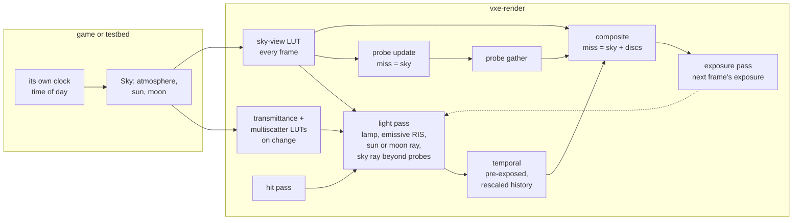

# 0032: Sun and sky: a Hillaire atmosphere, a time of day the game sets, the sun and moon as light samples, sky light into the probes, an outdoor testbed source

> **Status:** approved (2026-10-22)
> **Created:** 2026-10-22
> **Milestone:** M10: Outdoors in [`docs/roadmap.md`](../roadmap.md)
> **Related ADRs:** [ADR-0026](../adrs/0026-atmosphere-from-hillaire-luts-built-on-the-gpu-at-runtime.md)
> (proposed with this plan: the atmosphere model),
> [ADR-0027](../adrs/0027-the-sun-shadow-is-one-per-pixel-ray-in-the-light-pass.md) (proposed
> with this plan: the sun's shadow and how its sample sits beside the emissive one),
> [ADR-0018](../adrs/0018-direct-light-per-pixel-one-sample-from-a-hit-buffer-with-svgf-history-killed-by-edits.md)
> (the light pass, temporal pass and composite this plan extends), ADR-0025 (the near-emitter
> candidate table, on Plan 0024's branch), [ADR-0023](../adrs/0023-indirect-light-from-a-scrolling-probe-volume.md)
> (the probe volume whose misses now return the sky)
> **Source:** the owner's answers of 2026-10-22: outdoors is a general engine capability;
> time of day is a parameter the game sets; Hillaire 2020 with per-frame LUTs; the sun's shadow
> is one per-pixel ray continued into the far field later; every toggle shows its mode in the
> window; readings on both adapters.
> **Starts after:** [Plan 0024](done/0024-direct-light-hit-buffer-emissive-samples-and-svgf-denoiser.md)
> and [Plan 0029](0029-indirect-light-probe-volume.md) close. This plan is drafted against Plan
> 0024's branch as of 2b08d42 (`Frame`, `Lighting`, `light.wgsl`, `temporal.wgsl`,
> `composite.wgsl`, the mode banner of its Phase 14) and Plan 0029's drafted names
> (`ProbeVolume`, `probe_update.wgsl`, `probe_gather.wgsl`). The names dev finds in the tree
> win. It is independent of [Plan 0030](0030-temporal-upscaler.md); whichever lands second
> rebases `composite.wgsl`.

## TL;DR

The frame gets a sky. A `Sky` the game sets each frame names the atmosphere, the sun and the
moon (direction, illuminance and angular radius). The engine holds no clock: the game turns its
own time into directions, through a helper the engine offers. Compute passes build Hillaire's
transmittance, multiple-scattering and sky-view LUTs (ADR-0026). A primary ray that leaves the
world shows the sky and the sun's or moon's disc. The light pass adds one directional sample
per pixel, with a soft shadow ray toward the sun or moon (ADR-0027). Plan 0029's probe rays
return sky radiance on a miss. Surfaces beyond the probe volume take one cosine-weighted sky ray. The HDR targets
become pre-exposed, and an automatic exposure carries the image from noon to midnight
through the existing ACES tone map. The fly-through gains an outdoor source of integer hills
with a cave mouth that leads into a roofed chamber. `F8` switches between the cave, the level
and the outdoors, `,` and `.` step the time of day, and the mode banner shows both. The first
thing a reader sees is Phase 1's headless golden of an empty world under a noon sky. In the
window they see Phase 3's hills under that sky, then Phase 5's sunlit hills with soft shadows.

## Context & problem

Outdoors is a general engine capability (owner, 2026-10-22). The first consumer is
underground (`project-context.md`), so it sets the sky off and must see no change. Other
consumers need open sky with a dynamic day and night. The founding decisions already put
open-sky and kilometre-scale scenes in scope (`roadmap.md`, "Floor, profiles and scene
scale"). This plan is the first of the outdoors batch: Plan 0033 builds the far field, Plan
0034 water, Plan 0035 aerial perspective and clouds, and Plan 0036 weather. All of them read
this plan's sky.

Today a ray that leaves the mirror's window returns black. The renderer has no directional
light, and Plan 0029's probes see air, and nothing, on a miss. The exposure is a fixed `f32`.
The renderer's radiance units are set by the materials: the fly-through's ore emits `[1.6,
0.9, 0.35]`, and the headlamp's irradiance at 1 m is about 12.

Facts the design rests on:

- **Units and range.** Real sunlight is about 100 000 lux, and a full moon about 0.25, a ratio
  of 400 000. In frame units, a sunlit ground with albedo 0.3 should read about 200 times the
  ore's glow, which is the ratio of a sunlit field (about 10 000 cd/m^2) to a glowing crystal
  (about 50). That puts the sun's top-of-atmosphere illuminance near 3000 frame units, a
  guess the owner tunes. The irradiance targets are `rgba16float`, whose largest finite
  value is 65 504, so 3000 fits. The temporal pass's second moment of luminance does not
  (3000^2 = 9 million). Hence pre-exposure, below.
- **The near field's reach.** The residency ball (`r_lod` 24 chunks of 64 voxels at 10 cm) is
  about 154 m. Rayleigh extinction in blue at sea level is 33.1e-6 per metre, so the optical
  depth to 154 m is 0.005. Aerial perspective is invisible inside the near field and is left to
  Plan 0035, which comes after Plan 0033's far field makes it matter.
- **The probe volume** (Plan 0029) is 32 probes at 16 voxels per axis, a half-extent of 256
  voxels (25.6 m) around the camera. Outdoors, most of the terrain in view lies beyond it.
- **The mirror** gives a resident all-air chunk a record with `EMPTY_BIT`, and leaves a chunk
  that has not arrived absent (`0xFFFFFFFF`). The walk skips both as air. So a lighting ray
  can tell "known air" from "unknown" at no cost.

`nfr.md` figures touched: §2 Lighting (6.0 ms: the directional ray, the sky ray, the LUTs),
§2 Upscale, tone map, post (1.5 ms: the exposure reduction), §3 Everything else in VRAM (the
LUTs and the exposure buffer), §3 World in VRAM and §5 Streaming (read on the new outdoor
source, a new kind of scene).

## Decision

We build ADR-0026's atmosphere and ADR-0027's directional light in `vxe-render`, behind a
`Sky` that is `None` by default. With `None`, every existing image is byte for byte the same.

1. **The sky.** `sky.rs` holds `Atmosphere` (Earth defaults from the paper), `Body`
   (direction, top-of-atmosphere illuminance in frame radiance units, angular radius), `Sky`
   (atmosphere, sun, moon, and the world's altitude mapping: the voxel z of altitude 0, metres
   per voxel, the altitude of that plane above the planet's surface) and
   `body_direction(hour_angle, declination, latitude)`, a pure function for the game's use.
   Three passes, `sky_transmittance.wgsl`, `sky_multiscatter.wgsl` and `sky_view.wgsl`,
   build the LUTs. The first two run when `Atmosphere` changes and the third every frame.
   `sky.wgsl` holds the shared lookups: `sky_radiance(d)`, `transmittance(alt, mu)` and the
   discs. It is compiled into every frame shader that needs it.
2. **Misses.** The composite shades a primary miss with `sky_radiance(d)` plus the sun's and
   moon's discs, with the translucent layers over it. A lighting ray (shadow, sky, probe)
   whose walk enters an absent chunk inside the residency ball stops as occluded. A lighting
   ray that leaves the ball or the window has reached the sky. A lighting ray that reaches the
   sky below the horizon returns 0: the ground there is unknown, and it is rock more often than
   lit sky.
3. **The directional sample** (ADR-0027). This is one disc-sampled shadow ray toward the sun,
   or toward the moon at night. The value is the illuminance times the transmittance at the
   hit's altitude times `n.l`. It is added to the light pass's emissive (long-history) part.
   A drift of the body beyond its angular radius raises the "static light changed" bit.
4. **Sky light.** Plan 0029's probe rays return `sky_radiance(d)` on a miss, and the hits they
   shade include the directional sample through the shared estimator. A lighting pixel whose
   hit lies outside the probe lattice takes one cosine-weighted sky ray, with the frame's
   shadow walk and a length cap of 512 voxels. Its estimate `pi L_sky(d)` goes into the
   long-history part. The two cross-fade over the lattice's outermost probe step.
5. **Exposure.** Every HDR value the lighting passes store is pre-exposed, that is,
   multiplied by the frame's exposure. The temporal pass rescales history by the ratio of this
   frame's exposure to the last. `Exposure` is `Manual(f32)` (the default, 1.0) or `Auto`. In
   auto, the composite writes per-workgroup sums of log2 luminance before exposure, and a
   one-workgroup `exposure.wgsl` pass averages them. It sets the next frame's exposure toward
   `key / average`, clamped to `[min, max]` and adapted at `1 - exp(-dt speed)` per frame. The
   caller passes `dt` because the engine reads no clock.
6. **The testbed.** `apps/flythrough/src/outdoor.rs` holds an integer heightfield of hills
   over the cave noise, with a carved tunnel from a hillside to a roofed chamber. It adds
   `--source cave|level|outdoor`, an `F8` key that cycles the source in process, and a
   time of day owned by the testbed: `--time HH:MM`, `,` and `.` step an hour, and `/` runs or
   pauses the cycle. The mode banner shows the source, the time and the exposure.

We rejected Bruneton's tables, an analytic sky and a per-pixel atmosphere march (ADR-0026), and
a shadow heightmap, cascaded shadow maps and the sun as an RIS candidate (ADR-0027). For the
sky light beyond the probes, we rejected an unoccluded hemisphere term because it lights a
far cave's interior. We rejected a larger probe volume because doubling the reach costs eight
times the probes. For exposure, we rejected a fixed exposure per time of day computed from the
sky, because it leaves a cave mouth at noon black inside. We rejected a 64-bin histogram
because its 0.5 EV bins quantize a uniform scene by up to 0.25 EV, about 19 %. Percentile
clipping is a followup if the eye asks for it.

## Architecture diagram



## Implementation phases

Each phase ships as its own commit. `dev` implements all phases in one session with no review
between phases. The architect reviews once at the end, in a fresh session. Every golden this
plan adds is blessed on lavapipe at 320 x 180 under the harness's floor: at most 0.1 % of
pixels differ by more than 2/255. Every existing golden must stay byte-identical while `Sky`
is `None` and the exposure is `Manual(1.0)`, and each phase's test run asserts it.

### Phase 1: The sky on a miss: transmittance and sky-view LUTs, single scattering
- **Owner skill:** dev
- **What:** `sky.rs` with `Atmosphere`, `Body`, `Sky` and `Frame::set_sky(Option<Sky>)`. The
  transmittance pass builds 256 x 64 `rgba16float` with 40 steps, indexed by altitude and view
  zenith cosine with the paper's mapping. The sky-view pass builds 192 x 108 `rgba16float`
  with 30 steps, single scattering only for now, for the sun alone, by absolute azimuth and a
  horizon-weighted elevation. In `sky.wgsl`, `sky_radiance(d)` is LUT radiance times the
  sun's illuminance, and the composite shows it on a primary miss when a `Sky` is set. The
  cutaway's flat sky stays for the cutaway. The atmosphere's dirty flag decides when the
  transmittance pass runs. `Frame::frame_bytes` counts the LUTs.
- **Files touched:** new `crates/vxe-render/src/sky.rs`, new
  `crates/vxe-render/src/shaders/sky.wgsl`, `sky_transmittance.wgsl`, `sky_view.wgsl`,
  `composite.wgsl`, `marcher.rs` (the `Frame`), `lib.rs` (the shader sources), new
  `crates/vxe-render/tests/sky.rs`, `apps/flythrough/tests/golden.rs`, new golden
  `sky_empty_noon.png`.
- **Done when:**
  1. **Transmittance matches the closed form** (headless, lavapipe, LUT read back). With the
     default atmosphere, the texel for altitude 0 looking at the zenith reads `(0.9404,
     0.8677, 0.7623)` within 1 % per channel. Arithmetic: the optical depth is Rayleigh
     `(5.802, 13.558, 33.1)e-6 x 8000 m = (0.0464, 0.1085, 0.2648)`, plus Mie extinction
     `4.40e-6 x 1200 m = 0.0053`, plus ozone `(0.650, 1.881, 0.085)e-6 x 15 000 m (the tent's
     area) = (0.0098, 0.0282, 0.0013)`, which sums to `(0.0614, 0.1420, 0.2714)`. The texel at
     the top of the atmosphere looking up reads 1.0 within 0.1 %.
  2. **The noon sky is blue.** Read back after one frame of an empty world (no chunks), with
     the sun at elevation 45 degrees. At the sky-view texel of the zenith, blue > green > red.
     At the texel of elevation 5 degrees opposite the sun, the luminance exceeds the zenith's
     (the horizon is brighter than the zenith away from the sun).
  3. **No sky, no change.** With `Sky` `None`, every existing golden is byte-identical to the
     base commit, and `frame_bytes` reads the base commit's value.
  4. **Golden.** `sky_empty_noon.png` is blessed: an empty world, the camera looking south at
     the horizon, the sun at elevation 45 degrees behind the camera, manual exposure set so
     the zenith reads mid-grey.

### Phase 2: Multiple scattering, the moon, the discs and the time-of-day helper
- **Owner skill:** dev
- **What:** the multiple-scattering pass builds 32 x 32 `rgba16float` from 64 directions per
  texel and 20 steps. It uses the paper's `L_2nd / (1 - f_ms)` and is read by the sky-view
  pass. The sky-view pass sums the sun's and the moon's in-scattering. The composite draws
  the sun's disc as `E T / Omega` inside its angular radius, with a one-pixel smooth edge, and
  the moon's disc the same way. `body_direction(hour_angle, declination, latitude)` returns a
  unit vector in world axes (+x east, +y north, +z up).
- **Files touched:** new `crates/vxe-render/src/shaders/sky_multiscatter.wgsl`,
  `sky_view.wgsl`, `sky.wgsl`, `composite.wgsl`, `sky.rs`, `marcher.rs`,
  `crates/vxe-render/tests/sky.rs`, `apps/flythrough/tests/golden.rs`, new goldens
  `sky_empty_sunset.png` and `sky_empty_night.png`.
- **Done when:**
  1. **The helper's geometry** (unit tests). Hour angle 0, declination 0 and latitude 0 give
     `(0, 0, 1)` within 1e-6. Latitude 45 degrees, declination 0 and hour angle 0 give
     elevation 45 degrees toward the south. Hour angle 90 degrees gives elevation 0 within
     1e-6 rad toward the west. Hour angle 86.25 degrees (17:45 at 15 degrees per hour) gives
     elevation 2.65 degrees within 0.01: `sin(el) = cos(45) cos(86.25) = 0.7071 x 0.0654 =
     0.0463`. A test reads the real sun's disc solid angle as `2 pi (1 - cos 4.651 mrad) =
     6.80e-5` sr within 0.5 %.
  2. **Multiple scattering only adds.** At noon, every sky-view texel above the horizon reads
     at least its Phase 1 single-scattering value in every channel.
  3. **The moon is the sun, scaled.** A frame with the sun 30 degrees below the horizon and
     the moon at direction `v` with illuminance `m` reads, in every sky-view texel, the
     Phase 2 day LUT built with the sun at `v`, times `m / E_sun`, within 1 %. A sun 30
     degrees down lights no point of the atmosphere, because even the top's horizon dips only
     `acos(6360 / 6460) = 10.1` degrees.
  4. **Twilight darkens monotonically.** The zenith's luminance strictly falls for each sun
     elevation from 0 to -18 degrees in steps of 2 degrees (moon off).
  5. **Goldens.** `sky_empty_sunset.png` (the sun at elevation 2.65 degrees in the west,
     camera facing it) and `sky_empty_night.png` (the sun at -45 degrees, the moon at 45
     degrees in the south with illuminance `E_sun / 400 000`, manual exposure set so the
     zenith reads visible) are blessed.

### Phase 3: The outdoor source, the source switch and the time of day in the fly-through
- **Owner skill:** dev
- **What:** `outdoor.rs` defines `OutdoorSource { seed }`, unbounded in x and y. The surface
  height is `h(x, y) = BASE_Z + (A1 n9 + A2 n7 + A3 n5) >> SHIFT`, where `nk` is
  `ValueNoise::new(seed, k)` sampled at `(x, y, 0)`. The amplitudes are chosen so hills span
  about +-200 voxels (+-20 m), with constants pinned in the file. Above `h` is air. The top
  voxel is a new `grass` row, the next 8 are a new `soil` row, and below that is rock, with
  `CaveSource`'s density carving caverns only deeper than 40 voxels under the surface. A
  tunnel is carved as an integer capsule of radius 25 voxels (2.5 m). It runs from a hillside
  point at the fixed column `MOUTH` down at a slope of about 1 in 4 to a chamber, a sphere of
  radius 60 voxels whose centre is 150 voxels under the surface. Integer arithmetic is used
  throughout, the same `i64` segment-distance test as the capsule edit op. The outdoor
  material table is `look_materials()` with `grass` and `soil` appended, so every cave id
  keeps its meaning. `--source cave|level|outdoor` (`--level` stays as `--source level`) and
  `--spawn outside|inside` choose the spawn: 30 m in front of the mouth facing it, 2 m above
  the ground, or 3 m inside the tunnel facing out. `F8` cycles the source in process. It
  tears down and rebuilds the world, the stream, the mirror's contents, the server and the
  logic, and keeps the window, the `Frame` and the sky. The testbed's sky uses latitude 45
  degrees and declination 0 (an equinox, so the sun rises at 06:00, sets at 18:00 and reaches
  45 degrees at 12:00). The moon is full, 12 hours from the sun, at `E_sun / 400 000`.
  `--time HH:MM` sets the start (default 12:00). `,` and `.` step one hour, and `/` runs or
  pauses the cycle at `--day-length SECONDS` (default 1200). The testbed's clock advances by
  the frame loop's `dt`, never inside the engine. The outdoor source sets the sky, and the
  cave and the level set `None` unless `--sky on`. The banner (Plan 0024 Phase 14's
  `hud::Modes`) gains `source`, `time` and `day cycle`. If a plan that merged earlier took
  `F8`, `,`, `.` or `/`, dev picks a free key and the README says which.
- **Files touched:** new `apps/flythrough/src/outdoor.rs`, `lib.rs` (the outdoor table),
  `main.rs` (flags, keys, the in-process switch, the clock), `hud.rs` (the banner's new
  keys), `apps/flythrough/tests/determinism.rs`, new `apps/flythrough/tests/outdoor.rs`, the
  root `README.md` (flags, keys).
- **Done when:**
  1. **Deterministic.** Hashes of the outdoor source's chunks over a 4 x 4 x 4 block around
     the mouth, generated serially and on 8 threads in reverse order, are equal. The hash is
     pinned beside the cave's in `determinism.rs`.
  2. **The mouth leads in and the chamber is roofed.** Every voxel on the tunnel's axis from
     the surface at `MOUTH` to the chamber's centre is air. Every column over the chamber's
     centre, within 40 voxels of it, has at least 60 voxels of non-air between the chamber's
     top and the surface. The chamber is reached only through the tunnel: a 6-connected flood
     of air from the chamber's centre, bounded to the chamber's box grown by 32 voxels, leaves
     the box only through the tunnel's cross-section.
  3. **The heightfield is what the formula says.** At 16 seeded columns, the topmost non-air
     voxel is `grass` at the computed `h` and the 8 below are `soil`, except inside the
     tunnel's capsule.
  4. **The banner names the change** (headless, the frame clock driven as in Plan 0024 Phase
     14's test). `F8` changes the banner's source text through `cave`, `level` and `outdoor`
     and back. `.` changes `12:00` to `13:00` and `,` back to `12:00`. `/` changes `day cycle
     off` to `on`. The banner reads empty 3 s after the last change.
  5. **The parse test** pins `--source`, `--spawn`, `--time` (and refuses `25:00`),
     `--day-length` and `--sky`, and `--level` as `--source level`.
  6. **The switch is clean.** A headless run with `--frames 600 --source outdoor` sends `F8`
     at frame 200 (to the cave) and stops at frame 600. Its world's voxel hash over the
     chunks within 2 of the cave's spawn chunk equals a fresh `--source cave` run's over the
     same chunks. No resident record's palette holds `grass` or `soil`, and the server's op
     log starts empty at the switch.

### Phase 4: Pre-exposure and automatic exposure
- **Owner skill:** dev
- **What:** `Lighting::exposure` becomes `Exposure`: `Manual(f32)`, with 1.0 the default, or
  `Auto { key, min, max, speed }`. The testbed defaults are 0.18, 1e-4, 4.0 and 1.5 per
  second, all guesses that Phase 8 judges. A storage buffer holds `[current, previous]`
  exposure. The light pass multiplies every irradiance it stores by `current`. The temporal
  pass multiplies history by `current / previous`, and the moments by its square. The
  composite multiplies emission, sky and discs by `current`, and the probe gather's indirect
  irradiance at the point it is added. In auto, the composite writes each 8 x 8 workgroup's
  sum of `clamp(log2(max(Y / current, 1e-6)), -16, 16)` and its pixel count into a buffer of
  `ceil(w / 8) x ceil(h / 8)` pairs. `exposure.wgsl`, one workgroup of 256, sums them and
  writes next frame's `current = exp2(log2 e + (log2(key / avg) - log2 e) (1 - exp(-dt
  speed)))`, clamped. `Frame::set_dt(seconds)` sets the frame's `dt`, and `speed` infinity
  adapts at once. `--exposure auto|<value>` is added to the fly-through, with `auto` the
  default for the outdoor source. The banner names the exposure mode.
- **Files touched:** new `crates/vxe-render/src/shaders/exposure.wgsl`, `light.wgsl`,
  `temporal.wgsl`, `composite.wgsl`, `probe_gather.wgsl` (or the composite's add, wherever
  Plan 0029 put it), `marcher.rs`, `sky.rs`, `apps/flythrough/src/main.rs`, `hud.rs`,
  `apps/flythrough/examples/hero.rs`, new `crates/vxe-render/tests/exposure.rs`,
  `tests/golden.rs`.
- **Done when:**
  1. **Manual 1.0 changes nothing.** Every existing golden is byte-identical to the base
     commit, because a multiply by 1.0 is exact.
  2. **Auto finds the key.** An empty world under a uniform test sky of radiance 0.5
     (`Sky::uniform`, see Data shapes) with instant adaptation settles at exposure 0.36
     (`0.18 / 0.5`) within 1 % after 2 frames.
  3. **Adaptation follows its curve.** From the settled 0.36, the test sky steps to 0.05, a
     gap of `log2(10) = 3.32` EV. With `speed` 2 and `dt` 1/60 s, frame 60 after the step
     reads `log2 e` within 0.05 EV of `log2 0.36 + 0.865 x 3.32 = -1.474 + 2.873 = 1.399`.
     Arithmetic: `1 - exp(-60 x 2 / 60) = 1 - exp(-2) = 0.865`.
  4. **History survives an exposure change.** On Phase 3's emissive-ceiling box from Plan
     0024 (filter off, lamp off), a manual exposure step from 1.0 to 4.0 at frame 64 kills
     no history: at frame 65 every hit pixel's age is its frame-64 age plus one, or the
     temporal pass's cap. The composited floor-centre pixel
     at frame 65 is within 2/255 of a run that started at 4.0.
  5. **No overflow.** With a sun of illuminance 3000 at the zenith on Phase 5's floor scene in
     auto, after 64 frames no texel of the irradiance, accumulation or moments targets is
     infinite or NaN (read back).

### Phase 5: The sun and the moon as the light pass's directional sample
- **Owner skill:** dev
- **What:** ADR-0027. The CPU picks the body each frame: the sun if its elevation is above 0
  degrees, else the moon if its elevation is above 0 degrees, else none. The light pass draws
  a direction uniformly in that body's disc (its `angular_radius`) from the blue noise. It
  casts one shadow ray with the frame's shadow walk and adds `E T(alt(p), mu) max(n.l, 0)`
  to the emissive part when unoccluded. In `march`, a new lighting-ray flag treats an absent
  chunk inside the residency ball as solid. The ball is `Params.resident_r2` in squared chunks
  around the focus chunk. A non-streamed mirror never sets the flag, and primary rays never
  take it. The CPU sets the "static light changed" bit (Plan 0024's
  `LIGHTING_EMISSION_CHANGED`, renamed if dev prefers) for `EMISSION_CHANGE_FRAMES` frames
  whenever the body's direction has turned by more than its angular radius since the last
  time the bit was raised, or the body or its illuminance changed. A turn of more than 2
  degrees in one frame also marks every probe as touched (Plan 0029's edit path, hysteresis
  0.5). `Sky::sun.angular_radius` defaults to the real 0.2665 degrees (4.65 mrad). The
  fly-through takes `--sun-radius DEG` to show soft shadows on screen.
- **Files touched:** `light.wgsl`, `march.wgsl` (the absent-chunk flag), `sky.wgsl`,
  `marcher.rs`, `sky.rs`, `crates/vxe-render/src/gpu_world.rs` (`resident_r2` from the
  residency), `apps/flythrough/src/main.rs`, `apps/flythrough/tests/lights.rs`,
  `crates/vxe-render/tests/mirror.rs`.
- **Done when** (headless, lavapipe, lamp off, no emissive material, no sky light, filter
  off, manual exposure 1.0, `E_sun = (1, 1, 1)`, mean over 16 frames, a floor of rock in a
  level scene):
  1. **The noon floor.** With the sun at the zenith and the floor at altitude 0, a floor
     pixel reads `(0.9404, 0.8677, 0.7623)` within 1 % (Phase 1's transmittance; the disc's
     cosine falloff is `cos(0.2665 degrees) = 0.99999`).
  2. **The slant.** With the sun at elevation 30 degrees, the reading is `(0.4422, 0.3764,
     0.2906)` within 1 %. Arithmetic: `0.5 x exp(-2 x (0.0614, 0.1420, 0.2714))`. At 60
     degrees from the zenith the flat-atmosphere air mass of 2 is within 0.1 % of the curved
     one.
  3. **The shadow and its penumbra.** A 16 x 16 voxel roof slab sits 20 voxels above the
     floor under a zenith sun with the test radius of 5 degrees. With the camera at 4 or more
     pixels per voxel, floor pixels more than 2 voxels inside the shadow's geometric edge read
     0, those more than 2 voxels outside read the full value within 1 %, and the geometric
     edge reads half within 10 %. The 5 %-to-95 % rise spans 2.8 +- 0.6 voxels (64-frame
     mean). Arithmetic: the disc's radius on the floor is `20 tan(5 degrees) = 1.75` voxels,
     a disc segment holds 5 % of the disc at a depth of 0.2 radii, so the span is `2 x 1.75 -
     2 x 0.2 x 1.75 = 2.8`.
  4. **Night.** With the sun at -30 degrees and the moon at the zenith at illuminance 1e-3,
     the floor reads `1e-3 x (0.9404, 0.8677, 0.7623)` within 1 %. With both below the
     horizon, the floor reads 0.
  5. **Unknown is not sky.** On a streamed mirror, a floor whose chunk column above is absent
     but inside the residency ball reads 0. After that chunk syncs as `EMPTY_BIT` air, the
     floor reads the noon value of bar 1.
  6. **A turning sun updates.** In the edit-box history mode with the filter on and the sun
     at the real radius, turning the sun by 10 degrees in one frame raises the bit, and every
     pixel that left the shadow's new edge reaches 90 % of its new lit value within 11 frames
     (`0.8^11 = 0.086`). A drift of 0.15 radius per frame over 64 frames raises the bit at
     frames 7, 14, 21, 28, 35, 42, 49, 56 and 63 and at no other (7 x 0.15 = 1.05 radius,
     the first sum over one).

### Phase 6: Sky light: the probes on a miss, and one sky ray beyond them
- **Owner skill:** dev
- **What:** `probe_update.wgsl` returns `sky_radiance(d)` for a ray that reaches the sky with
  `d.z > 0`, and 0 below the horizon. The hits it shades include Phase 5's directional
  sample, through the estimator Plan 0029 Phase 2 made callable. Every visibility distance
  stored, from a hit or a miss, is clamped to 255 voxels, so the `rg16float` squared distance
  stays under 65 504 (`255^2 = 65 025`). Outdoors a probe ray can run far past the 16-voxel
  spacing. The light pass computes, for each hit, `w_probe`: 1 inside the probe
  lattice less its outermost step, 0 outside the lattice, linear in the L-infinity distance
  across that step. Where `w_probe < 1`, it casts one cosine-weighted ray about the shading
  normal with the frame's shadow walk, capped at `SKY_RAY_VOXELS` = 512 (51.2 m, a guess;
  beyond the cap counts as sky). It adds `(1 - w_probe) pi sky_radiance(d)` to the emissive
  part when the ray reaches the sky above the horizon. The gather scales its result by
  `w_probe`. `Sky::uniform(L)`, a test setting, makes `sky_radiance(d) = L` above the horizon
  and 0 below, with no discs and no directional light.
- **Files touched:** `probe_update.wgsl`, `probe_gather.wgsl`, `light.wgsl`, `sky.wgsl`,
  `probes.rs`, `marcher.rs`, `sky.rs`, `apps/flythrough/tests/indirect.rs`,
  `apps/flythrough/tests/lights.rs`.
- **Done when** (headless, lavapipe, `Sky::uniform(1.0)`, lamp off, no emissive material,
  filter off, manual exposure 1.0, a level scene of a 1024 x 1024 voxel rock floor whose top
  is the scene's lowest air):
  1. **The open floor reads pi.** At the floor pixel under the camera (inside the volume),
     the gathered indirect irradiance after 256 frames is within 10 % of `pi` (3.14). The
     upper hemisphere's cosine integral of a radiance of 1 is `pi`. The floor below a probe is
     outside the cosine lobe of the `+z` normal.
  2. **Beyond the volume, the same.** At a floor pixel 400 voxels from the camera (outside
     the 256-voxel half-extent), the light pass's accumulated sky estimate after 64 frames is
     within 10 % of `pi`. Along a line of floor pixels that crosses the fade step, the sum of
     the gathered and the sky-ray irradiance stays within 10 % of `pi` at every pixel.
  3. **No leak.** A closed rock box with 5-voxel walls stands on the floor, once inside the
     volume and once at 400 voxels. Its interior floor reads under 2 % of bar 1's value after
     256 frames in both cases.
  4. **Sun bounce reaches the shade.** With the real sky at noon (not uniform) and a 32 x 32
     voxel roof 20 voxels over the floor inside the volume, the shaded floor's indirect
     irradiance is greater with the directional sample on than with it off (a property; the
     ratio goes in the log).
  5. **Finite visibility.** After 64 frames outdoors, no visibility texel is infinite or NaN.

### Phase 7: The four goldens, the HUD rows and the readings
- **Owner skill:** dev
- **What:** four goldens of the outdoor source with seed 1, at the default lighting tier, 64
  settled frames and auto exposure with instant adaptation: `outdoor_noon.png` (spawn
  `outside`, 12:00), `outdoor_sunset.png` (outside, 17:45), `outdoor_night.png` (outside,
  00:00, the moon at 45 degrees in the south) and `cave_mouth.png` (spawn `inside`, 12:00,
  the lit opening and the dim tunnel walls lit by bounce). A stats HUD row gives the sky
  passes' GPU time, the directional and sky rays' share of the light pass where timestamps
  allow (else the light pass with the sky on and off), the exposure and the body in use. The
  autopilot accepts the outdoor source and flies its +x leg at the spawn's height plus 30 m.
  Readings follow.
- **Files touched:** `apps/flythrough/tests/golden.rs` (four new goldens),
  `apps/flythrough/src/main.rs`, `hud.rs`, `apps/flythrough/examples/hero.rs` (`--source`,
  `--time`), the root `README.md`, `docs/nfr.md` §2, §3 and §5.
- **Done when:**
  1. **The four goldens are blessed**, and each differs from the others in more than 20 % of
     its pixels by more than 8/255 (the times of day are really different images). In
     `cave_mouth.png` the opening's pixels read brighter than the tunnel walls' pixels, a
     property checked on two fixed regions the test names.
  2. **A sealed mouth goes dark.** In the same test, with the lamp off and every material's
     emission scale 0, the `cave_mouth` pose has the tunnel's mouth behind the camera filled
     by a stamp of rock (an edit, so history dies). After 64 frames the accumulated
     irradiance, read back over the test's tunnel-wall region, has a mean luminance under 2 %
     of the same region's in the unsealed pose. The sky does not leak into a sealed cave.
  3. **Readings on both adapters** (`--adapter`, Plan 0028 Phase 4), quiet box, 1080p, the
     defaults, median of the last 30 of 3000 frames, three runs each. These runs are
     `flythrough --source outdoor --headless --seed 1 --render 1920x1080 --frames 3000` at
     `--time 12:00`, `--time 00:00`, and `--spawn inside --time 12:00`. Each reads the sky
     passes, the light pass (beside the same pose with `--sky off`), temporal, probe update
     and gather, a-trous, composite and exposure. The streamed cave's spawn with no sky is
     read to show it unchanged against Plan 0029's close reading. `frame_bytes` and the
     outdoor mirror's live bytes at frame 3000 go in `nfr.md` §3. The outdoor autopilot's
     streaming line p50 and p99 go in §5.

### Phase 8: The owner's windowed check
- **Owner skill:** human
- **What:** the owner flies the outdoor source from noon through sunset to night with `/` and
  the `.` key, walks into the cave mouth and out again at noon, digs a skylight into the
  chamber, switches sources with `F8`, and tries `--sun-radius` at 0.27, 1 and 3 degrees,
  `--exposure` auto and fixed, and the lighting tier. A ping reaches the owner when the
  window is ready (memory: batch the live checks).
- **Files touched:** this plan's log, then ADR-0026's and ADR-0027's Outcomes at the close.
- **Done when:** the owner has recorded a verdict on the sky's colour at noon, sunset and
  night, on the cave mouth's transition (too dark, right or too bright inside), on the
  exposure's speed and night darkness (the `min`, `max` and `speed` values to keep), on the
  sun radius to default, and on whether a dug skylight lights the chamber on the next frames
  without a visible lag.

## Data shapes

```rust
// illustrative: crates/vxe-render/src/sky.rs
pub struct Atmosphere {                 // per metre unless named; Earth defaults (Hillaire 2020)
    pub bottom_radius_km: f32,          // 6360
    pub top_radius_km: f32,             // 6460
    pub rayleigh_scattering: [f32; 3],  // (5.802, 13.558, 33.1)e-6
    pub rayleigh_scale_height_km: f32,  // 8
    pub mie_scattering: [f32; 3],       // 3.996e-6
    pub mie_extinction: [f32; 3],       // 4.40e-6
    pub mie_scale_height_km: f32,       // 1.2
    pub mie_g: f32,                     // 0.8
    pub ozone_absorption: [f32; 3],     // (0.650, 1.881, 0.085)e-6, tent 10..40 km, peak 25
    pub ground_albedo: [f32; 3],        // 0.3, a guess
}
pub struct Body { pub direction: [f32; 3], pub illuminance: [f32; 3], pub angular_radius: f32 }
pub struct Sky {
    pub atmosphere: Atmosphere,
    pub sun: Body,
    pub moon: Body,
    pub altitude_zero_z: f32,     // world voxel z of altitude 0
    pub metres_per_voxel: f32,    // 0.1 for the first consumer
    pub base_altitude_m: f32,     // altitude of that plane above the planet's surface
    pub uniform: Option<[f32; 3]>,// tests: a constant sky above the horizon, no bodies
}
pub enum Exposure { Manual(f32), Auto { key: f32, min: f32, max: f32, speed: f32 } }
pub fn body_direction(hour_angle: f32, declination: f32, latitude: f32) -> [f32; 3];
// Frame::set_sky(Option<Sky>), Frame::set_dt(f32); Lighting::exposure: Exposure
```

GPU resources, sizes worked out:

| resource | format | size | bytes |
|---|---|---|---|
| transmittance LUT | rgba16float | 256 x 64 | 131 072 |
| multiple-scattering LUT | rgba16float | 32 x 32 | 8 192 |
| sky-view LUT | rgba16float | 192 x 108 | 165 888 |
| sky uniform (atmosphere, two bodies, mapping) | uniform | one block | under 256 |
| exposure partial sums at 1080p | `vec2<f32>` per 8 x 8 workgroup | 240 x 135 | 259 200 |
| exposure state | `[f32; 2]` | 1 | 8 |

That is about 0.56 MB in total. No frame target is added: the directional and sky-ray
irradiance join the existing emissive part.

`Params` gains `resident_r2: i32`, the focus chunk (already implied by the LOD radii's
centre), and the sky's flags: sky on, uniform, body (none, sun, moon). The new `Params.lighting`
bit is "lighting ray: absent chunks inside the ball are solid", set per call of `march` by the
light and probe passes, not per frame.

## Budgets

| `nfr.md` figure | line | projection (dev box, 1080p, half-resolution lighting) | how the close measures it |
|---|---|---|---|
| §2 Lighting | 6.0 ms | sky LUTs under 0.1 ms (sky-view every frame, about 622 000 samples for two bodies; a guess); directional ray 0.4 to 1.0 ms at half resolution (one more shadow ray per lit pixel; a guess, with outdoor rays long but crossing mostly empty chunks); sky ray 0.2 to 0.5 ms on the pixels beyond the probes (a guess); probe update plus one coarse shadow ray per probe ray, about 0.1 ms (a guess) | Phase 7's three outdoor runs and the cave's spawn, both adapters, per-pass timestamps; the light pass is also read with `--sky off` at the same pose |
| §2 Upscale, tone map, post | 1.5 ms | exposure partial sums inside the composite and a one-workgroup pass, under 0.05 ms (a guess) | the same runs |
| §3 Everything else in VRAM | 1.5 GB | +0.56 MB (table above) | `Frame::frame_bytes` printed by the autopilot |
| §3 World in VRAM | 3 GB | the outdoor source holds fewer `Full` bricks than the cave (a terrain surface against a volume of caverns) but one record per resident air chunk; unknown until read | the mirror's live bytes at frame 3000 of the outdoor run |
| §5 Streaming line | 1.0 ms | unchanged code; a new scene, with uniform-air chunks above the hills cheap to generate and narrow | the outdoor autopilot's render-thread timers, p50 and p99 |

On the slow adapter (`nfr.md` §1) every line projects two to four times the dev box. Plan
0024's half-resolution light pass alone read 1.85 to 2.92 ms on the dev box. With Plan 0029's
passes and this plan's, the lighting line is a likely miss on the slow adapter in daylight.
Phase 7 records it as read, and the close names which ray (directional or sky) to move to the
coarse walk first if the dev box misses. **No baseline reading exists**; the card is not on
hand.

## Risks & open questions

- **Range.** Pre-exposure is what keeps the moments finite at noon. A path that stores
  irradiance without the exposure (a new pass, a debug view) overflows `rgba16float` in
  daylight. Phase 4 bar 5 is the guard.
- **Light leaks into caves.** The rules are: an absent chunk inside the ball is solid for
  lighting rays; below the horizon is 0; the sky ray is capped. The first consumer sets the
  sky off. A cave whose open passage reaches the residency ball's edge still sees sky through
  it. The far field (Plan 0033) replaces "leaving the ball" with real far terrain.
- **The ring's edge shows sky.** Beyond `r_lod` nothing is drawn, so outdoors the terrain ends
  about 154 m out and the sky shows beneath the horizon there. That is the expected look
  until Plan 0033.
- **Cost of the directional ray** (ADR-0027, Negative). A sunward ray runs to the edge of the
  near field. If Phase 7 reads the light pass over its share, the coarse walk for the
  directional ray alone is the first knob, then the half tier's existing switch.
- **History and a moving sun.** A running day cycle at the testbed's default (1200 s per
  day) turns the sun by its 4.65 mrad radius about every 0.9 s (`2 pi / 1200 = 5.2 mrad/s`),
  so the bit is up about 11 frames of every 54 at 60 fps. A faster cycle keeps history short
  and the penumbra noisier. The owner judges this at Phase 8.
- **The upscaler rejects history on a miss** (Plan 0030 Phase 2's rule). A sky pixel is then
  unaccumulated, which is harmless for a smooth sky but may shimmer at the sun disc's edge
  and the horizon. If the eye sees it, the followup is reprojection by direction for misses in
  Plan 0030's upscale pass.
- **The sky-view LUT's azimuth** (ADR-0026, Negative) may soften the sun's halo. 192 is the
  paper's width; a wider table is a measured change.
- **Units are a convention, not physics.** One frame radiance unit is "about 30 cd/m^2", so
  that the ore's 1.6 and a sun of 3000 sit in their real ratio. Both numbers are guesses the
  owner tunes at Phase 8. The engine documents that emission and illuminance share units and
  defines nothing else.
- **Translucent layers** are lit by the headlamp's cone only (Plan 0024). In sunlight, glass
  and water render unlit by the sun until Plan 0034.
- **Determinism.** Nothing touches `vxe-world`. The outdoor source is an integer function of
  seed and coordinate, generated on stream workers like the cave, with a pinned hash. The
  testbed's clock is float and render-side. A game that needs the sun's direction in its
  server logic computes it there from its own ticks.
- **Adapter features.** The LUT passes use `rgba16float` storage textures and filtered
  sampling, which the frame already uses. The exposure pass uses workgroup memory and no
  atomics. There are no subgroups and no 64-bit atomics.
- **Plan 0024 and Plan 0029 are not closed.** Names (`LIGHTING_EMISSION_CHANGED`, the
  estimator's functions, the gather's output) may change. Dev follows the tree and logs the
  mapping.

## What this plan does NOT do

- **The far field** (Plan 0033): no terrain beyond the residency ball, and no shadow from it.
  The directional ray's continuation into the clipmap is Plan 0033's phase.
- **Aerial perspective and clouds** (Plan 0035): no aerial-perspective volume (ADR-0026 leaves
  it to that plan), no clouds and no cloud shadows.
- **Water** (Plan 0034): no reflection or refraction rays, no underwater fog, and no sky
  reflected on any surface. The materials stay Lambertian.
- **Weather** (Plan 0036): no rain, snow, wind, wet surfaces or lightning. The atmosphere's
  parameters are fixed per run here, though the LUTs rebuild on change.
- **Flowing liquids**, a later deterministic simulation plan.
- **Stars, a moon phase shape, eclipses, bloom, lens flare**, and histogram percentile
  clipping in the exposure.
- **A sun query in `vxe-world`** for gameplay ("is this voxel in sunlight"). That would be a
  deterministic integer query, its own plan if a consumer asks.
- **Baseline-GPU readings.** The card is not on hand.

## Implementation log

> Written by `dev`: one row per phase as its commit lands, then the close block. **The phases
> above are the contract. This section records what happened.** Observations, never conclusions:
> no pass list, no self-assessment. Deviations and unmet done-whens are **always** disclosed.
> Keep it shorter than `## Implementation phases`.

| phase | owner | state | commit |
|---|---|---|---|
| 1: The sky on a miss: transmittance and sky-view LUTs, single scattering | dev | not started | |
| 2: Multiple scattering, the moon, the discs and the time-of-day helper | dev | not started | |
| 3: The outdoor source, the source switch and the time of day in the fly-through | dev | not started | |
| 4: Pre-exposure and automatic exposure | dev | not started | |
| 5: The sun and the moon as the light pass's directional sample | dev | not started | |
| 6: Sky light: the probes on a miss, and one sky ray beyond them | dev | not started | |
| 7: The four goldens, the HUD rows and the readings | dev | not started | |
| 8: The owner's windowed check | human | not started | |

### Notes

_(Deviations from the plan, with the commit, stated without justification. Done-whens not
satisfiable as stated, and what was done instead. Followups noticed and not acted on. One line
each. Empty is fine.)_

### Close triggers

_(Facts for the architect. No recommendations, and no suggested version bump.)_

- **What shipped:** feature / fix-only / docs-chore-only
- **Public API changed:** types, traits, functions, shader interfaces, config (list them, or none)
- **Budget readings:** each `nfr.md` figure touched, with its measured value, machine and commit
- **Gate at the tip:** the commands run (build, nextest, doctests, clippy, fmt, deny), exit codes, test counts
- **Outstanding `human` phases:** which, or none

## Followups

- A reference note under `docs/references/` on the atmosphere sources, annotated: Hillaire
  2020 ("A Scalable and Production Ready Sky and Atmosphere Rendering Technique"), Bruneton
  and Neyret 2008 ("Precomputed Atmospheric Scattering"), Hosek and Wilkie 2012 ("An Analytic
  Model for Full Spectral Sky-Dome Radiance"), and Lagarde and de Rousiers 2014 ("Moving
  Frostbite to Physically Based Rendering", for exposure and sun units). The architect writes
  it with the batch.
- Reprojection by direction for miss pixels in Plan 0030's upscaler, if Phase 8 sees the sky
  shimmer.
- Stars and a moon phase shape, for a night-sky plan.
