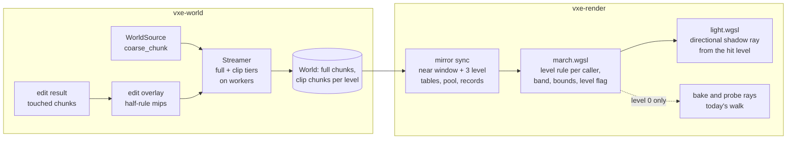

# 0033: The far field: a clipmap of three coarse chunk levels to about 1 km

> **Status:** approved (2026-10-22), amended 2026-11-10 (review pass)
> **Created:** 2026-10-22
> **Milestone:** M10: Outdoors in [`docs/roadmap.md`](../roadmap.md)
> **Related ADRs:** [ADR-0028](../adrs/0028-far-field-as-a-clipmap-of-source-generated-coarse-chunks.md)
> (proposed with this plan: the clipmap, the source's coarse path, the half rule in two
> readings, the edit overlay, the level rule and who takes it; heightfield, ESVO, impostors and
> downsampling rejected),
> [ADR-0003](../adrs/0003-sphere-residency-with-lod-ring-and-edit-persistence.md) (sphere
> residency, hysteresis and persistence, which each level reuses; its LOD-only ring stays for
> sources with no coarse path),
> [ADR-0013](../adrs/0013-mirror-reserves-its-vram-budget-up-front.md) (the reservation and
> the pressure rule, which clip chunks draw on),
> [ADR-0012](../adrs/0012-mask-first-brick-with-per-brick-palette-planes.md) (the packed brick
> a clip chunk stores),
> [ADR-0027](../adrs/0027-the-sun-shadow-is-one-per-pixel-ray-in-the-light-pass.md) (Plan
> 0032's directional shadow ray, which this plan continues into the far field),
> [ADR-0046](../adrs/0046-static-emissive-light-is-baked-per-chunk-when-a-chunk-loads-or-changes.md)
> (accepted: the baked brick store, which a clip hit does not read and whose bake this plan
> must leave camera-independent),
> [ADR-0042](../adrs/0042-the-far-shading-normal-blends-to-the-27-count-gradient-by-the-voxels-size-on-screen.md)
> and [ADR-0049](../adrs/0049-the-baked-light-is-read-by-the-far-shading-normal.md) (the far
> normal of near hits and the store read by it, Plan 0061; neither reaches a clip hit),
> [ADR-0034](../adrs/0034-fsr-2-ported-to-wgsl-as-the-default-upscaler-candidate.md) (FSR 2 at
> 1.5, the default upscaler, which resolves the dithered seam band)
> **Source:** the owner's outdoor answers (2026-10-22: view range about 1 km with the
> far-field clipmap; both readings of the half rule built and judged on screen; the forest as
> the scene); the owner's priority of 2026-11-03 (a stable image, no flicker or aliasing); the
> review of 2026-11-10.
> **Order (owner, 2026-11-10):** Plans 0060, 0061, 0058, 0044, 0045, the `own`-removal plan and
> the render-profile plan (both owed, not drafted), then M10 in a line: 0032, 0033, 0034,
> 0035, 0036, 0037.
> **Starts after:** [Plan 0032](0032-sun-and-sky-hillaire-atmosphere-time-of-day-and-an-outdoor-testbed.md)
> closes. The base is main after that close. This plan relies on Plan 0032's section
> "Interface for Plans 0033 to 0037" and on nothing else of it: `OutdoorSource`, the flags
> `--source outdoor`, `--spawn`, `--sun`, `--trees` and `--leaf-fill`, the column `FOREST`, the
> rows `grass`, `soil`, `bark` and `leaf`, the directional sample with its visibility computed
> at one place, the per-call `march` argument of the lighting rays, `SKY_RAY_VOXELS`, and the
> rule that no sky term enters the bake.
> **Paths:** [Plan 0045](0045-structure-pass-split-the-mega-files-share-the-fixtures.md) splits
> `gpu_world.rs`, `marcher.rs`, `march.wgsl`, `stream.rs` and the fly-through's `main.rs` before
> this plan starts. Every "Files touched" below names the file as of `82ea836`; `dev` re-reads
> the paths at each phase's start and the names in the tree win.
> **Readings** go in `docs/plans/logs/0033.md`; the `nfr.md` §2 and §3 readings in
> `docs/nfr/02-frame-budget.md` and `docs/nfr/03-memory.md`, §5's in `nfr.md`.

## TL;DR

Beyond the full-detail sphere the world is drawn from three coarse levels of 20, 40 and 80 cm
cells. Each level is a sphere of 22 *clip chunks* (a clip chunk is a chunk of 64³ cells, so
12.8, 25.6 and 51.2 m on an edge) around the camera, generated directly by the source's new
`coarse_chunk` method, stored as ordinary packed chunks in the mirror's pool, and addressed
through a wrapped table window per level. The primary ray and Plan 0032's lighting rays switch
level by distance from the camera (at 83 to 90 m, 243 to 256 m and 486 to 512 m at the
defaults, a dithered band FSR 2 resolves) and end at 1024 m. A cell is 1.6, 1.1 and 1.1
internal pixels wide where its level starts at the default 720p internal frame, and half a
pixel where it ends. Edits fold in from full detail through an overlay of half-rule mips, and
the sun's shadow ray walks the same levels, so a ridge 400 m away shadows the valley at the
camera's feet. The bake, the probe rays, the translucent walk and the field look keep today's
walk. A clip hit reads no baked light.
The first thing a reader sees is a headless test: a box 150 m away on a ground plane, absent
with the far field off, hit at exactly its face with the far field on.

## Context & problem

The owner wants outdoor scenes seen to about 1 km as a general engine capability (2026-10-22).
Today nothing beyond `r_lod` (24 chunks, 154 m) is drawn, and the roadmap's far-field note
shows why the LOD-only ring cannot simply grow: a 1 km ball is about 30 million chunks, and
the ring generates every chunk at full detail before downsampling. ADR-0028 records the
decision and its rejected alternatives; this plan builds it.

The numbers the plan rests on (arithmetic, `chunks_in_ball` and the disc of the same rule):

- **Pixel footprint.** At the fly-through's 1-radian vertical field of view a pixel subtends
  `2 tan(0.5) / H` for a frame `H` pixels tall: 1.012 mrad at 1080 and 1.517 mrad at 720. The
  default frame is FSR 2 at 1.5, so a 1080p window marches a 720p internal frame, and the
  internal figure is the one the upscaler sees. A level-`k` cell (`0.1 x 2^k` m) is one pixel
  at `98.8 x 2^k` m at 1080 and at `65.9 x 2^k` m at 720.
- **Switch distances.** Level `k` takes over at `s_k = (r_(k-1) - 2) x 64 x 2^(k-1)` voxels,
  `r_0 = r_full`, `r_k = r_clip`: the distance inside which every finer chunk is resident (a
  point at distance `D` lies in a chunk whose centre is at most `D / e + sqrt(3)` chunks of edge
  `e` from the focus chunk). With the upscaler on the switch moves closer by up to one
  level-`(k - 1)` chunk, `w_k = 64 x 2^(k-1)` voxels. At `r_full` 16 and `r_clip` 22: s_1 =
  896 voxels (89.6 m, band from 83.2 m), s_2 = 2560 (256 m, from 243.2 m), s_3 = 5120 (512 m,
  from 486.4 m); level 3 is guaranteed to (22 - 2) x 512 = 10 240 voxels, 1024 m, which is the
  far limit. Where its level starts a cell is 2.38, 1.63 and 1.63 px at 1080p and 1.58, 1.08
  and 1.08 px at the 720p internal frame; where its level ends, 0.77 px and 0.51 px. So under
  the default frame every clip cell is near or under one internal pixel, which is the regime
  the owner's stability priority is about; Phase 7 reads it before the owner flies it.
- **`r_full` moves.** The fly-through's pressure rule lowers and raises `r_full` by one chunk
  through `Streamer::set_radii`. `s_1` depends on `r_full`, so it moves by 64 voxels (6.4 m) a
  step; `s_2` and `s_3` depend on `r_clip` only.
- **Residency.** `chunks_in_ball(22)` = 44 473 clip chunks per level, `chunks_in_ball(23)` =
  50 883 with the hysteresis; the table window is 2 (22 + 1) + 1 = 47 on an edge, 103 823
  entries, 415 292 B per level, 1 245 876 B for three. A one-chunk step of a settled level
  brings in disc(22) = 1517 clip chunks.
- **Generation.** At 10 m/s a level-`k` step comes every `6.4 x 2^k / 10` s, so the three
  leading faces take 1517 x (0.78 + 0.39 + 0.20) = 2074 clip chunks a second, 5.4e8 cells if
  every cell were computed, against the near sphere's 1245 chunks and 3.3e8 voxels a second
  (disc(16) = 797). Outdoors the face is a vertical disc the terrain crosses in a strip about
  44 chunks long and 1.3 deep, about 57 of 1517 clip chunks (3.8 %, a guess for Plan 0032's
  terrain): 78 clip chunks a second need cells, 2.0e7 cells a second, about 0.3 of one worker at
  `nfr.md` §5's 6.95e7 voxels a second under streaming. The other 2000 a second are `Uniform`
  answers from the source's column bounds.
- **Bytes (guess until Phase 2's census).** About 1.3 x disc(23) = 2149 clip chunks per level
  hold the surface. At 96 to 160 `Full` bricks each (the surface's brick layer plus a material
  layer below it) and 192 B a brick (Plan 0028's two-material class), plus a 2112 B record:
  20 to 33 KB a clip chunk, 44 to 71 MB a level, **about 0.13 to 0.21 GB for three levels**
  plus 1.2 MB of tables, against `nfr.md` §3's 3 GB line, which already names "LOD to about
  1 km". RAM: the same clip chunks at 8 KiB of slots plus about 150 B a packed brick, about
  0.2 GB against the 4 GB line; uniform clip chunks are a few bytes.
- **The forest at distance** (owner, 2026-10-22). Plan 0032's trees stand one per 48-voxel
  scatter cell at `--trees forest` (about 94 % kept), with trunks of radius 2 or 3, canopies
  of radius 18 to 29 and half their canopy voxels kept by a hash. A level-`k` clip chunk's
  footprint holds about `(64 x 2^k / 48)^2 x 0.94` trees: 6.7, 26.7 and 107 at levels 1 to 3.
  At about 54 400 voxels a mean tree, its exact half-rule cells cost about 3.7e5, 1.5e6 and
  5.8e6 voxel samples a surface clip chunk; at the 3.8 % guess of a face (45, 22 and 11.5
  surface clip chunks a second at 10 m/s) that is about 1.2e8 samples a second, some 1.7
  workers at `nfr.md` §5's rate, against 0.3 for the bare hills (a guess until Phase 2 reads
  it). The first fill of the forest's three levels is about 2149 surface clip chunks a level
  times (3.7e5 + 1.5e6 + 5.8e6) samples, 1.6e10 samples, about 237 worker-seconds at that
  rate: a forest run is not settled for tens of seconds after it starts, which Phase 7's
  readings wait out.
- **Two readings of the half rule** (owner, 2026-10-22). The *level-by-level* rule
  (`MipRule::Half`, the default) keeps a cell with at least 4 of its 8 children, each level
  reduced from the one below. The *by-volume* rule (`MipRule::HalfVolume`) keeps a level-`k`
  cell when at least half of its `8^k` full-detail voxels are solid. The two agree at level 1
  (one reduction of voxels) and differ from level 2. Over a canopy interior at fill `f` (each
  voxel kept with probability `f / 256`, independently by the hash), the share of cells kept
  at levels 1 to 3 is:

  | leaf fill | level-by-level | by-volume |
  |---|---|---|
  | 128 (half) | 63.7 %, 87.8 %, 99.9 % | 63.7 %, 55.0 %, 51.8 % |
  | 64 (a quarter) | 11.4 %, 0.80 %, under 0.001 % | 11.4 %, 0.001 %, under 0.001 % |

  (`P(Bin(8, p) >= 4)` chained level by level, with the level-1 share at half fill `(70 + 56 +
  28 + 8 + 1) / 256 = 163 / 256`; against `P(Bin(8^k, f/256) >= 8^k / 2)`, which at fill 128 is
  `P(Bin(64, 0.5) >= 32) = 0.5 + C(64, 32) / 2^65` and the same at 512.) At fill 128 the level
  rule thickens far canopies and the volume rule keeps them near their real density; at fill
  64 both rules thin canopies to almost nothing beyond level 1 (about 243 m). A radius-2 trunk
  keeps 3 level-1 cells per 2-voxel slab at the alignment Phase 2 pins, and none at level 2.
  The volume rule costs the same voxel reads for an exact tree cell; Phase 2 measures both.

**What the tree is at `82ea836`, and what it means here.**

- **The baked store** (ADR-0046, Plan 0059). Emissive light on a cube face is read from a
  brick-level store keyed by a level-0 voxel and a face. `reads_store(rec)` in `march.wgsl` is
  true for any found hit with a face axis that is not a field hit, and `temporal.wgsl` counts a
  store hit with no record in `store_missing`. A clip hit has a face axis and no level-0
  record, so unless this plan says otherwise it would read nothing and be counted missing;
  `gpu_bake.rs` asserts `stats.missing == 0` on two rigs.
- **The bake compiles `march.wgsl`.** `bake_source()` in `bake.rs` is `march.wgsl` plus
  `light.wgsl` with the LOD walk's camera chunk replaced by the job's chunk
  (`bake_origin_chunk`), so a baked value does not depend on where the camera is. A level rule
  by distance from the camera, placed in `march`, would reach the bake's shadow rays and make
  a baked face depend on the camera.
- **The probe rays** are the lamp's bounce channel only (ADR-0043 as ADR-0046 left it) and
  call `march(o, d, BIG, false)` in `probe_update.wgsl`: with no caller rule they would walk
  the clip levels to the far limit.
- **Other walks.** `field_march` (the opt-in field look) and `translucent_march` are separate
  walks in `march.wgsl`; the translucent walk is bounded by the near window.
- **The far normal** (ADR-0042) blends a near hit's shading normal toward the 27-count
  gradient by the voxel's size on screen (`far_normal_weight`, in internal pixels per voxel).
  Its range ends far inside `s_1` under either setting in play (`[2, 6]` in the tree, `[1, 2]`
  picked at Plan 0056; Plan 0061 sets the default and gives the distances), so the near side of
  the level-1 seam is always at full far-normal weight.
- **Hit record.** The hit flags keep the entry face's axis at `HIT_AXIS_SHIFT` (two bits);
  the bits above it are free today. A table entry's material is `MATERIAL_MASK` (16 bits), with
  `LOD_BIT`, `EMPTY_BIT` and the all-ones `ABSENT`; one high bit is free.

The consumer requirement is general (the owner's outdoor capability); the look is the engine's
default, honest cubes (owner, 2026-11-01). The `nfr.md` figures touched are §2 (primary rays,
lighting, the streaming line), §3 (world VRAM and RAM) and §5 (generation throughput,
residency latency).

## Decision

**Three clip levels of clip chunks, generated by the source, mirrored as chunks** (ADR-0028).
`WorldSource::coarse_chunk(at: ClipCoord, rule: MipRule, out: &mut Chunk) -> Coarse` is a
provided method answering `Unsupported`; a source that implements it fills a level's 64³ cells
under the half rule or answers `Uniform(material)`. `vxe-world` gains `clip.rs`: `ClipCoord`,
`ClipChunk` (`Uniform` or `Cells(Chunk)`), the `ClipResidency` (levels 1 to 3, `r_clip`,
hysteresis, rule) the `Streamer` drives as more tiers on its worker pool, and the edit overlay
(`ChunkMips` built under the residency's rule, kept per edited chunk beside its persistence
entry). The `World` holds resident clip chunks as it holds LOD mips today. `vxe-render`'s
mirror gives each level a wrapped table window at the tail of the chunk table; a `Uniform`
clip chunk is a table entry with no record, a `Cells` clip chunk a record and slots from Plan
0028's bins under ADR-0013's reservation, with clip records reserved apart from the near ones.

**The level rule, and who takes it.** A walk that takes the far field picks its level at a
point `p` as the larger of the ray's level so far and the level of `|p - origin|`, coarser on
an absent chunk, with the dithered band, a per-level bound of non-empty chunks a ray may leave
early through, the level in the hit flags and a clip normal mode. The *level origin* and
whether a walk takes the far field at all are the caller's, through the per-call argument Plan
0032 gives `march`:

| caller | far field | level origin |
|---|---|---|
| primary ray (cube look) | yes | the camera |
| directional shadow ray (Plan 0032) | yes, from its hit's level | the camera |
| sky ray (Plan 0032) | yes, within `SKY_RAY_VOXELS` | the camera |
| the bake's rays (`bake_source()`) | no: level 0 only | the job's chunk, as today |
| probe rays (`probe_update.wgsl`) | no: today's walk | the camera, as today |
| translucent walk, glass reflection | no | as today |
| field look (`field_march`) | no: the far field is off under it | as today |

With no clip levels, or for a caller that does not take them, the walk is today's and every
existing golden holds its floor.

**A clip hit and light.** A clip hit (level above 0) reads no baked store: `reads_store` is
false for it, its emissive term is 0, and it is not counted in `store_missing`. It takes Plan
0032's direct terms (the directional sample and the sky ray) and the list lights of Plan 0058
as any hit does. Its stored normal is the clip normal (`face`, or a `gradient` over the hit
cell's 3³ neighbourhood); ADR-0042's blend and ADR-0049's store read are for level-0 hits and
do not run on it.

**`clip_switch` follows the live radii.** The mirror writes `s_1` from the streamer's current
`r_full` at every sync, and with the far field on the application keeps `r_lod` equal to
`r_full` in every `set_radii` call, so the LOD-only ring stays empty when the pressure rule
moves `r_full`.

**Both readings of the half rule are built** (owner, 2026-10-22). `ClipResidency::rule` is
`MipRule::Half` (the default) or `MipRule::HalfVolume`; the streamer passes it to
`coarse_chunk` and builds the overlay under it, so the source's cells and the overlay never
disagree on the rule. The fly-through selects it with `--clip-rule level|volume`, and Phase 9
picks the default.

We rejected a cylinder (vertical extent capped) instead of a sphere per level because uniform
clip chunks cost a table entry and nothing else, and one residency rule is worth more than the
saving. We rejected storing only each level's shell because a level that holds its whole ball
is the fallback for late finer data and the support of the continuous switch. We rejected
switching level on chunk residency alone (the boundary would be the chunk sphere's staircase,
moving in chunk steps) in favour of the distance rule, with residency as the fallback. We
rejected giving a clip cell a record in the baked store (a coarse block per clip brick):
outdoor light is the sun and the sky, the store's key has no level, and far emissive light is a
followup a reading would have to ask for.

## Architecture diagram



## Implementation phases

Each phase ships as its own commit. `dev` implements all phases in one session with no review
between phases. The architect reviews once at the end, in a fresh session.

**Goldens.** Every golden this plan adds is blessed on lavapipe at 320 x 180 under the
harness's floor: at most 0.1 % of pixels differ by more than 2/255. Every existing golden
holds that floor with the far field off, and each render phase's run asserts it; a re-bless of
an existing golden is a deviation to disclose.

**Tests and tiers.** A phase gates on `node scripts/test-changed.mjs --profile quick` and, for
a render phase, `--profile gpu` under the perf lock; the tip gates on `cargo nextest run
--profile gate`. A test that opens a GPU device lives in a `tests/gpu_*.rs` file; a CPU-only
bar lives in a file without the prefix, so it stays in the quick tier. Each named test carries
its expected wall time on lavapipe. **Every time below is an estimate: nothing was run.** `dev`
reads each with `node scripts/test-times.mjs`; a test over 30 s on lavapipe (60 s on CI) is
marked `#[ignore = "soak"]`, leaves the gate, and is never a phase's only gate: the phase then
keeps a smaller gated variant. A number a done-when only records is printed by the test that
asserts beside it, or lives in a named `reading::<name>` (`#[ignore]`d inside `mod reading`).
A fly-through or `world_budget` run is called a run; it is in no tier.

**Slots and keys.** Where a phase needs a hit-flag bit, a table-entry bit, a `Params` word, a
binding or a key, it takes the next free one; `dev` reads the tree at the phase's start. The
done-whens name the mode's word on the banner, not the key.

### Phase 1: Walking skeleton: one level, bounded, a box at 150 m
- **Owner skill:** dev
- **What:** `Coarse`, `ClipCoord`, `ClipChunk`, `WorldSource::coarse_chunk` (default
  `Unsupported`), `World::{insert_clip, clip, remove_clip, clip_coords}` and a synchronous
  `World::generate_clip(level, extent, rule, source, threads)` for tests;
  `MipRule::{AnySolid, Half, HalfVolume}` in `mips.rs` with `ChunkMips::build_with` (`build`
  keeps `AnySolid`; under `HalfVolume` a level-`k` cell is solid when at least `8^k / 2` of its
  voxels are, and its material is the most frequent among its exposed solid voxels, else among
  all its solid voxels, ties to the lowest id); the mirror's level-1 table window at the tail
  of `chunk_table` (static, no scrolling yet), uniform table entries, clip records; the level
  rule in `march` behind the per-call argument, with a hard switch at `s_1 - w_1 / 2` and the
  level in two free hit-flag bits; `reads_store` false for a hit whose level is above 0, and
  `temporal.wgsl` not counting it missing; `bake_source()` compiled so the bake's rays take no
  far field; `UniformSource` answers `Uniform`; a test source `PlaneBoxSource` (voxels with
  `z < 0` material 3, plus axis-aligned boxes) whose coarse path is exact.
- **Files touched:** `crates/vxe-world/src/{source.rs, clip.rs (new), mips.rs, store.rs, lib.rs}`,
  `crates/vxe-world/tests/clip.rs` (new, CPU), `crates/vxe-render/src/{gpu_world.rs, marcher.rs,
  bake.rs}`, `crates/vxe-render/src/shaders/{march.wgsl, temporal.wgsl}`,
  `apps/flythrough/tests/gpu_far_field.rs` (new), `apps/flythrough/tests/gpu_bake.rs`,
  `apps/flythrough/tests/support/mod.rs`, `apps/flythrough/tests/golden/far_skeleton.png` (new).
- **Done when:**
  1. `a_box_at_150_m_is_hit_with_the_far_field_on` (`gpu_far_field.rs`, about 10 s): with the
     near store generated over chunks [-4, 4) x [-4, 4) x [-1, 1), level 1 over clip chunks
     [-4, 16) x [-8, 8) x [-2, 2), `r_full` 4 (so s_1 = 2 x 64 = 128 voxels, w_1 = 64, the hard
     switch at 96) and a box at x in [1500, 1600), y in [-100, 100), z in [0, 200) voxels, a
     camera at (0.5, 0.5, 20.5) looking +x: the hit buffer's ground pixels with t < 96 carry
     level 0 and those with t >= 96 level 1, every ground hit at z = 0 within 1e-3 voxels with
     normal +z; the pixel whose ray passes nearest (1500, 0.5, 20.5) hits x = 1500 within 1e-3
     voxels with normal -x and level 1; with no clip levels the same pixel misses and no ground
     hit lies beyond the near extent. `far_skeleton.png` is blessed on lavapipe.
  2. `a_clip_hit_reads_no_store_and_is_not_missing` (`gpu_far_field.rs`, about 10 s): in the
     same scene with the store on, the frame's store counters read `missing == 0`, and every
     level-1 pixel's emissive term is exactly 0.
  3. `a_baked_face_is_the_same_with_the_far_field_on_and_off` (`gpu_bake.rs`, about 15 s): one
     chunk with an emitter baked twice, with level 1 resident and the camera at two poses 40
     chunks apart, and with no clip levels: the three stores are byte-equal. The two existing
     `missing == 0` rigs of `gpu_bake.rs` and Plan 0032's baked-face test pass unchanged.
  4. `half_rule_matches_on_aligned_planes` (`clip.rs`, under 1 s) asserts the half, by-volume
     and any-solid rules agree on the plane source (every cell boundary of levels 1 to 3 is
     aligned at z = 0).
  5. `half_rule_keeps_the_exposed_layer` (`clip.rs`, under 1 s) builds the mips of a chunk that
     is air at local z >= 32, a material with a higher id in the layer z = 31 and a lower-id
     material below it, and finds every cell of the top solid layer of levels 1 to 3 (the cells
     just under local z = 32) holding the top material, under `Half` (each has four top and
     four lower children, so a plain majority would tie to the lower id and fail) and under
     `HalfVolume` (a cell of that layer is wholly solid and its only exposed voxels are its
     `4^k` voxels in the z = 31 layer, all of the top material).
  6. Every existing golden holds its floor.

### Phase 2: The outdoor source's coarse path and the census
- **Owner skill:** dev
- **What:** Plan 0032's `OutdoorSource` implements `coarse_chunk`: a column-height bound over
  the clip chunk's footprint answers `Uniform(air)` above the highest surface and
  `Uniform(rock)` for a clip chunk wholly more than 40 voxels under the lowest (the caverns and
  the tunnel are interiors a viewer outside cannot see, and are left out of the far field);
  otherwise each cell takes occupancy from the surface height at its centre and the surface
  cell of each column takes `grass`, the cells within the soil depth `soil`, in the source's
  integer arithmetic. With trees on, every cell inside a tree's bounding box takes the
  residency's rule over the tree's full-detail voxels (`trees.rs`'s per-voxel function), the
  same reduction `ChunkMips::build_with` applies, so a tree downsamples exactly as an edit's
  overlay would; terrain cells keep the centre-sampled rule, and a clip chunk a tree's box
  reaches is never answered `Uniform(air)`. `world_budget` gains an outdoor arm for `--source`
  and the flags `--clip LEVELS,R`, `--trees`, `--clip-rule level|volume` and `--leaf-fill N`;
  it prints per level the clip chunks by kind (uniform air, uniform solid, cells), `Full`
  bricks by Plan 0028 class, projected mirror bytes (pool by bin, records, tables), CPU bytes,
  the coarse generation rate in cells and clip chunks per second per thread, and with trees
  the trees whose axis lies in that level's ring (from its switch distance to the next
  level's, or to the far limit), the share whose trunk keeps at least one `bark` cell under its
  canopy, the share whose canopy keeps at least one `leaf` cell, the canopy fill (the share of
  a canopy's interior cells kept) and the mean ratio of a canopy's solid cell volume (`8^k`
  voxels a cell) to its full-detail `leaf` volume.
- **Files touched:** `apps/flythrough/src/outdoor.rs` and `apps/flythrough/src/trees.rs`
  (Plan 0032's; the names follow the tree), `apps/flythrough/examples/world_budget.rs`,
  `crates/vxe-world/src/census.rs`, `crates/vxe-world/tests/clip.rs`,
  `apps/flythrough/tests/far_field_source.rs` (new, CPU), `docs/nfr/03-memory.md` and
  `docs/nfr.md` §5 (projection rows, labelled arithmetic).
- **Done when:**
  1. `coarse_cells_sit_within_a_cell_of_the_downsample` (`far_field_source.rs`, about 10 s, an
     8 x 8 x 4 region of level-1 clip chunks is 2048 full chunks generated on the CPU; `dev`
     shrinks the region, not the claim, if it reads over 30 s) asserts that every cell where
     the outdoor source's coarse path and the half-rule downsample of its full-detail
     generation differ lies within one cell (26-neighbourhood) of a cell where the downsample
     changes between solid and air. The same test prints the share of cells that differ and
     the share of exposed cells whose material differs.
  2. `tree_cells_equal_the_downsample` (`far_field_source.rs`, about 10 s): with `--trees
     forest` over a region holding at least 8 trees, every cell inside a tree's bounding box
     equals the downsample at levels 1 to 3, under `Half` against the `Half` downsample and
     under `HalfVolume` against its own.
  3. `half_rule_canopy_block_and_trunk` (`clip.rs`, under 1 s, one chunk of air, both rules).
     A solid `leaf` block at local `[8, 32)^3` (24 voxels, aligned to the 2-voxel cells) gives
     exactly `12^3 = 1728` level-1 `leaf` cells and no other solid cell, and 216 level-2 and 27
     level-3 cells under both rules (`6^3` and `3^3`, every cell full or empty). The same
     block at `[9, 33)^3` gives exactly 2057 level-1 cells under both rules: on each axis 11
     cells are full (`[10, 32)`) and 2 hold one voxel of 2 (`[8, 10)` and `[32, 34)`), a
     cell's solid children number the product of its axes' counts, and the rule keeps a cell
     with at least 4 of 8, so a cell keeps when at most one axis is a boundary: `11^3 + 3 x 2
     x 11^2 = 1331 + 726`. At level 2 (4-voxel cells) each axis has a cell holding 3 voxels
     (`[8, 12)`), 5 full cells (`[12, 32)`) and a cell holding 1 (`[32, 36)`). *By volume* a
     cell keeps when the product of its axes' counts is at least 32: `4 4 4`, `3 4 4` and
     `3 3 4` keep, `3 3 3` (27) and any axis at 1 (at most 16) do not, so `5^3 + 3 x 25 + 3 x 5
     = 215`. *Level by level*, over the level-1 cells above, a level-2 cell whose axes are
     each "boundary pair" (a level-1 boundary cell and a full one) or full keeps at least 4 of
     its 8 children in every mix, and so does one with a single axis on `[32, 36)` and the
     others full (4 of 8), so `125 + 75 + 15 + 1 + 75 = 291`. At level 3 (8-voxel cells; per
     axis `[8, 16)` holds 7, `[16, 32)` two full cells, `[32, 40)` holds 1) the volume rule
     keeps `3^3 = 27` (the 1-voxel axis gives at most 64 of 256) and the level rule `27 + 3 x 2
     x 2 = 39` (a cell with one axis on `[32, 40)` and the others full keeps 4 of 8). A `bark`
     trunk of the columns `dx^2 + dy^2 <= 4` around local column (32, 32), from z = 0 to 32,
     gives exactly 48 level-1 cells: the cells (16, 16), (15, 16) and (16, 15) hold 4, 3 and 3
     of their 4 columns (8, 6 and 6 children), the other cells it touches hold one column (2
     children), and there are 16 slabs. At level 2 the trunk gives no solid cell under either
     rule: level by level each level-2 cell over it holds one solid level-1 column through its
     two slabs, 2 of 8 children; by volume the level-2 cells over it hold 24, 12, 12 and 4 of
     64 voxels.
  4. **The census run** (`world_budget --source outdoor --clip 3,22`, a run, not a test) prints
     levels 1 to 3 around the outdoor spawn, and the plan's guesses (2149 surface clip chunks a
     level, 96 to 160 `Full` bricks each, 0.13 to 0.21 GB for three levels, about 0.2 GB of
     RAM, 3.8 % of a leading face needing cells) are confirmed or amended in the readings log
     before Phase 3 starts, with the Phase 8 bars they feed (an amendment is a note, not a
     rewrite). The generation rate is recorded on the dev box with its load.
  5. **The forest census runs** around `FOREST`, four of them (`--clip-rule level` and `volume`
     at `--leaf-fill` 128 and 64) beside the bare hills (one run: the hills' cells are
     centre-sampled, so the rule does not change them), go in the readings log: per level the
     canopy fill against the Context table (63.7, 87.8 and 99.9 % against 63.7, 55.0 and
     51.8 % at fill 128; 11.4, 0.80 and about 0 % against 11.4, 0.001 and about 0 % at fill
     64), the survival shares, the canopy volume ratios (at most 1.27, 1.76 and 2.0 times the
     half-filled leaf volume under the level rule), the clip bytes and the coarse generation
     rate with trees. These are observations; the bars of Phase 8 read the bare hills.

### Phase 3: Clip residency on the streamer
- **Owner skill:** dev
- **What:** `Residency` gains `clip: Option<ClipResidency>`; `update` keeps each level's ball
  around the focus's level-`k` chunk with ADR-0003's integer rule and hysteresis, incremental
  on a one-chunk step as the near tier is; jobs order full loads and promotions first, then
  clip chunks outside their finer level's switch distance (the ring) by world distance, then
  the rest (the fallback); `poll` inserts and evicts clip chunks and reports them in
  `StreamEvents` with per-level latency ticks; a source answering `Unsupported` leaves the
  clip tiers empty and says so once in `StreamStats`; `set_radii` leaves the clip tiers alone.
- **Files touched:** `crates/vxe-world/src/{stream.rs, clip.rs, store.rs}`,
  `crates/vxe-world/tests/clip_stream.rs` (new, CPU).
- **Done when:** (all in `clip_stream.rs`; the settled runs use `r_clip` 6 so they stay in the
  quick tier)
  1. `a_settled_level_holds_its_ball` (about 3 s): with `UniformSource`, the plane source and a
     seeded integer hills test source (an exact coarse path), levels 1 to 3, `r_clip` 6, `h` 1,
     a settled residency holds `chunks_in_ball(6)` = 925 clip chunks per level; a one-chunk
     step of the focus in +x at level 1 queues exactly 113 level-1 clip chunks (disc(6)) and
     none at levels 2 and 3 until the focus crosses their own chunk boundaries; evictions
     follow `(r_clip + h)^2`.
  2. `the_default_ball_and_step_counts` (under 1 s, no generation): `chunks_in_ball(22)` is
     44 473 and `chunks_in_ball(23)` 50 883, and the residency's entering set for a one-chunk
     step at `r_clip` 22 counts 1517.
  3. `jobs_order_full_then_ring_then_fallback` (about 2 s): every full job precedes every clip
     job and every ring job precedes every fallback job; with `r_lod` equal to `r_full` no
     `LodOnly` chunk is ever loaded, and after `set_radii(r_full - 1, r_full - 1)` none is
     either.
  4. `the_hills_clip_hash_is_the_same_at_1_and_7_workers` (about 5 s): the hash of every hills
     clip chunk after `wait_idle` is equal at 1 and 7 workers and is pinned in the test,
     blessed on Linux (the Windows arm confirms it).
  5. `an_unsupported_source_has_no_far_field` (under 1 s): a source answering `Unsupported`
     yields no clip chunk and one `StreamStats` flag.

### Phase 4: Three levels in the mirror, scrolling, the band and the clip normals
- **Owner skill:** dev
- **What:** the mirror's three wrapped level windows, moved when the focus's level-`k` chunk
  changes (entries leaving freed, entering written absent), uniform entries, clip records
  reserved by `MirrorConfig::clip_records` per level, sync ordered near first, then ring, then
  fallback clip chunks, under the existing partial-sync and deferral rules; `clip_switch`
  written at every sync from the streamer's live `r_full` and `r_clip`; the per-level bound of
  non-empty clip chunks (an AABB in voxels, refreshed at sync) through which a ray leaves
  early; the dithered band from the blue-noise texture when the upscaler is on (a hard switch
  at `s_k - w_k / 2` otherwise); the far limit at `(r_clip - 2) x 64 x 8` voxels; the clip
  normal mode (`face` or `gradient`) written to a clip hit's normal, with ADR-0042's blend
  skipped for it; a `levels` view that tints hits by level.
- **Files touched:** `crates/vxe-render/src/{gpu_world.rs, marcher.rs, lib.rs}`,
  `crates/vxe-render/src/shaders/march.wgsl`, `crates/vxe-render/tests/gpu_mirror.rs`,
  `apps/flythrough/tests/gpu_far_field.rs`, `apps/flythrough/tests/golden/{far_field.png,
  far_levels.png}`.
- **Done when:**
  1. `three_levels_switch_by_distance` (`gpu_far_field.rs`, about 15 s): with the plane source
     streamed at `r_full` 4, `r_clip` 6, levels 1 to 3 (so s_1 = 128, s_2 = 4 x 128 = 512,
     s_3 = 4 x 256 = 1024 voxels, far limit 4 x 512 = 2048), every below-horizon pixel's hit
     lies at z = 0 within 1e-3 voxels with normal +z, band on and off, and its level is 0 for
     t < 64, 1 for 128 <= t < 384, 2 for 512 <= t < 768 and 3 for t >= 1024 (with the band on,
     either neighbour inside [s_k - w_k, s_k)); no pixel hits beyond t = 2048.
  2. `the_level_tables_follow_the_focus` (`gpu_mirror.rs`, about 10 s): after the focus moves
     20 level-1 chunks in +x and the mirror syncs, the assertions of 1 hold from the new pose
     and a level table entry's readback matches `World::clip` for every resident clip chunk.
  3. `the_first_switch_follows_the_live_r_full` (`gpu_far_field.rs`, about 10 s): in the scene
     of 1, after `set_radii(3, 3)` and a sync, `clip_switch`'s first distance reads (3 - 2) x
     64 = 64 voxels, ground pixels with t >= 64 carry level 1 (band off: from 32), and no
     pixel's level is 0 beyond 64; back at `set_radii(4, 4)` the assertions of 1 hold again.
  4. `clip_normals_gradient_beats_face_on_a_slope` (`gpu_far_field.rs`, about 10 s): on the
     plane `z < x / 4` every clip hit lies within one cell of its level of the analytic
     surface, and the gradient mode's mean angular error against the analytic normal (14.04
     degrees from +z) is below the face mode's; the test prints both.
  5. `far_field.png` (the outdoor source from Plan 0032's `outside` spawn looking at the
     horizon, `r_full` 4, `r_clip` 6, band off; about 20 s) and `far_levels.png` (the same in
     the `levels` view) are blessed on lavapipe. `far_field_default.png`, the same view at
     `r_full` 16 and `r_clip` 22, is born `#[ignore = "soak"]` (minutes, a guess).
  6. With no clip levels every existing golden holds its floor and Plan 0015's skip-equality
     test still holds.

### Phase 5: Edits fold into the far field
- **Owner skill:** dev
- **What:** `Streamer::note_edits(&[ChunkCoord])` (the application passes each edit result's
  touched chunks) queues a worker job that builds the chunk's mips under the residency's rule
  and its read lock into the overlay; `poll` patches the resident clip chunks of every level
  whose footprint holds it and marks them dirty; `coarse_chunk` results take the overlay
  before insertion; an overlay entry lives while its chunk's persistence entry does (RAM or
  spill); `StreamStats` reports overlay entries and bytes.
- **Files touched:** `crates/vxe-world/src/{clip.rs, stream.rs, persist.rs}`,
  `crates/vxe-world/tests/clip_edits.rs` (new, CPU), `apps/flythrough/src/main.rs` (passes
  touched chunks).
- **Done when:** `a_carve_folds_into_every_level` (`clip_edits.rs`, about 3 s): in a world of
  `UniformSource(3)` (coarse path `Uniform(3)`), streamed at `r_full` 2, `r_clip` 4, `h` 1,
  levels 1 to 3, a radius-10 sphere carve at voxel (32, 32, 32) of chunk (0, 0, 0) removes
  `{3: 4169}` and, after `poll`, leaves exactly 492 air cells in level-1 clip chunk (0, 0, 0),
  53 in level 2 and 7 in level 3 under `Half`, and 492, 60 and 8 under `HalfVolume` (a
  level-`k` cell is air when more than half its `8^k` voxels are carved; level 1 agrees), all
  inside chunk (0, 0, 0)'s footprint. `a_regenerated_clip_chunk_equals_the_patched_one` (about
  3 s): after the focus moves until chunk (0, 0, 0) is evicted and level-1 clip chunk (0, 0,
  0) is evicted and regenerated, the regenerated clip chunk equals the patched one byte for
  byte under each rule, with a RAM persistence cap of 0 and a spill directory as well. The
  clip hash of Phase 3 is unchanged by a run with no edits.

### Phase 6: Light at a clip hit: the directional shadow ray walks the far field
- **Owner skill:** dev
- **What:** `light.wgsl`'s directional shadow ray toward the key light (ADR-0027, Plan 0032)
  starts at its hit's level with an offset of `SHADOW_OFFSET x 2^k` along the shadow normal,
  takes the level rule by distance from the camera, honours the coarse shadow walk at every
  level, and ends at the far limit. With the far field on, Plan 0032's lighting-ray rule moves
  outward: an absent chunk sends the ray one level coarser, only an absent chunk inside the
  coarsest level's ball is an occluder, and leaving that ball or passing the far limit reaches
  the sky. The far occluder enters at the one place the light pass computes the directional
  sample's visibility (Plan 0032's interface). The sky ray keeps `SKY_RAY_VOXELS` and takes
  the level of its origin. Probe rays, the bake's rays, the translucent walk and the glass
  reflection pass no far field and are unchanged. A clip hit takes the direct terms and no
  store value (Phase 1's rule).
- **Files touched:** `crates/vxe-render/src/shaders/{light.wgsl, march.wgsl, probe_update.wgsl}`,
  `crates/vxe-render/src/marcher.rs`, `apps/flythrough/tests/gpu_far_field.rs`.
- **Done when:**
  1. `a_far_wall_shadows_the_ground_at_the_camera` (`gpu_far_field.rs`, about 15 s): on the
     ground plane with a wall at x in [4000, 4200), |y| < 2000, z in [0, 1000) voxels (aligned
     to every level's cells; at `r_full` 4 and `r_clip` 22 it is level 2's, s_2 = 2560; the
     levels are generated with `generate_clip` over the extent the rays cross, not the whole
     ball) and the key light in the +x direction, the ground is shadowed for x > 4000 - 1000 /
     tan(elevation): at 10 degrees from x = -1671, at 30 degrees from x = 2268. The
     directional term of the light pass, from a camera at (0.5, 0.5, 20.5) looking +x and
     down, reads 0 on every ground pixel with hit x in [0, 500) at 10 degrees, non-zero on all
     of them at 30 degrees, and non-zero on all of them at 10 degrees with the far field off.
  2. `a_far_top_face_does_not_shadow_itself` (`gpu_far_field.rs`, about 10 s): from a camera
     at (0.5, 0.5, 1500.5) looking at the wall's top (z = 1000, normal +z, level-2 hits) every
     top pixel reads a non-zero directional term at 10 degrees.
  3. `probe_rays_walk_no_clip_level` (`gpu_far_field.rs`, about 10 s): with the lamp and its
     bounce on in the scene of Phase 1, the probe volume's texels are byte-equal with level 1
     resident and with no clip levels.
  4. The store rule holds with the sky on: in the scene of 1 with the store on, `missing == 0`
     and every clip pixel's emissive term is 0. Plan 0032's baked-face test and Phase 1's stay
     green.

### Phase 7: Is the far field still? A reading before the owner flies it
- **Owner skill:** dev
- **What:** a measurement with the existing strip rig (`gpu_strip.rs`, `support/aliasing.rs`)
  of what moves on the final image where the clip levels are, before any more mechanism is
  built on the band. `reading::far_field_strip` (in `mod reading`, run by hand on both
  adapters) renders Plan 0032's outdoor source from the Phase 8 vista pose with a fixed key
  light at the default frame (FSR 2 at 1.5 over a 1920 x 1080 output, 720p internal), a still
  camera for 64 frames and a slow pan for 64, and reads the rig's frame-to-frame change per
  region, the regions taken from the hit buffer's level: level 0, each band, each clip level,
  sky. It runs four arms: band dithered against the hard switch, clip normals `gradient`
  against `face`. No mechanism is added in this phase.
- **Files touched:** `apps/flythrough/tests/gpu_strip.rs`, `apps/flythrough/tests/support/
  aliasing.rs`, `apps/flythrough/tests/gpu_far_field.rs`, `docs/plans/logs/0033.md`.
- **Done when:**
  1. `a_still_camera_gets_the_same_levels_every_frame` (`gpu_far_field.rs`, about 10 s,
     gated): in the scene of Phase 4's first test with the upscaler and jitter off, two
     consecutive frames' hit buffers are bit-equal (level, t and normal), band setting
     either way.
  2. The readings log holds the table of `reading::far_field_strip`: per arm and region, the
     share of pixels that change by more than 2/255 between consecutive frames with the camera
     still, and the rig's pan figure, on the NVIDIA card and the AMD iGPU.
  3. **Stop rule (the factor is a proposal, not a measurement).** If, with the camera still,
     any clip level's or band's changed share under the default arm (band dithered, normals
     `gradient`) is more than twice level 0's in the same frames, `dev` stops before Phase 8
     and the architect amends: the candidates are the hard switch as the default, a dither
     that is fixed per pixel instead of drawn per frame, and a `face` default. Otherwise the
     table goes to Phase 9 as what the owner is about to judge.

### Phase 8: The fly-through's switches, HUD rows and readings on both adapters
- **Owner skill:** dev
- **What:** `--far-field [off|on]`, `--clip-radius`, `--clip-rule level|volume` (default
  `level`; a start-up flag, not a key: changing it regenerates every clip chunk and the
  overlay), the outdoor default on; `r_lod` kept equal to `r_full` in every `set_radii` call
  while the far field is on, the pressure rule's included; under the field look the far field
  is off and the banner says so; a key cycling the far field `on`, `levels` view, `off`, and a
  key switching clip normals `gradient` and `face`, both through `Modes` and its banner (`far
  field on, 3 levels to 1024 m, normals gradient, rule level`); HUD rows for clip chunks
  resident per level against their ball, clip bytes live and the overlay; `--spawn vista`,
  which stands over Plan 0032's `FOREST` column, 30 m above the ground (above every canopy,
  whose tops reach at most 11.8 m), facing +y with pitch 0, so the forest runs to the horizon
  under the camera; `--settle-clip`, with which a headless run starts counting `--frames` when
  every clip level reports its ball resident, and labels itself unsettled after 120 s without
  it; with `--frames`, an exit line (beside the steps line) that prints, per hit level 0 to 3,
  the count of ground pixels (hit material `grass` or `soil`), their mean linear luminance
  before the tone map, and the count of pixels whose level came from an absent finer chunk and
  not from the distance (the fallback pixels); the outdoor autopilot flight at 10 m/s with the
  far field on and off; the readings below on the NVIDIA card and the AMD iGPU.
- **Files touched:** `apps/flythrough/src/{main.rs, hud.rs, lib.rs}`,
  `apps/flythrough/tests/gpu_hud_golden.rs`, `crates/vxe-render/src/shaders/march.wgsl` (the
  fallback mark), the root `README.md` (the flags and keys), `docs/nfr/02-frame-budget.md`,
  `docs/nfr/03-memory.md`, `docs/nfr.md` §5.
- **Done when:**
  1. `the_far_field_banner_names_each_mode` (a unit test beside the fly-through's other banner
     tests, CPU, under 1 s): three presses of the far-field key find `Modes::line()` naming
     `far field levels`, `far field off`, `far field on` in turn with the banner shown from
     each press; the clip-normals key flips `normals gradient` to `normals face`; a parse of
     `--clip-rule volume` names `rule volume` and the default `rule level`; with the field
     look selected the line reads `far field off (field look)`.
  2. `the_pressure_rule_keeps_the_ring_empty` (the same module, CPU, about 2 s): with the far
     field on, a forced pressure step that lowers `r_full` by one calls `set_radii` with
     `r_lod` equal to the new `r_full`, and the streamer loads no `LodOnly` chunk before or
     after.
  3. **The open autopilot run** (far field on, `--settle-clip`) reads: clip residency per
     level equal to its ball, clip live bytes against Phase 2's census (bar: under 0.5 GB, the
     census's figure with room), the near tier's residency latency p95 under 500 ms (`nfr.md`
     §5, the far field must not delay it), each level's ring latency p95 under one of its own
     steps at 10 m/s (1.28, 2.56 and 5.12 s), clip generation in cells per second per worker
     and the workers' busy share, `update + poll + sync` p50 and p99 beside the far-field-off
     run, and the fallback pixels per level over the flight (a reading: `s_1` leaves 0.27
     chunk, 1.7 m, of margin against the near latency, so some are expected at the first
     seam).
  4. **The horizon view** at the outdoor spawn at the default frame reads the march GPU time
     with the far field on and off (bar: at most 3.0 ms on the NVIDIA card, `nfr.md` §2's
     line; recorded on the iGPU) and the light pass with the key light at 45 and 10 degrees
     elevation, on both adapters, labelled by adapter.
  5. **The forest under a low sun** (owner, 2026-10-22; cut to the worst cases, owner,
     2026-11-03). On each adapter (NVIDIA GeForce RTX 3080 Laptop GPU, dev reference; AMD
     Cezanne iGPU on RADV, the slow adapter; quiet box), median of the last 30 of 300 frames,
     three runs each, of `flythrough --source outdoor --headless --seed 1 --render 1920x1080
     --frames 300 --settle-clip --spawn vista --sun 10,270` in five configurations: far field
     on with `--trees none` (the open reference); on with forest at fill 128 under `level` and
     under `volume` (the densest masks); on with forest at fill 64 under `level` (the sparse
     fill's sign); off with forest at fill 128 (the on/off ratio). That is ten configurations,
     30 timed runs and ten `--view steps` runs. Each reads the march, the light pass and the
     frame's GPU time, and the steps run the directional shadow ray's mean and p99 steps; a
     run that reports unsettled is labelled so. The ratios are forest/open with the far field
     on, on/off, level/volume at fill 128 and fill 64/128 under `level`, per adapter. The clip
     live bytes of the forest runs are recorded against the 0.5 GB line as under or over.
     **No bar**: the bars above read the bare hills, and a forest bar would be invented.
  6. **Do far tree shadows survive? An observation** in the three forest runs with the far
     field on, against `none`, with the exposure fixed at the value auto settles to in the
     open run (logged): the exit line's mean ground luminance per hit level and the ratio
     forest/none per level go in the log (1.0 at a level means no tree shadow survives there),
     the shaded and `levels` views are saved under `target/` and named, and the log states
     per level whether trunk and canopy shadows are visible in the saved image.

### Phase 9: The owner's windowed outdoor flight
- **Owner skill:** human
- **What:** the outdoor fly-through at 2560 x 1440 under the defaults, banner and HUD visible,
  with Phase 7's table at hand: still views of the horizon at each switch distance in the
  `levels` view and shaded, slow and 30 m/s passes along the terrain watching for seams,
  popping and shimmer in the band, clip normals `gradient` against `face` and the seam where
  the near far normal meets them, and one flight at `r_full` 24 against 16 (level 1 then
  starts at 134 to 141 m). From `--spawn vista --trees forest` the owner runs the day with Plan
  0032's time key from 16:00 through sunset and holds `--sun 10,270`, in the shaded and
  `levels` views, at `--clip-rule level` and `volume`, each at `--leaf-fill` 128 and 64.
- **Files touched:** this plan's log.
- **Done when:** the owner has recorded in the Implementation log a verdict on the seams,
  popping and stillness of the far field, the default clip normal mode, whether the outdoor
  `r_full` default stays 16, whether distant forest shadows read at each level band, whether
  far canopies look too dense or too sparse, whether thin trunks vanishing beyond about 243 m
  is visible, and the default clip rule (`level` or `volume`), which `dev` then sets as the
  `--clip-rule` default and records; ADR-0028's Outcome records it at the close.

## Data shapes

```rust
// illustrative: vxe-world
pub struct ClipCoord { pub level: u8, pub chunk: ChunkCoord } // level 1..=3; spans 64 << level voxels
pub enum Coarse { Unsupported, Uniform(MaterialId), Cells }   // Cells: `out` holds the 64^3 cells
pub enum ClipChunk { Uniform(MaterialId), Cells(Chunk) }
pub struct ClipResidency { pub levels: u8, pub r_clip: i32, pub hysteresis: i32,
                           pub rule: MipRule }                // 3, 22, 1, Half
pub enum MipRule { AnySolid, Half, HalfVolume }
// Half (default): solid when >= 4 of 8 children solid, level by level; the majority
//   material of the exposed solid children, else of all; a child on the chunk's face
//   counts as exposed there.
// HalfVolume: solid when >= 8^k / 2 of the cell's voxels are solid; the same material
//   rule over its voxels.
pub trait WorldSource {
    fn chunk(&self, coord: ChunkCoord, out: &mut Chunk);
    fn coarse_chunk(&self, _at: ClipCoord, _rule: MipRule, _out: &mut Chunk) -> Coarse {
        Coarse::Unsupported
    }
}
```

- **Chunk table:** `[near window W0^3][level 1 W^3][level 2 W^3][level 3 W^3]`, `W = 2 (r_clip +
  h) + 1`, index `rem_euclid(coord, W)` per axis. A clip entry is absent (`ABSENT`), a record
  index with the existing empty bit, or a free high bit set with the uniform material under
  `MATERIAL_MASK` and no record (uniform air is the empty bit with no record).
- **Params:** `clip_levels`, `clip_window` (W), `clip_min[3]`, `clip_switch` and `clip_band`
  (voxels; the first switch from the live `r_full`), `clip_bounds_min[3]` and
  `clip_bounds_max[3]`, `far_limit`, `clip_normals`. The near walk's `lod1_r2` and `lod2_r2`
  stay for the LOD-only ring. The bake's parameter block reads `clip_levels` as 0.
- **Hit flags:** two free bits hold the hit's level (0 near, 1 to 3 clip), read by
  `reads_store`, by the light pass for the shadow start and by the `levels` view. A debug mark
  for a fallback pixel (Phase 8) takes one more.
- **Mirror:** clip records reserved apart (`MirrorConfig::clip_records`, per level, default
  4096: 3 x 4096 x 2112 B = 25 952 256 B), clip slots from the shared bins; pressure's record
  term reads near and clip records separately, the larger counting.
- **Overlay:** `ChunkCoord -> Arc<ChunkMips>` built under the residency's rule, kept while the
  chunk has a persistence entry or is resident and edited.

## What Plans 0034 to 0037 may rely on

- A primary hit beyond the near sphere is an ordinary hit record: `t` up to the far limit
  (10 240 voxels at the defaults), a normal, a material, and its level (0 to 3) in the hit
  flags. A primary miss means nothing within the far limit.
- A clip hit reads no baked store and carries emissive 0; it takes the direct target's terms
  as any hit does.
- The directional shadow ray is occluded by far-field geometry, and that occlusion enters at
  the one place Plan 0032's light pass computes the directional sample's visibility.
- A walk takes the far field only if its caller asks, through `march`'s per-call argument. A
  later plan's secondary ray (a reflection, a refraction) passes it and names its level origin;
  the bake never does.
- The translucent walk, the glass reflection, the probe rays and the field look have no far
  field.
- The fly-through has `--far-field`, `--clip-radius`, `--clip-rule`, `--spawn vista`,
  `--settle-clip` and the `levels` view.

## Budgets

Every projection is a guess until its reading; the readings go to `docs/nfr/02-frame-budget.md`
(whose ledger already carries a "far field" row), `docs/nfr/03-memory.md` and `nfr.md` §5.
Two lines this plan adds to are already over under the default frame and are read as a delta,
not against the line: §2's Upscale line (see `docs/nfr.md` §2 for the FSR 2 readings) and §7's
time to first frame (Plan 0059's close). The "before" of every row is read at this plan's
start commit, on both adapters, under the perf lock.

| `nfr.md` figure | line | projection (a guess) | how the close measures it |
|---|---|---|---|
| §3 World in VRAM, live | 3 GB | clip levels 0.13 to 0.21 GB plus 1.2 MB of tables and 26 MB of clip records (Phase 2 amends) | `world_budget --clip`; the outdoor autopilot's live bytes, both adapters |
| §3 World in VRAM, forest | 3 GB | canopies add about 270, 170 and 120 `Full` bricks to a surface clip chunk at levels 1 to 3 (bounded by the canopy layer, 6, 3 and 2 bricks tall), about +0.15 to 0.25 GB, so 0.3 to 0.45 GB for three levels | Phase 2's forest census; Phase 8's forest runs, recorded against 0.5 GB |
| §3 World in RAM | 4 GB | clip chunks about 0.2 GB; overlay bounded by edited chunks | `world_budget --clip`; `StreamStats`; `VmHWM` in the flight |
| §5 Generation throughput | near face 3.3e8 voxels/s at 10 m/s | clip faces 2074 chunks/s, about 2.0e7 cells/s computed (0.3 of a worker), if 3.8 % of a face needs cells; with the forest about 1.2e8 voxel samples a second, some 1.7 workers | Phase 2's census rates; Phase 8 cells/s/worker and busy share |
| §5 Residency latency | 500 ms p95 near | unchanged near; ring p95 under 1.28, 2.56, 5.12 s by level (bars) | Phase 8 autopilot, far field on |
| §2 Primary rays | 3.0 ms | outdoor horizon view, far field on: under 3.0 ms on the NVIDIA card (bar; +0.3 to 1.0 ms over off); iGPU recorded | Phase 8, timestamps, median of the last 30 of 300 frames, three runs, quiet box, both adapters |
| §2 Lighting | 6.0 ms | the directional ray grows with the far field, most at low sun; no projection | Phase 8, at 45 and 10 degrees, both adapters |
| §2 Primary rays, lighting and frame, forest at low sun | 3.0 ms; 6.0 ms; 16.6 ms | no projection: a grazing far ray meets denser masks than the bare hills at fill 128 | Phase 8's five configurations per adapter; no bar |
| §2 Streaming line (render thread) | 1.0 ms | clip syncs add uploads of surface clip chunks and table entries; no projection | Phase 8 autopilot timers, beside off |
| §7 Time to first frame | 3 s (proposal; already missed) | the first frame does not wait for clip chunks; the delta is read | Phase 8, far field on against off |
| §7 Gate wall time | 12 min (proposal; already over at Plan 0059's close) | this plan's gated tests add about 3 minutes on lavapipe by the estimates above | `node scripts/test-times.mjs` on the tip's gate log |

A figure read only on the NVIDIA card is labelled dev reference; the iGPU's readings are the
slow adapter's (`nfr.md` §1). The VRAM projection does not depend on the adapter; on the iGPU
it is shared DDR4.

## Risks & open questions

- **Sub-pixel cells under the default frame.** At 720p internal a clip cell is 1.6 px at
  best and half a pixel at each level's end, and the dithered band changes a pixel's level
  frame to frame by design. Whether FSR 2's lock and depth clip hold that still has not been
  read; Phase 7 reads it with a stop rule and Phase 9 judges it. This is the plan's main risk
  against the owner's priority.
- **The seam of two normals.** The near side of the first seam is at full far-normal weight
  (the 27-count gradient of voxels), the far side at the clip normal (a gradient of 3³ cells,
  or the face). Plan 0061's pick decides what the near side looks like; Phase 9 judges the
  seam, and the `face` clip normal is the lever.
- **No baked light on far terrain.** A glowing vein beyond `s_1` shows its own emission (its
  material) and lights nothing around it. Outdoors the light is the sun and the sky; a far
  emissive store is a followup.
- **Thin trunks vanish and canopies thicken at distance.** A radius-2 trunk is gone at level 2
  in the alignment Phase 2 pins (beyond about 243 m). A half-filled canopy keeps 63.7, 87.8
  and 99.9 % of its interior cells at levels 1 to 3 under the level rule, so far canopies are
  opaque blobs and their shadows, if anything, too dark; the volume rule keeps 55 % and 52 %
  at levels 2 and 3. Both are built and Phase 9 picks. At leaf fill 64 both rules thin far
  canopies to almost nothing beyond level 1, so the fill the owner keeps in Plan 0032 matters
  as much as the rule.
- **Tree cells may be too slow to generate exactly.** If Phase 2's forest rate cannot keep the
  ring latency bars at 10 m/s, the lever is a centre-sampled canopy that keeps a cell by a
  per-cell hash at the interior shares above, an approximation the property test then bounds
  instead of matching exactly. That is an architect amendment.
- **Grazing rays are the step cost.** A ray skimming terrain to the horizon crosses every level
  at brick or cell granularity near the surface; the bound of non-empty chunks helps only rays
  that leave the slab. If Phase 8's march misses its bar, the levers are a coarser shadow walk
  by distance (a followup) and a lower `r_clip` in the portable profile (two levels end at
  512 m).
- **The first seam's margin is thin in flight.** `s_1` leaves 0.27 chunk between the switch and
  the near sphere's guaranteed edge, 0.17 s at 10 m/s against a 500 ms p95 latency, so the
  "coarser on an absent chunk" fallback fires at the first seam in flight. It shows coarser
  geometry, never a hole; Phase 8 counts the pixels.
- **The seam without the upscaler.** The band is dithered only when an upscaler runs;
  otherwise the hard switch shows up to half a coarse cell of surface offset on grazing
  terrain. Phase 4's plane test bounds it; Phase 9 judges it.
- **Interiors left out of the far field wall off long sightlines underground.** The outdoor
  coarse path draws no caverns, so a camera in a cavern sees rock where a passage continues
  past s_1. The cave-like consumer has no far field; a source that needs it there pays for
  interior clip chunks in records and slots, which Phase 2's census would show.
- **Thin surface layers at distance.** The half rule's exposed-material choice keeps grass on
  grass-over-soil, but where the rule empties the cell holding the exposed layer, the cell
  under it shows soil. Phase 2 prints the share; Phase 9 judges the colour.
- **The source's coarse path is the consumer's work.** A coarse path far from the half rule
  shows seams around edited chunks and at the level boundary. Phase 2's property test is the
  template a consumer copies; `Unsupported` is always safe (no far field).
- **Plan 0032's shape.** The scene, the key light and the lighting rays' per-call argument are
  Plan 0032's. If its close changes the interface section this plan cites, the architect
  re-reads Phases 2, 6 and 8 before the go.
- **Editing `march.wgsl` and `light.wgsl` reaches the bake's module.** They are its source.
  Phase 1's baked-face test and Plan 0032's are the guard, and every later phase keeps them
  green.
- **Determinism:** clip chunks and overlays are integer, seeded through the source, and
  thread-order independent (Phase 3's hash at 1 and 7 workers). Rendering is not deterministic;
  its goldens are blessed on lavapipe with the band off.
- **Threading:** coarse generation and overlay builds run on the existing workers, outside any
  lock but the chunk read lock an overlay build takes, as demotion does today.
- **Precision:** at 1 km a position is 10 240 voxels from the camera; `f32` keeps about 1e-3
  voxel there, within the walk's plane-order tolerance. A camera far from the world origin is
  an existing limit, not this plan's.

## What this plan does NOT do

- **Sky, sun, moon and time of day** (Plan 0032): this plan extends its directional shadow
  ray and adds no light term.
- **Baked or emissive light at a clip hit**, a clip cell in the baked store, or a far field
  for the bake's rays.
- **A far field for the probe rays, the translucent walk, the glass reflection or the field
  look.** The lamp's bounce channel stays near-field; translucent voxels beyond the near
  window are not drawn as glass.
- **Water surfaces, reflection and refraction** (Plan 0034): water optics at distance, and
  whether its secondary rays take the far field, are that plan's.
- **Aerial perspective and volumetric clouds** (Plan 0035): it consumes the far-field hit
  distance this plan writes; cloud shadows on far terrain are that plan's.
- **Weather, wet surfaces and snow cover** (Plan 0036), including snow on far terrain.
- **Antialiasing mechanisms.** Phase 7 reads the far field's stillness and stops on a bad
  reading; a fix beyond the levers it names is its own plan.
- **Retiring ADR-0003's LOD-only ring**, or a coarse path for the cave source: a later
  decision by measurement.
- **More than three levels, or a horizon beyond 1024 m**: the overlay uses the three
  `ChunkMips` levels; deeper levels need deeper mips.
- **Prefab placements in the far field**: `StampedSource` forwards `coarse_chunk` to its base,
  so stamped prefabs are absent from clip levels until a followup downsamples them.
- **CPU queries, raycasts or collision against clip levels**, and edits beyond `r_full`.
- **A shadow walk that coarsens with distance from its origin** (cone-like): a followup if
  Phase 8's low-sun reading asks for it.

## Owner answers

1. **The scene and the rules (owner, 2026-10-22).** The far field's scene includes Plan 0032's
   seeded forest; both readings of the half rule are built and judged on screen, the
   level-by-level rule the default until the owner picks.
2. **The forest readings (owner, 2026-11-03).** "the main thing that I care about for now is a stable image without any flicker or aliasing artiacts. we move towards this image by any means possible, considering performance of course. all other things doesnt really matter as of now, so just go with recommended" So the
   recommended option: the forest matrix is cut to 300 frames and the worst cases (Phase 8,
   reading 5; Budgets).
3. **The order (owner, 2026-11-10).** Plans 0060, 0061, 0058, 0044, 0045, then M10; the outdoor
   plans stay approved through the review pass.

## Architect calls of the 2026-11-10 pass

The owner was away; each of these took the recommended option and is his to overturn.

1. **A clip hit reads no baked store** (emissive 0, not counted missing). The alternative, a
   coarse store block per clip brick, is rejected in the Decision.
2. **The bake takes no far field** and keeps the job chunk as its origin; its rays stay within
   the light radius of the job, where full detail is what a baked value must see.
3. **Probe rays, the translucent walk, the glass reflection and the field look take no far
   field.** The far field is off under the field look.
4. **The sky ray takes the level of its origin** within `SKY_RAY_VOXELS`, so a far hit's sky
   ray does not walk full-detail chunks that are not resident there.
5. **A clip hit stores the clip normal**; ADR-0042's blend and ADR-0049's store read do not run
   on it.
6. **`clip_switch` follows the live `r_full`**, and the application keeps `r_lod` equal to
   `r_full` while the far field is on.
7. **Phase 7 is new**: a stillness reading with the strip rig and a stop rule at twice level
   0's changed share. The factor is a proposal.
8. **Phase 3's settled runs use `r_clip` 6**; the default counts are asserted without
   generation.
9. **`--settle-clip`** is added so Phase 8's readings wait for residency; a run that times out
   is labelled unsettled.
10. **The gated `far_field.png` renders at `r_full` 4 and `r_clip` 6**; the default-radius
    golden is born a soak test.
11. **No key, bit or binding is named**; `dev` takes the next free one.

## Implementation log

> Written by `dev`: one row per phase as its commit lands, then the close block. **The phases
> above are the contract. This section records what happened.** Observations, never conclusions:
> no pass list, no self-assessment. Deviations and unmet done-whens are **always** disclosed.
> Keep it shorter than `## Implementation phases`. Readings, gate counts, attempts, sweeps and
> resume notes go to the plan's readings log, `docs/plans/logs/0033.md` (started from
> `templates/readings-log.md`), and this section links it once it exists.

| phase | owner | state | commit |
|---|---|---|---|
| 1: Walking skeleton: one level, bounded, a box at 150 m | dev | not started | |
| 2: The outdoor source's coarse path and the census | dev | not started | |
| 3: Clip residency on the streamer | dev | not started | |
| 4: Three levels in the mirror, scrolling, the band and the clip normals | dev | not started | |
| 5: Edits fold into the far field | dev | not started | |
| 6: Light at a clip hit: the directional shadow ray walks the far field | dev | not started | |
| 7: Is the far field still? A reading before the owner flies it | dev | not started | |
| 8: The fly-through's switches, HUD rows and readings on both adapters | dev | not started | |
| 9: The owner's windowed outdoor flight | human | not started | |

### Notes
