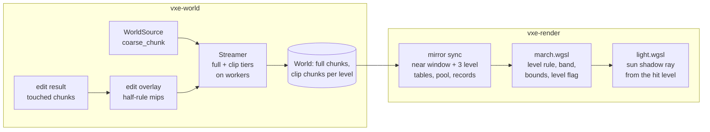

# 0033: The far field: a clipmap of three coarse chunk levels to about 1 km

> **Status:** draft
> **Created:** 2026-10-22
> **Milestone:** M10: Outdoors in [`docs/roadmap.md`](../roadmap.md)
> **Related ADRs:** [ADR-0028](../adrs/0028-far-field-as-a-clipmap-of-source-generated-coarse-chunks.md)
> (proposed with this plan: the clipmap, the source's coarse path, the half rule, the edit
> overlay and the level rule; heightfield, ESVO, impostors and downsampling rejected),
> [ADR-0003](../adrs/0003-sphere-residency-with-lod-ring-and-edit-persistence.md) (sphere
> residency, hysteresis and persistence, which each level reuses; its LOD-only ring stays for
> sources with no coarse path),
> [ADR-0013](../adrs/0013-mirror-reserves-its-vram-budget-up-front.md) (the reservation and
> the pressure rule, which clip chunks draw on),
> [ADR-0012](../adrs/0012-mask-first-brick-with-per-brick-palette-planes.md) (the packed brick
> a clip chunk stores), ADR-0027 (Plan 0032's per-pixel sun shadow ray, which this plan
> continues into the far field),
> [ADR-0024](../adrs/0024-own-temporal-upscaler-on-the-hit-buffer.md) (the upscaler that
> resolves the dithered seam band)
> **Source:** the owner's outdoor answers (2026-10-22: view range about 1 km with the
> far-field clipmap); the roadmap's far-field note and its "Floor, profiles and scene scale"
> decision; ADR-0003's Negative on LOD generation cost.
> **Starts after:** [Plan 0028](done/0028-size-classed-mirror-slots-and-surface-only-attributes.md)
> closes (this plan's byte arithmetic is in its 64-byte units, its 2112-byte record and its
> header; it rewrites what `upload_brick` and the records hold) and Plan 0032 closes (its
> outdoor testbed source is this plan's scene, its directional sample is the shadow ray Phase 6
> extends). Drafted against Plan 0024's `Frame`, hit buffer, `light.wgsl` and `Modes` banner,
> and Plan 0032's `OutdoorSource`, `--source outdoor` and directional sample as drafted; the
> names dev finds in the tree win.

## TL;DR

Beyond the full-detail sphere the world is drawn from three coarse levels of 20, 40 and 80 cm
cells. Each level is a sphere of 22 *clip chunks* (a clip chunk is a chunk of 64³ cells, so
12.8, 25.6 and 51.2 m on an edge) around the camera, generated directly by the source's new
`coarse_chunk` method, stored as ordinary packed chunks in the mirror's pool, and addressed
through a wrapped table window per level. The marcher switches level by distance from the
camera (at 83 to 90 m, 243 to 256 m and 486 to 512 m at the defaults, a dithered band the
upscaler resolves) and ends at 1024 m; a cell is 1.6 to 2.4 pixels wide where its level starts
at 1080p. Edits fold in from full detail through an overlay of half-rule mips, and the sun's
shadow ray walks the same levels, so a ridge 400 m away shadows the valley at the camera's feet.
The first thing a reader sees is a headless test: a box 150 m away on a ground plane, absent
with the far field off, hit at exactly its face with the far field on.

## Context & problem

The owner wants outdoor scenes seen to about 1 km as a general engine capability (2026-10-22).
Today nothing beyond `r_lod` (24 chunks, 154 m) is drawn, and the roadmap's far-field note
shows why the LOD-only ring cannot simply grow: a 1 km ball is about 30 million chunks, and
the ring generates every chunk at full detail before downsampling. ADR-0028 records the
decision and its rejected alternatives; this plan builds it.

The numbers the plan rests on (arithmetic, `chunks_in_ball` and the disc of the same rule):

- **Pixel footprint.** At 1080p and the fly-through's 1-radian vertical field of view a pixel
  subtends 2 tan(0.5) / 1080 = 1.012 mrad. A level-`k` cell (`0.1 x 2^k` m) is one pixel at
  `98.8 x 2^k` m.
- **Switch distances.** Level `k` takes over at `s_k = (r_(k-1) - 2) x 64 x 2^(k-1)` voxels,
  `r_0 = r_full`, `r_k = r_clip`: the distance inside which every finer chunk is resident (a
  point at distance `D` lies in a chunk whose centre is at most `D / e + sqrt(3)` chunks of edge
  `e` from the focus chunk). With the upscaler on the switch moves closer by up to one
  level-`(k - 1)` chunk, `w_k = 64 x 2^(k-1)` voxels. At `r_full` 16 and `r_clip` 22: s_1 =
  896 voxels (89.6 m, band from 83.2 m), s_2 = 2560 (256 m, from 243.2 m), s_3 = 5120 (512 m,
  from 486.4 m); level 3 is guaranteed to (22 - 2) x 512 = 10 240 voxels, 1024 m, which is the
  far limit. A cell where its level starts is 0.2 / (83.2 x 1.012e-3) = 2.38 px for level 1 and
  1.63 px for levels 2 and 3; 0.77 px at each level's end.
- **Residency.** `chunks_in_ball(22)` = 44 473 clip chunks per level, `chunks_in_ball(23)` =
  50 883 with the hysteresis; the table window is 2 (22 + 1) + 1 = 47 on an edge, 103 823
  entries, 415 292 B per level, 1 245 876 B for three. A one-chunk step of a settled level
  brings in disc(22) = 1517 clip chunks.
- **Generation.** At 10 m/s a level-`k` step comes every `6.4 x 2^k / 10` s, so the three
  leading faces take 1517 x (0.78 + 0.39 + 0.20) = 2074 clip chunks a second, 5.4e8 cells if
  every cell were computed, against the near sphere's 1245 chunks and 3.3e8 voxels a second
  (disc(16) = 797). Outdoors the face is a vertical disc the terrain crosses in a strip about
  44 chunks long and 1.3 deep, about 57 of 1517 clip chunks (3.8 %, a guess for Plan 0032's
  terrain): 78 clip chunks a second need cells, 2.0e7 cells a second, about 0.3 of one worker at
  `nfr.md` §5's 6.95e7 voxels a second under streaming. The other 2000 a second are `Uniform`
  answers from the source's column bounds.
- **Bytes (guess until Phase 2's census).** About 1.3 x disc(23) = 2149 clip chunks per level
  hold the surface. At 96 to 160 `Full` bricks each (the surface's brick layer plus a material
  layer below it) and 192 B a brick (Plan 0028's two-material class), plus a 2112 B record:
  20 to 33 KB a clip chunk, 44 to 71 MB a level, **about 0.13 to 0.21 GB for three levels**
  plus 1.2 MB of tables, against `nfr.md` §3's 3 GB line, which already names "LOD to about
  1 km". RAM: the same clip chunks at 8 KiB of slots plus about 150 B a packed brick, about
  0.2 GB against the 4 GB line; uniform clip chunks are a few bytes.

The consumer requirement is general (the owner's outdoor capability); `project-context.md`'s
Rendering row sets the look (smooth, not visible cubes). The `nfr.md` figures touched are §2
(primary rays and lighting), §3 (world VRAM and RAM) and §5 (generation throughput, residency
latency).

## Decision

**Three clip levels of clip chunks, generated by the source, mirrored as chunks** (ADR-0028).
`WorldSource::coarse_chunk(at: ClipCoord, out: &mut Chunk) -> Coarse` is a provided method
answering `Unsupported`; a source that implements it fills a level's 64³ cells under the half
rule or answers `Uniform(material)`. `vxe-world` gains `clip.rs`: `ClipCoord`, `ClipChunk`
(`Uniform` or `Cells(Chunk)`), the `ClipResidency` (levels 1 to 3, `r_clip`, hysteresis) the
`Streamer` drives as more tiers on its worker pool, and the edit overlay (`ChunkMips` built
under `MipRule::Half`, kept per edited chunk beside its persistence entry). The `World` holds
resident clip chunks as it holds LOD mips today. `vxe-render`'s mirror gives each level a
wrapped table window at the tail of the chunk table; a `Uniform` clip chunk is a table entry
with no record, a `Cells` clip chunk a record and slots from Plan 0028's bins under ADR-0013's
reservation, with clip records reserved apart from the near ones. `march` gains the level rule
(the larger of the ray's level so far and the level of `|p - camera|`, coarser on an absent
chunk), the dithered band, a per-level bound of non-empty chunks a ray may leave early through,
the level in the hit flags and a far normal mode (face, or a gradient over the hit cell's 3³
neighbourhood); `light.wgsl`'s sun shadow ray starts at its hit's level. With no clip levels
the walk is today's and every existing golden holds its floor.

We rejected a cylinder (vertical extent capped) instead of a sphere per level because uniform
clip chunks cost a table entry and nothing else, and one residency rule is worth more than the
saving. We rejected storing only each level's shell because a level that holds its whole ball
is the fallback for late finer data and the support of the continuous switch. We rejected
switching level on chunk residency alone (the boundary would be the chunk sphere's staircase,
moving in chunk steps) in favour of the distance rule, with residency as the fallback.

## Architecture diagram



## Implementation phases

Each phase ships as its own commit. `dev` implements all phases in one session with no review
between phases. The architect reviews once at the end, in a fresh session. Every existing golden
renders under `assert_golden`'s floor (at most 0.1 % of pixels differing by more than 2/255)
with the far field off; a re-bless of an existing golden is a deviation to disclose.

### Phase 1: Walking skeleton: one level, bounded, a box at 150 m
- **Owner skill:** dev
- **What:** `Coarse`, `ClipCoord`, `ClipChunk`, `WorldSource::coarse_chunk` (default
  `Unsupported`), `World::{insert_clip, clip, remove_clip, clip_coords}` and a synchronous
  `World::generate_clip(level, extent, source, threads)` for tests; `MipRule::{AnySolid, Half}`
  in `mips.rs` (`ChunkMips::build` keeps `AnySolid`); the mirror's level-1 table window at the
  tail of `chunk_table` (static, no scrolling yet), uniform table entries, clip records; the
  march's level rule with a hard switch at `s_1 - w_1 / 2` and the level in hit flags bits
  5..7; `UniformSource` answers `Uniform`; a test source `PlaneBoxSource` (voxels with `z < 0`
  material 3, plus axis-aligned boxes) whose coarse path is exact.
- **Files touched:** `crates/vxe-world/src/{source.rs, clip.rs, mips.rs, store.rs, lib.rs}`,
  `crates/vxe-world/tests/clip.rs`, `crates/vxe-render/src/{gpu_world.rs, marcher.rs}`,
  `crates/vxe-render/src/shaders/march.wgsl`, `apps/flythrough/tests/far_field.rs`,
  `apps/flythrough/tests/support/mod.rs`, `apps/flythrough/tests/golden/far_skeleton.png`.
- **Done when:** with the near store generated over chunks [-4, 4) x [-4, 4) x [-1, 1), level 1
  over clip chunks [-4, 16) x [-8, 8) x [-2, 2), `r_full` 4 (so s_1 = 2 x 64 = 128 voxels,
  w_1 = 64, the hard switch at 96) and a box at x in [1500, 1600), y in [-100, 100), z in
  [0, 200) voxels, a camera at (0.5, 0.5, 20.5) looking +x: the hit buffer's ground pixels
  with t < 96 carry level 0 and those with t >= 96 level 1, every ground hit at z = 0 within 1e-3 voxels with normal +z; the pixel
  whose ray passes nearest (1500, 0.5, 20.5) hits x = 1500 within 1e-3 voxels with normal -x
  and level 1; with no clip levels the same pixel misses and no ground hit lies beyond the near
  extent; `far_skeleton.png` is blessed on lavapipe; `half_rule_matches_on_aligned_planes`
  asserts the half and any-solid rules agree on the plane source (every cell boundary of
  levels 1 to 3 is aligned at z = 0); `half_rule_keeps_the_exposed_layer` builds the half-rule
  mips of a chunk that is air at local z >= 32, a material with a higher id in the layer
  z = 31 and a lower-id material below it, and finds every cell of the top solid layer of
  levels 1 to 3 (the cells just under local z = 32) holding the top material (each has four
  top and four lower children, so a plain majority would tie to the lower id and fail); every
  existing golden holds its floor.

### Phase 2: The outdoor source's coarse path and the census
- **Owner skill:** dev
- **What:** Plan 0032's `OutdoorSource` implements `coarse_chunk`: a column-height bound over
  the clip chunk's footprint answers `Uniform(air)` above the highest surface and
  `Uniform(rock)` for a clip chunk wholly more than 40 voxels under the lowest (the caverns and
  the tunnel are interiors a viewer outside cannot see, and are left out of the far field);
  otherwise each cell takes occupancy from the surface height at its centre and the surface
  cell of each column takes `grass`, the cells within the soil depth `soil`, in the source's
  integer arithmetic; `world_budget --clip LEVELS,R` prints per level the clip chunks by kind (uniform air, uniform solid, cells), `Full` bricks
  by Plan 0028 class, projected mirror bytes (pool by bin, records, tables), CPU bytes, and
  the coarse generation rate in cells and clip chunks per second per thread; a property test
  compares the source's level-1 cells with the half-rule downsample of its full-detail
  generation over a test region.
- **Files touched:** `apps/flythrough/src/outdoor.rs` (Plan 0032's source; the name follows
  that plan), `apps/flythrough/examples/world_budget.rs`, `crates/vxe-world/src/census.rs`,
  `apps/flythrough/tests/far_field.rs`, `docs/nfr.md` §3 and §5 (projection rows, labelled
  arithmetic).
- **Done when:** the census prints for levels 1 to 3 at `r_clip` 22 around the outdoor spawn,
  and the plan's guesses (2149 surface clip chunks a level, 96 to 160 `Full` bricks each, 0.13
  to 0.21 GB for three levels, about 0.2 GB of RAM, 3.8 % of a leading face needing cells) are
  confirmed or amended in the log before Phase 3 starts, with the Phase 7 bars they feed (an
  amendment is a note, not a rewrite); `coarse_cells_sit_within_a_cell_of_the_downsample`
  asserts that over 8 x 8 x 4 level-1 clip chunks of the outdoor source, every cell where the
  coarse path and the half-rule downsample differ lies within one cell (26-neighbourhood) of
  a cell where the downsample changes between solid and air, and records the share of cells
  that differ, and the share of exposed cells whose material differs; the generation rate is
  recorded on the dev box with its load.

### Phase 3: Clip residency on the streamer
- **Owner skill:** dev
- **What:** `Residency` gains `clip: Option<ClipResidency>`; `update` keeps each level's ball
  around the focus's level-`k` chunk with ADR-0003's integer rule and hysteresis, incremental
  on a one-chunk step as the near tier is; jobs order full loads and promotions first, then
  clip chunks outside their finer level's switch distance (the ring) by world distance, then
  the rest (the fallback); `poll` inserts and evicts clip chunks and reports them in
  `StreamEvents` with per-level latency ticks; a source answering `Unsupported` leaves the
  clip tiers empty and says so once in `StreamStats`.
- **Files touched:** `crates/vxe-world/src/{stream.rs, clip.rs, store.rs}`,
  `crates/vxe-world/tests/clip_stream.rs`.
- **Done when:** with `UniformSource`, the plane source and a seeded integer hills test source
  (an exact coarse path), levels 1 to 3, `r_clip` 22, `h` 1: a settled residency holds 44 473 clip chunks per level; a one-chunk step of the focus in
  +x at level 1 queues exactly 1517 level-1 clip chunks and none at levels 2 and 3 until the
  focus crosses their own chunk boundaries; evictions follow `(r_clip + h)^2`; with `r_lod`
  equal to `r_full` no `LodOnly` chunk is ever loaded; the job order test finds every full job
  before every clip job and every ring job before every fallback job; the hash of every hills clip
  chunk after `wait_idle` is equal at 1 and 7 workers and is pinned in the test, blessed on
  Linux (the Windows arm confirms it); a source answering `Unsupported` yields no clip chunk
  and one `StreamStats` flag.

### Phase 4: Three levels in the mirror, scrolling, the band and the far normals
- **Owner skill:** dev
- **What:** the mirror's three wrapped level windows, moved when the focus's level-`k` chunk
  changes (entries leaving freed, entering written absent), uniform entries, clip records
  reserved by `MirrorConfig::clip_records` per level, sync ordered near first, then ring, then
  fallback clip chunks, under the existing partial-sync and deferral rules; the per-level
  bound of non-empty clip chunks (an AABB in voxels, refreshed at sync) through which a ray
  leaves early; the dithered band from the blue-noise texture when the upscaler is on (a hard
  switch at `s_k - w_k / 2` otherwise); the far limit at `(r_clip - 2) x 64 x 8` voxels; the
  far normal mode (`face` or `gradient`) for clip hits; a `levels` view that tints hits by
  level.
- **Files touched:** `crates/vxe-render/src/{gpu_world.rs, marcher.rs, lib.rs}`,
  `crates/vxe-render/src/shaders/march.wgsl`, `crates/vxe-render/tests/mirror.rs`,
  `apps/flythrough/tests/far_field.rs`, `apps/flythrough/tests/golden/{far_field.png,
  far_levels.png}`.
- **Done when:** with the plane source streamed at `r_full` 4, `r_clip` 6, levels 1 to 3 (so
  s_1 = 128, s_2 = 4 x 128 = 512, s_3 = 4 x 256 = 1024 voxels, far limit 4 x 512 = 2048):
  every below-horizon pixel's hit lies at z = 0 within 1e-3 voxels with normal +z, band on and
  off, and its level is 0 for t < 64, 1 for 128 <= t < 384, 2 for 512 <= t < 768 and 3 for
  t >= 1024 (with the band on, either neighbour inside [s_k - w_k, s_k)); no pixel hits beyond
  t = 2048; after the focus moves 20 level-1 chunks in +x and the mirror syncs, the same
  assertions hold from the new pose and a level table entry's readback matches
  `World::clip` for every resident clip chunk; on the plane `z < x / 4` every clip hit lies
  within one cell of its level of the analytic surface, and the gradient mode's mean angular
  error against the analytic normal (14.04 degrees from +z) is below the face mode's, both
  recorded; `far_field.png` (the outdoor source from Plan 0032's spawn, looking at the horizon,
  band off) and `far_levels.png` are blessed on lavapipe; with no clip levels every existing
  golden holds its floor and Plan 0015's skip-equality test still holds.

### Phase 5: Edits fold into the far field
- **Owner skill:** dev
- **What:** `Streamer::note_edits(&[ChunkCoord])` (the application passes each edit result's
  touched chunks) queues a worker job that builds the chunk's half-rule mips under its read
  lock into the overlay; `poll` patches the resident clip chunks of every level whose
  footprint holds it and marks them dirty; `coarse_chunk` results take the overlay before
  insertion; an overlay entry lives while its chunk's persistence entry does (RAM or spill);
  `StreamStats` reports overlay entries and bytes.
- **Files touched:** `crates/vxe-world/src/{clip.rs, stream.rs, persist.rs}`,
  `crates/vxe-world/tests/clip_edits.rs`, `apps/flythrough/src/main.rs` (passes touched
  chunks).
- **Done when:** in a world of `UniformSource(3)` (coarse path `Uniform(3)`), streamed at
  `r_full` 2, `r_clip` 4, `h` 1, levels 1 to 3, a radius-10
  sphere carve at voxel (32, 32, 32) of chunk (0, 0, 0) removes `{3: 4169}` and, after `poll`,
  leaves exactly 492 air cells in level-1 clip chunk (0, 0, 0), 53 in level 2 and 7 in level 3,
  all inside chunk (0, 0, 0)'s footprint (the half rule applied to the carve, level by level);
  after the focus moves until chunk (0, 0, 0) is evicted and level-1 clip chunk (0, 0, 0) is
  evicted and regenerated, the regenerated clip chunk equals the patched one byte for byte,
  with a RAM persistence cap of 0 and a spill directory as well; the clip hash of Phase 3 is
  unchanged by a run with no edits.

### Phase 6: The sun's shadow ray walks the far field
- **Owner skill:** dev
- **What:** `light.wgsl`'s directional shadow ray toward the sun or moon (ADR-0027, Plan
  0032) starts at its hit's level with an offset of `SHADOW_OFFSET x 2^k` along the shadow
  normal, takes the level rule by distance from the camera, honours the coarse shadow walk at
  every level, and ends at the far limit. With the far field on, Plan 0032's lighting-ray rules
  move outward: an absent chunk sends the ray one level coarser, only an absent chunk inside the
  coarsest level's ball is an occluder, and leaving that ball or passing the far limit reaches
  the sky. The sky ray keeps its 512-voxel cap. Every other ray's hit and light pass is
  unchanged.
- **Files touched:** `crates/vxe-render/src/shaders/{light.wgsl, march.wgsl}`,
  `crates/vxe-render/src/marcher.rs`, `apps/flythrough/tests/far_field.rs`.
- **Done when:** on the ground plane with a wall at x in [4000, 4200), |y| < 2000, z in [0,
  1000) voxels (aligned to every level's cells; at 400 m it is level 2's at `r_full` 4 and
  `r_clip` 22) and the sun in the +x direction, the ground is shadowed for x > 4000 - 1000 /
  tan(elevation): at 10 degrees from x = -1671, at 30 degrees from x = 2268. The sun term of the
  light pass, from a camera at (0.5, 0.5, 20.5) looking +x and down, reads 0 on every ground
  pixel with hit x in [0, 500) at 10 degrees, non-zero on all of them at 30 degrees, and
  non-zero on all of them at 10 degrees with the far field off; from a camera at (0.5, 0.5,
  1500.5) looking at the wall's top (z = 1000, normal +z, level-2 hits) every top pixel reads a
  non-zero sun term at 10 degrees (no self-shadowing at its level).

### Phase 7: The fly-through's switches, HUD rows and readings on both adapters
- **Owner skill:** dev
- **What:** `--far-field [off|on]`, `--clip-radius`, the outdoor default on; `r_lod` set to
  `r_full` when the far field is on; a key cycling the far field `on`, `levels` view, `off`, and
  a key switching far normals `gradient` and `face`, both through `Modes` and its banner
  (`far field on, 3 levels to 1024 m, normals gradient`); HUD rows for clip chunks resident per
  level against their ball, clip bytes live and the overlay; the outdoor autopilot flight at 10
  m/s with the far field on and off; the readings below on the NVIDIA card and the AMD iGPU.
- **Files touched:** `apps/flythrough/src/{main.rs, hud.rs}`, `apps/flythrough/tests/hud_golden.rs`,
  the root `README.md` (the flags and keys), `docs/nfr.md` §2, §3 and §5.
- **Done when:** a test presses the far-field key three times and finds `Modes::line()` naming
  `far field levels`, `far field off`, `far field on` in turn with the banner shown from each
  press, and the far-normals key flipping `normals gradient` to `normals face`; the outdoor
  autopilot with the far field on reads: clip residency per level at full residency equal to
  its ball, clip live bytes recorded against Phase 2's census (bar: under 0.5 GB, the census's
  figure with room), the near tier's residency latency p95 under 500 ms (`nfr.md` §5, the far
  field must not delay it), each level's ring latency p95 under one of its own steps at 10 m/s
  (1.28, 2.56 and 5.12 s), clip generation in cells per second per worker and the workers'
  busy share, `update + poll + sync` p50 and p99 beside the far-field-off run; at the outdoor
  spawn looking at the horizon at 1080p the march GPU time with the far field on and off
  (bar: at most 3.0 ms on the NVIDIA card, `nfr.md` §2's line; recorded on the iGPU) and the
  light pass with the sun at 45 and 10 degrees elevation, on both adapters, labelled by adapter.

### Phase 8: The owner's windowed outdoor flight
- **Owner skill:** human
- **What:** the outdoor fly-through at 2560 x 1440, banner and HUD visible: still views of the
  horizon at each switch distance in the `levels` view and shaded, slow and 30 m/s passes along
  the terrain watching for seams and popping, far normals `gradient` against `face`, and one
  flight at `r_full` 24 against 16 (level 1 then starts at 134 to 141 m, about 1.5 px a cell at
  1080p, and the near tier's cost is the census's).
- **Files touched:** this plan's log.
- **Done when:** the owner has recorded in the Implementation log a verdict on the seams and
  popping, the default far normal mode, and whether the outdoor `r_full` default stays 16.

## Data shapes

```rust
// illustrative: vxe-world
pub struct ClipCoord { pub level: u8, pub chunk: ChunkCoord } // level 1..=3; spans 64 << level voxels
pub enum Coarse { Unsupported, Uniform(MaterialId), Cells }   // Cells: `out` holds the 64^3 cells
pub enum ClipChunk { Uniform(MaterialId), Cells(Chunk) }
pub struct ClipResidency { pub levels: u8, pub r_clip: i32, pub hysteresis: i32 } // 3, 22, 1
pub enum MipRule { AnySolid, Half }  // Half: solid when >= 4 of 8 children solid; the majority
                                     // material of the exposed solid children, else of all;
                                     // a child on the chunk's face counts as exposed there
pub trait WorldSource {
    fn chunk(&self, coord: ChunkCoord, out: &mut Chunk);
    fn coarse_chunk(&self, _at: ClipCoord, _out: &mut Chunk) -> Coarse { Coarse::Unsupported }
}
```

- **Chunk table:** `[near window W0^3][level 1 W^3][level 2 W^3][level 3 W^3]`, `W = 2 (r_clip +
  h) + 1`, index `rem_euclid(coord, W)` per axis. A clip entry is absent (`0xFFFFFFFF`), a record
  index with the existing empty bit, or bit 31 set with the uniform material in bits 0..16 and
  no record (uniform air is the empty bit with no record).
- **Params:** `clip_levels`, `clip_window` (W), `clip_min[3]` (`vec4<i32>`), `clip_switch` and
  `clip_band` (`vec4<f32>`, voxels), `clip_bounds_min[3]` and `clip_bounds_max[3]`, `far_limit`,
  `far_normals`. The near walk's `lod1_r2` and `lod2_r2` stay for the LOD-only ring.
- **Hit flags:** bits 5..7 the hit's level (0 near, 1 to 3 clip), read by the light pass for the
  shadow start and by the `levels` view.
- **Mirror:** clip records reserved apart (`MirrorConfig::clip_records`, per level, default
  4096: 3 x 4096 x 2112 B = 25 952 256 B), clip slots from the shared bins; pressure's record
  term reads near and clip records separately, the larger counting.
- **Overlay:** `ChunkCoord -> Arc<ChunkMips>` built under `MipRule::Half`, kept while the chunk
  has a persistence entry or is resident and edited.

## Budgets

| `nfr.md` figure | line | projection (dev box) | how the close measures it |
|---|---|---|---|
| §3 World in VRAM, live | 3 GB | clip levels 0.13 to 0.21 GB plus 1.2 MB of tables and 26 MB of clip records (guess, Phase 2 amends) | `world_budget --clip`; the outdoor autopilot's live bytes, both adapters |
| §3 World in RAM | 4 GB | clip chunks about 0.2 GB; overlay bounded by edited chunks | `world_budget --clip`; `StreamStats`; `VmHWM` in the flight |
| §5 Generation throughput | near face 3.3e8 voxels/s at 10 m/s | clip faces 2074 chunks/s, about 2.0e7 cells/s computed (0.3 of a worker), if 3.8 % of a face needs cells | Phase 2 census rate; Phase 7 cells/s/worker and busy share |
| §5 Residency latency | 500 ms p95 near | unchanged near; ring p95 under 1.28, 2.56, 5.12 s by level (bars) | Phase 7 autopilot, far field on |
| §2 Primary rays | 3.0 ms | outdoor horizon view, far field on: under 3.0 ms on the NVIDIA card (bar, a guess of +0.3 to 1.0 ms over off); iGPU recorded | Phase 7, timestamps, median of the last 30 of 300 frames, three runs, quiet box, both adapters |
| §2 Lighting | 6.0 ms | the sun ray grows with the far field, most at low sun; recorded at 45 and 10 degrees | Phase 7, both adapters |
| §2 Streaming line (render thread) | 1.0 ms | clip syncs add uploads of surface clip chunks and table entries; recorded beside off | Phase 7 autopilot timers |

A figure read only on the NVIDIA card is labelled dev reference; the iGPU's readings are the
slow adapter's (`nfr.md` §1). The VRAM projection does not depend on the adapter; on the iGPU it
is shared DDR4.

## Risks & open questions

- **Grazing rays are the step cost.** A ray skimming terrain to the horizon crosses every level
  at brick or cell granularity near the surface; the bound of non-empty chunks helps only rays
  that leave the slab. If Phase 7's march misses its bar, the next levers are a coarser shadow
  walk by distance (a followup) and a lower `r_clip` in the portable profile (two levels end at
  512 m).
- **The seam without the upscaler.** The band is dithered only when the upscaler runs (Plan
  0030); otherwise the hard switch shows up to half a coarse cell of surface offset on grazing
  terrain. Phase 4's plane test bounds it; Phase 8 judges it.
- **Interiors left out of the far field wall off long sightlines underground.** The outdoor
  coarse path draws no caverns, so a camera in a cavern sees rock where a passage continues
  past s_1 (83 m). The cave-like consumer has no far field; a source that needs it there pays
  for interior clip chunks in records and slots, which Phase 2's census would show.
- **Thin surface layers at distance.** The half rule's exposed-material choice keeps grass on
  grass-over-soil, but where the rule empties the cell holding the exposed layer, the cell
  under it shows soil. Phase 2 records the share; Phase 8 judges the colour.
- **The source's coarse path is the consumer's work.** A coarse path far from the half rule
  shows seams around edited chunks and at the level boundary. Phase 2's property test is the
  template a consumer copies; `Unsupported` is always safe (no far field).
- **Plan 0028 and Plan 0032 must land first.** The byte arithmetic is in Plan 0028's units and
  record; the scene, sun and shadow ray are Plan 0032's. If either changes shape, the census
  (Phase 2) re-derives the bars and the log notes it.
- **Determinism:** clip chunks and overlays are integer, seeded through the source, and
  thread-order independent (Phase 3's hash at 1 and 7 workers). Rendering is not deterministic;
  its goldens are blessed on lavapipe with the band off.
- **Threading:** coarse generation and overlay builds run on the existing workers, outside any
  lock but the chunk read lock an overlay build takes, as demotion does today.
- **Precision:** at 1 km a position is 10 240 voxels from the camera; `f32` keeps about 1e-3
  voxel there, within the walk's plane-order tolerance. A camera far from the world origin is
  an existing limit, not this plan's.
- **Probe and reflection rays** go through `march` and so see the far field; Plan 0029's probe
  rays have their own `t_limit` and stay near.

## What this plan does NOT do

- **Sky, sun, moon and time of day** (Plan 0032): this plan extends its sun shadow ray.
- **Water surfaces, reflection and refraction** (Plan 0034): the translucent walk runs at clip
  levels as at mip levels, but water optics at distance are that plan's.
- **Aerial perspective and volumetric clouds** (Plan 0035): it consumes the far-field hit
  distance this plan writes; cloud shadows on far terrain are that plan's.
- **Weather, wet surfaces and snow cover** (Plan 0036), including snow on far terrain.
- **Retiring ADR-0003's LOD-only ring**, or a coarse path for the cave source: a later
  decision by measurement.
- **More than three levels, or a horizon beyond 1024 m**: the overlay uses the three
  `ChunkMips` levels; deeper levels need deeper mips.
- **Prefab placements in the far field**: `StampedSource` forwards `coarse_chunk` to its base,
  so stamped prefabs are absent from clip levels until a followup downsamples them.
- **CPU queries, raycasts or collision against clip levels**, and edits beyond `r_full`.
- **A shadow walk that coarsens with distance from its origin** (cone-like): a followup if
  Phase 7's low-sun reading asks for it.
- **Probes beyond the near volume** (Plan 0029 stays near-field).

## Implementation log

> Written by `dev`: one row per phase as its commit lands, then the close block. **The phases
> above are the contract. This section records what happened.** Observations, never conclusions:
> no pass list, no self-assessment. Deviations and unmet done-whens are **always** disclosed.
> Keep it shorter than `## Implementation phases`.

| phase | owner | state | commit |
|---|---|---|---|
| 1: Walking skeleton: one level, bounded, a box at 150 m | dev | not started | |
| 2: The outdoor source's coarse path and the census | dev | not started | |
| 3: Clip residency on the streamer | dev | not started | |
| 4: Three levels in the mirror, scrolling, the band and the far normals | dev | not started | |
| 5: Edits fold into the far field | dev | not started | |
| 6: The sun's shadow ray walks the far field | dev | not started | |
| 7: The fly-through's switches, HUD rows and readings on both adapters | dev | not started | |
| 8: The owner's windowed outdoor flight | human | not started | |

### Notes

_(Deviations from the plan, with the commit, stated without justification. Done-whens not
satisfiable as stated, and what was done instead. Followups noticed and not acted on. One line
each. Empty is fine.)_

### Close triggers

_(Facts for the architect. No recommendations, and no suggested version bump.)_

- **What shipped:** feature / fix-only / docs-chore-only
- **Public API changed:** types, traits, functions, shader interfaces, config (list them, or none)
- **Budget readings:** each `nfr.md` figure touched, with its measured value, machine and commit
- **Gate at the tip:** the commands run (build, nextest, doctests, clippy, fmt, deny), exit codes, test counts
- **Outstanding `human` phases:** which, or none

## Followups

- A reference worth adding to `docs/references/`: Losasso and Hoppe, "Geometry Clipmaps:
  Terrain Rendering Using Nested Regular Grids" (2004), and Tanner, Migdal and Jones, "The
  Clipmap: A Virtual Mipmap" (1998), the sources of the nested-level, toroidal-update shape.
- At close: ADR-0003 gets an Outcome line pointing at ADR-0028 for the far field, if the ring's
  role changed in the fly-through's defaults.
