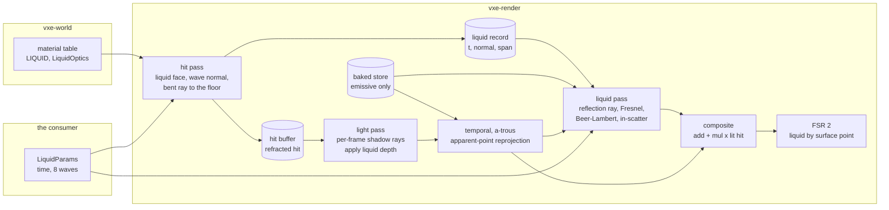

# 0034: Liquid surfaces: analytic waves, traced reflection and refraction rays, and absorption under the surface

> **Status:** approved (2026-10-22), amended 2026-11-10 (review pass)
> **Paths (architect, 2026-11-13, at Plan 0045's close):** Plan 0045 split files this plan names
> by their old paths (`gpu_world.rs`, `marcher.rs`, `bake.rs`, `fsr2.rs`, `march.wgsl`,
> `tests/gpu_mirror.rs`, `tests/gpu_strip.rs`'s reading, the fly-through's `main.rs` and
> `hud.rs`). Read each through "Where things moved" in
> [Plan 0045](done/0045-structure-pass-split-the-mega-files-share-the-fixtures.md); the
> phases re-cut their Files touched at their start.
> **Created:** 2026-10-22
> **Milestone:** M10: Outdoors in `docs/roadmap.md`
> **Related ADRs:** [ADR-0029](../adrs/0029-liquid-surfaces-as-analytic-wave-normals-with-traced-reflection-and-refraction.md)
> (proposed with this plan: the liquid surface, its waves, rays and absorption, and the
> rejected displacement, screen-space and per-voxel options),
> [ADR-0047](../adrs/0047-translucent-solids-filter-by-path-length-with-a-baked-reflected-share.md)
> (accepted: translucent solids filter by path length; a liquid follows the same law),
> [ADR-0046](../adrs/0046-static-emissive-light-is-baked-per-chunk-when-a-chunk-loads-or-changes.md)
> (accepted: the baked store a reflected face hit reads),
> [ADR-0044](../adrs/0044-direct-light-from-a-fixed-list-of-analytic-lights-one-shadow-ray-each.md)
> (proposed, Plan 0058: the direct target the lake floor is lit in),
> [ADR-0026](../adrs/0026-atmosphere-from-hillaire-luts-built-on-the-gpu-at-runtime.md) and
> [ADR-0027](../adrs/0027-the-sun-shadow-is-one-per-pixel-ray-in-the-light-pass.md) (proposed,
> Plan 0032: the sky radiance a reflection reads, the key light),
> [ADR-0034](../adrs/0034-fsr-2-ported-to-wgsl-as-the-default-upscaler-candidate.md) (FSR 2,
> the default upscaler, whose motion and reactive inputs liquid pixels change),
> [ADR-0012](../adrs/0012-mask-first-brick-with-per-brick-palette-planes.md) (the translucent
> class is fixed for the world's life)
> **Source:** the owner's answers of 2026-10-22 (outdoors as a general engine capability;
> liquids render first, flow later; decide by measurement, a smooth natural look; readings on
> both adapters; every testbed toggle shows its mode in the window), of 2026-11-03 (a stable
> image first; liquids keep flat faces) and of 2026-11-10 (the plan order), the roadmap's
> "Floor, profiles and scene scale" decision (glass, water and lava are translucent voxels in
> the brick map), Plan 0015's translucent class
> ([done](done/0015-traversal-hierarchy-chunk-bits-brick-masks-and-translucent-class.md)).
> **Starts after:** [Plan 0033](0033-far-field-clipmap-to-a-kilometre.md) closes. The order is
> linear (owner, 2026-11-10): Plans 0060, 0061, 0058, 0044, 0045, the `own`-removal plan and
> the render-profile plan (both owed), then Plans 0032, 0033, 0034, 0035, 0036, 0037. The base
> commit is main after Plan 0033's close. Plan 0045 splits `marcher.rs`, `gpu_world.rs`,
> `march.wgsl` and `main.rs` before this plan starts, so every path under "Files touched" names
> the file as it stands at main 82ea836, and `dev` re-reads the paths at the base commit.
> **Relies on:** [Plan 0032](0032-sun-and-sky-hillaire-atmosphere-time-of-day-and-an-outdoor-testbed.md)'s
> section "Interface for Plans 0033 to 0037" and nothing else of that plan;
> [Plan 0058](0058-dynamic-lights-a-list-of-analytic-lights-dropped-carried-and-bounced.md)'s
> direct target and light list as its Data shapes state them; Plan 0033 only for what it says
> of secondary rays through `march`. If any of the three closes with a different shape, the
> architect re-reads Phases 2, 4 and 5 before the go.

> **Amended 2026-11-10 (test cost, owner).** Phases 1 to 8 are **exploration** (lane rules 2b):
> the owner's window in Phase 9 is their gate. Each lands its CPU tests of data, determinism
> and API; every test it names that judges the image (goldens, SSIM or pixel floors, stillness,
> settle and difference bars) runs as a reading from `live/`, a `mod reading` or the strip tool,
> recorded in the readings log, and is written as a test in Phase 10, after the window, against
> the picks. Phase 8 keeps its switches, banner and readings before the window; its goldens and image bars move to Phase 10. Per phase the gpu check runs only the `gpu_*` binaries the phase names
> (`test-changed.mjs --binaries`, Plan 0066); a named test over 10 s on lavapipe is born
> `#[ignore = "soak"]` (`docs/nfr.md` section 7). The mechanisms and bars stand; only when they
> become tests moves.

## TL;DR

A material row can be a liquid (`MaterialFlags::LIQUID`, always with `TRANSLUCENT`), with
absorption, scattering, an index of refraction and two wave scales. The hit pass finds the
first face where a liquid meets air, records it, bends the ray there by Snell's law and walks
on to the floor, which goes into the hit buffer and is lit like any other surface: the baked
store's emissive light, the lamp, the list lights, the key light and the sky ray. A new liquid
pass traces one reflection ray from the surface and shades its hit (the baked store on a cube
face, the exact direct terms, the sky on a miss), and weighs reflection against transmission
by the exact Fresnel equations. Light along every liquid span falls by Beer-Lambert, the same
path-length law ADR-0047 gives glass, and gains in-scatter from the light the pixel's own floor
receives. Waves are a normal, not geometry: a sum of eight Gerstner waves evaluated at the
flat face, animated by a time the game supplies. A camera under the surface sees Snell's window
and fog. Lava is the same class with emission and an absorption so high that its surface is the
hit. The first thing a reader sees is Phase 1's pond in the outdoor source, dark looking down
and bright with sky at grazing angles; the goldens are a lake at noon, the same lake from under
water, and a lava pool lighting a dark basin.

## Context & problem

ADR-0047 (Plan 0059) draws a translucent solid as a filter: the hit pass's `translucent_march`
sums the ray's path length through the solid, writes the reflected share of the entry face's
baked light to `layer_out` and the transmittance `T(L)` per channel to `transmit_out`
(rgb9e5), and the composite returns `reflected * exposure + T * behind`. The law is right for a
lake; the rest is not. The ray does not bend, so the floor seen through water is not displaced.
The reflection is a Schlick share of the entry face's own light, so nothing of the world
reflects. The tint comes from the row's albedo, not from a depth colour the game sets, and
there is no in-scatter, so deep water reads black instead of coloured. A camera under the
surface sees the same filter in every direction. Outdoors (the owner's M10) water is the
commonest translucent surface, and the roadmap's floor decision already placed it in the brick
map.

What is settled, at main 82ea836 and in the plans ahead of this one:

- **The world does not move for rendering.** An edit is a deterministic operation through the
  op log, and the mirror is uploaded from it (ADR-0002, ADR-0022). The game owns the clock:
  `vxe-world` reads none, and `vxe-render` takes time as a parameter.
- **Emissive light is baked.** A cube-face hit reads the brick store (`reads_store`,
  `store_brick_value` in `temporal.wgsl`); the bake's shadow test treats a translucent voxel as
  air, and the bake writes cells for translucent faces too (ADR-0046, ADR-0047). The hit pass
  already binds the store read-only for glass.
- **Exact direct light has its own target.** Plan 0058 adds `direct` (`rgba16float` on the
  lighting grid, pre-exposed, a short blend) for the lamp and the list lights; Plan 0032 adds
  the key light's directional sample and the sky ray to it. The composite sums it with the
  store's emissive before the albedo.
- **The probe volume is the lamp's bounce channel only** (ADR-0043). It takes no sky, sun or
  emissive light, and it is off with the lamp off. This plan reads it nowhere.
- **Targets are pre-exposed** (ADR-0033): absolute radiance is multiplied by `exposure_now()`
  once where it enters a target, and the meter reads the composite's `c / ex`.
- **FSR 2 at 1.5 is the default upscaler** (Plan 0055). `fsr2/input.wgsl` writes its motion and
  its reactive mask (`reactive_translucent` marks glass). The `own` upscaler is removed by its
  own plan before M10.
- **Liquids keep flat faces** with analytic normals (owner, 2026-11-03); a liquid does not take
  the field surface.

The consumer is underground (`project-context.md`, Rendering: mostly dark scenes, emissive
voxels as lights); a pool in a cave lit by a vein or by lava is its case, a lake under the sky
the outdoor consumers'. The `nfr.md` figures touched are section 2's primary rays (the
refraction walk in the hit pass), lighting (the liquid pass) and upscale (the liquid pixels'
rule), and section 3's "everything else" (the liquid targets).

## Decision

We build ADR-0029. **The liquid is a material class; its surface is the face where it meets a
cell that is neither opaque nor the same liquid; the shading normal there is analytic.**

1. **`vxe-world` gains a flag and five carried floats.** `MaterialFlags::LIQUID` and
   `Material::liquid: LiquidOptics` are renderer data carried by the table, as `albedo` is. No
   voxel data changes and no edit path reads a float.
2. **The hit pass records the surface and bends the ray.** `translucent_march` stops at the
   first liquid face. A translucent solid in front of that face keeps ADR-0047's filter; a
   liquid voxel is never filtered as glass. On a face whose normal is world up (+z, as the
   cutaway view assumes) the normal is a sum of eight Gerstner waves from `LiquidParams`, which
   the game sets per frame with its own time. The transmitted ray bends by Snell's law and is
   walked to the floor, which becomes the pixel's hit (`HIT_REFRACTED`).
3. **One absorption law, two stores.** A liquid span absorbs by `exp(-(absorption +
   scattering) L)` per channel over its path length `L`, which is ADR-0047's `tint^(L / d)`
   with the coefficients stated by the row instead of derived from its albedo. The composite
   has one rule: `c = glass_reflected * ex + T_glass * (liquid_add + liquid_mul * c_hit)`. The
   liquid's two terms stay in targets of their own (`rgba16float`), because the reflection ray
   and the in-scatter are computed after lighting and the numeric bars need more than rgb9e5's
   nine bits. Folding `liquid_mul` into `transmit` is a followup.
4. **A liquid pass shades the reflection after lighting.** `liquid.wgsl` runs after `atrous`
   and before `composite`. It traces the reflection ray and shades its hit: on a cube face, the
   brick store's value (a read-only store binding on this pass, as the hit pass has); where
   there is no face, one stochastic emissive sample (`emissive_estimate`); always the hit's own
   emission, the lamp (`lamp_lit`) and the key light (`key_light_at`) with one shadow ray each,
   the list lights unshadowed, and one sky ray. A miss reads `sky_radiance(r)`.
5. **In-scatter takes the floor's light.** The in-scatter `S` along a span is
   `scattering / (absorption + scattering) * (E / PI) * (1 - T)`, with `E` the filtered
   irradiance the composite reads for that pixel (the `direct` target plus the store's
   emissive, pre-exposed, before albedo). That value is shadowed, filtered and holds still, and
   it costs no ray. On a refracted miss `E` is `PI * sky_radiance(+z) * exposure_now()`.
6. **The bake takes no liquid term.** Baked emissive light is not absorbed by a liquid. Every
   per-frame lighting ray is: the light pass's shadow rays from a hit under liquid multiply
   their visibility by the liquid's transmittance along the segment, through a per-call
   argument the bake never passes.
7. **History follows the surface.** The temporal pass reprojects a refracted floor pixel by
   its apparent point. FSR 2 takes the surface point's motion on liquid pixels and a
   `reactive_liquid` tuning. Reflected and refracted radiance bypass the a-trous filter and
   keep no history of their own. The upscaler half is measured before it is built (Phase 7).
8. **A liquid opaque within one voxel (lava) is its own hit**, lit and emissive like rock; only
   its reflection is added, and none for a rough row.

We rejected displacing geometry (per-frame edits through the op log, or a height-field
intersection inside the walk), screen-space or planar reflections (blind to the cave ceiling
over a pool, or one plane only), keeping the glass filter for liquids, stochastic rough
reflections through the denoiser, and baking the liquid's absorption. The reasons are in
ADR-0029.

## Architecture diagram



## Implementation phases

Each phase ships as its own commit. `dev` implements all phases in one session with no review
between phases. The architect reviews once at the end, in a fresh session.

**Goldens.** Every golden this plan adds is blessed on lavapipe at 320 x 180 under the
harness's floor: at most 0.1 % of pixels differ by more than 2/255. A golden with emissive
light bakes first (`Frame::bake_until`, as `gpu_golden.rs` does) and then renders the
harness's `SETTLE_FRAMES`. Every existing golden stays byte-identical in a world with no liquid
row, and each phase's test run asserts it.

**Numeric tests.** They read the liquid targets back with `readback::read_rgba16f` in linear
values, lamp off, every filter off, exposure fixed at 1 and the identity tone map unless they
say otherwise. "A uniform sky of radiance `s`" is Plan 0032's `Sky::uniform(s)`: `s` above the
horizon, 0 below, no discs and no directional light.

**Tests and tiers.** A phase gates on `node scripts/test-changed.mjs --profile quick` and
`--profile gpu` under the perf lock; the tip gates on `cargo nextest run --profile gate`. A
test that opens a GPU device lives in a `tests/gpu_*.rs` file; a CPU-only bar lives in a unit
test or a file without the prefix. Each named test carries its expected wall time on lavapipe.
**Every time below is an estimate: nothing was run.** `dev` reads each test's time with
`node scripts/test-times.mjs`; a test over 30 s on lavapipe (60 s on CI) is marked
`#[ignore = "soak"]` and leaves the gate, and the phase then keeps a smaller variant of the same
claim in the gate. A number that is only logged is printed by the test that asserts beside it,
or lives in a named `reading::<name>` inside a `mod reading`. A reading taken by running the
fly-through is a run, not a test. Readings go to `docs/plans/logs/0034.md`.

**Slots, bits and keys.** This plan names no binding slot, hit-record bit, material-flag value
or key. Each addition takes the next free one, and `dev` reads the tree at the base commit
(`MaterialFlags` holds 1, 2 and 4 at 82ea836; Plan 0033 takes two hit-record bits for its level
first). A toggle's done-when names the banner's mode word, and the README names the key.

### Phase 1: The liquid class, the surface record, and a Fresnel sky reflection
- **Owner skill:** dev
- **What:** the walking skeleton. `MaterialFlags::LIQUID`, `LiquidOptics`, `Material::liquid`
  (a constructor that sets `TRANSLUCENT | LIQUID`) and `MaterialTable::is_liquid` in
  `vxe-world`. The GPU material row grows from four `vec4` to six (`MATERIAL_FLOATS` 16 to 24,
  and the `m * 4u` of `march.wgsl`'s row reads; see Data shapes) and carries the liquid bit and
  the optics. `translucent_march` stops at the first liquid face; a translucent solid in front
  of it keeps its filter, and a liquid voxel is never filtered as glass. The hit pass writes the
  liquid record (`liquid_out`) with the face normal and the straight ray's hit unchanged. A new
  `liquid.wgsl` pass writes `liquid_add = F * sky_radiance(reflect(d, n)) * exposure_now()` and
  `liquid_mul = 1 - F`, `F` by the exact unpolarised dielectric Fresnel equations. The composite
  returns `glass_reflected * ex + T_glass * (liquid_add + liquid_mul * c_hit)`. `Frame::frame_bytes`
  counts the three targets. The outdoor source of Plan 0032 gains a pond (a rock basin filled
  with a testbed water row to a fixed height), and its pinned hashes are re-pinned once with the
  reason in the log. Editing `march.wgsl` changes the bake's source: ADR-0047 says a store file
  is then re-baked once; the mechanism was not found in `bake.rs` at 82ea836 and is unverified.
- **Files touched:** `crates/vxe-world/src/material.rs`, new
  `crates/vxe-world/tests/liquid_material.rs`, `crates/vxe-render/src/gpu_world.rs` (the row
  stride and the liquid bit), `crates/vxe-render/src/shaders/march.wgsl` (the walk's stop, the
  record), new `crates/vxe-render/src/shaders/liquid.wgsl`, `composite.wgsl`,
  `crates/vxe-render/src/marcher.rs` (the targets, the pass in `FRAME_PASSES`, `LiquidParams`
  with its defaults), `lib.rs` (the shader source),
  `crates/vxe-render/tests/gpu_shader_portability.rs` (the new pass), new
  `crates/vxe-render/tests/gpu_liquid.rs`, `apps/flythrough/src/` (the outdoor source's pond),
  `apps/flythrough/tests/determinism.rs`.
- **Done when:**
  - `liquid_material.rs`, `a_liquid_row_is_translucent_and_liquid` (CPU, under 1 s):
    `Material::liquid(..)` reads `is_translucent()` and `is_liquid()` true; a row with `LIQUID`
    and no `TRANSLUCENT` reads `is_liquid()` false.
  - `gpu_mirror.rs`, `a_liquid_row_without_translucent_uploads_as_opaque` (about 2 s): the
    upload puts that row's voxels in the opaque mask of one brick.
  - `gpu_liquid.rs`, `a_flat_pond_reflects_the_sky_by_fresnel` (about 4 s): over a flat pond
    (wave amplitude 0) of the testbed water (`ior` 1.33) on a floor of albedo 0, under a uniform
    sky of radiance 1, a view ray meeting the surface at incidence 0, 45, 60 and 80 degrees reads
    `liquid_add` of 0.02006, 0.02752, 0.05913 and 0.34692 within 1e-3 in every channel (the
    exact Fresnel values for n = 1.33, worked in the log), and `liquid_mul` of one minus each.
  - The same test at exposure fixed at 2 and incidence 45 degrees reads `liquid_add` of 0.05504
    within 2e-3 and `liquid_mul` of 0.97248 within 1e-3: the absolute sky term is pre-exposed
    once, the factor is not.
  - Every existing golden renders byte for byte (no liquid row in them; the stride change moves
    no pixel), including `translucent.png`, whose glass rows are not liquid.
  - `apps/flythrough/tests/determinism.rs` hashes of every world without the pond are unchanged.

### Phase 2: The bent ray, the floor in the hit buffer, and absorption
- **Owner skill:** dev
- **What:** at the surface the transmitted direction bends by Snell's law; a `liquid_span` walk
  (a translucent-walk variant that runs while the cell is the liquid) measures the span to the
  first non-liquid cell, and the opaque walk continues from there along the bent ray. Its hit is
  the pixel's hit (`HIT_REFRACTED`, and `HIT_UNDER_LIQUID` when the span ended on it). The
  liquid pass multiplies the transmitted part by `T = exp(-(absorption + scattering) L)` and
  adds the in-scatter `S = scattering / (absorption + scattering) * (E / PI) * (1 - T)` per
  channel (zero scattering gives zero in-scatter, guarded). `E` is the filtered irradiance the
  composite reads for the pixel: the `direct` target plus the store's emissive, pre-exposed,
  before albedo. `add = F * R + (1 - F) * S`, `mul = (1 - F) * T`. A refracted ray that misses
  folds `sky_radiance(t_dir) * exposure_now()` into `add`, takes `E = PI * sky_radiance(+z) *
  exposure_now()`, and flags the record so the composite takes `c_hit = 0`. A test hook writes a
  constant into the irradiance the liquid pass reads (`Frame::set_test_irradiance`, added here
  unless Plan 0058 left one).
- **Files touched:** `march.wgsl` (`liquid_span`, the bend, the flags), `liquid.wgsl`,
  `composite.wgsl`, `marcher.rs`, `tests/gpu_liquid.rs`.
- **Done when:**
  - `the_refracted_floor_sits_where_snell_puts_it` (about 3 s): a view ray at incidence 45
    degrees meeting a flat surface at `(x_s, y_s, z_s)` over a floor 20 voxels below reads a hit
    position of `x_s + 12.5546` within 0.01 voxel on the ray's horizontal axis and the floor's
    `z` (refraction angle `asin(sin 45 / 1.33)` = 32.118 degrees, `20 tan 32.118` = 12.5546);
    with `ior` 1.0 the same ray reads `x_s + 20.0`.
  - `ten_voxels_of_water_absorb_by_beer_lambert` (about 3 s): looking straight down through 10
    voxels of water with absorption `[0.045, 0.006, 0.002]` per voxel and scattering 0, over a
    floor of albedo 0 and emission `[1, 1, 1]`, under a uniform sky of radiance 0: `liquid_mul`
    reads `[0.62484, 0.92287, 0.96054]` within 1e-3 (`(1 - 0.02006) exp(-0.45, -0.06, -0.02)`),
    and the composite's pixel equals that value encoded within 2/255.
  - `a_scattering_span_gains_the_floors_light` (about 3 s): with absorption 0, scattering
    `[0.05, 0.05, 0.05]` per voxel, looking straight down through 20 voxels onto a floor of
    albedo 0 under a uniform sky of 0, and the test irradiance set to `PI`, `liquid_add` reads
    `(1 - 0.02006) * 0.63212` = 0.61944 within 2e-3 (`1 - e^-1` of a radiance of 1).

### Phase 3: Waves: an analytic normal with the game's time
- **Owner skill:** dev
- **What:** `LiquidParams` carries `time_s`, `gravity` (voxels per s^2, for deep-water
  dispersion `omega = sqrt(g k)`) and eight `Wave`s (direction, wavelength in voxels, amplitude
  in voxels, steepness); `LiquidParams::wind_waves(dir, longest, shortest, steepness)` fills
  them (wavelengths geometric between the two, directions spread about the wind by a fixed
  table); the frame clamps the sum of `Q k A` to 1 so no crest loops. On a face whose normal is
  +z, the normal is the Gerstner normal (Finch, "Effective Water Simulation from Physical
  Models", GPU Gems ch. 1) at the face point, each wave's amplitude scaled by the row's
  `wave_amplitude` and its time by `wave_speed`, and each faded by `smoothstep(2f, 4f,
  wavelength)` with `f` the pixel's footprint at the surface (`t_s` times the view's angle per
  pixel). Other faces keep the face normal. The fly-through supplies its frame loop's time; the
  engine reads no clock.
- **Files touched:** `marcher.rs` (`LiquidParams`, `Wave`, the uniform), `march.wgsl`
  (`wave_normal`), `liquid.wgsl`, `apps/flythrough/src/main.rs` (the time), `tests/gpu_liquid.rs`.
- **Done when:**
  - A unit test in the module that holds `LiquidParams`, `wind_waves_never_loop_a_crest` (CPU,
    under 1 s): for steepness 0, 0.3 and 1 the sum of `Q k A` over the eight waves is at most 1.
  - `one_wave_tilts_the_normal_by_its_slope` (about 4 s): one wave (direction +x, wavelength 32
    voxels, amplitude 1 voxel, steepness 0, the other seven of amplitude 0, `gravity` 98.1) at a
    surface point with phase 0 at `time_s` 0 reads a recorded normal of `(-0.19267, 0, 0.98126)`
    within 1e-3 (`k = 2 PI / 32` = 0.19635); at `time_s` 1.43163 (one period, `omega =
    sqrt(98.1 k)` = 4.38884) the same; at half a period `(0.19267, 0, 0.98126)`; with the row's
    `wave_speed` 0.5, `time_s` 1.43163 reads the half-period normal.
  - The same test: that wave at wavelength 8 on a surface pixel whose footprint is 4 voxels or
    more reads `(0, 0, 1)` within 1e-4 (faded out).
  - `still_waves_change_no_pixel` (about 3 s): with every amplitude 0 the frame matches Phase
    2's byte for byte; a side face of the pond (carved open) reads its face normal at any time.

### Phase 4: The traced reflection, and the lake at noon
- **Owner skill:** dev
- **What:** the liquid pass traces the reflection ray from the surface (offset along the face
  normal as the shadow-ray origin is) through `march`. It shades the hit with: the brick
  store's value on a cube face (`reads_store`, through a read-only store binding on this pass),
  or `emissive_estimate`'s one sample where the hit has no face; the hit's own emission under
  the frame's scale; `lamp_lit` and `key_light_at`, each times one shadow ray; the list lights
  of Plan 0058, unshadowed; and one cosine-weighted sky ray capped at `SKY_RAY_VOXELS`. The sum
  is absolute and enters `liquid_add` times `exposure_now()`, clamped at `HDR_MAX`. A miss reads
  `sky_radiance(r)`; beyond the near field the ray continues only as Plan 0033 states for
  secondary rays through `march`, and this plan adds no far-field code. A liquid row whose
  roughness is 0.3 or more traces nothing and adds no reflection. `LiquidParams::reflection` is
  `Trace`, `Sky` (no ray, `sky_radiance(r)` only) or `Off` (no reflection term). The golden
  `lake_noon.png` (the outdoor pond with a rock pillar on its shore, `--time 12:00`,
  `wind_waves` at steepness 0.3, `time_s` 2.0, baked first, `SETTLE_FRAMES`) is blessed.
- **Files touched:** `liquid.wgsl`, `light.wgsl` (only if a callable function needs a new
  argument; the bake compiles this file, so any new argument is one the bake's calls leave at
  its old meaning), `marcher.rs` (the store binding on the liquid pass), `tests/gpu_liquid.rs`,
  `apps/flythrough/tests/gpu_golden.rs`, new `apps/flythrough/tests/golden/lake_noon.png`.
- **Done when:**
  - `off_screen_content_reflects` (about 5 s): a camera above a flat pond looking down at 45
    degrees, a floor of albedo 0, a uniform sky of radiance 0, and a wall of emission
    `[1, 0, 0]` and albedo 0 behind the camera, outside the frustum (no pixel's hit record holds
    the wall's material), baked first (one flat emitter lights none of its own faces, so the
    store holds 0 there): with `LiquidParams::reflection` at `Trace` the centre pixel's
    `liquid_add` reads `[0.02752, 0, 0]` within 1e-3, and at `Sky` it reads `[0, 0, 0]`.
  - The same test under a uniform sky of 1 with the wall removed reads 0.02752 at `Trace` and at
    `Sky` alike (a ray that misses reads the sky), and 0 at `Off`.
  - `a_reflected_face_reads_the_store` (about 6 s): the wall given albedo 0.5 and no emission, an
    emissive block of emission `[0, 1, 0]` lighting it from outside the frustum, baked: the centre
    pixel's `liquid_add` equals `F` times the wall's albedo over `PI` times the store's value at
    the reflected face within 2 %, and is identical on two consecutive frames (no stochastic
    sample on a face).
  - `the_bake_takes_no_liquid_pass_term` (about 6 s, in `gpu_bake.rs` beside Plan 0032's
    baked-face test): a baked face beside the pond is byte-equal before and after this phase's
    shader edits, with reflection at `Trace` and at `Off`.
  - `lake_noon.png` is blessed (`the_lake_at_noon_golden`, about 20 s with its bake), and the
    same pose with `LiquidParams::reflection` at `Sky` differs from it in the pillar's
    reflection region; the test asserts the difference and prints the pixel count.

### Phase 5: Under the surface: the camera in the liquid, Snell's window, and shadow rays through water
- **Owner skill:** dev
- **What:** a primary ray whose first cell is a liquid starts in the span: it walks the liquid
  to its first non-liquid cell; an opaque cell is the hit (`HIT_UNDER_LIQUID`, span `t_hit`); a
  face to air is the surface from below, where the ray refracts out (`1.33 -> 1`) or, beyond the
  critical angle of 48.753 degrees, reflects totally, the reflection ray then walking back
  through the liquid with its own span's absorption. `add = S0 + T0 * F * R`, `mul = T0 * (1 -
  F)` for the span before the surface. Every per-frame lighting ray from a hit flagged
  `HIT_UNDER_LIQUID` (the light pass's lamp ray, list-light rays, the key light's directional
  sample and the sky ray) whose walk saw a translucent brick runs `liquid_depth` along its
  segment and multiplies its visibility by `exp(-optical depth)`. The term is a per-call
  argument; the bake's calls never pass it, so baked emissive light is not absorbed. The golden
  `under_water.png` (the pond's camera 6 voxels under the surface, looking up 30 degrees from
  horizontal, noon, the Phase 4 waves) is blessed.
- **Files touched:** `march.wgsl` (the start state, `liquid_depth`), `light.wgsl` (the shadow
  rays' transmittance argument), `liquid.wgsl`, `marcher.rs`, `tests/gpu_liquid.rs`,
  `apps/flythrough/tests/gpu_bake.rs`, `apps/flythrough/tests/gpu_golden.rs`, new
  `apps/flythrough/tests/golden/under_water.png`.
- **Done when:**
  - `snells_window_from_below` (about 5 s): a camera under a flat surface (absorption and
    scattering 0) under a uniform sky of 1, over walls and floor of albedo 0: a ray 30 degrees
    from the vertical reads `liquid_mul` of 0.97491 within 1e-3 and a final pixel value of
    0.97491 encoded within 2/255 (`1 - F` from the dense side, 0.02509); a ray at 45 degrees
    reads `liquid_mul` of 0.86581 (`F` = 0.13419); a ray at 50 and at 60 degrees reads 0 (total
    internal reflection onto black walls). No pixel whose ray is beyond 48.753 degrees from the
    vertical takes the sky.
  - `a_wall_through_twenty_voxels_of_water` (about 3 s): a camera in water with absorption
    `[0.045, 0.006, 0.002]` looking horizontally at a wall of emission `[1, 1, 1]` and albedo 0
    20 voxels away reads `[0.40657, 0.88692, 0.96079]` within 2e-3 (`exp(-20 sigma)`), with no
    surface crossing (the record's from-below flag clear).
  - `a_shadow_ray_through_water_dims_by_its_depth` (about 4 s): a floor under 10 voxels of
    water (absorption as above, scattering 0), no `Sky`, lamp off, lit by one list light of Plan
    0058 placed 30 degrees from the zenith of the floor's centre and far enough that its ray
    leaves through the top face: the centre pixel's `direct` value divided by the same with the
    water removed reads `[0.59475, 0.93306, 0.97717]` within 1 % per channel
    (`exp(-sigma 10 / cos 30)`). The list light is exact, so one frame is enough.
  - The same rig under a `Sky` with the sun 30 degrees from the zenith reads a `direct` value
    lower with the water than without in every channel, red the most.
  - `baked_light_ignores_the_liquid` (about 6 s, `gpu_bake.rs`): a baked floor face under the
    pond is byte-equal to the same face with the water rows removed.
  - `under_water.png` is blessed (`the_lake_from_below_golden`, about 20 s).

### Phase 6: Lava: an opaque emissive liquid and its light samples
- **Owner skill:** dev
- **What:** a liquid whose one-voxel transmittance `exp(-(absorption + scattering))` is under
  1/255 in every channel (absorption plus scattering over `ln 255` = 5.5413 per voxel) is opaque
  at its surface: the hit pass writes the surface itself as the hit (material, wave normal), so
  it reads its store cell and its direct light like rock and the composite adds its emission,
  and the liquid pass adds only its reflection (none for a rough row). `exposed_emitters` counts
  an emissive liquid voxel's face as exposed when the voxel across it is air (material 0); its
  interior faces against the same liquid do not emit. Its consumer is the bake's candidate
  table, so the pool lights the basin through the store. The outdoor source gains a lava pool in
  a closed rock basin under a roof (dark), and the golden `lava_pool.png` (lamp off, the pool as
  the only light, `wave_speed` 0.2 and roughness 0.6 on the lava row, baked first,
  `SETTLE_FRAMES`) is blessed.
- **Files touched:** `march.wgsl`, `liquid.wgsl`, `crates/vxe-render/src/gpu_world.rs`
  (`exposed_emitters`), `crates/vxe-render/tests/gpu_mirror.rs` (the counts),
  `tests/gpu_liquid.rs`, `apps/flythrough/src/` (the pool), `apps/flythrough/tests/gpu_golden.rs`,
  new `apps/flythrough/tests/golden/lava_pool.png`.
- **Done when:**
  - `gpu_mirror.rs`, `an_emissive_liquid_shows_its_air_faces` (about 2 s): a 4 x 4 x 1 pool of
    an emissive liquid row with absorption 8 per voxel in a rock basin, air above, holds 16
    light samples after a sync, each showing the +z face alone; the same pool 4 x 4 x 2 deep
    holds 16 (the lower layer has no air face); before this phase the rule took 0.
  - `an_opaque_liquid_is_its_own_hit` (about 4 s): replacing the rock under the lava by a rock
    of albedo 1 changes no lava pixel of the frame (the surface is the hit; nothing beneath is
    walked), and a lava pixel's hit record holds the lava's material id.
  - `the_pool_is_the_basins_only_light` (about 8 s at 96 x 54, gated): baked, the basin's walls
    read above 0 beside the pool; with the lava's emission scale set to 0 the walls read black
    in every pixel that is not lava, with no re-bake (the store keeps unit emission).
  - `lava_pool.png` is blessed (`the_lava_pool_golden`, about 25 s with its bake; if `dev`
    reads it over 30 s it is `#[ignore = "soak"]` and the gated test above carries the claim).

### Phase 7: History on liquid pixels: measured, then the temporal pass and FSR 2
- **Owner skill:** dev
- **What:** two steps, the second written by the first.
  **Step 1, the measurement.** With no change to the upscaler's inputs, `dev` reads how liquid
  pixels behave under FSR 2 at 1.5: a still camera over the wave pond with the waves frozen and
  with the waves moving, and a one-voxel sideways move over the flat pond. The readings are the
  lake's mean absolute frame-to-frame change in the upscaled output beside the dry shore's in
  the same frames, and beside the native render's. They go in the log as the "before".
  **Step 2, the mechanism.** The temporal pass reprojects a `HIT_REFRACTED` pixel by its
  apparent point (`o + d (t_s + |hit - surface point|)`, the straight ray at the bent path's
  length) and compares the real hit positions as it does today. `fsr2/input.wgsl` writes the
  surface point's motion on liquid pixels and a `reactive_liquid` tuning in its reactive mask (a
  starting value the owner reviews in Phase 9, beside `reactive_translucent`). The a-trous
  filter leaves `liquid_add` and `liquid_mul` alone (they are not its inputs).
  **Stop rule.** If step 2 does not bring the frozen-wave bar below under its bound, or raises
  the moving-wave reading above step 1's, `dev` stops and the architect amends the mechanism
  (a reactive value from the wave slope, or a lock on liquid pixels) before Phase 8.
- **Files touched:** `temporal.wgsl`, `fsr2/input.wgsl`, `fsr2.rs`, `marcher.rs`,
  `apps/flythrough/tests/gpu_lights.rs`, `apps/flythrough/tests/gpu_fsr2.rs`. If the `own`
  upscaler is still in the tree at the base commit, `upscale.wgsl` takes the same surface point
  and nothing else; no bar reads it.
- **Done when:**
  - `gpu_lights.rs`, `a_refracted_floor_keeps_its_age` (about 5 s): a still camera over a flat
    pond for 16 frames reads age 16 in every refracted floor pixel, as on dry ground; a camera
    moving one voxel sideways keeps temporal age at least 1 in a fraction of refracted floor
    pixels at least as large as reprojection by the real hit position keeps. The test asserts
    the comparison and prints both fractions.
  - `gpu_fsr2.rs`, `fsr2_moves_liquid_pixels_by_their_surface_point` (about 8 s): with a still
    camera over the flat pond the motion target reads exactly 0 on liquid pixels; on a sideways
    move it equals the surface point's reprojection; the reactive mask reads the tuning on
    liquid pixels and not on dry ones away from an edit.
  - `gpu_fsr2.rs`, `a_frozen_lake_holds_as_still_as_its_shore` (about 20 s): under FSR 2 at 1.5,
    a still camera, the waves frozen at steepness 0.3, after 32 frames: the lake's mean absolute
    frame-to-frame change in the upscaled output is at most 1.5 times the dry shore's in the
    same frames. The 1.5 is a proposal; step 1's reading replaces it by an architect note if the
    "before" already sits elsewhere.
  - `gpu_fsr2.rs`, `reading::liquid_wave_ratio` (in `mod reading`, run by hand): with waves
    moving at steepness 0.3 and a still camera, the lake's mean absolute frame-to-frame change
    over 32 frames in the FSR 2 output and in the native render, and their ratio, before and
    after step 2. Phase 9 judges it.

### Phase 8: The testbed's switches, the mode banner, and the readings
- **Owner skill:** dev
- **What:** `--liquid-reflection trace|sky|off` and a key cycling it; `--waves on|frozen` and a
  key freezing the time the fly-through supplies; both shown on the mode banner for 3 s after
  start and after each change. Plan 0032's `--spawn` gains `lake`, `under-water` and `lava`,
  the goldens' poses in the outdoor source. HUD rows for the liquid pass's GPU time and its
  reflection-ray count; the autopilot prints the liquid pass's p50 and p99. Readings on both
  adapters (`nfr.md` section 1).
- **Files touched:** `apps/flythrough/src/main.rs`, `hud.rs` (the banner words and their unit
  tests), the root `README.md` (flags, keys), `docs/nfr/02-frame-budget.md` and
  `docs/nfr/03-memory.md` (the readings), `docs/plans/logs/0034.md`.
- **Done when:**
  - A CPU unit test beside `hud::Modes`, `the_liquid_banner_names_its_modes` (under 1 s), drives
    the frame clock: the reflection key changes the banner's text through `reflection trace`,
    `reflection sky`, `reflection off` and back, the waves key through `waves on` and
    `waves frozen`, and the banner reads empty 3 s after the last change.
  - The parse test, `the_liquid_flags_parse_and_refuse` (CPU, under 1 s), pins the two new
    flags, the three new `--spawn` values and their refusal of an unknown value.
  - Runs, not tests: on the dev box's RTX 3080 Laptop and on its Radeon iGPU (`--adapter`),
    quiet box, 1080p output at the default internal scale and upscaler, `flythrough --headless
    --source outdoor --seed 1 --spawn lake --frames 300`, median of the last 30, three runs:
    the hit pass, the liquid pass and the frame are read in each reflection mode and recorded in
    `docs/nfr/02-frame-budget.md` with the adapter, the commit and the lake's share of the
    screen; the same at `--spawn under-water` and `--spawn lava`. No flag waits for residency,
    so each reading says whether the queue had drained.
  - `gpu_frame.rs`, `the_liquid_targets_cost_thirty_two_bytes_a_pixel` (about 2 s):
    `frame_bytes` rises by 32 bytes per internal pixel over the same frame before Phase 1 and no
    more (29.5 MB at 1280 x 720).

### Phase 9: The owner's windowed check
- **Owner skill:** human
- **What:** the owner flies the outdoor lake at noon and at a low sun, dives under it, holds the
  camera still over moving waves, sweeps across the lake at speed, visits the lava pool, and
  tries the two keys while watching the banner, on the dev box.
- **Files touched:** this plan's log, then ADR-0029's Outcome at the close.
- **Done when:** the owner has recorded a verdict on the wave look (smooth or busy, the
  horizon's flat silhouette acceptable or a followup for displaced geometry), on smearing or
  shimmer of reflections with a still and a moving camera (`reactive_liquid` kept or a new
  value; the reflected hit's sky ray kept or dropped), on the depth colour and the underwater
  fog (the in-scatter's floor-light estimate kept or replaced), and a default for
  `--liquid-reflection`.

### Phase 10: The picks as tests

- **Owner skill:** dev
- **What:** the image tests, goldens and bars Phases 1 to 8 name, written now with the
  values the Phase 9 window settled, and the readings they replace cited from the log.
- **Files touched:** the `gpu_*` test files and `golden/` images Phases 1 to 8 name,
  `docs/plans/logs/0034.md`.
- **Done when:** every image test Phases 1 to 8 name exists, asserts the picked value or
  the bar the plan states (a bar the window moved says so in the log, with the owner's words),
  and passes in the gpu tier under the lock; each one over 10 s on lavapipe is
  `#[ignore = "soak"]` and passes once by name. A test for a mechanism the window dropped
  is not written, and the log names it.

## Data shapes

```rust
// illustrative: vxe-world, carried by the table like albedo; read only with LIQUID
impl MaterialFlags { pub const LIQUID: Self = Self(/* next free bit */); } // with TRANSLUCENT only

#[derive(Clone, Copy, Debug, PartialEq, Default)]
pub struct LiquidOptics {
    pub absorption: [f32; 3], // per voxel of path, Beer-Lambert
    pub scattering: [f32; 3], // per voxel of path, isotropic, toward the ambient light
    pub ior: f32,             // relative to air; the testbed's water 1.33
    pub wave_amplitude: f32,  // scale on the frame's waves; 0 is a still surface
    pub wave_speed: f32,      // scale on the frame's time
}
// Material gains `pub liquid: LiquidOptics` (Material::named: all zero, ior 1.0).

// illustrative: vxe-render
pub struct Wave { pub dir: [f32; 2], pub wavelength: f32, pub amplitude: f32, pub steepness: f32 }
pub struct LiquidParams {
    pub time_s: f32,                  // the game's clock; the engine reads none
    pub gravity: f32,                 // voxels / s^2 (98.1 at 10 cm voxels)
    pub waves: [Wave; 8],
    pub reflection: ReflectionMode,   // Trace | Sky | Off
}
impl Frame { pub fn set_liquid(&mut self, p: &LiquidParams) { /* one uniform */ } }
```

GPU material row, six `vec4` (was four, `MATERIAL_FLOATS` 16): the first four as the tree holds
them, with the liquid bit beside the translucent one; then absorption + ior, scattering + wave
amplitude, and wave speed + three spare. If a plan ahead of this one claims the spares first,
the stride grows again; it is one constant.

Per-pixel targets at the internal resolution, no history:

| target | format | bytes | content |
|---|---|---|---|
| `liquid_out` (record) | rgba32uint | 16 | `t_s` (f32 bits, BIG for none); wave normal as two snorm16 octahedral coordinates; liquid material and flags (surface, camera in liquid, from below, total internal reflection, opaque liquid, refracted miss); the span length (f32 bits) |
| `liquid_add` | rgba16float | 8 | pre-exposed: `F R + (1 - F) S`, or `S0 + T0 F R` from below |
| `liquid_mul` | rgba16float | 8 | a factor, not exposed: `(1 - F) T`, or `T0 (1 - F)` from below |

32 bytes per pixel: 66.4 MB at 1920 x 1080 internal, 29.5 MB at 1280 x 720 (the default scale
1.5 at 1080p output). The hit record gains two flags, `HIT_REFRACTED` and `HIT_UNDER_LIQUID`.
`liquid` sits in `FRAME_PASSES` after `atrous` and `gather` and before `composite`: FSR 2's
input pass, after the composite, reads the record, and `exposure` stays last.

**Exposure.** `liquid_add` is a pre-exposed target. The sky terms, the reflected hit's shading
and any emission are absolute and are multiplied by `exposure_now()` once, where they enter it;
the in-scatter's `E` is read from pre-exposed targets and is not multiplied again; the sum is
clamped at `HDR_MAX`. `liquid_mul` is a factor and never exposed. The composite adds
`liquid_add` to `c`, so the meter reads it.

**The store on the liquid pass.** The liquid pass binds the brick store read-only, as the hit
pass does for glass, and reads it with `store_voxel`, `store_face` and `store_brick_value` at
the reflected hit. It writes nothing to the store, and no liquid term enters the bake's source
or bindings.

```wgsl
// illustrative: one wave's contribution to the normal at face point p (Finch, GPU Gems ch. 1)
let k = 2.0 * PI / w.wavelength;
let theta = k * dot(w.dir, p.xy) - sqrt(params.gravity * k) * speed * params.time_s;
let a = w.amplitude * amp_scale * smoothstep(2.0 * f, 4.0 * f, w.wavelength);
n.x -= w.dir.x * k * a * cos(theta);
n.y -= w.dir.y * k * a * cos(theta);
n.z -= w.steepness * k * a * sin(theta);   // n starts at (0, 0, 1); normalised after the sum
```

## Budgets

Every projection is a guess until Phase 8 reads it on both adapters. The "before" is read at
this plan's base commit; the current readings are in `docs/nfr/02-frame-budget.md` and
`docs/nfr/03-memory.md`.

| `nfr.md` figure | line | projection (a guess) | how the close measures it |
|---|---|---|---|
| Section 2, primary rays | 3.0 ms | the refraction walk adds one walk per transmitting liquid pixel: a lake on half of a 1280 x 720 internal frame is 0.46 M walks, about 0.4 ms on the RTX 3080 Laptop at Plan 0015's 0.9 ms per million; lava adds none | Phase 8, `--spawn lake`, both adapters |
| Section 2, lighting | 6.0 ms | the liquid pass on the same half-screen lake: a reflection walk, two shadow rays and a sky ray at the reflected hit, about 0.8 to 1.4 ms on the RTX in `Trace`, under 0.1 ms in `Sky`; shadow rays of under-liquid hits add a `liquid_depth` walk only where they saw a translucent brick | Phase 8, each reflection mode, both adapters |
| Section 2, upscale, tone map, post | 1.5 ms | unchanged within noise: one flag test and a different motion point per liquid pixel. The line is already over under the FSR 2 default (`docs/nfr.md` section 2 records the miss), so the reading is the delta against the base commit | Phase 8 |
| Section 3, everything else in VRAM | 1.5 GB | +29.5 MB at 1280 x 720 internal, +66.4 MB at 1080p internal | `frame_bytes`, Phase 8's test |
| Section 2, streaming, upload, light extraction | 1.0 ms | none: the table grows by two `vec4` per row; the extraction's rule change touches only emissive liquid voxels | the autopilot's `light_us`, unchanged on a world with no liquid |

The Radeon iGPU's figures have no projection; Phase 8 records them, labelled by adapter. If the
RTX reads the liquid pass over 1.5 ms in `Trace` on the half-screen lake, the close says so and
the owner picks the default in Phase 9 (`Sky`, or `Trace` without the reflected hit's sky ray).

## Risks & open questions

- **Baked light under water is not absorbed.** A lake floor lit by a vein or by lava takes the
  store's value at full strength, while the lamp, the list lights, the key light and the sky ray
  on the same floor are dimmed by the water. In a cave pool lit only by emissive rock the floor
  reads brighter and less coloured than the same floor under the lamp. The view path still
  absorbs (`liquid_mul`), so the floor is tinted once, not twice. Giving the bake's shadow test
  the liquid depth would re-bake every chunk with a liquid on a wave-free, static term; it is a
  followup if Phase 9 asks.
- **The in-scatter's `E` is the floor's light, not the span's.** A deep absorbing lake's floor
  is dim, so its in-scatter reads low near the surface; a shallow pool is right. Phase 9 judges
  the depth colour. The fallback is the key light at the span's midpoint, dimmed to it and
  unshadowed, plus `PI * sky_radiance(+z)`; one function in `liquid.wgsl`.
- **Noise in reflections.** On a cube face the reflected hit reads the store, which holds
  still. Three terms are one-sample and unfiltered: the sky ray at the reflected hit, the key
  light's disc sample, and the emissive sample on a hit with no face. Only FSR 2's history
  smooths them. Phase 7's readings and Phase 9's window judge it; the fallback drops the sky
  ray from reflected hits (reflections of ground that only the sky lights then read darker than
  the ground itself).
- **List lights reflect unshadowed.** A light behind a wall still shows in the reflection of
  the wall's far side. Plan 0058 makes the same cut for glass. A shadow ray each is a followup.
- **Waves alias at a distance.** The footprint fade removes waves under two pixels; the slope
  they carried is lost, so a far lake reads smoother than a real one. A distance roughness
  (LEAN-style slope variance) is a followup if Phase 9 asks.
- **Refraction and history.** Reprojection by the apparent point is exact for a flat surface
  and a still camera and approximate otherwise; under steep waves the floor's history resets
  more. Phase 7 reads the fraction.
- **Second interfaces.** A reflection or shadow ray that meets another liquid surface sees no
  interface (no Fresnel, no bend). The lamp channel's probe rays treat liquids as air.
- **Glass behind a liquid surface is not drawn.** The walk stops at the first liquid face; a
  pane under water shows as the refracted ray's opaque hit behind it. No scene has one today.
- **World up.** Waves exist only on +z faces. A consumer with another up axis needs a
  parameter; none asks today.
- **Plans 0032, 0058 and 0033 are not built yet.** This plan assumes `sky_radiance`,
  `Sky::uniform`, `key_light_at`, `SKY_RAY_VOXELS`, the per-call absent-chunk argument, the
  outdoor source and `--spawn` (Plan 0032's Interface), and the `direct` target and
  `Frame::set_lights` (Plan 0058). If one is missing or shaped differently at the base commit,
  `dev` stops for an architect amendment before Phase 2.
- **Determinism.** `vxe-world` changes only the table's shape: a flag and five carried fields,
  no voxel data, no float in any edit path; the determinism hashes of existing worlds are pinned
  unchanged. Rendering is deterministic per adapter; goldens are blessed on lavapipe.
- **Collision and audio.** Liquid voxels stay solid to every CPU reader (Plan 0015's rule): the
  fly-through's free flight enters the water, walk mode stands on it. A passable class belongs
  with flowing liquids. The acoustic triple is unchanged.
- **Adapter features.** None new: two more `rgba16float` storage textures, one `rgba32uint`,
  one more uniform, and the store bound read-only on one more pass.

## What this plan does NOT do

- **Flowing liquid.** Spreading, levelling and draining are a later deterministic simulation
  plan in `vxe-world` (the owner, 2026-10-22); a carve into a lake here leaves a static hole.
- **Absorb baked light.** The store's emissive light reaches an underwater face unattenuated
  (Risks).
- **Caustics, light shafts under water and refraction of light paths.** Shadow rays go straight
  through the surface; volumetric light belongs with Plan 0035's volumetrics.
- **Displaced wave geometry** (ADR-0029 Alternative A), the field surface on a liquid (owner,
  2026-11-03), and rough or glossy reflections for any material (Alternative D).
- **Rain on water, wind-driven waves from weather, wet surfaces.** `Frame::set_liquid` lets a
  game or a later plan set the waves from its weather; no plan in M10 has a phase that does, and
  this plan adds no weather.
- **Puddles.** Plan 0036's wet surfaces are its own; if they reflect, they call this plan's
  Fresnel and `ReflectionMode::Sky` code and add no second implementation.
- **The sky, sun and time of day** (Plan 0032), **the far field** (Plan 0033) and **aerial
  perspective and clouds** (Plan 0035); this plan reads the first and passes rays through the
  second as it stands.
- **Sunlight bounce or sky light in the probes.** Plan 0032 offers neither.
- **Swimming**, a passable class for collision, and underwater audio filtering.
- **Glass**: non-liquid translucent rows keep ADR-0047's filter unchanged.

## Owner answers

1. **Liquids keep their flat faces (owner, 2026-11-03).** "the main thing that I care about for now is a stable image without any flicker or aliasing artiacts. we move towards this image by any means possible, considering performance of course. all other things doesnt really matter as of now, so just go with recommended" So the
   recommended option: flat faces with analytic normals stay, as ADR-0029 decides, and a liquid
   does not take the field surface. This answers the owner's open item of 2026-11-01
   ([Plan 0054](done/0054-field-surface-trilinear-zero-set-of-the-27-fraction.md) owner answers 13
   and 14, and its Followup "Smooth for liquids"). No new ADR.
2. **The order (owner, 2026-11-10).** Plans 0060, 0061, 0058, 0044, 0045, then M10; Plan 0032
   redesigned before the rest of M10. This plan stays approved.

### Architect calls of the 2026-11-10 pass

The owner was away; each call below took the recommended option and stands until the owner
overturns it.

1. **One absorption law, separate stores.** Liquids follow ADR-0047's path-length law and the
   composite has one combine; `liquid_add` and `liquid_mul` stay `rgba16float` targets of their
   own in the first cut (Decision 3). ADR-0029 records it.
2. **The in-scatter's `E` is the pixel's filtered floor irradiance**, not a new ray and not an
   unshadowed sky term (Decision 5). It is shadowed and still; its bias is in Risks.
3. **A reflected cube-face hit reads the brick store**; the stochastic emissive sample is kept
   only for hits with no face (Decision 4).
4. **Baked light is not absorbed by a liquid** in the first cut (Decision 6, Risks).
5. **The reflected hit takes one sky ray.** Without it a sun-shadowed shore reflects black at
   noon. Its noise is read in Phase 7 and judged in Phase 9.
6. **The upscaler half measures first** and has a stop rule (Phase 7). The frozen-lake bound of
   1.5 is a proposal.
7. **No `own` rule or bar.** `LIQUID_ALPHA` and the 95 % keep-share bar are struck; the `own`
   upscaler is removed by its own plan before M10.
8. **The shadow-ray bar uses a list light** of Plan 0058 instead of the sun, because the sun
   arrives with a sky ray the test cannot switch off through Plan 0032's Interface; the sun
   keeps a property bar.
9. **This plan starts after Plan 0033**, so the order of M10 is linear and the far field is
   whatever Plan 0033 closed with.

## Implementation log

> Written by `dev`: one row per phase as its commit lands, then the close block. **The phases
> above are the contract. This section records what happened.** Observations, never conclusions:
> no pass list, no self-assessment. Deviations and unmet done-whens are **always** disclosed.
> Keep it shorter than `## Implementation phases`. Readings, gate counts, attempts, sweeps and
> resume notes go to the plan's readings log, `docs/plans/logs/0034.md` (started from
> `templates/readings-log.md`), and this section links it once it exists.

| phase | owner | state | commit |
|---|---|---|---|
| 1: The liquid class, the surface record, and a Fresnel sky reflection | dev | not started | |
| 2: The bent ray, the floor in the hit buffer, and absorption | dev | not started | |
| 3: Waves: an analytic normal with the game's time | dev | not started | |
| 4: The traced reflection, and the lake at noon | dev | not started | |
| 5: Under the surface: the camera in the liquid, Snell's window, and shadow rays through water | dev | not started | |
| 6: Lava: an opaque emissive liquid and its light samples | dev | not started | |
| 7: History on liquid pixels: measured, then the temporal pass and FSR 2 | dev | not started | |
| 8: The testbed's switches, the mode banner, and the readings | dev | not started | |
| 9: The owner's windowed check | human | not started | |
| 10: The picks as tests | dev | not started | |

### Notes

_(Deviations from the plan, with the commit, stated without justification. Done-whens not
satisfiable as stated, and what was done instead. Followups noticed and not acted on. One line
each. Empty is fine.)_

### Close triggers

_(Facts for the architect. No recommendations, and no suggested version bump.)_

- **What shipped:** feature / fix-only / docs-chore-only
- **Public API changed:** types, traits, functions, shader interfaces, config (list them, or none)
- **Budget readings:** each `nfr.md` figure touched, with its measured value, machine and commit
- **Gate at the tip:** the commands run (build, nextest, doctests, clippy, fmt, deny), exit codes, test counts
- **Outstanding `human` phases:** which, or none

## Followups

- Flowing liquids: a deterministic spread-and-level simulation in `vxe-world` with a passable
  collision class (the owner's "flow later").
- The liquid's depth in the bake's shadow test, so baked light under water is absorbed.
- `liquid_mul` folded into ADR-0047's `transmit` target once the numeric bars allow rgb9e5.
- Caustics on underwater floors, derived from the same wave sum.
- A distance roughness for faded waves, if the far lake reads too smooth.
- Shadow rays for list lights at a reflected hit, and liquid interfaces on secondary rays, if a
  scene shows the gap.
- A reference worth adding to `docs/references/`: Finch, "Effective Water Simulation from
  Physical Models", GPU Gems (2004), ch. 1; Tessendorf, "Simulating Ocean Water" (2001).
